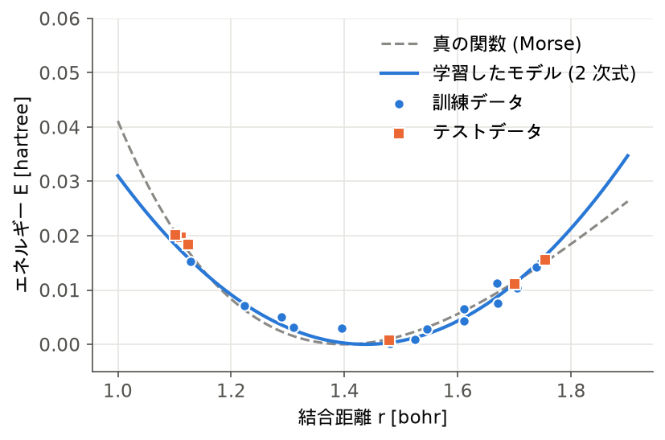

# 第 1 回　機械学習とは：データから関数を作る

!!! abstract "この回の道筋"
    機械学習は、データ（入力と答えの組）から関数を作る方法です。
    この回では、機械学習の種類と、どの手法にも共通する 3 つの要素（モデル・損失関数・学習）を説明します。
    最後に、作った関数を訓練データとは別のデータで確かめる理由を、小さな計算例で示します。

    | 節 | 内容 |
    |---|---|
    | 1 | 機械学習は何をするのか |
    | 2 | 教師あり学習と教師なし学習 |
    | 3 | 回帰と分類 |
    | 4 | 3 つの要素：モデル・損失関数・学習 |
    | 5 | 訓練データとテストデータ |
    | 6 | 計算例：ポテンシャル曲線に 2 次式をあてはめる |

    **前に読んでおく回**：なし

!!! tip "物理的なイメージ"
    機械学習が求めているのは、例題（入力と答えの組）から、まだ見ていない入力の答えも当てられる関数です。人が規則を書く代わりに、たくさんの候補の関数の中から、例題によく合うものをデータで選びます。大事なのは、例題に合うことではなく、新しい入力で当たることです。そのため、データを訓練用とテスト用に分け、学習に使っていないテスト用のデータで性能を測ります。

## 1. 機械学習は何をするのか

量子化学では、分子の構造を決めれば、シュレーディンガー方程式を解いてエネルギーを求められます。
ただし、精度の高い方法ほど計算に時間がかかります。
そこで、すでに計算した結果（構造とエネルギーの組）をたくさん集めて、そこから「構造からエネルギーを返す関数」を作れないか、と考えます。
この関数を作る作業が、機械学習（machine learning）です。

もう少し一般に書きます。
入力 $\boldsymbol{x}$ と、それに対応する答え $y$ の組が $N$ 個あるとします。

$$
\mathcal{D} = \{(\boldsymbol{x}_1, y_1), (\boldsymbol{x}_2, y_2), \dots, (\boldsymbol{x}_N, y_N)\}
$$

この集まり $\mathcal{D}$ をデータセット（data set）と呼びます。
機械学習の目標は、$\mathcal{D}$ に入っていない新しい入力 $\boldsymbol{x}$ に対しても、正しい $y$ に近い値を返す関数 $f(\boldsymbol{x})$ を作ることです。

化学での例を挙げます。

- 入力が分子の構造、答えが DFT で計算した原子化エネルギー。Rupp らは、7000 を超える小さな有機分子のデータからこの関数を作りました [Rupp 2012]。
- 入力が分子の種類、答えが溶解度や沸点などの実験値。
- 入力が二原子分子の結合距離 $r$、答えがその距離でのエネルギー $E(r)$。この回の計算例はこれです。

入力 $\boldsymbol{x}$ は、ふつう数値を並べたベクトルにします。
分子をどうやってベクトルにするか（記述子、descriptor）は、それだけで大きな問題です。
この連載の前半では、入力はすでにベクトルになっているものとして話を進めます。

**ここまでで分かったこと**：機械学習は、入力と答えの組の集まりから、新しい入力にも使える関数を作る方法です。

## 2. 教師あり学習と教師なし学習

機械学習は、データに答え $y$ が付いているかどうかで、大きく 2 つに分かれます。

**教師あり学習**（supervised learning）では、各入力に答えが付いています。
前節の例は、どれも教師あり学習です。
答えを「教師」に見立てて、関数がその答えに近い値を返すように作ります。

**教師なし学習**（unsupervised learning）では、入力 $\boldsymbol{x}_1, \dots, \boldsymbol{x}_N$ だけがあり、答えはありません。
この場合は、データの中の構造を見つけることが目標になります。
代表的な作業は次の 2 つです。

- **クラスタリング**（clustering）：似たデータをまとめて、いくつかのグループに分けます。たとえば、分子動力学で得た多数の構造を、似た配座ごとにまとめる作業です。
- **次元削減**（dimensionality reduction）：多くの数値で表されたデータを、少ない数値で近似的に表します。たとえば、数十個の原子座標の変化を、2 つか 3 つの変数で眺めたいときに使います。

この連載で主に扱うのは、教師あり学習です。
量子化学で機械学習を使う場面の多く（エネルギーや性質の予測）が、教師あり学習だからです。

**ここまでで分かったこと**：答えの付いたデータから関数を作るのが教師あり学習、答えのないデータから構造を見つけるのが教師なし学習です。

## 3. 回帰と分類

教師あり学習は、答え $y$ の種類によって、さらに 2 つに分かれます。

**回帰**（regression）では、$y$ が連続な実数です。
エネルギー、双極子モーメント、溶解度の予測は、どれも回帰です。

**分類**（classification）では、$y$ がいくつかの決まった種類（クラス）のどれかです。
たとえば、「この反応が進むか、進まないか」「この錯体の基底状態は高スピンか、低スピンか」を予測する問題は分類です。
2 つのクラスなら、$y \in \{0, 1\}$ のように数字を割り当てて扱います。

回帰と分類は、使う関数の形や、次節で説明する損失関数の選び方が違います。
しかし、考え方の骨組みは同じです。
この連載では、量子化学で多く使われる回帰を中心に説明します。

**ここまでで分かったこと**：答えが実数なら回帰、決まった種類のどれかなら分類です。

## 4. 3 つの要素：モデル・損失関数・学習

教師あり学習のどの手法も、次の 3 つの要素に分けて理解できます。

### 4.1 モデル

**モデル**（model）は、関数 $f$ の形を決めたものです。
形の中には、まだ値を決めていない数がいくつか入っています。
この数をパラメータ（parameter）と呼び、まとめて $\boldsymbol{\theta}$ と書きます。
パラメータを含むことをはっきりさせるため、モデルを $f(\boldsymbol{x}; \boldsymbol{\theta})$ と書きます。

例を挙げます。
結合距離 $r$ からエネルギーを返すモデルとして、調和振動子の形

$$
f(r; k, r_0) = \frac{1}{2} k (r - r_0)^2
$$

を選んだとします。
このモデルのパラメータは、力の定数 $k$ と平衡距離 $r_0$ の 2 つです。
$\boldsymbol{\theta} = (k, r_0)$ の値を変えると、放物線の幅と位置が変わります。

モデルの形をどう選ぶかで、作れる関数の範囲が決まります。
上の 2 次式のモデルは、どんなパラメータを選んでも放物線しか表せません。
後の回で扱う多項式、カーネル法、ニューラルネットワークは、もっと広い範囲の関数を表せるモデルです。

### 4.2 損失関数

**損失関数**（loss function）は、モデルの予測が答えからどれだけずれているかを、1 つの数で表したものです。
回帰でよく使うのは、**平均二乗誤差**（mean squared error, MSE）です。

$$
L(\boldsymbol{\theta}) = \frac{1}{N} \sum_{i=1}^{N} \bigl( f(\boldsymbol{x}_i; \boldsymbol{\theta}) - y_i \bigr)^2
$$

各データ点での予測と答えの差を 2 乗し、平均したものです。
2 乗するのは、ずれが正でも負でも同じように損失として数えるためです。
予測がすべての点で答えと一致すれば $L = 0$ になり、ずれが大きいほど $L$ は大きくなります。

MSE の平方根 $\sqrt{L}$ を、**RMSE**（root mean squared error）と呼びます。
RMSE は $y$ と同じ単位を持つので、誤差の大きさを読み取るのに便利です。

### 4.3 学習

**学習**（learning, training）は、損失関数を最も小さくするパラメータを探す作業です。

$$
\boldsymbol{\theta}^{*} = \arg\min_{\boldsymbol{\theta}} L(\boldsymbol{\theta})
$$

$\arg\min$ は、「その関数を最小にする変数の値」を表す記号です。
つまり、学習は数学の言葉では**最適化**（optimization）の問題です。
モデルが簡単なら、$\boldsymbol{\theta}^{*}$ を式で書き下せます（第 2 回の線形回帰）。
そうでなければ、数値的な最適化法で $\boldsymbol{\theta}^{*}$ を探します。

量子化学の言葉で言えば、学習は構造最適化に似ています。
構造最適化では、原子座標を変えてエネルギーの最小を探します。
学習では、パラメータを変えて損失の最小を探します。

**ここまでで分かったこと**：教師あり学習は、モデル（関数の形）を選び、損失関数（ずれの測り方）を決め、学習（損失の最小化）でパラメータを決める、という 3 段階でできています。

## 5. 訓練データとテストデータ

前節の手順で、損失を小さくするパラメータは求められます。
しかし、機械学習の目標は、手元のデータをよく再現することではありませんでした。
目標は、**まだ見ていない入力**に対して正しく予測することです。
この能力を**汎化**（generalization）と呼びます。

汎化の良さは、学習に使ったデータでは測れません。
学習に使ったデータについては、モデルはそのデータに合わせてパラメータを決めているからです。
たとえば、データ点の数と同じだけパラメータを持つモデルは、すべての点を正確に通れます。
それでも、点と点の間で正しい値を返すとは限りません（この問題は第 3 回で詳しく扱います）。

そこで、手元のデータを最初に 2 つに分けます。

- **訓練データ**（training data）：学習に使うデータ。
- **テストデータ**（test data）：学習には一切使わず、最後に予測の精度を測るためだけに使うデータ。

テストデータでの誤差は、まだ見ていない入力に対する誤差（**汎化誤差**、generalization error）の見積もりになります。
テストデータを使ってモデルを選び直すと、テストデータもある意味で学習に使ったことになります。
すると、テストデータでの誤差は、汎化誤差を小さく見積もってしまいます。
モデルの選び方とデータの分け方の注意点は、第 3 回で説明します。

**ここまでで分かったこと**：手元のデータを訓練データとテストデータに分け、テストデータは精度を測るためだけに使います。

## 6. 計算例：ポテンシャル曲線に 2 次式をあてはめる

ここまでの 3 つの要素と、訓練データ・テストデータの分け方を、小さな例で確かめます。

### 6.1 データを作る

「真の関数」として、二原子分子のポテンシャル曲線のモデルである Morse ポテンシャル [Morse 1929] を使います。

$$
V(r) = D_\mathrm{e} \bigl( 1 - e^{-a (r - r_\mathrm{e})} \bigr)^2
$$

$D_\mathrm{e}$ は解離エネルギー、$r_\mathrm{e}$ は平衡距離、$a$ は井戸の幅を決める定数です。
ここでは原子単位を使い、例として $D_\mathrm{e} = 0.17\ E_\mathrm{h}$、$a = 1.0\ \mathrm{bohr}^{-1}$、$r_\mathrm{e} = 1.4\ \mathrm{bohr}$ とします。
特定の分子の値ではなく、説明のために選んだ値です。

この関数から、$r = 1.1$〜$1.8$ bohr の範囲で 20 点をでたらめに選びます。
各点のエネルギーには、標準偏差 $0.002\ E_\mathrm{h}$（2 m$E_\mathrm{h}$）の乱数を足します。
これは、実際のデータには計算や測定の誤差が含まれることをまねたものです。

### 6.2 モデル・損失関数・学習

モデルは 4.1 節の 2 次式 $f(r; k, r_0) = \frac{1}{2} k (r - r_0)^2$、損失関数は平均二乗誤差です。
20 点のうち 14 点を訓練データ、残りの 6 点をテストデータにします。
学習には、SciPy の汎用の最小化関数 `scipy.optimize.minimize` を使います。

```python
import numpy as np
from scipy.optimize import minimize

# 例として選んだ Morse ポテンシャルの値（原子単位）
De, a, re = 0.17, 1.0, 1.4
def morse(r):
    return De * (1.0 - np.exp(-a * (r - re)))**2

rng = np.random.default_rng(0)
r = rng.uniform(1.1, 1.8, size=20)             # 結合距離 [bohr]
E = morse(r) + rng.normal(0.0, 0.002, size=20)  # 誤差を足す

# 訓練データ 14 点、テストデータ 6 点に分ける
idx = rng.permutation(20)
tr, te = idx[:14], idx[14:]

# モデル：E = k/2 (r - r0)^2   パラメータは k と r0
def model(theta, r):
    k, r0 = theta
    return 0.5 * k * (r - r0)**2

# 損失関数：平均二乗誤差
def loss(theta, r, E):
    return np.mean((model(theta, r) - E)**2)

# 学習：訓練データだけを使って損失を最小にする
res = minimize(loss, x0=[0.1, 1.5], args=(r[tr], E[tr]))
k, r0 = res.x
print(f"学習した k  = {k:.4f}  (Morse の 2 De a^2 = {2*De*a**2:.4f})")
print(f"学習した r0 = {r0:.4f}  (Morse の re = {re})")
rmse_tr = np.sqrt(loss(res.x, r[tr], E[tr]))
rmse_te = np.sqrt(loss(res.x, r[te], E[te]))
print(f"訓練データの RMSE = {rmse_tr*1000:.2f} mEh")
print(f"テストデータの RMSE = {rmse_te*1000:.2f} mEh")
```

出力は次のとおりです。

```text
学習した k  = 0.3244  (Morse の 2 De a^2 = 0.3400)
学習した r0 = 1.4374  (Morse の re = 1.4)
訓練データの RMSE = 1.31 mEh
テストデータの RMSE = 1.62 mEh
```

### 6.3 結果を読む

学習したモデルを図に示します。



比べる相手として、Morse ポテンシャルを $r_\mathrm{e}$ のまわりでテイラー展開します。
2 次の項は $\frac{1}{2} (2 D_\mathrm{e} a^2)(r - r_\mathrm{e})^2$ なので、力の定数は $2 D_\mathrm{e} a^2 = 0.34$ です。
学習した $k = 0.324$ はこれに近い値です。
一方、$r_0 = 1.437$ は $r_\mathrm{e} = 1.4$ より少し長くなりました。
Morse ポテンシャルは、$r$ が長い側でなだらかで、短い側で急です。
左右対称な放物線でこの非対称な曲線に合わせようとすると、最小の位置が長い側にずれます。
これは、モデルの形が真の関数を表しきれないことによるずれです。

訓練データの RMSE は 1.31 m$E_\mathrm{h}$、テストデータの RMSE は 1.62 m$E_\mathrm{h}$ でした。
どちらも、足した誤差の大きさ（2 m$E_\mathrm{h}$）と同じ程度です。
テストデータの誤差のほうが少し大きいのは、モデルが訓練データに合わせてパラメータを決めているからです。
ただし、データ点が 20 点しかないので、この差は乱数の選び方でも変わります。
テストデータの誤差は、汎化誤差の「見積もり」であり、データが少ないほど当てになりません。

この例では、図の範囲（1.0〜1.9 bohr）で放物線と Morse 曲線がまだ近いので、テスト誤差も小さく済みました。
訓練データの範囲から大きく外れた $r$（たとえば解離に近い $r = 4$ bohr）では、放物線はどこまでも上がり続けます。
一方、Morse 曲線は $D_\mathrm{e}$ に近づきます。
訓練データの範囲の外での予測を**外挿**（extrapolation）と呼びます。
機械学習のモデルは、一般に外挿が苦手です。

**ここまでで分かったこと**：モデル・損失関数・学習の 3 要素で 2 次式をあてはめ、学習に使わなかったテストデータで誤差を測れました。モデルの形が真の関数に合わないと、学習したパラメータにも系統的なずれが残ります。

## まとめ

- 機械学習（教師あり学習）は、入力と答えの組の集まりから、新しい入力にも使える関数を作る方法です。
- 答えが実数なら回帰、決まった種類のどれかなら分類です。答えのないデータを扱うのが教師なし学習です。
- どの手法も、モデル（関数の形）、損失関数（ずれの測り方）、学習（損失の最小化）の 3 要素でできています。
- 精度はテストデータ（学習に使わないデータ）で測ります。訓練データでの誤差は、汎化の良さを表しません。
- 次回は、学習を式で解ける最も基本的なモデル、線形回帰を扱います。

## 参考文献

- C. M. Bishop, "Pattern Recognition and Machine Learning" (Springer, 2006). ISBN: 9780387310732
- T. Hastie, R. Tibshirani, J. Friedman, "The Elements of Statistical Learning" (Springer, 2009). ISBN: 9780387848570
- M. Rupp, A. Tkatchenko, K.-R. Müller, O. A. von Lilienfeld, "Fast and Accurate Modeling of Molecular Atomization Energies with Machine Learning", Phys. Rev. Lett. 108, 058301 (2012). DOI: [10.1103/PhysRevLett.108.058301](https://doi.org/10.1103/PhysRevLett.108.058301)
- P. M. Morse, "Diatomic Molecules According to the Wave Mechanics. II. Vibrational Levels", Phys. Rev. 34, 57 (1929). DOI: [10.1103/PhysRev.34.57](https://doi.org/10.1103/PhysRev.34.57)
- P. Virtanen et al., "SciPy 1.0: fundamental algorithms for scientific computing in Python", Nat. Methods 17, 261 (2020). DOI: [10.1038/s41592-019-0686-2](https://doi.org/10.1038/s41592-019-0686-2)
