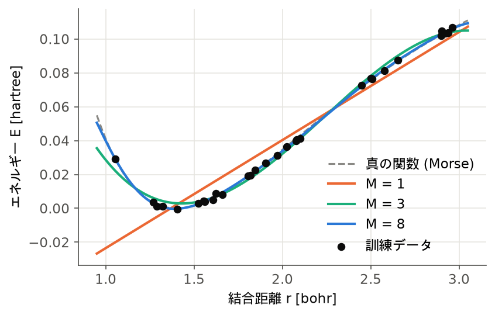

# 第 2 回　線形回帰と最小二乗法

!!! abstract "この回の道筋"
    パラメータについて 1 次式のモデル（線形モデル）では、損失を最小にするパラメータを連立 1 次方程式（正規方程式）の解として求められます。
    この回では、正規方程式を導き、基底関数を使って曲線のあてはめに広げます。
    最後に、numpy で Morse ポテンシャルの点に多項式をあてはめ、数値計算での注意点を確かめます。

    | 節 | 内容 |
    |---|---|
    | 1 | 線形モデルと計画行列 |
    | 2 | 最小二乗法と正規方程式 |
    | 3 | 正規方程式の幾何学的な意味 |
    | 4 | 基底関数による拡張：多項式回帰 |
    | 5 | 計算例：Morse ポテンシャルに多項式をあてはめる |
    | 6 | 数値計算での注意：正規方程式を直接解かない |

    **前に読んでおく回**：[機械学習の基礎 第 1 回](01-what-is-ml.md)

## 1. 線形モデルと計画行列

第 1 回では、モデル・損失関数・学習の 3 要素を説明しました。
この回では、その中で最も基本的なモデルを扱います。

入力が $D$ 個の数値を並べたベクトル $\boldsymbol{x} = (x_1, \dots, x_D)^\mathsf{T}$ だとします。
**線形回帰**（linear regression）のモデルは、次の 1 次式です。

$$
f(\boldsymbol{x}; \boldsymbol{w}) = w_0 + w_1 x_1 + w_2 x_2 + \dots + w_D x_D
$$

パラメータは $\boldsymbol{w} = (w_0, w_1, \dots, w_D)^\mathsf{T}$ です。
$w_0$ は、入力によらない定数の項です。
各 $w_j$ は、$x_j$ が 1 増えたときに予測がどれだけ変わるかを表します。

$N$ 個のデータ点 $(\boldsymbol{x}_i, y_i)$ に対する予測を、まとめて行列で書きます。
$i$ 番目のデータの入力を、先頭に 1 を付けて横に並べた行を作り、それを縦に $N$ 行積みます。

$$
\mathbf{X} =
\begin{pmatrix}
1 & x_{11} & \cdots & x_{1D} \\
1 & x_{21} & \cdots & x_{2D} \\
\vdots & \vdots & & \vdots \\
1 & x_{N1} & \cdots & x_{ND}
\end{pmatrix}
$$

ここで $x_{ij}$ は、$i$ 番目のデータの $j$ 番目の成分です。
この $N \times (D+1)$ 行列を**計画行列**（design matrix）と呼びます。
先頭の列の 1 は、定数項 $w_0$ に掛かる分です。
すると、$N$ 個の予測をまとめたベクトルは $\mathbf{X}\boldsymbol{w}$ と書けます。
答えを並べたベクトルを $\boldsymbol{y} = (y_1, \dots, y_N)^\mathsf{T}$ とすると、学習の目標は $\mathbf{X}\boldsymbol{w}$ を $\boldsymbol{y}$ に近づけることです。

**ここまでで分かったこと**：線形回帰のモデルは入力の 1 次式で、$N$ 個の予測は計画行列 $\mathbf{X}$ を使って $\mathbf{X}\boldsymbol{w}$ とまとめて書けます。

## 2. 最小二乗法と正規方程式

### 2.1 損失関数

損失関数には、第 1 回と同じく二乗誤差を使います。
ここでは、平均を取る前の「二乗誤差の和」を使います。

$$
L(\boldsymbol{w}) = \sum_{i=1}^{N} \bigl( f(\boldsymbol{x}_i; \boldsymbol{w}) - y_i \bigr)^2 = \lVert \mathbf{X}\boldsymbol{w} - \boldsymbol{y} \rVert^2
$$

$\lVert \cdot \rVert$ はベクトルの長さ（ユークリッドノルム）です。
平均を取っても取らなくても、全体を $1/N$ 倍するだけなので、最小を与える $\boldsymbol{w}$ は変わりません。
二乗誤差の和を最小にしてパラメータを決める方法を、**最小二乗法**（method of least squares）と呼びます。

### 2.2 正規方程式の導出

$L(\boldsymbol{w})$ を最小にする $\boldsymbol{w}$ では、各成分 $w_k$ についての偏微分が 0 になります。
まず成分で書きます。
計画行列の $(i, j)$ 成分を $X_{ij}$ とします（$j = 0, 1, \dots, D$ で、$X_{i0} = 1$）。

$$
L(\boldsymbol{w}) = \sum_{i=1}^{N} \Bigl( \sum_{j=0}^{D} X_{ij} w_j - y_i \Bigr)^2
$$

これを $w_k$ で偏微分します。
括弧の中を $w_k$ で微分すると $X_{ik}$ だけが残るので、連鎖律から次のようになります。

$$
\frac{\partial L}{\partial w_k} = 2 \sum_{i=1}^{N} X_{ik} \Bigl( \sum_{j=0}^{D} X_{ij} w_j - y_i \Bigr)
$$

これを 0 とおいて、$w_j$ を含む項と含まない項に分けます。

$$
\sum_{j=0}^{D} \Bigl( \sum_{i=1}^{N} X_{ik} X_{ij} \Bigr) w_j = \sum_{i=1}^{N} X_{ik} y_i \qquad (k = 0, 1, \dots, D)
$$

左辺の括弧の中は、行列 $\mathbf{X}^\mathsf{T}\mathbf{X}$ の $(k, j)$ 成分です。
右辺は、ベクトル $\mathbf{X}^\mathsf{T}\boldsymbol{y}$ の第 $k$ 成分です。
したがって、$D+1$ 本の式をまとめて次のように書けます。

$$
\mathbf{X}^\mathsf{T}\mathbf{X} \, \boldsymbol{w} = \mathbf{X}^\mathsf{T}\boldsymbol{y}
$$

これを**正規方程式**（normal equations）と呼びます。
$\mathbf{X}^\mathsf{T}\mathbf{X}$ は $(D+1) \times (D+1)$ の対称行列です。
これが逆行列を持てば、解は 1 つに決まります。

$$
\boldsymbol{w}^{*} = (\mathbf{X}^\mathsf{T}\mathbf{X})^{-1} \mathbf{X}^\mathsf{T}\boldsymbol{y}
$$

### 2.3 本当に最小か

偏微分が 0 の点は、最小とは限りません。
そこで、2 階微分を調べます。
上の $\partial L / \partial w_k$ をもう一度 $w_j$ で微分すると、$2 (\mathbf{X}^\mathsf{T}\mathbf{X})_{kj}$ になります。
つまり、$L$ のヘッセ行列（2 階微分を並べた行列）は $2\mathbf{X}^\mathsf{T}\mathbf{X}$ で、$\boldsymbol{w}$ によりません。

任意のベクトル $\boldsymbol{v}$ について、$\boldsymbol{v}^\mathsf{T}\mathbf{X}^\mathsf{T}\mathbf{X}\boldsymbol{v} = \lVert \mathbf{X}\boldsymbol{v} \rVert^2 \ge 0$ です。
よって、ヘッセ行列はどこでも半正定値で、$L$ は下に凸な関数です。
下に凸な関数では、偏微分が 0 の点は最小の点です。

さらに、$\mathbf{X}$ の列が 1 次独立なら、$\boldsymbol{v} \neq \boldsymbol{0}$ のとき $\mathbf{X}\boldsymbol{v} \neq \boldsymbol{0}$ です。
このとき $\mathbf{X}^\mathsf{T}\mathbf{X}$ は正定値になり、逆行列を持ち、最小の点はただ 1 つです。
列が 1 次独立でない例は、同じ意味の特徴量を 2 回入れた場合や、データ点の数 $N$ がパラメータの数 $D+1$ より少ない場合です。
このときは最小の点が無数にあります。1 つに決める方法の 1 つが、第 3 回で扱う正則化です。

**ここまでで分かったこと**：二乗誤差の和を最小にするパラメータは、正規方程式 $\mathbf{X}^\mathsf{T}\mathbf{X}\boldsymbol{w} = \mathbf{X}^\mathsf{T}\boldsymbol{y}$ の解です。$\mathbf{X}$ の列が 1 次独立なら、解はただ 1 つです。

## 3. 正規方程式の幾何学的な意味

正規方程式を移項すると、次の形になります。

$$
\mathbf{X}^\mathsf{T} (\boldsymbol{y} - \mathbf{X}\boldsymbol{w}^{*}) = \boldsymbol{0}
$$

$\boldsymbol{y} - \mathbf{X}\boldsymbol{w}^{*}$ は、答えと予測の差を並べたベクトルで、**残差**（residual）と呼びます。
上の式は、残差が $\mathbf{X}$ のどの列とも直交することを表します。

これを $N$ 次元の空間で考えます。
$\boldsymbol{w}$ をいろいろ変えたときの $\mathbf{X}\boldsymbol{w}$ は、$\mathbf{X}$ の列が張る部分空間の中を動きます。
最小二乗法は、その部分空間の中で $\boldsymbol{y}$ に最も近い点を選ぶ操作です。
最も近い点は、$\boldsymbol{y}$ からその部分空間に下ろした垂線の足、つまり**正射影**（orthogonal projection）です。
量子化学で、ある関数を基底関数の張る空間に射影するのと同じ考え方です。

**ここまでで分かったこと**：最小二乗法の予測 $\mathbf{X}\boldsymbol{w}^{*}$ は、答えのベクトル $\boldsymbol{y}$ を、$\mathbf{X}$ の列が張る空間に正射影したものです。

## 4. 基底関数による拡張：多項式回帰

### 4.1 「線形」はパラメータについての線形

線形回帰は、入力の 1 次式しか表せないように見えます。
しかし、前節までの導出で使ったのは、**モデルがパラメータ $\boldsymbol{w}$ の 1 次式である**ことだけでした。
入力 $\boldsymbol{x}$ についての形は、何も使っていません。

そこで、入力の関数 $\phi_0(\boldsymbol{x}), \phi_1(\boldsymbol{x}), \dots, \phi_M(\boldsymbol{x})$ をあらかじめ決めておき、その 1 次結合をモデルにします。

$$
f(\boldsymbol{x}; \boldsymbol{w}) = \sum_{j=0}^{M} w_j \phi_j(\boldsymbol{x})
$$

$\phi_j$ を**基底関数**（basis function）と呼びます。
ふつう $\phi_0(\boldsymbol{x}) = 1$ として、定数項を入れます。
このモデルは $\boldsymbol{x}$ について曲線を表せますが、$\boldsymbol{w}$ については 1 次式のままです。
したがって、計画行列を

$$
\Phi_{ij} = \phi_j(\boldsymbol{x}_i)
$$

に取り替えるだけで、前節までの結果がそのまま使えます。
解は正規方程式 $\boldsymbol{\Phi}^\mathsf{T}\boldsymbol{\Phi}\boldsymbol{w} = \boldsymbol{\Phi}^\mathsf{T}\boldsymbol{y}$ から求まります。

量子化学の LCAO 法も同じ形をしています。
分子軌道を、あらかじめ決めた原子軌道（基底関数）の 1 次結合で表し、係数だけを決めるからです。

### 4.2 多項式の基底

入力が 1 つの数 $x$ のとき、最も簡単な基底関数は $x$ のべき乗です。

$$
\phi_j(x) = x^j \qquad (j = 0, 1, \dots, M)
$$

これを使ったモデル $f(x) = w_0 + w_1 x + \dots + w_M x^M$ は $M$ 次の多項式です。
この方法を**多項式回帰**（polynomial regression）と呼びます。
計画行列は、各行が $(1, x_i, x_i^2, \dots, x_i^M)$ の行列になります。
この形の行列は、ヴァンデルモンド行列（Vandermonde matrix）と呼ばれます。

多項式以外にも、ガウス関数 $\phi_j(x) = \exp\bigl(-(x - \mu_j)^2 / (2s^2)\bigr)$ を、中心 $\mu_j$ をずらして並べたものなどが使われます。
どの基底を選んでも、学習は正規方程式を解くだけです。

**ここまでで分かったこと**：「線形」回帰はパラメータについての線形性だけを使うので、基底関数を選べば曲線のあてはめにも使えます。多項式回帰はその例です。

## 5. 計算例：Morse ポテンシャルに多項式をあてはめる

第 1 回と同じ Morse ポテンシャル（$D_\mathrm{e} = 0.17\ E_\mathrm{h}$、$a = 1.0\ \mathrm{bohr}^{-1}$、$r_\mathrm{e} = 1.4\ \mathrm{bohr}$、原子単位）を使います。
今回は範囲を $r = 1.0$〜$3.0$ bohr に広げ、曲線の非対称な形がはっきり出るようにします。
訓練データは 30 点、テストデータは別に選んだ 100 点です。
どちらにも、標準偏差 1 m$E_\mathrm{h}$ の乱数を足します。

多項式の変数には、$r$ そのものではなく、データの範囲の中央を 0 にずらした $x = r - 2$ を使います。
その理由は 6 節で説明します。

```python
import numpy as np

De, a, re = 0.17, 1.0, 1.4
def morse(r):
    return De * (1.0 - np.exp(-a * (r - re)))**2

rng = np.random.default_rng(1)
r_tr = rng.uniform(1.0, 3.0, size=30)                 # 訓練データ
E_tr = morse(r_tr) + rng.normal(0.0, 0.001, size=30)
r_te = rng.uniform(1.0, 3.0, size=100)                # テストデータ
E_te = morse(r_te) + rng.normal(0.0, 0.001, size=100)

def design(r, M):
    """基底関数 1, x, x^2, ..., x^M を並べた計画行列。x = r - 2 とずらす"""
    x = r - 2.0
    return np.vander(x, M + 1, increasing=True)

def rmse(w, r, E, M):
    return np.sqrt(np.mean((design(r, M) @ w - E)**2))

# 正規方程式を直接解く方法と、lstsq を使う方法を比べる（M = 4）
Phi = design(r_tr, 4)
w_ne = np.linalg.solve(Phi.T @ Phi, Phi.T @ E_tr)
w_ls, *_ = np.linalg.lstsq(Phi, E_tr, rcond=None)
print("正規方程式:", np.round(w_ne, 5))
print("lstsq     :", np.round(w_ls, 5))

print(" M   訓練 RMSE   テスト RMSE  [mEh]")
for M in range(1, 9):
    w, *_ = np.linalg.lstsq(design(r_tr, M), E_tr, rcond=None)
    print(f"{M:2d}   {rmse(w, r_tr, E_tr, M)*1000:8.3f}   {rmse(w, r_te, E_te, M)*1000:8.3f}")
```

`np.vander(x, M + 1, increasing=True)` は、各行が $(1, x_i, \dots, x_i^M)$ の計画行列を作ります。
`np.linalg.lstsq` は、最小二乗問題を解く関数です（6 節で説明します）。
出力は次のとおりです。

```text
正規方程式: [ 0.03445  0.08731  0.00974 -0.05156  0.02938]
lstsq     : [ 0.03445  0.08731  0.00974 -0.05156  0.02938]
 M   訓練 RMSE   テスト RMSE  [mEh]
 1     11.059     12.755
 2      7.413      8.641
 3      2.379      2.735
 4      1.093      1.098
 5      0.801      1.095
 6      0.765      1.027
 7      0.762      1.014
 8      0.756      0.970
```

最初の 2 行から、$M = 4$ では正規方程式の解と `lstsq` の解が表示した桁まで一致することが分かります。

表からは、次の 2 つのことが読み取れます。

1. 次数 $M$ を上げると、訓練データの RMSE は単調に下がります。$M$ 次の多項式は $M-1$ 次の多項式をすべて含む（$w_M = 0$ とすればよい）ので、最小値が上がることはありません。
2. テストデータの RMSE は、$M = 4$ でほぼ 1.1 m$E_\mathrm{h}$ まで下がり、その先はあまり変わりません。テストデータ自体に 1 m$E_\mathrm{h}$ の乱数が入っているので、どんなモデルでもこの程度より大きく下がることはありません。

$M = 1, 3, 8$ のあてはめを図に示します。



1 次式（直線）は、井戸の形をまったく表せません。
3 次式は大まかな形を表しますが、極小の位置と深さがずれます。
8 次式は、図の範囲では真の曲線とほとんど重なります。

ただし、この例では訓練データが 30 点あり、範囲全体に散らばっていました。
データが少ないときに次数を上げすぎると、テスト誤差が逆に大きくなります。
この現象（過学習）は第 3 回で扱います。

**ここまでで分かったこと**：多項式回帰は、計画行列を作って最小二乗問題を解くだけで実行できます。次数を上げると訓練誤差は必ず下がりますが、テスト誤差は、データに含まれる乱数の大きさ程度で下げ止まります。

## 6. 数値計算での注意：正規方程式を直接解かない

正規方程式は導出には便利ですが、数値計算でそのまま解くのは避けるのが普通です。
理由は、$\boldsymbol{\Phi}^\mathsf{T}\boldsymbol{\Phi}$ を作ると、問題の解きにくさが 2 乗に増えるからです。

連立 1 次方程式の解きにくさは、行列の**条件数**（condition number）で測ります。
条件数は、行列の最大の特異値と最小の特異値の比です。
条件数が $10^k$ 程度なら、右辺の相対誤差（丸め誤差を含む）が、解ではおよそ $10^k$ 倍に増えうる、と考えます。
倍精度の浮動小数点数は有効数字がおよそ 16 桁なので、条件数が $10^{16}$ に近づくと、解の数字はほとんど信用できなくなります。

$\boldsymbol{\Phi}$ の特異値を $s_j$ とすると、$\boldsymbol{\Phi}^\mathsf{T}\boldsymbol{\Phi}$ の固有値は $s_j^2$ です。
そのため、$\boldsymbol{\Phi}^\mathsf{T}\boldsymbol{\Phi}$ の条件数は $\boldsymbol{\Phi}$ の条件数の 2 乗になります。
`np.linalg.lstsq` は、$\boldsymbol{\Phi}^\mathsf{T}\boldsymbol{\Phi}$ を作らずに、$\boldsymbol{\Phi}$ の特異値分解を使って最小二乗問題を解きます（内部では LAPACK の `gelsd` という関数を呼びます）。
こうすると、条件数の 2 乗による精度の損失を避けられます。

多項式の基底では、変数のずらし方も条件数に大きく効きます。
$r = 1$〜$3$ の範囲で $r^j$ をそのまま並べると、どの列も「$r$ が大きいほど大きい」似た形になり、列が 1 次従属に近くなります。
$x = r - 2$ とずらすと、偶数次と奇数次の列の形が違ってきて、この問題が和らぎます。
実際に比べてみます。

```python
import numpy as np
rng = np.random.default_rng(1)
r = rng.uniform(1.0, 3.0, size=30)
for M in (4, 8):
    A = np.vander(r, M + 1, increasing=True)        # x = r のまま
    B = np.vander(r - 2.0, M + 1, increasing=True)  # x = r - 2 とずらす
    print(f"M = {M}:  cond(A^T A) = {np.linalg.cond(A.T @ A):.1e},  "
          f"cond(B^T B) = {np.linalg.cond(B.T @ B):.1e}")
```

```text
M = 4:  cond(A^T A) = 4.9e+08,  cond(B^T B) = 4.0e+02
M = 8:  cond(A^T A) = 4.1e+18,  cond(B^T B) = 1.1e+06
```

ずらさずに $M = 8$ とすると、$\boldsymbol{\Phi}^\mathsf{T}\boldsymbol{\Phi}$ の条件数は $10^{18}$ を超え、倍精度の限界を超えます。
この大きさになると、表示した条件数そのものも丸め誤差で正確ではありません（$\boldsymbol{\Phi}$ の条件数の 2 乗は約 $7 \times 10^{18}$ です）。
このとき正規方程式を直接解いた結果は信用できません。
変数をずらす（必要なら幅もそろえる）ことと、`lstsq` のような安定な解法を使うことの両方が大切です。

**ここまでで分かったこと**：正規方程式を直接解くと条件数が 2 乗になるので、`lstsq` のような特異値分解に基づく解法を使います。多項式の変数は、データの中央が 0 になるようにずらします。

## まとめ

- 線形回帰は、パラメータについて 1 次式のモデルを、二乗誤差の和を最小にするように決める方法です。
- 解は正規方程式 $\mathbf{X}^\mathsf{T}\mathbf{X}\boldsymbol{w} = \mathbf{X}^\mathsf{T}\boldsymbol{y}$ から求まり、幾何学的には答えのベクトルの正射影です。
- 基底関数を使えば、同じ方法で曲線をあてはめられます。多項式回帰はその例です。
- 次数を上げると訓練誤差は必ず下がりますが、テスト誤差もそうなるとは限りません（第 3 回）。
- 数値計算では、正規方程式を直接解かず、変数をずらして `lstsq` を使います。

## 付録 A　最小二乗法と正規分布の誤差

最小二乗法は、「データに含まれる誤差が正規分布に従う」と仮定したときの、自然なパラメータの決め方になっています。
この見方は、第 4 回のガウス過程回帰で使います。

答えが、モデルの値に誤差を足したものだと仮定します。

$$
y_i = f(\boldsymbol{x}_i; \boldsymbol{w}) + \varepsilon_i
$$

誤差 $\varepsilon_i$ は互いに独立で、平均 0、分散 $\sigma^2$ の正規分布に従うとします。
すると、パラメータが $\boldsymbol{w}$ のときに $y_i$ が観測される確率密度は次のとおりです。

$$
p(y_i \mid \boldsymbol{w}) = \frac{1}{\sqrt{2\pi\sigma^2}} \exp\Bigl( -\frac{(y_i - f(\boldsymbol{x}_i; \boldsymbol{w}))^2}{2\sigma^2} \Bigr)
$$

$N$ 個のデータが同時に観測される確率密度は、独立なので積になります。
これを $\boldsymbol{w}$ の関数とみたものを**尤度**（likelihood）と呼びます。
対数を取ると、次のようになります。

$$
\ln \prod_{i=1}^{N} p(y_i \mid \boldsymbol{w}) = -\frac{1}{2\sigma^2} \sum_{i=1}^{N} \bigl( y_i - f(\boldsymbol{x}_i; \boldsymbol{w}) \bigr)^2 - \frac{N}{2} \ln (2\pi\sigma^2)
$$

$\boldsymbol{w}$ を含むのは第 1 項だけで、その符号は負です。
したがって、尤度を最大にする $\boldsymbol{w}$（**最尤推定**、maximum likelihood estimation）は、二乗誤差の和を最小にする $\boldsymbol{w}$ と一致します。
また、上の式を $\sigma^2$ で微分して 0 とおくと、$\sigma^2$ の最尤推定は残差の二乗の平均 $\frac{1}{N}\sum_i (y_i - f(\boldsymbol{x}_i; \boldsymbol{w}^{*}))^2$ になります。

## 参考文献

- C. M. Bishop, "Pattern Recognition and Machine Learning" (Springer, 2006). ISBN: 9780387310732
- T. Hastie, R. Tibshirani, J. Friedman, "The Elements of Statistical Learning" (Springer, 2009). ISBN: 9780387848570
- G. H. Golub, C. F. Van Loan, "Matrix Computations" (Johns Hopkins University Press, 2013). ISBN: 9781421407944
- P. M. Morse, "Diatomic Molecules According to the Wave Mechanics. II. Vibrational Levels", Phys. Rev. 34, 57 (1929). DOI: [10.1103/PhysRev.34.57](https://doi.org/10.1103/PhysRev.34.57)
- C. R. Harris et al., "Array programming with NumPy", Nature 585, 357 (2020). DOI: [10.1038/s41586-020-2649-2](https://doi.org/10.1038/s41586-020-2649-2)

## 関連リンク

- NumPy の `numpy.linalg.lstsq` の説明：https://numpy.org/doc/stable/reference/generated/numpy.linalg.lstsq.html
