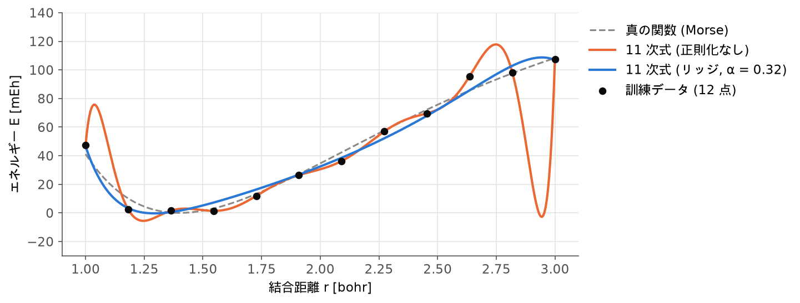

# 第 3 回　過学習と正則化、データの分け方

!!! abstract "この回の道筋"
    モデルを複雑にすると、訓練データにはよく合うのに、新しいデータでは外れる「過学習」が起きます。
    この回では、過学習をバイアスとバリアンスという 2 つの誤差に分けて理解し、それを抑える正則化（リッジ回帰とラッソ）を説明します。
    さらに、正則化の強さを交差検証で決める方法と、化学のデータで起きやすい「データ漏洩」の防ぎ方を、scikit-learn の例で示します。

    | 節 | 内容 |
    |---|---|
    | 1 | 過学習を見る |
    | 2 | バイアスとバリアンス |
    | 3 | 正則化：リッジ回帰とラッソ |
    | 4 | ハイパーパラメータと交差検証 |
    | 5 | 計算例：交差検証で正則化の強さを決める |
    | 6 | データ漏洩：化学のデータで特に注意すること |

    **前に読んでおく回**：[機械学習の基礎 第 2 回](02-linear-regression.md)

## 1. 過学習を見る

第 2 回では、Morse ポテンシャルの 30 点に多項式をあてはめました。
次数を上げても、テスト誤差はデータの乱数の大きさ程度で下げ止まるだけでした。
今回は、データを 12 点に減らして同じことをします。

この回の計算例では、ライブラリ scikit-learn [Pedregosa 2011] を使います。
エネルギーの単位は m$E_\mathrm{h}$（ミリハートリー）にします。
Morse ポテンシャルの値は第 1、2 回と同じで、$D_\mathrm{e} = 170$ m$E_\mathrm{h}$、$a = 1.0\ \mathrm{bohr}^{-1}$、$r_\mathrm{e} = 1.4$ bohr です。
訓練データは $r = 1.0$〜$3.0$ bohr に等間隔に並べた 12 点、テストデータは同じ範囲からでたらめに選んだ 200 点です。
どちらにも、標準偏差 3 m$E_\mathrm{h}$ の乱数を足します。

```python
import numpy as np
from sklearn.pipeline import make_pipeline
from sklearn.preprocessing import PolynomialFeatures, StandardScaler, FunctionTransformer
from sklearn.linear_model import LinearRegression
from sklearn.metrics import mean_squared_error

De, a, re = 170.0, 1.0, 1.4          # エネルギーの単位は mEh
def morse(r):
    return De * (1.0 - np.exp(-a * (r - re)))**2

rng = np.random.default_rng(3)
r_tr = np.linspace(1.0, 3.0, 12)[:, None]          # 訓練データは 12 点だけ
E_tr = morse(r_tr[:, 0]) + rng.normal(0, 3.0, size=12)
r_te = rng.uniform(1.0, 3.0, size=200)[:, None]    # テストデータ 200 点
E_te = morse(r_te[:, 0]) + rng.normal(0, 3.0, size=200)

def poly_model(M, reg):
    # x = r - 2 とずらし、x^1..x^M を作り、各列を平均 0・標準偏差 1 にそろえる
    return make_pipeline(FunctionTransformer(lambda r: r - 2.0),
                         PolynomialFeatures(M, include_bias=False),
                         StandardScaler(), reg)

def rmse(m, r, E):
    return np.sqrt(mean_squared_error(E, m.predict(r)))

print(" M   訓練 RMSE   テスト RMSE  [mEh]")
for M in (1, 2, 3, 4, 5, 6, 8, 11):
    m = poly_model(M, LinearRegression()).fit(r_tr, E_tr)
    print(f"{M:2d}   {rmse(m, r_tr, E_tr):8.2f}   {rmse(m, r_te, E_te):10.2f}")
```

scikit-learn では、入力を行列（データ点が行、特徴量が列）で渡すので、`[:, None]` で 1 列の行列にしています。
`make_pipeline` は、前処理とモデルを順につないで、1 つのモデルとして扱えるようにする関数です。
ここでは、(1) $x = r - 2$ とずらし、(2) $x, x^2, \dots, x^M$ の列を作り、(3) 各列を平均 0・標準偏差 1 にそろえ（`StandardScaler`）、(4) 線形回帰をします。
(3) の処理を**標準化**（standardization）と呼びます。
定数項は、(4) の `LinearRegression` が別に持ちます。

出力は次のとおりです。

```text
 M   訓練 RMSE   テスト RMSE  [mEh]
 1      19.77        13.90
 2      12.82         9.79
 3       5.20         4.90
 4       4.45         3.68
 5       3.30         4.33
 6       2.70         4.74
 8       1.79         5.55
11       0.00        22.34
```

訓練 RMSE は、次数とともに下がり続けます。
$M = 11$ では、パラメータが定数項を含めて 12 個で、データ点の数と同じなので、多項式はすべての点を正確に通り、訓練 RMSE は 0 になります。
一方、テスト RMSE は $M = 4$ で最も小さく、その先は大きくなります。
$M = 11$ のテスト RMSE は 22 m$E_\mathrm{h}$ で、1 次式（直線）よりも悪くなりました。

このように、訓練データにはよく合うのに、新しいデータでの誤差が大きくなることを**過学習**（overfitting）と呼びます。
$M = 11$ の曲線は、5 節の図にあります。
データ点の間、特に両端で大きく振動しています。
多項式が、真の曲線だけでなく、各点に足した乱数まで再現しようとした結果です。

**ここまでで分かったこと**：モデルが複雑すぎると、訓練誤差は小さくなってもテスト誤差は大きくなります。これが過学習です。

## 2. バイアスとバリアンス

過学習がなぜ起きるかを、テスト誤差を 2 つの部分に分けて考えます。

### 2.1 訓練データが変わると、モデルも変わる

学習したモデルは、たまたま手に入った訓練データに依存します。
同じ方法で訓練データを取り直せば、乱数が変わるので、学習したモデルも少し変わります。
そこで、ある入力 $x$ での予測値 $\hat{f}(x)$ を、訓練データの取り方によってばらつく量（確率変数）とみなします。
その平均を $\mathbb{E}[\hat{f}(x)]$ と書きます。

### 2.2 分解の結果

データが $y = f(x) + \varepsilon$（$f$ は真の関数、$\varepsilon$ は平均 0、分散 $\sigma^2$ の乱数）で生まれるとします。
新しい点 $x$ での二乗誤差を、訓練データの取り方と $\varepsilon$ について平均すると、次の 3 つの和になります。
導出は付録 A に回しますが、結果は次のとおりです。

$$
\mathbb{E}\bigl[ (y - \hat{f}(x))^2 \bigr]
= \underbrace{\bigl( f(x) - \mathbb{E}[\hat{f}(x)] \bigr)^2}_{\text{バイアス}^2}
+ \underbrace{\mathbb{E}\bigl[ (\hat{f}(x) - \mathbb{E}[\hat{f}(x)])^2 \bigr]}_{\text{バリアンス}}
+ \underbrace{\sigma^2}_{\text{データの乱数}}
$$

- **バイアス**（bias）：予測の平均が、真の値からどれだけずれているか。モデルの形が単純すぎて真の関数を表せないと大きくなります。
- **バリアンス**（variance）：訓練データを取り直したときに、予測がどれだけばらつくか。モデルが柔軟すぎて、訓練データの乱数に合わせてしまうと大きくなります。
- **$\sigma^2$**：データそのものに含まれる乱数の分散です。どんなモデルでも、これより小さくはできません。

第 1 回で、2 次式のモデルで学習した平衡距離が真の値からずれたのは、バイアスの例です。
1 節の $M = 11$ の振動は、バリアンスの例です。

### 2.3 計算で確かめる

分解の各項を、実際に計算してみます。
訓練データ（20 点、$r$ はでたらめに選ぶ）を 2000 回作り直し、そのたびに多項式をあてはめます。
そして、$r = 1.2$〜$2.8$ bohr の 50 点で、予測の平均と分散を計算します。

```python
# 上の計算例の続き（morse と poly_model を使う）
rng = np.random.default_rng(4)
r_eval = np.linspace(1.2, 2.8, 50)[:, None]     # 予測を調べる点
f_true = morse(r_eval[:, 0])
print(" M   バイアス^2   バリアンス   [mEh^2]")
for M in (1, 2, 3, 4, 6, 8):
    preds = []
    for _ in range(2000):                        # 訓練データを 2000 回作り直す
        r = rng.uniform(1.0, 3.0, size=20)[:, None]
        E = morse(r[:, 0]) + rng.normal(0, 3.0, size=20)
        preds.append(poly_model(M, LinearRegression()).fit(r, E).predict(r_eval))
    preds = np.array(preds)                      # 形は (2000, 50)
    bias2 = np.mean((preds.mean(axis=0) - f_true)**2)
    var = np.mean(preds.var(axis=0))
    print(f"{M:2d}   {bias2:10.2f}   {var:10.2f}")
```

```text
 M   バイアス^2   バリアンス   [mEh^2]
 1        78.02        23.38
 2        34.83        17.30
 3         3.14         4.38
 4         0.15         3.31
 6         0.01       112.53
 8         0.10      1822.45
```

表の値は、50 点で平均したものです。
次数を上げると、バイアスの 2 乗は $M = 4$ でほぼ 0 まで小さくなります（$M = 6, 8$ の小さな値の違いは、2000 回の平均にも残る偶然のばらつきです）。
一方、バリアンスは $M = 4$ で最も小さく、それより上では急に大きくなります。
バイアスの 2 乗とバリアンスの和は $M = 4$ で最小（約 3.5 m$E_\mathrm{h}^2$）です。
これに $\sigma^2 = 9$ m$E_\mathrm{h}^2$ を足したものが、テストでの二乗誤差の期待値になります。

$M = 1, 2$ でバリアンスがやや大きいのは、直線や放物線の位置が、どこに点が多く取れたかに左右されるためです。
それでも全体としては、「単純すぎるとバイアスが大きく、柔軟すぎるとバリアンスが大きい」という傾向がはっきり見えます。
この関係を**バイアスとバリアンスのトレードオフ**と呼びます。
ニューラルネットワークの文脈でこの問題を論じた論文として、Geman らの論文 [Geman 1992] があります。

**ここまでで分かったこと**：テスト誤差は、バイアスの 2 乗、バリアンス、データの乱数の分散の和に分かれます。過学習は、バリアンスが大きくなった状態です。

## 3. 正則化：リッジ回帰とラッソ

バリアンスを抑えるには、次数を下げてモデルを単純にする方法があります。
もう 1 つの方法は、柔軟なモデルを使ったまま、パラメータが極端な値を取ることに罰を与える方法です。
これを**正則化**（regularization）と呼びます。

1 節の $M = 11$ の多項式は、点を正確に通るために、大きな正と負の係数を打ち消し合わせて振動していました。
係数が大きくなりすぎないように制限すれば、振動は抑えられるはずです。

### 3.1 リッジ回帰（L2 正則化）

損失関数に、係数の 2 乗和を足します。

$$
L_\text{ridge}(\boldsymbol{w}) = \lVert \boldsymbol{y} - \boldsymbol{\Phi}\boldsymbol{w} \rVert^2 + \lambda \lVert \boldsymbol{w} \rVert^2
$$

$\boldsymbol{\Phi}$ は第 2 回の計画行列、$\lambda \ge 0$ は正則化の強さを決める数です。
$\lVert \boldsymbol{w} \rVert^2 = \sum_j w_j^2$ はベクトルの長さ（L2 ノルム）の 2 乗なので、**L2 正則化**とも呼びます。
この方法を**リッジ回帰**（ridge regression）と呼び、Hoerl と Kennard が 1970 年に提案しました [Hoerl 1970]。

第 2 回と同じように $\boldsymbol{w}$ で微分して 0 とおきます。
第 1 項の微分は $-2\boldsymbol{\Phi}^\mathsf{T}(\boldsymbol{y} - \boldsymbol{\Phi}\boldsymbol{w})$、第 2 項の微分は $2\lambda\boldsymbol{w}$ です。
したがって、次の式が得られます。

$$
(\boldsymbol{\Phi}^\mathsf{T}\boldsymbol{\Phi} + \lambda \mathbf{I}) \boldsymbol{w} = \boldsymbol{\Phi}^\mathsf{T}\boldsymbol{y}
$$

$\mathbf{I}$ は単位行列です。
正規方程式との違いは、左辺の行列の対角に $\lambda$ が足されたことだけです。
$\boldsymbol{\Phi}^\mathsf{T}\boldsymbol{\Phi}$ の固有値は 0 以上なので、$\lambda > 0$ なら左辺の行列の固有値はすべて $\lambda$ 以上になります。
したがって、列が 1 次独立でない場合（第 2 回 2.3 節）でも、解はただ 1 つに決まります。
条件数も小さくなり、数値的にも解きやすくなります。

正則化には、注意が 2 つあります。

- **定数項は罰しません。** 定数項はデータ全体の高さを決めるだけで、振動の原因にはならないからです。scikit-learn の `Ridge` も、定数項を罰の対象から外しています。
- **特徴量の大きさをそろえます。** $\lambda \lVert \boldsymbol{w} \rVert^2$ はすべての係数を同じ重みで罰します。ある列の値が 1000 倍大きければ、同じ効果を持つ係数は 1/1000 で済むので、罰をほとんど受けません。そのため、正則化の前に標準化して、各列の大きさをそろえます。

### 3.2 ラッソ（L1 正則化）

2 乗和の代わりに、係数の絶対値の和を罰にすることもできます。

$$
L_\text{lasso}(\boldsymbol{w}) = \frac{1}{2N} \lVert \boldsymbol{y} - \boldsymbol{\Phi}\boldsymbol{w} \rVert^2 + \alpha \sum_j |w_j|
$$

$\sum_j |w_j|$ は L1 ノルムなので、**L1 正則化**とも呼びます。
この方法は**ラッソ**（lasso）と呼ばれ、Tibshirani が 1996 年に提案しました [Tibshirani 1996]。
第 1 項の係数 $1/(2N)$ は、scikit-learn の `Lasso` の定義に合わせたものです。
係数の付け方が違うだけなので、リッジ回帰の $\lambda$ とラッソの $\alpha$ は、数値を直接比べられません。

ラッソの特徴は、いくつかの係数を**ちょうど 0** にすることです。
その理由を、パラメータが 1 つだけの最も簡単な場合で確かめます。
数 $z$ が与えられたとき、次の 2 つの関数を最小にする $w$ を求めます。

$$
\frac{1}{2}(w - z)^2 + \frac{\lambda}{2} w^2
\qquad\text{と}\qquad
\frac{1}{2}(w - z)^2 + \alpha |w|
$$

左（L2）は、微分して 0 とおくと $w = z / (1 + \lambda)$ です。
$z$ を一定の割合で縮めるだけなので、$z \neq 0$ なら $w$ は 0 になりません。

右（L1）は、$w > 0$ の範囲では微分が $w - z + \alpha$ なので、$z > \alpha$ のとき $w = z - \alpha$ が最小です。
$w < 0$ の範囲も同じように考えると、$z < -\alpha$ のとき $w = z + \alpha$ です。
$|z| \le \alpha$ のときは、$w > 0$ でも $w < 0$ でも関数は $w = 0$ から離れるほど大きくなるので、$w = 0$ が最小です。
まとめると、L1 では $|z| \le \alpha$ なら $w$ がちょうど 0 になり、それ以外では $|z|$ が $\alpha$ だけ縮みます。
$|w|$ は $w = 0$ でとがっているので、小さな係数を「少し残す」より「0 にする」ほうが得になるのです。

係数が 0 になった基底関数は、モデルから取り除かれたのと同じです。
そのため、ラッソは「どの特徴量が予測に必要か」を選ぶ働きも持ちます。

**ここまでで分かったこと**：リッジ回帰は係数の 2 乗和を、ラッソは係数の絶対値の和を罰にして、係数が大きくなりすぎるのを防ぎます。ラッソはさらに、いくつかの係数をちょうど 0 にします。

## 4. ハイパーパラメータと交差検証

### 4.1 ハイパーパラメータ

正則化の強さ $\lambda$（あるいは $\alpha$）は、学習で決まるパラメータ $\boldsymbol{w}$ とは別に、学習の前に決めておく数です。
多項式の次数 $M$ も同じです。
このような数を**ハイパーパラメータ**（hyperparameter）と呼びます。

ハイパーパラメータを、訓練誤差が最小になるように決めることはできません。
$\lambda = 0$、$M$ が最大のときに訓練誤差は最小になり、過学習したモデルが選ばれてしまうからです。
テストデータで選ぶこともできません。
第 1 回で述べたように、テストデータを使って選ぶと、テストデータでの誤差が汎化誤差を小さく見積もるからです。

### 4.2 検証データと交差検証

そこで、訓練データの一部を、さらに**検証データ**（validation data）として取り分けます。
いろいろなハイパーパラメータで残りのデータから学習し、検証データでの誤差が最小になるものを選びます。

ただし、データが少ないと、検証データに回す分だけ学習に使えるデータが減ります。
検証データの選び方による偶然のばらつきも大きくなります。
この問題を和らげるのが**交差検証**（cross-validation）です。
交差検証を予測の方法の選択と評価に使う考え方は、Stone の 1974 年の論文で一般的な形で論じられました [Stone 1974]。
よく使われるのは、次の **$K$ 分割交差検証**（$K$-fold cross-validation）です。

1. 訓練データを $K$ 個のグループ（fold）に分けます。
2. $k = 1, \dots, K$ について、$k$ 番目のグループを検証データ、残りの $K-1$ 個を学習用にして、誤差を測ります。
3. $K$ 個の誤差の平均を、そのハイパーパラメータの評価値にします。

こうすると、すべてのデータ点が 1 回ずつ検証に使われます。
ハイパーパラメータを決めたら、訓練データ全体でもう一度学習し、最後にテストデータで 1 回だけ評価します。
全体の流れは次のとおりです。

| データ | 使い道 |
|---|---|
| 訓練データ（交差検証で、学習用と検証用に何度も分け直す） | パラメータの学習と、ハイパーパラメータの選択 |
| テストデータ | 最後に 1 回だけ、汎化誤差を見積もる |

**ここまでで分かったこと**：正則化の強さなどのハイパーパラメータは、訓練データの中で交差検証をして決めます。テストデータは最後の評価にだけ使います。

## 5. 計算例：交差検証で正則化の強さを決める

1 節の 12 点のデータで、$M = 11$ の多項式にリッジ回帰とラッソを使います。
正則化の強さは、4 分割の交差検証で選びます。
scikit-learn の `GridSearchCV` は、与えた候補の値それぞれについて交差検証をし、最もよい値で訓練データ全体から学習し直す道具（クラス）です。

```python
# 1 節の計算例の続き（r_tr, E_tr, r_te, E_te, poly_model, rmse を使う）
from sklearn.linear_model import Ridge, Lasso
from sklearn.model_selection import GridSearchCV, KFold

M = 11
cv = KFold(n_splits=4, shuffle=True, random_state=0)
for name, reg, key, grid in [
        ("リッジ", Ridge(), "ridge__alpha", np.logspace(-6, 2, 17)),
        ("ラッソ", Lasso(max_iter=10_000_000), "lasso__alpha", np.logspace(-4, 1, 11))]:
    search = GridSearchCV(poly_model(M, reg), {key: grid}, cv=cv,
                          scoring="neg_mean_squared_error").fit(r_tr, E_tr)
    best = search.best_estimator_
    print(f"{name}: 交差検証で選んだ alpha = {search.best_params_[key]:.1e}")
    print(f"  訓練 RMSE = {rmse(best, r_tr, E_tr):.2f} mEh, "
          f"テスト RMSE = {rmse(best, r_te, E_te):.2f} mEh")
    print("  係数:", np.array2string(best[-1].coef_, precision=1, suppress_small=True))
```

scikit-learn では、リッジ回帰の $\lambda$ も `alpha` という名前の引数で渡します。
`Lasso` の `max_iter` は、ラッソの数値解法（座標降下法）の反復の上限です。
既定値のままでは収束しなかったので、大きくしています。
出力は次のとおりです。

```text
リッジ: 交差検証で選んだ alpha = 3.2e-01
  訓練 RMSE = 4.12 mEh, テスト RMSE = 5.28 mEh
  係数: [40.7  8.3  5.9  1.6 -3.8  0.6 -5.7  1.8 -5.4  3.5 -4.7]
ラッソ: 交差検証で選んだ alpha = 1.0e-01
  訓練 RMSE = 2.83 mEh, テスト RMSE = 4.32 mEh
  係数: [ 48.1  10.   -0.   -0.   -9.4   0.  -10.6   0.   -0.    5.9  -0. ]
```

正則化なしの $M = 11$ ではテスト RMSE が 22.34 m$E_\mathrm{h}$ でしたが、リッジ回帰で 5.28、ラッソで 4.32 m$E_\mathrm{h}$ まで下がりました。
訓練 RMSE は 0 から上がっています。
訓練データの乱数まで再現するのをやめた結果です。
ラッソの係数は、11 個のうち 6 個がちょうど 0 になりました（`-0.` と表示されたものも 0 です）。

リッジ回帰の結果を図で比べます。



正則化なしの 11 次式（橙）は、すべての点を通る代わりに、点の間で大きく振動しています。
リッジ回帰（青）は点を正確には通りませんが、真の曲線に近い滑らかな曲線になりました。

!!! note "前処理も交差検証の中で行う"
    この例では、標準化（`StandardScaler`）をパイプラインの中に入れました。
    こうすると、交差検証の各回で、平均と標準偏差が学習用のデータだけから計算されます。
    標準化をデータ全体で先に済ませると、検証データの情報（平均と標準偏差）が学習に混ざります。
    次節で扱うデータ漏洩の、最も小さな例です。

**ここまでで分かったこと**：交差検証で選んだ強さの正則化を加えると、柔軟なモデルのままでも過学習を抑えられます。

## 6. データ漏洩：化学のデータで特に注意すること

### 6.1 データ漏洩とは

テストデータ（または検証データ）の情報が、何らかの形で学習に入り込むことを、**データ漏洩**（data leakage）と呼びます。
漏洩があると、テスト誤差は本当の汎化誤差より小さく出ます。
つまり、モデルの性能を実際より良く見積もってしまいます。

Kapoor と Narayanan は、機械学習を使った研究の文献を調べ、データ漏洩が見つかっている分野が 17、影響を受けた論文が 294 本あることをまとめました [Kapoor 2023]。
漏洩は、まれな失敗ではありません。

ここまでに出てきた漏洩の例は、テストデータでハイパーパラメータを選ぶこと（4.1 節）と、前処理をデータ全体で行うこと（5 節）でした。
化学のデータでは、これに加えて次の問題がよく起きます。

### 6.2 同じ分子の配座が、訓練とテストに分かれる

分子の性質を予測するデータセットでは、1 つの分子について複数の配座（コンフォメーション）の構造が入っていることがあります。
同じ分子の配座どうしは、構造も性質もよく似ています。
データを配座ごとにでたらめに分けると、テストデータの配座とほとんど同じ配座が、訓練データに入ります。
するとモデルは、「似た配座の答えを思い出す」だけで、テストデータをよく予測できてしまいます。
しかし、本当に知りたいのは、**まだ見たことのない分子**に対する性能のはずです。

これを、人工的なデータで確かめます。
60 個の「分子」を考え、各分子に 5 つの数からなる記述子を割り当てます。
答えは、記述子の滑らかな関数に、記述子では説明できない分子ごとのずれ（標準偏差 1）を足したものとします。
各分子について、記述子を少しだけ変えた 10 個の「配座」を作ります。

モデルには、**$k$ 近傍法**（$k$-nearest neighbors）を使います。
これは、入力に最も近い $k$ 個の訓練データ点を探し、その答えの平均を予測値とする方法です。
5 分割交差検証の分け方を、(a) 配座ごとにでたらめに分ける場合と、(b) 同じ分子の配座が必ず同じグループに入るように分ける場合（`GroupKFold`）で比べます。

```python
import numpy as np
from sklearn.neighbors import KNeighborsRegressor
from sklearn.model_selection import KFold, GroupKFold, cross_val_score

rng = np.random.default_rng(5)
n_mol, n_conf = 60, 10
# 各分子の「記述子」（5 個の数）と、記述子では説明できない分子ごとのずれ
d_mol = rng.normal(size=(n_mol, 5))
u_mol = rng.normal(0, 1.0, size=n_mol)
X, y, groups = [], [], []
for m in range(n_mol):
    for c in range(n_conf):
        x = d_mol[m] + rng.normal(0, 0.05, size=5)          # 配座による小さな違い
        X.append(x)
        y.append(np.sin(x[0]) + 0.5 * x[1]**2 + u_mol[m] + rng.normal(0, 0.1))
        groups.append(m)                                     # どの分子の配座か
X, y, groups = np.array(X), np.array(y), np.array(groups)

model = KNeighborsRegressor(n_neighbors=3)
for name, cv, g in [("配座ごとにランダムに分ける", KFold(5, shuffle=True, random_state=0), None),
                    ("分子ごとに分ける        ", GroupKFold(5), groups)]:
    s = cross_val_score(model, X, y, groups=g, cv=cv,
                        scoring="neg_root_mean_squared_error")
    print(f"{name}: RMSE = {-s.mean():.2f}")
```

```text
配座ごとにランダムに分ける: RMSE = 0.13
分子ごとに分ける        : RMSE = 1.34
```

配座ごとにでたらめに分けると、RMSE は 0.13 で、配座による乱数（0.1）と同じ程度です。
モデルは、同じ分子の別の配座を見つけて、その答えを返しているだけです。
分子ごとに分けると、RMSE は 1.34 になります。
分子ごとのずれ（標準偏差 1）は記述子からは予測できないので、これが新しい分子に対する本当の誤差に近い値です。
同じモデル、同じデータでも、分け方だけで誤差の見積もりが 10 倍変わりました。

同じことは、次の場合にも起きます。

- **分子動力学の軌跡**：時間的に隣り合う構造はほとんど同じです。軌跡の各フレームをでたらめに分けると、テストの構造のすぐ隣のフレームが訓練データに入ります。軌跡を時間の区間で区切って分けるなどの工夫が必要です。
- **重複したデータ**：複数のデータベースを合わせると、同じ分子が 2 回入ることがあります。学習の前に重複を取り除きます。

### 6.3 「似た分子」と「新しい分子」

漏洩とは少し違いますが、関係の深い問題があります。
同じ分子でなくても、骨格がよく似た分子が訓練とテストに分かれると、テスト誤差は小さめに出ます。
新しい種類の分子を予測したいなら、テストデータはそれに合わせて選ぶ必要があります。
よく使われる分け方を 2 つ挙げます。

- **スキャフォールド分割**（scaffold split）：分子の 2 次元の骨格（スキャフォールド）ごとにグループを作り、同じ骨格の分子が訓練とテストに分かれないようにします。ベンチマーク集 MoleculeNet は、この分け方は構造の異なる分子を別のグループに分けるので、でたらめな分け方より学習が難しい（性能の見積もりが厳しい）と述べています [Wu 2018]。
- **時間による分割**（time split）：データを登録された日付で分け、古いデータで学習して新しいデータでテストします。Sheridan は、創薬の構造活性相関（QSAR）のデータで、時間による分割の評価が、実際に将来の化合物を予測したときの性能に近いと報告しています [Sheridan 2013]。でたらめな分割では、評価が楽観的すぎました。

どの分け方が正しいかは、モデルを何に使うかで決まります。
「使うときに来る入力」と「テストデータ」が、訓練データに対して同じくらい新しいことが大切です。

**ここまでで分かったこと**：データ漏洩があると、性能を実際より良く見積もります。化学のデータでは、同じ分子の配座や隣り合う MD のフレームを、同じグループにまとめて分けます。

## まとめ

- 過学習は、訓練誤差は小さいのにテスト誤差が大きい状態です。テスト誤差はバイアスの 2 乗、バリアンス、データの乱数の分散の和に分かれ、過学習はバリアンスが大きい状態です。
- リッジ回帰（L2）とラッソ（L1）は、係数の大きさに罰を与えてバリアンスを抑えます。ラッソは係数をちょうど 0 にして、特徴量を選びます。
- 正則化の強さなどのハイパーパラメータは、訓練データの中の交差検証で決め、テストデータは最後の評価だけに使います。
- 化学のデータでは、同じ分子の配座、MD の隣り合うフレーム、重複した分子が訓練とテストに分かれないようにします。

## 付録 A　バイアス・バリアンス分解の導出

記号を短くするため、点 $x$ を固定して $f = f(x)$、$\hat{f} = \hat{f}(x)$、$\bar{f} = \mathbb{E}[\hat{f}]$ と書きます。
新しい答え $y = f + \varepsilon$ の乱数 $\varepsilon$ は、訓練データとは独立で、$\mathbb{E}[\varepsilon] = 0$、$\mathbb{E}[\varepsilon^2] = \sigma^2$ です。

まず $y - \hat{f} = \varepsilon + (f - \hat{f})$ と分けて 2 乗し、平均を取ります。

$$
\mathbb{E}[(y - \hat{f})^2] = \mathbb{E}[\varepsilon^2] + 2\,\mathbb{E}[\varepsilon (f - \hat{f})] + \mathbb{E}[(f - \hat{f})^2]
$$

$\varepsilon$ と $\hat{f}$ は独立なので、中央の項は $2\,\mathbb{E}[\varepsilon]\,\mathbb{E}[f - \hat{f}] = 0$ です。
次に、$f - \hat{f} = (f - \bar{f}) + (\bar{f} - \hat{f})$ と分けます。

$$
\mathbb{E}[(f - \hat{f})^2] = (f - \bar{f})^2 + 2 (f - \bar{f})\,\mathbb{E}[\bar{f} - \hat{f}] + \mathbb{E}[(\bar{f} - \hat{f})^2]
$$

$f - \bar{f}$ は乱数を含まない定数で、$\mathbb{E}[\bar{f} - \hat{f}] = \bar{f} - \bar{f} = 0$ なので、中央の項は 0 です。
以上をまとめると、本文の式が得られます。

$$
\mathbb{E}[(y - \hat{f})^2] = (f - \bar{f})^2 + \mathbb{E}[(\hat{f} - \bar{f})^2] + \sigma^2
$$

## 付録 B　リッジ回帰と事前分布

第 2 回の付録 A では、誤差が正規分布に従うと仮定すると、最小二乗法が最尤推定になることを示しました。
リッジ回帰も、同じ見方で理解できます。
この見方は、第 4 回のガウス過程回帰につながります。

パラメータ $\boldsymbol{w}$ について、データを見る前の考え（**事前分布**、prior）として、各成分が平均 0、分散 $\sigma_w^2$ の正規分布に従うと仮定します。

$$
p(\boldsymbol{w}) \propto \exp\Bigl( -\frac{\lVert \boldsymbol{w} \rVert^2}{2\sigma_w^2} \Bigr)
$$

ベイズの定理から、データを見た後の $\boldsymbol{w}$ の分布（**事後分布**、posterior）は、尤度と事前分布の積に比例します。
その対数は、定数を除いて次のようになります。

$$
\ln p(\boldsymbol{w} \mid \boldsymbol{y}) = -\frac{1}{2\sigma^2} \lVert \boldsymbol{y} - \boldsymbol{\Phi}\boldsymbol{w} \rVert^2 - \frac{1}{2\sigma_w^2} \lVert \boldsymbol{w} \rVert^2 + \text{定数}
$$

$\sigma^2$ はデータの乱数の分散です。
両辺に $-2\sigma^2$ を掛けると、最大化の問題が次の最小化の問題に変わります。

$$
\lVert \boldsymbol{y} - \boldsymbol{\Phi}\boldsymbol{w} \rVert^2 + \frac{\sigma^2}{\sigma_w^2} \lVert \boldsymbol{w} \rVert^2
$$

これは、$\lambda = \sigma^2 / \sigma_w^2$ としたリッジ回帰の損失関数です。
つまり、リッジ回帰の解は、事後分布を最大にする $\boldsymbol{w}$（**MAP 推定**、maximum a posteriori）です。
「係数は大きくないだろう」という事前の考えが強いほど（$\sigma_w^2$ が小さいほど）、正則化は強くなります。

## 参考文献

- C. M. Bishop, "Pattern Recognition and Machine Learning" (Springer, 2006). ISBN: 9780387310732
- T. Hastie, R. Tibshirani, J. Friedman, "The Elements of Statistical Learning" (Springer, 2009). ISBN: 9780387848570
- A. E. Hoerl, R. W. Kennard, "Ridge Regression: Biased Estimation for Nonorthogonal Problems", Technometrics 12, 55 (1970). DOI: [10.1080/00401706.1970.10488634](https://doi.org/10.1080/00401706.1970.10488634)
- R. Tibshirani, "Regression Shrinkage and Selection Via the Lasso", J. R. Stat. Soc. B 58, 267 (1996). DOI: [10.1111/j.2517-6161.1996.tb02080.x](https://doi.org/10.1111/j.2517-6161.1996.tb02080.x)
- M. Stone, "Cross-Validatory Choice and Assessment of Statistical Predictions", J. R. Stat. Soc. B 36, 111 (1974). DOI: [10.1111/j.2517-6161.1974.tb00994.x](https://doi.org/10.1111/j.2517-6161.1974.tb00994.x)
- S. Geman, E. Bienenstock, R. Doursat, "Neural Networks and the Bias/Variance Dilemma", Neural Comput. 4, 1 (1992). DOI: [10.1162/neco.1992.4.1.1](https://doi.org/10.1162/neco.1992.4.1.1)
- S. Kapoor, A. Narayanan, "Leakage and the reproducibility crisis in machine-learning-based science", Patterns 4, 100804 (2023). DOI: [10.1016/j.patter.2023.100804](https://doi.org/10.1016/j.patter.2023.100804)
- Z. Wu, B. Ramsundar, E. N. Feinberg, J. Gomes, C. Geniesse, A. S. Pappu, K. Leswing, V. Pande, "MoleculeNet: a benchmark for molecular machine learning", Chem. Sci. 9, 513 (2018). DOI: [10.1039/C7SC02664A](https://doi.org/10.1039/C7SC02664A)
- R. P. Sheridan, "Time-Split Cross-Validation as a Method for Estimating the Goodness of Prospective Prediction", J. Chem. Inf. Model. 53, 783 (2013). DOI: [10.1021/ci400084k](https://doi.org/10.1021/ci400084k)
- F. Pedregosa et al., "Scikit-learn: Machine Learning in Python", arXiv:1201.0490 (2012).
- P. M. Morse, "Diatomic Molecules According to the Wave Mechanics. II. Vibrational Levels", Phys. Rev. 34, 57 (1929). DOI: [10.1103/PhysRev.34.57](https://doi.org/10.1103/PhysRev.34.57)

## 関連リンク

- scikit-learn の交差検証の説明：https://scikit-learn.org/stable/modules/cross_validation.html
