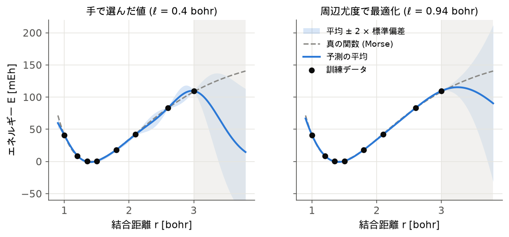

# 第 4 回　カーネル法とガウス過程回帰

!!! abstract "この回の道筋"
    リッジ回帰を書き直すと、予測が「入力どうしの内積」だけで書けることが分かります。
    この内積をカーネル関数に置き換えると、基底関数を 1 つも書かずに柔軟な回帰ができます（カーネルリッジ回帰）。
    同じ予測は、関数そのものに確率分布を置くガウス過程回帰からも得られ、こちらは予測の不確かさも与えます。
    最後に、化学でこれらの方法がどう使われているか（分子の原子化エネルギー、GAP 原子間ポテンシャル）を紹介します。

    | 節 | 内容 |
    |---|---|
    | 1 | リッジ回帰を内積で書き直す |
    | 2 | カーネルトリック |
    | 3 | カーネルリッジ回帰 |
    | 4 | ガウス過程回帰：予測の平均と分散 |
    | 5 | ハイパーパラメータと周辺尤度 |
    | 6 | 計算例：Morse ポテンシャルのガウス過程回帰 |
    | 7 | 化学での使われ方 |

    **前に読んでおく回**：[機械学習の基礎 第 2 回](02-linear-regression.md)、[第 3 回](03-overfitting-regularization.md)（特に付録 B）

!!! tip "物理的なイメージ"
    カーネル法が利用しているのは、「似た入力には似た答えが返る」という考え方です。新しい入力の予測は、学習データの各点の答えを、その点とどれだけ似ているか（カーネル）で重みづけして足し合わせたものになります。ガウス過程は、これを確率の言葉で書き直したもので、予測の値だけでなく、学習データから離れた所では予測の不確かさが大きくなることも表します。

## 1. リッジ回帰を内積で書き直す

第 2 回では、基底関数 $\phi_0(\boldsymbol{x}), \dots, \phi_M(\boldsymbol{x})$ を並べたベクトルを使いました。
これを

$$
\boldsymbol{\phi}(\boldsymbol{x}) = \bigl( \phi_0(\boldsymbol{x}), \dots, \phi_M(\boldsymbol{x}) \bigr)^\mathsf{T}
$$

と書き、**特徴写像**（feature map）と呼びます。
入力 $\boldsymbol{x}$ を、$M+1$ 次元の「特徴空間」のベクトルに写す写像だからです。
モデルは $f(\boldsymbol{x}) = \boldsymbol{w}^\mathsf{T}\boldsymbol{\phi}(\boldsymbol{x})$ です。

基底関数を増やせば柔軟なモデルになりますが、$M$ が大きいと $(M+1) \times (M+1)$ の行列を扱うのが大変になります。
入力が多次元なら、多項式の基底の数は次数とともに急に増えます。
そこで、リッジ回帰の解を、$M$ ではなくデータ点の数 $N$ の大きさの問題に書き直します。

第 3 回のリッジ回帰の式から始めます。
$\boldsymbol{\Phi}$ は、$i$ 行目が $\boldsymbol{\phi}(\boldsymbol{x}_i)^\mathsf{T}$ の計画行列です。

$$
(\boldsymbol{\Phi}^\mathsf{T}\boldsymbol{\Phi} + \lambda \mathbf{I}) \boldsymbol{w} = \boldsymbol{\Phi}^\mathsf{T}\boldsymbol{y}
$$

$\lambda \boldsymbol{w}$ の項だけを左辺に残して整理すると、次のようになります。

$$
\boldsymbol{w} = \boldsymbol{\Phi}^\mathsf{T} \boldsymbol{a}, \qquad \boldsymbol{a} = \frac{1}{\lambda} (\boldsymbol{y} - \boldsymbol{\Phi}\boldsymbol{w})
$$

つまり、解 $\boldsymbol{w}$ は、データ点の特徴ベクトル $\boldsymbol{\phi}(\boldsymbol{x}_i)$ の 1 次結合 $\sum_i a_i \boldsymbol{\phi}(\boldsymbol{x}_i)$ で書けます。
次に、$\boldsymbol{a}$ の式の $\boldsymbol{w}$ に $\boldsymbol{\Phi}^\mathsf{T}\boldsymbol{a}$ を代入します。

$$
\lambda \boldsymbol{a} = \boldsymbol{y} - \boldsymbol{\Phi}\boldsymbol{\Phi}^\mathsf{T}\boldsymbol{a}
\quad\Longrightarrow\quad
(\mathbf{K} + \lambda \mathbf{I}) \boldsymbol{a} = \boldsymbol{y}, \qquad \mathbf{K} = \boldsymbol{\Phi}\boldsymbol{\Phi}^\mathsf{T}
$$

$\mathbf{K}$ は $N \times N$ の行列で、その $(i, j)$ 成分は特徴ベクトルどうしの内積 $\boldsymbol{\phi}(\boldsymbol{x}_i)^\mathsf{T}\boldsymbol{\phi}(\boldsymbol{x}_j)$ です。
新しい入力 $\boldsymbol{x}$ での予測も、内積だけで書けます。

$$
f(\boldsymbol{x}) = \boldsymbol{w}^\mathsf{T}\boldsymbol{\phi}(\boldsymbol{x}) = \sum_{i=1}^{N} a_i \, \boldsymbol{\phi}(\boldsymbol{x}_i)^\mathsf{T}\boldsymbol{\phi}(\boldsymbol{x})
$$

学習（$\boldsymbol{a}$ を求めること）にも予測にも、特徴ベクトルそのものは現れません。
現れるのは、2 つの入力の特徴ベクトルの内積だけです。

**ここまでで分かったこと**：リッジ回帰の解と予測は、特徴ベクトルどうしの内積だけで書けます。解くのは $N \times N$ の連立 1 次方程式 $(\mathbf{K} + \lambda\mathbf{I})\boldsymbol{a} = \boldsymbol{y}$ です。

## 2. カーネルトリック

### 2.1 内積を関数で直接与える

前節の結果から、特徴写像 $\boldsymbol{\phi}$ を明示しなくても、内積を返す関数

$$
k(\boldsymbol{x}, \boldsymbol{x}') = \boldsymbol{\phi}(\boldsymbol{x})^\mathsf{T}\boldsymbol{\phi}(\boldsymbol{x}')
$$

さえ計算できれば、リッジ回帰を実行できます。
この関数 $k$ を**カーネル関数**（kernel function）と呼びます。
特徴ベクトルを作らずに、カーネル関数で内積を直接計算する工夫を、**カーネルトリック**（kernel trick）と呼びます。

簡単な例で確かめます。
入力が 1 つの数 $x$ のとき、カーネル関数 $k(x, x') = (1 + x x')^2$ を考えます。
展開すると次のようになります。

$$
(1 + x x')^2 = 1 + 2 x x' + x^2 x'^2 = \boldsymbol{\phi}(x)^\mathsf{T}\boldsymbol{\phi}(x'), \qquad \boldsymbol{\phi}(x) = (1, \sqrt{2}\,x, x^2)^\mathsf{T}
$$

このカーネルを使うことは、基底 $1, \sqrt{2}x, x^2$ で 2 次式のリッジ回帰をすることと同じです。
入力が $D$ 次元で $k(\boldsymbol{x}, \boldsymbol{x}') = (1 + \boldsymbol{x}^\mathsf{T}\boldsymbol{x}')^p$ とすれば、$p$ 次までのすべての単項式を基底にしたことになります。
基底の数は $D$ と $p$ とともに急に増えますが、カーネル関数の計算は $D$ 次元の内積 1 回で済みます。

### 2.2 ガウスカーネル

最もよく使われるのは、次の**ガウスカーネル**（Gaussian kernel）です。
RBF（radial basis function）カーネル、2 乗指数（squared exponential）カーネルとも呼ばれます。

$$
k(\boldsymbol{x}, \boldsymbol{x}') = \sigma_f^2 \exp\Bigl( -\frac{\lVert \boldsymbol{x} - \boldsymbol{x}' \rVert^2}{2\ell^2} \Bigr)
$$

$\ell$ は**長さのスケール**（length scale）、$\sigma_f^2$ は全体の大きさを決める数です。
2 つの入力が $\ell$ より十分近ければ $k \approx \sigma_f^2$、十分遠ければ $k \approx 0$ になります。
つまり、ガウスカーネルは「入力がどれだけ似ているか」を測る関数です。

ガウスカーネルに対応する特徴写像は、無限個の基底関数を持ちます [Rasmussen 2006, 4.2 節]。
無限次元のベクトルは計算機で扱えませんが、カーネル関数を使えば、その内積は 1 行の式で計算できます。
これがカーネルトリックの最大の利点です。

### 2.3 カーネル関数として使える条件

どんな 2 変数関数でもカーネル関数にできるわけではありません。
ある特徴写像の内積になっているためには、どんな点の組 $\boldsymbol{x}_1, \dots, \boldsymbol{x}_N$ を選んでも、行列 $K_{ij} = k(\boldsymbol{x}_i, \boldsymbol{x}_j)$ が対称で半正定値（固有値がすべて 0 以上）であることが必要十分です（Mercer の定理と呼ばれる結果に関係します。詳しくは [Schölkopf 2002]）。
この条件を満たす $k$ を**正定値カーネル**（positive definite kernel）と呼び、行列 $\mathbf{K}$ を**グラム行列**（Gram matrix）と呼びます。
ガウスカーネルと多項式カーネルは、この条件を満たします。

**ここまでで分かったこと**：特徴写像の内積をカーネル関数で直接与えると、特徴ベクトルを作らずに回帰ができます。ガウスカーネルは、無限個の基底関数を使うことに相当します。

## 3. カーネルリッジ回帰

1 節の式で内積をカーネル関数に置き換えたものを、**カーネルリッジ回帰**（kernel ridge regression, KRR）と呼びます。
手順は次のとおりです。

1. 訓練データからグラム行列 $K_{ij} = k(\boldsymbol{x}_i, \boldsymbol{x}_j)$ を作ります。
2. 連立 1 次方程式 $(\mathbf{K} + \lambda\mathbf{I})\boldsymbol{a} = \boldsymbol{y}$ を解いて、係数 $\boldsymbol{a}$ を求めます。
3. 新しい入力 $\boldsymbol{x}$ では、$f(\boldsymbol{x}) = \sum_{i} a_i \, k(\boldsymbol{x}_i, \boldsymbol{x})$ で予測します。

3 の式は、「訓練データの各点を中心に置いたカーネル関数の重ね合わせ」と読めます。
ガウスカーネルなら、各データ点を中心とするガウス関数を、係数 $a_i$ で足し合わせたものが予測になります。

カーネルリッジ回帰の弱点は、データ点の数 $N$ が増えたときの計算量です。
$N \times N$ の行列を記憶するのに $N^2$ に比例するメモリが、連立 1 次方程式を解くのに $N^3$ に比例する時間がかかります。
$N$ が数万を超えると、そのままでは計算が難しくなります。
7 節で触れる GAP では、この問題を「代表点」を使う方法で和らげています。

**ここまでで分かったこと**：カーネルリッジ回帰は、グラム行列を作り、$N$ 元の連立 1 次方程式を解くだけの方法です。計算量は $N^3$ に比例します。

## 4. ガウス過程回帰：予測の平均と分散

カーネルリッジ回帰の予測には、「この予測はどれくらい確かか」という情報がありません。
ガウス過程回帰は、同じ予測に加えて、その不確かさも与えます。

### 4.1 関数に確率分布を置く

第 3 回の付録 B では、パラメータ $\boldsymbol{w}$ に正規分布の事前分布を置くと、リッジ回帰が得られることを示しました。
そこでの事前分布は、各成分が平均 0、分散 $\sigma_w^2$ の正規分布でした。
この事前分布のもとで、モデルの値 $f(\boldsymbol{x}) = \boldsymbol{w}^\mathsf{T}\boldsymbol{\phi}(\boldsymbol{x})$ がどう分布するかを考えます。

$f(\boldsymbol{x})$ は正規分布に従う $w_j$ の 1 次結合なので、やはり正規分布に従い、平均は 0 です。
2 つの入力での値の共分散は、$\mathbb{E}[w_j w_l] = \sigma_w^2 \delta_{jl}$ を使うと次のようになります。

$$
\mathbb{E}[f(\boldsymbol{x}) f(\boldsymbol{x}')] = \sum_{j, l} \phi_j(\boldsymbol{x}) \, \mathbb{E}[w_j w_l] \, \phi_l(\boldsymbol{x}') = \sigma_w^2 \, \boldsymbol{\phi}(\boldsymbol{x})^\mathsf{T}\boldsymbol{\phi}(\boldsymbol{x}')
$$

共分散が、特徴ベクトルの内積、つまりカーネル関数になりました。
どの有限個の点を選んでも、そこでの値 $(f(\boldsymbol{x}_1), \dots, f(\boldsymbol{x}_N))$ は多変数の正規分布に従い、その共分散行列はグラム行列です。

この性質を逆に定義として使います。
「どの有限個の点での値も、平均 0、共分散行列 $K_{ij} = k(\boldsymbol{x}_i, \boldsymbol{x}_j)$ の多変数正規分布に従う」ような関数 $f$ の確率分布を、**ガウス過程**（Gaussian process）と呼びます [Rasmussen 2006]。
カーネル関数は、「2 つの点での関数の値がどれだけ連動するか」を決めます。
ガウスカーネルなら、近い点どうしの値は強く連動し（滑らかな関数）、遠い点どうしの値はほとんど独立です。

### 4.2 予測の分布

データは、関数の値に乱数を足したもの $y_i = f(\boldsymbol{x}_i) + \varepsilon_i$ だとします。
$\varepsilon_i$ は互いに独立で、平均 0、分散 $\sigma_n^2$ の正規分布に従います。

新しい入力 $\boldsymbol{x}_*$ での関数の値 $f_* = f(\boldsymbol{x}_*)$ を予測します。
ガウス過程の定義から、$\boldsymbol{y}$ と $f_*$ を合わせたものは、次の多変数正規分布に従います。

$$
\begin{pmatrix} \boldsymbol{y} \\ f_* \end{pmatrix}
\sim \mathcal{N}\left( \boldsymbol{0}, \;
\begin{pmatrix} \mathbf{K} + \sigma_n^2 \mathbf{I} & \boldsymbol{k}_* \\ \boldsymbol{k}_*^\mathsf{T} & k(\boldsymbol{x}_*, \boldsymbol{x}_*) \end{pmatrix}
\right)
$$

ここで $\boldsymbol{k}_*$ は、$i$ 番目の成分が $k(\boldsymbol{x}_i, \boldsymbol{x}_*)$ の $N$ 次元ベクトルです。
$\boldsymbol{y}$ の共分散に $\sigma_n^2 \mathbf{I}$ が足されているのは、乱数 $\varepsilon_i$ の分だけです。

観測した $\boldsymbol{y}$ が分かったときの $f_*$ の分布（条件付き分布）も正規分布になります。
導出は付録 A に回しますが、結果は次のとおりです。

$$
\mu(\boldsymbol{x}_*) = \boldsymbol{k}_*^\mathsf{T} (\mathbf{K} + \sigma_n^2 \mathbf{I})^{-1} \boldsymbol{y}
$$

$$
\sigma^2(\boldsymbol{x}_*) = k(\boldsymbol{x}_*, \boldsymbol{x}_*) - \boldsymbol{k}_*^\mathsf{T} (\mathbf{K} + \sigma_n^2 \mathbf{I})^{-1} \boldsymbol{k}_*
$$

$\mu$ が予測の平均、$\sigma^2$ が予測の分散です。
この方法を**ガウス過程回帰**（Gaussian process regression, GPR）と呼びます。

### 4.3 式を読む

**平均はカーネルリッジ回帰と同じです。**
$\boldsymbol{a} = (\mathbf{K} + \sigma_n^2 \mathbf{I})^{-1}\boldsymbol{y}$ とおくと、$\mu(\boldsymbol{x}_*) = \sum_i a_i \, k(\boldsymbol{x}_i, \boldsymbol{x}_*)$ です。
これは、3 節のカーネルリッジ回帰で $\lambda = \sigma_n^2$ としたものです。
ただし、カーネル関数の大きさ $\sigma_f^2$ を 1 にそろえたカーネル $\tilde{k} = k / \sigma_f^2$ で書くと、$(\mathbf{K} + \sigma_n^2\mathbf{I})^{-1}$ の中から $\sigma_f^2$ をくくり出せます。
そのため、$\tilde{k}$ を使うカーネルリッジ回帰では、対応する正則化の強さは $\lambda = \sigma_n^2 / \sigma_f^2$ になります。
第 3 回の付録 B で $\lambda = \sigma^2/\sigma_w^2$ だったのと同じ形です。

**分散は、データ点の近くで小さく、遠くで大きくなります。**
第 1 項 $k(\boldsymbol{x}_*, \boldsymbol{x}_*)$ は、データを見る前の分散（ガウスカーネルなら $\sigma_f^2$）です。
第 2 項は、データを見たことで減った分です。
$\boldsymbol{x}_*$ がどのデータ点からも遠ければ $\boldsymbol{k}_* \approx \boldsymbol{0}$ なので、分散は事前の $\sigma_f^2$ に戻ります。
つまり、ガウス過程回帰は「データのないところでは自信がない」ことを、数値で教えてくれます。
また、分散の式には $\boldsymbol{y}$ が入っていません。
ハイパーパラメータ（次節）を固定すれば、予測の不確かさは、どこにデータ点があるかだけで決まり、答えの値にはよりません。

**ここまでで分かったこと**：ガウス過程回帰の予測の平均はカーネルリッジ回帰と同じ式で、さらに予測の分散が得られます。分散はデータ点から離れると大きくなります。

## 5. ハイパーパラメータと周辺尤度

ガウスカーネルを使うガウス過程回帰には、3 つのハイパーパラメータがあります。

- $\ell$（長さのスケール）：関数がどのくらいの距離で変化するか。小さすぎるとデータ点の間で予測が平均 0 に戻ってしまい、大きすぎると細かい形を表せません。
- $\sigma_f^2$（信号の大きさ）：関数の値がどのくらいの範囲で変化するか。
- $\sigma_n^2$（乱数の大きさ）：データにどのくらいの乱数が含まれているか。正則化の強さに当たります。

カーネルリッジ回帰では、第 3 回と同じように、これらを交差検証で選びます。
ガウス過程回帰では、もう 1 つの方法があります。
それは、**周辺尤度**（marginal likelihood）を最大にする方法です。

ガウス過程のもとでは、観測値 $\boldsymbol{y}$ そのものが、平均 0、共分散行列 $\mathbf{K}_y = \mathbf{K} + \sigma_n^2\mathbf{I}$ の多変数正規分布に従います。
したがって、ハイパーパラメータ $\boldsymbol{\theta} = (\ell, \sigma_f, \sigma_n)$ のもとで、観測した $\boldsymbol{y}$ が得られる確率密度の対数は、次のとおりです。

$$
\ln p(\boldsymbol{y} \mid \boldsymbol{\theta}) = -\frac{1}{2} \boldsymbol{y}^\mathsf{T} \mathbf{K}_y^{-1} \boldsymbol{y} - \frac{1}{2} \ln \det \mathbf{K}_y - \frac{N}{2} \ln 2\pi
$$

これは、関数 $f$ のとりうる形すべてについて平均（積分）した尤度なので、周辺尤度と呼ばれます。
第 1 項は、データへの合い方を表します。
第 2 項は、モデルの柔軟さへの罰の役割をします。
$\ln\det\mathbf{K}_y$ は $\mathbf{K}_y$ の固有値の対数の和です。
$\ell$ を小さくしてモデルを柔軟にすると、$\mathbf{K}_y$ の固有値がそろってきて小さな固有値が減るので、$\ln\det\mathbf{K}_y$ が大きくなり、第 2 項は小さく（負の大きな値に）なります [Rasmussen 2006, 5.4 節]。
周辺尤度を最大にすると、この 2 つの釣り合いでハイパーパラメータが決まります。
交差検証と違って、訓練データをすべて使ったまま、勾配を使った最適化で決められるのが利点です。

**ここまでで分かったこと**：ガウス過程回帰のハイパーパラメータは、周辺尤度を最大にして決められます。周辺尤度は、データへの合い方とモデルの柔軟さの釣り合いを表します。

## 6. 計算例：Morse ポテンシャルのガウス過程回帰

### 6.1 numpy で書く

第 3 回と同じ Morse ポテンシャル（エネルギーは m$E_\mathrm{h}$、$D_\mathrm{e} = 170$、$a = 1.0\ \mathrm{bohr}^{-1}$、$r_\mathrm{e} = 1.4$ bohr）から、8 点の訓練データを作ります。
乱数の標準偏差は 1 m$E_\mathrm{h}$ です。
ハイパーパラメータは、まず手で $\sigma_f = 50$ m$E_\mathrm{h}$、$\ell = 0.4$ bohr、$\sigma_n = 1$ m$E_\mathrm{h}$ と選びます。

4.2 節の式の $(\mathbf{K} + \sigma_n^2\mathbf{I})^{-1}$ は、逆行列を作らずに、コレスキー分解 $\mathbf{K} + \sigma_n^2\mathbf{I} = \mathbf{L}\mathbf{L}^\mathsf{T}$（$\mathbf{L}$ は下三角行列）を使って計算します。
対称で正定値な行列の連立 1 次方程式を、安定に解く標準的な方法です [Rasmussen 2006, 2.2 節]。

```python
import numpy as np

De, a, re = 170.0, 1.0, 1.4                    # エネルギーの単位は mEh
def morse(r):
    return De * (1.0 - np.exp(-a * (r - re)))**2

rng = np.random.default_rng(7)
r_tr = np.array([1.0, 1.2, 1.35, 1.5, 1.8, 2.1, 2.6, 3.0])   # 8 点
E_tr = morse(r_tr) + rng.normal(0, 1.0, size=r_tr.size)

def rbf(x1, x2, sf, ell):
    """ガウスカーネル k(x, x') = sf^2 exp(-(x - x')^2 / (2 ell^2))"""
    d = x1[:, None] - x2[None, :]
    return sf**2 * np.exp(-0.5 * d**2 / ell**2)

def gp_predict(r_new, sf, ell, sn):
    K = rbf(r_tr, r_tr, sf, ell) + sn**2 * np.eye(r_tr.size)
    L = np.linalg.cholesky(K)                          # K = L L^T
    alpha = np.linalg.solve(L.T, np.linalg.solve(L, E_tr))   # K^{-1} y
    ks = rbf(r_new, r_tr, sf, ell)                     # k_* を並べた行列
    mean = ks @ alpha
    v = np.linalg.solve(L, ks.T)
    var = sf**2 - np.sum(v**2, axis=0)                 # k(x*,x*) - k_*^T K^{-1} k_*
    return mean, np.sqrt(var)

sf, ell, sn = 50.0, 0.4, 1.0
r_new = np.array([1.35, 1.65, 2.35, 3.5])
mean, std = gp_predict(r_new, sf, ell, sn)
for r, m, s in zip(r_new, mean, std):
    print(f"r = {r:4.2f}: 予測 {m:7.2f} ± {s:5.2f} mEh,  真の値 {morse(r):7.2f} mEh")
```

`v = L^{-1} k_*` とおくと、$\boldsymbol{k}_*^\mathsf{T}(\mathbf{L}\mathbf{L}^\mathsf{T})^{-1}\boldsymbol{k}_* = \lVert \boldsymbol{v} \rVert^2$ なので、分散は `sf**2 - np.sum(v**2)` で計算できます。
出力は次のとおりです（「±」の後は予測の標準偏差 $\sigma(\boldsymbol{x}_*)$ です）。

```text
r = 1.35: 予測   -0.41 ±  0.80 mEh,  真の値    0.45 mEh
r = 1.65: 予測    8.00 ±  1.27 mEh,  真の値    8.32 mEh
r = 2.35: 予測   60.94 ±  5.21 mEh,  真の値   63.93 mEh
r = 3.50: 予測   49.49 ± 41.79 mEh,  真の値  130.91 mEh
```

4 つの点の性格は、それぞれ違います。

- $r = 1.35$ は訓練データの点そのものです。標準偏差は 0.80 m$E_\mathrm{h}$ で、乱数の大きさ $\sigma_n = 1$ より小さくなりました。
- $r = 1.65$ は、近くに訓練データ（1.5 と 1.8）があるので、標準偏差は 1.27 m$E_\mathrm{h}$ と小さいままです。
- $r = 2.35$ は、訓練データの間隔が 0.5 bohr と広いところで、標準偏差は 5.21 m$E_\mathrm{h}$ に増えました。
- $r = 3.5$ は訓練データの範囲（1.0〜3.0 bohr）の外です。予測の平均は真の値から 80 m$E_\mathrm{h}$ 以上外れていますが、標準偏差も 41.79 m$E_\mathrm{h}$ と大きく、「この予測は信用できない」ことを示しています。

### 6.2 カーネルリッジ回帰と比べる

4.3 節で述べたように、予測の平均はカーネルリッジ回帰と一致するはずです。
scikit-learn の `KernelRidge` で確かめます。

```python
# 上の続き：カーネルリッジ回帰と比べる
from sklearn.kernel_ridge import KernelRidge
# sklearn の "rbf" カーネルは exp(-gamma (x - x')^2) で、前の係数 sf^2 がない。
# そのため、正則化の強さは lambda = sn^2 / sf^2 になる（本文 4.3 節）。
krr = KernelRidge(alpha=sn**2 / sf**2, kernel="rbf", gamma=0.5 / ell**2)
krr.fit(r_tr[:, None], E_tr)
print("KRR の予測 :", np.round(krr.predict(r_new[:, None]), 2))
print("GP の平均  :", np.round(mean, 2))
```

```text
KRR の予測 : [-0.41  8.   60.94 49.49]
GP の平均  : [-0.41  8.   60.94 49.49]
```

表示した桁まで一致しました。

### 6.3 ハイパーパラメータを周辺尤度で決める

次に、scikit-learn の `GaussianProcessRegressor` で、ハイパーパラメータを周辺尤度の最大化で決めます。
カーネルは「定数 × ガウスカーネル + 乱数の項」とします。
`ConstantKernel` が $\sigma_f^2$、`RBF` が $\exp(-\lVert\boldsymbol{x} - \boldsymbol{x}'\rVert^2 / 2\ell^2)$、`WhiteKernel` が $\sigma_n^2 \delta_{ij}$ に当たります。
括弧の中は、初期値と探す範囲です。
周辺尤度には極大が複数ありうるので、`n_restarts_optimizer=10` で初期値を変えて 10 回やり直し、最もよいものを選びます。

```python
# 上の続き：ハイパーパラメータを周辺尤度の最大化で決める
from sklearn.gaussian_process import GaussianProcessRegressor
from sklearn.gaussian_process.kernels import ConstantKernel, RBF, WhiteKernel
kernel = (ConstantKernel(1000.0, (1e-2, 1e6)) * RBF(1.0, (1e-2, 1e2))
          + WhiteKernel(1.0, (1e-4, 1e2)))
gpr = GaussianProcessRegressor(kernel, n_restarts_optimizer=10, random_state=0)
gpr.fit(r_tr[:, None], E_tr)
print("最適化したカーネル:", gpr.kernel_)
print("対数周辺尤度:", round(gpr.log_marginal_likelihood_value_, 2))
m2, s2 = gpr.predict(r_new[:, None], return_std=True)
for r, m, s in zip(r_new, m2, s2):
    print(f"r = {r:4.2f}: 予測 {m:7.2f} ± {s:5.2f} mEh")
theta0 = np.log([sf**2, ell, sn**2])          # 手で選んだ値（sf=50, ell=0.4, sn=1）
print("手で選んだ値の対数周辺尤度:", round(gpr.log_marginal_likelihood(theta0), 2))
```

```text
最適化したカーネル: 234**2 * RBF(length_scale=0.943) + WhiteKernel(noise_level=0.0968)
対数周辺尤度: -33.68
r = 1.35: 予測   -0.07 ±  0.37 mEh
r = 1.65: 予測    7.68 ±  0.41 mEh
r = 2.35: 予測   62.55 ±  0.59 mEh
r = 3.50: 予測  109.69 ± 23.78 mEh
手で選んだ値の対数周辺尤度: -36.55
```

最適化の結果は、$\sigma_f = 234$ m$E_\mathrm{h}$、$\ell = 0.943$ bohr、$\sigma_n^2 = 0.0968$ m$E_\mathrm{h}^2$ でした。
対数周辺尤度は、手で選んだ値の $-36.55$ から $-33.68$ に上がっています。
長さのスケールが 0.4 から 0.94 bohr に伸びたことで、データ点の間の予測が滑らかになり、$r = 3.5$ の予測も真の値（130.91）に近づきました。

注意すべき点が 2 つあります。

- 推定した乱数の分散 $\sigma_n^2 = 0.0968$（標準偏差 0.31）は、実際に足した乱数（標準偏差 1）よりかなり小さくなりました。8 点しかないと、「データの乱数」と「関数の細かい形」を見分ける情報が足りないからです。ハイパーパラメータの推定値も、データが少ないと当てになりません。
- scikit-learn の `predict(..., return_std=True)` が返す標準偏差には、`WhiteKernel` の分（乱数の分散 $\sigma_n^2$）が含まれます。これは $f_*$ ではなく、乱数を含む新しい観測値 $y_*$ の予測の標準偏差です。6.1 節の numpy の計算は $f_*$ の標準偏差なので、定義が少し違います。

2 つのハイパーパラメータでの予測を図で比べます。
帯は、予測の平均 ± 2 × 標準偏差の範囲です。
灰色の部分は、訓練データの範囲の外（外挿）です。



左の図（$\ell = 0.4$ bohr）では、データ点の間隔が広い $r = 2.1$〜$3.0$ で帯が膨らみ、外挿の領域では予測の平均が 0 に向かって下がります。
データのないところでは、予測が事前分布の平均（0）に戻るからです。
右の図（$\ell = 0.94$ bohr）では、データ点の間の帯はほとんど見えないほど細くなりました。
どちらの図でも、外挿の領域では帯が大きく広がります。
ガウス過程回帰は、外挿を正しく予測できるわけではありませんが、外挿していることを分散の大きさで知らせてくれます。

**ここまでで分かったこと**：ガウス過程回帰は numpy で数行で書け、平均はカーネルリッジ回帰と一致します。周辺尤度でハイパーパラメータを決めると予測は改善しますが、データが少ないと推定値は当てになりません。

## 7. 化学での使われ方

### 7.1 分子の原子化エネルギー

Rupp らは、分子の原子の種類と位置から作った行列（クーロン行列）を入力にして、ガウスカーネルのカーネルリッジ回帰で、ハイブリッド汎関数の DFT で計算した原子化エネルギーを予測しました [Rupp 2012]。
7000 を超える小さな有機分子での交差検証で、平均絶対誤差は約 10 kcal/mol でした [Rupp 2012]。
分子の性質を、量子化学計算のデータから機械学習で予測する研究の、初期の代表例です。

### 7.2 GAP：ガウス過程による原子間ポテンシャル

Bartók らは、量子力学計算のエネルギーと力のデータから、ガウス過程回帰で原子間ポテンシャルを作る方法を提案し、GAP（Gaussian approximation potential）と名づけました [Bartók 2010]。
決まった関数形を持たないので、複雑なポテンシャルエネルギー面を表せ、データを増やすほど系統的に改善できることが特徴です [Bartók 2010]。

GAP の考え方を、Deringer らの総説 [Deringer 2021] に沿って説明します。

- **全エネルギーを原子ごとの局所エネルギーの和に分けます。** 各原子のエネルギーは、その原子のまわり（近くの原子の配置）だけで決まると仮定し、この局所エネルギーをガウス過程でモデル化します。周囲の原子の配置は、回転や並べ替えで変わらない記述子（たとえば SOAP と呼ばれる記述子）で表します。
- **局所エネルギーそのものは観測できません。** 量子化学計算で得られるのは全エネルギー（局所エネルギーの和）と、その微分である力（周期系では応力も）です。ガウス過程は 1 次変換（和や微分）をしてもガウス過程なので、これらのデータから直接学習できます。
- **代表点を使って計算量を減らします。** 3 節で述べたように、データ点の数 $N$ に対して計算量は $N^3$ に比例します。GAP では、$N$ よりずっと少ない $M$ 個の代表的な原子環境だけを基底に使う「スパースなガウス過程回帰」を使います。
- **予測の分散を使います。** 予測の分散は、うまく予測できていない構造を見つけ、学習データに加えるための手がかりとして使われています。

予測の不確かさを使ってデータを効率よく集める方法（能動学習）は、[第 10 回](10-uncertainty-active-learning.md)で扱います。

**ここまでで分かったこと**：カーネルリッジ回帰とガウス過程回帰は、分子の性質の予測や、原子間ポテンシャル（GAP）の作成に使われています。GAP は、全エネルギーを局所エネルギーの和に分け、エネルギーと力から学習します。

## まとめ

- リッジ回帰の解と予測は、特徴ベクトルの内積だけで書けます。内積をカーネル関数で直接与えるのがカーネルトリックで、これを使うのがカーネルリッジ回帰です。
- ガウス過程は、どの有限個の点での値も、カーネル関数を共分散とする多変数正規分布に従う、関数の確率分布です。
- ガウス過程回帰の予測の平均はカーネルリッジ回帰と同じで、予測の分散はデータから離れると大きくなります。
- ハイパーパラメータは、周辺尤度の最大化（または交差検証）で決めます。
- 化学では、分子の性質の予測や、GAP のような原子間ポテンシャルに使われています。計算量が $N^3$ に比例するため、大きなデータでは代表点などの工夫が必要です。

## 付録 A　多変数正規分布の条件付き分布

4.2 節の予測の式は、次の一般的な結果から得られます。
平均 0 の 2 つの確率変数のベクトル $\boldsymbol{u}$（観測したもの）と $\boldsymbol{v}$（予測したいもの）が、合わせて次の多変数正規分布に従うとします。

$$
\begin{pmatrix} \boldsymbol{u} \\ \boldsymbol{v} \end{pmatrix}
\sim \mathcal{N}\left( \boldsymbol{0}, \begin{pmatrix} \mathbf{A} & \mathbf{B} \\ \mathbf{B}^\mathsf{T} & \mathbf{C} \end{pmatrix} \right)
$$

$\mathbf{A}$ は $\boldsymbol{u}$ の共分散行列、$\mathbf{C}$ は $\boldsymbol{v}$ の共分散行列、$\mathbf{B}$ は $\boldsymbol{u}$ と $\boldsymbol{v}$ の共分散行列です。
このとき、$\boldsymbol{u}$ が分かったときの $\boldsymbol{v}$ の分布は、平均 $\mathbf{B}^\mathsf{T}\mathbf{A}^{-1}\boldsymbol{u}$、共分散行列 $\mathbf{C} - \mathbf{B}^\mathsf{T}\mathbf{A}^{-1}\mathbf{B}$ の正規分布です。

これを示します。
新しい変数 $\boldsymbol{z} = \boldsymbol{v} - \mathbf{B}^\mathsf{T}\mathbf{A}^{-1}\boldsymbol{u}$ を作ります。
$\boldsymbol{z}$ と $\boldsymbol{u}$ の共分散は、次のように 0 になります。

$$
\mathbb{E}[\boldsymbol{z}\boldsymbol{u}^\mathsf{T}] = \mathbb{E}[\boldsymbol{v}\boldsymbol{u}^\mathsf{T}] - \mathbf{B}^\mathsf{T}\mathbf{A}^{-1}\mathbb{E}[\boldsymbol{u}\boldsymbol{u}^\mathsf{T}] = \mathbf{B}^\mathsf{T} - \mathbf{B}^\mathsf{T}\mathbf{A}^{-1}\mathbf{A} = \mathbf{0}
$$

$\boldsymbol{z}$ と $\boldsymbol{u}$ は合わせて正規分布に従う（正規分布に従う変数の 1 次変換だから）ので、共分散が 0 なら互いに独立です。
したがって、$\boldsymbol{u}$ が分かっても $\boldsymbol{z}$ の分布は変わらず、平均 $\boldsymbol{0}$ のままです。
$\boldsymbol{z}$ の共分散行列は、次のとおりです。

$$
\mathbb{E}[\boldsymbol{z}\boldsymbol{z}^\mathsf{T}] = \mathbf{C} - \mathbf{B}^\mathsf{T}\mathbf{A}^{-1}\mathbf{B} - \mathbf{B}^\mathsf{T}\mathbf{A}^{-1}\mathbf{B} + \mathbf{B}^\mathsf{T}\mathbf{A}^{-1}\mathbf{A}\mathbf{A}^{-1}\mathbf{B} = \mathbf{C} - \mathbf{B}^\mathsf{T}\mathbf{A}^{-1}\mathbf{B}
$$

$\boldsymbol{v} = \boldsymbol{z} + \mathbf{B}^\mathsf{T}\mathbf{A}^{-1}\boldsymbol{u}$ で、$\boldsymbol{u}$ が分かれば第 2 項は定数です。
よって、$\boldsymbol{v}$ の条件付き分布の平均は $\mathbf{B}^\mathsf{T}\mathbf{A}^{-1}\boldsymbol{u}$、共分散行列は $\mathbf{C} - \mathbf{B}^\mathsf{T}\mathbf{A}^{-1}\mathbf{B}$ です。

4.2 節では、$\boldsymbol{u} = \boldsymbol{y}$、$\boldsymbol{v} = f_*$、$\mathbf{A} = \mathbf{K} + \sigma_n^2\mathbf{I}$、$\mathbf{B} = \boldsymbol{k}_*$、$\mathbf{C} = k(\boldsymbol{x}_*, \boldsymbol{x}_*)$ とおけば、本文の式になります。

## 参考文献

- C. E. Rasmussen, C. K. I. Williams, "Gaussian Processes for Machine Learning" (MIT Press, 2006). ISBN: 9780262182539
- C. M. Bishop, "Pattern Recognition and Machine Learning" (Springer, 2006). ISBN: 9780387310732
- B. Schölkopf, A. J. Smola, "Learning with Kernels" (MIT Press, 2002). ISBN: 9780262194754
- M. Rupp, A. Tkatchenko, K.-R. Müller, O. A. von Lilienfeld, "Fast and Accurate Modeling of Molecular Atomization Energies with Machine Learning", Phys. Rev. Lett. 108, 058301 (2012). DOI: [10.1103/PhysRevLett.108.058301](https://doi.org/10.1103/PhysRevLett.108.058301)
- A. P. Bartók, M. C. Payne, R. Kondor, G. Csányi, "Gaussian Approximation Potentials: The Accuracy of Quantum Mechanics, without the Electrons", Phys. Rev. Lett. 104, 136403 (2010). DOI: [10.1103/PhysRevLett.104.136403](https://doi.org/10.1103/PhysRevLett.104.136403)
- V. L. Deringer, A. P. Bartók, N. Bernstein, D. M. Wilkins, M. Ceriotti, G. Csányi, "Gaussian Process Regression for Materials and Molecules", Chem. Rev. 121, 10073 (2021). DOI: [10.1021/acs.chemrev.1c00022](https://doi.org/10.1021/acs.chemrev.1c00022)
- F. Pedregosa et al., "Scikit-learn: Machine Learning in Python", arXiv:1201.0490 (2012).
- P. M. Morse, "Diatomic Molecules According to the Wave Mechanics. II. Vibrational Levels", Phys. Rev. 34, 57 (1929). DOI: [10.1103/PhysRev.34.57](https://doi.org/10.1103/PhysRev.34.57)

## 関連リンク

- scikit-learn のガウス過程の説明：https://scikit-learn.org/stable/modules/gaussian_process.html
