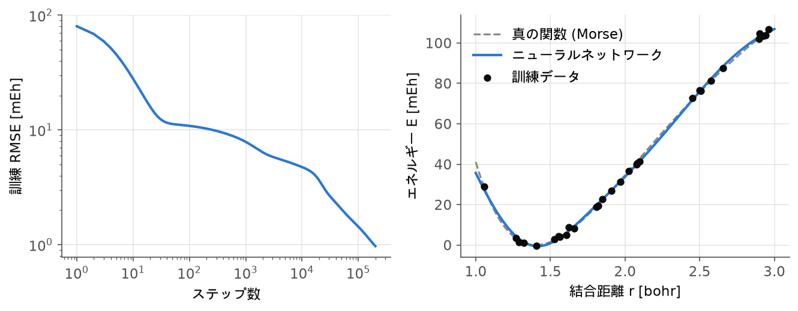

# 第 5 回　ニューラルネットワークと誤差逆伝播

!!! abstract "この回の道筋"
    ニューラルネットワークは、「1 次変換」と「非線形な関数」を交互に重ねたモデルです。
    この回では、パーセプトロンから多層パーセプトロンへ進み、活性化関数の役割と、普遍近似定理が何を保証し何を保証しないかを説明します。
    後半では、学習に必要な勾配を連鎖律で効率よく計算する誤差逆伝播法を、小さなネットワークで手計算し、numpy で実装して数値微分と一致することを確かめます。

    | 節 | 内容 |
    |---|---|
    | 1 | パーセプトロン |
    | 2 | 多層パーセプトロン |
    | 3 | 活性化関数 |
    | 4 | 普遍近似定理 |
    | 5 | 誤差逆伝播法：小さなネットワークで手計算する |
    | 6 | 誤差逆伝播法：一般の多層パーセプトロン |
    | 7 | 計算例：numpy で実装して数値微分と比べる |
    | 8 | 化学での使われ方：Behler–Parrinello 型のポテンシャル |

    **前に読んでおく回**：[機械学習の基礎 第 1 回](01-what-is-ml.md)、[第 2 回](02-linear-regression.md)、[第 3 回](03-overfitting-regularization.md)

!!! tip "物理的なイメージ"
    ニューラルネットワークは、「1 次変換で引き伸ばす」と「非線形な関数で折り曲げる」を何度も繰り返して、複雑な関数を組み立てる道具です。1 回の折り曲げでできるのは単純な形ですが、重ねるほど複雑な形を表せます。学習は、出力と答えの差（損失）が小さくなる方向にパラメータを少しずつ動かすことで、その方向（勾配）は誤差逆伝播法で効率よく計算します。

## 1. パーセプトロン

第 2 回の線形回帰では、基底関数 $\phi_j$ を前もって決め、その係数だけを学習しました。
ニューラルネットワークは、基底関数そのものもデータから学習するモデルです。
その出発点として、最も簡単な形から始めます。

入力を $\boldsymbol{x} = (x_1, \dots, x_D)^\mathsf{T}$ とします。
重み $\boldsymbol{w}$ とバイアス $b$ を使って、まず 1 次式 $z = \boldsymbol{w}^\mathsf{T}\boldsymbol{x} + b$ を作ります。
これを、$z \ge 0$ なら 1、$z < 0$ なら 0 を返す階段関数に通したものを出力にします。

$$
y = \begin{cases} 1 & (\boldsymbol{w}^\mathsf{T}\boldsymbol{x} + b \ge 0) \\ 0 & (\boldsymbol{w}^\mathsf{T}\boldsymbol{x} + b < 0) \end{cases}
$$

このモデルを**パーセプトロン**（perceptron）と呼びます。
Rosenblatt が 1958 年に、脳の情報処理のモデルとして提案しました [Rosenblatt 1958]。
入力の重み付きの和が、しきい値を超えたら「発火する」という、神経細胞（ニューロン）を単純化した形です。

パーセプトロンは、第 1 回で説明した分類（答えが 0 か 1）のモデルです。
$\boldsymbol{w}^\mathsf{T}\boldsymbol{x} + b = 0$ は入力空間の超平面（2 次元なら直線）なので、パーセプトロンは入力空間を 1 枚の超平面で 2 つに分けます。
そのため、超平面 1 枚で分けられない問題は解けません。

最も有名な例は、排他的論理和（XOR）です。
2 つの入力 $(x_1, x_2) \in \{0, 1\}^2$ のうち、ちょうど 1 つが 1 のときだけ $y = 1$ とします。
パーセプトロンで解けると仮定すると、4 つの点について次の不等式が成り立つ必要があります。

- $(0, 0) \to 0$：$b < 0$
- $(1, 1) \to 0$：$w_1 + w_2 + b < 0$
- $(1, 0) \to 1$：$w_1 + b \ge 0$
- $(0, 1) \to 1$：$w_2 + b \ge 0$

下の 2 つを足すと $w_1 + w_2 + 2b \ge 0$ です。
上の 2 つを足すと $w_1 + w_2 + 2b < 0$ です。
これは矛盾するので、XOR はパーセプトロン 1 つでは表せません。

**ここまでで分かったこと**：パーセプトロンは、1 次式としきい値で入力を 2 つに分けるモデルです。超平面 1 枚で分けられない問題（XOR など）は表せません。

## 2. 多層パーセプトロン

### 2.1 層を重ねる

パーセプトロンの限界を超えるには、1 次式と非線形な関数の組を何段も重ねます。
入力が 1 つで出力が 1 つの、最も小さな例を書きます。

$$
z_j = w_j x + b_j, \qquad h_j = \sigma(z_j) \qquad (j = 1, \dots, H)
$$

$$
\hat{y} = \sum_{j=1}^{H} v_j h_j + c
$$

入力 $x$ から、$H$ 個の 1 次式 $z_j$ を作り、それぞれに非線形な関数 $\sigma$ を通して $h_j$ を作ります。
最後に $h_j$ の 1 次結合で出力 $\hat{y}$ を作ります。
$\sigma$ を**活性化関数**（activation function）と呼びます。

この形は、第 2 回の基底関数のモデル $\hat{y} = \sum_j v_j \phi_j(x) + c$ と同じ形をしています。
違いは、基底関数 $\phi_j(x) = \sigma(w_j x + b_j)$ が、学習するパラメータ $w_j, b_j$ を含むことです。
つまり、どんな基底関数を使うかも、データに合わせて決めます。

入力も出力も多次元の場合は、行列とベクトルで書きます。

$$
\boldsymbol{h} = \sigma(\mathbf{W}^{(1)}\boldsymbol{x} + \boldsymbol{b}^{(1)}), \qquad \hat{\boldsymbol{y}} = \mathbf{W}^{(2)}\boldsymbol{h} + \boldsymbol{b}^{(2)}
$$

$\sigma$ は、ベクトルの各成分にそれぞれ作用させます。
$\boldsymbol{h}$ を**隠れ層**（hidden layer）、その成分の数 $H$ を隠れ層の**幅**と呼びます。
隠れ層をさらに重ねたものを含めて、このようなモデルを**多層パーセプトロン**（multilayer perceptron, MLP）と呼びます。
階段関数の代わりに滑らかな活性化関数を使うのが普通ですが、歴史的な名前として「パーセプトロン」が残っています。

### 2.2 非線形な活性化関数が必要な理由

活性化関数を恒等関数 $\sigma(z) = z$ にすると、どうなるでしょうか。
出力は $\mathbf{W}^{(2)}(\mathbf{W}^{(1)}\boldsymbol{x} + \boldsymbol{b}^{(1)}) + \boldsymbol{b}^{(2)} = \mathbf{W}'\boldsymbol{x} + \boldsymbol{b}'$ となり、ただの 1 次式です。
1 次変換をいくつ重ねても 1 次変換のままなので、層を重ねる意味がなくなります。
非線形な活性化関数を挟むことで、初めて層を重ねて複雑な関数を表せるようになります。

たとえば XOR は、隠れ層を 1 つ持つネットワークで表せます。
階段関数を使い、隠れ層の 2 つのユニットを $h_1 = [x_1 + x_2 - 0.5 \ge 0]$、$h_2 = [x_1 + x_2 - 1.5 \ge 0]$ とします（$[\cdots]$ は条件が成り立てば 1、そうでなければ 0）。
$h_1$ は「少なくとも 1 つが 1」、$h_2$ は「両方とも 1」を表します。
出力を $y = [h_1 - h_2 - 0.5 \ge 0]$ とすれば、「少なくとも 1 つが 1 で、両方ではない」となり、XOR になります。

**ここまでで分かったこと**：多層パーセプトロンは、1 次変換と非線形な活性化関数を交互に重ねたモデルで、基底関数そのものを学習します。活性化関数が非線形でなければ、層を重ねても 1 次式にしかなりません。

## 3. 活性化関数

よく使われる活性化関数と、その導関数を挙げます。
導関数は、5 節以降の学習で使います。

| 名前 | $\sigma(z)$ | $\sigma'(z)$ |
|---|---|---|
| シグモイド関数 | $\dfrac{1}{1 + e^{-z}}$ | $\sigma(z)\bigl(1 - \sigma(z)\bigr)$ |
| tanh | $\tanh z$ | $1 - \tanh^2 z$ |
| ReLU | $\max(0, z)$ | $z > 0$ で 1、$z < 0$ で 0 |

tanh の導関数は、$\tanh z = \sinh z / \cosh z$ を商の微分で微分して、$(\cosh^2 z - \sinh^2 z)/\cosh^2 z = 1 - \tanh^2 z$ と求まります。
シグモイド関数の導関数も、同じように直接微分して確かめられます。
どちらも、導関数が関数の値そのもので書けるので、計算に便利です。

ReLU（rectified linear unit）は計算が軽く、深いネットワークの学習で広く使われています。
ただし、$z = 0$ で導関数が不連続です。
原子間ポテンシャルのように、出力（エネルギー）を座標で微分して力を求める用途では、力が不連続にならないように、tanh のような滑らかな活性化関数がよく選ばれます。

**ここまでで分かったこと**：活性化関数には、シグモイド関数、tanh、ReLU などがあります。エネルギーを微分して力を求める用途では、滑らかな関数を選びます。

## 4. 普遍近似定理

多層パーセプトロンで、どのくらい広い範囲の関数を表せるでしょうか。
これに答えるのが**普遍近似定理**（universal approximation theorem）です。
主張を正確に書きます。

!!! note "普遍近似定理（隠れ層 1 層の場合）"
    $K$ を $\mathbb{R}^D$ の有界な閉集合（たとえば $[0, 1]^D$）、$f$ を $K$ 上の任意の連続関数とします。
    活性化関数 $\sigma$ が以下の条件を満たすとき、任意の $\varepsilon > 0$ に対して、ある幅 $H$ とパラメータ $\boldsymbol{w}_j, b_j, v_j$ が存在して、
    $$
    \Bigl| f(\boldsymbol{x}) - \sum_{j=1}^{H} v_j \, \sigma(\boldsymbol{w}_j^\mathsf{T}\boldsymbol{x} + b_j) \Bigr| < \varepsilon \quad (K \text{ のすべての } \boldsymbol{x} \text{ について})
    $$
    が成り立ちます。

    - Cybenko（1989）：$\sigma$ が連続で、$z \to -\infty$ で 0、$z \to +\infty$ で 1 に近づく関数（シグモイド関数など）のとき。Cybenko は $K = [0, 1]^D$ の場合を証明しました [Cybenko 1989]。同じ年に Hornik、Stinchcombe、White も、減少せず、$z \to -\infty$ で 0、$z \to +\infty$ で 1 に近づく関数（連続でなくてよく、階段関数も含む）について、同じ結論を示しました [Hornik 1989]。
    - より一般に：$\sigma$ が連続なら、「$\sigma$ が多項式でない」ことが、この主張が成り立つための必要十分条件です。つまり、多項式でなければ成り立ち、多項式なら成り立ちません。Leshno、Lin、Pinkus、Schocken は、これを連続とは限らない広い関数の集まり（局所的に有界で、不連続な点の集まりの閉包の測度が 0 の関数）について示しました [Leshno 1993]。この場合は、測度 0 の点を除いて多項式と一致する関数も、多項式とみなします。証明の解説は Pinkus の総説にあります [Pinkus 1999]。

    なお、Leshno らは、バイアス $b_j$ を省くとこの結論が一般には成り立たないことも指摘しています [Leshno 1993]。

$\sigma$ が多項式ではいけない理由は、次のように分かります。
$\sigma$ が $p$ 次の多項式なら、$\sigma(\boldsymbol{w}_j^\mathsf{T}\boldsymbol{x} + b_j)$ はどれも $\boldsymbol{x}$ の $p$ 次以下の多項式です。
その 1 次結合も $p$ 次以下の多項式なので、$H$ をいくら大きくしても、$p$ 次以下の多項式しか表せません。
tanh、シグモイド関数、ReLU は、どれも連続で、多項式ではないので、定理の条件を満たします。

この定理が**保証しないこと**も、正確に押さえておきます。

1. **必要な幅 $H$ について何も言いません。** 定理は「十分大きな $H$ があれば近似できる」と言うだけで、$H$ がどのくらい大きくなるかは分かりません。
2. **学習でそのパラメータが見つかるとは言いません。** 定理が言うのは、よいパラメータが「存在する」ことだけです。勾配を使った最適化（[第 6 回](06-optimization.md)）で、それにたどり着ける保証はありません。
3. **汎化について何も言いません。** 有限個のデータからパラメータを決めたとき、データのない点で正しく予測できるかは、第 3 回の過学習の問題です。
4. **$K$ の外については何も言いません。** 近似は有界な集合 $K$ の上だけです。訓練データの範囲の外（外挿）での正しさは保証されません。

つまり、普遍近似定理は「幅を十分大きくできるなら、多層パーセプトロンが表現の能力の不足で失敗することはない」という意味の定理です。
実際にうまくいくかどうかは、データ、学習の方法、正則化によって決まります。

**ここまでで分かったこと**：隠れ層 1 層の多層パーセプトロンでも、活性化関数が連続で多項式でなければ、有界な集合の上の連続関数を任意の精度で近似できます。ただし、必要な幅、学習で見つかるか、汎化、外挿については何も保証しません。

## 5. 誤差逆伝播法：小さなネットワークで手計算する

### 5.1 勾配が必要な理由

多層パーセプトロンは、パラメータについて 1 次式ではありません。
そのため、第 2 回の正規方程式のように、損失を最小にするパラメータを式で書き下すことはできません。
代わりに、損失の勾配 $\nabla L$（各パラメータでの偏微分を並べたベクトル）を計算し、勾配の逆向きにパラメータを少しずつ動かして、損失を下げていきます。

$$
\boldsymbol{\theta} \leftarrow \boldsymbol{\theta} - \eta \, \nabla L(\boldsymbol{\theta})
$$

$\eta > 0$ は**学習率**（learning rate）と呼ばれる小さな数です。
この方法を**勾配降下法**（gradient descent）と呼びます。
詳しい最適化の方法は、[第 6 回](06-optimization.md)で扱います。
この回の問題は、勾配をどう計算するかです。

勾配は、数値微分 $\partial L / \partial \theta_k \approx [L(\theta_k + \epsilon) - L(\theta_k - \epsilon)] / (2\epsilon)$ でも計算できます。
しかし、パラメータが $P$ 個あれば、損失を $2P$ 回計算する必要があります。
ニューラルネットワークの $P$ は数千から数百万以上になることも多いので、これでは遅すぎます。
**誤差逆伝播法**（backpropagation）は、連鎖律を出力の側から順に使うことで、損失 1 回分の計算の定数倍の手間で、すべての偏微分を求める方法です。
多層のネットワークの学習法として、Rumelhart、Hinton、Williams の 1986 年の論文で広く知られるようになりました [Rumelhart 1986]。

### 5.2 ネットワークと数値

2.1 節の、入力 1 つ・隠れ層の幅 2・出力 1 つのネットワークを使います。
活性化関数は tanh です。
データ点は 1 つで、損失は $L = \frac{1}{2}(\hat{y} - y)^2$ とします（係数 $1/2$ は、微分を簡単にするためです）。
数値は次のように選びます。

| 量 | 値 |
|---|---|
| データ | $x = 1.0$、$y = 0.5$ |
| 隠れ層の重みとバイアス | $w_1 = 0.5$、$w_2 = -1.0$、$b_1 = 0.0$、$b_2 = 0.5$ |
| 出力層の重みとバイアス | $v_1 = 1.0$、$v_2 = 2.0$、$c = 0.1$ |

### 5.3 順伝播

入力から出力に向かって、順に計算します。
これを**順伝播**（forward propagation）と呼びます。

$$
z_1 = 0.5 \times 1.0 + 0.0 = 0.5, \qquad z_2 = -1.0 \times 1.0 + 0.5 = -0.5
$$

$$
h_1 = \tanh(0.5) = 0.46212, \qquad h_2 = \tanh(-0.5) = -0.46212
$$

$$
\hat{y} = 1.0 \times 0.46212 + 2.0 \times (-0.46212) + 0.1 = -0.36212
$$

$$
L = \tfrac{1}{2}(-0.36212 - 0.5)^2 = 0.37162
$$

### 5.4 逆伝播

次に、出力の側から入力の側へ、偏微分を順に計算します。
各段階で使うのは連鎖律だけです。

**(1) 出力について。**
$L = \frac{1}{2}(\hat{y} - y)^2$ を $\hat{y}$ で微分します。

$$
\frac{\partial L}{\partial \hat{y}} = \hat{y} - y = -0.86212
$$

**(2) 出力層のパラメータについて。**
$\hat{y} = v_1 h_1 + v_2 h_2 + c$ なので、$\partial \hat{y} / \partial v_j = h_j$、$\partial \hat{y} / \partial c = 1$ です。
連鎖律から、次のようになります。

$$
\frac{\partial L}{\partial v_1} = \frac{\partial L}{\partial \hat{y}} h_1 = -0.39840, \qquad
\frac{\partial L}{\partial v_2} = \frac{\partial L}{\partial \hat{y}} h_2 = 0.39840, \qquad
\frac{\partial L}{\partial c} = -0.86212
$$

**(3) 隠れ層の出力について。**
$\partial \hat{y} / \partial h_j = v_j$ なので、次のようになります。

$$
\frac{\partial L}{\partial h_1} = \frac{\partial L}{\partial \hat{y}} v_1 = -0.86212, \qquad
\frac{\partial L}{\partial h_2} = \frac{\partial L}{\partial \hat{y}} v_2 = -1.72423
$$

**(4) 活性化関数の手前について。**
$h_j = \tanh z_j$ なので、$\partial h_j / \partial z_j = 1 - h_j^2 = 1 - 0.46212^2 = 0.78645$ です（2 つとも同じ値）。

$$
\frac{\partial L}{\partial z_1} = \frac{\partial L}{\partial h_1}(1 - h_1^2) = -0.67801, \qquad
\frac{\partial L}{\partial z_2} = \frac{\partial L}{\partial h_2}(1 - h_2^2) = -1.35602
$$

**(5) 隠れ層のパラメータについて。**
$z_j = w_j x + b_j$ なので、$\partial z_j / \partial w_j = x = 1.0$、$\partial z_j / \partial b_j = 1$ です。

$$
\frac{\partial L}{\partial w_1} = \frac{\partial L}{\partial z_1} x = -0.67801, \qquad
\frac{\partial L}{\partial w_2} = -1.35602, \qquad
\frac{\partial L}{\partial b_1} = -0.67801, \qquad
\frac{\partial L}{\partial b_2} = -1.35602
$$

この計算の要点は、(3) で使った $\partial L / \partial \hat{y}$ が (1) の結果を、(5) で使った $\partial L / \partial z_j$ が (4) の結果を、そのまま使い回していることです。
出力に近い側の偏微分を 1 回計算しておけば、入力に近い側の偏微分はそれに局所的な微分（$v_j$、$1 - h_j^2$、$x$）を掛けるだけで求まります。
「誤差」$\hat{y} - y$ が、出力から入力に向かって逆向きに伝わっていくように見えるので、誤差逆伝播法と呼ばれます。

### 5.5 数値微分で確かめる

上の手計算を、numpy で確かめます。
最後の数行で、$\partial L / \partial w_1$ を数値微分（中心差分）でも計算しています。

```python
import numpy as np
x, y = 1.0, 0.5
w = np.array([0.5, -1.0]); b = np.array([0.0, 0.5])
v = np.array([1.0, 2.0]);  c = 0.1
# 順伝播
z = w * x + b
h = np.tanh(z)
yhat = v @ h + c
L = 0.5 * (yhat - y)**2
print("z =", z, " h =", np.round(h, 5), " yhat =", round(yhat, 5), " L =", round(L, 5))
# 逆伝播
dy = yhat - y
dc = dy
dv = dy * h
dh = dy * v
dz = dh * (1 - h**2)
dw = dz * x
db = dz
print("dL/dyhat =", round(dy, 5))
print("dL/dv =", np.round(dv, 5), " dL/dc =", round(dc, 5))
print("dL/dh =", np.round(dh, 5))
print("dL/dz =", np.round(dz, 5))
print("dL/dw =", np.round(dw, 5), " dL/db =", np.round(db, 5))
# 数値微分で dL/dw1 を確かめる
def loss_w1(w1):
    hh = np.tanh(np.array([w1, w[1]]) * x + b)
    return 0.5 * (v @ hh + c - y)**2
eps = 1e-6
print("数値微分 dL/dw1 =", round((loss_w1(w[0] + eps) - loss_w1(w[0] - eps)) / (2 * eps), 5))
```

```text
z = [ 0.5 -0.5]  h = [ 0.46212 -0.46212]  yhat = -0.36212  L = 0.37162
dL/dyhat = -0.86212
dL/dv = [-0.3984  0.3984]  dL/dc = -0.86212
dL/dh = [-0.86212 -1.72423]
dL/dz = [-0.67801 -1.35602]
dL/dw = [-0.67801 -1.35602]  dL/db = [-0.67801 -1.35602]
数値微分 dL/dw1 = -0.67801
```

手計算の値と一致し、$\partial L / \partial w_1$ は数値微分とも一致しました。

**ここまでで分かったこと**：誤差逆伝播法は、出力の側から順に連鎖律を使い、前の段階の偏微分を使い回して、すべてのパラメータの偏微分を求める方法です。

## 6. 誤差逆伝播法：一般の多層パーセプトロン

前節の手順を、層がいくつもあるネットワークに一般化します。
第 $l$ 層（$l = 1, \dots, \Lambda$）の計算を、次のように書きます。

$$
\boldsymbol{z}^{(l)} = \mathbf{W}^{(l)}\boldsymbol{h}^{(l-1)} + \boldsymbol{b}^{(l)}, \qquad \boldsymbol{h}^{(l)} = \sigma(\boldsymbol{z}^{(l)})
$$

ここで $\boldsymbol{h}^{(0)} = \boldsymbol{x}$ は入力です。
最後の層 $l = \Lambda$ だけは活性化関数を通さず、$\hat{\boldsymbol{y}} = \boldsymbol{z}^{(\Lambda)}$ を出力にします。

各層で、損失の $\boldsymbol{z}^{(l)}$ についての偏微分を並べたベクトルを $\boldsymbol{\delta}^{(l)} = \partial L / \partial \boldsymbol{z}^{(l)}$ と書きます。
前節の (4) で計算した $\partial L / \partial z_j$ に当たる量です。
連鎖律から、次の 3 つの式が得られます。
導出は付録 A に回しますが、結果は次のとおりです。

$$
\boldsymbol{\delta}^{(\Lambda)} = \frac{\partial L}{\partial \hat{\boldsymbol{y}}}
$$

$$
\boldsymbol{\delta}^{(l)} = \bigl( \mathbf{W}^{(l+1)\mathsf{T}} \boldsymbol{\delta}^{(l+1)} \bigr) \odot \sigma'(\boldsymbol{z}^{(l)}) \qquad (l = \Lambda - 1, \dots, 1)
$$

$$
\frac{\partial L}{\partial W^{(l)}_{jk}} = \delta^{(l)}_j \, h^{(l-1)}_k, \qquad \frac{\partial L}{\partial b^{(l)}_j} = \delta^{(l)}_j
$$

$\odot$ は、ベクトルの成分ごとの積です。
手順は次のとおりです。

1. 順伝播で、すべての層の $\boldsymbol{h}^{(l)}$ を計算して記録します。
2. 出力層の $\boldsymbol{\delta}^{(\Lambda)}$ から始めて、2 番目の式で $\boldsymbol{\delta}^{(l)}$ を出力側から入力側へ順に求めます。
3. 各層で、3 番目の式から重みとバイアスの偏微分を求めます。

2 番目の式の計算は、順伝播の行列 $\mathbf{W}^{(l+1)}$ を転置して掛けるだけです。
そのため、逆伝播の計算量は、順伝播と同じ程度になります。
数値微分のように損失の計算を $2P$ 回繰り返す必要はなく、すべての偏微分が順伝播の数回分の手間で求まります。

**ここまでで分かったこと**：一般の多層パーセプトロンでも、$\boldsymbol{\delta}^{(l)}$ を出力側から順に求めれば、すべての偏微分が得られます。計算量は順伝播と同じ程度です。

## 7. 計算例：numpy で実装して数値微分と比べる

### 7.1 実装

6 節の式を、そのまま numpy で書きます。
複数のデータ点をまとめて扱うため、入力 $\mathbf{X}$ は「データ点の数 × 入力の次元」の行列にし、各行を 1 つのデータ点とします。
このとき、6 節の式は行と列を入れ替えた形になります。
損失は、データ点 $N$ 個についての平均 $L = \frac{1}{2N}\sum_{i} \lVert \hat{\boldsymbol{y}}_i - \boldsymbol{y}_i \rVert^2$ です。

```python
import numpy as np

def init_params(sizes, rng):
    """sizes = [入力の次元, 隠れ層 1 の幅, ..., 出力の次元]"""
    params = []
    for n_in, n_out in zip(sizes[:-1], sizes[1:]):
        W = rng.normal(0, 1 / np.sqrt(n_in), size=(n_out, n_in))
        b = np.zeros(n_out)
        params.append([W, b])
    return params

def forward(params, X):
    """X の形は (データ点の数, 入力の次元)。各層の出力を記録して返す"""
    hs = [X]
    for l, (W, b) in enumerate(params):
        z = hs[-1] @ W.T + b
        last = (l == len(params) - 1)
        hs.append(z if last else np.tanh(z))   # 出力層だけ活性化関数なし
    return hs

def loss_and_grad(params, X, y):
    """損失 L = (1/2N) Σ (yhat - y)^2 と、全パラメータについての勾配"""
    N = X.shape[0]
    hs = forward(params, X)
    err = hs[-1] - y                           # 形は (N, 出力の次元)
    L = 0.5 * np.mean(np.sum(err**2, axis=1))
    grads = [None] * len(params)
    delta = err / N                            # dL/dz（出力層）
    for l in range(len(params) - 1, -1, -1):
        W, b = params[l]
        grads[l] = [delta.T @ hs[l], delta.sum(axis=0)]   # dL/dW, dL/db
        if l > 0:
            delta = (delta @ W) * (1 - hs[l]**2)          # 1 つ前の層の dL/dz
    return L, grads
```

重みの初期値は、平均 0、標準偏差 $1/\sqrt{n_\text{in}}$（$n_\text{in}$ はその層の入力の数）の正規分布から選んでいます。
各層の $z$ の大きさが 1 程度になり、tanh が飽和しにくくなるようにするためです。
`hs[l]` は 6 節の $\boldsymbol{h}^{(l)}$ です。
`(1 - hs[l]**2)` は、tanh の導関数 $\sigma'(\boldsymbol{z}^{(l)}) = 1 - \tanh^2 \boldsymbol{z}^{(l)}$ を、記録した $\boldsymbol{h}^{(l)}$ から計算したものです。

### 7.2 数値微分と比べる

入力 3 次元、隠れ層 2 層（幅 5 と 4）、出力 2 次元のネットワークを、でたらめな 10 個のデータ点で調べます。
54 個のパラメータすべてについて、誤差逆伝播法の偏微分と、中心差分の数値微分を比べます。

```python
# 上の続き：数値微分と比べる
rng = np.random.default_rng(0)
params = init_params([3, 5, 4, 2], rng)        # 入力 3、隠れ層 5 と 4、出力 2
X = rng.normal(size=(10, 3))
y = rng.normal(size=(10, 2))
L, grads = loss_and_grad(params, X, y)

eps = 1e-6
max_abs, max_rel = 0.0, 0.0
for l in range(len(params)):
    for k in range(2):                         # k = 0: W、k = 1: b
        P = params[l][k]
        for idx in np.ndindex(P.shape):
            old = P[idx]
            P[idx] = old + eps; Lp, _ = loss_and_grad(params, X, y)
            P[idx] = old - eps; Lm, _ = loss_and_grad(params, X, y)
            P[idx] = old
            num = (Lp - Lm) / (2 * eps)
            ana = grads[l][k][idx]
            max_abs = max(max_abs, abs(num - ana))
            max_rel = max(max_rel, abs(num - ana) / max(abs(num) + abs(ana), 1e-12))
n_par = sum(W.size + b.size for W, b in params)
print(f"パラメータの数 = {n_par}")
print(f"誤差逆伝播と数値微分の差の最大値   = {max_abs:.1e}")
print(f"誤差逆伝播と数値微分の相対誤差の最大値 = {max_rel:.1e}")
```

```text
パラメータの数 = 54
誤差逆伝播と数値微分の差の最大値   = 2.7e-10
誤差逆伝播と数値微分の相対誤差の最大値 = 7.7e-08
```

差の最大値は $3 \times 10^{-10}$ 程度で、数値微分そのものの誤差と同じ程度です。
中心差分の誤差には、$\epsilon^2$ に比例する打ち切り誤差と、損失の丸め誤差（倍精度でおよそ $10^{-16}$）を $\epsilon$ で割った分（およそ $10^{-10}$）があるからです。
相対誤差の最大値が $10^{-7}$ 程度と大きめなのは、偏微分そのものが小さいパラメータで、分母が小さくなるためです。
どちらの値も、実装が正しいことを示しています。
誤差逆伝播法を自分で書いたときは、このように小さなネットワークで数値微分と比べると、誤りを見つけやすくなります。

### 7.3 Morse ポテンシャルを学習する

最後に、この実装で、第 2 回と同じ Morse ポテンシャルの 30 点（範囲 $r = 1.0$〜$3.0$ bohr、乱数の標準偏差 1 m$E_\mathrm{h}$）を学習します。
ネットワークは、隠れ層 1 層・幅 20 です。
入力は $x = r - 2$、出力は $E / 100$ m$E_\mathrm{h}$ として、どちらも 1 程度の大きさにそろえます。
学習には、5.1 節の勾配降下法を、学習率 $\eta = 0.05$ で 200000 回繰り返します。

```python
# 上の続き：Morse ポテンシャルの点を学習する
De, a, re = 170.0, 1.0, 1.4                     # mEh
def morse(r):
    return De * (1.0 - np.exp(-a * (r - re)))**2

rng = np.random.default_rng(1)
r_tr = rng.uniform(1.0, 3.0, size=30)
E_tr = morse(r_tr) + rng.normal(0, 1.0, size=30)
r_te = rng.uniform(1.0, 3.0, size=100)
E_te = morse(r_te) + rng.normal(0, 1.0, size=100)

# 入力は x = r - 2、出力は E / 100 にして、どちらも 1 程度の大きさにそろえる
X_tr, y_tr = (r_tr - 2.0)[:, None], (E_tr / 100.0)[:, None]
X_te, y_te = (r_te - 2.0)[:, None], (E_te / 100.0)[:, None]

params = init_params([1, 20, 1], rng)          # 隠れ層 1 層、幅 20
lr = 0.05                                       # 学習率
for step in range(1, 200001):
    L, grads = loss_and_grad(params, X_tr, y_tr)
    for (W, b), (dW, db) in zip(params, grads):
        W -= lr * dW                            # 勾配降下法：勾配の逆向きに少し動かす
        b -= lr * db
    if step in (1, 1000, 10000, 50000, 200000):
        rmse_tr = np.sqrt(np.mean((forward(params, X_tr)[-1] - y_tr)**2)) * 100
        rmse_te = np.sqrt(np.mean((forward(params, X_te)[-1] - y_te)**2)) * 100
        print(f"step {step:6d}: 訓練 RMSE {rmse_tr:7.2f} mEh, テスト RMSE {rmse_te:7.2f} mEh")
```

```text
step      1: 訓練 RMSE   68.67 mEh, テスト RMSE   63.79 mEh
step   1000: 訓練 RMSE    7.87 mEh, テスト RMSE    8.90 mEh
step  10000: 訓練 RMSE    4.75 mEh, テスト RMSE    5.54 mEh
step  50000: 訓練 RMSE    2.04 mEh, テスト RMSE    2.48 mEh
step 200000: 訓練 RMSE    0.97 mEh, テスト RMSE    1.41 mEh
```

200000 回の後、テスト RMSE は 1.41 m$E_\mathrm{h}$ になりました。
第 2 回の多項式（$M = 8$ でテスト RMSE 0.97 m$E_\mathrm{h}$）にはまだ届いていませんが、データの乱数（1 m$E_\mathrm{h}$）に近づいています。
訓練 RMSE の変化と、学習したネットワークを図に示します（左の図の縦軸と横軸は対数目盛です）。



左の図から、単純な勾配降下法では、誤差が下がるのに非常に多くの反復が必要なことが分かります。
途中で誤差がゆっくりとしか下がらない区間（数十回から 1000 回付近）もあります。
もっと速く学習する方法（確率的勾配降下法や Adam）は、[第 6 回](06-optimization.md)で扱います。

**ここまでで分かったこと**：6 節の式どおりに実装した誤差逆伝播法は、すべてのパラメータで数値微分と一致しました。その勾配を使った勾配降下法で、ネットワークは Morse ポテンシャルを学習できます。

## 8. 化学での使われ方：Behler–Parrinello 型のポテンシャル

ニューラルネットワークで多原子系のポテンシャルエネルギー面を表す代表的な方法が、Behler と Parrinello が 2007 年に提案した方法です [Behler 2007]。
考え方の骨組みは、次のとおりです。

- **全エネルギーを、原子ごとのエネルギーの和に分けます。** $E = \sum_i E_i$ とし、各原子のエネルギー $E_i$ を、その原子のまわり（決めた距離＝カットオフ半径の内側）の環境から、1 つのニューラルネットワークで計算します。
- **環境は、回転・並進・同種原子の入れ替えで変わらない量（対称関数）で表します。** 同じ元素の原子には、同じネットワーク（同じパラメータ）を使います。こうすると、原子の番号の付け方によらず、同じ全エネルギーが得られます。
- **任意の大きさの系に使えます。** 原子が増えても、和の項が増えるだけだからです。論文では、DFT のデータから作ったポテンシャルを、バルクのシリコンで示しています [Behler 2007]。

原子にかかる力は、全エネルギーを原子の座標で微分したもの（の符号を変えたもの）です。
この微分も、ネットワークの中の計算に連鎖律を使って求められます。
つまり、この回で学んだ誤差逆伝播法と同じ考え方で、パラメータについての微分（学習に使う）と、座標についての微分（力の計算に使う）の両方が得られます。
3 節で、力を計算する用途では滑らかな活性化関数を選ぶと述べたのは、このためです。

原子の環境をネットワークに直接学習させる方法（グラフニューラルネットワーク）と、回転などの対称性をネットワークの構造に組み込む方法は、[第 7 回](07-graph-neural-networks.md)と[第 8 回](08-invariance-equivariance.md)で扱います。

**ここまでで分かったこと**：Behler–Parrinello 型のポテンシャルは、全エネルギーを原子ごとのエネルギーの和に分け、各原子のエネルギーをニューラルネットワークで計算します。力は、エネルギーの座標についての微分として、連鎖律で求めます。

## まとめ

- 多層パーセプトロンは、1 次変換と非線形な活性化関数を交互に重ねたモデルで、基底関数そのものをデータから学習します。
- 普遍近似定理は、活性化関数が連続で多項式でなければ、隠れ層 1 層でも有界な集合の上の連続関数を任意の精度で近似できることを保証します。必要な幅、学習で見つかるか、汎化、外挿は保証しません。
- 誤差逆伝播法は、連鎖律を出力側から順に使い、順伝播と同じ程度の手間ですべての偏微分を求めます。
- 自分で実装した勾配は、小さなネットワークで数値微分と比べて確かめます。
- 化学では、全エネルギーを原子ごとのエネルギーの和に分ける Behler–Parrinello 型のポテンシャルが代表的な応用です。

## 付録 A　逆伝播の式の導出

6 節の 3 つの式を、連鎖律から導きます。

**出力層。**
$\hat{\boldsymbol{y}} = \boldsymbol{z}^{(\Lambda)}$ なので、$\boldsymbol{\delta}^{(\Lambda)} = \partial L / \partial \boldsymbol{z}^{(\Lambda)} = \partial L / \partial \hat{\boldsymbol{y}}$ です。
二乗誤差 $L = \frac{1}{2}\lVert \hat{\boldsymbol{y}} - \boldsymbol{y} \rVert^2$ なら、$\boldsymbol{\delta}^{(\Lambda)} = \hat{\boldsymbol{y}} - \boldsymbol{y}$ です。

**$\boldsymbol{\delta}$ の漸化式。**
$L$ は、$\boldsymbol{z}^{(l)}$ に、$\boldsymbol{z}^{(l+1)}$ を通してだけ依存します。
$z^{(l+1)}_m = \sum_j W^{(l+1)}_{mj} \sigma(z^{(l)}_j) + b^{(l+1)}_m$ なので、$\partial z^{(l+1)}_m / \partial z^{(l)}_j = W^{(l+1)}_{mj} \sigma'(z^{(l)}_j)$ です。
多変数の連鎖律から、次のようになります。

$$
\delta^{(l)}_j = \sum_m \frac{\partial L}{\partial z^{(l+1)}_m} \frac{\partial z^{(l+1)}_m}{\partial z^{(l)}_j} = \Bigl( \sum_m W^{(l+1)}_{mj} \delta^{(l+1)}_m \Bigr) \sigma'(z^{(l)}_j)
$$

括弧の中は、ベクトル $\mathbf{W}^{(l+1)\mathsf{T}}\boldsymbol{\delta}^{(l+1)}$ の第 $j$ 成分です。

**パラメータについての偏微分。**
$W^{(l)}_{jk}$ と $b^{(l)}_j$ は、$z^{(l)}_j$ だけに現れます。
$\partial z^{(l)}_j / \partial W^{(l)}_{jk} = h^{(l-1)}_k$、$\partial z^{(l)}_j / \partial b^{(l)}_j = 1$ なので、次のようになります。

$$
\frac{\partial L}{\partial W^{(l)}_{jk}} = \delta^{(l)}_j h^{(l-1)}_k, \qquad \frac{\partial L}{\partial b^{(l)}_j} = \delta^{(l)}_j
$$

データ点が $N$ 個あり、損失がそれぞれの損失の平均なら、各データ点で上の計算をして、偏微分を平均します。
7.1 節のコードでは、出力層の `delta = err / N` で $1/N$ を掛け、`delta.T @ hs[l]` の行列の積でデータ点についての和を取っています。

## 参考文献

- C. M. Bishop, "Pattern Recognition and Machine Learning" (Springer, 2006). ISBN: 9780387310732
- I. Goodfellow, Y. Bengio, A. Courville, "Deep Learning" (MIT Press, 2016). ISBN: 9780262035613
- F. Rosenblatt, "The perceptron: A probabilistic model for information storage and organization in the brain", Psychol. Rev. 65, 386 (1958). DOI: [10.1037/h0042519](https://doi.org/10.1037/h0042519)
- G. Cybenko, "Approximation by superpositions of a sigmoidal function", Math. Control Signals Syst. 2, 303 (1989). DOI: [10.1007/BF02551274](https://doi.org/10.1007/BF02551274)
- K. Hornik, M. Stinchcombe, H. White, "Multilayer feedforward networks are universal approximators", Neural Netw. 2, 359 (1989). DOI: [10.1016/0893-6080(89)90020-8](https://doi.org/10.1016/0893-6080(89)90020-8)
- M. Leshno, V. Ya. Lin, A. Pinkus, S. Schocken, "Multilayer feedforward networks with a nonpolynomial activation function can approximate any function", Neural Netw. 6, 861 (1993). DOI: [10.1016/S0893-6080(05)80131-5](https://doi.org/10.1016/S0893-6080(05)80131-5)
- A. Pinkus, "Approximation theory of the MLP model in neural networks", Acta Numer. 8, 143 (1999). DOI: [10.1017/S0962492900002919](https://doi.org/10.1017/S0962492900002919)
- D. E. Rumelhart, G. E. Hinton, R. J. Williams, "Learning representations by back-propagating errors", Nature 323, 533 (1986). DOI: [10.1038/323533a0](https://doi.org/10.1038/323533a0)
- J. Behler, M. Parrinello, "Generalized Neural-Network Representation of High-Dimensional Potential-Energy Surfaces", Phys. Rev. Lett. 98, 146401 (2007). DOI: [10.1103/PhysRevLett.98.146401](https://doi.org/10.1103/PhysRevLett.98.146401)
- P. M. Morse, "Diatomic Molecules According to the Wave Mechanics. II. Vibrational Levels", Phys. Rev. 34, 57 (1929). DOI: [10.1103/PhysRev.34.57](https://doi.org/10.1103/PhysRev.34.57)
