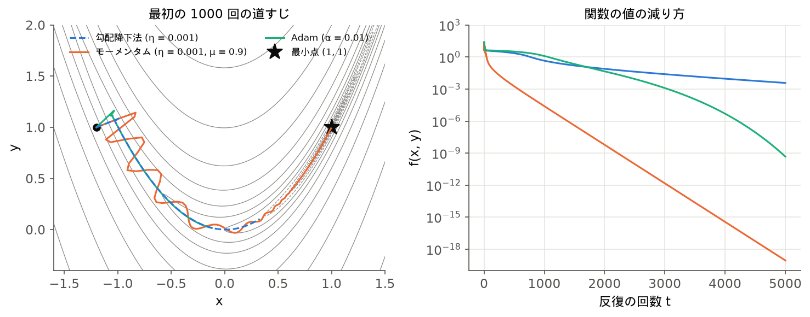

# 第 6 回　最適化：確率的勾配降下法と Adam

!!! abstract "この回の道筋"
    第 5 回では、勾配降下法でニューラルネットワークを学習させましたが、20 万回もの反復が必要でした。
    この回では、まず勾配降下法がなぜ遅くなるのかを、2 次関数とヘッセ行列の固有値で説明します。
    そのうえで、データの一部だけで勾配を計算する確率的勾配降下法、過去の勾配を使うモーメンタムと Adam、学習率を途中で変えるスケジュールを順に導入し、Rosenbrock 関数と第 5 回の Morse ポテンシャルで実際に比べます。

    | 節 | 内容 |
    |---|---|
    | 1 | 勾配降下法と学習率：2 次関数で考える |
    | 2 | 細い谷：Rosenbrock 関数 |
    | 3 | ミニバッチと確率的勾配降下法 |
    | 4 | モーメンタム |
    | 5 | Adam |
    | 6 | 学習率のスケジュール |
    | 7 | 計算例：Rosenbrock 関数で比べる |
    | 8 | 計算例：Morse ポテンシャルのネットワークを Adam で学習する |

    **前に読んでおく回**：[機械学習の基礎 第 1 回](01-what-is-ml.md)、[第 5 回](05-neural-networks.md)

## 1. 勾配降下法と学習率：2 次関数で考える

### 1.1 更新の式

第 5 回で使った**勾配降下法**（gradient descent）を、もう一度書きます。
パラメータをまとめて $\boldsymbol{\theta}$、損失を $L(\boldsymbol{\theta})$ とします。
反復の番号を $t$ として、次の更新をくり返します。

$$
\boldsymbol{\theta}_{t+1} = \boldsymbol{\theta}_t - \eta \, \nabla L(\boldsymbol{\theta}_t)
$$

$\eta > 0$ は学習率です。
$\eta$ が小さすぎると、なかなか進みません。
大きすぎると、谷を飛び越えて、かえって損失が増えることがあります。
この境目を、最も簡単な 2 次関数で求めます。

### 1.2 1 次元の 2 次関数

$L(\theta) = \frac{1}{2}\lambda\theta^2$（$\lambda > 0$）とします。
最小点は $\theta = 0$ で、$\lambda$ は 2 階微分（曲がり具合）です。
勾配は $\lambda\theta$ なので、更新は次のようになります。

$$
\theta_{t+1} = \theta_t - \eta\lambda\theta_t = (1 - \eta\lambda)\,\theta_t
\quad\Longrightarrow\quad
\theta_t = (1 - \eta\lambda)^t \, \theta_0
$$

$\theta_t$ が 0 に近づくのは、$|1 - \eta\lambda| < 1$、つまり $0 < \eta < 2/\lambda$ のときだけです。
$\eta = 1/\lambda$ なら 1 回で最小点に着きます。
$\eta > 2/\lambda$ では、$\theta_t$ は符号を変えながら大きくなり、発散します。
つまり、曲がり具合 $\lambda$ が大きいほど、使える学習率は小さくなります。

### 1.3 多次元の 2 次関数

多次元では、最小点のまわりの損失を 2 次式 $L(\boldsymbol{\theta}) = \frac{1}{2}\boldsymbol{\theta}^\mathsf{T}\mathbf{H}\boldsymbol{\theta}$ で考えます。
$\mathbf{H}$ は 2 階微分を並べた**ヘッセ行列**（Hessian）で、構造最適化で出てくるものと同じです。
最小点では、$\mathbf{H}$ の固有値 $\lambda_1, \dots, \lambda_P$ はすべて正です。

$\mathbf{H}$ の固有ベクトルの方向に座標を取り直すと、損失は 1 次元の 2 次関数の和 $\sum_i \frac{1}{2}\lambda_i u_i^2$ になります。
したがって、各方向の成分は、1.2 節と同じく $(1 - \eta\lambda_i)^t$ 倍になっていきます。
ここから、次の 2 つが分かります。

- すべての方向で収束するには、$\eta < 2/\lambda_\text{max}$ が必要です。
- そのとき、最も曲がり具合の小さい方向の成分は、1 回ごとに $1 - \eta\lambda_\text{min}$ 倍にしかなりません。$\eta$ を上限近くまで大きくしても、$1 - 2\lambda_\text{min}/\lambda_\text{max}$ 倍です。

比 $\kappa = \lambda_\text{max}/\lambda_\text{min}$ を**条件数**（condition number）と呼びます。
$\kappa$ が大きいと、急な方向に合わせて $\eta$ を小さくするしかなく、ゆるやかな方向にはほとんど進めません。
固定した学習率で最もよく選んだときでも、最小点までの距離は 1 回ごとに $(\kappa - 1)/(\kappa + 1)$ 倍にしかならないことが知られています [Bottou 2018]。

**ここまでで分かったこと**：勾配降下法の学習率は、ヘッセ行列の最大の固有値で上限が決まります。条件数が大きいと、ゆるやかな方向の収束がとても遅くなります。

## 2. 細い谷：Rosenbrock 関数

最適化法を比べるときによく使われる 2 次元の関数に、**Rosenbrock 関数**があります [Rosenbrock 1960]。

$$
f(x, y) = (1 - x)^2 + 100\,(y - x^2)^2
$$

最小点は $(x, y) = (1, 1)$ で、そこで $f = 0$ です。
第 2 項の係数 100 のため、$y = x^2$ に沿って、細く曲がった谷ができます。
谷を横切る方向は急で、谷に沿う方向はゆるやかです。

最小点でのヘッセ行列を計算します。
$\partial^2 f/\partial x^2 = 2 - 400(y - x^2) + 800x^2$、$\partial^2 f/\partial x \partial y = -400x$、$\partial^2 f/\partial y^2 = 200$ に $(1, 1)$ を代入すると、次のようになります。

$$
\mathbf{H} = \begin{pmatrix} 802 & -400 \\ -400 & 200 \end{pmatrix}
$$

固有値は約 1001.6 と 0.399 で、条件数は約 2500 です。
1.3 節から、学習率は $2/1001.6 \approx 0.0020$ より小さくする必要があります。
このとき、谷に沿う方向の成分は、1 回ごとに $1 - 0.0020 \times 0.399 \approx 0.9992$ 倍にしかなりません。
1/10 にするのに、約 2900 回かかる計算です（$0.9992^{2900} \approx 0.1$）。

ヘッセ行列の条件数が大きいことを**悪条件**（ill-conditioning）と呼びます。
Goodfellow らの教科書は、ニューラルネットワークの学習の問題にも悪条件があると一般に考えられている、と述べています [Goodfellow 2016, 8.2.1 節]。
第 5 回の勾配降下法が 20 万回もの反復を必要としたのも、同じ種類の問題だと考えられます。
4 節と 5 節の方法は、この問題を和らげるためのものです。

**ここまでで分かったこと**：Rosenbrock 関数は、最小点での条件数が約 2500 の細い谷を持ちます。勾配降下法では、谷に沿って進むのに非常に多くの反復が必要です。

## 3. ミニバッチと確率的勾配降下法

### 3.1 一部のデータで勾配を見積もる

2 節は反復の回数の問題でした。
もう 1 つの問題は、1 回の反復の重さです。
機械学習の損失は、データ点ごとの損失 $\ell_i$ の平均 $L(\boldsymbol{\theta}) = \frac{1}{N}\sum_{i=1}^{N} \ell_i(\boldsymbol{\theta})$ です。
$\nabla L$ を正確に計算するには、$N$ 個のデータ点すべてで誤差逆伝播をする必要があり、データが大きいと重くなります。

そこで、毎回 $N$ 個の中から $B$ 個のデータ点をでたらめに選び、その平均の勾配で更新します。
選んだデータ点の集まり $\mathcal{B}$ を**ミニバッチ**（minibatch）、$B$ を**バッチサイズ**と呼びます。

$$
\boldsymbol{g}_t = \frac{1}{B}\sum_{i \in \mathcal{B}_t} \nabla \ell_i(\boldsymbol{\theta}_t), \qquad
\boldsymbol{\theta}_{t+1} = \boldsymbol{\theta}_t - \eta\,\boldsymbol{g}_t
$$

この方法を**確率的勾配降下法**（stochastic gradient descent, SGD）と呼びます。
考え方は、Robbins と Monro の確率近似法（1951 年）にさかのぼります [Robbins 1951; Bottou 2018]。

$\boldsymbol{g}_t$ は、本当の勾配 $\nabla L$ の「見積もり」です。
データ点を一様にでたらめに選べば、$\boldsymbol{g}_t$ の期待値は $\nabla L$ に一致します。
$B$ 個のデータ点を互いに独立に選ぶとき、$\boldsymbol{g}_t$ の各成分の分散は、1 つのデータ点の勾配の分散 $s^2$ の $1/B$、つまり $s^2/B$ です（独立な量の平均の分散）。

$B$ を大きくすると揺らぎは小さくなりますが、計算の手間は $B$ に比例して増えます。
揺らぎの標準偏差は $1/\sqrt{B}$ でしか減らないので、小さなミニバッチで回数を多く進む方が、同じ計算量で先まで進めることが多くなります。
全データを 1 回ずつ使い終わるまでの更新のまとまりを、**エポック**（epoch）と呼びます。
実際には、エポックごとにデータの順番を混ぜ、先頭から $B$ 個ずつ取り出す方法がよく使われます（8 節のコードもこの方法です）。

### 3.2 揺らぎが残る

SGD には、学習率を一定にすると最小点に落ち着かないという性質があります。
最小点の近くでは本当の勾配は小さくなりますが、ミニバッチの勾配の揺らぎは残るからです。
パラメータは、最小点のまわりを、学習率と揺らぎの大きさで決まる幅で動き続けます。

最小点に近づけるには、反復とともに学習率を小さくします。
どのくらいの速さで小さくすればよいかについては、Robbins と Monro の確率近似法の論文にある、学習率の列 $\eta_t$ についての次の条件が知られています [Robbins 1951]。

$$
\sum_{t} \eta_t = \infty, \qquad \sum_{t} \eta_t^2 < \infty
$$

前の条件は「どこまでも進める」こと、後ろの条件は「揺らぎがやがて消える」ことを表します（$\eta_t \propto 1/t$ が両方を満たす例です）。
Bottou らの総説も、SGD の収束を解析するときの学習率の条件として、これを紹介しています [Bottou 2018]。
実際の学習率の下げ方は、6 節で扱います。

**ここまでで分かったこと**：確率的勾配降下法は、ミニバッチの平均の勾配で更新します。勾配の見積もりの分散は $1/B$ に比例し、学習率が一定のままでは揺らぎが残ります。

## 4. モーメンタム

### 4.1 過去の勾配を足し込む

2 節の細い谷に戻ります。
勾配降下法がうまく進まないのは、勾配がおもに谷を横切る向き（急な方向）を指すからです。
1 回ごとに谷の両側を行き来し、谷に沿う向きにはほとんど進みません。

そこで、過去の勾配を足し合わせて使います。
谷を横切る成分は、1 回ごとに符号が変わるので、打ち消し合います。
谷に沿う成分は、毎回同じ符号なので、大きくなります。
この考え方が**モーメンタム**（momentum）です。
Polyak が 1964 年に提案した方法で、「重い球」（heavy ball）法とも呼ばれます [Polyak 1964; Bottou 2018]。

### 4.2 更新の式

速度 $\boldsymbol{v}$ を導入し、次のように更新します（$\boldsymbol{v}_0 = \boldsymbol{0}$）。

$$
\boldsymbol{v}_{t+1} = \mu\,\boldsymbol{v}_t - \eta\,\nabla L(\boldsymbol{\theta}_t), \qquad
\boldsymbol{\theta}_{t+1} = \boldsymbol{\theta}_t + \boldsymbol{v}_{t+1}
$$

$0 \le \mu < 1$ は、過去の速度をどれだけ残すかを決める数で、0.9 がよく使われます。
$\mu = 0$ なら、勾配降下法に戻ります。

$\boldsymbol{v}$ の式をくり返し代入すると、$\boldsymbol{v}_{t+1} = -\eta \sum_{k=0}^{t} \mu^{t-k} \nabla L(\boldsymbol{\theta}_k)$ です。
つまり、過去の勾配を、古いものほど $\mu$ 倍ずつ小さくして足したものです。
勾配がずっと同じ $\boldsymbol{g}$ なら、$\boldsymbol{v}$ は $-\eta\boldsymbol{g}(1 + \mu + \mu^2 + \cdots) = -\eta\boldsymbol{g}/(1 - \mu)$ に近づきます。
$\mu = 0.9$ なら、同じ学習率で 10 倍の歩幅になります。

2 次関数で $\eta$ と $\mu$ を最もよく選んだとき、1 回ごとの縮み方は $(\kappa - 1)/(\kappa + 1)$ から $(\sqrt{\kappa} - 1)/(\sqrt{\kappa} + 1)$ に改善します [Bottou 2018]。
$\kappa = 2500$ なら、0.9992 が 0.96 になる計算です。

**ここまでで分かったこと**：モーメンタムは、過去の勾配を指数関数的に重みを減らしながら足し込みます。向きが変わる成分は打ち消され、向きが一定の成分は大きくなるので、細い谷を速く進めます。

## 5. Adam

### 5.1 パラメータごとに歩幅を変える

モーメンタムでも、学習率 $\eta$ はすべてのパラメータに共通です。
しかし、ニューラルネットワークのパラメータには、勾配が大きいものも小さいものもあります。

**Adam**（adaptive moment estimation）は、モーメンタムのような勾配の平均と、勾配の 2 乗の平均の両方を使って、パラメータごとに歩幅を決める方法です。
Kingma と Ba が 2014 年に発表しました（ICLR 2015 の会議論文）[Kingma 2014]。

### 5.2 原論文の更新式

原論文のアルゴリズム 1 を書きます [Kingma 2014]。
$\boldsymbol{g}_t$ は $t$ 回目の（ミニバッチの）勾配です。
2 乗、割り算、平方根は、すべてベクトルの成分ごとに計算します。
$\boldsymbol{m}_0 = \boldsymbol{0}$、$\boldsymbol{v}_0 = \boldsymbol{0}$ から始め、$t = 1, 2, \dots$ について次をくり返します。

$$
\boldsymbol{m}_t = \beta_1 \boldsymbol{m}_{t-1} + (1 - \beta_1)\,\boldsymbol{g}_t
$$

$$
\boldsymbol{v}_t = \beta_2 \boldsymbol{v}_{t-1} + (1 - \beta_2)\,\boldsymbol{g}_t^2
$$

$$
\hat{\boldsymbol{m}}_t = \frac{\boldsymbol{m}_t}{1 - \beta_1^t}, \qquad
\hat{\boldsymbol{v}}_t = \frac{\boldsymbol{v}_t}{1 - \beta_2^t}
$$

$$
\boldsymbol{\theta}_t = \boldsymbol{\theta}_{t-1} - \alpha \, \frac{\hat{\boldsymbol{m}}_t}{\sqrt{\hat{\boldsymbol{v}}_t} + \epsilon}
$$

$\beta_1^t$、$\beta_2^t$ は $\beta_1$、$\beta_2$ の $t$ 乗です。
$\alpha$ は学習率で、原論文に合わせて Adam ではこの記号を使います。
原論文が勧める値は、$\alpha = 0.001$、$\beta_1 = 0.9$、$\beta_2 = 0.999$、$\epsilon = 10^{-8}$ です [Kingma 2014]。

### 5.3 式を読む

**$\boldsymbol{m}_t$ と $\boldsymbol{v}_t$。**
$\boldsymbol{m}_t$ は勾配の指数移動平均で、4 節のモーメンタムの $\boldsymbol{v}$ と同じ役割をします。
$\boldsymbol{v}_t$ は勾配の 2 乗の指数移動平均で、各パラメータの勾配の典型的な大きさの 2 乗を表します。

**更新の大きさは、およそ $\alpha$ です。**
更新量は $\alpha\,\hat{m}/\sqrt{\hat{v}}$ です（$\epsilon$ は 0 での割り算を防ぐ小さな数です）。
勾配がほぼ一定なら $|\hat{m}| \approx \sqrt{\hat{v}}$ なので、各パラメータは 1 回におよそ $\alpha$ だけ動きます。
原論文も、1 回の更新の大きさがおよそ $\alpha$ で抑えられることを示しています [Kingma 2014]。

**勾配の大きさの尺度によりません。**
勾配全体を $c$ 倍（$c > 0$）しても、$\hat{m}$ も $\sqrt{\hat{v}}$ も $c$ 倍になるので、更新量は変わりません [Kingma 2014]。
勾配降下法では、1 節の式から分かるように、損失を 100 倍すると使える学習率は 1/100 になります。Adam ではそうなりません。

**勾配の符号がばらつくと、歩幅が小さくなります。**
反復ごとに勾配の符号が変わるパラメータでは、平均 $\hat{m}$ は打ち消し合って小さくなりますが、$\sqrt{\hat{v}}$ は小さくなりません。
そのため、勾配の向きが当てにならないパラメータでは、自動的に歩幅が小さくなります [Kingma 2014]。

**$1 - \beta^t$ で割る理由。**
$\boldsymbol{m}_0 = \boldsymbol{v}_0 = \boldsymbol{0}$ から始めるので、最初のうちの $\boldsymbol{m}_t$、$\boldsymbol{v}_t$ は 0 の側に偏っています。
たとえば $\beta_2 = 0.999$ なら、$t = 1$ の $\boldsymbol{v}_1$ は $0.001\,\boldsymbol{g}_1^2$ しかありません。
導出は付録 A に回しますが、勾配の分布が変わらないとすれば $\mathbb{E}[\boldsymbol{v}_t] = (1 - \beta_2^t)\,\mathbb{E}[\boldsymbol{g}^2]$ です [Kingma 2014]。
したがって、$1 - \beta_2^t$ で割れば、この偏りが取り除けます。
$\boldsymbol{m}_t$ も同じです。

**ここまでで分かったこと**：Adam は、勾配の平均と 2 乗の平均の指数移動平均から、パラメータごとに歩幅を決めます。1 回の更新はおよそ $\alpha$ の大きさで、勾配の尺度によりません。最初の偏りは $1 - \beta^t$ で割って取り除きます。

## 6. 学習率のスケジュール

3.2 節で見たように、SGD や Adam を一定の学習率で続けると、揺らぎのため最小点に落ち着きません。
そこで、学習の途中で学習率を小さくしていきます。
学習率を反復の回数の関数として決めたものを、**学習率のスケジュール**と呼びます。
よく使われるのは、次の 3 つです。

- **段階的に下げる**：決めたエポックごとに、学習率を一定の割合（たとえば 1/10）に下げます。
- **検証の誤差に応じて下げる**：第 3 回の検証データでの誤差が、一定のエポックの間よくならなければ、学習率を下げます。
- **コサインで下げる**：全部で $T$ 回の更新をするとき、$t$ 回目の学習率を次の式で決めます [Loshchilov 2016]。$t = 0$ で $\eta_\text{max}$、$t = T$ で $\eta_\text{min}$ になり、その間をなめらかに下がります。

$$
\eta_t = \eta_\text{min} + \frac{1}{2}(\eta_\text{max} - \eta_\text{min})\left(1 + \cos\frac{\pi t}{T}\right)
$$

Loshchilov と Hutter は、コサインの下げ方を何度も最初からやり直す方法（warm restart）として提案しましたが [Loshchilov 2016]、やり直さずに 1 回だけ下げる使い方も広く使われています。

逆に、学習の最初だけ、小さな学習率から目標の値まで少しずつ上げる**ウォームアップ**（warmup）もあります。
Goyal らは、大きなミニバッチと大きな学習率で学習するときに、最初の 5 エポックで学習率を少しずつ上げる方法を提案しました [Goyal 2017]。

**ここまでで分かったこと**：学習率は、学習の途中で小さくしていくのが普通です。段階的に、検証の誤差に応じて、コサインで、などの下げ方があり、最初のウォームアップを組み合わせることもあります。

## 7. 計算例：Rosenbrock 関数で比べる

2 節の Rosenbrock 関数で、勾配降下法、モーメンタム、Adam を比べます。
出発点は、よく使われる $(-1.2, 1.0)$ です（$f = 24.2$）。
勾配降下法の学習率は、2 節の上限 0.0020 より小さい $\eta = 0.001$ にします。
モーメンタムも同じ $\eta$ で $\mu = 0.9$、Adam は $\alpha = 0.01$ で、ほかは原論文の値です。

```python
import numpy as np

def f(p):
    x, y = p
    return (1 - x)**2 + 100 * (y - x**2)**2

def grad(p):
    x, y = p
    return np.array([-2 * (1 - x) - 400 * x * (y - x**2), 200 * (y - x**2)])

def gd(p0, lr, n):
    p = p0.copy(); path = [p.copy()]
    for t in range(n):
        p = p - lr * grad(p); path.append(p.copy())
    return np.array(path)

def momentum(p0, lr, mu, n):
    p = p0.copy(); v = np.zeros(2); path = [p.copy()]
    for t in range(n):
        v = mu * v - lr * grad(p)
        p = p + v; path.append(p.copy())
    return np.array(path)

def adam(p0, lr, n, b1=0.9, b2=0.999, eps=1e-8):
    p = p0.copy(); m = np.zeros(2); v = np.zeros(2); path = [p.copy()]
    for t in range(1, n + 1):
        g = grad(p)
        m = b1 * m + (1 - b1) * g
        v = b2 * v + (1 - b2) * g**2
        mhat = m / (1 - b1**t)
        vhat = v / (1 - b2**t)
        p = p - lr * mhat / (np.sqrt(vhat) + eps); path.append(p.copy())
    return np.array(path)

p0 = np.array([-1.2, 1.0])
n = 5000
runs = {
    "勾配降下法 (η=0.001)":        gd(p0, 1e-3, n),
    "モーメンタム (η=0.001, μ=0.9)": momentum(p0, 1e-3, 0.9, n),
    "Adam (α=0.01)":              adam(p0, 1e-2, n),
}
for name, path in runs.items():
    out = [f"{name:28s}"]
    for t in (100, 1000, 5000):
        out.append(f"t={t}: f={f(path[t]):.1e}")
    print("  ".join(out))
```

```text
勾配降下法 (η=0.001)               t=100: f=3.8e+00  t=1000: f=4.5e-01  t=5000: f=3.8e-03
モーメンタム (η=0.001, μ=0.9)       t=100: f=1.4e-01  t=1000: f=2.5e-05  t=5000: f=8.8e-20
Adam (α=0.01)                 t=100: f=4.2e+00  t=1000: f=1.3e+00  t=5000: f=4.7e-10
```

道すじと、関数の値の減り方を図に示します（右の図の縦軸は対数目盛です）。



結果を読みます。

- **勾配降下法**は、谷の底まではすぐに下りますが、そこから谷に沿ってほとんど進みません。5000 回後も $f = 3.8 \times 10^{-3}$ です。2 節で見積もったとおり、谷に沿う方向の収束が遅いためです。
- **モーメンタム**は、最初は谷を横切って左右に揺れますが（左の図）、谷に沿う向きに速度がたまり、最も速く収束しました。関数の値は、1000 回ごとに 3〜4 桁ずつ下がっています。
- **Adam** は、最初の 10 回ほどは 1 回にほぼ $\alpha = 0.01$ ずつ動きますが、谷に入ると、各座標の歩幅は 0.002 以下に縮みます（`path` の差から確かめられます）。谷を横切る向きでは勾配の符号が交互に変わるので、5.3 節で見たように $\hat{m}$ が $\sqrt{\hat{v}}$ に比べて小さくなるためと考えられます。そのため、最初の 1000 回では勾配降下法ほども下がっていません（$f = 1.3$ と 0.45）。後半は速く下がり、5000 回後には $f = 4.7 \times 10^{-10}$ になりました。

この例では、Adam は一番ではありませんでした。
Adam の工夫は、座標軸（$x$ や $y$）ごとに歩幅を変えることです。
しかし、Rosenbrock 関数の谷は曲がっていて、急な方向が座標軸に沿っていません。
また、ミニバッチの勾配の揺らぎもありません。
どの最適化法が速いかは、問題によって変わります。

**ここまでで分かったこと**：細い谷では、勾配降下法はほとんど進まず、モーメンタムは速度をためて速く進みます。Adam は、谷を横切る勾配の符号が変わるところで歩幅が小さくなり、この問題では勾配降下法とモーメンタムの間の速さでした。

## 8. 計算例：Morse ポテンシャルのネットワークを Adam で学習する

### 8.1 設定

第 5 回 7.3 節では、Morse ポテンシャルの 30 点を、隠れ層 1 層・幅 20 のネットワークに学習させました。
勾配降下法（学習率 0.05）で 20 万回更新して、テスト RMSE は 1.41 m$E_\mathrm{h}$ でした。
同じデータと同じ初期値で、Adam を試します。
次の 3 つを比べます。

- (a) 全データ（30 点）で勾配を計算する Adam、$\alpha = 0.01$
- (b) バッチサイズ 5 の Adam、$\alpha = 0.01$（1 エポックで 6 回更新）
- (c) (b) の学習率を、0.01 からコサイン（6 節、$\eta_\text{min} = 0$）で 0 まで下げたもの

どれも 5000 エポック学習させます。
コードは、第 5 回 7.1 節の関数 `init_params`、`forward`、`loss_and_grad` と、7.3 節のデータ（`X_tr`、`y_tr`、`X_te`、`y_te`。乱数の状態もそこまで同じ）を使います。

```python
# 第 5 回 7.1 節の関数と、7.3 節のデータ（params を作る直前まで）の続き
import copy

def rmse(params, X, y):
    return np.sqrt(np.mean((forward(params, X)[-1] - y)**2)) * 100   # mEh

def train_adam(params, n_epochs, batch, lr, seed=0, b1=0.9, b2=0.999, eps=1e-8):
    """lr は数（一定の学習率）か、更新の回数 t を受け取る関数（スケジュール）"""
    params = copy.deepcopy(params)
    m = [[np.zeros_like(P) for P in layer] for layer in params]
    v = [[np.zeros_like(P) for P in layer] for layer in params]
    rng = np.random.default_rng(seed)
    N, t = X_tr.shape[0], 0
    for epoch in range(1, n_epochs + 1):
        idx = rng.permutation(N)                   # エポックごとに順番を混ぜる
        for start in range(0, N, batch):
            j = idx[start:start + batch]           # ミニバッチ
            _, grads = loss_and_grad(params, X_tr[j], y_tr[j])
            t += 1
            lr_t = lr(t) if callable(lr) else lr
            for l in range(len(params)):
                for k in range(2):                 # k = 0: W、k = 1: b
                    g = grads[l][k]
                    m[l][k] = b1 * m[l][k] + (1 - b1) * g
                    v[l][k] = b2 * v[l][k] + (1 - b2) * g**2
                    mhat = m[l][k] / (1 - b1**t)
                    vhat = v[l][k] / (1 - b2**t)
                    params[l][k] -= lr_t * mhat / (np.sqrt(vhat) + eps)
        if epoch in (100, 1000, 2000, 5000):
            print(f"  epoch {epoch:4d}（更新 {t:5d} 回）: 訓練 RMSE {rmse(params, X_tr, y_tr):4.2f}, "
                  f"テスト RMSE {rmse(params, X_te, y_te):4.2f} mEh")
    return params

params0 = init_params([1, 20, 1], rng)             # 第 5 回と同じ初期値
print("(a) Adam、バッチ 30（全データ）、学習率 0.01")
pa = train_adam(params0, 5000, 30, 0.01)
print("(b) Adam、バッチ 5、学習率 0.01")
pb = train_adam(params0, 5000, 5, 0.01)
T = 5000 * 6                                        # 更新の総回数（1 エポック 6 回）
cosine = lambda t: 0.01 * 0.5 * (1 + np.cos(np.pi * t / T))
print("(c) Adam、バッチ 5、学習率 0.01 からコサインで 0 へ")
pc = train_adam(params0, 5000, 5, cosine)
```

```text
(a) Adam、バッチ 30（全データ）、学習率 0.01
  epoch  100（更新   100 回）: 訓練 RMSE 8.07, テスト RMSE 9.17 mEh
  epoch 1000（更新  1000 回）: 訓練 RMSE 3.07, テスト RMSE 3.70 mEh
  epoch 2000（更新  2000 回）: 訓練 RMSE 1.42, テスト RMSE 1.84 mEh
  epoch 5000（更新  5000 回）: 訓練 RMSE 0.82, テスト RMSE 1.16 mEh
(b) Adam、バッチ 5、学習率 0.01
  epoch  100（更新   600 回）: 訓練 RMSE 5.13, テスト RMSE 5.94 mEh
  epoch 1000（更新  6000 回）: 訓練 RMSE 1.63, テスト RMSE 2.02 mEh
  epoch 2000（更新 12000 回）: 訓練 RMSE 1.54, テスト RMSE 1.92 mEh
  epoch 5000（更新 30000 回）: 訓練 RMSE 1.76, テスト RMSE 2.22 mEh
(c) Adam、バッチ 5、学習率 0.01 からコサインで 0 へ
  epoch  100（更新   600 回）: 訓練 RMSE 5.13, テスト RMSE 5.94 mEh
  epoch 1000（更新  6000 回）: 訓練 RMSE 1.48, テスト RMSE 1.86 mEh
  epoch 2000（更新 12000 回）: 訓練 RMSE 1.36, テスト RMSE 1.78 mEh
  epoch 5000（更新 30000 回）: 訓練 RMSE 0.86, テスト RMSE 1.26 mEh
```

### 8.2 結果を読む

**(a) Adam は、勾配降下法よりずっと少ない回数で学習できました。**
5000 回の更新で、テスト RMSE は 1.16 m$E_\mathrm{h}$ です。
第 5 回の勾配降下法は、20 万回で 1.41 m$E_\mathrm{h}$ でした。
40 分の 1 の回数で、それより小さな誤差になっています。

**(b) ミニバッチにすると、最初は速く、最後は揺らぎが残ります。**
1 エポックで 6 回更新できるので、100 エポックの時点では (a) よりかなり下がっています（テスト 5.94 と 9.17 m$E_\mathrm{h}$）。
しかし、2000 エポックから 5000 エポックの間に、誤差はかえって増えました。
3.2 節で見たように、学習率が一定のままでは、ミニバッチの勾配の揺らぎで、パラメータが最小点のまわりを動き続けるためと考えられます。

**(c) 学習率を下げると、揺らぎが収まります。**
同じミニバッチでも、コサインで学習率を 0 まで下げると、最後のテスト RMSE は 1.26 m$E_\mathrm{h}$ まで下がりました。
(b) との違いは、学習率のスケジュールだけです。

### 8.3 化学での使われ方

機械学習ポテンシャルの学習も、同じ部品でできています。
損失はエネルギーと力の誤差の和で（詳しくは「量子化学のための機械学習」で扱います）、ミニバッチは構造をいくつか集めたものです。
一例として、NequIP の論文（arXiv 版）は、次の設定を報告しています [Batzner 2021]。

- 最適化法：Adam の変種の AMSGrad（$\beta_1 = 0.9$、$\beta_2 = 0.999$、$\epsilon = 10^{-8}$）。AMSGrad は、Adam が収束しない例を示した Reddi らが提案した修正で、$\boldsymbol{v}_t$ の代わりにそれまでの $\boldsymbol{v}_t$ の最大値を使います [Reddi 2019]。
- 小さな分子の系：学習率 0.01、バッチサイズ 5
- スケジュール：検証データでの力の損失が 50 エポックの間よくならなければ、学習率を 0.8 倍にする（6 節の「検証の誤差に応じて下げる」方法）

論文は、小さなバッチサイズを使うことが重要なハイパーパラメータだったとも述べています [Batzner 2021]。
NequIP のモデルそのものは、[量子化学のための機械学習 第 5 回](../ml-chem/05-equivariant-mlips.md)で説明しています。

**ここまでで分かったこと**：第 5 回の Morse ポテンシャルの学習で、Adam は勾配降下法の 40 分の 1 の更新回数で、より小さな誤差に達しました。ミニバッチで学習率を一定にすると揺らぎが残り、学習率を下げると収まります。

## まとめ

- 勾配降下法の学習率の上限はヘッセ行列の最大の固有値で決まり、条件数が大きいとゆるやかな方向の収束が遅くなります。
- 確率的勾配降下法は、ミニバッチで勾配を見積もって 1 回の計算を軽くします。見積もりの分散は $1/B$ に比例し、学習率が一定だと揺らぎが残ります。
- モーメンタムは過去の勾配を足し込んで、細い谷を速く進みます。
- Adam は、勾配の平均と 2 乗の平均からパラメータごとに歩幅を決め、1 回の更新はおよそ $\alpha$ です。最初の偏りは $1 - \beta^t$ で割って取り除きます。
- 学習率は途中で下げるのが普通で、段階的、検証の誤差に応じて、コサインで、などの方法があります。

## 付録 A　Adam の偏りの補正

5.3 節の $\mathbb{E}[\boldsymbol{v}_t] = (1 - \beta_2^t)\,\mathbb{E}[\boldsymbol{g}^2]$ を導きます [Kingma 2014]。
成分ごとの式なので、1 つの成分だけを考えます。

$v_0 = 0$ から $v_t = \beta_2 v_{t-1} + (1 - \beta_2) g_t^2$ をくり返し代入すると、次のようになります。

$$
v_t = (1 - \beta_2) \sum_{i=1}^{t} \beta_2^{\,t-i} g_i^2
$$

両辺の期待値を取ります。
勾配の分布が反復によって変わらず、$\mathbb{E}[g_i^2] = \mathbb{E}[g^2]$ がどの $i$ でも同じだとします。

$$
\mathbb{E}[v_t] = (1 - \beta_2)\,\mathbb{E}[g^2] \sum_{i=1}^{t} \beta_2^{\,t-i}
= (1 - \beta_2)\,\mathbb{E}[g^2] \, \frac{1 - \beta_2^t}{1 - \beta_2}
= (1 - \beta_2^t)\,\mathbb{E}[g^2]
$$

2 つ目の等号では、等比数列の和 $\sum_{k=0}^{t-1}\beta_2^k = (1 - \beta_2^t)/(1 - \beta_2)$ を使いました。
したがって、$\hat{v}_t = v_t/(1 - \beta_2^t)$ の期待値は $\mathbb{E}[g^2]$ に一致します。
$t$ が大きくなると $\beta_2^t \to 0$ なので、補正の効果は最初のうちだけです。
$m_t$ についても、$g_i^2$ を $g_i$ に、$\beta_2$ を $\beta_1$ に置き換えれば、同じ結果が得られます。

勾配の分布が反復とともに変わる場合は、上の式に補正の項が加わります。
原論文は、$\beta$ を適切に選べば、遠い過去の勾配の重みが小さくなるので、この項は小さく保てると述べています [Kingma 2014]。

## 参考文献

- I. Goodfellow, Y. Bengio, A. Courville, "Deep Learning" (MIT Press, 2016). ISBN: 9780262035613
- L. Bottou, F. E. Curtis, J. Nocedal, "Optimization Methods for Large-Scale Machine Learning", SIAM Rev. 60, 223 (2018). DOI: [10.1137/16M1080173](https://doi.org/10.1137/16M1080173)
- H. H. Rosenbrock, "An Automatic Method for Finding the Greatest or Least Value of a Function", Comput. J. 3, 175 (1960). DOI: [10.1093/comjnl/3.3.175](https://doi.org/10.1093/comjnl/3.3.175)
- H. Robbins, S. Monro, "A Stochastic Approximation Method", Ann. Math. Stat. 22, 400 (1951). DOI: [10.1214/aoms/1177729586](https://doi.org/10.1214/aoms/1177729586)
- B. T. Polyak, "Some methods of speeding up the convergence of iteration methods", USSR Comput. Math. Math. Phys. 4, 1 (1964). DOI: [10.1016/0041-5553(64)90137-5](https://doi.org/10.1016/0041-5553(64)90137-5)
- D. P. Kingma, J. Ba, "Adam: A Method for Stochastic Optimization", arXiv:1412.6980 (2014).
- S. J. Reddi, S. Kale, S. Kumar, "On the Convergence of Adam and Beyond", arXiv:1904.09237 (2019).
- I. Loshchilov, F. Hutter, "SGDR: Stochastic Gradient Descent with Warm Restarts", arXiv:1608.03983 (2016).
- P. Goyal, P. Dollár, R. Girshick, P. Noordhuis, L. Wesolowski, A. Kyrola, A. Tulloch, Y. Jia, K. He, "Accurate, Large Minibatch SGD: Training ImageNet in 1 Hour", arXiv:1706.02677 (2017).
- S. Batzner, A. Musaelian, L. Sun, M. Geiger, J. P. Mailoa, M. Kornbluth, N. Molinari, T. E. Smidt, B. Kozinsky, "E(3)-Equivariant Graph Neural Networks for Data-Efficient and Accurate Interatomic Potentials", arXiv:2101.03164 (2021).
