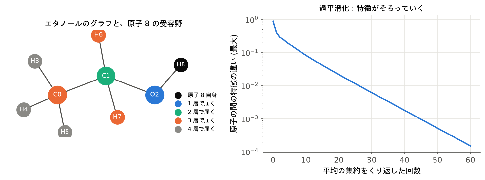

# 第 7 回　グラフニューラルネットワーク

!!! abstract "この回の道筋"
    分子は、原子を頂点、結合を辺とする「グラフ」として表せます。
    グラフニューラルネットワークは、各原子が隣の原子から情報（メッセージ）を受け取って自分の特徴を書き換える操作をくり返し、最後に全原子の特徴をまとめて分子の性質を予測します。
    この回では、Gilmer らのメッセージパッシングの一般形を説明し、集約のしかた（和と平均）と原子の番号の付け方によらない性質、層の数と受容野、層を重ねすぎたときの過平滑化を、numpy の小さな計算で確かめます。

    | 節 | 内容 |
    |---|---|
    | 1 | 分子をグラフとして表す |
    | 2 | メッセージパッシングの一般形 |
    | 3 | 集約と置換不変性 |
    | 4 | 計算例：エタノールで 1 層のメッセージパッシング |
    | 5 | 受容野：層の数と、情報が届く範囲 |
    | 6 | 過平滑化 |
    | 7 | 化学での使われ方 |

    **前に読んでおく回**：[機械学習の基礎 第 5 回](05-neural-networks.md)、[第 6 回](06-optimization.md)

!!! tip "物理的なイメージ"
    グラフニューラルネットワークは、各原子が隣の原子と「伝言（メッセージ）」をやり取りして、自分のまわりの情報を集める仕組みです。1 回のやり取りで隣の原子の情報が、2 回で 2 つ先の原子の情報が届きます。最後に原子ごとの情報をまとめて、分子全体の性質を予測します。やり取りの仕方が原子の番号の付け方によらないので、番号を付け替えても結果は変わりません。

## 1. 分子をグラフとして表す

### 1.1 グラフ

**グラフ**（graph）は、**頂点**（vertex、node）の集まりと、2 つの頂点を結ぶ**辺**（edge）の集まりでできたものです。
分子では、原子を頂点、化学結合を辺とするのが最も素直な表し方です。
これを**分子グラフ**と呼びます。
構造式は、分子グラフを紙に描いたものと言えます。

頂点に $1, \dots, n$ の番号を付けると、グラフは $n \times n$ の**隣接行列**（adjacency matrix）$\mathbf{A}$ で表せます。
頂点 $i$ と $j$ が辺で結ばれていれば $A_{ij} = 1$、そうでなければ $A_{ij} = 0$ です。
結合には向きがないので、$\mathbf{A}$ は対称行列です。
頂点 $i$ と辺で結ばれた頂点の集まりを、$i$ の**近傍**（neighborhood）と呼び、$\mathcal{N}(i)$ と書きます。

### 1.2 頂点と辺の特徴

グラフの形だけでなく、各頂点と各辺に数のベクトルを持たせます。

- **頂点の特徴** $\boldsymbol{x}_i$：元素の種類（たとえば H、C、O を $(1,0,0)$、$(0,1,0)$、$(0,0,1)$ で表す one-hot ベクトル）、形式電荷、芳香族かどうか、など。
- **辺の特徴** $\boldsymbol{e}_{ij}$：結合の種類（単結合、二重結合など）。3 次元構造が分かっていれば、原子間の距離も使えます。

### 1.3 番号の付け方は任意

ここで大事なのは、原子の番号の付け方に意味がないことです。
エタノールの 2 つの炭素のどちらを 0 番と呼んでも、同じ分子です。
番号を付け替えると、隣接行列は $\mathbf{A} \to \mathbf{P}\mathbf{A}\mathbf{P}^\mathsf{T}$ と変わります。
$\mathbf{P}$ は**置換行列**（各行・各列にちょうど 1 つだけ 1 があり、ほかは 0 の行列）で、番号の並べ替えを表します。
頂点の特徴を行に並べた行列 $\mathbf{X}$ も、$\mathbf{X} \to \mathbf{P}\mathbf{X}$ と行が並べ替わります。

分子の性質を予測するモデルは、番号を付け替えても同じ答えを出さなければなりません。
第 5 回の多層パーセプトロンに $\mathbf{A}$ や $\mathbf{X}$ をそのまま 1 本のベクトルにして入れると、この性質は成り立ちません。
入力の成分の並び順が変わると、一般に出力も変わるからです。
また、原子の数が分子ごとに違うので、入力の長さが決まりません。
グラフニューラルネットワークは、この 2 つの問題を、モデルの形そのもので解決します。

**ここまでで分かったこと**：分子は、原子を頂点、結合を辺とするグラフで表せます。原子の番号の付け方は任意なので、モデルは番号の付け替え（置換）で答えが変わらないように作る必要があります。

## 2. メッセージパッシングの一般形

### 2.1 Gilmer らの枠組み

**グラフニューラルネットワーク**（graph neural network, GNN）は、グラフを入力とするニューラルネットワークの総称です。
グラフの上のニューラルネットワークの初期のモデルとして、Scarselli らの研究があります [Scarselli 2009]。
その後、分子のためのモデルがいくつも提案されました。
Gilmer らは 2017 年に、それらを 1 つの共通の形にまとめ、**メッセージパッシングニューラルネットワーク**（message passing neural network, MPNN）と名付けました [Gilmer 2017]。

MPNN では、各頂点 $v$ が**隠れ状態**（特徴ベクトル）$\boldsymbol{h}_v^t$ を持ちます。
最初の $\boldsymbol{h}_v^0$ は、頂点の特徴 $\boldsymbol{x}_v$ から作ります。
計算は、メッセージパッシングの段階と、読み出しの段階に分かれます [Gilmer 2017]。

**メッセージパッシングの段階。**
$t = 0, 1, \dots, T-1$ について、次の 2 つをくり返します。

$$
\boldsymbol{m}_v^{t+1} = \sum_{w \in \mathcal{N}(v)} M_t\bigl(\boldsymbol{h}_v^t, \boldsymbol{h}_w^t, \boldsymbol{e}_{vw}\bigr)
$$

$$
\boldsymbol{h}_v^{t+1} = U_t\bigl(\boldsymbol{h}_v^t, \boldsymbol{m}_v^{t+1}\bigr)
$$

$M_t$ を**メッセージ関数**、$U_t$ を**更新関数**と呼びます。
1 つ目の式で、頂点 $v$ は、隣の各頂点 $w$ から「メッセージ」$M_t(\cdots)$ を受け取り、それを足し合わせます。
2 つ目の式で、受け取ったメッセージの和 $\boldsymbol{m}_v^{t+1}$ と自分の今の状態から、新しい状態を作ります。
1 回のくり返しを、ニューラルネットワークの 1 **層**と数えます。

**読み出しの段階。**
最後の状態から、グラフ全体の出力を作ります。

$$
\hat{y} = R\bigl(\{\boldsymbol{h}_v^T \mid v \in G\}\bigr)
$$

$R$ を**読み出し関数**（readout function）と呼びます。
最も簡単な例は、全頂点の状態を足し合わせてから多層パーセプトロンを通す $R = f\bigl(\sum_v \boldsymbol{h}_v^T\bigr)$ です [Gilmer 2017]。

$M_t$、$U_t$、$R$ は、どれも学習するパラメータを含む微分可能な関数（多層パーセプトロンなど）です [Gilmer 2017]。
そのため、第 5 回の誤差逆伝播と第 6 回の最適化法で、全体をまとめて学習できます。

### 2.2 最も簡単な例

この回の計算例では、次の最も簡単な形を使います。

$$
\boldsymbol{m}_v = \sum_{w \in \mathcal{N}(v)} \mathbf{W}_\text{msg}\,\boldsymbol{h}_w, \qquad
\boldsymbol{h}_v' = \tanh\bigl(\mathbf{W}_\text{self}\,\boldsymbol{h}_v + \boldsymbol{m}_v + \boldsymbol{b}\bigr)
$$

メッセージは、隣の状態に行列 $\mathbf{W}_\text{msg}$ を掛けたものです。
更新は、第 5 回の 1 層分の計算（1 次変換と活性化関数）に、メッセージの和を足したものです。
頂点の状態を行に並べた行列 $\mathbf{H}$ で書くと、次のようになります。

$$
\mathbf{H}' = \tanh\bigl(\mathbf{H}\mathbf{W}_\text{self}^\mathsf{T} + \mathbf{A}\mathbf{H}\mathbf{W}_\text{msg}^\mathsf{T} + \boldsymbol{1}\boldsymbol{b}^\mathsf{T}\bigr)
$$

$\mathbf{A}\mathbf{H}$ の $v$ 行目は $\sum_w A_{vw}\boldsymbol{h}_w^\mathsf{T}$ なので、ちょうど近傍についての和になります。
$\boldsymbol{1}$ はすべての成分が 1 の列ベクトルです。

大事なのは、**重み $\mathbf{W}_\text{msg}$、$\mathbf{W}_\text{self}$、$\boldsymbol{b}$ がすべての頂点で共通**なことです。
原子が 9 個の分子でも 50 個の分子でも、同じパラメータがそのまま使えます。
これで、1.3 節の「入力の長さが決まらない」問題が解決します。

**ここまでで分かったこと**：MPNN は、隣からのメッセージを足し合わせて各頂点の状態を書き換える操作を $T$ 回くり返し、最後に全頂点の状態を読み出し関数でまとめます。重みは全頂点で共通です。

## 3. 集約と置換不変性

### 3.1 なぜ「和」なのか

メッセージを 1 つにまとめる操作を**集約**（aggregation）と呼びます。
2.1 節の式では和を使いました。
和の代わりに平均や最大値を使うモデルもあります。
これらに共通するのは、**足す順番（並べる順番）によらない**ことです。

頂点 $v$ の隣にどの頂点が何番として並んでいても、集約の結果は同じです。
そのため、番号を付け替えても、各頂点の新しい状態は「同じ原子の状態」として変わりません。
変わるのは、それが何番目の行に書かれているかだけです。
行列で書くと、$\mathbf{A} \to \mathbf{P}\mathbf{A}\mathbf{P}^\mathsf{T}$、$\mathbf{H} \to \mathbf{P}\mathbf{H}$ としたとき、2.2 節の式は次のようになります。

$$
\mathbf{P}\mathbf{H}\mathbf{W}_\text{self}^\mathsf{T} + \mathbf{P}\mathbf{A}\mathbf{P}^\mathsf{T}\mathbf{P}\mathbf{H}\mathbf{W}_\text{msg}^\mathsf{T} + \boldsymbol{1}\boldsymbol{b}^\mathsf{T}
= \mathbf{P}\bigl(\mathbf{H}\mathbf{W}_\text{self}^\mathsf{T} + \mathbf{A}\mathbf{H}\mathbf{W}_\text{msg}^\mathsf{T} + \boldsymbol{1}\boldsymbol{b}^\mathsf{T}\bigr)
$$

ここで、置換行列が $\mathbf{P}^\mathsf{T}\mathbf{P} = \mathbf{I}$ を満たすことと、$\mathbf{P}\boldsymbol{1} = \boldsymbol{1}$ を使いました。
$\tanh$ は成分ごとに作用するので、行の並べ替えと順番を入れ替えられます。
したがって、$\mathbf{H}' \to \mathbf{P}\mathbf{H}'$ です。

### 3.2 不変と等変

上の結果には、2 つの種類の「変わらなさ」が現れています。

- **各頂点の状態**は、番号を付け替えると、同じように並べ替わります（$\mathbf{H}' \to \mathbf{P}\mathbf{H}'$）。入力の変換に合わせて出力も決まった規則で変わることを、**等変**（equivariant）と呼びます。
- **読み出した出力**は、全頂点について足すので、並べ替えても変わりません（$\boldsymbol{1}^\mathsf{T}\mathbf{P}\mathbf{H}' = \boldsymbol{1}^\mathsf{T}\mathbf{H}'$）。入力を変換しても出力が変わらないことを、**不変**（invariant）と呼びます。

つまり、MPNN は「層の中では置換について等変、読み出しで不変」という作りになっています。
Gilmer らも、読み出し関数は頂点の並べ替えについて不変でなければならないと述べています [Gilmer 2017]。
不変と等変は、回転などの対称性についても使う考え方で、[第 8 回](08-invariance-equivariance.md)で一般的に扱います。

### 3.3 和と平均の違い

集約に平均を使うと、近傍の頂点の数（化学で言えば結合の数）によらず、メッセージの大きさがそろいます。
広く使われるグラフ畳み込みネットワーク（GCN）も、和をそのまま使わず、次数（つながっている辺の数）で正規化した和を使います [Kipf 2016]。

しかし、平均には弱点があります。
Xu らは、近傍の特徴の集まりを「同じものが何度も現れてよい集合」（多重集合）と見なして、集約の表現力を調べました [Xu 2018]。
その結果によると、和は多重集合全体をとらえますが、平均がとらえるのは要素の割合（分布）だけです [Xu 2018]。
たとえば、隣が $\{a\}$ の頂点と $\{a, a, a, a\}$ の頂点は、平均では区別できません。

化学の例で言えば、メタン CH$_4$ の C 原子（隣は H が 4 つ）と、メチリジン CH の C 原子（隣は H が 1 つ）は、平均の集約では同じメッセージを受け取ります。
結合の数という化学的に大事な情報が、平均では失われるわけです。
4 節の計算例で、このことを確かめます。

**ここまでで分かったこと**：集約に和や平均を使うと、各頂点の状態は番号の付け替えについて等変になり、全頂点の和で読み出した出力は不変になります。平均は近傍の要素の割合しかとらえず、結合の数を区別できません。

## 4. 計算例：エタノールで 1 層のメッセージパッシング

### 4.1 1 層を計算する

エタノール CH$_3$CH$_2$OH の分子グラフ（水素も含めて 9 個の原子）で、2.2 節の 1 層を計算します。
頂点の特徴は元素の one-hot ベクトル（3 次元）、隠れ状態は 4 次元です。
重みは学習させず、でたらめに選びます。
ここで確かめたいのは、学習の結果ではなく、モデルの形が持つ性質だからです。
原子の番号は、0 と 1 が C（0 がメチル基）、2 が O、3〜5 がメチル基の H、6 と 7 が CH$_2$ の H、8 がヒドロキシ基の H です。

```python
import numpy as np

# エタノール CH3-CH2-OH の分子グラフ（原子が頂点、結合が辺）
elements = ["C", "C", "O", "H", "H", "H", "H", "H", "H"]
#            0    1    2    3    4    5    6    7    8
bonds = [(0, 1), (1, 2), (0, 3), (0, 4), (0, 5), (1, 6), (1, 7), (2, 8)]
n = len(elements)
A = np.zeros((n, n))
for i, j in bonds:
    A[i, j] = A[j, i] = 1.0                     # 隣接行列

# 頂点の特徴：元素の one-hot ベクトル [H, C, O]
onehot = {"H": [1, 0, 0], "C": [0, 1, 0], "O": [0, 0, 1]}
X = np.array([onehot[e] for e in elements], dtype=float)

# 1 層のメッセージパッシング（重みはでたらめに選ぶ）
rng = np.random.default_rng(0)
d_in, d_hid = 3, 4
W_msg = rng.normal(scale=0.5, size=(d_hid, d_in))   # メッセージ関数 M(h_i, h_j) = W_msg h_j
W_self = rng.normal(scale=0.5, size=(d_hid, d_in))  # 更新関数 U の、自分の特徴にかかる重み
b = rng.normal(scale=0.5, size=d_hid)
w_out = rng.normal(size=d_hid)                      # 読み出しの重み

def mp_layer(A, H):
    M = A @ H @ W_msg.T                         # m_i = Σ_{j∈N(i)} W_msg h_j（和の集約）
    return np.tanh(H @ W_self.T + M + b)        # h_i' = U(h_i, m_i)

def readout(H):
    return w_out @ H.sum(axis=0)                # 原子についての和 → 分子の値

H1 = mp_layer(A, X)
for i in range(n):
    print(f"原子 {i} ({elements[i]}): h' = {np.round(H1[i], 3)}")
print("分子の出力 y =", round(readout(H1), 6))
```

```text
原子 0 (C): h' = [ 0.434 -0.324  0.989 -0.995]
原子 1 (C): h' = [ 0.618 -0.204  0.918 -0.982]
原子 2 (O): h' = [-0.173 -0.315  0.598 -0.842]
原子 3 (H): h' = [-0.651 -0.528  0.298 -0.089]
原子 4 (H): h' = [-0.651 -0.528  0.298 -0.089]
原子 5 (H): h' = [-0.651 -0.528  0.298 -0.089]
原子 6 (H): h' = [-0.651 -0.528  0.298 -0.089]
原子 7 (H): h' = [-0.651 -0.528  0.298 -0.089]
原子 8 (H): h' = [-0.372 -0.137 -0.476  0.238]
分子の出力 y = -2.459957
```

### 4.2 結果を読む

2 つの C 原子（0 と 1）は、同じ元素ですが、違う状態になりました。
原子 0 の隣は C と H が 3 つ、原子 1 の隣は C、O、H が 2 つで、受け取るメッセージが違うからです。
1 層のメッセージパッシングで、各原子の状態に「どの原子と結合しているか」の情報が入ったことになります。

一方、C に結合した 5 つの H（原子 3〜7）は、すべて同じ状態です。
どの H も、隣は C が 1 つだけなので、1 層では区別がつきません。
O に結合した H（原子 8）だけが違う状態になりました。
これは 5 節の受容野の話につながります。

### 4.3 番号を付け替える

原子の番号をでたらめに付け替えて、3.1 節の性質を確かめます。

```python
# 上の続き：原子の番号を付け替える
perm = rng.permutation(n)                       # 新しい番号 k の原子 = もとの原子 perm[k]
P = np.eye(n)[perm]                             # 置換行列
A_p, X_p = P @ A @ P.T, P @ X
H1_p = mp_layer(A_p, X_p)
print("perm =", perm)
print("原子の特徴は同じように並べ替わるか:", np.allclose(H1_p, P @ H1))
print("分子の出力:", round(readout(H1), 6), "→", round(readout(H1_p), 6))
```

```text
perm = [2 6 4 8 0 7 3 1 5]
原子の特徴は同じように並べ替わるか: True
分子の出力: -2.459957 → -2.459957
```

各原子の状態は、番号の付け替えと同じように並べ替わり（等変）、分子の出力は変わりませんでした（不変）。

### 4.4 和と平均を比べる

3.3 節の、メタンとメチリジンの C 原子が受け取るメッセージを、和と平均で比べます。

```python
# 上の続き：和と平均の集約を比べる。メタン CH4 と、メチリジン CH の C 原子
def message(A, H, i, how):
    nb = A[i] > 0
    s = (H[nb] @ W_msg.T).sum(axis=0)
    return s if how == "sum" else s / nb.sum()

for name, els in [("CH4", ["C", "H", "H", "H", "H"]), ("CH ", ["C", "H"])]:
    Xm = np.array([onehot[e] for e in els], dtype=float)
    Am = np.zeros((len(els), len(els))); Am[0, 1:] = Am[1:, 0] = 1.0   # C に H が結合
    print(f"{name}: 和 {np.round(message(Am, Xm, 0, 'sum'), 3)}   平均 {np.round(message(Am, Xm, 0, 'mean'), 3)}")
```

```text
CH4: 和 [ 0.251  0.21   2.608 -2.531]   平均 [ 0.063  0.052  0.652 -0.633]
CH : 和 [ 0.063  0.052  0.652 -0.633]   平均 [ 0.063  0.052  0.652 -0.633]
```

和では、メタンのメッセージはメチリジンのちょうど 4 倍で、区別できます。
平均では、2 つはまったく同じです。
C 原子自身の特徴も同じなので、平均の集約の 1 層では、2 つの C 原子は同じ状態になります。

**ここまでで分かったこと**：1 層のメッセージパッシングで、各原子の状態に隣の原子の情報が入ります。番号を付け替えると、原子の状態は同じように並べ替わり、和で読み出した出力は変わりません。平均の集約では、結合の数の違いが消えます。

## 5. 受容野：層の数と、情報が届く範囲

### 5.1 1 層で届くのは隣まで

4.2 節で、C に結合した H はすべて同じ状態になりました。
1 層のメッセージパッシングでは、各頂点は隣の頂点の状態しか受け取らないからです。
2 層目では、隣の頂点が 1 層目で受け取った情報、つまり 2 つ先の頂点の情報も届きます。
一般に、$T$ 層の後の頂点 $v$ の状態は、$v$ から辺を $T$ 本以内でたどれる頂点だけで決まります。
この範囲を、頂点 $v$ の**受容野**（receptive field）と呼びます。

下の図の左は、エタノールの原子 8（ヒドロキシ基の H）の受容野を、層の数ごとに色分けしたものです。
4 層あれば、分子全体の情報が原子 8 に届きます。



### 5.2 計算で確かめる

2 層目を重ねて、メチル基の H（原子 3）と CH$_2$ の H（原子 6）が区別できるようになることを確かめます。

```python
# 上の続き：2 層目を重ねる（2 層目は別の重みを使う）
W_msg2 = rng.normal(scale=0.5, size=(d_hid, d_hid))
W_self2 = rng.normal(scale=0.5, size=(d_hid, d_hid))
b2 = rng.normal(scale=0.5, size=d_hid)
H2 = np.tanh(H1 @ W_self2.T + A @ H1 @ W_msg2.T + b2)
for i in (3, 6, 8):
    print(f"原子 {i} ({elements[i]}): 1 層後 {np.round(H1[i], 3)}   2 層後 {np.round(H2[i], 3)}")
```

```text
原子 3 (H): 1 層後 [-0.651 -0.528  0.298 -0.089]   2 層後 [ 0.267  0.378 -0.056 -0.03 ]
原子 6 (H): 1 層後 [-0.651 -0.528  0.298 -0.089]   2 層後 [ 0.243  0.531 -0.056  0.154]
原子 8 (H): 1 層後 [-0.372 -0.137 -0.476  0.238]   2 層後 [-0.304 -0.137  0.218 -0.316]
```

1 層後に同じだった原子 3 と 6 が、2 層後には違う状態になりました。
原子 3 の隣の C（原子 0）と、原子 6 の隣の C（原子 1）は、1 層目で違う状態になっていたからです。

### 5.3 層の数を決める

受容野の外の原子は、その頂点の状態に影響しません。
したがって、性質を決めるのに遠くの原子の情報が必要なら、それが届くだけの層の数が必要です。
3 次元構造を使うモデルでは、辺を「ある距離（カットオフ半径）より近い原子の組」として作ることが多く、このときは受容野が距離で決まります。
機械学習ポテンシャルでの受容野の考え方は、[量子化学のための機械学習 第 4 回](../ml-chem/04-early-mlips.md)で、SchNet を例に計算しています。

**ここまでで分かったこと**：$T$ 層のメッセージパッシングでは、各頂点に、辺を $T$ 本以内でたどれる頂点の情報だけが届きます。この範囲が受容野です。

## 6. 過平滑化

### 6.1 層を増やせばよいわけではない

受容野を広げるには、層を増やせばよいように思えます。
しかし、層を重ねすぎると、すべての頂点の状態が似てきて、区別がつかなくなることがあります。
この現象を**過平滑化**（over-smoothing）と呼びます。

Li らは、GCN の 1 層の計算が、グラフの上で各頂点の値を「自分と隣の重み付き平均」に置き換える操作（ラプラシアン平滑化）の一種であることを示しました [Li 2018]。
そして、この操作をくり返すと、グラフのつながった部分の中で、頂点の特徴が同じ値に近づくことを示し、層の多い GCN では特徴が区別できなくなる心配があると指摘しました [Li 2018]。

### 6.2 計算で確かめる

重みを使わず、「自分を含む隣の平均」をくり返す操作だけを、エタノールで試します。
各頂点に自分自身への辺を加えた隣接行列 $\tilde{\mathbf{A}} = \mathbf{A} + \mathbf{I}$ を、行ごとに行の和で割った行列を $\mathbf{S}$ とすると、1 回の操作は $\mathbf{H} \to \mathbf{S}\mathbf{H}$ です。

```python
# 上の続き：自分を含む隣の平均を何度もくり返す（重みなし）
A_self = A + np.eye(n)                          # 自分自身への辺を加える
S = A_self / A_self.sum(axis=1, keepdims=True)  # 各行を、自分と隣の平均にする行列
H = X.copy()
for k in range(0, 51):
    if k in (0, 1, 2, 5, 10, 20, 50):
        spread = np.max(np.abs(H - H.mean(axis=0)))
        print(f"{k:2d} 回後: C 原子 {np.round(H[0], 3)}  O 原子 {np.round(H[2], 3)}  原子の間の違いの最大 {spread:.1e}")
    H = S @ H
```

```text
 0 回後: C 原子 [0. 1. 0.]  O 原子 [0. 0. 1.]  原子の間の違いの最大 8.9e-01
 1 回後: C 原子 [0.6 0.4 0. ]  O 原子 [0.333 0.333 0.333]  原子の間の違いの最大 4.0e-01
 2 回後: C 原子 [0.5  0.46 0.04]  O 原子 [0.411 0.244 0.344]  原子の間の違いの最大 2.9e-01
 5 回後: C 原子 [0.51 0.44 0.05]  O 原子 [0.441 0.314 0.246]  原子の間の違いの最大 1.8e-01
10 回後: C 原子 [0.496 0.423 0.081]  O 原子 [0.458 0.361 0.181]  原子の間の違いの最大 8.3e-02
20 回後: C 原子 [0.485 0.407 0.108]  O 原子 [0.474 0.39  0.137]  原子の間の違いの最大 2.2e-02
50 回後: C 原子 [0.48 0.4  0.12]  O 原子 [0.48 0.4  0.12]  原子の間の違いの最大 5.2e-04
```

最初は C 原子と O 原子の特徴がまったく違いましたが、50 回後には、どちらも $(0.48, 0.40, 0.12)$ になりました。
原子の間の違いは、くり返しごとにほぼ一定の割合で小さくなっています（5.1 節の図の右）。

### 6.3 行き着く先

行き着いた値 $(0.48, 0.40, 0.12)$ にも意味があります。
自分自身への辺を含めた各原子の辺の数は、C が 5、O が 3、H が 2 です。
これで重みを付けて、元素の割合を数えます。
H は $6 \times 2 = 12$、C は $2 \times 5 = 10$、O は $1 \times 3 = 3$ で、合計 25 なので、$(12, 10, 3)/25 = (0.48, 0.40, 0.12)$ です。
つまり、くり返しの果てには、どの原子の特徴も「分子全体の（辺の数で重みを付けた）組成」になります。
どの原子が O だったかという情報は、すべて失われました。

この行き着く先は、$\mathbf{S}$ の固有値 1 の固有ベクトルがすべての成分の等しいベクトルであることから導けます [Li 2018]。
導出は付録 A に回しますが、結果は上のとおりです。

実際のモデルでは、層ごとに重みと活性化関数が入るので、この計算ほど単純ではありません。
それでも、集約が平均をとる操作である以上、層を重ねるほど頂点の状態が混ざっていく傾向は残ります。
そのため、受容野を広げたいときも、層の数はむやみに増やしません。

**ここまでで分かったこと**：平均の集約をくり返すと、すべての頂点の特徴が同じ値に近づき、区別がつかなくなります（過平滑化）。層の数は、受容野と過平滑化の釣り合いで決めます。

## 7. 化学での使われ方

Gilmer らは、MPNN を、約 13 万個の小さな有機分子について DFT で計算した 13 種類の性質を集めたデータセット QM9 で試しました [Gilmer 2017]。
論文によると、13 の性質すべてでそれまでの最高の精度を出し、そのうち 11 の性質で、DFT との差を化学的精度と呼ばれる目標の範囲に収めました [Gilmer 2017]。
さらに、3 次元の位置を使わず、分子グラフ（結合のつながり）だけを入力にしたモデルでも、13 の性質のうち 5 つで化学的精度に達したと報告しています [Gilmer 2017]。

機械学習ポテンシャルの多くも、メッセージパッシングの形をしています。
その場合、辺は化学結合ではなく、カットオフ半径の中にある原子の組で、辺の特徴には原子間の距離（や向き）を使います。
具体的なモデル（SchNet など）は、[量子化学のための機械学習 第 4 回](../ml-chem/04-early-mlips.md)で扱っています。

**ここまでで分かったこと**：MPNN は、分子の性質の予測（QM9）で高い精度を示しました。機械学習ポテンシャルでも、原子間の距離を辺の特徴とするメッセージパッシングが広く使われています。

## まとめ

- 分子は、原子を頂点、結合を辺とするグラフで表せます。原子の番号は任意なので、モデルは番号の付け替えに対して答えが変わらないように作ります。
- MPNN は、隣からのメッセージの和で各頂点の状態を書き換える操作をくり返し、読み出し関数でグラフ全体の出力を作ります。
- 和や平均の集約で、頂点の状態は置換について等変、和で読み出した出力は不変になります。平均は結合の数の違いを区別できません。
- $T$ 層の後に頂点に届くのは、辺を $T$ 本以内でたどれる範囲（受容野）の情報だけです。
- 層を重ねすぎると、頂点の状態が同じ値に近づく過平滑化が起こります。

## 付録 A　平均のくり返しの行き着く先

6.2 節の行列 $\mathbf{S} = \tilde{\mathbf{D}}^{-1}\tilde{\mathbf{A}}$ を考えます。
$\tilde{\mathbf{A}} = \mathbf{A} + \mathbf{I}$、$\tilde{\mathbf{D}}$ は $\tilde{d}_i = \sum_j \tilde{A}_{ij}$（自分を含む辺の数）を対角に並べた行列です。
グラフはつながっている（どの 2 つの頂点も辺をたどって行き来できる）とします。
エタノールの分子グラフは、この条件を満たします。

**固有値 1 の固有ベクトル。**
$\mathbf{S}$ の各行の和は 1 なので、$\mathbf{S}\boldsymbol{1} = \boldsymbol{1}$ です。
つまり、すべての成分が等しいベクトル $\boldsymbol{1}$ は、固有値 1 の右固有ベクトルです。
また、$\boldsymbol{\pi} = \tilde{\boldsymbol{d}} / \sum_i \tilde{d}_i$ とおくと、$\tilde{\mathbf{A}}$ が対称なので $\boldsymbol{\pi}^\mathsf{T}\mathbf{S} = \tilde{\boldsymbol{d}}^\mathsf{T}\tilde{\mathbf{D}}^{-1}\tilde{\mathbf{A}} / \sum_i \tilde{d}_i = \boldsymbol{1}^\mathsf{T}\tilde{\mathbf{A}} / \sum_i \tilde{d}_i = \boldsymbol{\pi}^\mathsf{T}$ です。
$\boldsymbol{\pi}$ は、固有値 1 の左固有ベクトルです。

**ほかの固有値。**
$\mathbf{S}$ は対称行列 $\tilde{\mathbf{D}}^{-1/2}\tilde{\mathbf{A}}\tilde{\mathbf{D}}^{-1/2}$ と相似なので、対角化でき、固有値はすべて実数です。
Li らの定理 1 とその証明によると、二部グラフ（頂点を 2 組に分けたとき、辺が必ず組の間だけを結ぶグラフ）になっている部分がなければ、この形の行列（隣接行列の各行を行の和で割ったもの）の固有値はすべて $-1$ より大きく 1 以下で、固有値 1 の固有ベクトルは、つながった部分ごとに値が一定のベクトルの組み合わせに限られます [Li 2018]。
各頂点に自分自身への辺を加えると、二部グラフの部分はなくなります（自分自身への辺は、同じ組の中を結ぶ辺だからです）[Li 2018]。
したがって、グラフがつながっていれば、固有値 1 は 1 つだけで、ほかの固有値の絶対値は 1 より小さくなります。
自分自身への辺がないと、たとえば二部グラフでは固有値 $-1$ が現れ、平均のくり返しは一定の値に近づかずに振動することがあります。

**行き着く先。**
$\mathbf{S}^k$ を掛けるたびに、固有値 1 以外の成分は小さくなり、$k \to \infty$ で $\mathbf{S}^k \to \boldsymbol{1}\boldsymbol{\pi}^\mathsf{T}$ となります。
これを $\mathbf{X}$ に掛けると $\boldsymbol{1}(\boldsymbol{\pi}^\mathsf{T}\mathbf{X})$ で、どの頂点の特徴も、頂点の特徴を $\tilde{d}_i$ で重みを付けて平均した同じ値 $\boldsymbol{\pi}^\mathsf{T}\mathbf{X}$ になります。
6.3 節の $(0.48, 0.40, 0.12)$ は、この値です。
違いが小さくなる速さは、絶対値が 2 番目に大きい固有値で決まります（エタノールでは約 0.88 で、6.2 節で違いが 1 回ごとにほぼ一定の割合で小さくなったことと合います）。

## 参考文献

- F. Scarselli, M. Gori, A. C. Tsoi, M. Hagenbuchner, G. Monfardini, "The Graph Neural Network Model", IEEE Trans. Neural Netw. 20, 61 (2009). DOI: [10.1109/TNN.2008.2005605](https://doi.org/10.1109/TNN.2008.2005605)
- J. Gilmer, S. S. Schoenholz, P. F. Riley, O. Vinyals, G. E. Dahl, "Neural Message Passing for Quantum Chemistry", arXiv:1704.01212 (2017).
- T. N. Kipf, M. Welling, "Semi-Supervised Classification with Graph Convolutional Networks", arXiv:1609.02907 (2016).
- K. Xu, W. Hu, J. Leskovec, S. Jegelka, "How Powerful are Graph Neural Networks?", arXiv:1810.00826 (2018).
- Q. Li, Z. Han, X.-M. Wu, "Deeper Insights into Graph Convolutional Networks for Semi-Supervised Learning", arXiv:1801.07606 (2018).
