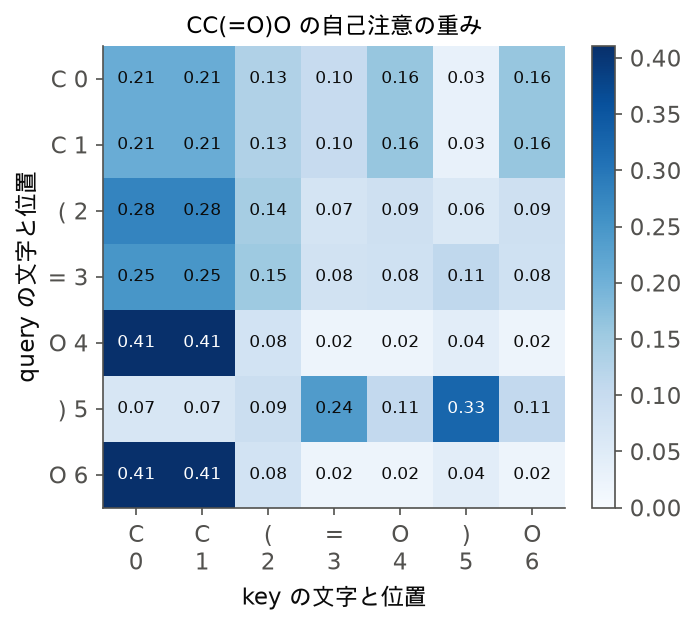

# 第 9 回　Transformer と注意機構

!!! abstract "この回の道筋"
    Transformer は、文章のような「並び」のデータを扱うニューラルネットワークで、その中心は注意機構と呼ばれる計算です。
    この回では、query・key・value による注意機構とスケール付き内積注意を式で説明し、自己注意が入力の順番の入れ替えに対して等変であること、そのため位置の情報を別に加える必要があることを、numpy の計算で確かめます。
    最後に、Transformer 全体の構成と、SMILES の言語モデルなど化学での使われ方を紹介します。

    | 節 | 内容 |
    |---|---|
    | 1 | 並びのデータ：SMILES を例に |
    | 2 | 注意機構：query、key、value |
    | 3 | スケール付き内積注意 |
    | 4 | 自己注意と、順番の入れ替えに対する等変性 |
    | 5 | 位置の情報 |
    | 6 | Transformer の構成 |
    | 7 | 化学での使われ方 |

    **前に読んでおく回**：[機械学習の基礎 第 5 回](05-neural-networks.md)、[第 7 回](07-graph-neural-networks.md)、[第 8 回](08-invariance-equivariance.md)

!!! tip "物理的なイメージ"
    注意機構が行っているのは、並びの中の各要素が「ほかのどの要素にどれだけ注目するか」をその場で決めて、情報を集めることです。各要素は、自分が探しているもの（クエリ）と、自分が持っているものの目印（キー）を出し、クエリとキーの一致の度合いで、相手の情報（値）を重みづけして集めます。どの要素とどの要素が関係するかを、あらかじめ決めずにデータから学べるのが特徴です。

## 1. 並びのデータ：SMILES を例に

分子を文字の並びで表す方法に、**SMILES**（simplified molecular input line entry system）があります [Weininger 1988]。
たとえば、エタノールは `CCO`、ジメチルエーテルは `COC`、酢酸は `CC(=O)O` と書きます。
原子を元素記号で並べ、枝分かれを括弧で、二重結合を `=` で表します（水素は省略します）。

SMILES のような並びのデータを扱うモデルには、2 つの難しさがあります。

- **長さが決まっていない。** 分子ごとに文字の数が違います。
- **遠くの文字どうしが関係する。** `CC(=O)O` の `(` と `)` のように、離れた位置の文字が組になって意味を持ちます。

第 7 回のグラフニューラルネットワークは、分子グラフの「隣」から情報を集めました。
文字の並びでは、どの文字とどの文字が関係するかは、前もって決まっていません。
そこで、「各文字が、並びの中のどの文字に注目すべきかを、データから決める」仕組みを作ります。
これが**注意機構**（attention mechanism）です。

注意機構は、機械翻訳で、訳文の各単語を作るときに原文のどの部分に注目するかを決める仕組みとして、Bahdanau らが 2014 年に提案しました [Bahdanau 2014]。
Vaswani らは 2017 年に、注意機構だけを使って並びを扱うモデル、**Transformer** を提案しました [Vaswani 2017]。

**ここまでで分かったこと**：SMILES は分子を文字の並びで表します。並びのデータは長さが決まっておらず、遠くの文字どうしが関係します。注意機構は、どの文字に注目するかをデータから決める仕組みです。

## 2. 注意機構：query、key、value

### 2.1 辞書を引く操作にたとえる

注意機構は、辞書を引く操作にたとえると分かりやすくなります。
普通の辞書では、調べたい語（**query**、問い合わせ）と一致する見出し語（**key**、鍵）を探し、その項目の内容（**value**、値）を取り出します。

注意機構では、これを「ぼかした」形で行います。
query と最もよく一致する key を 1 つだけ選ぶのではなく、すべての key との「一致の度合い」を計算します。
そして、その度合いを重みとして、すべての value の重み付き平均を取り出します。

### 2.2 式

query を $\boldsymbol{q}$（$d_k$ 次元のベクトル）、$n$ 個の key と value の組を $(\boldsymbol{k}_j, \boldsymbol{v}_j)$（$j = 1, \dots, n$）とします。
一致の度合いを内積 $\boldsymbol{q}^\mathsf{T}\boldsymbol{k}_j$ で測ると、注意機構の出力は次のようになります。

$$
\boldsymbol{o} = \sum_{j=1}^{n} a_j \boldsymbol{v}_j, \qquad
a_j = \frac{\exp(s_j)}{\sum_{l=1}^{n} \exp(s_l)}, \qquad
s_j = \frac{\boldsymbol{q}^\mathsf{T}\boldsymbol{k}_j}{\sqrt{d_k}}
$$

$a_j$ を**注意の重み**と呼びます。
$s_j$ から $a_j$ を作る操作は**ソフトマックス関数**（softmax）で、次の性質を持ちます。

- どの $a_j$ も正で、合計は 1 です。したがって、出力は value の重み付き平均です。
- $s_j$ の大きい key ほど、重みが大きくなります。
- $s_j$ の 1 つが他よりずっと大きければ、その $a_j$ だけがほぼ 1 になり、普通の辞書のように 1 つを選ぶ操作に近づきます。

$\sqrt{d_k}$ で割る理由は、3 節で説明します。

**ここまでで分かったこと**：注意機構は、query とすべての key の内積からソフトマックス関数で重みを作り、value の重み付き平均を出力します。

## 3. スケール付き内積注意

### 3.1 行列で書く

query が $m$ 個あるときは、それぞれについて 2.2 節の計算をします。
query を行に並べた行列 $\mathbf{Q}$（$m \times d_k$）、key を並べた $\mathbf{K}$（$n \times d_k$）、value を並べた $\mathbf{V}$（$n \times d_v$）を使うと、次のように書けます [Vaswani 2017]。

$$
\operatorname{Attention}(\mathbf{Q}, \mathbf{K}, \mathbf{V}) = \operatorname{softmax}\!\left(\frac{\mathbf{Q}\mathbf{K}^\mathsf{T}}{\sqrt{d_k}}\right)\mathbf{V}
$$

ソフトマックス関数は、行列の各行に作用させます。
$\mathbf{Q}\mathbf{K}^\mathsf{T}$ の $(i, j)$ 成分が $i$ 番目の query と $j$ 番目の key の内積なので、ソフトマックス関数を通した行列の $i$ 行目が、$i$ 番目の query の注意の重みです。
Vaswani らは、この計算を**スケール付き内積注意**（scaled dot-product attention）と呼びました [Vaswani 2017]。

### 3.2 $\sqrt{d_k}$ で割る理由

$\boldsymbol{q}$ と $\boldsymbol{k}$ の各成分が、互いに独立で、平均 0、分散 1 だとします。
内積 $\boldsymbol{q}^\mathsf{T}\boldsymbol{k} = \sum_{i=1}^{d_k} q_i k_i$ は $d_k$ 個の項の和で、各項 $q_i k_i$ の平均は 0、分散は $\mathbb{E}[q_i^2]\,\mathbb{E}[k_i^2] = 1$ です。
独立な量の和の分散は分散の和なので、内積の分散は $d_k$ になります [Vaswani 2017]。

つまり、$d_k$ が大きいと内積の値の幅が広がり、ソフトマックス関数の重みが 1 つの key にほぼ集中します。
重みがほぼ 0 か 1 に張り付いた状態では、ソフトマックス関数の勾配が非常に小さくなり、学習が進みにくくなります。
Vaswani らは、これが大きな $d_k$ で内積注意がうまくいかない原因だろうと述べ、$\sqrt{d_k}$ で割って内積の分散を 1 にそろえました [Vaswani 2017]。

### 3.3 計算で確かめる

1 つの query と 10 個の key を 2000 組作り、内積の分散と、10 個の重みのうち最大のものの平均を調べます。

```python
import numpy as np

rng = np.random.default_rng(0)

def softmax(z):
    z = z - z.max(axis=-1, keepdims=True)       # 大きな数の exp であふれるのを防ぐ（結果は同じ）
    e = np.exp(z)
    return e / e.sum(axis=-1, keepdims=True)

# 1 つの query と 10 個の key（成分は平均 0、分散 1）を 2000 組作り、
# 内積の分散と、softmax の重みの最大値を調べる
for dk in (4, 64, 512):
    q = rng.normal(size=(2000, 1, dk))
    K = rng.normal(size=(2000, 10, dk))
    s = np.sum(q * K, axis=-1)                  # 内積 q・k_j、形は (2000, 10)
    w_raw = softmax(s).max(axis=1).mean()
    w_scaled = softmax(s / np.sqrt(dk)).max(axis=1).mean()
    print(f"d_k = {dk:3d}: q・k の分散 {s.var():6.1f}   重みの最大値の平均  そのまま {w_raw:.3f}, √d_k で割る {w_scaled:.3f}")
```

```text
d_k =   4: q・k の分散    4.0   重みの最大値の平均  そのまま 0.496, √d_k で割る 0.304
d_k =  64: q・k の分散   62.9   重みの最大値の平均  そのまま 0.866, √d_k で割る 0.319
d_k = 512: q・k の分散  506.9   重みの最大値の平均  そのまま 0.954, √d_k で割る 0.321
```

内積の分散は、ほぼ $d_k$ になりました。
割らないと、$d_k = 512$ では最大の重みが平均 0.95 で、ほぼ 1 つの key だけを見ています。
$\sqrt{d_k}$ で割ると、$d_k$ によらず 0.3 程度にそろいました。

**ここまでで分かったこと**：スケール付き内積注意は $\operatorname{softmax}(\mathbf{Q}\mathbf{K}^\mathsf{T}/\sqrt{d_k})\mathbf{V}$ です。$\sqrt{d_k}$ で割るのは、内積の分散が $d_k$ に比例して大きくなり、重みが 1 つに張り付くのを防ぐためです。

## 4. 自己注意と、順番の入れ替えに対する等変性

### 4.1 自己注意

並びの $n$ 個の要素（SMILES なら $n$ 個の文字）を、それぞれ $d$ 次元のベクトルで表し、行に並べた行列を $\mathbf{X}$（$n \times d$）とします。
文字をベクトルに直す操作を**埋め込み**（embedding）と呼び、文字ごとのベクトルもパラメータとして学習します。

**自己注意**（self-attention）では、query、key、value のすべてを同じ $\mathbf{X}$ から作ります [Vaswani 2017]。

$$
\mathbf{Q} = \mathbf{X}\mathbf{W}^Q, \qquad \mathbf{K} = \mathbf{X}\mathbf{W}^K, \qquad \mathbf{V} = \mathbf{X}\mathbf{W}^V, \qquad
\mathbf{Y} = \operatorname{softmax}\!\left(\frac{\mathbf{Q}\mathbf{K}^\mathsf{T}}{\sqrt{d_k}}\right)\mathbf{V}
$$

$\mathbf{W}^Q, \mathbf{W}^K, \mathbf{W}^V$ は学習する行列です。
出力 $\mathbf{Y}$ の $i$ 行目は、$i$ 番目の文字が、並びのすべての文字（自分も含む）から、注意の重みに応じて情報を集めたものです。
重みは入力によって変わるので、どの文字に注目するかが、データから決まります。

### 4.2 順番を入れ替えると

文字の順番を置換行列 $\mathbf{P}$ で入れ替える（$\mathbf{X} \to \mathbf{P}\mathbf{X}$）と、自己注意の出力はどうなるでしょうか。
$\mathbf{Q}, \mathbf{K}, \mathbf{V}$ は $\mathbf{P}\mathbf{Q}, \mathbf{P}\mathbf{K}, \mathbf{P}\mathbf{V}$ になり、内積の行列は $\mathbf{P}\mathbf{Q}\mathbf{K}^\mathsf{T}\mathbf{P}^\mathsf{T}$ になります。
これは、もとの行列の行と列を同じように並べ替えたものです。
行ごとのソフトマックス関数は、行を並べ替えても、行の中の成分を並べ替えても、結果が同じように並べ替わるだけです。
したがって、次が成り立ちます。

$$
\operatorname{softmax}\!\left(\frac{\mathbf{P}\mathbf{Q}\mathbf{K}^\mathsf{T}\mathbf{P}^\mathsf{T}}{\sqrt{d_k}}\right)\mathbf{P}\mathbf{V}
= \mathbf{P}\operatorname{softmax}\!\left(\frac{\mathbf{Q}\mathbf{K}^\mathsf{T}}{\sqrt{d_k}}\right)\mathbf{P}^\mathsf{T}\mathbf{P}\mathbf{V}
= \mathbf{P}\mathbf{Y}
$$

最後に $\mathbf{P}^\mathsf{T}\mathbf{P} = \mathbf{I}$ を使いました。
つまり、自己注意は、入力の順番の入れ替えに対して**等変**です（[第 8 回](08-invariance-equivariance.md) 4 節の意味で）。

これは、第 7 回のメッセージパッシングと同じ性質です。
実際、自己注意は「すべての要素が互いに辺で結ばれたグラフ」の上のメッセージパッシングで、メッセージの重みを注意の重みで決めたものと見ることができます。

### 4.3 計算で確かめる

酢酸の SMILES `CC(=O)O` の 7 文字に、自己注意を 1 回作用させます。
埋め込みと重みは、でたらめに選びます。

```python
# 上の続き：SMILES の文字に自己注意を作用させる
vocab = ["C", "O", "(", ")", "="]
d = 8                                           # 埋め込みの次元
E = rng.normal(size=(len(vocab), d))            # 文字ごとの埋め込みベクトル（でたらめ）
W_Q, W_K, W_V = (rng.normal(size=(d, d)) / np.sqrt(d) for _ in range(3))

def embed(smiles):
    return np.array([E[vocab.index(c)] for c in smiles])

def self_attention(X):
    Q, K, V = X @ W_Q, X @ W_K, X @ W_V
    A = softmax(Q @ K.T / np.sqrt(K.shape[1]))  # 注意の重み（各行の和が 1）
    return A @ V, A

X = embed("CC(=O)O")                            # 酢酸
Y, A = self_attention(X)
np.set_printoptions(precision=2, suppress=True)
print("注意の重み（行：query の文字、列：key の文字）")
print(A)
print("各行の和:", A.sum(axis=1))

# 文字の順番を入れ替える
perm = rng.permutation(len(X))
P = np.eye(len(X))[perm]
Y_p, _ = self_attention(P @ X)
print("出力は同じように並べ替わるか:", np.allclose(Y_p, P @ Y))
```

```text
注意の重み（行：query の文字、列：key の文字）
[[0.21 0.21 0.13 0.1  0.16 0.03 0.16]
 [0.21 0.21 0.13 0.1  0.16 0.03 0.16]
 [0.28 0.28 0.14 0.07 0.09 0.06 0.09]
 [0.25 0.25 0.15 0.08 0.08 0.11 0.08]
 [0.41 0.41 0.08 0.02 0.02 0.04 0.02]
 [0.07 0.07 0.09 0.24 0.11 0.33 0.11]
 [0.41 0.41 0.08 0.02 0.02 0.04 0.02]]
各行の和: [1. 1. 1. 1. 1. 1. 1.]
出力は同じように並べ替わるか: True
```

注意の重みを図にすると、次のようになります。



順番を入れ替えると、出力は同じように並べ替わりました（等変）。
もう 1 つ、図と出力から分かることがあります。
0 番目と 1 番目の `C`、4 番目と 6 番目の `O` は、それぞれ行がまったく同じです。
同じ文字は同じベクトルに埋め込まれ、自己注意はその文字が並びのどこにあるかを知らないからです。
メチル基の C とカルボキシ基の C を区別できないことになります。

**ここまでで分かったこと**：自己注意は、query・key・value を同じ入力から作る注意機構です。入力の順番を入れ替えると出力も同じように入れ替わる（等変）ので、それだけでは文字の位置を区別できません。

## 5. 位置の情報

### 5.1 位置符号

4.3 節で見たように、自己注意だけでは、文字が並びのどこにあるかが分かりません。
これは、並びのデータでは困ります。
`CCO`（エタノール）と `COC`（ジメチルエーテル）は、同じ文字の組み合わせを並べ替えただけですが、違う分子です。

そこで、各位置に固有のベクトル（**位置符号**、positional encoding）を、文字の埋め込みに足してから自己注意に入れます。
Vaswani らは、位置 $\mathrm{pos}$ の位置符号の各成分を、次の正弦波で決めました [Vaswani 2017]。

$$
\mathrm{PE}(\mathrm{pos}, 2i) = \sin\!\left(\frac{\mathrm{pos}}{10000^{2i/d}}\right), \qquad
\mathrm{PE}(\mathrm{pos}, 2i+1) = \cos\!\left(\frac{\mathrm{pos}}{10000^{2i/d}}\right)
$$

$d$ は埋め込みの次元、$i = 0, 1, \dots, d/2 - 1$ です。
成分ごとに波長が違い、波長は $2\pi$ から $10000 \cdot 2\pi$ まで等比数列で並びます [Vaswani 2017]。
Vaswani らは、位置符号そのものを学習させる方法も試し、ほぼ同じ結果になったと報告しています [Vaswani 2017]。

位置符号を足すと、入力の各行が「どの文字か」と「どこにあるか」の両方を含むようになります。
順番を入れ替えたものは、もう同じ入力の並べ替えではないので、4.2 節の等変性は成り立たなくなります。
並びのデータでは、それが望ましいのです。

### 5.2 計算で確かめる

`CCO` と `COC` を自己注意に通し、文字についての平均を取って、分子を表す 1 本のベクトルを作ります。
位置符号がないときとあるときで、2 つの分子のベクトルを比べます。

```python
# 上の続き：エタノール CCO とジメチルエーテル COC を区別できるか
def positional_encoding(n, d):
    """Vaswani らの正弦波の位置符号"""
    pos = np.arange(n)[:, None]
    i = np.arange(d // 2)[None, :]
    PE = np.zeros((n, d))
    PE[:, 0::2] = np.sin(pos / 10000**(2 * i / d))
    PE[:, 1::2] = np.cos(pos / 10000**(2 * i / d))
    return PE

def molecule_vector(smiles, use_pe):
    X = embed(smiles)
    if use_pe:
        X = X + positional_encoding(len(smiles), d)
    Y, _ = self_attention(X)
    return Y.mean(axis=0)                       # 文字についての平均 → 分子のベクトル

for use_pe in (False, True):
    diff = np.linalg.norm(molecule_vector("CCO", use_pe) - molecule_vector("COC", use_pe))
    print(f"位置の情報 {'あり' if use_pe else 'なし'}: CCO と COC のベクトルの差 {diff:.3f}")
```

```text
位置の情報 なし: CCO と COC のベクトルの差 0.000
位置の情報 あり: CCO と COC のベクトルの差 0.420
```

位置符号がないと、エタノールとジメチルエーテルは、まったく同じベクトルになりました。
自己注意は等変で、文字についての平均は並べ替えで変わらないので、文字の組み合わせが同じなら区別できないのです。
位置符号を加えると、2 つは区別できるようになりました。

### 5.3 グラフと並びの違い

ここで、第 7 回と比べておきます。
分子グラフでは、原子の番号に意味がないので、置換について等変・不変であることが望ましい性質でした。
SMILES では、文字の位置に意味があるので、位置符号でその等変性をわざと壊します。
どの対称性を組み込むべきかは、データの表し方で決まります。

なお、1 つの分子は、何通りもの SMILES で書けます。
たとえば、エタノールは `CCO` とも `OCC` とも書けます。
位置符号を使うモデルは、この 2 つを違う入力として扱うので、同じ分子に同じ答えを出すことは保証されません。

**ここまでで分かったこと**：位置符号を埋め込みに足すと、自己注意に文字の位置の情報が入ります。位置の情報がないと、`CCO` と `COC` のように、同じ文字を並べ替えた違う分子を区別できません。

## 6. Transformer の構成

### 6.1 マルチヘッド注意

Transformer は、自己注意をいくつか並べて使います。
重み $\mathbf{W}_h^Q, \mathbf{W}_h^K, \mathbf{W}_h^V$ の組を $H$ 組用意し、それぞれで注意を計算します（$h = 1, \dots, H$）。
各組を**ヘッド**（head）と呼びます。

$$
\mathrm{head}_h = \operatorname{Attention}(\mathbf{X}\mathbf{W}_h^Q, \mathbf{X}\mathbf{W}_h^K, \mathbf{X}\mathbf{W}_h^V), \qquad
\operatorname{MultiHead}(\mathbf{X}) = [\mathrm{head}_1, \dots, \mathrm{head}_H]\,\mathbf{W}^O
$$

$[\cdots]$ は行列を横に並べてつなぐことを、$\mathbf{W}^O$ は最後にかける学習する行列を表します。
ヘッドごとに違う重みを持つので、たとえば「括弧の対応」と「隣の原子」のように、違う種類の関係に同時に注目できます。
Vaswani らは $H = 8$ とし、各ヘッドの $d_k$ を $d/H$ にして、全体の計算量を 1 つのヘッドのときと同じ程度にしました [Vaswani 2017]。

### 6.2 1 つの層

Transformer の 1 つの層（エンコーダーの層）は、2 つの部分からできています [Vaswani 2017]。

1. **マルチヘッド自己注意**：並びの中で情報をやり取りします。
2. **位置ごとの全結合ネットワーク**：各位置のベクトルに、同じ 2 層の多層パーセプトロン（第 5 回）を別々に作用させます。

それぞれの部分は、出力を入力に足し（$\boldsymbol{x} + \mathrm{Sublayer}(\boldsymbol{x})$）、そのあと**層正規化**（layer normalization）を行う形になっています [Vaswani 2017]。
入力を出力に足すつながりを**残差接続**（residual connection）と呼び、層を深く重ねても学習しやすくするために、He らが画像の認識のネットワークで導入したものです [He 2015]。
層正規化は、各位置のベクトルの成分の平均と分散をそろえる操作です [Ba 2016]。

位置ごとの全結合ネットワークは、すべての位置に同じ重みで作用するので、順番の入れ替えに等変です。
したがって、位置符号を除けば、層全体も順番の入れ替えに等変です。

### 6.3 エンコーダーとデコーダー

元の Transformer は、機械翻訳のためのモデルで、**エンコーダー**と**デコーダー**からできています [Vaswani 2017]。

- **エンコーダー**は、入力の並び（翻訳前の文）を、6.2 節の層を $N$ 回重ねて、各位置のベクトルに変えます。Vaswani らは $N = 6$、ベクトルの次元 $d = 512$ としました。
- **デコーダー**は、出力の並び（訳文）を 1 文字（1 単語）ずつ作ります。自己注意では、まだ作っていない後ろの位置を見ないように、その位置の重みを 0 にします（ソフトマックス関数に入れる前の値を $-\infty$ にします）。さらに、query をデコーダーから、key と value をエンコーダーの出力から作る注意（エンコーダー・デコーダー注意）で、入力の並びのどこに注目するかを決めます。

**ここまでで分かったこと**：Transformer の層は、マルチヘッド自己注意と位置ごとの全結合ネットワークを、残差接続と層正規化でつないだものです。エンコーダーが入力の並びを読み、デコーダーが出力の並びを 1 つずつ作ります。

## 7. 化学での使われ方

ここでは、文献で確かめた例を 3 つだけ挙げます。

**反応の予測を翻訳として解く。**
Schwaller らは、反応物と試薬の SMILES から生成物の SMILES を予測する問題を、機械翻訳の問題として扱い、Transformer で解きました（Molecular Transformer）[Schwaller 2019]。
論文によると、よく使われるベンチマークのデータセットで、最も確率の高い 1 つの予測が正しい割合（top-1 正解率）が 90% を超えました [Schwaller 2019]。
また、モデル自身が予測の確からしさを見積もり、その値で予測が正しいかどうかを 89% の割合で正しく判定できたと報告しています [Schwaller 2019]。

**SMILES の言語モデルを事前学習する。**
文章の Transformer では、文の一部の単語を隠し、それを当てる問題（マスク言語モデル）で大量の文章を学習させてから、目的の問題に使う方法があります。Devlin らの BERT が代表例です [Devlin 2018]。
Chithrananda らの ChemBERTa は、この方法を SMILES に当てはめたもので、PubChem の化合物の SMILES で、各入力のトークン（文字のまとまり）の 15% を隠して当てる事前学習を行いました [Chithrananda 2020]。
論文は、事前学習に使うデータを増やすほど、分子の性質の予測の性能がよくなる傾向を報告しています [Chithrananda 2020]。

**3 次元構造に使う。**
注意機構は、SMILES だけでなく、3 次元の原子の座標を入力とするモデルにも使われています。
たとえば、Thölke と De Fabritiis の TorchMD-NET は、[第 8 回](08-invariance-equivariance.md)の等変性を持たせた Transformer で、機械学習ポテンシャルを作りました [Thölke 2022]。
3 次元構造を扱う等変なモデルは、[量子化学のための機械学習 第 5 回](../ml-chem/05-equivariant-mlips.md)で扱っています。

**ここまでで分かったこと**：化学では、Transformer は SMILES を使った反応の予測や、SMILES の事前学習による性質の予測に使われています。3 次元構造を扱う等変な Transformer もあります。

## まとめ

- 注意機構は、query と key の内積からソフトマックス関数で重みを作り、value の重み付き平均を出力します。$\sqrt{d_k}$ で割るのは、内積の分散が $d_k$ に比例して大きくなるのを防ぐためです。
- 自己注意は query・key・value を同じ入力から作り、入力の順番の入れ替えに対して等変です。
- そのため、並びのデータでは位置符号を加えて、位置の情報を入れます。位置の情報がないと、`CCO` と `COC` を区別できません。
- Transformer の層は、マルチヘッド自己注意と位置ごとの全結合ネットワークを、残差接続と層正規化でつないだものです。
- 化学では、SMILES による反応の予測や性質の予測、3 次元構造を扱う等変なモデルに使われています。

## 参考文献

- D. Weininger, "SMILES, a chemical language and information system. 1. Introduction to methodology and encoding rules", J. Chem. Inf. Comput. Sci. 28, 31 (1988). DOI: [10.1021/ci00057a005](https://doi.org/10.1021/ci00057a005)
- D. Bahdanau, K. Cho, Y. Bengio, "Neural Machine Translation by Jointly Learning to Align and Translate", arXiv:1409.0473 (2014).
- J. Devlin, M.-W. Chang, K. Lee, K. Toutanova, "BERT: Pre-training of Deep Bidirectional Transformers for Language Understanding", arXiv:1810.04805 (2018).
- A. Vaswani, N. Shazeer, N. Parmar, J. Uszkoreit, L. Jones, A. N. Gomez, Ł. Kaiser, I. Polosukhin, "Attention Is All You Need", arXiv:1706.03762 (2017).
- K. He, X. Zhang, S. Ren, J. Sun, "Deep Residual Learning for Image Recognition", arXiv:1512.03385 (2015).
- J. L. Ba, J. R. Kiros, G. E. Hinton, "Layer Normalization", arXiv:1607.06450 (2016).
- P. Schwaller, T. Laino, T. Gaudin, P. Bolgar, C. A. Hunter, C. Bekas, A. A. Lee, "Molecular Transformer: A Model for Uncertainty-Calibrated Chemical Reaction Prediction", ACS Cent. Sci. 5, 1572 (2019). DOI: [10.1021/acscentsci.9b00576](https://doi.org/10.1021/acscentsci.9b00576)
- S. Chithrananda, G. Grand, B. Ramsundar, "ChemBERTa: Large-Scale Self-Supervised Pretraining for Molecular Property Prediction", arXiv:2010.09885 (2020).
- P. Thölke, G. De Fabritiis, "TorchMD-NET: Equivariant Transformers for Neural Network based Molecular Potentials", arXiv:2202.02541 (2022).
