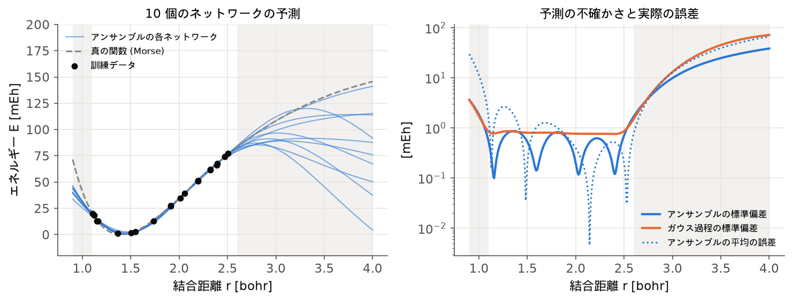

# 第 10 回　不確かさの見積もりと能動学習

!!! abstract "この回の道筋"
    機械学習のモデルは、訓練データから離れた入力でも、何かしらの値を答えてしまいます。
    この回では、予測がどのくらい当てにならないか（不確かさ）を、偶然的な不確かさと認識的な不確かさに分けて考え、ガウス過程の分散と、モデルのアンサンブルで見積もる方法を説明します。
    そのうえで、不確かさの大きいところを選んで量子化学計算をする「能動学習」と、不確かさの数値そのものが信用できるかを調べる「較正」を、Morse ポテンシャルの計算例で確かめます。

    | 節 | 内容 |
    |---|---|
    | 1 | 予測の不確かさが必要な理由 |
    | 2 | 偶然的な不確かさと認識的な不確かさ |
    | 3 | ガウス過程の分散 |
    | 4 | アンサンブル |
    | 5 | 計算例：訓練データの外で、アンサンブルの分散が大きくなる |
    | 6 | 能動学習 |
    | 7 | 較正：不確かさの数値は信用できるか |

    **前に読んでおく回**：[機械学習の基礎 第 3 回](03-overfitting-regularization.md)、[第 4 回](04-kernel-gp.md)、[第 5 回](05-neural-networks.md)

## 1. 予測の不確かさが必要な理由

第 5 回の普遍近似定理のところで、ニューラルネットワークは訓練データの範囲の外（外挿）での正しさを保証しないことを見ました。
困るのは、外挿でも、モデルは平然と数値を返すことです。
返ってきた数値だけを見ても、それが信用できる予測か、でたらめな外挿かは分かりません。

量子化学で機械学習を使う場面では、これが具体的な問題になります。

- **機械学習ポテンシャルで分子動力学計算をする。** 計算の途中で、訓練データにない構造（結合が大きく伸びた構造など）に入ると、エネルギーや力が大きく間違うことがあります。
- **次にどの構造を量子化学計算するかを決める。** 計算には時間がかかるので、モデルの役に最も立つ構造から計算したいわけです。

どちらの場面でも、「この入力での予測は、どのくらい当てにならないか」を数値で知りたくなります。
この数値を、予測の**不確かさ**（uncertainty）と呼びます。
この回では、不確かさを予測の標準偏差 $\sigma(\boldsymbol{x})$ の形で表します。

**ここまでで分かったこと**：モデルは外挿でも値を返すので、予測がどのくらい当てにならないかを別に見積もる必要があります。

## 2. 偶然的な不確かさと認識的な不確かさ

予測の不確かさには、原因の違う 2 種類があります [Kendall 2017]。

- **偶然的な不確かさ**（aleatoric uncertainty）：データそのものに含まれるばらつきです。同じ入力でも、出力がばらつく場合に生じます。データを増やしても減りません。
- **認識的な不確かさ**（epistemic uncertainty）：モデルが知らないことから生じる不確かさです。その入力の近くにデータが少ないと大きくなり、データを十分に増やせば減らせます [Kendall 2017]。

量子化学計算は、同じ構造に対していつも同じ値を返します。
それでも偶然的な不確かさが生じるのは、モデルの入力が、出力を決める情報をすべて含んでいないときです。
たとえば、分子の性質を SMILES（第 9 回）から予測すると、同じ SMILES の分子でも配座によってエネルギーが違います。
SMILES だけを見るモデルにとっては、この違いは減らせないばらつきです。
第 2〜5 回の計算例で Morse ポテンシャルに足した乱数も、偶然的な不確かさのモデルです。

一方、能動学習（6 節）で使いたいのは、認識的な不確かさです。
データを足すことで減らせるのは、こちらだけだからです。

2 種類の不確かさは、全体の分散の中で次のように分かれます。
モデルのパラメータ $\boldsymbol{\theta}$ が確率的にばらつき、$\boldsymbol{\theta}$ を決めたときの予測が平均 $\mu(\boldsymbol{x}; \boldsymbol{\theta})$、分散 $\sigma^2(\boldsymbol{x}; \boldsymbol{\theta})$ の分布だとします。
導出は付録 A に回しますが、出力 $y$ の全体の分散は次のようになります。

$$
\operatorname{Var}[y] =
\underbrace{\mathbb{E}_{\boldsymbol{\theta}}\bigl[\sigma^2(\boldsymbol{x}; \boldsymbol{\theta})\bigr]}_{\text{偶然的}}
+ \underbrace{\operatorname{Var}_{\boldsymbol{\theta}}\bigl[\mu(\boldsymbol{x}; \boldsymbol{\theta})\bigr]}_{\text{認識的}}
$$

第 1 項は、各モデルが「データにはこのくらいばらつきがある」と見積もった分散の平均です。
第 2 項は、モデルどうしの予測の食い違いの大きさです。
データの多いところでは、どのモデルも同じような予測をするので、第 2 項は小さくなります。

**ここまでで分かったこと**：不確かさには、データのばらつきによる偶然的な不確かさと、データの不足による認識的な不確かさがあります。データを足して減らせるのは、認識的な不確かさだけです。

## 3. ガウス過程の分散

第 4 回のガウス過程回帰は、予測の平均 $\mu(\boldsymbol{x}_*)$ と一緒に、予測の分散を与えました [Rasmussen 2006]。

$$
\sigma^2(\boldsymbol{x}_*) = k(\boldsymbol{x}_*, \boldsymbol{x}_*) - \boldsymbol{k}_*^\mathsf{T} (\mathbf{K} + \sigma_n^2 \mathbf{I})^{-1} \boldsymbol{k}_*
$$

記号は第 4 回 4.2 節と同じです。
これは関数の値 $f(\boldsymbol{x}_*)$ の分散で、2 節の言葉では認識的な不確かさに当たります。
データ点の近くでは小さく、離れると事前の分散 $k(\boldsymbol{x}_*, \boldsymbol{x}_*)$ に戻ります（第 4 回 4.3 節）。
観測値 $y_*$（乱数を含む）の分散がほしいときは、偶然的な不確かさの分 $\sigma_n^2$ を足します。

ガウス過程の分散は、式が 1 つで計算でき、ハイパーパラメータを周辺尤度で決めれば、ほかに調整するものがありません。
ただし、第 4 回 3 節で見たように、計算量はデータ点の数 $N$ の 3 乗に比例します。
また、分散の大きさは、カーネル関数とそのハイパーパラメータの選び方に強くよります。

**ここまでで分かったこと**：ガウス過程回帰の分散は、そのまま認識的な不確かさの見積もりとして使えます。観測値の不確かさには、乱数の分散 $\sigma_n^2$ を足します。

## 4. アンサンブル

### 4.1 考え方

ニューラルネットワークでは、ガウス過程のように分散を式で書くことはできません。
最も簡単で広く使われている方法が、**アンサンブル**（ensemble）です。
同じ訓練データで、初期値の違うネットワークを $M$ 個学習させ、それらの予測の平均と標準偏差を使います。

$$
\bar{\mu}(\boldsymbol{x}) = \frac{1}{M}\sum_{m=1}^{M} \mu_m(\boldsymbol{x}), \qquad
\sigma_\text{ens}^2(\boldsymbol{x}) = \frac{1}{M}\sum_{m=1}^{M} \bigl(\mu_m(\boldsymbol{x}) - \bar{\mu}(\boldsymbol{x})\bigr)^2
$$

$\mu_m(\boldsymbol{x})$ は $m$ 番目のネットワークの予測です。
ネットワークの損失関数には多くの極小点があり、初期値が違うと、違う極小点にたどり着きます。
訓練データの近くでは、どのネットワークもデータに合わせるので、予測はそろいます。
訓練データから離れたところでは、データによる縛りがないので、予測はネットワークごとにばらばらになります。
つまり、$\sigma_\text{ens}^2$ は 2 節の式の第 2 項（認識的な不確かさ）の見積もりです。

### 4.2 Lakshminarayanan らの方法

Lakshminarayanan らは、この方法を「deep ensembles」として調べ、ベイズ的なニューラルネットワークの近似法と同等以上の不確かさの見積もりが得られると報告しました [Lakshminarayanan 2016]。
論文の方法の要点は次のとおりです [Lakshminarayanan 2016]。

- 各ネットワークは、平均 $\mu_m$ だけでなく分散 $\sigma_m^2$ も出力し、正規分布の負の対数尤度を損失関数にして学習します。
- 全体の予測の平均は $\bar{\mu} = M^{-1}\sum_m \mu_m$、分散は $M^{-1}\sum_m(\sigma_m^2 + \mu_m^2) - \bar{\mu}^2$ とします。この分散は、$\sigma_m^2$ の平均（偶然的）と $\mu_m$ の分散（認識的）の和に書き直せます。2 節の式と同じ形です。
- ネットワークの数は $M = 5$ を勧めています。
- 各ネットワークの違いは、初期値と、データを使う順番のでたらめさで十分だったと述べています。訓練データから重複を許してでたらめに選び直す方法（ブートストラップ）は、かえって性能を下げたと報告しています。

この回の計算例では、簡単のため、各ネットワークは平均だけを出力し、$\sigma_\text{ens}$ で認識的な不確かさだけを見積もります。

### 4.3 アンサンブルの弱点

アンサンブルの標準偏差は、「ネットワークどうしの食い違い」です。
すべてのネットワークが同じように間違えれば、食い違いは小さく、不確かさは小さく見積もられます。
同じ形のネットワークを同じデータで学習させるので、そうしたことは起こりえます。
5 節と 7 節の計算例で、実際にそれが起こる様子を見ます。

**ここまでで分かったこと**：アンサンブルは、初期値の違うネットワークの予測の食い違いで、認識的な不確かさを見積もります。すべてのネットワークが同じように間違えるところでは、不確かさを小さく見積もってしまいます。

## 5. 計算例：訓練データの外で、アンサンブルの分散が大きくなる

### 5.1 設定

第 2〜5 回と同じ Morse ポテンシャル（$D_\mathrm{e} = 170$ m$E_\mathrm{h}$、$a = 1.0\ \mathrm{bohr}^{-1}$、$r_\mathrm{e} = 1.4$ bohr）を使います。
訓練データは、$r = 1.1$〜$2.6$ bohr の範囲だけから 20 点選び、標準偏差 1 m$E_\mathrm{h}$ の乱数を足します。
scikit-learn の `MLPRegressor` で、隠れ層 2 層（幅 20、tanh）のネットワークを、初期値を変えて 10 個学習させます。
比べるために、ガウス過程回帰（第 4 回）も使います。
ガウス過程のハイパーパラメータは、scikit-learn が周辺尤度を最大にして決めます（第 4 回 5 節）。

```python
import numpy as np
from sklearn.neural_network import MLPRegressor
from sklearn.gaussian_process import GaussianProcessRegressor
from sklearn.gaussian_process.kernels import RBF, ConstantKernel, WhiteKernel

De, a, re = 170.0, 1.0, 1.4                     # Morse ポテンシャル（mEh、bohr）
def morse(r):
    return De * (1.0 - np.exp(-a * (r - re)))**2

rng = np.random.default_rng(0)
r_tr = np.sort(rng.uniform(1.1, 2.6, size=20))  # 訓練データは 1.1〜2.6 bohr だけ
E_tr = morse(r_tr) + rng.normal(0, 1.0, size=r_tr.size)

def fit_ensemble(r, E, n_models=10):
    """初期値の違う 10 個のネットワーク（隠れ層 2 層、幅 20、tanh）"""
    models = []
    for m in range(n_models):
        net = MLPRegressor(hidden_layer_sizes=(20, 20), activation="tanh", solver="lbfgs",
                           alpha=1e-4, max_iter=5000, random_state=m)
        net.fit((r - 2.0)[:, None], E / 100.0)  # 入力と出力を 1 程度の大きさにそろえる
        models.append(net)
    return models

def predict_ensemble(models, r):
    P = np.array([net.predict((r - 2.0)[:, None]) * 100.0 for net in models])
    return P.mean(axis=0), P.std(axis=0)

models = fit_ensemble(r_tr, E_tr)
kernel = ConstantKernel(1.0) * RBF(1.0) + WhiteKernel(1e-4)
gp = GaussianProcessRegressor(kernel=kernel, normalize_y=True).fit(r_tr[:, None], E_tr)

r_check = np.array([1.5, 2.0, 2.5, 2.8, 3.2, 3.6])
mean_e, std_e = predict_ensemble(models, r_check)
mean_g, std_g = gp.predict(r_check[:, None], return_std=True)
for r, me, se, mg, sg in zip(r_check, mean_e, std_e, mean_g, std_g):
    print(f"r = {r:.1f}: 真の値 {morse(r):6.1f}  アンサンブル {me:6.1f} ± {se:5.1f}  GP {mg:6.1f} ± {sg:5.1f}  mEh")
```

```text
r = 1.5: 真の値    1.5  アンサンブル    1.4 ±   0.5  GP    1.2 ±   0.8  mEh
r = 2.0: 真の値   34.6  アンサンブル   34.2 ±   0.2  GP   34.4 ±   0.8  mEh
r = 2.5: 真の値   75.7  アンサンブル   75.9 ±   0.7  GP   76.7 ±   0.9  mEh
r = 2.8: 真の値   96.5  アンサンブル   91.3 ±   4.9  GP  101.1 ±   5.4  mEh
r = 3.2: 真の値  118.4  アンサンブル   95.9 ±  15.8  GP  121.6 ±  24.7  mEh
r = 3.6: 真の値  134.4  アンサンブル   89.3 ±  27.8  GP  113.6 ±  52.1  mEh
```

「±」の後は予測の標準偏差です。
GP の `return_std=True` は、`WhiteKernel` の分（乱数の分散）も含めた標準偏差を返します。

### 5.2 結果を読む

10 個のネットワークの予測と、標準偏差を図に示します（灰色の帯は訓練データのない範囲です）。



- **訓練データの範囲（1.1〜2.6 bohr）では**、10 個のネットワークの予測はほぼ重なり、標準偏差は 1 m$E_\mathrm{h}$ 以下です。
- **範囲の外（2.6 bohr より長い側）では**、ネットワークごとに予測がばらばらになり、標準偏差は 2.8 bohr で 4.9、3.6 bohr で 27.8 m$E_\mathrm{h}$ と大きくなりました。ガウス過程の標準偏差も、同じように大きくなります。
- 右の図の点線は、アンサンブルの平均の実際の誤差です。範囲の外では、標準偏差と誤差がほぼ一緒に大きくなっていて、標準偏差が「ここは当てにならない」ことを教えています。

ただし、標準偏差が誤差を正しく表しているとは限りません。
3.6 bohr では、平均の誤差は $134.4 - 89.3 = 45.1$ m$E_\mathrm{h}$ で、標準偏差 27.8 の 1.6 倍です。
また、右の図の左端（1.1 bohr より短い側）では、$r = 0.9$ bohr で誤差が 29.9 m$E_\mathrm{h}$ あるのに、アンサンブルの標準偏差は 3.6 m$E_\mathrm{h}$ しかありません。
左の図を見ると、この範囲では 10 個のネットワークがそろって同じ向きに外れています。
4.3 節で述べた弱点が、実際に現れたわけです。

**ここまでで分かったこと**：アンサンブルの標準偏差は、訓練データの範囲の外で大きくなり、外挿していることを知らせます。ただし、すべてのネットワークが同じ向きに外れるところでは、誤差より小さく見積もられます。

## 6. 能動学習

### 6.1 流れ

不確かさの見積もりができると、次にどのデータを計算すればよいかを、モデル自身に選ばせられます。
これを**能動学習**（active learning）と呼びます。
量子化学のデータで使う場合の流れは、次のとおりです。

1. 少しのデータで、モデル（アンサンブルなど）を学習させます。
2. まだ計算していない候補の構造（分子動力学計算で出てきた構造など）すべてについて、不確かさを見積もります。
3. 不確かさの大きい構造を選び、量子化学計算でエネルギーや力を求めます。
4. それを訓練データに足して、1 に戻ります。

不確かさの小さい構造は、計算しても、モデルがすでに知っていることを確かめるだけです。
不確かさの大きい構造を選べば、少ない計算で、モデルの知らない範囲を効率よく埋められます。

複数のモデルの「意見の食い違い」が大きい入力を選ぶ方法は、query by committee（委員会による問い合わせ）と呼ばれ、Seung らが 1992 年に調べました [Seung 1992]。
アンサンブルの標準偏差で選ぶのは、この方法の一種です。

### 6.2 計算例

$r = 1.0$〜$4.0$ bohr に 301 個の候補の点を用意し、最初はでたらめに 4 点だけ計算します。
そこから、次の 2 つの方法で 1 点ずつ足し、16 点まで増やします。

- **能動学習**：5 個のネットワークのアンサンブルを学習させ、候補の中で標準偏差が最大の点を足します。
- **でたらめ**：候補の中からでたらめに 1 点を足します。

最初の 4 点の選び方を変えて 10 回くり返し、1.0〜4.0 bohr の 200 点での誤差（真の関数との RMSE）の中央値と最大値を比べます。

```python
# 上の続き：能動学習。候補の構造から、アンサンブルの標準偏差が最大のものを選んで足す
pool = np.linspace(1.0, 4.0, 301)               # 計算してよい候補（まだエネルギーは知らない）
r_test = np.linspace(1.0, 4.0, 200)

def run(strategy, seed, n_rounds=12):
    rng_al = np.random.default_rng(seed)
    chosen = list(rng_al.choice(pool.size, size=4, replace=False))   # 最初の 4 点はでたらめ
    history = []
    for k in range(n_rounds + 1):
        r_sel = pool[chosen]
        E_sel = morse(r_sel) + rng_al.normal(0, 1.0, size=r_sel.size)  # 「量子化学計算」
        ens = fit_ensemble(r_sel, E_sel, n_models=5)
        mean_t, _ = predict_ensemble(ens, r_test)
        history.append(np.sqrt(np.mean((mean_t - morse(r_test))**2)))
        if k == n_rounds:
            break
        rest = np.setdiff1d(np.arange(pool.size), chosen)
        if strategy == "能動学習":
            _, std_p = predict_ensemble(ens, pool[rest])
            chosen.append(rest[np.argmax(std_p)])            # 最も自信のない候補を計算する
        else:
            chosen.append(rng_al.choice(rest))               # でたらめに選ぶ
    return np.array(history), np.sort(pool[chosen])

for strategy in ("能動学習", "でたらめ"):
    H = np.array([run(strategy, seed)[0] for seed in range(1, 11)])   # 最初の 4 点を変えて 10 回
    med, worst = np.median(H, axis=0), H.max(axis=0)
    print(strategy + "（テスト RMSE、mEh。10 回の中央値 / 最大値）")
    for n in (4, 8, 12, 16):
        print(f"   {n:2d} 点: {med[n - 4]:5.1f} / {worst[n - 4]:5.1f}")
print("能動学習で選んだ 16 点（1 回目）:", np.round(run("能動学習", 1)[1], 2))
```

```text
能動学習（テスト RMSE、mEh。10 回の中央値 / 最大値）
    4 点:  15.6 /  21.4
    8 点:   1.7 /   3.3
   12 点:   0.9 /   1.0
   16 点:   0.7 /   1.2
でたらめ（テスト RMSE、mEh。10 回の中央値 / 最大値）
    4 点:  15.6 /  21.4
    8 点:  10.6 /  18.3
   12 点:   9.4 /  18.8
   16 点:   5.7 /  17.8
能動学習で選んだ 16 点（1 回目）: [1.   1.12 1.15 1.34 1.46 1.64 1.67 1.76 1.95 2.11 2.41 2.53 2.84 3.26
 3.86 4.  ]
```

能動学習では、8 点の時点で誤差の中央値が 1.7 m$E_\mathrm{h}$ まで下がり、12 点では 10 回の最大値も 1.0 m$E_\mathrm{h}$ になりました。
でたらめに選ぶと、16 点でも中央値は 5.7 m$E_\mathrm{h}$ で、最大値は 17.8 m$E_\mathrm{h}$ です。
でたらめに選ぶと、エネルギーが急に変わる短い距離の側に点が来ないことがあり、そこで大きく外れるからです。
能動学習で選んだ点を見ると、短い距離の側に多くの点が置かれています（1 回目の実行では、最初の 4 点が 2.41、2.53、3.26、3.86 bohr で、最初に足されたのは端の 1.0 bohr でした）。
エネルギーの変化が大きく、最初の 4 点から最も遠い範囲を、アンサンブルの食い違いが指し示したわけです。

### 6.3 化学での使われ方

機械学習ポテンシャルのデータ作りでは、この方法が実際に使われています。

- Smith らは、ANI ポテンシャルのアンサンブルの予測の食い違い（query by committee）で、計算する分子の構造を自動的に選ぶ方法を作りました [Smith 2018]。論文によると、能動学習で作ったポテンシャルは、でたらめに選んだデータで作った元の ANI-1 を、その 10% のデータ量で上回りました [Smith 2018]。
- Zhang らの DP-GEN は、分子動力学計算で構造を探し、アンサンブルの予測の食い違いが一定の範囲にある構造だけを選んで DFT 計算をする手順をくり返します [Zhang 2019]。食い違いの指標には、各原子の力の予測の標準偏差の最大値を使い、初期値の違う 4 個のモデルで見積もっています [Zhang 2019]。

選ぶ範囲は、たとえば Al では 0.05〜0.15 eV/Å で、食い違いが下限より小さい構造も、上限より大きい構造も計算に回しません [Zhang 2019]。

**ここまでで分かったこと**：能動学習は、不確かさの大きい入力を選んで計算し、データに足すことをくり返します。Morse ポテンシャルの例では、でたらめに選ぶよりずっと少ない点で誤差が下がりました。機械学習ポテンシャルのデータ作りでも使われています。

## 7. 較正：不確かさの数値は信用できるか

### 7.1 較正とは

5.2 節で、アンサンブルの標準偏差が誤差より小さいところがありました。
能動学習のように不確かさの大小を比べるだけなら、それでも役に立ちます。
しかし、「この予測は ±5 m$E_\mathrm{h}$ の範囲で正しい」のように数値そのものを使うなら、その数値が正しい必要があります。

予測の不確かさの数値が、実際の誤差の大きさと合っていることを、**較正されている**（calibrated）と言います。
回帰では、たとえば「90% の区間」と言った区間に、実際に 90% の割合で正しい値が入っていれば、較正されています [Kuleshov 2018]。
予測が正規分布なら、平均 ± 1 標準偏差の区間には約 68%、± 2 標準偏差の区間には約 95% の割合で正しい値が入るはずです。

較正は、自動的には成り立ちません。
Kuleshov らは、ベイズ的な方法の不確かさでも、モデルの仮定のずれや近似のために、たとえば 90% の区間が 90% の割合で正しい値を含まないことがよくあると指摘しています [Kuleshov 2018]。
分類の問題では、Guo らが、最近の深いニューラルネットワークの予測の確率は、正しさの確率とよく合っていない（較正されていない）ことを報告しています [Guo 2017]。

### 7.2 計算で確かめる

5 節のアンサンブルとガウス過程で、真の値が「平均 ± 1 標準偏差」「平均 ± 2 標準偏差」に入る割合を、訓練データの範囲の中と外で調べます。

```python
# 上の続き：較正。真の値が「平均 ± 標準偏差」の幅に入る割合を調べる
for name, lo, hi in [("訓練データの範囲 1.1〜2.6 bohr", 1.1, 2.6), ("範囲の外 2.6〜4.0 bohr    ", 2.6, 4.0)]:
    r = np.linspace(lo, hi, 100)
    mean_e, std_e = predict_ensemble(models, r)
    mean_g, std_g = gp.predict(r[:, None], return_std=True)
    z_e = np.abs(morse(r) - mean_e) / std_e
    z_g = np.abs(morse(r) - mean_g) / std_g
    print(f"{name}: アンサンブル ±1σ {np.mean(z_e < 1):.2f}, ±2σ {np.mean(z_e < 2):.2f}   "
          f"GP ±1σ {np.mean(z_g < 1):.2f}, ±2σ {np.mean(z_g < 2):.2f}")
```

```text
訓練データの範囲 1.1〜2.6 bohr: アンサンブル ±1σ 0.34, ±2σ 0.65   GP ±1σ 0.72, ±2σ 1.00
範囲の外 2.6〜4.0 bohr    : アンサンブル ±1σ 0.13, ±2σ 1.00   GP ±1σ 0.89, ±2σ 1.00
```

正規分布なら 0.68 と 0.95 になるはずです。

- **アンサンブル**は、訓練データの範囲の中で ±1σ に 34%、±2σ に 65% しか入りませんでした。標準偏差が小さすぎる、つまり自信を持ちすぎています。範囲の外でも ±1σ には 13% しか入りません。
- **ガウス過程**は、範囲の中で 72% と 100%、外で 89% と 100% で、どちらかと言えば標準偏差が大きめ（控えめ）です。

この例は 1 次元で、等間隔の 100 点で数えただけなので、割合は大まかな目安です。
それでも、アンサンブルの標準偏差をそのまま「誤差の大きさ」として使うと、誤差を小さく見積もる危険があることが分かります。

### 7.3 較正をとる

不確かさが較正されていないときは、検証データ（第 3 回）を使って直します。
最も簡単な方法は、標準偏差全体に 1 つの数 $s$ を掛け、検証データで「± $s\sigma$ に入る割合」が目標に合うように $s$ を決めることです。
Kuleshov らは、より一般に、予測の区間の割合を検証データで写し直して、任意の回帰のモデルの不確かさを較正する方法を提案しています [Kuleshov 2018]。

ただし、較正に使う検証データは、使いたい範囲を代表している必要があります。
訓練データの範囲の中で較正しても、範囲の外で較正されている保証はありません。
7.2 節で、アンサンブルの割合が範囲の中と外で違ったのが、その例です。

**ここまでで分かったこと**：較正は、不確かさの数値が実際の誤差の大きさと合っていることです。この例のアンサンブルは、自信を持ちすぎていました。不確かさの数値を使うときは、検証データで較正を確かめ、必要なら直します。

## まとめ

- 不確かさには、データのばらつきによる偶然的な不確かさと、データの不足による認識的な不確かさがあります。データを足して減らせるのは認識的な不確かさです。
- ガウス過程回帰の分散と、アンサンブルの予測の食い違いは、どちらも認識的な不確かさの見積もりで、訓練データから離れると大きくなります。
- アンサンブルは、すべてのネットワークが同じ向きに外れるところで、不確かさを小さく見積もります。
- 能動学習は、不確かさの大きい入力を選んで計算に回し、少ないデータでモデルをよくします。機械学習ポテンシャルのデータ作りにも使われています。
- 不確かさの数値を使うときは、較正（区間に入る割合が名目どおりか）を検証データで確かめます。

## 付録 A　全体の分散の分け方

2 節の式を導きます。
$\boldsymbol{\theta}$ を決めたとき、$y$ の条件付きの平均と分散を $\mathbb{E}[y \mid \boldsymbol{\theta}] = \mu(\boldsymbol{\theta})$、$\operatorname{Var}[y \mid \boldsymbol{\theta}] = \sigma^2(\boldsymbol{\theta})$ とします（$\boldsymbol{x}$ は省略します）。

まず、$\mathbb{E}[y^2 \mid \boldsymbol{\theta}] = \sigma^2(\boldsymbol{\theta}) + \mu(\boldsymbol{\theta})^2$ です。
分散の定義 $\operatorname{Var}[y \mid \boldsymbol{\theta}] = \mathbb{E}[y^2 \mid \boldsymbol{\theta}] - \mu(\boldsymbol{\theta})^2$ を書き直しただけです。
$\boldsymbol{\theta}$ について平均を取ると、次のようになります。

$$
\mathbb{E}[y^2] = \mathbb{E}_{\boldsymbol{\theta}}[\sigma^2] + \mathbb{E}_{\boldsymbol{\theta}}[\mu^2], \qquad
\mathbb{E}[y] = \mathbb{E}_{\boldsymbol{\theta}}[\mu]
$$

したがって、全体の分散は次のとおりです。

$$
\operatorname{Var}[y] = \mathbb{E}[y^2] - \mathbb{E}[y]^2
= \mathbb{E}_{\boldsymbol{\theta}}[\sigma^2] + \Bigl(\mathbb{E}_{\boldsymbol{\theta}}[\mu^2] - \mathbb{E}_{\boldsymbol{\theta}}[\mu]^2\Bigr)
= \mathbb{E}_{\boldsymbol{\theta}}[\sigma^2] + \operatorname{Var}_{\boldsymbol{\theta}}[\mu]
$$

$\boldsymbol{\theta}$ の分布を、アンサンブルの $M$ 個のネットワークの一様な平均に置き換えると、4.2 節の Lakshminarayanan らの式 $M^{-1}\sum_m(\sigma_m^2 + \mu_m^2) - \bar{\mu}^2$ になります。

## 参考文献

- A. Kendall, Y. Gal, "What Uncertainties Do We Need in Bayesian Deep Learning for Computer Vision?", arXiv:1703.04977 (2017).
- C. E. Rasmussen, C. K. I. Williams, "Gaussian Processes for Machine Learning" (MIT Press, 2006). ISBN: 9780262182539
- B. Lakshminarayanan, A. Pritzel, C. Blundell, "Simple and Scalable Predictive Uncertainty Estimation using Deep Ensembles", arXiv:1612.01474 (2016).
- H. S. Seung, M. Opper, H. Sompolinsky, "Query by committee", Proceedings of the fifth annual workshop on Computational learning theory, 287 (1992). DOI: [10.1145/130385.130417](https://doi.org/10.1145/130385.130417)
- J. S. Smith, B. Nebgen, N. Lubbers, O. Isayev, A. E. Roitberg, "Less is more: Sampling chemical space with active learning", J. Chem. Phys. 148, 241733 (2018). DOI: [10.1063/1.5023802](https://doi.org/10.1063/1.5023802)
- L. Zhang, D.-Y. Lin, H. Wang, R. Car, W. E, "Active learning of uniformly accurate interatomic potentials for materials simulation", Phys. Rev. Mater. 3, 023804 (2019). DOI: [10.1103/PhysRevMaterials.3.023804](https://doi.org/10.1103/PhysRevMaterials.3.023804)
- V. Kuleshov, N. Fenner, S. Ermon, "Accurate Uncertainties for Deep Learning Using Calibrated Regression", arXiv:1807.00263 (2018).
- C. Guo, G. Pleiss, Y. Sun, K. Q. Weinberger, "On Calibration of Modern Neural Networks", arXiv:1706.04599 (2017).
