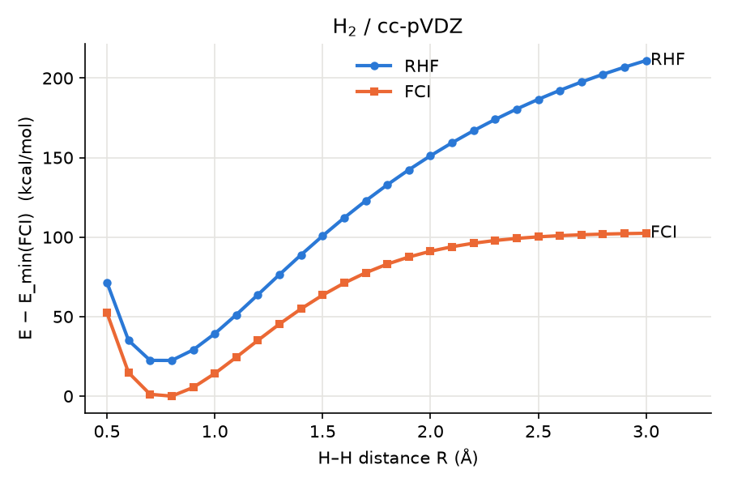

# 第 1 回　何を学習させるのか：エネルギー、力、性質

!!! abstract "この回の道筋"
    量子化学の機械学習では、多くの場合「原子の種類と位置から、量子化学計算の答えを予測する関数」を作ります。この回では、その答えとして何を選ぶのか（エネルギー、力、その他の性質）と、選んだ答えの質が予測の質の上限を決めることを説明します。

    | 節 | 内容 |
    |---|---|
    | 1 | ポテンシャルエネルギー曲面を学ぶとは |
    | 2 | 力はエネルギーの微分 |
    | 3 | 力を学習に使う利点 |
    | 4 | エネルギー以外の性質を予測する |
    | 5 | 学習データの理論レベルが精度の上限を決める |

    **前に読んでおく回**：[量子化学の理論 第 1 回](../qc-theory/01-born-oppenheimer.md)、[量子化学の理論 第 7 回](../qc-theory/07-electron-correlation.md)、[機械学習の基礎 第 1 回](../ml-basics/01-what-is-ml.md)

## 1. ポテンシャルエネルギー曲面を学ぶとは

### 1.1 学習させたい関数

Born–Oppenheimer 近似では、核を止めて電子のシュレーディンガー方程式を解きます。
その答えのエネルギー $E$ は、核の位置の関数になります。
この関数がポテンシャルエネルギー曲面（potential energy surface、PES）です。

分子に $N$ 個の原子があり、原子 $A$ の原子番号を $Z_A$、位置を $\mathbf R_A$ とします。
すると、PES は次の対応です。

$$
(Z_1, \mathbf R_1, \dots, Z_N, \mathbf R_N) \;\longmapsto\; E .
$$

ここで $E$ には核間の反発エネルギーも含めます。
量子化学のプログラムは、この対応を 1 点ずつ計算します。
1 点の計算には、分子の大きさと理論のレベルに応じて、数秒から数日かかります。

機械学習で作りたいのは、同じ対応を近似する関数 $\hat E$ です。
ハット（$\hat{\ }$）は「モデルの予測値」を表すことにします。
$\hat E$ は、量子化学計算で求めた構造とエネルギーの組（学習データ）から作ります。
作ってしまえば、1 点の評価は量子化学計算よりはるかに速くなります。
原子の多い系の PES をニューラルネットワークで表す方法は、2007 年に Behler と Parrinello が示しました [Behler 2007]。
その方法は第 4 回で扱います。
この分野の全体像は、総説 [Unke 2021] にまとまっています。

### 1.2 なぜ速さが要るのか

PES は、1 点だけ分かっても役に立ちません。
構造最適化では、エネルギーが下がる方向へ何十回も構造を動かします。
分子動力学（molecular dynamics、MD）では、もっと多くの点が要ります。
たとえば時間刻み 1 fs で 1 ns 進めるには、$10^6$ 回の評価が必要です。
これを量子化学計算でそのまま行うのは、小さな分子でも重い仕事です。

### 1.3 なぜ「表」ではなく「関数」を学ぶのか

PES を、格子点ごとの値の表として持つことはできません。
$N$ 原子の分子では、内部座標の数は $3N-6$ です（直線分子では $3N-5$）。
各座標に 10 点ずつ取ると、格子点の数は $10^{3N-6}$ になります。
水分子（$3N-6 = 3$）なら $10^3$ 点で済みますが、10 原子なら $10^{24}$ 点です。

そこで、必要な領域にばらばらに置いた点から、その間を滑らかにつなぐ関数を作ります。
これが機械学習の回帰（regression）の問題です。
回帰の一般論は、[機械学習の基礎 第 2 回](../ml-basics/02-linear-regression.md)から順に扱っています。
この連載で考えるのは、化学に特有の問い、つまり「何を入力にし、何を出力にするか」です。

**ここまでで分かったこと**：機械学習ポテンシャルは、原子の種類と位置からエネルギーを返す関数を、量子化学計算の点の集まりから作るものです。

## 2. 力はエネルギーの微分

### 2.1 定義

原子 $A$ に働く力 $\mathbf F_A$ は、エネルギーを原子 $A$ の位置で微分し、符号を変えたものです。

$$
\mathbf F_A = -\frac{\partial E}{\partial \mathbf R_A}
= -\left(\frac{\partial E}{\partial x_A},\, \frac{\partial E}{\partial y_A},\, \frac{\partial E}{\partial z_A}\right).
$$

$x_A, y_A, z_A$ は $\mathbf R_A$ の成分です（原子番号 $Z_A$ と区別するため、小文字で書きます）。
1 つの構造に対して、エネルギーは 1 つの数ですが、力は $3N$ 個の数です。

量子化学のプログラムは、多くの手法で、この微分を解析的に計算できます（解析的勾配、analytic gradient）。
HF 法や DFT では、力を求めても、計算の手間はエネルギーだけのときから大きくは増えません。
そのため、学習データを作るときには、エネルギーと一緒に力も保存するのが普通です。

### 2.2 計算例：数値微分と解析的勾配

H₂（cc-pVDZ 基底）の RHF エネルギーで確かめます。
核間距離 $R = 1.0$ Å で、2 番目の H 原子を $z$ 方向に $\pm 0.001$ Å 動かし、中心差分で力を求めます。
それを、PySCF の解析的勾配と比べます。
単位は原子単位（$E_\mathrm h$/bohr）にそろえます。

```python
import numpy as np
from pyscf import gto, scf

def energy(r):
    mol = gto.M(atom=f"H 0 0 0; H 0 0 {r}", basis="cc-pvdz", verbose=0)
    return scf.RHF(mol).run().e_tot

r, h = 1.0, 1e-3                      # Å
bohr = 0.529177                       # 1 bohr = 0.529177 Å
# 2 番目の H 原子に働く力の z 成分（中心差分）。単位を Eh/bohr にそろえる
f_fd = -(energy(r + h) - energy(r - h)) / (2 * h / bohr)
mol = gto.M(atom=f"H 0 0 0; H 0 0 {r}", basis="cc-pvdz", verbose=0)
mf = scf.RHF(mol).run()
grad = mf.nuc_grad_method().kernel()  # dE/dx（Eh/bohr）、原子ごとに 3 成分
print("数値微分による力 F_z(H2)  :", f"{f_fd:.6f}")
print("解析的勾配から求めた力 F_z(H2):", f"{-grad[1, 2]:.6f}")
print("2 原子の力の和:", -grad.sum(axis=0))
```

```text
数値微分による力 F_z(H2)  : -0.095081
解析的勾配から求めた力 F_z(H2): -0.095081
2 原子の力の和: [-1.23259516e-31 -4.93038066e-32 -2.22044605e-16]
```

2 つの値は、表示した小数第 6 位まで一致します。
力が負なのは、平衡距離（約 0.74 Å）より伸びた結合が縮もうとして、2 番目の原子を $-z$ 方向へ引くからです。

最後の行は、2 つの原子の力の和がほぼ 0 であることを示しています。
これは偶然ではありません。
分子全体を同じだけ平行移動しても、エネルギーは変わりません。
つまり、任意のベクトル $\mathbf a$ について $E(\mathbf R_1 + \mathbf a, \dots, \mathbf R_N + \mathbf a) = E(\mathbf R_1, \dots, \mathbf R_N)$ です。
両辺を $\mathbf a$ で微分して $\mathbf a = 0$ と置くと、$\sum_A \partial E / \partial \mathbf R_A = 0$、つまり $\sum_A \mathbf F_A = 0$ が出ます。
このような対称性は、第 2 回で記述子を作るときの中心的な条件になります。

**ここまでで分かったこと**：力はエネルギーの微分で、1 つの構造から $3N$ 個得られます。量子化学のプログラムは、それを解析的に計算できます。

## 3. 力を学習に使う利点

### 3.1 1 つの構造から得られる情報が多い

エネルギーだけを学習すると、1 つの構造から 1 つの数しか使えません。
力も使うと、1 つの構造から $1 + 3N$ 個の数が使えます。
しかも力は、その構造のまわりで PES がどちらに傾いているかを教えてくれます。
点の値だけでなく、点での傾きも分かるので、少ない構造から PES の形を決めやすくなります。

### 3.2 モデルの力は、モデルのエネルギーの微分から作る

学習に力を使うとき、普通はモデルが直接力を出すのではありません。
モデルはエネルギー $\hat E$ を出し、力はそれを微分して作ります。

$$
\hat{\mathbf F}_A = -\frac{\partial \hat E}{\partial \mathbf R_A}.
$$

このためには、$\hat E$ が位置について滑らかに微分できる関数でなければなりません。
ニューラルネットワークでは、この微分を自動微分（automatic differentiation）で計算します。
ニューラルネットワークの微分を効率よく計算する誤差逆伝播法（自動微分の一種）は、[機械学習の基礎 第 5 回](../ml-basics/05-neural-networks.md)で扱っています。

力をエネルギーの微分として作ると、力は保存力になります。
保存力とは、ある閉じた経路に沿って原子を動かして元に戻したとき、力がした仕事の合計が 0 になる力のことです。
保存力で MD を行えば、全エネルギー（運動エネルギーとポテンシャルエネルギーの和）が保存されます。
力を直接予測するモデルでは、この性質が保証されません。
Chmiela らの GDML（2017 年）は、この「エネルギー保存」を学習の段階から組み込むことを主眼にした方法です [Chmiela 2017]。

### 3.3 損失関数

エネルギーと力を同時に学習するときは、次のような損失関数（モデルの予測と正解のずれを測る量）を小さくします。

$$
L = \sum_{\text{構造}} \left[ \left(E - \hat E\right)^2
+ \frac{w}{3N} \sum_{A=1}^{N} \left\lVert \mathbf F_A - \hat{\mathbf F}_A \right\rVert^2 \right].
$$

$w$ はエネルギーと力の重みを決める数で、使う人が選びます。
$3N$ で割るのは、原子の多い構造ほど力の項が大きくなるのを抑えるためです。
重みの付け方や正規化の仕方は、モデルごとに少しずつ違います。
たとえば SchNet の論文も、エネルギーと力を組み合わせた損失関数を使っています [Schütt 2018]。

!!! note "エネルギーと力の単位"
    エネルギーの誤差は kcal/mol や meV、力の誤差は kcal/(mol·Å) や meV/Å で報告されることが多いです。$w$ の値は単位によって変わるので、論文の $w$ をそのまま使うときは単位を確かめてください。

**ここまでで分かったこと**：力も学習に使うと、1 つの構造から得られる情報が増えます。力をエネルギーの微分として作れば、MD でエネルギーが保存されます。

## 4. エネルギー以外の性質を予測する

### 4.1 どんな性質があるか

構造から予測したいのは、エネルギーだけではありません。
よく使われるデータセット QM9 には、C、H、O、N、F からなる約 13 万 4 千個の小さな有機分子について、B3LYP/6-31G(2df,p) で計算した最適化構造、双極子モーメント、分極率、原子化エネルギーなどが入っています [Ramakrishnan 2014]。
HOMO と LUMO のエネルギー、そしてその差（HOMO-LUMO ギャップ）も QM9 に含まれ、予測の対象としてよく使われます [Schütt 2018]。

これらの性質を予測するときには、性質ごとに 2 つの点を考える必要があります。

### 4.2 示量的か、示強的か

1 つ目は、分子が大きくなると値がどう変わるかです。
エネルギーは、分子が大きくなるとおおよそ原子の数に比例して大きくなります（示量的、extensive）。
HOMO-LUMO ギャップは、原子の数に比例しません（示強的、intensive）。
そのため、モデルの出力の作り方も変えます。
たとえば SchNet は、原子ごとの寄与を作ったあと、QM9 の性質のうち HOMO、LUMO、HOMO-LUMO ギャップでは寄与の平均を、それ以外の性質では寄与の和を予測値にしています [Schütt 2018]。
和は原子の数に比例して大きくなり、平均はならないので、示量的な量には和、示強的な量には平均が合います。
エネルギーを原子の寄与の和に分ける考え方は、第 3 回で詳しく扱います。

### 4.3 回転したときにどう変わるか

2 つ目は、分子を回転させたときに値がどう変わるかです。
エネルギーと HOMO-LUMO ギャップは、回転しても変わりません。
双極子モーメント $\boldsymbol\mu$ はベクトルなので、分子と一緒に回ります。
分子を回転行列 $\mathsf Q$ で回すと、$\boldsymbol\mu$ は $\mathsf Q\boldsymbol\mu$ になります。
力も同じで、分子と一緒に回ります。
回転しても変わらない性質を「不変」、一緒に回る性質を「等変」と呼びます。
この区別は第 2 回と第 5 回で中心になります。

### 4.4 構造だけでは決まらないもの

もう 1 つ注意があります。
エネルギーは、構造だけでなく、分子全体の電荷とスピン多重度にもよります。
同じ構造の中性分子と陽イオンでは、エネルギーがまったく違います。
入力が原子の種類と位置だけのモデルは、この違いを区別できません。
この回と次の数回では、電荷とスピン状態が決まった系だけを考えます。
電荷とスピンの扱いは、[第 10 回](10-cautions.md)で扱います。

**ここまでで分かったこと**：性質を予測するときは、示量的か示強的か、回転で不変か等変かを確かめます。電荷とスピン状態は構造だけでは決まりません。

## 5. 学習データの理論レベルが精度の上限を決める

### 5.1 機械学習は、学習データの手法をまねる

機械学習のモデルは、学習データを作った計算手法のまねをします。
RHF のエネルギーで学習したモデルは、うまくいっても RHF のエネルギーを再現するだけです。
RHF の誤差は、そのままモデルに引き継がれます。

H₂（cc-pVDZ）の解離曲線で確かめます。
RHF と FCI（この基底関数での厳密解）を並べます。

```python
import numpy as np
from pyscf import gto, scf, fci

R = np.array([0.5, 0.6, 0.7, 0.74, 0.8, 1.0, 1.2, 1.5, 2.0, 2.5, 3.0])  # Å
print(" R/Å    E(RHF)/Eh    E(FCI)/Eh   差/(kcal/mol)")
for r in R:
    mol = gto.M(atom=f"H 0 0 0; H 0 0 {r}", basis="cc-pvdz", verbose=0)
    mf = scf.RHF(mol).run()
    e_fci = fci.FCI(mf).kernel()[0]
    print(f"{r:4.2f}  {mf.e_tot:11.6f}  {e_fci:11.6f}  {(mf.e_tot-e_fci)*627.5:8.1f}")
```

```text
 R/Å    E(RHF)/Eh    E(FCI)/Eh   差/(kcal/mol)
0.50    -1.048801    -1.079370      19.2
0.60    -1.106892    -1.139173      20.3
0.70    -1.126925    -1.160905      21.3
0.74    -1.128700    -1.163374      21.8
0.80    -1.127001    -1.162751      22.4
1.00    -1.100154    -1.140073      25.0
1.20    -1.061112    -1.106855      28.7
1.50    -1.002193    -1.061535      37.2
2.00    -0.921909    -1.017594      60.0
2.50    -0.865330    -1.003129      86.5
3.00    -0.826448    -0.999551     108.6
```

エネルギーの換算には 1 $E_\mathrm h$ = 627.5 kcal/mol を使いました。
平衡距離の近くでも、RHF と FCI の差は約 22 kcal/mol あります。
3.0 Å では、差は 100 kcal/mol を超えます。
RHF では、結合が切れるにつれて誤差が大きくなります（理由は[量子化学の理論 第 7 回](../qc-theory/07-electron-correlation.md)で説明しています）。



図は、同じ計算を 0.1 Å ごとに行い、FCI の最小値を 0 として描いたものです。
RHF のデータで学習した完璧なモデルは、青い曲線を再現します。
オレンジの曲線には、決して近づきません。

### 5.2 性質の場合

性質についても同じことが言えます。
水分子（def2-SVP 基底、同じ構造）で、HF と B3LYP の双極子モーメントと HOMO-LUMO ギャップを比べます。

```python
import numpy as np
from pyscf import gto, scf, dft

mol = gto.M(atom="""O 0.0000 0.0000 0.1173
H 0.0000 0.7572 -0.4692
H 0.0000 -0.7572 -0.4692""", basis="def2-svp", verbose=0)
hf = scf.RHF(mol).run()
ks = dft.RKS(mol, xc="b3lyp").run()
for name, mf in [("HF", hf), ("B3LYP", ks)]:
    nocc = mol.nelectron // 2
    gap = (mf.mo_energy[nocc] - mf.mo_energy[nocc - 1]) * 27.211
    mu = np.linalg.norm(mf.dip_moment(verbose=0))
    print(f"{name:6s}  双極子モーメント {mu:.3f} D   HOMO-LUMO ギャップ {gap:.2f} eV")
```

```text
HF      双極子モーメント 2.133 D   HOMO-LUMO ギャップ 18.35 eV
B3LYP   双極子モーメント 1.982 D   HOMO-LUMO ギャップ 9.22 eV
```

双極子モーメントの違いは 1 割未満ですが、HOMO-LUMO ギャップは 2 倍近く違います。
ここでのギャップは、軌道エネルギーの差です。
HF の仮想軌道のエネルギーは高く出る傾向があり、HF と B3LYP では軌道エネルギーの値が大きく違います。
「HOMO-LUMO ギャップを予測するモデル」と言うときは、どの手法のギャップなのかを必ず確かめる必要があります。

### 5.3 「DFT の精度」という言い方

論文の題や要旨に「DFT の精度」「CCSD(T) に近い精度」などと書かれていることがあります。
これは、多くの場合、学習データを作った手法の値と比べた誤差が小さいという意味です。
実験値や厳密解と比べた誤差ではありません。
たとえば ANI-1 の論文の題は「DFT の精度を力場の計算コストで」という意味ですが、比べている相手は学習に使った DFT の値です [Smith 2017]。

全体の誤差は、おおまかに次の 2 つを合わせたものと考えられます。

$$
\hat E - E_\text{真} = \underbrace{(\hat E - E_\text{参照})}_{\text{機械学習の誤差}} + \underbrace{(E_\text{参照} - E_\text{真})}_{\text{参照の手法の誤差}} .
$$

$E_\text{参照}$ は学習データを作った手法の値、$E_\text{真}$ は知りたい本当の値です。
論文で報告される誤差の多くは、右辺の第 1 項です。
第 2 項は、機械学習をどれだけ工夫しても小さくなりません。

### 5.4 高い精度のデータを使う工夫

第 2 項を小さくするには、学習データの手法を良くするしかありません。
しかし、CCSD(T) のような高い精度の計算は重いので、たくさんの構造について計算するのは大変です。
そのため、少ない高精度のデータを生かす工夫が研究されています。
たとえば ANI-1ccx は、まず DFT のデータで学習し、次に CCSD(T)/CBS のデータで学習し直す転移学習（transfer learning）を使っています [Smith 2019]。
ほかに、安い手法と高い手法の差だけを学習する Δ 学習があり、[第 8 回](08-delta-learning.md)で扱います。

学習データについてもう 1 つ気をつけることがあります。
1 つのデータセットの中で、汎関数、基底関数、収束の条件などがそろっていないと、モデルは食い違う答えを同時にまねようとします。
データセットの中身を確かめる方法は、[第 6 回](06-datasets.md)で扱います。

**ここまでで分かったこと**：機械学習のモデルは、学習データを作った手法の精度を超えられません。論文の誤差が何と比べた誤差なのかを確かめる必要があります。

## まとめ

- 機械学習ポテンシャルは、原子の種類と位置からエネルギーを返す関数（PES）を、量子化学計算の点から作るものです。
- 力はエネルギーの微分で、1 つの構造から $3N$ 個得られます。モデルの力をモデルのエネルギーの微分として作れば、保存力になります。
- エネルギー以外の性質を予測するときは、示量的か示強的か、回転で不変か等変かを確かめます。電荷とスピン状態は構造だけでは決まりません。
- モデルの精度の上限は、学習データを作った手法の精度で決まります。

## 参考文献

- J. Behler, M. Parrinello, "Generalized Neural-Network Representation of High-Dimensional Potential-Energy Surfaces", Phys. Rev. Lett. 98, 146401 (2007). DOI: [10.1103/PhysRevLett.98.146401](https://doi.org/10.1103/PhysRevLett.98.146401)
- S. Chmiela, A. Tkatchenko, H. E. Sauceda, I. Poltavsky, K. T. Schütt, K.-R. Müller, "Machine learning of accurate energy-conserving molecular force fields", Sci. Adv. 3, e1603015 (2017). DOI: [10.1126/sciadv.1603015](https://doi.org/10.1126/sciadv.1603015)
- K. T. Schütt, H. E. Sauceda, P.-J. Kindermans, A. Tkatchenko, K.-R. Müller, "SchNet – A deep learning architecture for molecules and materials", J. Chem. Phys. 148, 241722 (2018). DOI: [10.1063/1.5019779](https://doi.org/10.1063/1.5019779)
- R. Ramakrishnan, P. O. Dral, M. Rupp, O. A. von Lilienfeld, "Quantum chemistry structures and properties of 134 kilo molecules", Sci. Data 1, 140022 (2014). DOI: [10.1038/sdata.2014.22](https://doi.org/10.1038/sdata.2014.22)
- J. S. Smith, O. Isayev, A. E. Roitberg, "ANI-1: an extensible neural network potential with DFT accuracy at force field computational cost", Chem. Sci. 8, 3192 (2017). DOI: [10.1039/C6SC05720A](https://doi.org/10.1039/C6SC05720A)
- J. S. Smith, B. T. Nebgen, R. Zubatyuk, N. Lubbers, C. Devereux, K. Barros, S. Tretiak, O. Isayev, A. E. Roitberg, "Approaching coupled cluster accuracy with a general-purpose neural network potential through transfer learning", Nat. Commun. 10, 2903 (2019). DOI: [10.1038/s41467-019-10827-4](https://doi.org/10.1038/s41467-019-10827-4)
- O. T. Unke, S. Chmiela, H. E. Sauceda, M. Gastegger, I. Poltavsky, K. T. Schütt, A. Tkatchenko, K.-R. Müller, "Machine Learning Force Fields", Chem. Rev. 121, 10142 (2021). DOI: [10.1021/acs.chemrev.0c01111](https://doi.org/10.1021/acs.chemrev.0c01111)
