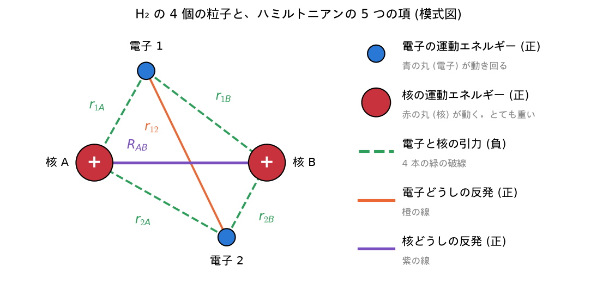
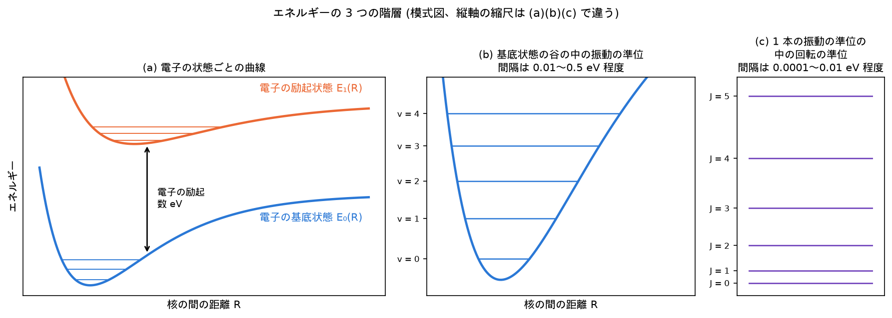
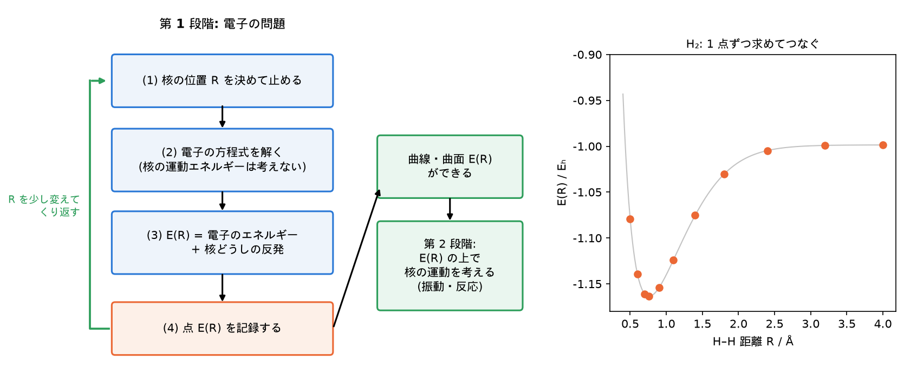
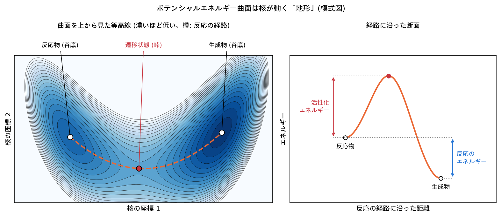
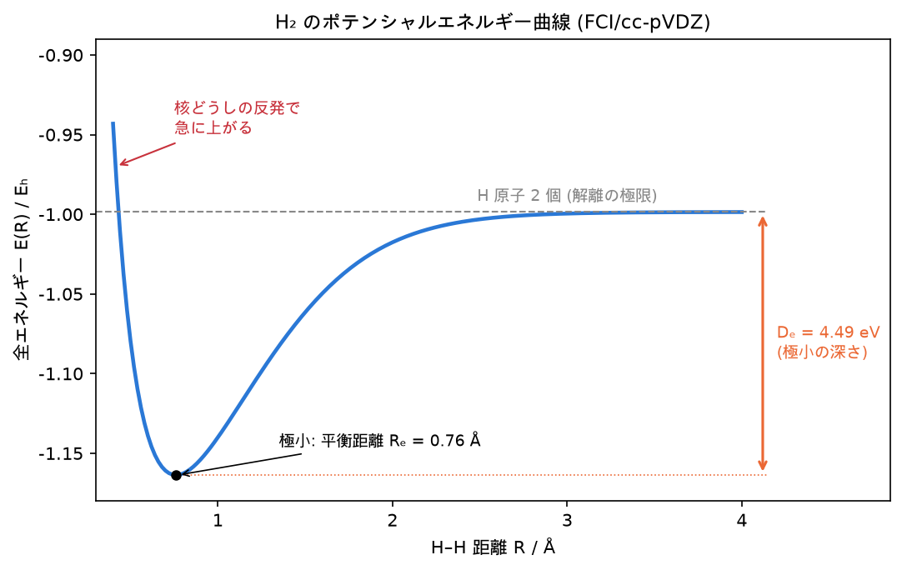
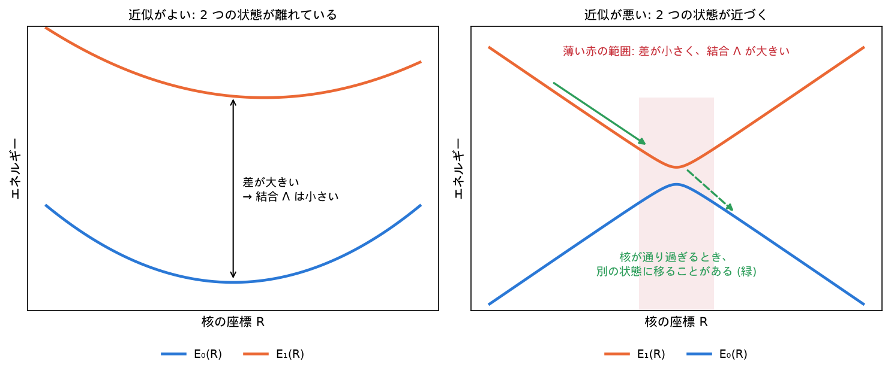

# 第 1 回　量子化学で解きたい方程式：Born–Oppenheimer 近似と電子のハミルトニアン

!!! abstract "この回の道筋"
    量子化学の計算プログラムが解いているのは、分子全体のシュレーディンガー方程式ではありません。核を止めたときの「電子のシュレーディンガー方程式」です。この回では、その方程式がどこから来るのか（Born–Oppenheimer 近似）と、その答えから何が分かるのか（ポテンシャルエネルギー曲面）を説明します。

    | 節 | 内容 |
    |---|---|
    | 1 | 分子のハミルトニアン：5 つの項 |
    | 2 | 原子単位：式から定数を消す |
    | 3 | Born–Oppenheimer 近似：核と電子を分ける |
    | 4 | ポテンシャルエネルギー曲面：H₂ の計算例 |
    | 5 | Born–Oppenheimer 近似が悪くなるとき |

    **前に読んでおく回**：なし（この連載の最初の回です）

!!! tip "物理的なイメージ"
    量子化学の計算が求めているのは、原子核を止めたときの電子のエネルギーです。いちばん軽い原子核の陽子でも電子の 1836 倍の質量があり、原子核は電子よりずっとゆっくり動きます。電子から見ると原子核はほぼ止まって見え、電子は原子核の位置が変わるたびに、すぐにその位置での最もエネルギーの低い状態に落ち着きます。そこで、原子核の位置ごとに電子のエネルギーを計算し、それを原子核の位置の関数としてつなげると、原子核が動く「地形」（ポテンシャルエネルギー曲面）ができます。分子の安定な構造は地形の谷底、反応の遷移状態は峠、分子の振動は谷底のまわりの揺れです。

## 1. 分子のハミルトニアン：5 つの項

分子は、いくつかの原子核と電子でできています。
量子力学では、分子の状態は波動関数 $\Psi$ で表され、時間によらない状態はシュレーディンガー方程式

$$
\hat H \Psi = E \Psi
$$

を満たします。
$\hat H$ はハミルトニアン（Hamiltonian）と呼ばれ、系の全エネルギーを表す演算子です。
$E$ はその状態のエネルギーです。

分子のハミルトニアンを書くために、記号を決めます。

- 電子に $i, j$ の番号を付け、位置を $\mathbf r_i$ とします。電子の数を $N$ とします。
- 原子核に $A, B$ の番号を付け、位置を $\mathbf R_A$、質量を $M_A$、原子番号を $Z_A$ とします。核の数を $M$ とします。
- $r_{iA} = |\mathbf r_i - \mathbf R_A|$（電子 $i$ と核 $A$ の距離）、$r_{ij} = |\mathbf r_i - \mathbf r_j|$（電子どうしの距離）、$R_{AB} = |\mathbf R_A - \mathbf R_B|$（核どうしの距離）と書きます。
- 電子の質量を $m_\mathrm e$、電気素量を $e$、真空の誘電率を $\varepsilon_0$、プランク定数を $2\pi$ で割ったものを $\hbar$ とします。

図 1 は、いちばん簡単な分子 H₂ の 4 個の粒子（核 2 個と電子 2 個）と、それらを結ぶ距離です。



**図 1**　H₂ の核 A、B（赤）と電子 1、2（青）。緑の破線 4 本が電子と核の引力、橙の線が電子どうしの反発、紫の線が核どうしの反発に対応します。これに、電子と核のそれぞれが動き回る運動エネルギーが加わり、全部で 5 種類の項になります。

相対論の効果と、スピンが関わる磁気的な相互作用を無視すると、分子のハミルトニアンは次の 5 つの項の和です。

$$
\hat H =
\underbrace{-\sum_{i}\frac{\hbar^2}{2m_\mathrm e}\nabla_i^2}_{\hat T_\mathrm e}
\underbrace{-\sum_{A}\frac{\hbar^2}{2M_A}\nabla_A^2}_{\hat T_\mathrm N}
\underbrace{-\sum_{i}\sum_{A}\frac{Z_A e^2}{4\pi\varepsilon_0\, r_{iA}}}_{\hat V_\mathrm{eN}}
\underbrace{+\sum_{i<j}\frac{e^2}{4\pi\varepsilon_0\, r_{ij}}}_{\hat V_\mathrm{ee}}
\underbrace{+\sum_{A<B}\frac{Z_A Z_B e^2}{4\pi\varepsilon_0\, R_{AB}}}_{\hat V_\mathrm{NN}}
$$

各項の意味は次のとおりです。

| 項 | 意味 | 符号 | H₂ での項の数 |
|---|---|---|---|
| $\hat T_\mathrm e$ | 電子の運動エネルギー | 正 | 電子 2 個分 |
| $\hat T_\mathrm N$ | 核の運動エネルギー | 正 | 核 2 個分 |
| $\hat V_\mathrm{eN}$ | 電子と核の引き合い（クーロン引力） | 負 | 4（図 1 の緑の破線） |
| $\hat V_\mathrm{ee}$ | 電子どうしの反発 | 正 | 1（橙の線） |
| $\hat V_\mathrm{NN}$ | 核どうしの反発 | 正 | 1（紫の線） |

$\nabla_i^2$ は電子 $i$ の座標についてのラプラシアン（$x, y, z$ についての 2 階微分の和）、$\nabla_A^2$ は核 $A$ の座標についてのラプラシアンです。
和の $i<j$ は、同じ組を 2 回数えないための書き方です。
たとえば H₂ の $\hat V_\mathrm{ee}$ は、組 $(1, 2)$ の 1 項 $e^2/(4\pi\varepsilon_0 r_{12})$ だけです。

この方程式は、水素原子のように電子が 1 個で核が 1 個なら厳密に解けます。
しかし電子が 2 個以上になると、$\hat V_\mathrm{ee}$ の $1/r_{ij}$ が 2 個の電子の座標を同時に含むため、電子ごとに分けて解けなくなります。
さらに核も動くので、変数の数は $3N + 3M$ に増えます。
たとえば H₂O（電子 10 個、核 3 個）では $3\times 10 + 3\times 3 = 39$ 個です。
そこで、まず変数を減らす工夫が必要になります。それが第 3 節の Born–Oppenheimer 近似です。
その前に、式を見やすくするために単位を決めます。

**ここまでで分かったこと**：分子のハミルトニアンは、電子と核の運動エネルギー、電子と核の引力、電子どうしと核どうしの反発の 5 項でできています。

## 2. 原子単位：式から定数を消す

上の式には $\hbar$、$m_\mathrm e$、$e$、$4\pi\varepsilon_0$ が何度も出てきます。
これらをすべて 1 とする単位系を、原子単位（atomic units）と呼びます。
量子化学の論文やプログラムの出力は、ほとんどがこの単位で書かれています。

### 2.1 長さとエネルギーの単位

原子単位では、長さとエネルギーを、次の 2 つの量で測ります。

$$
a_0 = \frac{4\pi\varepsilon_0\hbar^2}{m_\mathrm e e^2},\qquad
E_\mathrm h = \frac{e^2}{4\pi\varepsilon_0\, a_0}
$$

$a_0$ をボーア（bohr）、$E_\mathrm h$ をハートリー（hartree）と呼びます。
$a_0$ の式を $E_\mathrm h$ の式に入れると、$E_\mathrm h = \hbar^2/(m_\mathrm e a_0^2)$ とも書けます。
この 2 つの書き方が、次の 2.2 節で使う鍵です。

| 量 | 原子単位での名前 | SI などでの値 |
|---|---|---|
| 長さ | ボーア（bohr）、$a_0$ | 0.529177 Å |
| エネルギー | ハートリー（hartree）、$E_\mathrm h$ | 27.211 eV ＝ 627.5 kcal/mol ＝ 2625.5 kJ/mol |
| 質量 | 電子の質量 $m_\mathrm e$ | — |
| 電荷 | 電気素量 $e$ | — |

数値は CODATA の推奨値 [Tiesinga 2021] によります。
たとえば 4 節で求める H₂ の平衡距離 0.76 Å は、$0.76/0.529177 = 1.44$ ボーアです。

### 2.2 定数が消えるしくみ

水素原子（核は止めたとする）のハミルトニアンで確かめます。

$$
\hat H = -\frac{\hbar^2}{2m_\mathrm e}\nabla^2 - \frac{e^2}{4\pi\varepsilon_0\, r}
$$

距離をボーアで測った数 $r'$ を使い、$r = a_0 r'$ とおきます。
微分は $\nabla^2 = \nabla'^2/a_0^2$ になります（長さが $a_0$ 倍になると、2 階微分は $1/a_0^2$ 倍になるため）。
これを代入すると、

$$
\hat H = -\frac{\hbar^2}{m_\mathrm e a_0^2}\cdot\frac12\nabla'^2 - \frac{e^2}{4\pi\varepsilon_0\, a_0}\cdot\frac{1}{r'}
$$

です。
2.1 節の 2 つの書き方から、どちらの項の係数もちょうど $E_\mathrm h$ です。
したがって

$$
\hat H = E_\mathrm h\left(-\frac12\nabla'^2 - \frac1{r'}\right)
$$

となり、エネルギーをハートリーで測れば、括弧の中の定数のない式だけが残ります。
この式の基底状態のエネルギーは、ちょうど $-\tfrac12\,E_\mathrm h$ です。

分子のハミルトニアンでも同じことが起きます。
原子単位では、分子のハミルトニアンは次のように短くなります。

$$
\hat H =
-\sum_{i}\frac12\nabla_i^2
-\sum_{A}\frac{1}{2M_A}\nabla_A^2
-\sum_{i}\sum_{A}\frac{Z_A}{r_{iA}}
+\sum_{i<j}\frac{1}{r_{ij}}
+\sum_{A<B}\frac{Z_A Z_B}{R_{AB}}
$$

ここで $M_A$ は、電子の質量を 1 とした核の質量です。
核の運動エネルギーの項だけは、$m_\mathrm e$ のかわりに $M_A$ が入るので、$1/M_A$ が残ります。
陽子の質量は電子の約 1836 倍です [Tiesinga 2021]。
したがって、いちばん軽い水素の核でも $1/(2M_A)$ は $1/(2\cdot 1836)$ ほどしかありません。
この「核はとても重い」という事実が、次の節の出発点です。

**ここまでで分かったこと**：原子単位では $\hbar = m_\mathrm e = e = 4\pi\varepsilon_0 = 1$ とし、エネルギーをハートリー、長さをボーアで測ります。この連載でも、断りがなければ原子単位を使います。

## 3. Born–Oppenheimer 近似：核と電子を分ける

### 3.1 考え方：速い電子と遅い核

核は電子より 1800 倍以上重いので、同じ程度の力を受けても、核はずっとゆっくり動きます。
電子から見ると、核はほとんど止まっているように見えます。
逆に核から見ると、電子はとても速く動くので、その時々の核の配置に合わせた「平均の雲」になっています。
そこで、次の 2 段階に分けて問題を解きます。

1. 核の位置 $\mathbf R = (\mathbf R_1, \mathbf R_2, \dots)$ を固定し、その中で電子の状態を求める。
2. 求めた電子のエネルギーを、核が感じるポテンシャルとして使い、核の運動を考える。

この分け方を Born–Oppenheimer 近似と呼びます。
教科書では、Szabo–Ostlund の 2.1.2 節に分かりやすい説明があります [Szabo 1996]。

この分け方がうまくいくのは、電子の動きと核の動きのエネルギーの大きさが、桁で違うからです。
付録 B で見積もるように、電子の励起のエネルギーの大きさを $\varepsilon_\mathrm{el}$ とすると、分子の振動と回転のエネルギーの間隔はおよそ

$$
\varepsilon_\mathrm{vib} \sim \left(\frac{m_\mathrm e}{M}\right)^{1/2}\varepsilon_\mathrm{el},\qquad
\varepsilon_\mathrm{rot} \sim \frac{m_\mathrm e}{M}\,\varepsilon_\mathrm{el}
$$

です（$M$ は核の質量の目安）。
$m_\mathrm e/M = 1/1836$ なら、$(m_\mathrm e/M)^{1/2} \approx 0.023$ です。
電子の励起が数 eV なら、振動は 0.1 eV ほど、回転は数 meV ほどになります。
Born と Oppenheimer は 1927 年に、質量比の 4 乗根 $\kappa = (m_\mathrm e/M)^{1/4}$ を小さなパラメータとして分子のエネルギーを展開し、電子・振動・回転のエネルギーが $\kappa$ の 0 乗、2 乗、4 乗の大きさで順に現れることを示しました [Born 1927]。
上の 2 つの式は、$\kappa^2 = (m_\mathrm e/M)^{1/2}$、$\kappa^4 = m_\mathrm e/M$ と書き直すと、この順番そのものです。



**図 2**　(a) 電子の状態ごとに 1 本ずつ、核の間の距離 $R$ の関数としてのエネルギーの曲線があります（青が基底状態、橙が励起状態）。曲線どうしの間隔が電子の励起のエネルギーです。(b) 1 本の曲線の谷の中に、核の振動の準位（横線）が並びます。(c) さらに 1 本の振動の準位の中に、分子の回転の準位が並びます。(a)(b)(c) の順に、間隔が桁で小さくなることを見てください。

### 3.2 電子のシュレーディンガー方程式

核を止めると、核の運動エネルギー $\hat T_\mathrm N$ を考えなくてよくなります。
残りの項のうち、電子の座標を含むものを集めたのが、電子のハミルトニアンです。

$$
\hat H_\mathrm{el}
= -\sum_{i}\frac12\nabla_i^2
-\sum_{i}\sum_{A}\frac{Z_A}{r_{iA}}
+\sum_{i<j}\frac{1}{r_{ij}}
$$

核どうしの反発 $V_\mathrm{NN} = \sum_{A<B} Z_A Z_B / R_{AB}$ は、核を止めればただの数です。
そこで、電子の方程式を次のように書きます。

$$
\hat H_\mathrm{el}\,\psi_k(\mathbf r;\mathbf R) = E_k^\mathrm{el}(\mathbf R)\,\psi_k(\mathbf r;\mathbf R)
$$

$\mathbf r$ はすべての電子の座標をまとめたもの、$k = 0, 1, 2, \dots$ は電子の状態の番号（0 が基底状態）です。
「$;\mathbf R$」は、核の位置が変数ではなく、外から与える値（パラメータ）であることを表します。
$\hat H_\mathrm{el}$ の中で $\mathbf R$ が現れるのは、$r_{iA} = |\mathbf r_i - \mathbf R_A|$ の中だけです。
核の位置を変えるたびに $r_{iA}$ が変わるので、この方程式を解き直します。

量子化学の計算プログラムが解いているのは、この電子のシュレーディンガー方程式です。
プログラムが「全エネルギー」として出力するのは、電子のエネルギーに核の反発を足した値

$$
E_k(\mathbf R) = E_k^\mathrm{el}(\mathbf R) + V_\mathrm{NN}(\mathbf R)
$$

です。
この連載の第 3 回以降で扱う手法（Hartree–Fock 法、電子相関の方法、密度汎関数理論）は、どれもこの方程式を近似的に解く方法です。
図 3 に、この手順の流れをまとめます。



**図 3**　左：第 1 段階では、核の位置 $R$ を決めて止め、電子の方程式を解き、核の反発を足して 1 点 $E(R)$ を得ます。これを $R$ を少しずつ変えてくり返します（緑の矢印）。集めた点をつなぐと曲線（曲面）$E(R)$ ができ、第 2 段階ではその上で核の運動を考えます。右：H₂ で、こうして求めた点（橙）と、それをつないだ曲線（灰）。

### 3.3 核の運動

次に、核の運動を考えます。
分子全体の波動関数を、電子の状態 $\psi_k$ と核の波動関数 $\chi(\mathbf R)$ の積

$$
\Psi(\mathbf r, \mathbf R) \approx \chi(\mathbf R)\,\psi_k(\mathbf r;\mathbf R)
$$

で近似します。
この積の形は、「核がどこにいても、電子はその核の位置での状態 $\psi_k$ にすぐに合わせている」という 3.1 節の絵を式にしたものです。
すべての段階は付録 A で導きますが、核の波動関数は次の方程式を満たします。

$$
\left[\,-\sum_A \frac{1}{2M_A}\nabla_A^2 + E_k(\mathbf R)\right]\chi(\mathbf R) = E\,\chi(\mathbf R)
$$

この式は、ポテンシャル $E_k(\mathbf R)$ の中を核が動く、というシュレーディンガー方程式の形をしています。
つまり、電子のエネルギー $E_k(\mathbf R)$ が、核にとってのポテンシャルの役目をします。
分子の振動や化学反応は、このポテンシャルの上での核の運動として理解できます。

何を捨てたのかを、行列の形で見ておきます。
近似をしない場合、全体の波動関数は $\Psi = \sum_l \chi_l(\mathbf R)\,\psi_l(\mathbf r;\mathbf R)$ と、すべての電子状態についての和になります（付録 A の式 (A.1)）。
電子状態を基底状態 0 と励起状態 1 の 2 つだけに限ると、付録 A の式 (A.6) は次の 2 行 2 列の形になります。

$$
\begin{pmatrix}
\hat T_\mathrm N + E_0(\mathbf R) + \Lambda_{00} & \Lambda_{01}\\
\Lambda_{10} & \hat T_\mathrm N + E_1(\mathbf R) + \Lambda_{11}
\end{pmatrix}
\begin{pmatrix}\chi_0\\ \chi_1\end{pmatrix}
= E\begin{pmatrix}\chi_0\\ \chi_1\end{pmatrix}
$$

$\hat T_\mathrm N = -\sum_A \nabla_A^2/(2M_A)$ は核の運動エネルギーの演算子です。
$\Lambda_{kl}$（非断熱結合）は、核が動いたときに電子の状態 $\psi_l$ が変わる速さを表す演算子で、式 (A.5) で定義します。
非対角の $\Lambda_{01}$ と $\Lambda_{10}$ は、核の運動によって電子の状態が 0 から 1 へ（またはその逆へ）移る効果です。

Born–Oppenheimer 近似では、$\Lambda_{kl}$ をすべて捨てます。
すると行列は対角になり、$\chi_0$ と $\chi_1$ の方程式は互いに関係しなくなります。
1 行目だけを取り出したものが、上の核の方程式（$k = 0$）です。
付録 A で示すように、$\Lambda_{kl}$ には $1/M_A$ がかかっているため、核が重いほど近似がよくなります。

**ここまでで分かったこと**：核を止めて電子の方程式を解き、得られたエネルギー $E_k(\mathbf R)$ を核のポテンシャルとして使います。これが Born–Oppenheimer 近似で、電子状態どうしを結ぶ非断熱結合を捨てています。

## 4. ポテンシャルエネルギー曲面：H₂ の計算例

### 4.1 曲面から読み取れること

核の位置 $\mathbf R$ の関数としての $E_k(\mathbf R)$ を、ポテンシャルエネルギー曲面（potential energy surface、PES）と呼びます。
核が $M$ 個ある分子では、核の座標は $3M$ 個あります。
ただし、分子全体を平行移動（3 方向）しても、回転（3 つの軸のまわり）しても、エネルギーは変わりません。
そこでこの 6 個を除いた、$3M-6$ 個の変数の関数になります。
直線分子では、分子の軸のまわりの回転が意味をもたないので、除くのは 5 個で、$3M - 5$ 個です。
たとえば H₂O は $3\cdot 3 - 6 = 3$ 個（2 本の O–H 距離と H–O–H 角）、H₂ は $3\cdot 2 - 5 = 1$ 個（H–H 距離）です。
変数が 1 個の場合は、ポテンシャルエネルギー曲線と呼ぶこともあります。

ポテンシャルエネルギー曲面から、化学で使う多くの量が分かります（図 4）。

- **平衡構造**：曲面の極小点（谷底）。
- **振動数**：極小点のまわりの曲がり具合（2 階微分）。4.3 節で、曲がり具合から振動数を求める式を導きます。
- **反応のエネルギー**：反応物と生成物の極小点のエネルギー差。
- **活性化エネルギー**：反応物の極小点と、反応経路の上でいちばん高い点（遷移状態）のエネルギー差。遷移状態は、経路の方向には極大、それ以外の方向には極小になる点（1 次の鞍点、峠）です。



**図 4**　核の座標が 2 個の場合の模式図。左：曲面を上から見た等高線で、色が濃いほどエネルギーが低い所です。反応物と生成物は 2 つの谷底（白い点）にあり、その間を結ぶ最も楽な道（橙の破線）は、峠（赤い点、遷移状態）を越えます。右：その道に沿ったエネルギーの断面。峠の高さが活性化エネルギー、2 つの谷底の高さの差が反応のエネルギーです。

### 4.2 H₂ の曲線を計算する

いちばん簡単な例として、H₂ 分子のポテンシャルエネルギー曲線を計算してみます。
変数は H–H の距離 $R$ だけです。
距離ごとに電子の方程式を解きます。
解き方には、使った基底関数（第 6 回で説明します）の範囲で厳密な解を与える完全 CI（full CI、[第 8 回](08-configuration-interaction.md)で説明します）を使います。
計算には PySCF [Sun 2020] を使い、基底関数は cc-pVDZ [Dunning 1989] とします。

```python
import numpy as np
from pyscf import gto, scf, fci

def e_h2(r):
    # r は H–H 距離（Å）。全エネルギー E(R)（ハートリー）を返す
    mol = gto.M(atom=f"H 0 0 0; H 0 0 {r}", basis="cc-pvdz", unit="Angstrom", verbose=0)
    mf = scf.RHF(mol).run()
    return fci.FCI(mf).kernel()[0]

R = np.round(np.arange(0.40, 4.001, 0.02), 2)
E = np.array([e_h2(r) for r in R])
i = np.argmin(E)

# 遠く離れた 2 個の H 原子のエネルギー
h = gto.M(atom="H 0 0 0", basis="cc-pvdz", spin=1, verbose=0)
e_h = scf.UHF(h).run().e_tot
De = 2 * e_h - E[i]
print(f"最小の点      R = {R[i]:.2f} Å   E = {E[i]:.5f} Eh")
print(f"H 原子 2 個    2E(H) = {2*e_h:.5f} Eh")
print(f"解離エネルギー De = {De:.5f} Eh = {De*27.211386:.2f} eV")
```

出力は次のとおりです。

```text
最小の点      R = 0.76 Å   E = -1.16367 Eh
H 原子 2 個    2E(H) = -0.99856 Eh
解離エネルギー De = 0.16512 Eh = 4.49 eV
```

曲線を図にすると、図 5 のようになります。



**図 5**　H₂ のポテンシャルエネルギー曲線（FCI/cc-pVDZ、青）。灰色の破線は 2 個の H 原子に分かれたときのエネルギー、橙の矢印がその破線から極小（黒の点）までの深さ $D_\mathrm e$ です。左端の急な立ち上がりが核どうしの反発、右に向かって破線に近づく部分が解離です。

この図から、次のことが読み取れます。

- 距離が短いと、核どうしの反発 $V_\mathrm{NN} = 1/R$ が大きくなり、エネルギーが急に上がります。
- 距離が長いと、エネルギーは 2 個の H 原子のエネルギーの和に近づきます。
- その間に極小があり、これが H₂ の平衡距離（この計算では 0.76 Å）です。極小の深さ $D_\mathrm e$ が、結合を切るのに必要なエネルギー（零点振動を含まない値）です。

H 原子のエネルギーは厳密には $-0.5\,E_\mathrm h$ なので、2 個で $-1\,E_\mathrm h$ のはずです。
上の計算では $-0.99856\,E_\mathrm h$ と、少し高く出ました。
この差は、電子の方程式の解き方ではなく、基底関数が有限であることから来ます。
基底関数の選び方は第 6 回で扱います。

### 4.3 谷底の曲がり具合から振動を求める

谷底の近くで、曲線を $R_\mathrm e$（極小の位置）のまわりでテイラー展開します。

$$
E(R) = E(R_\mathrm e) + E'(R_\mathrm e)\,(R - R_\mathrm e) + \frac12 E''(R_\mathrm e)\,(R - R_\mathrm e)^2 + \cdots
$$

極小では傾きが 0 なので、$E'(R_\mathrm e) = 0$ で第 2 項が消えます。
$k = E''(R_\mathrm e)$ とおき、3 次以上の項を捨てると、

$$
E(R) \approx E(R_\mathrm e) + \frac12 k\,(R - R_\mathrm e)^2
$$

です。
これは、ばね定数 $k$ のばねのポテンシャル（放物線）と同じ形です。
2 個の核の相対運動は、換算質量 $\mu = M_A M_B/(M_A + M_B)$ をもつ 1 個の粒子の運動と同じです。
H₂ では $\mu = M_\mathrm H/2$ です。
したがって核は、角振動数

$$
\omega = \sqrt{k/\mu}
$$

で振動します。
量子力学の調和振動子のエネルギーは $\hbar\omega(v + \tfrac12)$（$v = 0, 1, 2, \dots$）なので、いちばん低い状態でも谷底より $\tfrac12\hbar\omega$ だけ高くなります。
これが零点振動のエネルギーです。

このように、谷底の曲率 $k$ が分かれば振動数が決まります。
谷が鋭い（$k$ が大きい）ほど振動数は高く、核が重い（$\mu$ が大きい）ほど低くなります。
これが、4.1 節で「振動数は極小点のまわりの曲がり具合から分かる」と書いた理由です。
零点振動のエネルギーのため、実際に結合を切るのに必要なエネルギー $D_0$ は、極小の深さ $D_\mathrm e$ より $\tfrac12\hbar\omega$ だけ小さくなります。

$$
D_0 \approx D_\mathrm e - \frac12\hbar\omega
$$

（右辺は放物線で近似した場合の値で、実際の谷は放物線より広がっているので、目安です。）
3.1 節の見積もりのとおり、$\hbar\omega$ は電子の励起のエネルギーに $(m_\mathrm e/M)^{1/2}$ をかけた大きさで、$D_\mathrm e$（数 eV）よりずっと小さい量です。

**ここまでで分かったこと**：核の位置を変えながら電子の方程式を解くと、ポテンシャルエネルギー曲面が得られます。平衡構造、振動、反応のエネルギーは、この曲面の谷底、谷底の曲がり具合、谷と峠の高さから読み取ります。

## 5. Born–Oppenheimer 近似が悪くなるとき

第 3 節で捨てた非断熱結合 $\Lambda_{kl}$ は、付録 A の式 (A.5) のように、電子の状態 $\psi_l$ を核の座標で微分した量 $\langle\psi_k|\nabla_A\psi_l\rangle$ を含みます。
付録 A の式 (A.10) で示すように、この量は 2 つの電子状態のエネルギー差 $E_l - E_k$ に反比例します。
差が小さいほど、結合は大きくなります。
したがって、Born–Oppenheimer 近似が悪くなるのは、主に次の場合です（図 6）。

- 2 つの電子状態のエネルギーが近づく、または交わる場所（円錐交差など）。光化学反応や、励起状態からの緩和がこれに当たります。
- 核が軽く、速く動く場合（水素の移動など）。ただし多くの場合、近似はまだよく成り立ちます。



**図 6**　模式図。左：2 つの電子状態のエネルギーが大きく離れていると、非断熱結合は小さく、核は 1 本の曲線の上だけを動くと考えてよくなります。右：2 つの曲線が近づく所（薄い赤の範囲）では結合が大きくなり、上の曲線を進んできた核が、そこを通り過ぎるときに下の曲線へ移ることがあります（緑の破線の矢印）。

基底状態の平衡構造の近くで、励起状態とのエネルギー差が十分大きければ、Born–Oppenheimer 近似はたいへんよい近似です。
この連載の第 I〜IV 部は、すべてこの近似の中で話を進めます。
近似が破れる場合は、[第 22 回](22-conical-intersections.md)で扱います。

!!! note "「全エネルギー」の意味に注意"
    計算プログラムが出す全エネルギーは、静止した核の位置での電子のエネルギーと核の反発の和です。零点振動エネルギーや熱の寄与は含みません。反応熱などを実験と比べるときは、4.3 節のように、ポテンシャルエネルギー曲面の上で振動を別に計算して足します。

**ここまでで分かったこと**：Born–Oppenheimer 近似は、電子状態どうしのエネルギーが近いところで悪くなります。それ以外では、量子化学の計算の土台として信頼できます。

## まとめ

- 分子のハミルトニアンは、電子と核の運動エネルギー、電子と核の引力、電子どうしと核どうしの反発の 5 項でできています。
- 原子単位では $\hbar = m_\mathrm e = e = 4\pi\varepsilon_0 = 1$ とし、1 $E_\mathrm h$ = 27.211 eV = 627.5 kcal/mol です。
- Born–Oppenheimer 近似では、核を止めて電子のシュレーディンガー方程式を解きます。量子化学の計算プログラムが解いているのはこの方程式です。電子・振動・回転のエネルギーが桁で違うことが、この近似の根拠です。
- 電子のエネルギーを核の位置の関数として見たものがポテンシャルエネルギー曲面で、構造・振動・反応はここから読み取ります。
- 電子状態のエネルギーが近づくところでは、この近似が悪くなります。

## 付録 A　核の方程式と非断熱結合の導出

### A.1 全体の波動関数の展開

分子全体のシュレーディンガー方程式 $\hat H\Psi = E\Psi$ から出発します。
ハミルトニアンを $\hat H = \hat T_\mathrm N + \hat H_\mathrm{el} + V_\mathrm{NN}$ と分けます。
$\hat T_\mathrm N = -\sum_A \nabla_A^2/(2M_A)$ です。
本文 3.2 節の記号で、$(\hat H_\mathrm{el} + V_\mathrm{NN})\psi_l = E_l(\mathbf R)\,\psi_l$ です（$E_l = E_l^\mathrm{el} + V_\mathrm{NN}$）。

各 $\mathbf R$ で、電子の状態 $\{\psi_k(\mathbf r;\mathbf R)\}$ は規格直交な完全系になるとします。
すると、全体の波動関数は、各 $\mathbf R$ で $\psi_l$ の一次結合に展開できます。
その係数は $\mathbf R$ によって変わるので、$\mathbf R$ の関数 $\chi_l(\mathbf R)$ と書きます。

$$
\Psi(\mathbf r,\mathbf R) = \sum_l \chi_l(\mathbf R)\,\psi_l(\mathbf r;\mathbf R) \tag{A.1}
$$

これを Born–Huang の展開と呼びます [Born 1954]。
ここまでは近似を使っていません。

### A.2 方程式に代入する

式 (A.1) を $\hat H\Psi = E\Psi$ に代入します。
$\hat H_\mathrm{el} + V_\mathrm{NN}$ は核の座標で微分しないので、$\chi_l$ をそのまま素通りし、$\psi_l$ にかかって $E_l$ を出します。

$$
\sum_l \Big[\hat T_\mathrm N\big(\chi_l\psi_l\big) + E_l\,\chi_l\psi_l\Big] = E\sum_l \chi_l\psi_l \tag{A.2}
$$

$\hat T_\mathrm N$ は核の座標での微分なので、$\chi_l$ と $\psi_l$ の両方にかかります。
積の 2 階微分の公式

$$
\nabla_A^2(\chi_l\psi_l) = (\nabla_A^2\chi_l)\,\psi_l + 2(\nabla_A\chi_l)\cdot(\nabla_A\psi_l) + \chi_l\,\nabla_A^2\psi_l \tag{A.3}
$$

を使い、両辺に $-1/(2M_A)$ をかけて $A$ について足すと、

$$
\hat T_\mathrm N(\chi_l\psi_l) = \psi_l\,(\hat T_\mathrm N\chi_l) - \sum_A\frac{1}{2M_A}\Big[2(\nabla_A\chi_l)\cdot(\nabla_A\psi_l) + \chi_l\,\nabla_A^2\psi_l\Big] \tag{A.4}
$$

です。

### A.3 電子の座標で積分する

式 (A.2) に式 (A.4) を入れ、左から $\psi_k^*$ をかけて、電子の座標 $\mathbf r$ で積分します。
以下、$\langle\cdots\rangle$ は電子の座標だけについての積分を表します。
$\chi_l$ と $\hat T_\mathrm N\chi_l$ は $\mathbf R$ だけの関数なので、積分の外に出せます。
項ごとに見ます。

- $\psi_l\,(\hat T_\mathrm N\chi_l)$ の項：$\langle\psi_k|\psi_l\rangle\,\hat T_\mathrm N\chi_l = \delta_{kl}\,\hat T_\mathrm N\chi_l$。
- $E_l\chi_l\psi_l$ の項：$\delta_{kl}\,E_l\chi_l$。
- 右辺：$E\,\delta_{kl}\,\chi_l$。
- 残りの 2 つの項：$-\sum_A\frac{1}{2M_A}\big[2\langle\psi_k|\nabla_A\psi_l\rangle\cdot\nabla_A\chi_l + \langle\psi_k|\nabla_A^2\psi_l\rangle\,\chi_l\big]$。

最後の項をまとめて、$\chi_l$ にかかる演算子として

$$
\Lambda_{kl} = -\sum_A \frac{1}{2M_A}\Big[\,2\,\langle\psi_k|\nabla_A\psi_l\rangle\cdot\nabla_A + \langle\psi_k|\nabla_A^2\psi_l\rangle\Big] \tag{A.5}
$$

と定義します（$\nabla_A$ は右の $\chi_l$ にかかります）。
$l$ について和をとると、$\delta_{kl}$ の付いた項は $l = k$ だけが残ります。
したがって、

$$
\left[\hat T_\mathrm N + E_k(\mathbf R)\right]\chi_k + \sum_l \Lambda_{kl}\,\chi_l = E\,\chi_k \tag{A.6}
$$

が得られます。
ここまでも近似を使っていません。
$k = 0, 1$ の 2 本を並べて行列の形に書いたものが、本文 3.3 節の 2 行 2 列の式です。

### A.4 Born–Oppenheimer 近似と断熱近似

$\Lambda_{kl}$ には $1/M_A$ がかかっていて、核が重いほど小さくなります。
$\Lambda_{kl}$ をすべて捨てると、式 (A.6) は異なる $k$ の間で結び付かなくなり、本文の核の方程式になります。
これが Born–Oppenheimer 近似です。
対角項 $\Lambda_{kk}$ だけを残す近似は、断熱近似と呼ばれ、$\Lambda_{kk}$ の寄与は断熱補正（diagonal Born–Oppenheimer correction）と呼ばれます。

### A.5 非対角の結合の大きさ

最後に、非対角の結合 $\langle\psi_k|\nabla_A\psi_l\rangle$（$k\neq l$）の大きさを見積もります。
出発点は、電子の方程式 $\hat H_\mathrm{el}\psi_l = E_l^\mathrm{el}\psi_l$ です。

**段階 1**：両辺を核の座標 $\mathbf R_A$ で微分します。左辺は積の微分で 2 つの項になります。

$$
(\nabla_A\hat H_\mathrm{el})\,\psi_l + \hat H_\mathrm{el}\,\nabla_A\psi_l = (\nabla_A E_l^\mathrm{el})\,\psi_l + E_l^\mathrm{el}\,\nabla_A\psi_l \tag{A.7}
$$

$\hat H_\mathrm{el}$ の中で $\mathbf R_A$ を含むのは $-\sum_i Z_A/r_{iA}$ だけなので、$\nabla_A\hat H_\mathrm{el}$ は、電子が核 $A$ に及ぼす力（の符号を変えたもの）を表す関数です。

**段階 2**：左から $\psi_k^*$（$k\neq l$）をかけて、電子の座標で積分します。右辺第 1 項は $\langle\psi_k|\psi_l\rangle = 0$ で消えます。

$$
\langle\psi_k|(\nabla_A\hat H_\mathrm{el})|\psi_l\rangle + \langle\psi_k|\hat H_\mathrm{el}|\nabla_A\psi_l\rangle = E_l^\mathrm{el}\,\langle\psi_k|\nabla_A\psi_l\rangle \tag{A.8}
$$

**段階 3**：左辺第 2 項で、$\hat H_\mathrm{el}$ がエルミートであることを使い、$\hat H_\mathrm{el}$ を左の $\psi_k$ にかけます。$\hat H_\mathrm{el}\psi_k = E_k^\mathrm{el}\psi_k$ なので、

$$
\langle\psi_k|\hat H_\mathrm{el}|\nabla_A\psi_l\rangle = E_k^\mathrm{el}\,\langle\psi_k|\nabla_A\psi_l\rangle \tag{A.9}
$$

です。

**段階 4**：式 (A.9) を式 (A.8) に入れ、$\langle\psi_k|\nabla_A\psi_l\rangle$ の項を右辺にまとめて、$E_l^\mathrm{el} - E_k^\mathrm{el}$ で割ります。

$$
\langle\psi_k|\nabla_A\psi_l\rangle = \frac{\langle\psi_k|(\nabla_A\hat H_\mathrm{el})|\psi_l\rangle}{E_l^\mathrm{el} - E_k^\mathrm{el}} \qquad (k\neq l) \tag{A.10}
$$

分子は、ふつう核の位置によってゆっくり変わる大きさの量です。
分母がエネルギー差なので、2 つの状態が近づくと結合が大きくなります。
本文の第 5 節は、この式にもとづいています。
なお、全エネルギー $E_k = E_k^\mathrm{el} + V_\mathrm{NN}$ では、どちらの状態にも同じ $V_\mathrm{NN}$ が足されます。そのため、分母は全エネルギーの差 $E_l - E_k$ と書いても同じです。

## 付録 B　電子・振動・回転のエネルギーの大きさの見積もり

本文 3.1 節の見積もりを、桁の大きさだけに注目して導きます。
分子の大きさ（結合の長さ）を $a$ とします。

**電子**：電子は大きさ $a$ の領域に閉じ込められています。
不確定性関係から運動量は $\hbar/a$ ほどなので、電子の運動エネルギーの大きさは

$$
\varepsilon_\mathrm{el} \sim \frac{\hbar^2}{m_\mathrm e a^2}
$$

です。
電子の励起のエネルギーも、この大きさです。

**振動**：結合を $a$ ほど伸ばすと、エネルギーは $\varepsilon_\mathrm{el}$ ほど変わります（結合が切れるため）。
したがって、谷底の曲率（ばね定数）の大きさは $k \sim \varepsilon_\mathrm{el}/a^2$ です。
質量 $M$ の核がこのばねで振動するときの振動の量子は、

$$
\hbar\omega = \hbar\sqrt{\frac{k}{M}} \sim \hbar\sqrt{\frac{\varepsilon_\mathrm{el}}{M a^2}}
$$

です。
ここに $\varepsilon_\mathrm{el} = \hbar^2/(m_\mathrm e a^2)$ を入れると、

$$
\hbar\omega \sim \hbar\sqrt{\frac{\hbar^2}{m_\mathrm e M a^4}} = \frac{\hbar^2}{m_\mathrm e a^2}\sqrt{\frac{m_\mathrm e}{M}} = \left(\frac{m_\mathrm e}{M}\right)^{1/2}\varepsilon_\mathrm{el}
$$

となります。

**回転**：分子の回転のエネルギーは、慣性モーメント $I \sim M a^2$ を使って $\hbar^2/(2I)$ ほどです。
したがって

$$
\varepsilon_\mathrm{rot} \sim \frac{\hbar^2}{M a^2} = \frac{\hbar^2}{m_\mathrm e a^2}\cdot\frac{m_\mathrm e}{M} = \frac{m_\mathrm e}{M}\,\varepsilon_\mathrm{el}
$$

です。
どちらも係数を無視した見積もりで、桁の大きさだけが意味をもちます。

## 参考文献

- M. Born, R. Oppenheimer, "Zur Quantentheorie der Molekeln", Ann. Phys. 389, 457 (1927). DOI: [10.1002/andp.19273892002](https://doi.org/10.1002/andp.19273892002)
- A. Szabo, N. S. Ostlund, "Modern Quantum Chemistry" (Dover, 1996). ISBN: 9780486691862
- M. Born, K. Huang, "Dynamical Theory of Crystal Lattices" (Oxford University Press, 1954). ISBN: 9780198503699
- E. Tiesinga, P. J. Mohr, D. B. Newell, B. N. Taylor, "CODATA recommended values of the fundamental physical constants: 2018", Rev. Mod. Phys. 93, 025010 (2021). DOI: [10.1103/RevModPhys.93.025010](https://doi.org/10.1103/RevModPhys.93.025010)
- Q. Sun et al., "Recent developments in the PySCF program package", J. Chem. Phys. 153, 024109 (2020). DOI: [10.1063/5.0006074](https://doi.org/10.1063/5.0006074)
- T. H. Dunning Jr., "Gaussian basis sets for use in correlated molecular calculations. I. The atoms boron through neon and hydrogen", J. Chem. Phys. 90, 1007 (1989). DOI: [10.1063/1.456153](https://doi.org/10.1063/1.456153)
