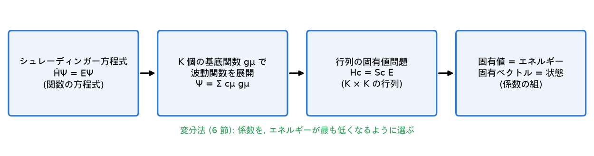
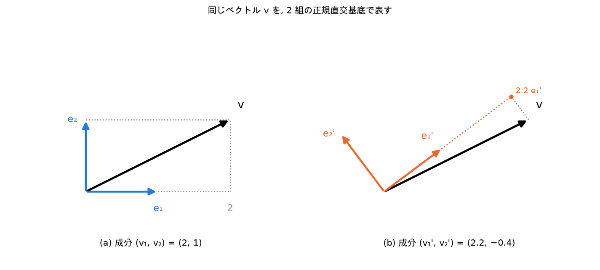
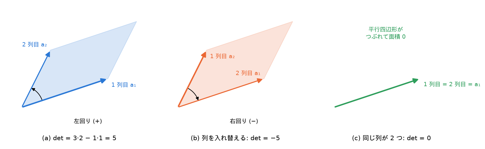
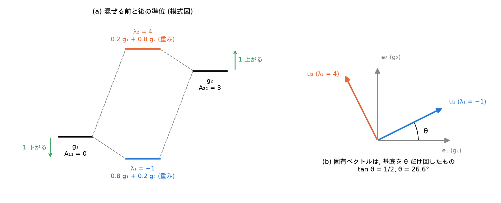
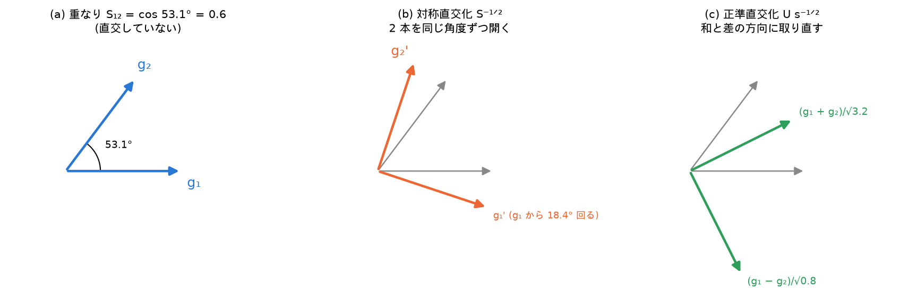
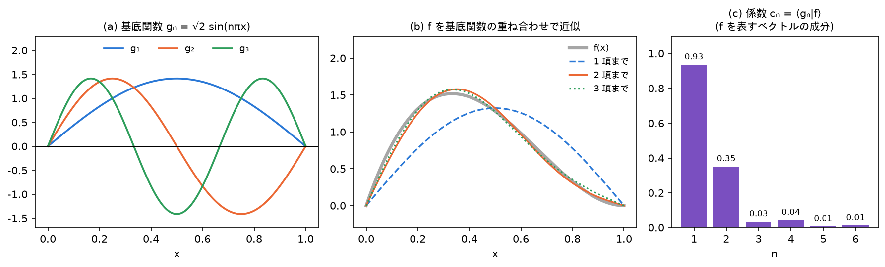
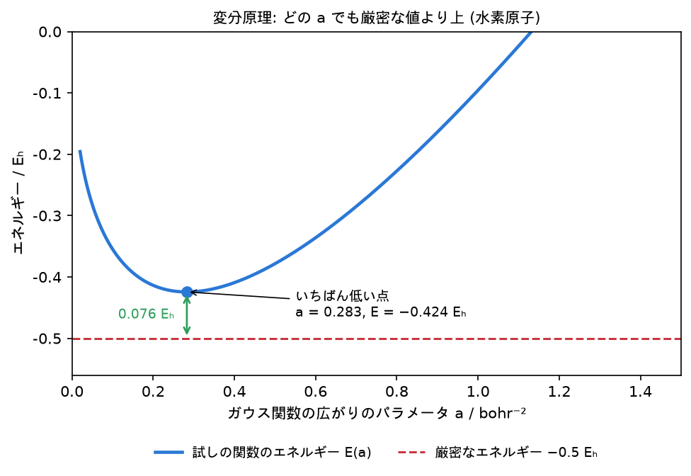
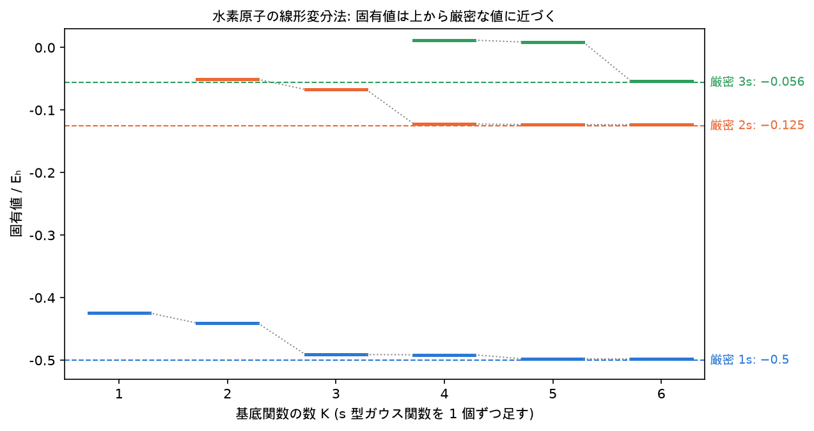
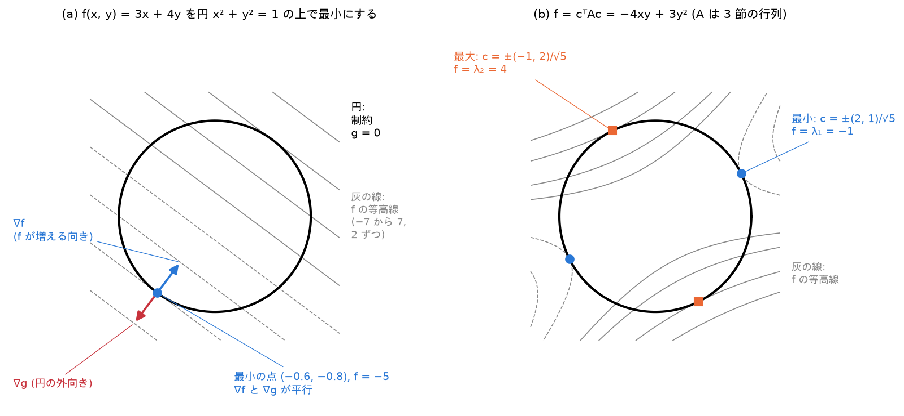

# 第 1 回　量子化学のための数学：行列、固有値問題、変分法

!!! abstract "この回の道筋"
    量子化学の計算は、波動関数を有限個の関数で表し、シュレーディンガー方程式を「行列の固有値問題」に置き換えて解きます。この回では、そのために必要な線形代数（ベクトル、行列、固有値問題、行列の関数）と、関数をベクトルとみなす考え方、変分法、Lagrange の未定乗数法をまとめます。Szabo–Ostlund の第 1 章に沿い、どの道具も 2 行 2 列の例で最後まで手で確かめます。

    | 節 | 内容 |
    |---|---|
    | 1 | ベクトル：基底、成分、内積、ブラとケット |
    | 2 | 行列：積、随伴、エルミート行列、ユニタリ行列、行列式 |
    | 3 | 固有値問題：エルミート行列の対角化 |
    | 4 | 行列の関数：重なり行列による直交化と一般化固有値問題 |
    | 5 | 関数の空間：関数を無限次元のベクトルとみなす |
    | 6 | 変分法：エネルギーの上限と線形変分法 |
    | 7 | Lagrange の未定乗数法：制約つきの最小化 |

    **前に読んでおく回**：なし（学部の線形代数と量子力学）

!!! tip "物理的なイメージ"
    量子化学の計算がしていることは、図 0 の 1 本の流れです。分子の波動関数は、3 次元の空間に広がった複雑な関数です。これを、あらかじめ決めた $K$ 個の関数（基底関数）の重ね合わせで表すと、波動関数は「$K$ 個の係数の組」、つまりベクトルになります。すると、シュレーディンガー方程式は $K\times K$ の行列の固有値問題に変わり、**固有値がエネルギー、固有ベクトルが状態**を表します。係数の選び方は変分法で決めます。エネルギーを係数の関数とみなすと、これは「エネルギーという地形の谷底を探す」ことです。基底関数を増やすほど探せる範囲が広がり、谷底は本当の答えに上から近づきます。

**図 0**　この回の道具の位置づけ。関数の方程式（左端）を、基底関数で展開して（5 節）、行列の固有値問題に直し（6 節）、それを対角化して（3、4 節）、エネルギーと状態を得ます。

この回の道具は、次の回で使います。

| 道具 | 使う所 |
|---|---|
| 行列式の性質（入れ替えで符号が変わる、同じ列があれば 0） | [第 2 回](02-many-electron-wavefunctions.md)：Slater 決定子とパウリの原理 |
| ブラ・ケット、行列要素 $\langle i\vert\hat A\vert j\rangle$ | [第 3 回](03-second-quantization.md)：Slater–Condon 則、第二量子化 |
| エルミート行列の対角化、ユニタリ変換 | [第 4 回](04-spin.md)：スピンの固有関数、[第 5 回](05-hartree-fock.md)：正準軌道 |
| 重なり行列 $\mathbf S$、$\mathbf S^{-1/2}$、一般化固有値問題 | [第 5 回](05-hartree-fock.md)：Roothaan–Hall 方程式 |
| Lagrange の未定乗数法 | [第 5 回](05-hartree-fock.md)：Hartree–Fock 方程式の導出 |
| 関数の展開と基底の打ち切り | [第 6 回](06-basis-sets.md)：基底関数 |
| 線形変分法、MacDonald の定理 | [第 5 回](05-hartree-fock.md)、[第 8 回](08-configuration-interaction.md)：配置間相互作用（CI） |

## 1. ベクトル

### 1.1 3 次元から N 次元へ

3 次元の空間のベクトル $\mathbf v$ は、互いに直交する長さ 1 のベクトル $\mathbf e_1, \mathbf e_2, \mathbf e_3$ を使って

$$
\mathbf v = v_1\mathbf e_1 + v_2\mathbf e_2 + v_3\mathbf e_3 = \sum_{i=1}^{3} v_i\,\mathbf e_i
$$

と書けます。
$\mathbf e_i$ の組を基底（basis）、数 $v_i$ を成分と呼びます。
成分を縦に並べると、$\mathbf v$ は列ベクトル $\begin{pmatrix} v_1 & v_2 & v_3\end{pmatrix}^{\mathrm T}$ で表せます。

この考え方は、次元が 3 でなくても同じです。
$N$ 個の基底 $\mathbf e_1, \dots, \mathbf e_N$ を使うと、$N$ 次元のベクトルは $N$ 個の成分の組です。
量子化学では、$N$ は数十から数百万になります。

2 つのベクトルの内積（スカラー積）は、成分の積の和です。

$$
\mathbf a\cdot\mathbf b = \sum_{i=1}^{N} a_i b_i
$$

自分自身との内積 $\mathbf a\cdot\mathbf a$ は長さの 2 乗です。
内積が 0 の 2 つのベクトルは、直交するといいます。
基底どうしが

$$
\mathbf e_i\cdot\mathbf e_j = \delta_{ij} =
\begin{cases} 1 & (i = j)\\ 0 & (i \ne j)\end{cases}
$$

を満たすとき、正規直交基底と呼びます。$\delta_{ij}$ はクロネッカーのデルタです。

正規直交基底では、成分は内積で取り出せます。
$\mathbf v = \sum_j v_j\mathbf e_j$ と $\mathbf e_i$ の内積をとると、

$$
\mathbf e_i\cdot\mathbf v = \sum_j v_j\,(\mathbf e_i\cdot\mathbf e_j) = \sum_j v_j\,\delta_{ij} = v_i
$$

です。
2 つ目の等号で正規直交の条件を使い、3 つ目の等号で $j = i$ の項だけを残しました。

### 1.2 基底を取り替えると成分が変わる

同じベクトルでも、基底を取り替えると成分が変わります。
図 1 で確かめます。

**図 1**　同じベクトル $\mathbf v$（黒）を、2 組の正規直交基底で表したもの。(a) ふつうの基底 $\mathbf e_1, \mathbf e_2$（青）では、成分は $(2, 1)$ です。(b) 基底を 36.9° 回した $\mathbf e_1', \mathbf e_2'$（橙）では、成分は $(2.2, -0.4)$ です。矢印そのものは変わらず、成分の数字だけが変わることを見てください。

(b) の基底は、(a) の基底で書くと $\mathbf e_1' = (0.8, 0.6)$、$\mathbf e_2' = (-0.6, 0.8)$ です。
どちらも長さが 1 で（$0.8^2 + 0.6^2 = 1$）、互いに直交します（$0.8\times(-0.6) + 0.6\times 0.8 = 0$）。
新しい成分は、1.1 節のとおり内積で取り出せます。

$$
v_1' = \mathbf e_1'\cdot\mathbf v = 0.8\times 2 + 0.6\times 1 = 2.2,\qquad
v_2' = \mathbf e_2'\cdot\mathbf v = -0.6\times 2 + 0.8\times 1 = -0.4
$$

確かめると、$2.2\,\mathbf e_1' - 0.4\,\mathbf e_2' = (1.76 + 0.24,\ 1.32 - 0.32) = (2, 1)$ で、元のベクトルに戻ります。
長さの 2 乗も、$2^2 + 1^2 = 5$、$2.2^2 + 0.4^2 = 5$ で変わりません。

量子化学では、同じ状態を「原子軌道の基底」「分子軌道の基底」など、いろいろな基底で表します。
基底を取り替えても状態そのものは変わらず、成分（係数）だけが変わります。

### 1.3 複素数のベクトルとブラ・ケットの記法

量子力学では、成分が複素数のベクトルを使います。
このとき、内積は一方の成分の複素共役をとって

$$
\langle\mathbf a|\mathbf b\rangle = \sum_{i=1}^{N} a_i^* b_i
$$

と定義します。
複素共役をとるのは、自分自身との内積 $\sum_i a_i^*a_i = \sum_i|a_i|^2$ を、0 以上の実数（長さの 2 乗）にするためです。
たとえば $\mathbf a = (1, i)$ では、$\langle\mathbf a|\mathbf a\rangle = 1\cdot 1 + (-i)\cdot i = 2$ です。
共役をとらずに $1 + i^2$ と計算すると 0 になってしまいます。

Dirac のブラ・ケットの記法では、列ベクトルを**ケット** $|a\rangle$、成分の複素共役を横に並べた行ベクトルを**ブラ** $\langle a|$ と書きます。

$$
|a\rangle = \begin{pmatrix} a_1\\ a_2\end{pmatrix},\qquad
\langle a| = \begin{pmatrix} a_1^* & a_2^*\end{pmatrix}
$$

ブラとケットを並べると、行と列の積として内積になります。

$$
\langle a|b\rangle = \begin{pmatrix} a_1^* & a_2^*\end{pmatrix}\begin{pmatrix} b_1\\ b_2\end{pmatrix} = a_1^*b_1 + a_2^*b_2
$$

順番を入れ替えると、複素共役になります：$\langle b|a\rangle = \langle a|b\rangle^*$。
$|a\rangle = (1, i)^{\mathrm T}$、$|b\rangle = (2, 1)^{\mathrm T}$ で確かめると、$\langle a|b\rangle = 1\cdot 2 + (-i)\cdot 1 = 2 - i$、$\langle b|a\rangle = 2\cdot 1 + 1\cdot i = 2 + i$ です。

逆に、ケットとブラを $|a\rangle\langle b|$ の順に並べると、列と行の積なので行列になります。
正規直交基底 $|i\rangle$ について、これを全部足すと単位行列になります。

$$
\sum_{i=1}^{N}|i\rangle\langle i| = \mathbf 1
$$

2 次元のふつうの基底では $\begin{pmatrix}1\\0\end{pmatrix}\begin{pmatrix}1 & 0\end{pmatrix} + \begin{pmatrix}0\\1\end{pmatrix}\begin{pmatrix}0 & 1\end{pmatrix} = \begin{pmatrix}1 & 0\\ 0 & 0\end{pmatrix} + \begin{pmatrix}0 & 0\\ 0 & 1\end{pmatrix} = \mathbf 1$ です。
図 1 (b) の基底でも、

$$
\begin{pmatrix}0.8\\0.6\end{pmatrix}\begin{pmatrix}0.8 & 0.6\end{pmatrix} + \begin{pmatrix}-0.6\\0.8\end{pmatrix}\begin{pmatrix}-0.6 & 0.8\end{pmatrix}
= \begin{pmatrix}0.64 & 0.48\\ 0.48 & 0.36\end{pmatrix} + \begin{pmatrix}0.36 & -0.48\\ -0.48 & 0.64\end{pmatrix} = \mathbf 1
$$

です。
この式を完全性（completeness）の関係と呼びます。
$|v\rangle = \mathbf 1|v\rangle = \sum_i|i\rangle\langle i|v\rangle$ と使うと、「ベクトルを基底で展開し、成分は $\langle i|v\rangle$」という 1.1 節の結果が 1 行で書けます。
この「単位行列を差し込む」操作は、第 3 回以降で何度も使います。

**ここまでで分かったこと**：ベクトルは、正規直交基底を決めると成分の組で表せます。成分は内積 $\langle i|v\rangle$ で取り出せ、基底を取り替えると変わります。

## 2. 行列

### 2.1 積、転置、随伴

$N\times N$ の行列 $\mathbf A$ は、ベクトルに作用して別のベクトルに変える「操作」を表します。
行列とベクトルの積、行列どうしの積は、行と列の内積で計算します。

$$
(\mathbf A\mathbf B)_{ij} = \sum_{k=1}^{N} A_{ik}B_{kj}
$$

2×2 の例で、積の順番を入れ替えます。

$$
\mathbf A = \begin{pmatrix} 1 & 2\\ 3 & 4\end{pmatrix},\quad
\mathbf B = \begin{pmatrix} 0 & 1\\ 1 & 0\end{pmatrix},\quad
\mathbf A\mathbf B = \begin{pmatrix} 2 & 1\\ 4 & 3\end{pmatrix},\quad
\mathbf B\mathbf A = \begin{pmatrix} 3 & 4\\ 1 & 2\end{pmatrix}
$$

$\mathbf A\mathbf B$ は $\mathbf A$ の列を入れ替え、$\mathbf B\mathbf A$ は $\mathbf A$ の行を入れ替えたものです。
このように、一般に $\mathbf A\mathbf B \ne \mathbf B\mathbf A$ です。

行と列を入れ替えた行列を転置（$\mathbf A^{\mathrm T}$、$(A^{\mathrm T})_{ij} = A_{ji}$）と呼びます。
転置してさらに各要素の複素共役をとったものを、随伴（エルミート共役）と呼び、$\mathbf A^\dagger$ と書きます。

$$
(A^\dagger)_{ij} = A_{ji}^*,\qquad
\mathbf C = \begin{pmatrix} 1 & i\\ 2 & 3 - i\end{pmatrix}
\ \Longrightarrow\
\mathbf C^\dagger = \begin{pmatrix} 1 & 2\\ -i & 3 + i\end{pmatrix}
$$

ケット（列ベクトル）の随伴がブラ（行ベクトル）です：$\langle a| = (|a\rangle)^\dagger$。
積の随伴は、順番が逆になります：$(\mathbf A\mathbf B)^\dagger = \mathbf B^\dagger\mathbf A^\dagger$。

正規直交基底 $|i\rangle$ を使うと、行列の要素は

$$
A_{ij} = \langle i|\mathbf A|j\rangle
$$

と書けます。$\mathbf A|j\rangle$ は $\mathbf A$ の第 $j$ 列で、それと $\langle i|$ の内積がその第 $i$ 成分だからです。
この形は、5 節で演算子を行列に直すときにそのまま使います。

### 2.2 エルミート行列とユニタリ行列

量子化学で特に大事な 2 種類の行列があります。

**エルミート行列**：自分の随伴に等しい行列 $\mathbf A^\dagger = \mathbf A$、つまり $A_{ij} = A_{ji}^*$ です。
対角要素は $A_{ii} = A_{ii}^*$ なので実数です。
要素がすべて実数なら、エルミート行列は対称行列（$\mathbf A^{\mathrm T} = \mathbf A$）です。

$$
\begin{pmatrix} 2 & 1 - i\\ 1 + i & 3\end{pmatrix},\qquad
\begin{pmatrix} 0 & -2\\ -2 & 3\end{pmatrix},\qquad
\begin{pmatrix} 2 & 1 & 0\\ 1 & 3 & 1\\ 0 & 1 & 2\end{pmatrix}
$$

は、どれもエルミート行列です。
ハミルトニアンの行列、重なり行列、Fock 行列は、どれもエルミート行列です。

**ユニタリ行列**：随伴が逆行列になる行列 $\mathbf U^\dagger\mathbf U = \mathbf U\mathbf U^\dagger = \mathbf 1$ です。
実数のユニタリ行列を直交行列と呼びます。
2 次元の回転は直交行列です。

$$
\mathbf U(\theta) = \begin{pmatrix} \cos\theta & -\sin\theta\\ \sin\theta & \cos\theta\end{pmatrix},\qquad
\mathbf U^{\mathrm T}\mathbf U = \begin{pmatrix} \cos^2\theta + \sin^2\theta & 0\\ 0 & \sin^2\theta + \cos^2\theta\end{pmatrix} = \mathbf 1
$$

図 1 (b) の基底を列に並べた $\begin{pmatrix} 0.8 & -0.6\\ 0.6 & 0.8\end{pmatrix}$ も、$\cos\theta = 0.8$、$\sin\theta = 0.6$ の回転です。
一般に、ユニタリ行列の列は正規直交基底をなします。$\mathbf U^\dagger\mathbf U = \mathbf 1$ の $(i, j)$ 要素が、第 $i$ 列と第 $j$ 列の内積だからです。

複素数のユニタリ行列の例も確かめます。

$$
\mathbf U = \frac{1}{\sqrt 2}\begin{pmatrix} 1 & i\\ i & 1\end{pmatrix},\quad
\mathbf U^\dagger = \frac{1}{\sqrt 2}\begin{pmatrix} 1 & -i\\ -i & 1\end{pmatrix},\quad
\mathbf U^\dagger\mathbf U = \frac12\begin{pmatrix} 1 + 1 & i - i\\ -i + i & 1 + 1\end{pmatrix} = \mathbf 1
$$

ユニタリ行列は内積を変えません。
$|a'\rangle = \mathbf U|a\rangle$、$|b'\rangle = \mathbf U|b\rangle$ とすると、$\langle a'| = \langle a|\mathbf U^\dagger$ なので、

$$
\langle a'|b'\rangle = \langle a|\mathbf U^\dagger\mathbf U|b\rangle = \langle a|b\rangle
$$

です。
つまり、ユニタリ行列は長さと角度を保つ「回転」の一般化です。
1.2 節で長さが変わらなかったのは、このためです。

### 2.3 跡

対角要素の和を跡（トレース、trace）と呼びます：$\mathrm{tr}\,\mathbf A = \sum_i A_{ii}$。
積の順番を入れ替えても跡は変わりません。

$$
\mathrm{tr}(\mathbf A\mathbf B) = \sum_{i}\sum_{k} A_{ik}B_{ki} = \sum_{k}\sum_{i} B_{ki}A_{ik} = \mathrm{tr}(\mathbf B\mathbf A)
$$

2.1 節の例では、$\mathrm{tr}(\mathbf A\mathbf B) = 2 + 3 = 5$、$\mathrm{tr}(\mathbf B\mathbf A) = 3 + 2 = 5$ です。
この性質から、ユニタリ行列ではさんでも跡は変わりません：$\mathrm{tr}(\mathbf U^\dagger\mathbf A\mathbf U) = \mathrm{tr}(\mathbf A\mathbf U\mathbf U^\dagger) = \mathrm{tr}\,\mathbf A$。

### 2.4 行列式

2×2 の行列式は $\begin{vmatrix} a & b\\ c & d\end{vmatrix} = ad - bc$ です。
3×3 の行列式は、1 行目に沿って 2×2 の行列式に展開して計算します（符号は $+, -, +$ と交互）。

$$
\begin{vmatrix} 2 & 1 & 0\\ 1 & 3 & 1\\ 0 & 1 & 2\end{vmatrix}
= 2\begin{vmatrix} 3 & 1\\ 1 & 2\end{vmatrix} - 1\begin{vmatrix} 1 & 1\\ 0 & 2\end{vmatrix} + 0\begin{vmatrix} 1 & 3\\ 0 & 1\end{vmatrix}
= 2\times 5 - 1\times 2 + 0 = 8
$$

2×2 の行列式は、図 2 のように、2 本の列ベクトルがつくる平行四辺形の「向きのついた面積」です。

**図 2**　2×2 の行列式は、1 列目と 2 列目のベクトルがつくる平行四辺形の面積に、向きの符号をつけたものです。(a) $\begin{vmatrix} 3 & 1\\ 1 & 2\end{vmatrix} = 5$。1 列目から 2 列目へ左回り。(b) 列を入れ替えると回る向きが逆になり、$-5$。(c) 2 つの列が同じだと平行四辺形がつぶれ、面積は 0。

量子化学で使う行列式の性質は、次のとおりです。
3×3 の上の例で 1 つずつ確かめます。

1. **2 つの行（または列）を入れ替えると、符号が変わる。** 1 行目と 2 行目を入れ替えると、
   $\begin{vmatrix} 1 & 3 & 1\\ 2 & 1 & 0\\ 0 & 1 & 2\end{vmatrix} = 1\times(1\cdot 2 - 0\cdot 1) - 3\times(2\cdot 2 - 0\cdot 0) + 1\times(2\cdot 1 - 1\cdot 0) = 2 - 12 + 2 = -8$ です。
2. **同じ行（または列）が 2 つあると、0 になる。** 1 行目と 2 行目を同じにすると、
   $\begin{vmatrix} 2 & 1 & 0\\ 2 & 1 & 0\\ 0 & 1 & 2\end{vmatrix} = 2\times(1\cdot 2 - 0) - 1\times(2\cdot 2 - 0) + 0 = 4 - 4 = 0$ です。
   理由は性質 1 から分かります。同じ 2 つの行を入れ替えても行列は変わらないのに、行列式の符号は変わります。$D = -D$ を満たす数は $D = 0$ だけです。
3. **積の行列式は、行列式の積。** $\det(\mathbf A\mathbf B) = \det\mathbf A\,\det\mathbf B$。2.1 節の例では $\det\mathbf A = 4 - 6 = -2$、$\det\mathbf B = -1$、$\det(\mathbf A\mathbf B) = 2\cdot 3 - 1\cdot 4 = 2 = (-2)\times(-1)$ です。
4. **転置しても変わらない。** $\det\mathbf A^{\mathrm T} = \det\mathbf A$。そのため、行についての性質は列についても成り立ちます。
5. **ユニタリ行列の行列式は絶対値が 1。** 性質 3 と $\det\mathbf U^\dagger = (\det\mathbf U)^*$ から、$|\det\mathbf U|^2 = \det(\mathbf U^\dagger\mathbf U) = \det\mathbf 1 = 1$ です。
6. **逆行列は、行列式が 0 でないときだけ存在する。** 2×2 では $\begin{pmatrix} a & b\\ c & d\end{pmatrix}^{-1} = \dfrac{1}{ad - bc}\begin{pmatrix} d & -b\\ -c & a\end{pmatrix}$ です。

性質 1 と 2 は、第 2 回で電子の波動関数を行列式で作るとき（Slater 決定子）の要になります。
行を電子、列を軌道に対応させると、性質 1 は「2 つの電子を入れ替えると波動関数の符号が変わる」こと、性質 2 は「同じ軌道に 2 個の電子は入れない」こと（パウリの原理）になります。
性質 3 は、「占有した軌道どうしを混ぜても、決定子は定数倍しか変わらない」ことの根拠になります。

**ここまでで分かったこと**：エルミート行列（$\mathbf A^\dagger = \mathbf A$）は量子化学の行列の基本形で、ユニタリ行列（$\mathbf U^\dagger\mathbf U = \mathbf 1$）は内積を保つ回転です。行列式は、行や列の入れ替えで符号が変わり、同じ行や列が 2 つあると 0 です。

## 3. 固有値問題

### 3.1 固有値と固有ベクトル

行列 $\mathbf A$ をかけても向きが変わらず、長さだけが $\lambda$ 倍になるベクトル $\mathbf c$ を、固有ベクトルと呼びます。

$$
\mathbf A\mathbf c = \lambda\mathbf c
$$

$\lambda$ が固有値です。
右辺を左辺に移すと $(\mathbf A - \lambda\mathbf 1)\mathbf c = \mathbf 0$ です。
$\mathbf c = \mathbf 0$ 以外の解があるためには、$\mathbf A - \lambda\mathbf 1$ の逆行列があってはいけません（あれば、左からかけて $\mathbf c = \mathbf 0$ になってしまう）。
2.4 節の性質 6 から、条件は

$$
\det(\mathbf A - \lambda\mathbf 1) = 0
$$

です。これを固有方程式（特性方程式）と呼びます。
$N\times N$ の行列では、$\lambda$ についての $N$ 次方程式なので、固有値は重複も数えて $N$ 個あります。

エルミート行列には、次の 2 つの性質があります。
証明は付録 A に回しますが、どちらも数行で示せます。

- **固有値はすべて実数。**
- **異なる固有値の固有ベクトルは直交する。** 同じ固有値が重なる場合も、直交するように選べる。

量子力学では、エネルギーなどの観測量はエルミートな演算子で表されます。
固有値が実数であることは、測定値が実数であることに対応します。
固有ベクトルが直交することは、異なるエネルギーの状態が互いに重ならないことに対応します。

複素数の要素をもつ例で確かめます。
$\begin{pmatrix} 2 & 1 - i\\ 1 + i & 3\end{pmatrix}$ の固有方程式は、

$$
(2 - \lambda)(3 - \lambda) - (1 - i)(1 + i) = \lambda^2 - 5\lambda + 6 - 2 = (\lambda - 1)(\lambda - 4) = 0
$$

です。$(1 - i)(1 + i) = 1 - i^2 = 2$ を使いました。
要素が複素数でも、固有値は $\lambda = 1, 4$ の実数です。

### 3.2 2×2 の例を最後まで解く

実対称行列

$$
\mathbf A = \begin{pmatrix} 0 & -2\\ -2 & 3\end{pmatrix}
$$

を対角化します。
これは、エネルギー 0 と 3 の 2 つの準位が、$-2$ の大きさで混ざり合う 2 準位の系のハミルトニアンだと思ってもかまいません。

**固有値**：固有方程式を展開します。

$$
\det(\mathbf A - \lambda\mathbf 1) = (0 - \lambda)(3 - \lambda) - (-2)(-2) = \lambda^2 - 3\lambda - 4 = (\lambda + 1)(\lambda - 4) = 0
$$

したがって $\lambda_1 = -1$、$\lambda_2 = 4$ です。
和 $-1 + 4 = 3$ は跡 $0 + 3$ に、積 $-1\times 4 = -4$ は行列式 $0\cdot 3 - 4$ に等しくなっています（どの行列でも成り立ちます）。

**固有ベクトル**：$\lambda_1 = -1$ を $(\mathbf A - \lambda\mathbf 1)\mathbf c = \mathbf 0$ に入れます。

$$
\begin{pmatrix} 1 & -2\\ -2 & 4\end{pmatrix}\begin{pmatrix} c_1\\ c_2\end{pmatrix} = \mathbf 0
$$

1 行目から $c_1 - 2c_2 = 0$、つまり $c_1 = 2c_2$ です（2 行目は 1 行目の $-2$ 倍で、同じ条件です）。
長さを 1 にすると $\mathbf c_1 = \frac{1}{\sqrt 5}(2, 1)^{\mathrm T}$ です。
$\lambda_2 = 4$ では、$\begin{pmatrix} -4 & -2\\ -2 & -1\end{pmatrix}\mathbf c = \mathbf 0$ から $c_2 = -2c_1$ で、$\mathbf c_2 = \frac{1}{\sqrt 5}(-1, 2)^{\mathrm T}$ です（全体の符号は自由に選べます）。
2 つの内積は $\frac15(2\cdot(-1) + 1\cdot 2) = 0$ で、確かに直交します。

**対角化**：固有ベクトルを列に並べた行列を $\mathbf U$ とします。

$$
\mathbf U = \frac{1}{\sqrt 5}\begin{pmatrix} 2 & -1\\ 1 & 2\end{pmatrix}
$$

列が正規直交なので、$\mathbf U$ は直交行列です。
$\mathbf U^{\mathrm T}\mathbf A\mathbf U$ を、右から順に計算します。

$$
\mathbf A\mathbf U = \frac{1}{\sqrt 5}\begin{pmatrix} 0\cdot 2 - 2\cdot 1 & 0\cdot(-1) - 2\cdot 2\\ -2\cdot 2 + 3\cdot 1 & -2\cdot(-1) + 3\cdot 2\end{pmatrix}
= \frac{1}{\sqrt 5}\begin{pmatrix} -2 & -4\\ -1 & 8\end{pmatrix}
$$

$$
\mathbf U^{\mathrm T}\mathbf A\mathbf U = \frac15\begin{pmatrix} 2 & 1\\ -1 & 2\end{pmatrix}\begin{pmatrix} -2 & -4\\ -1 & 8\end{pmatrix}
= \frac15\begin{pmatrix} -5 & 0\\ 0 & 20\end{pmatrix}
= \begin{pmatrix} -1 & 0\\ 0 & 4\end{pmatrix}
$$

対角要素に固有値が並びました。
一般に、エルミート行列 $\mathbf A$ は、固有ベクトルを列に並べたユニタリ行列 $\mathbf U$ で

$$
\mathbf U^\dagger\mathbf A\mathbf U = \boldsymbol\lambda = \begin{pmatrix} \lambda_1 & & \\ & \ddots & \\ & & \lambda_N\end{pmatrix}
$$

と対角化できます。
これは $\mathbf A\mathbf c_i = \lambda_i\mathbf c_i$ を $N$ 本、列として横に並べた式 $\mathbf A\mathbf U = \mathbf U\boldsymbol\lambda$ に、左から $\mathbf U^\dagger$ をかけたものです。
1.2 節の言葉でいえば、**対角化とは、行列が対角になる基底（固有ベクトルの基底）に取り替えること**です。

### 3.3 回転角と 2 準位の混ざり

$\mathbf U$ は、$\cos\theta = 2/\sqrt 5$、$\sin\theta = 1/\sqrt 5$（$\tan\theta = 1/2$、$\theta = 26.6^\circ$）の回転 $\mathbf U(\theta)$ そのものです。
一般の実対称行列 $\begin{pmatrix} a & b\\ b & d\end{pmatrix}$ で、この回転角を求めておきます。
$\mathbf U(\theta)$ の 2 つの列 $(\cos\theta, \sin\theta)$ と $(-\sin\theta, \cos\theta)$ ではさんだ非対角要素は、

$$
(\mathbf U^{\mathrm T}\mathbf A\mathbf U)_{12} = (d - a)\sin\theta\cos\theta + b(\cos^2\theta - \sin^2\theta) = \tfrac12(d - a)\sin 2\theta + b\cos 2\theta
$$

です。最後の等号で、倍角の公式 $2\sin\theta\cos\theta = \sin 2\theta$、$\cos^2\theta - \sin^2\theta = \cos 2\theta$ を使いました。
これが 0 になる条件から、

$$
\tan 2\theta = \frac{2b}{a - d}
$$

です。
上の例では $\tan 2\theta = 2(-2)/(0 - 3) = 4/3$ です。$\tan\theta = 1/2$ を倍角の公式 $\tan 2\theta = 2\tan\theta/(1 - \tan^2\theta)$ に入れると $1/(3/4) = 4/3$ となり、一致します。
固有値は、2 次方程式の解の公式から

$$
\lambda_\pm = \frac{a + d}{2} \pm \sqrt{\Big(\frac{a - d}{2}\Big)^2 + b^2}
$$

です。例では $\frac32 \pm \sqrt{\frac94 + 4} = 1.5 \pm 2.5$ で、$-1$ と $4$ になります。

図 3 に、この結果を準位の図で表します。

**図 3**　(a) 模式図。混ざる前の 2 つの準位（$A_{11} = 0$、$A_{22} = 3$）が、非対角要素 $-2$ で混ざると、下の準位は 1 下がって $-1$ に、上の準位は 1 上がって $4$ になります。下の状態は $g_1$ の重み $\cos^2\theta = 0.8$、$g_2$ の重み $\sin^2\theta = 0.2$ です。(b) 固有ベクトル $\mathbf u_1$、$\mathbf u_2$ は、もとの基底を $\theta = 26.6^\circ$ 回したものです。

図 3 (a) から、2 準位の混ざりについて次のことが読み取れます。

- 混ざると、準位は**押し広げられます**。$\sqrt{(\frac{a-d}{2})^2 + b^2} \ge |\frac{a - d}{2}|$ なので、下の固有値はもとの低いほうの準位より下に、上の固有値は高いほうの準位より上に来ます。
- 跡が変わらないので、2 つの準位の下がり幅と上がり幅は等しくなります（ここではどちらも 1）。
- 下の状態には、もとの低い準位 $g_1$ が多く混ざります。もとの準位の差 $|a - d|$ が非対角要素 $|b|$ より大きいほど、混ざりは小さく（$\theta$ が 0 に近く）なります。

化学結合で、2 つの原子軌道から結合性と反結合性の分子軌道ができるのも、この押し広げの例です。

**ここまでで分かったこと**：エルミート行列の固有値は実数で、固有ベクトルは直交します。固有ベクトルを並べたユニタリ行列で $\mathbf U^\dagger\mathbf A\mathbf U$ とすると、行列は対角になります。2 準位では、混ざりによって準位が押し広げられます。

## 4. 行列の関数

### 4.1 対角化を使って関数を作る

数の関数 $f(x)$（たとえば $x^2$、$e^x$、$x^{-1/2}$）を、行列に広げたいことがあります。
対角行列なら簡単で、対角要素ごとに関数をとれば済みます。

$$
f\begin{pmatrix} \lambda_1 & 0\\ 0 & \lambda_2\end{pmatrix} = \begin{pmatrix} f(\lambda_1) & 0\\ 0 & f(\lambda_2)\end{pmatrix}
$$

一般のエルミート行列は、対角化して $\mathbf A = \mathbf U\boldsymbol\lambda\mathbf U^\dagger$ と書けます（3.2 節の式に、左から $\mathbf U$、右から $\mathbf U^\dagger$ をかけた）。
2 乗を計算すると、$\mathbf U^\dagger\mathbf U = \mathbf 1$ が真ん中で消えて

$$
\mathbf A^2 = \mathbf U\boldsymbol\lambda\mathbf U^\dagger\,\mathbf U\boldsymbol\lambda\mathbf U^\dagger = \mathbf U\boldsymbol\lambda^2\mathbf U^\dagger
$$

です。$n$ 乗でも同じように $\mathbf A^n = \mathbf U\boldsymbol\lambda^n\mathbf U^\dagger$ です。
そこで、一般の関数を

$$
f(\mathbf A) = \mathbf U\,f(\boldsymbol\lambda)\,\mathbf U^\dagger
$$

で定義します。
手順は「対角化する → 固有値に関数をほどこす → 元の基底に戻す」の 3 段です。
$f(x) = x^{-1/2}$ のように負の数で定義されない関数では、固有値がすべて正である必要があります。

### 4.2 S の −1/2 乗を 2×2 で作る

量子化学で最もよく使う行列の関数は、$\mathbf S^{-1/2}$ です。
$\mathbf S$ は重なり行列で、規格化された 2 つの関数 $g_1$、$g_2$ の重なりが $s$ のとき、

$$
\mathbf S = \begin{pmatrix} 1 & s\\ s & 1\end{pmatrix}
$$

です（重なり行列の意味は 4.3 節と 5 節で説明します。いまは、ただの行列と思ってください）。

**段階 1：対角化**。固有方程式 $(1 - \lambda)^2 - s^2 = 0$ から、$\lambda = 1 \pm s$ です。
$1 + s$ の固有ベクトルは $\frac{1}{\sqrt 2}(1, 1)^{\mathrm T}$、$1 - s$ の固有ベクトルは $\frac{1}{\sqrt 2}(1, -1)^{\mathrm T}$ です。

$$
\mathbf U = \frac{1}{\sqrt 2}\begin{pmatrix} 1 & 1\\ 1 & -1\end{pmatrix},\qquad
\mathbf s = \mathbf U^{\mathrm T}\mathbf S\mathbf U = \begin{pmatrix} 1 + s & 0\\ 0 & 1 - s\end{pmatrix}
$$

$\mathbf S$ の固有値を並べた対角行列を、小文字の $\mathbf s$ と書きました。

**段階 2：固有値に関数をほどこす**。$p = (1 + s)^{-1/2}$、$q = (1 - s)^{-1/2}$ とおくと、$\mathbf s^{-1/2} = \begin{pmatrix} p & 0\\ 0 & q\end{pmatrix}$ です。

**段階 3：元の基底に戻す**。

$$
\mathbf S^{-1/2} = \mathbf U\mathbf s^{-1/2}\mathbf U^{\mathrm T}
= \frac12\begin{pmatrix} 1 & 1\\ 1 & -1\end{pmatrix}\begin{pmatrix} p & 0\\ 0 & q\end{pmatrix}\begin{pmatrix} 1 & 1\\ 1 & -1\end{pmatrix}
= \frac12\begin{pmatrix} p & q\\ p & -q\end{pmatrix}\begin{pmatrix} 1 & 1\\ 1 & -1\end{pmatrix}
= \frac12\begin{pmatrix} p + q & p - q\\ p - q & p + q\end{pmatrix}
$$

**数値例**：$s = 0.6$ とします。固有値は $1.6$ と $0.4$ で、$p = 1/\sqrt{1.6} = \sqrt{10}/4 = 0.7906$、$q = 1/\sqrt{0.4} = \sqrt{10}/2 = 1.5811$ です。
$p + q = 3\sqrt{10}/4$、$p - q = -\sqrt{10}/4$ なので、

$$
\mathbf S^{-1/2} = \frac{\sqrt{10}}{8}\begin{pmatrix} 3 & -1\\ -1 & 3\end{pmatrix} = \begin{pmatrix} 1.1859 & -0.3953\\ -0.3953 & 1.1859\end{pmatrix}
$$

です。
検算として、$\mathbf S^{-1/2}\mathbf S\mathbf S^{-1/2}$ を計算します。
$\begin{pmatrix} 3 & -1\\ -1 & 3\end{pmatrix}\begin{pmatrix} 1 & 0.6\\ 0.6 & 1\end{pmatrix} = \begin{pmatrix} 2.4 & 0.8\\ 0.8 & 2.4\end{pmatrix}$、さらに右から $\begin{pmatrix} 3 & -1\\ -1 & 3\end{pmatrix}$ をかけると $\begin{pmatrix} 6.4 & 0\\ 0 & 6.4\end{pmatrix}$ です。
係数 $(\sqrt{10}/8)^2 = 10/64$ をかけると $6.4\times 10/64 = 1$ で、単位行列になります。

### 4.3 重なりのある関数を直交化する

量子化学の基底関数（各原子を中心とする原子軌道のような関数）は、互いに直交しません。
基底関数を $g_\mu$ と書きます（ギリシャ文字の添字 $\mu, \nu$ は基底関数の番号です）。
重なりの積分を並べた行列が、重なり行列 $\mathbf S$ です（関数の内積は 5 節で定義します）。

$$
S_{\mu\nu} = \langle g_\mu|g_\nu\rangle
$$

直交しない基底は扱いにくいので、一次結合を取り直して正規直交な関数 $g_\nu'$ を作ります。

$$
g_\nu' = \sum_\mu g_\mu X_{\mu\nu}
$$

新しい関数の重なりは、展開を代入して

$$
\langle g_\lambda'|g_\nu'\rangle = \sum_{\mu\kappa} X_{\kappa\lambda}^*\,\langle g_\kappa|g_\mu\rangle\,X_{\mu\nu} = (\mathbf X^\dagger\mathbf S\mathbf X)_{\lambda\nu}
$$

です。
したがって、$\mathbf X^\dagger\mathbf S\mathbf X = \mathbf 1$ を満たす $\mathbf X$ を見つければ、新しい関数は正規直交です。
代表的な選び方が 2 つあります [Szabo 1996]。

- **対称直交化**（Löwdin の直交化）：$\mathbf X = \mathbf S^{-1/2}$。$\mathbf S^{-1/2}$ はエルミートなので、$\mathbf X^\dagger\mathbf S\mathbf X = \mathbf S^{-1/2}\mathbf S\mathbf S^{-1/2} = \mathbf 1$ です（4.2 節の検算と同じ）。Löwdin が 1950 年に導入しました [Löwdin 1950]。
- **正準直交化**：$\mathbf X = \mathbf U\mathbf s^{-1/2}$。$\mathbf X^\dagger\mathbf S\mathbf X = \mathbf s^{-1/2}\mathbf U^\dagger\mathbf S\mathbf U\mathbf s^{-1/2} = \mathbf s^{-1/2}\mathbf s\,\mathbf s^{-1/2} = \mathbf 1$ です。

$s = 0.6$ の例で、2 つを書き出します。
対称直交化では、$\mathbf S^{-1/2}$ の列が新しい関数の係数です。

$$
g_1' = 1.1859\,g_1 - 0.3953\,g_2,\qquad
g_2' = -0.3953\,g_1 + 1.1859\,g_2
$$

正準直交化では、$\mathbf U\mathbf s^{-1/2} = \frac{1}{\sqrt 2}\begin{pmatrix} p & q\\ p & -q\end{pmatrix}$ の列が係数です。

$$
g_1' = \frac{g_1 + g_2}{\sqrt{2(1 + s)}} = \frac{g_1 + g_2}{\sqrt{3.2}},\qquad
g_2' = \frac{g_1 - g_2}{\sqrt{2(1 - s)}} = \frac{g_1 - g_2}{\sqrt{0.8}}
$$

図 4 に、2 つの直交化をベクトルの絵で示します。

**図 4**　重なり 0.6 の 2 つの関数を、長さ 1 のベクトルの間の角度 $53.1^\circ$（$\cos 53.1^\circ = 0.6$）として描いた模式図。(a) もとの $g_1$、$g_2$。(b) 対称直交化では、2 本を同じ角度（$18.4^\circ$）ずつ外へ開いて直交させます。どちらの関数も特別扱いしません。(c) 正準直交化では、和の方向と差の方向に取り直します。灰の矢印はもとの $g_1$、$g_2$ です。

2 つの直交化には、それぞれ利点があります。
対称直交化では、新しい関数 $g_\mu'$ がもとの $g_\mu$ の名残をとどめ、どの原子の関数かが分かります。
正準直交化では、$\mathbf S$ の固有値 $s_i$ がとても小さい（基底関数がほとんど一次従属である）とき、その列を捨てて、数値の不安定を避けられます。
$s_i^{-1/2}$ が非常に大きくなるのは、図 4 で $g_1$ と $g_2$ がほとんど重なり、差の方向 $g_1 - g_2$ がほぼ 0 になる場合にあたります。

### 4.4 一般化固有値問題をふつうの固有値問題に直す

第 5 回の Roothaan–Hall 方程式は、重なり行列を含む次の形をしています。

$$
\mathbf H\mathbf C = \mathbf S\mathbf C\boldsymbol\varepsilon
$$

$\mathbf H$ はエルミート行列（第 5 回では Fock 行列 $\mathbf F$）、$\mathbf C$ は各列が 1 つの解の係数、$\boldsymbol\varepsilon$ は固有値（軌道エネルギー）を並べた対角行列です。
この形を一般化固有値問題と呼びます。
なぜこの形になるかは 6.3 節で示します。ここでは、解き方だけを 1 行ずつ示します。

1. 係数を $\mathbf C = \mathbf S^{-1/2}\mathbf C'$ とおきます（$\mathbf C'$ が新しい未知数）。代入すると
   $\mathbf H\mathbf S^{-1/2}\mathbf C' = \mathbf S\mathbf S^{-1/2}\mathbf C'\boldsymbol\varepsilon$ です。
2. 両辺に左から $\mathbf S^{-1/2}$ をかけます。
   $\mathbf S^{-1/2}\mathbf H\mathbf S^{-1/2}\mathbf C' = \mathbf S^{-1/2}\mathbf S\mathbf S^{-1/2}\mathbf C'\boldsymbol\varepsilon$ です。
3. 右辺の $\mathbf S^{-1/2}\mathbf S\mathbf S^{-1/2}$ は単位行列です（4.2 節）。
   $\mathbf S^{-1/2}\mathbf H\mathbf S^{-1/2}\mathbf C' = \mathbf C'\boldsymbol\varepsilon$ です。
4. $\mathbf H' = \mathbf S^{-1/2}\mathbf H\mathbf S^{-1/2}$ とおくと、$\mathbf H'\mathbf C' = \mathbf C'\boldsymbol\varepsilon$ で、ふつうの固有値問題です。$\mathbf H'$ はエルミートなので、3 節の方法で対角化できます。
5. 求めた $\mathbf C'$ から、$\mathbf C = \mathbf S^{-1/2}\mathbf C'$ で元の係数に戻します。

$\mathbf H'$ は、4.3 節の直交化した基底 $g_\mu'$ で書いたハミルトニアンの行列です。
つまり、この手順は「基底を直交化してから、ふつうに対角化する」ことです。
正準直交化の $\mathbf X = \mathbf U\mathbf s^{-1/2}$ を使っても、$\mathbf C = \mathbf X\mathbf C'$、$\mathbf H' = \mathbf X^\dagger\mathbf H\mathbf X$ として同じ手順で解けます。
得られた $\mathbf C$ は $\mathbf C^\dagger\mathbf S\mathbf C = \mathbf C'^\dagger\mathbf S^{-1/2}\mathbf S\mathbf S^{-1/2}\mathbf C' = \mathbf C'^\dagger\mathbf C' = \mathbf 1$ を満たします。
これは、解の関数 $\sum_\mu C_{\mu i}g_\mu$ どうしが正規直交であることを表します。

**数値例**：重なり $s = 0.6$ の 2 つの関数で、

$$
\mathbf H = \begin{pmatrix} -1.7 & -1.3\\ -1.3 & -0.5\end{pmatrix},\qquad
\mathbf S = \begin{pmatrix} 1 & 0.6\\ 0.6 & 1\end{pmatrix}
$$

を解きます（エネルギーの単位は何でもかまいません）。

段階 2〜4：$\mathbf H' = \frac{10}{64}\begin{pmatrix} 3 & -1\\ -1 & 3\end{pmatrix}\mathbf H\begin{pmatrix} 3 & -1\\ -1 & 3\end{pmatrix}$ を、左から順に計算します。

$$
\begin{pmatrix} 3 & -1\\ -1 & 3\end{pmatrix}\begin{pmatrix} -1.7 & -1.3\\ -1.3 & -0.5\end{pmatrix} = \begin{pmatrix} -3.8 & -3.4\\ -2.2 & -0.2\end{pmatrix},\qquad
\begin{pmatrix} -3.8 & -3.4\\ -2.2 & -0.2\end{pmatrix}\begin{pmatrix} 3 & -1\\ -1 & 3\end{pmatrix} = \begin{pmatrix} -8.0 & -6.4\\ -6.4 & 1.6\end{pmatrix}
$$

$$
\mathbf H' = \frac{10}{64}\begin{pmatrix} -8.0 & -6.4\\ -6.4 & 1.6\end{pmatrix} = \begin{pmatrix} -1.25 & -1.0\\ -1.0 & 0.25\end{pmatrix}
$$

$\mathbf H'$ の固有方程式は $(-1.25 - \varepsilon)(0.25 - \varepsilon) - 1 = \varepsilon^2 + \varepsilon - 1.3125 = (\varepsilon + 1.75)(\varepsilon - 0.75) = 0$ で、$\varepsilon_1 = -1.75$、$\varepsilon_2 = 0.75$ です。
固有ベクトルは、3.2 節と同じ手順で $\mathbf c_1' = \frac{1}{\sqrt 5}(2, 1)^{\mathrm T}$、$\mathbf c_2' = \frac{1}{\sqrt 5}(-1, 2)^{\mathrm T}$ です。
たとえば $\varepsilon_1$ では、$\mathbf H' + 1.75 = \begin{pmatrix} 0.5 & -1\\ -1 & 2\end{pmatrix}$ から $c_1' = 2c_2'$ です。

段階 5：元の係数に戻します。$\frac{\sqrt{10}}{8}\cdot\frac{1}{\sqrt 5} = \frac{\sqrt 2}{8}$ なので、

$$
\mathbf C = \mathbf S^{-1/2}\mathbf C' = \frac{\sqrt 2}{8}\begin{pmatrix} 3 & -1\\ -1 & 3\end{pmatrix}\begin{pmatrix} 2 & -1\\ 1 & 2\end{pmatrix}
= \frac{\sqrt 2}{8}\begin{pmatrix} 5 & -5\\ 1 & 7\end{pmatrix}
= \begin{pmatrix} 0.8839 & -0.8839\\ 0.1768 & 1.2374\end{pmatrix}
$$

です。
低いほうの解は $0.88\,g_1 + 0.18\,g_2$ で、主に $g_1$ に同じ符号で $g_2$ が混ざったもの（結合性）です。
高いほうの解は $-0.88\,g_1 + 1.24\,g_2$ で、符号が逆の組み合わせ（反結合性）です。

元の式で検算します。1 列目について、$\mathbf H\mathbf c_1$ と $\varepsilon_1\mathbf S\mathbf c_1$ を、共通の因子 $\sqrt 2/8$ を除いて計算すると、

$$
\mathbf H\begin{pmatrix} 5\\ 1\end{pmatrix} = \begin{pmatrix} -8.5 - 1.3\\ -6.5 - 0.5\end{pmatrix} = \begin{pmatrix} -9.8\\ -7.0\end{pmatrix},\qquad
-1.75\,\mathbf S\begin{pmatrix} 5\\ 1\end{pmatrix} = -1.75\begin{pmatrix} 5.6\\ 4.0\end{pmatrix} = \begin{pmatrix} -9.8\\ -7.0\end{pmatrix}
$$

で一致します。
規格化は $\mathbf c_1^{\mathrm T}\mathbf S\mathbf c_1 = \frac{2}{64}(25 + 1 + 2\times 0.6\times 5) = \frac{32}{32} = 1$ です。
係数の 2 乗の和 $0.8839^2 + 0.1768^2 = 0.81$ が 1 にならないのは、重なりの項 $2\times 0.6\times C_{11}C_{21}$ も規格化に寄与するためです。

**ここまでで分かったこと**：エルミート行列の関数は「対角化 → 固有値に関数 → 元に戻す」で作れます。$\mathbf S^{-1/2}$ を使うと、重なりのある基底を直交化でき、一般化固有値問題 $\mathbf H\mathbf C = \mathbf S\mathbf C\boldsymbol\varepsilon$ をふつうの固有値問題に直せます。

## 5. 関数の空間

### 5.1 関数を無限次元のベクトルとみなす

波動関数は関数です。
ここまでのベクトルの道具を関数に使うために、関数をベクトルとみなします。

関数 $f(x)$ を、細かく区切った点 $x_1, x_2, \dots$ での値の組 $(f(x_1), f(x_2), \dots)$ と考えます。
これは、点の数だけ成分をもつベクトルです。
点を細かくしていけば、成分の数が無限のベクトルになります。
この見方では、内積の「成分の積の和」は、「関数の値の積の積分」になります。

$$
\langle f|g\rangle = \int f^*(x)\,g(x)\,dx
$$

3 次元の空間の関数なら、$x$ についての積分を $\mathbf r$ についての積分 $\int d\mathbf r$ に置き換えます。
ベクトルと関数の対応をまとめると、次のとおりです。

| | ベクトル | 関数 |
|---|---|---|
| 成分 | $a_i$（番号 $i$） | $f(x)$（位置 $x$） |
| 内積 | $\langle a\vert b\rangle = \sum_i a_i^*b_i$ | $\langle f\vert g\rangle = \int f^*(x)g(x)\,dx$ |
| 長さの 2 乗 | $\sum_i\vert a_i\vert^2$ | $\int\vert f(x)\vert^2dx$（規格化なら 1） |
| 直交 | $\langle a\vert b\rangle = 0$ | $\int f^*g\,dx = 0$ |
| 行列・演算子 | $\mathbf A$ | $\hat A$（微分、かけ算など） |

### 5.2 完全系による展開

関数の正規直交な組 $g_1, g_2, \dots$（$\langle g_m|g_n\rangle = \delta_{mn}$）が、どんな関数でも重ね合わせで表せるとき、完全系（complete set）と呼びます。

$$
f(x) = \sum_{n=1}^{\infty} c_n\,g_n(x)
$$

係数は、1.1 節と同じく内積で取り出せます。
両辺と $g_m$ の内積をとると、

$$
\langle g_m|f\rangle = \sum_n c_n\langle g_m|g_n\rangle = \sum_n c_n\delta_{mn} = c_m
$$

です。
つまり、関数 $f$ は、成分 $c_n = \langle g_n|f\rangle$ をもつベクトルです。

例として、長さ 1 の箱（$0 \le x \le 1$）の中の粒子の固有関数

$$
g_n(x) = \sqrt 2\,\sin(n\pi x)\qquad(n = 1, 2, 3, \dots)
$$

を使います。
これは、両端で 0 になる関数の完全系です。
$f(x) = \sqrt{105}\,x(1 - x)^2$（規格化した、左に偏った山の形）を展開した結果を、図 5 に示します。

**図 5**　(a) 基底関数 $g_1, g_2, g_3$。(b) $f(x)$（灰の太線）を、最初の $K$ 項まで足して近似したもの。1 項（青の破線）では山の位置がずれていますが、2 項（橙）でほぼ重なります。(c) 係数 $c_n = \langle g_n|f\rangle$。これが、$f$ を表す「ベクトルの成分」です。

正規直交な展開では、$\langle f|f\rangle = \sum_n|c_n|^2 = 1$ です（1.2 節で長さが成分の 2 乗の和だったのと同じ）。
最初の $K$ 項で打ち切ったときに取り込めた割合は $\sum_{n\le K}|c_n|^2$ で、$K = 1$ で $0.935^2 = 0.874$、$K = 2$ で $0.874 + 0.350^2 = 0.997$ です。
図 5 (b) で 2 項からほとんど重なるのは、このためです。

基底関数がよく選べていれば、少ない項数で関数をよく近似できます。
量子化学の基底関数（第 6 回）は、分子の軌道を少ない項数で表せるように、原子軌道に似せた形を選んだものです。

### 5.3 演算子を行列に直す

演算子 $\hat A$ が関数 $f$ を関数 $g$ に変えるとします：$\hat A f = g$。
両辺を同じ基底で展開すると、$\sum_j c_j\hat Ag_j = \sum_j d_jg_j$ です（$c_j = \langle g_j|f\rangle$、$d_j = \langle g_j|g\rangle$）。
両辺と $g_i$ の内積をとると、左辺は $\sum_j\langle g_i|\hat A|g_j\rangle c_j$、右辺は $\sum_j d_j\langle g_i|g_j\rangle = d_i$ です。
したがって、

$$
d_i = \sum_j A_{ij}\,c_j,\qquad A_{ij} = \langle g_i|\hat A|g_j\rangle = \intg_i^*(x)\,\hat A\,g_j(x)\,dx
$$

です。
演算子は行列 $\mathbf A$ に、関数は係数のベクトルに、「演算子を作用させる」ことは「行列をかける」ことになりました。
2.1 節の $A_{ij} = \langle i|\mathbf A|j\rangle$ と同じ形です。

量子力学の観測量の演算子は、エルミート演算子です。
エルミート演算子とは、どの関数 $f$、$g$ についても

$$
\langle f|\hat A g\rangle = \langle\hat A f|g\rangle
$$

が成り立つ演算子です。
$f = g_i$、$g = g_j$ とおき、右辺を $\langle\hat Ag_i|g_j\rangle = \langle g_j|\hat Ag_i\rangle^*$ と書き直すと、$A_{ij} = A_{ji}^*$ が得られます。
つまり、エルミート演算子の行列はエルミート行列です。
3 節の結果（固有値は実数、固有ベクトルは直交）が、そのまま使えます。

**例**：箱の基底 $g_1$、$g_2$ で、位置の演算子 $\hat x$（$x$ をかける）を行列にします。
対角要素は、$\sin^2$ の関数が箱の中央について対称なので、$\langle g_1|x|g_1\rangle = \langle g_2|x|g_2\rangle = 1/2$ です。
非対角要素は、積を和に直す公式 $2\sin(\pi x)\sin(2\pi x) = \cos(\pi x) - \cos(3\pi x)$ と、部分積分で求めた $\int_0^1 x\cos(k\pi x)\,dx = [(-1)^k - 1]/(k\pi)^2$ を使って、

$$
\langle g_1|x|g_2\rangle = \int_0^1 x\big[\cos(\pi x) - \cos(3\pi x)\big]dx = -\frac{2}{\pi^2} + \frac{2}{9\pi^2} = -\frac{16}{9\pi^2} = -0.180
$$

です。
したがって、2 つの基底で打ち切った $\hat x$ の行列は

$$
\mathbf x = \begin{pmatrix} 0.5 & -0.180\\ -0.180 & 0.5\end{pmatrix}
$$

です。
対角要素が等しいので、固有ベクトルは $(g_1 + g_2)/\sqrt 2$（固有値 $0.5 - 0.180 = 0.320$）と $(g_1 - g_2)/\sqrt 2$（固有値 $0.680$）です。
$g_1 + g_2$ は、$g_2$ が左半分で正なので左に偏り、粒子が左側 $x \approx 0.32$ にいる状態を表します。
本当の位置の固有値は 0 から 1 までの連続した値ですが、基底を 2 個に打ち切ったので、2 個の値しか出てきません。
基底を増やすと、固有値の数が増え、間隔が細かくなります。
このように、**無限次元の演算子の問題を、有限の基底で打ち切ると、行列の問題になります**。
打ち切りが近似であり、基底を増やすほど正確になる、という点が大切です。

量子化学の基底関数は直交しないので、4.3 節の重なり行列 $S_{\mu\nu} = \langle g_\mu|g_\nu\rangle$ が現れます。
2 個の電子にかかわる演算子（電子間の反発 $1/r_{12}$）の積分は、化学者の表記 $(\mu\nu|\lambda\sigma)$ で書き、第 3 回と第 5 回で扱います。

**ここまでで分かったこと**：関数は無限次元のベクトルで、内積は積分 $\langle f|g\rangle = \int f^*g$ です。完全系で展開すると関数は係数のベクトルに、演算子は行列 $A_{ij} = \langle g_i|\hat A|g_j\rangle$ になります。基底を有限個で打ち切ると、行列の問題として解けます。

## 6. 変分法

この節では原子単位（エネルギーはハートリー $E_\mathrm h$、1 $E_\mathrm h$ = 27.211 eV）を使います。

### 6.1 変分原理：エネルギーの上限

量子化学では、電子のシュレーディンガー方程式 $\hat H\Psi = E\Psi$ を解きます。
電子が 2 個以上あると、これは厳密には解けません。
そこで、近似の波動関数を作り、その「よさ」をエネルギーで測ります。
その根拠になるのが変分原理です。

**変分原理**：規格化された任意の波動関数 $\tilde\Psi$ について、

$$
\tilde E = \langle\tilde\Psi|\hat H|\tilde\Psi\rangle \ \ge\ E_0
$$

が成り立ちます。$E_0$ は基底状態の厳密なエネルギーです。

理由を 1 段ずつ示します。
$\hat H$ の固有関数を $\Psi_n$（エネルギー $E_0 \le E_1 \le E_2 \le \cdots$）とします。
$\hat H$ はエルミートなので、固有関数は正規直交にとれ（3.1 節）、完全系をなします。
そこで、5.2 節のように $\tilde\Psi$ を

$$
\tilde\Psi = \sum_n c_n\Psi_n
$$

と展開できます。
$\tilde\Psi$ が規格化されているので、$\langle\tilde\Psi|\tilde\Psi\rangle = \sum_{m,n}c_m^*c_n\langle\Psi_m|\Psi_n\rangle = \sum_n|c_n|^2 = 1$ です。
次に、エネルギーを計算します。$\hat H\Psi_n = E_n\Psi_n$ を使い、$\langle\Psi_m|\Psi_n\rangle = \delta_{mn}$ で $m = n$ の項だけを残すと、

$$
\tilde E = \sum_{m,n}c_m^*c_n\langle\Psi_m|\hat H|\Psi_n\rangle = \sum_{m,n}c_m^*c_n E_n\delta_{mn} = \sum_n|c_n|^2E_n
$$

です。
最後に、すべての $E_n$ を、それ以下の $E_0$ で置き換えると、

$$
\tilde E = \sum_n|c_n|^2E_n \ \ge\ \sum_n|c_n|^2E_0 = E_0
$$

となります。
つまり $\tilde E$ は、各固有状態のエネルギーを重み $|c_n|^2$ で平均したものです。
平均は、いちばん小さい $E_0$ より小さくなれません。

**2 状態の例**：$\tilde\Psi = \cos\theta\,\Psi_0 + \sin\theta\,\Psi_1$ とすると、

$$
\tilde E = \cos^2\theta\,E_0 + \sin^2\theta\,E_1 = E_0 + \sin^2\theta\,(E_1 - E_0) \ \ge\ E_0
$$

です。
励起状態が混ざる割合 $\sin^2\theta$ に比例して、エネルギーが上がります。
等号は、$\theta = 0$（厳密な基底状態そのもの）のときだけ成り立ちます。

### 6.2 パラメータを調節する

したがって、波動関数にいくつかの調節できる部分（パラメータ）を持たせ、$\tilde E$ がいちばん低くなるように選べば、その範囲で最もよい近似が得られます。
「物理的なイメージ」の言葉でいえば、パラメータを座標とするエネルギーの地形の谷底を探すことです。
谷底の高さは、厳密なエネルギーより下には来ません。

水素原子で試してみます。
厳密な基底状態は $e^{-r}$ の形で、エネルギーは $-0.5\,E_\mathrm h$ です。
これを、わざと形の違うガウス関数 $\tilde\psi = (2a/\pi)^{3/4}e^{-ar^2}$ で近似します。
$a$ が、関数の広がりを決めるパラメータです。
付録 C で計算するように、エネルギーは

$$
\tilde E(a) = \frac{3a}{2} - 2\sqrt{\frac{2a}{\pi}}
$$

です。
第 1 項が運動エネルギー、第 2 項が核からの引力です。
$d\tilde E/da = 0$ から、いちばん低くなるのは $a = 8/(9\pi) = 0.283$ のときで、$\tilde E = -4/(3\pi) = -0.424\,E_\mathrm h$ です。

**図 6**　水素原子をガウス関数で近似したときのエネルギー $\tilde E(a)$（青）。$a$ が小さい（関数が広がりすぎる）と核からの引力が弱まり、$a$ が大きい（狭すぎる）と運動エネルギーが大きくなります。いちばん低い点でも、厳密なエネルギー（赤の破線）より $0.076\,E_\mathrm h$ 高いままです。どの $a$ でも赤の破線の下には来ないことを見てください。

### 6.3 線形変分法

6.2 節では、パラメータ $a$ が関数の形の中に入っていました（非線形のパラメータ）。
実際の量子化学では、パラメータを「基底関数の係数」にする方法を主に使います。
これを線形変分法と呼びます。

試しの関数を、決まった $K$ 個の基底関数 $g_\mu$ の一次結合にします。

$$
\tilde\Phi = \sum_{\mu=1}^{K} c_\mu\,g_\mu
$$

関数と係数は実数とします（複素数でも結果は同じ形です）。
基底関数は直交しなくてもよく、重なり行列を $S_{\mu\nu} = \langle g_\mu|g_\nu\rangle$、ハミルトニアンの行列を $H_{\mu\nu} = \langle g_\mu|\hat H|g_\nu\rangle$ とします。
$\tilde\Phi$ は規格化されているとは限らないので、エネルギーを規格化で割った形で書きます。

$$
\tilde E(\mathbf c) = \frac{\langle\tilde\Phi|\hat H|\tilde\Phi\rangle}{\langle\tilde\Phi|\tilde\Phi\rangle}
= \frac{\sum_{\mu\nu}c_\mu H_{\mu\nu}c_\nu}{\sum_{\mu\nu}c_\mu S_{\mu\nu}c_\nu}
= \frac{\mathbf c^{\mathrm T}\mathbf H\mathbf c}{\mathbf c^{\mathrm T}\mathbf S\mathbf c}
$$

これを最小にする $\mathbf c$ を求めます。

1. 分母を払います：$\tilde E\,(\mathbf c^{\mathrm T}\mathbf S\mathbf c) = \mathbf c^{\mathrm T}\mathbf H\mathbf c$。
2. 両辺を $c_\kappa$ で微分します。$\mathbf c^{\mathrm T}\mathbf H\mathbf c = \sum_{\mu\nu}c_\mu H_{\mu\nu}c_\nu$ の微分は、$\mu = \kappa$ の項から $\sum_\nu H_{\kappa\nu}c_\nu$、$\nu = \kappa$ の項から $\sum_\mu c_\mu H_{\mu\kappa}$ が出ます。$\mathbf H$ が対称なので、2 つは等しく、合わせて $2(\mathbf H\mathbf c)_\kappa$ です。$\mathbf S$ についても同じです。積の微分を使うと、
   $\dfrac{\partial\tilde E}{\partial c_\kappa}(\mathbf c^{\mathrm T}\mathbf S\mathbf c) + \tilde E\cdot 2(\mathbf S\mathbf c)_\kappa = 2(\mathbf H\mathbf c)_\kappa$ です。
3. 最小では、すべての $\kappa$ で $\partial\tilde E/\partial c_\kappa = 0$ です。第 1 項が消えて、
   $(\mathbf H\mathbf c)_\kappa = \tilde E\,(\mathbf S\mathbf c)_\kappa\quad(\kappa = 1, \dots, K)$ です。
4. $K$ 本の式をまとめると、

$$
\mathbf H\mathbf c = E\,\mathbf S\mathbf c
$$

です。
「エネルギーを最小にする」問題が、**行列の一般化固有値問題**になりました。
2×2 で書き出すと、

$$
\begin{pmatrix} H_{11} & H_{12}\\ H_{21} & H_{22}\end{pmatrix}\begin{pmatrix} c_1\\ c_2\end{pmatrix}
= E\begin{pmatrix} S_{11} & S_{12}\\ S_{21} & S_{22}\end{pmatrix}\begin{pmatrix} c_1\\ c_2\end{pmatrix},
\qquad
\begin{vmatrix} H_{11} - ES_{11} & H_{12} - ES_{12}\\ H_{21} - ES_{21} & H_{22} - ES_{22}\end{vmatrix} = 0
$$

です（右の式は、$(\mathbf H - E\mathbf S)\mathbf c = \mathbf 0$ が $\mathbf c \ne \mathbf 0$ の解をもつ条件）。
基底が正規直交（$\mathbf S = \mathbf 1$）なら、ふつうの固有値問題 $\mathbf H\mathbf c = E\mathbf c$ です。

$K$ 個の解のすべての列を並べると、$\mathbf H\mathbf C = \mathbf S\mathbf C\mathbf E$ です（$\mathbf E$ は固有値の対角行列）。
4.4 節の手順で解けます。
いちばん低い固有値 $E_1$ が、この基底で得られる最もよい基底状態のエネルギーで、変分原理から $E_1 \ge E_0$ です。
$K$ 個の解はどれも $\tilde E(\mathbf c)$ の停留点（傾きが 0 の点）で、いちばん低い解が最小（谷底）、いちばん高い解が最大、その間の解は鞍点にあたります。

4.4 節の数値例は、この形そのものです。
$g_1$ だけで近似すると、エネルギーは $H_{11}/S_{11} = -1.7$ です。
$g_2$ を加えると $E_1 = -1.75$ に下がりました。
関数を加えて探せる範囲が広がったので、谷底が下がったのです。

この考え方は、第 5 回（軌道を基底関数で展開する Roothaan–Hall 方程式）と、第 8 回（波動関数を多くの決定子で展開する CI）の両方の土台です。

### 6.4 MacDonald の定理：基底を増やすと準位は上から近づく

線形変分法では、固有値が $K$ 個出ます。
いちばん低いもの以外にも意味があることを、次の定理が保証します [Hylleraas 1930; MacDonald 1933]。

**MacDonald の定理**（Hylleraas–Undheim の定理とも呼びます）：$K$ 個の基底での固有値を $E_1^{(K)} \le E_2^{(K)} \le \cdots \le E_K^{(K)}$、厳密な固有値を $E_1 \le E_2 \le \cdots$ とします。

1. どの $i$ についても、$E_i^{(K)} \ge E_i$。つまり、$i$ 番目の固有値は、$i$ 番目の厳密なエネルギーの上限です。
2. 基底関数を 1 個加えると、新しい固有値は古い固有値の間に入ります：$E_i^{(K+1)} \le E_i^{(K)} \le E_{i+1}^{(K+1)}$。

性質 2 から、基底を増やすと、各固有値は下がるか変わらないかのどちらかです。
性質 1 と合わせると、**各準位は、基底を増やすにつれて、上から厳密な値に近づきます**。
2×2 の場合を付録 B で確かめます。
4.4 節の数値例でも、$g_1$ だけの $-1.7$ が、2 つの固有値 $-1.75$ と $0.75$ の間に入っています。

図 7 に、水素原子の例を示します。

**図 7**　水素原子を、規格化した s 型のガウス関数 $(2a/\pi)^{3/4}e^{-ar^2}$ で線形変分法により解いたときの固有値。指数 $a$ が 0.283、0.06、1.5、0.015、8.0、0.004 の関数を、この順に 1 個ずつ加えました。$K = 1$ の $-0.424$ は 6.2 節の最小値です。破線は厳密な 1s、2s、3s のエネルギー（$-1/(2n^2)$）。どの準位も、基底を増やすと下がり、破線より下には来ません。$K = 6$ では $-0.4978$、$-0.1234$、$-0.0536$ です。0.02 より上の固有値は省きました。

この定理は、第 8 回の CI で励起状態を求めるときに使います。
CI の 2 番目、3 番目の固有値も、それぞれ厳密な励起状態のエネルギーの上限です。

**ここまでで分かったこと**：近似の波動関数のエネルギーは、厳密なエネルギーより必ず高くなります。試しの関数を基底関数の一次結合にすると、エネルギーの最小化は一般化固有値問題 $\mathbf H\mathbf c = E\mathbf S\mathbf c$ になります。基底を増やすと、各固有値は上から厳密な値に近づきます。

## 7. Lagrange の未定乗数法

### 7.1 制約つきの最小化

6.3 節では、規格化で割った形のエネルギーを最小にしました。
同じ結果を、「規格化を保ったまま、エネルギーを最小にする」と考えても得られます。
このような、条件（制約）のもとでの最小化に使うのが、Lagrange の未定乗数法です。
第 5 回で Hartree–Fock 方程式を導くとき、「軌道どうしが正規直交である」という制約を扱うのに使います。

簡単な例で考え方を示します。
円 $x^2 + y^2 = 1$ の上で、$f(x, y) = 3x + 4y$ を最小にします。
制約を $g(x, y) = x^2 + y^2 - 1 = 0$ と書きます。

図 8 (a) のように、最小の点では、$f$ の等高線が円に接します。
もし接していなければ、円に沿って少し動くと $f$ がさらに下がるからです。
等高線が円に接することは、$f$ の勾配 $\nabla f$（$f$ が最も増える向き）と、$g$ の勾配 $\nabla g$（円に垂直な向き）が平行であることと同じです。

$$
\nabla f = \lambda\,\nabla g
$$

この比例の係数 $\lambda$ を、未定乗数と呼びます。
この条件と制約 $g = 0$ は、次の関数 $L$ を作り、そのすべての変数での微分を 0 とおけば、まとめて得られます。

$$
L(x, y, \lambda) = f(x, y) - \lambda\,g(x, y)
$$

$x$、$y$ での微分が $\nabla f = \lambda\nabla g$ を、$\lambda$ での微分が $g = 0$ を与えるからです。
制約のない最小化の問題に直せた点が、この方法の便利なところです。

**図 8**　(a) 円の上で $f = 3x + 4y$ を最小にする。灰の線は $f$ の等高線（破線が負の値）。最小の点 $(-0.6, -0.8)$ では、等高線が円に接し、$\nabla f$（青）と $\nabla g$（赤）が平行（ここでは逆向き）です。(b) 2 次形式 $f = \mathbf c^{\mathrm T}\mathbf A\mathbf c$（$\mathbf A$ は 3.2 節の行列）を円の上で最小・最大にすると、その点は $\mathbf A$ の固有ベクトルの方向になり、$f$ の値は固有値になります。

**例の計算**：$L = 3x + 4y - \lambda(x^2 + y^2 - 1)$ です。

1. $x$ で微分して 0 とおく：$3 - 2\lambda x = 0$、つまり $x = 3/(2\lambda)$。
2. $y$ で微分して 0 とおく：$4 - 2\lambda y = 0$、つまり $y = 2/\lambda$。
3. 制約に代入する：$\dfrac{9}{4\lambda^2} + \dfrac{4}{\lambda^2} = \dfrac{25}{4\lambda^2} = 1$、つまり $\lambda = \pm\dfrac52$。
4. $\lambda = -\frac52$ では $(x, y) = (-0.6, -0.8)$、$f = -1.8 - 3.2 = -5$ で、これが最小です。$\lambda = +\frac52$ では $(0.6, 0.8)$、$f = 5$ で、最大です。

### 7.2 規格化を保ってエネルギーを最小にすると固有値問題になる

次に、$f$ を 2 次形式 $f(\mathbf c) = \mathbf c^{\mathrm T}\mathbf A\mathbf c$ にします。
$\mathbf A$ は 3.2 節の行列 $\begin{pmatrix} 0 & -2\\ -2 & 3\end{pmatrix}$ で、$\mathbf c = (c_1, c_2)$ です。
書き出すと $f = -4c_1c_2 + 3c_2^2$ です。
制約は規格化 $\mathbf c^{\mathrm T}\mathbf c = c_1^2 + c_2^2 = 1$ で、未定乗数を $\lambda$ とします。

$$
L = -4c_1c_2 + 3c_2^2 - \lambda(c_1^2 + c_2^2 - 1)
$$

1. $c_1$ で微分して 0 とおく：$-4c_2 - 2\lambda c_1 = 0$。2 で割って移項すると、$0\cdot c_1 - 2c_2 = \lambda c_1$。
2. $c_2$ で微分して 0 とおく：$-4c_1 + 6c_2 - 2\lambda c_2 = 0$。2 で割って移項すると、$-2c_1 + 3c_2 = \lambda c_2$。
3. 2 本の式の左辺は、$\mathbf A\mathbf c$ の 1 行目と 2 行目です。まとめると、

$$
\begin{pmatrix} 0 & -2\\ -2 & 3\end{pmatrix}\begin{pmatrix} c_1\\ c_2\end{pmatrix} = \lambda\begin{pmatrix} c_1\\ c_2\end{pmatrix}
$$

で、固有値問題 $\mathbf A\mathbf c = \lambda\mathbf c$ そのものです。
解での $f$ の値は、$f = \mathbf c^{\mathrm T}\mathbf A\mathbf c = \lambda\,\mathbf c^{\mathrm T}\mathbf c = \lambda$ です。
**未定乗数が、そのまま固有値（エネルギー）になります。**

3.2 節から、最小は $\lambda_1 = -1$（$\mathbf c = \pm\frac{1}{\sqrt 5}(2, 1)$）、最大は $\lambda_2 = 4$ です。
図 8 (b) で、円の上の最小と最大の点が、固有ベクトルの方向にあることを確かめてください。

同じことを、重なりのある基底で、一般の $K$ で行います。
$\mathbf c^{\mathrm T}\mathbf H\mathbf c$ を、規格化 $\mathbf c^{\mathrm T}\mathbf S\mathbf c = 1$ のもとで最小にします。

$$
L = \sum_{\mu\nu}c_\mu H_{\mu\nu}c_\nu - E\Big(\sum_{\mu\nu}c_\mu S_{\mu\nu}c_\nu - 1\Big)
$$

$c_\kappa$ で微分すると、6.3 節の段階 2 と同じ計算で、

$$
\frac{\partial L}{\partial c_\kappa} = 2\sum_\nu H_{\kappa\nu}c_\nu - 2E\sum_\nu S_{\kappa\nu}c_\nu = 0
$$

です。
これは $\mathbf H\mathbf c = E\mathbf S\mathbf c$ で、6.3 節の線形変分法の式と同じです。
未定乗数 $E$ が、エネルギーになっています。

### 7.3 複数のベクトルを互いに直交させる

第 5 回の Hartree–Fock 法では、1 本ではなく何本もの軌道を、互いに正規直交に保ったまま最適化します。
その準備として、2 本のベクトル $\mathbf c_1$、$\mathbf c_2$ で、エネルギーの和 $\mathbf c_1^{\mathrm T}\mathbf H\mathbf c_1 + \mathbf c_2^{\mathrm T}\mathbf H\mathbf c_2$ を最小にします。
制約は次の 3 つです（$\mathbf c_1^{\mathrm T}\mathbf S\mathbf c_2 = \mathbf c_2^{\mathrm T}\mathbf S\mathbf c_1$ なので、直交の条件は 1 つ）。

$$
\mathbf c_1^{\mathrm T}\mathbf S\mathbf c_1 = 1,\qquad
\mathbf c_2^{\mathrm T}\mathbf S\mathbf c_2 = 1,\qquad
\mathbf c_1^{\mathrm T}\mathbf S\mathbf c_2 = 0
$$

各制約に未定乗数をつけます。
直交の条件には、$\varepsilon_{12}$ と $\varepsilon_{21}$ を、$\mathbf c_1^{\mathrm T}\mathbf S\mathbf c_2$ と $\mathbf c_2^{\mathrm T}\mathbf S\mathbf c_1$ にそれぞれつけます。
2 つの量は等しいので、効くのは和 $\varepsilon_{12} + \varepsilon_{21}$ だけです。そこで $\varepsilon_{12} = \varepsilon_{21}$ と選んでかまいません。

$$
L = \sum_{i=1}^{2}\mathbf c_i^{\mathrm T}\mathbf H\mathbf c_i - \sum_{i=1}^{2}\sum_{j=1}^{2}\varepsilon_{ji}\big(\mathbf c_i^{\mathrm T}\mathbf S\mathbf c_j - \delta_{ij}\big)
$$

$\mathbf c_1$ の成分で微分します。
第 1 項からは $2\mathbf H\mathbf c_1$、制約の項からは $2\varepsilon_{11}\mathbf S\mathbf c_1 + (\varepsilon_{21} + \varepsilon_{12})\mathbf S\mathbf c_2 = 2\varepsilon_{11}\mathbf S\mathbf c_1 + 2\varepsilon_{21}\mathbf S\mathbf c_2$ が出ます。
0 とおいて 2 で割ると、

$$
\mathbf H\mathbf c_1 = \mathbf S\mathbf c_1\varepsilon_{11} + \mathbf S\mathbf c_2\varepsilon_{21}
$$

です。$\mathbf c_2$ で微分すると、同じように $\mathbf H\mathbf c_2 = \mathbf S\mathbf c_1\varepsilon_{12} + \mathbf S\mathbf c_2\varepsilon_{22}$ です。
2 本を列として並べると、

$$
\mathbf H\begin{pmatrix} \mathbf c_1 & \mathbf c_2\end{pmatrix} = \mathbf S\begin{pmatrix} \mathbf c_1 & \mathbf c_2\end{pmatrix}\begin{pmatrix} \varepsilon_{11} & \varepsilon_{12}\\ \varepsilon_{21} & \varepsilon_{22}\end{pmatrix},
\qquad\text{つまり}\qquad
\mathbf H\mathbf C = \mathbf S\mathbf C\boldsymbol\varepsilon
$$

です。
ただし、$\boldsymbol\varepsilon$ はまだ対角行列とは限りません。
両辺に左から $\mathbf C^{\mathrm T}$ をかけ、制約 $\mathbf C^{\mathrm T}\mathbf S\mathbf C = \mathbf 1$ を使うと、$\boldsymbol\varepsilon = \mathbf C^{\mathrm T}\mathbf H\mathbf C$ で、対称行列です。

そこで、3 節の方法で $\boldsymbol\varepsilon$ を対角化する直交行列 $\mathbf U$（$\mathbf U^{\mathrm T}\boldsymbol\varepsilon\mathbf U = \boldsymbol\varepsilon'$ が対角）を選び、新しいベクトルの組 $\mathbf C' = \mathbf C\mathbf U$ を作ります。

1. 制約は保たれます：$\mathbf C'^{\mathrm T}\mathbf S\mathbf C' = \mathbf U^{\mathrm T}\mathbf C^{\mathrm T}\mathbf S\mathbf C\mathbf U = \mathbf U^{\mathrm T}\mathbf U = \mathbf 1$。
2. 最小にした量（エネルギーの和）も変わりません：$\sum_i\mathbf c_i^{\mathrm T}\mathbf H\mathbf c_i = \mathrm{tr}(\mathbf C^{\mathrm T}\mathbf H\mathbf C)$ で、2.3 節から跡はユニタリ変換で変わりません。
3. 方程式は対角の形になります：$\mathbf H\mathbf C' = \mathbf H\mathbf C\mathbf U = \mathbf S\mathbf C\boldsymbol\varepsilon\mathbf U = \mathbf S\mathbf C\mathbf U\,\mathbf U^{\mathrm T}\boldsymbol\varepsilon\mathbf U = \mathbf S\mathbf C'\boldsymbol\varepsilon'$。3 つ目の等号で、$\mathbf U\mathbf U^{\mathrm T} = \mathbf 1$ を差し込みました。

つまり、ベクトルの組を回し直すと、未定乗数の行列を対角にでき、各ベクトルが固有値問題 $\mathbf H\mathbf c_i' = \varepsilon_i'\mathbf S\mathbf c_i'$ を満たすようにできます。
第 5 回では、$\mathbf H$ が軌道そのものに依存する Fock 行列 $\mathbf F$ に変わりますが、未定乗数 $\varepsilon_{ij}$ を入れる → ユニタリ変換で対角にする、という流れは同じです。
対角にした軌道を正準軌道と呼び、$\varepsilon_i$ が軌道エネルギーになります。

**ここまでで分かったこと**：制約つきの最小化は、制約に未定乗数をつけた関数 $L$ の停留点として解けます。規格化を保ってエネルギーを最小にすると、固有値問題が出て、未定乗数がエネルギーになります。複数のベクトルを直交させる場合は未定乗数が行列になりますが、ユニタリ変換で対角にできます。

## まとめ

- ベクトルは基底を決めると成分の組で表せ、成分は内積 $\langle i|v\rangle$ で取り出せます。関数も同じで、内積は積分 $\int f^*g$、成分は展開の係数です。
- エルミート行列の固有値は実数で、固有ベクトルは直交します。固有ベクトルを並べたユニタリ行列で $\mathbf U^\dagger\mathbf A\mathbf U$ とすると、行列は対角になります。2 準位では、混ざりによって準位が押し広げられます。
- 行列式は、行や列の入れ替えで符号が変わり、同じ行や列が 2 つあると 0 です（第 2 回の Slater 決定子とパウリの原理）。
- 行列の関数は対角化を通して作れます。$\mathbf S^{-1/2}$ を使うと、重なりのある基底を直交化し、一般化固有値問題 $\mathbf H\mathbf C = \mathbf S\mathbf C\boldsymbol\varepsilon$ をふつうの固有値問題に直せます。
- 変分原理により、近似のエネルギーは厳密な値より高くなります。線形変分法ではエネルギーの最小化が $\mathbf H\mathbf c = E\mathbf S\mathbf c$ になり、基底を増やすと各固有値は上から厳密な値に近づきます（MacDonald の定理）。規格化などの制約は、Lagrange の未定乗数で扱えます。

## 付録 A　エルミート行列の固有値と固有ベクトル

**固有値が実数であること**：$\mathbf A\mathbf c = \lambda\mathbf c$（$\mathbf c \ne \mathbf 0$）とします。

1. 左から $\mathbf c^\dagger$ をかけます：$\mathbf c^\dagger\mathbf A\mathbf c = \lambda\,\mathbf c^\dagger\mathbf c$。
2. もとの式の随伴をとります。積の随伴は順番が逆になるので、$\mathbf c^\dagger\mathbf A^\dagger = \lambda^*\mathbf c^\dagger$ です。$\mathbf A^\dagger = \mathbf A$ を使うと、$\mathbf c^\dagger\mathbf A = \lambda^*\mathbf c^\dagger$。
3. 2 の式に右から $\mathbf c$ をかけます：$\mathbf c^\dagger\mathbf A\mathbf c = \lambda^*\,\mathbf c^\dagger\mathbf c$。
4. 1 と 3 の差をとります：$0 = (\lambda - \lambda^*)\,\mathbf c^\dagger\mathbf c$。
5. $\mathbf c^\dagger\mathbf c = \sum_i|c_i|^2 > 0$ なので、$\lambda = \lambda^*$、つまり $\lambda$ は実数です。

**異なる固有値の固有ベクトルが直交すること**：$\mathbf A\mathbf c_1 = \lambda_1\mathbf c_1$、$\mathbf A\mathbf c_2 = \lambda_2\mathbf c_2$、$\lambda_1 \ne \lambda_2$ とします。

1. 2 本目の式に左から $\mathbf c_1^\dagger$ をかけます：$\mathbf c_1^\dagger\mathbf A\mathbf c_2 = \lambda_2\,\mathbf c_1^\dagger\mathbf c_2$。
2. 1 本目の式の随伴をとります。上の段階 2 と同じく、$\lambda_1$ が実数なので $\mathbf c_1^\dagger\mathbf A = \lambda_1\mathbf c_1^\dagger$ です。右から $\mathbf c_2$ をかけると、$\mathbf c_1^\dagger\mathbf A\mathbf c_2 = \lambda_1\,\mathbf c_1^\dagger\mathbf c_2$。
3. 1 と 2 の差をとります：$0 = (\lambda_2 - \lambda_1)\,\mathbf c_1^\dagger\mathbf c_2$。
4. $\lambda_1 \ne \lambda_2$ なので、$\mathbf c_1^\dagger\mathbf c_2 = 0$ です。

**同じ固有値が重なる場合**：固有値 $\lambda$ の固有ベクトル $\mathbf c_1$、$\mathbf c_2$ の一次結合も、$\mathbf A(a\mathbf c_1 + b\mathbf c_2) = \lambda(a\mathbf c_1 + b\mathbf c_2)$ なので、同じ固有値の固有ベクトルです。
そこで、$\mathbf c_2' = \mathbf c_2 - \mathbf c_1(\mathbf c_1^\dagger\mathbf c_2)/(\mathbf c_1^\dagger\mathbf c_1)$ のように、$\mathbf c_1$ の成分を引き去れば（Gram–Schmidt の直交化）、$\mathbf c_1^\dagger\mathbf c_2' = 0$ にできます。
こうして、エルミート行列の固有ベクトルは、いつでも正規直交な組として選べます。
これを列に並べた行列がユニタリ行列 $\mathbf U$ で、3.2 節の対角化 $\mathbf U^\dagger\mathbf A\mathbf U = \boldsymbol\lambda$ が成り立ちます。

## 付録 B　MacDonald の定理を 2×2 で確かめる

基底関数が正規直交の場合を考えます（直交しない場合は、付録の最後で扱います）。
基底 1 個では、ハミルトニアンの行列は $1\times 1$ の $(a)$ で、固有値は $E_1^{(1)} = a$ です。
基底を 2 個にすると、行列は $\begin{pmatrix} a & b\\ b & d\end{pmatrix}$ で、3.3 節の式から固有値は

$$
E_\mp^{(2)} = \frac{a + d}{2} \mp R,\qquad R = \sqrt{\Big(\frac{a - d}{2}\Big)^2 + b^2}
$$

です。
$R \ge |a - d|/2$ なので、

$$
\begin{aligned}
E_-^{(2)} &\le \frac{a + d}{2} - \frac{|a - d|}{2} = \min(a, d) \le a\\
E_+^{(2)} &\ge \frac{a + d}{2} + \frac{|a - d|}{2} = \max(a, d) \ge a
\end{aligned}
$$

です。
1 つ目と 2 つ目の等号は、$\frac{a + d}{2} \mp \frac{|a - d|}{2}$ が $a$ と $d$ の小さいほう・大きいほうになることを使いました。
したがって $E_-^{(2)} \le E_1^{(1)} \le E_+^{(2)}$ で、定理の性質 2（古い固有値が新しい固有値の間に入る）が成り立ちます。
等号が成り立つのは、$b = 0$（2 つ目の関数がまったく混ざらない）ときだけです。

**直交しない基底の場合**：基底 $g_1, g_2, \dots$ を、Gram–Schmidt の方法で前から順に直交化します。
$g_1$ は規格化するだけ、$g_2$ からは $g_1$ の成分を引き去る、という手順です。
この手順では、最初の $K$ 個の関数で表せる関数の範囲が変わらないので、固有値も変わりません。
したがって、直交化した基底で上の議論がそのまま使えます。
4.4 節の例では、$g_1$ だけの $E^{(1)} = H_{11}/S_{11} = -1.7$ が、$E_-^{(2)} = -1.75$ と $E_+^{(2)} = 0.75$ の間に入っています。

一般の $K$ での証明（性質 1 と 2）は、MacDonald の論文 [MacDonald 1933] にあります。

## 付録 C　水素原子のガウス関数によるエネルギー

試しの関数を $\tilde\psi = N e^{-ar^2}$、$N = (2a/\pi)^{3/4}$ とします。
$N$ は規格化の定数です。
以下、ガウス関数の積分の公式

$$
\int_0^\infty r^2 e^{-br^2}dr = \frac{\sqrt\pi}{4b^{3/2}},\qquad
\int_0^\infty r^4 e^{-br^2}dr = \frac{3\sqrt\pi}{8b^{5/2}},\qquad
\int_0^\infty r\, e^{-br^2}dr = \frac{1}{2b}
$$

を使います。$|\tilde\psi|^2$ には $e^{-2ar^2}$ が現れるので、$b = 2a$ です。

**運動エネルギー**：球対称な関数 $f(r)$ のラプラシアンは $\nabla^2 f = f'' + \frac{2}{r}f'$ です。
$f = e^{-ar^2}$ では $f' = -2ar\,f$、$f'' = (-2a + 4a^2r^2)f$ なので、

$$
-\frac12\nabla^2 f = -\frac12\big(-2a + 4a^2r^2 - 4a\big)f = \big(3a - 2a^2r^2\big)f
$$

です。
したがって $\langle\hat T\rangle = 3a - 2a^2\langle r^2\rangle$ です。
$\langle r^2\rangle$ は、上の公式の 2 番目を 1 番目で割って、$\frac{3}{2b} = \frac{3}{4a}$ です。
よって $\langle\hat T\rangle = 3a - \frac{3a}{2} = \frac{3a}{2}$ です。

**核からの引力**：体積要素 $4\pi r^2dr$ を使うと、

$$
\Big\langle\frac1r\Big\rangle = N^2\int_0^\infty \frac1r e^{-2ar^2}\,4\pi r^2dr = 4\pi N^2\cdot\frac{1}{4a} = \frac{\pi}{a}\Big(\frac{2a}{\pi}\Big)^{3/2} = 2\sqrt{\frac{2a}{\pi}}
$$

です。
最後の等号は、$\frac{\pi}{a}\cdot\frac{(2a)^{3/2}}{\pi^{3/2}} = \frac{2\sqrt2\,a^{3/2}}{a\sqrt\pi} = 2\sqrt{2a/\pi}$ という整理です。

**合計と最小**：$\tilde E(a) = \frac{3a}{2} - 2\sqrt{\frac{2a}{\pi}}$ です。
$a$ で微分して 0 とおくと、$\frac32 - \sqrt{\frac{2}{\pi}}\,a^{-1/2} = 0$、つまり $\sqrt a = \frac23\sqrt{\frac2\pi}$、$a = \frac{8}{9\pi}$ です。
これを代入すると、$\tilde E = \frac32\cdot\frac{8}{9\pi} - 2\sqrt{\frac2\pi}\cdot\frac23\sqrt{\frac2\pi} = \frac{4}{3\pi} - \frac{8}{3\pi} = -\frac{4}{3\pi}$ です。

図 7 の計算では、指数の違う 2 つのガウス関数の間の積分も使いました。
規格化した $g_a = (2a/\pi)^{3/4}e^{-ar^2}$ と $g_b$ について、同じ公式から $S_{ab} = \big(2\sqrt{ab}/(a + b)\big)^{3/2}$、$T_{ab} = \frac{3ab}{a + b}S_{ab}$、$\langle g_a|{-1/r}|g_b\rangle = -\frac{2\pi}{a + b}\big(\frac{4ab}{\pi^2}\big)^{3/4}$ です。
$a = b$ とおくと、上の $\langle\hat T\rangle$ と $-\langle 1/r\rangle$ に戻ります。

## 参考文献

- A. Szabo, N. S. Ostlund, "Modern Quantum Chemistry" (Dover, 1996). ISBN: 9780486691862
- E. A. Hylleraas, B. Undheim, "Numerische Berechnung der 2S-Terme von Ortho- und Par-Helium", Z. Phys. 65, 759 (1930). DOI: [10.1007/BF01397263](https://doi.org/10.1007/BF01397263)
- J. K. L. MacDonald, "Successive Approximations by the Rayleigh-Ritz Variation Method", Phys. Rev. 43, 830 (1933). DOI: [10.1103/PhysRev.43.830](https://doi.org/10.1103/PhysRev.43.830)
- P.-O. Löwdin, "On the Non-Orthogonality Problem Connected with the Use of Atomic Wave Functions in the Theory of Molecules and Crystals", J. Chem. Phys. 18, 365 (1950). DOI: [10.1063/1.1747632](https://doi.org/10.1063/1.1747632)
