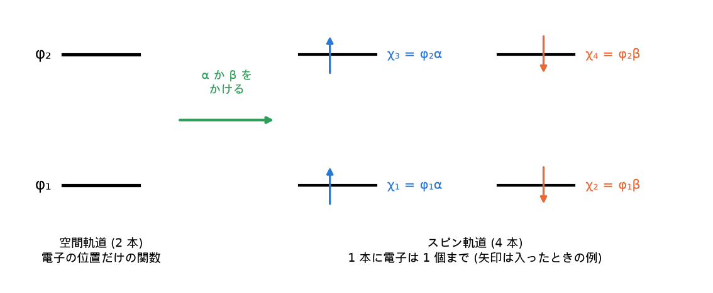
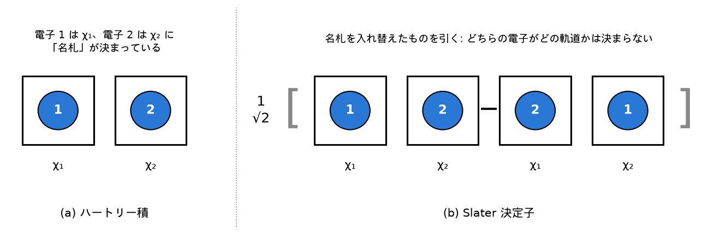
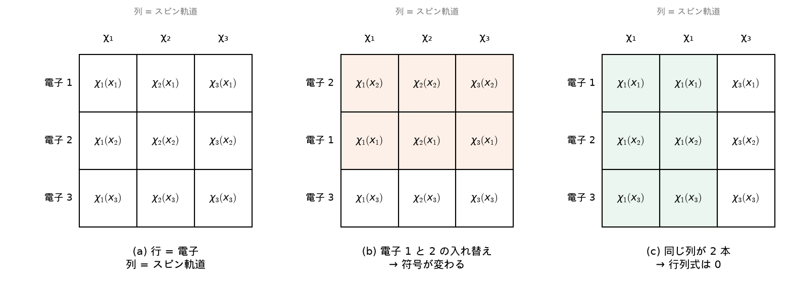
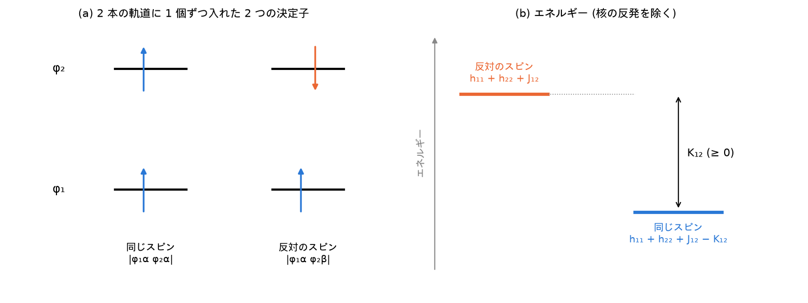

# 第 2 回　決定子とパウリの原理

!!! abstract "この回の道筋"
    電子の波動関数は、2 つの電子を入れ替えると符号が変わらなければなりません。この性質（反対称性）を満たすいちばん簡単な波動関数が Slater 決定子です。この回では、スピン軌道から Slater 決定子を作り、2 電子の例で、反対称性が「同じスピンの電子どうしを遠ざける」効果（交換の効果）を生むことを確かめます。

    | 節 | 内容 |
    |---|---|
    | 1 | スピン軌道：空間の関数とスピンの関数の積 |
    | 2 | 反対称性の要請とパウリの原理 |
    | 3 | Slater 決定子 |
    | 4 | 2 電子の例：交換の効果 |

    **前に読んでおく回**：量子化学の理論 [第 1 回](01-born-oppenheimer.md)

!!! tip "物理的なイメージ"
    Slater 決定子が表しているのは、「どの軌道に電子が 1 個ずつ入っているか」という最も簡単な電子の入り方を、電子の入れ替えで符号が変わるように組み立てたものです。行列式は、2 つの行を入れ替えると符号が変わり、2 つの列が同じだと 0 になります。電子を入れ替えると符号が変わること（反対称性）と、同じスピン軌道に 2 個の電子が入れないこと（パウリの原理）は、行列式のこの性質そのものです。その結果、同じスピンの 2 個の電子は同じ場所に来られず、互いのまわりに相手の来にくい領域をつくります。電子どうしの反発が下がるこの効果が、交換の効果です。

## 1. スピン軌道：空間の関数とスピンの関数の積

### 1.1 スピンの関数

第 1 回で、核を止めたときの電子のハミルトニアン $\hat H_\mathrm{el}$ を書きました。
$\hat H_\mathrm{el}$ には電子の位置しか出てきません。
しかし電子にはスピンがあり、波動関数はスピンの状態も表す必要があります。

電子 1 個のスピンの状態は、上向き $\alpha$ と下向き $\beta$ の 2 つです。
これを関数として扱うために、スピンの座標 $\omega$ を導入します。
$\omega$ は、スピンの $z$ 成分の値 $+\tfrac12$ と $-\tfrac12$ の 2 つの値だけをとる変数です。
$\alpha$ と $\beta$ は、次の値をとる関数と考えます。

| | $\omega = +\tfrac12$ | $\omega = -\tfrac12$ |
|---|---|---|
| $\alpha(\omega)$ | 1 | 0 |
| $\beta(\omega)$ | 0 | 1 |

$\omega$ は 2 つの値しかとらないので、スピンの座標についての「積分」は、2 つの値についての和です。
たとえば

$$
\langle\alpha|\beta\rangle = \sum_{\omega = \pm 1/2}\alpha(\omega)\,\beta(\omega) = 1\cdot 0 + 0\cdot 1 = 0,\qquad
\langle\alpha|\alpha\rangle = 1\cdot 1 + 0\cdot 0 = 1
$$

です。
同じように $\langle\beta|\beta\rangle = 1$ なので、

$$
\langle\alpha|\alpha\rangle = \langle\beta|\beta\rangle = 1,\qquad \langle\alpha|\beta\rangle = 0
$$

となり、$\alpha$ と $\beta$ は互いに直交し規格化されています。
上の表の行を縦に並べたベクトル $\alpha = \begin{pmatrix}1\\0\end{pmatrix}$、$\beta = \begin{pmatrix}0\\1\end{pmatrix}$ の内積だと考えても同じです。

### 1.2 空間軌道とスピン軌道

電子 1 個の状態を表す関数を軌道と呼びます。
位置だけの関数 $\phi(\mathbf r)$ を空間軌道（spatial orbital）と呼び、空間軌道にスピンの関数をかけたもの

$$
\chi(\mathbf x) = \phi(\mathbf r)\,\alpha(\omega)\quad\text{または}\quad \chi(\mathbf x) = \phi(\mathbf r)\,\beta(\omega)
$$

をスピン軌道（spin orbital）と呼びます。
$\mathbf x = (\mathbf r, \omega)$ は、位置とスピンをまとめた電子の座標です。
以下、$\mathbf x$ についての積分は、$\mathbf r$ についての積分と $\omega$ についての和の両方を行うことを意味します。

図 1 のように、1 つの空間軌道から、$\alpha$ と $\beta$ の 2 つのスピン軌道ができます。



**図 1**　左：2 本の空間軌道 $\phi_1$、$\phi_2$。右：それぞれに $\alpha$ か $\beta$ をかけてできる 4 本のスピン軌道 $\chi_1, \dots, \chi_4$。横線 1 本が 1 つのスピン軌道で、電子は 1 本に 1 個まで入れます（3 節で示します）。青の上向きの矢印は $\alpha$ の電子、橙の下向きの矢印は $\beta$ の電子が入った場合を表します。

スピン軌道どうしの重なりの積分は、空間の積分とスピンの和に分かれます。

$$
\langle\phi_i\sigma|\phi_j\tau\rangle = \langle\phi_i|\phi_j\rangle\,\langle\sigma|\tau\rangle
$$

$\sigma$、$\tau$ は $\alpha$ か $\beta$ です。
空間軌道が規格直交（$\langle\phi_i|\phi_j\rangle = \delta_{ij}$）なら、スピン軌道も規格直交です。
たとえば図 1 の $\chi_1 = \phi_1\alpha$ と $\chi_2 = \phi_1\beta$ は、空間の部分は同じ（$\langle\phi_1|\phi_1\rangle = 1$）ですが、スピンの部分が $\langle\alpha|\beta\rangle = 0$ なので直交します。

**ここまでで分かったこと**：電子 1 個の状態は、空間軌道とスピンの関数の積であるスピン軌道で表します。1 つの空間軌道から、$\alpha$ と $\beta$ の 2 つのスピン軌道ができます。

## 2. 反対称性の要請とパウリの原理

### 2.1 ハートリー積とその問題

電子が $N$ 個あるとき、いちばん素朴な波動関数は、スピン軌道の積

$$
\Psi^\mathrm{HP}(\mathbf x_1, \mathbf x_2, \dots, \mathbf x_N) = \chi_1(\mathbf x_1)\,\chi_2(\mathbf x_2)\cdots\chi_N(\mathbf x_N)
$$

です。これをハートリー積（Hartree product）と呼びます。
ハートリー積は「電子 1 は軌道 $\chi_1$ に、電子 2 は軌道 $\chi_2$ に入る」と、電子に名札を付けて区別しています（図 2 (a)）。

2 電子で、名札が問題になることを確かめます。
$|\Psi^\mathrm{HP}(\mathbf x_1, \mathbf x_2)|^2 = |\chi_1(\mathbf x_1)|^2|\chi_2(\mathbf x_2)|^2$ は、「電子 1 が $\mathbf x_1$ に、電子 2 が $\mathbf x_2$ に見つかる確率密度」です。
2 個の電子を入れ替えた配置の確率密度は $|\chi_1(\mathbf x_2)|^2|\chi_2(\mathbf x_1)|^2$ で、ふつうは最初のものと違う値です。
しかし、電子は互いに区別できないので、「電子 1 が点 P、電子 2 が点 Q」と「電子 1 が点 Q、電子 2 が点 P」は、観測では区別できない同じ配置です。
同じ配置に違う確率を与えるので、ハートリー積は電子の波動関数として不十分です。



**図 2**　(a) ハートリー積では、電子 1 は $\chi_1$、電子 2 は $\chi_2$ と、名札が決まっています。(b) Slater 決定子（3 節）は、名札を入れ替えたものを引いた組み合わせです。どちらの電子がどちらの軌道に入っているかは決まらず、「$\chi_1$ と $\chi_2$ に 1 個ずつ入っている」ことだけが決まります。

### 2.2 反対称性の要請

2 つの電子 $i$、$j$ の座標を入れ替える操作を $\hat P_{ij}$ と書きます。
電子は区別できないので、入れ替えても確率密度 $|\Psi|^2$ は変わりません。
したがって、入れ替えた波動関数は、もとの波動関数の定数倍 $\lambda$（$|\lambda| = 1$）です。

$$
\hat P_{ij}\Psi = \lambda\,\Psi
$$

入れ替えを 2 回行うと元に戻るので、$\hat P_{ij}^2\Psi = \lambda^2\Psi = \Psi$、つまり $\lambda^2 = 1$ で、$\lambda = +1$ か $-1$ です。
自然界では、粒子の種類によってどちらかが決まっています。
電子（フェルミ粒子）は $\lambda = -1$ で、波動関数そのものは入れ替えで符号が変わります。

$$
\Psi(\dots, \mathbf x_i, \dots, \mathbf x_j, \dots) = -\Psi(\dots, \mathbf x_j, \dots, \mathbf x_i, \dots)
$$

これを反対称性の要請（antisymmetry principle）と呼びます。
$\lambda$ が $+1$ か $-1$ のどちらかであることは上のように導けますが、電子が $-1$ をとることはシュレーディンガー方程式からは出てこない、独立した原理です。
1926 年に Heisenberg と Dirac が、それぞれ多電子の波動関数の対称性としてこの考え方を示しました [Heisenberg 1926; Dirac 1926]。

反対称性から、すぐに次のことが分かります。
2 つの電子が同じ座標（同じ位置かつ同じスピン）$\mathbf x_i = \mathbf x_j$ にあると、入れ替えても波動関数は同じものなので、上の式は $\Psi = -\Psi$ となります。
したがって、そのような配置では $\Psi = 0$ です。
次の節で見るように、このことから「2 つの電子が同じスピン軌道に入ることはできない」というパウリの排他原理が出てきます。
パウリの排他原理は、原子のスペクトルを説明するために 1925 年に Pauli が導入しました [Pauli 1925]。
反対称性の要請は、それをより一般的な形にしたものです。

**ここまでで分かったこと**：電子の波動関数は、2 つの電子を入れ替えると符号が変わる（反対称である）必要があります。ハートリー積は電子に名札を付けていて、これを満たしません。

## 3. Slater 決定子

### 3.1 2 電子の場合

2 つのスピン軌道 $\chi_1$、$\chi_2$ に 2 個の電子を入れます。
ハートリー積 $\chi_1(\mathbf x_1)\chi_2(\mathbf x_2)$ から、名札を入れ替えたもの $\chi_1(\mathbf x_2)\chi_2(\mathbf x_1)$ を引くと、

$$
\Psi(\mathbf x_1, \mathbf x_2) = \frac{1}{\sqrt 2}\Big[\chi_1(\mathbf x_1)\chi_2(\mathbf x_2) - \chi_2(\mathbf x_1)\chi_1(\mathbf x_2)\Big]
$$

となります。

**反対称性の確認**：$\mathbf x_1$ と $\mathbf x_2$ を入れ替えると、

$$
\Psi(\mathbf x_2, \mathbf x_1) = \frac{1}{\sqrt 2}\Big[\chi_1(\mathbf x_2)\chi_2(\mathbf x_1) - \chi_2(\mathbf x_2)\chi_1(\mathbf x_1)\Big]
$$

です。
括弧の中の 2 つの項は、もとの式の第 2 項と第 1 項を、符号を変えて並べたものです。
したがって $\Psi(\mathbf x_2, \mathbf x_1) = -\Psi(\mathbf x_1, \mathbf x_2)$ で、確かに符号が変わります。

**規格化の確認**：$\chi_1$ と $\chi_2$ が規格直交のとき、$\langle\Psi|\Psi\rangle$ を展開すると 4 つの項が出ます。
各項は、電子 1 の座標の積分と電子 2 の座標の積分の積に分かれます。

$$
\langle\Psi|\Psi\rangle = \frac12\Big[\underbrace{\langle\chi_1|\chi_1\rangle\langle\chi_2|\chi_2\rangle}_{1\cdot 1} - \underbrace{\langle\chi_1|\chi_2\rangle\langle\chi_2|\chi_1\rangle}_{0\cdot 0} - \underbrace{\langle\chi_2|\chi_1\rangle\langle\chi_1|\chi_2\rangle}_{0\cdot 0} + \underbrace{\langle\chi_2|\chi_2\rangle\langle\chi_1|\chi_1\rangle}_{1\cdot 1}\Big] = 1
$$

$1/\sqrt 2$ は、この「2 つの項が 1 ずつ残る」分を打ち消すための因子です。

この式は、2 行 2 列の行列式 $\begin{vmatrix}a & b\\ c & d\end{vmatrix} = ad - bc$ の形に書けます。

$$
\Psi(\mathbf x_1, \mathbf x_2) = \frac{1}{\sqrt 2}
\begin{vmatrix}
\chi_1(\mathbf x_1) & \chi_2(\mathbf x_1)\\
\chi_1(\mathbf x_2) & \chi_2(\mathbf x_2)
\end{vmatrix}
$$

1 行目が電子 1、2 行目が電子 2、1 列目が $\chi_1$、2 列目が $\chi_2$ です。

### 3.2 N 電子の場合

一般に、$N$ 個のスピン軌道 $\chi_1, \dots, \chi_N$ に $N$ 個の電子を入れた波動関数を、次の行列式で作ります。

$$
\Psi(\mathbf x_1, \dots, \mathbf x_N) = \frac{1}{\sqrt{N!}}
\begin{vmatrix}
\chi_1(\mathbf x_1) & \chi_2(\mathbf x_1) & \cdots & \chi_N(\mathbf x_1)\\
\chi_1(\mathbf x_2) & \chi_2(\mathbf x_2) & \cdots & \chi_N(\mathbf x_2)\\
\vdots & \vdots & & \vdots\\
\chi_1(\mathbf x_N) & \chi_2(\mathbf x_N) & \cdots & \chi_N(\mathbf x_N)
\end{vmatrix}
$$

図 3 (a) のように、行が電子、列がスピン軌道に対応します。
これを Slater 決定子（Slater determinant）、または単に決定子と呼びます。
Slater が 1929 年に、原子のスペクトルの理論でこの形を使いました [Slater 1929]。
教科書では、Szabo–Ostlund の 2.2.3 節に詳しい説明があります [Szabo 1996]。

**3 電子の例**：Li 原子の基底状態の電子配置 $1s^2 2s^1$ を、スピン軌道 $\chi_1 = 1s\,\alpha$、$\chi_2 = 1s\,\beta$、$\chi_3 = 2s\,\alpha$ で表します。
$\chi_j(\mathbf x_i)$ を $\chi_j(i)$ と略して行列式を書き、展開すると、

$$
\Psi = \frac{1}{\sqrt 6}
\begin{vmatrix}
\chi_1(1) & \chi_2(1) & \chi_3(1)\\
\chi_1(2) & \chi_2(2) & \chi_3(2)\\
\chi_1(3) & \chi_2(3) & \chi_3(3)
\end{vmatrix}
$$

$$
= \frac{1}{\sqrt 6}\Big[
\chi_1(1)\chi_2(2)\chi_3(3) - \chi_1(1)\chi_3(2)\chi_2(3)
- \chi_2(1)\chi_1(2)\chi_3(3) + \chi_2(1)\chi_3(2)\chi_1(3)
+ \chi_3(1)\chi_1(2)\chi_2(3) - \chi_3(1)\chi_2(2)\chi_1(3)
\Big]
$$

です。
各項は、3 個の電子を 3 本のスピン軌道に 1 個ずつ割り当てる 1 つの方法（ハートリー積）です。
割り当て方は $3! = 6$ 通りあり、決定子はそのすべてを足し合わせています。
符号は、最初の項 $\chi_1(1)\chi_2(2)\chi_3(3)$ から、電子の入れ替えを奇数回して作れる項が $-$、偶数回なら $+$ です。
たとえば 2 番目の項は、電子 2 と 3 を 1 回入れ替えたものなので $-$ です。
$N$ 電子では $N!$ 個の項があり、$1/\sqrt{N!}$ が規格化の因子です（3.1 節と同じく、$N!$ 個の項が 1 ずつ残るため）。

この連載では、対角に並ぶスピン軌道だけを書いた略記

$$
|\chi_1\chi_2\cdots\chi_N\rangle
$$

を使います。
上の Li の決定子は $|1s\alpha\;1s\beta\;2s\alpha\rangle$ と書きます。

### 3.3 決定子の 4 つの性質

行列式の性質から、Slater 決定子は次の性質を持ちます。図 3 と合わせて見てください。



**図 3**　(a) 決定子の行列。行が電子、列がスピン軌道です。(b) 電子 1 と電子 2 を入れ替えると、行列の 1 行目と 2 行目が入れ替わります（橙の行）。行列式は 2 つの行を入れ替えると符号が変わるので、決定子の符号が変わります。(c) 同じスピン軌道 $\chi_1$ を 2 回使うと、1 列目と 2 列目が同じになります（緑の列）。2 つの列が同じ行列式は 0 です。

1. **反対称性**：2 つの電子を入れ替えると、2 つの行が入れ替わるので、符号が変わります（図 3 (b)）。反対称性の要請は自動的に満たされます。
2. **パウリの排他原理**：同じスピン軌道を 2 回使う（$\chi_i = \chi_j$）と、2 つの列が等しくなるので、行列式は 0 です（図 3 (c)）。2 電子で確かめると、$\chi_1 = \chi_2$ のとき $\chi_1(\mathbf x_1)\chi_1(\mathbf x_2) - \chi_1(\mathbf x_1)\chi_1(\mathbf x_2) = 0$ です。つまり、1 つのスピン軌道には電子が 1 個しか入れません。1 つの空間軌道には、$\alpha$ と $\beta$ の 2 個まで入れます。
3. **軌道の並べ方と符号**：スピン軌道の並べ方を入れ替えると、列が入れ替わり、符号が変わります。たとえば $|\chi_2\chi_1\rangle = -|\chi_1\chi_2\rangle$ です。決定子を扱うときは、軌道の順番を決めておく必要があります。
4. **占有した軌道どうしの混ぜ方によらない**：占有された軌道どうしを混ぜ合わせても（正則な一次変換をしても）、決定子は定数倍しか変わりません。決定子は、個々の軌道よりも「どの軌道の組を占有したか」で決まります。

4 番目の性質を 2 電子で確かめます。
新しい軌道を $\chi_1' = a\chi_1 + b\chi_2$、$\chi_2' = c\chi_1 + d\chi_2$ とします。
$\chi_1'(\mathbf x_1)\chi_2'(\mathbf x_2) - \chi_2'(\mathbf x_1)\chi_1'(\mathbf x_2)$ を展開すると、

$$
\begin{aligned}
&(a\chi_1 + b\chi_2)(1)\,(c\chi_1 + d\chi_2)(2) - (c\chi_1 + d\chi_2)(1)\,(a\chi_1 + b\chi_2)(2)\\
&= ac\,\chi_1(1)\chi_1(2) + ad\,\chi_1(1)\chi_2(2) + bc\,\chi_2(1)\chi_1(2) + bd\,\chi_2(1)\chi_2(2)\\
&\quad - ca\,\chi_1(1)\chi_1(2) - cb\,\chi_1(1)\chi_2(2) - da\,\chi_2(1)\chi_1(2) - db\,\chi_2(1)\chi_2(2)\\
&= (ad - bc)\,\big[\chi_1(1)\chi_2(2) - \chi_2(1)\chi_1(2)\big]
\end{aligned}
$$

です。
2 行目から 3 行目では、$\chi_1(1)\chi_1(2)$ と $\chi_2(1)\chi_2(2)$ の項が打ち消し合い、残りを $\chi_1(1)\chi_2(2)$ と $\chi_2(1)\chi_1(2)$ についてまとめました。
つまり、新しい決定子はもとの決定子の $ad - bc$ 倍です。
$ad - bc$ は混ぜ方の行列 $\begin{pmatrix}a & b\\ c & d\end{pmatrix}$ の行列式で、混ぜ方が正則なら 0 ではありません。
この性質は、第 3 回で Hartree–Fock 法の軌道を考えるときに使います。

**ここまでで分かったこと**：スピン軌道を並べた行列式（Slater 決定子）は、電子をスピン軌道に割り当てるすべての方法を符号付きで足したもので、反対称性の要請を自動的に満たします。同じスピン軌道に 2 個の電子は入れません。

## 4. 2 電子の例：交換の効果

反対称にしたことで、電子の振る舞いがどう変わるかを見ます。
2 つの空間軌道 $\phi_1$、$\phi_2$ に、2 個の電子を 1 個ずつ入れる場合を考えます。
スピンの入れ方によって、次の 2 つの決定子を比べます。

- 同じスピン：$|\phi_1\alpha\;\phi_2\alpha\rangle$
- 反対のスピン：$|\phi_1\alpha\;\phi_2\beta\rangle$

### 4.1 2 個の電子が見つかる確率

決定子 $\Psi$ の $|\Psi|^2$ を、2 つの電子のスピン $\omega_1$、$\omega_2$ について足し合わせます。すると、「電子 1 が $\mathbf r_1$ に、電子 2 が $\mathbf r_2$ に見つかる確率密度」になります（全空間で積分すると 1 です）。
これを 2 電子密度（ペア密度）と呼び、$P(\mathbf r_1, \mathbf r_2)$ と書きます。
付録 A.4 で 1 段ずつ計算しますが、結果は次のとおりです（軌道は実数とします）。

$$
P_{\uparrow\uparrow}(\mathbf r_1, \mathbf r_2) = \frac12\Big[\phi_1(\mathbf r_1)\phi_2(\mathbf r_2) - \phi_2(\mathbf r_1)\phi_1(\mathbf r_2)\Big]^2
$$

$$
P_{\uparrow\downarrow}(\mathbf r_1, \mathbf r_2) = \frac12\Big[\big(\phi_1(\mathbf r_1)\phi_2(\mathbf r_2)\big)^2 + \big(\phi_2(\mathbf r_1)\phi_1(\mathbf r_2)\big)^2\Big]
$$

2 つの式の違いは、$P_{\uparrow\uparrow}$ にだけ交差項 $-\phi_1(\mathbf r_1)\phi_2(\mathbf r_2)\phi_2(\mathbf r_1)\phi_1(\mathbf r_2)$ があることです。
反対のスピンでは、交差項にかかるスピンの和 $\langle\alpha|\beta\rangle$ が 0 なので、交差項が消えます。

同じスピンの場合、$\mathbf r_1 = \mathbf r_2$ とおくと、括弧の中が $\phi_1(\mathbf r_1)\phi_2(\mathbf r_1) - \phi_2(\mathbf r_1)\phi_1(\mathbf r_1) = 0$ になります。
つまり、同じスピンの 2 個の電子が同じ場所に見つかる確率は 0 です。
電子のまわりにできるこの「穴」を、フェルミ孔（Fermi hole）、または交換孔（exchange hole）と呼びます。
反対のスピンの場合は、$\mathbf r_1 = \mathbf r_2$ でも 0 になりません。

この違いを、1 次元の箱（長さ 1）の中の 2 つの軌道 $\phi_n(x) = \sqrt 2\sin(n\pi x)$（$n = 1, 2$）で描いてみます。
電子間の反発は入れていません。決定子の形だけで、どのような違いが出るかを見るための例です。

```python
import numpy as np

x = np.linspace(0, 1, 201)
p1 = np.sqrt(2) * np.sin(np.pi * x)
p2 = np.sqrt(2) * np.sin(2 * np.pi * x)
X1, X2 = np.meshgrid(x, x, indexing="ij")
a = np.outer(p1, p2)   # phi1(x1) phi2(x2)
b = np.outer(p2, p1)   # phi2(x1) phi1(x2)
same = 0.5 * (a - b) ** 2        # 同じスピン
opp = 0.5 * (a ** 2 + b ** 2)    # 反対のスピン
dx = x[1] - x[0]
for name, P in [("same", same), ("opposite", opp)]:
    norm = P.sum() * dx * dx
    d = (np.abs(X1 - X2) * P).sum() * dx * dx / norm
    print(f"{name:8s}: 規格化 {norm:.4f}, 平均の距離 <|x1-x2|> = {d:.4f}, 対角線上の最大 = {np.diag(P).max():.4f}")
```

```text
same    : 規格化 1.0000, 平均の距離 <|x1-x2|> = 0.3826, 対角線上の最大 = 0.0000
opposite: 規格化 1.0000, 平均の距離 <|x1-x2|> = 0.2700, 対角線上の最大 = 2.3703
```


**図 4**　1 次元の箱の中の 2 電子密度。横軸が電子 1 の位置、縦軸が電子 2 の位置で、明るいほど見つかりやすい配置です。白の破線は $x_1 = x_2$（2 個の電子が同じ場所にいる配置）の線です。(a) 同じスピン。(b) 反対のスピン。(c) 電子 1 を $x_1 = 0.3$ に置いたとき、電子 2 がどこに見つかりやすいか（(a)(b) の橙の縦線に沿った値）。同じスピン（青）では、電子 1 のいる $x_2 = 0.3$ で 0 になります（白丸）。これがフェルミ孔です。

図 4 (a)（同じスピン）では、対角線 $x_1 = x_2$ の上で密度が 0 になっています。
2 個の電子は、箱の左右に分かれて見つかりやすくなります。
2 電子の平均の距離は 0.383 で、反対のスピンの場合の 0.270 より大きくなりました。
図 4 (c) の青の曲線を見ると、電子 1 を $x_1 = 0.3$ に置いたとき、電子 2 は電子 1 のまわりを避け、反対側の $x_2 \approx 0.7$ に見つかりやすくなっています。

図 4 (b)（反対のスピン）では、対角線の上にも密度があります。
中央 $x_1 = x_2 = 0.5$ で密度が 0 なのは、$\phi_2$ が $x = 0.5$ に節を持つためで、反対称性とは関係ありません。
図 4 (c) の橙の破線は、電子 1 のいる $x_2 = 0.3$ でむしろ大きな値をとります。
(b) の密度は、2 個の電子がそれぞれの軌道で独立に動くとしたとき（ハートリー積）の密度を、電子を入れ替えて平均したものと同じです（$P_{\uparrow\downarrow}$ の式の 2 つの項がそれぞれ、名札を付けたハートリー積の確率密度です）。
つまり、1 個の決定子は、反対のスピンの電子どうしの動きを、まったく関連づけていません。

### 4.2 エネルギーへの影響：クーロン積分と交換積分

この違いは、電子間の反発のエネルギーに現れます。
1 電子の部分（運動エネルギーと核からの引力）をまとめた演算子を $\hat h = -\frac12\nabla^2 - \sum_A Z_A/r_A$ とし、その積分を $h_{ii} = \langle\phi_i|\hat h|\phi_i\rangle$ と書きます。
電子反発積分は、化学者の表記

$$
(ij|kl) = \iint \phi_i^*(\mathbf r_1)\phi_j(\mathbf r_1)\,\frac{1}{r_{12}}\,\phi_k^*(\mathbf r_2)\phi_l(\mathbf r_2)\,d\mathbf r_1\,d\mathbf r_2
$$

で書きます。
左の組 $ij$ が電子 1 の座標、右の組 $kl$ が電子 2 の座標の関数です。
すべての段階は付録 A で導きますが、2 つの決定子のエネルギー（原子単位、核の反発を除く）は次のとおりです。

$$
E_{\uparrow\uparrow} = h_{11} + h_{22} + J_{12} - K_{12},\qquad
E_{\uparrow\downarrow} = h_{11} + h_{22} + J_{12}
$$

$$
J_{12} = (11|22),\qquad K_{12} = (12|21)
$$

$J_{12}$ をクーロン積分（Coulomb integral）と呼びます。
$J_{12} = \iint |\phi_1(\mathbf r_1)|^2\,r_{12}^{-1}\,|\phi_2(\mathbf r_2)|^2\,d\mathbf r_1 d\mathbf r_2$ と書くと分かるように、電子の雲 $|\phi_1|^2$ と $|\phi_2|^2$ の間の、古典的な静電反発のエネルギーです。
$K_{12}$ を交換積分（exchange integral）と呼びます。
古典的な対応物がなく、反対称性から生じる項です。

$K_{12}$ は正です（少なくとも 0 以上）。
理由は次のとおりです。
$\rho_{12}(\mathbf r) = \phi_1^*(\mathbf r)\phi_2(\mathbf r)$ とおくと、$K_{12} = \iint \rho_{12}^*(\mathbf r_1)\,r_{12}^{-1}\,\rho_{12}(\mathbf r_2)\,d\mathbf r_1 d\mathbf r_2$ です。
これは、電荷の分布 $\rho_{12}$ が自分自身と反発する静電エネルギーの形をしています。
電荷の分布の静電エネルギーは、分布の形によらず 0 以上です（静電場のエネルギーが、電場の 2 乗の積分で書けるため）。

したがって、同じスピンの決定子は、反対のスピンの決定子より $K_{12}$ だけエネルギーが低くなります。
4.1 節で見たように、同じスピンの電子どうしはフェルミ孔によって遠ざけられ、反発が減るためです。
このように反対称性によって生じる効果を、交換の効果と呼びます。

図 5 に、2 つの決定子とそのエネルギーの関係をまとめます。



**図 5**　模式図。(a) 2 本の空間軌道 $\phi_1$、$\phi_2$ に 1 個ずつ電子を入れた 2 つの決定子。左はスピンが同じ、右はスピンが反対です。(b) 2 つの決定子のエネルギー。1 電子の部分 $h_{11} + h_{22}$ とクーロンの反発 $J_{12}$ は共通で、同じスピンの決定子（青）だけが、交換積分 $K_{12}$ の分だけ低くなります。

!!! note "交換は「スピンが同じ電子どうし」にだけ働く"
    交換積分の項は、スピン軌道のスピンが同じときにだけ現れます。スピンの積分 $\langle\alpha|\beta\rangle = 0$ が、反対のスピンどうしの交換の項を消すためです。反対のスピンの電子どうしの動きの関連（電子相関）は、決定子 1 個では表せません。これを取り入れる方法は[第 7 回](07-electron-correlation.md)以降で扱います。

なお、反対のスピンの決定子 $|\phi_1\alpha\;\phi_2\beta\rangle$ は、一重項でも三重項でもない状態です。
一重項と三重項のエネルギーは $h_{11} + h_{22} + J_{12} \pm K_{12}$ となることが知られていますが、その説明は第 5 回のスピンの回で行います。

**ここまでで分かったこと**：決定子では、同じスピンの電子どうしが互いに避け合います（フェルミ孔）。その結果、エネルギーに交換積分 $-K$ の項が現れます。反対のスピンの電子どうしには、この効果はありません。

## まとめ

- 電子 1 個の状態は、空間軌道とスピンの関数の積であるスピン軌道で表します。
- 電子の波動関数は、2 つの電子を入れ替えると符号が変わらなければなりません（反対称性の要請）。
- スピン軌道を並べた Slater 決定子は、反対称性を自動的に満たし、同じスピン軌道に 2 個の電子を入れることを禁じます（パウリの排他原理）。
- 決定子では、同じスピンの電子どうしが避け合い、エネルギーに交換積分 $-K$ が現れます。反対のスピンの電子どうしの相関は、決定子 1 個では表せません。

## 付録 A　2 電子の決定子のエネルギーと 2 電子密度

### A.1 準備

スピン軌道を $\chi_1 = \phi_1\sigma_1$、$\chi_2 = \phi_2\sigma_2$ とします（$\sigma_1, \sigma_2$ は $\alpha$ か $\beta$）。
$\phi_1$ と $\phi_2$ は規格直交な実数の関数とします。
決定子は

$$
\Psi = \frac{1}{\sqrt 2}\big[\chi_1(1)\chi_2(2) - \chi_2(1)\chi_1(2)\big]
$$

です。$(1)$ は $\mathbf x_1$ の略です。
ハミルトニアンは、$\hat H = \hat h(1) + \hat h(2) + 1/r_{12}$ です。

計算で何度も使う事実を、先にまとめます。

- 電子 1 だけに作用する演算子の積分は、電子 1 の積分と電子 2 の積分の積に分かれます。
- スピン軌道の積分は、空間の積分とスピンの和の積に分かれます。$\hat h$ も $1/r_{12}$ もスピンには作用しないので、スピンの部分は $\langle\sigma|\tau\rangle$ の形の和になります。これは $\sigma = \tau$ なら 1、違えば 0 です。この値を $\delta_{\sigma\tau}$ と書きます。

### A.2 1 電子の部分

$\langle\Psi|\hat h(1)|\Psi\rangle$ を展開すると、4 つの項が出ます。

$$
\langle\Psi|\hat h(1)|\Psi\rangle = \frac12\Big[
\langle\chi_1|\hat h|\chi_1\rangle\langle\chi_2|\chi_2\rangle
- \langle\chi_1|\hat h|\chi_2\rangle\langle\chi_2|\chi_1\rangle
- \langle\chi_2|\hat h|\chi_1\rangle\langle\chi_1|\chi_2\rangle
+ \langle\chi_2|\hat h|\chi_2\rangle\langle\chi_1|\chi_1\rangle\Big]
$$

各項で、左の因子が電子 1 の積分（$\hat h$ を含む）、右の因子が電子 2 の重なりの積分です。

- 第 1 項：$\langle\chi_2|\chi_2\rangle = 1$ なので $\langle\chi_1|\hat h|\chi_1\rangle$。空間とスピンに分けると $\langle\phi_1|\hat h|\phi_1\rangle\langle\sigma_1|\sigma_1\rangle = h_{11}$。
- 第 2 項、第 3 項：電子 2 の重なり $\langle\chi_2|\chi_1\rangle = \langle\phi_2|\phi_1\rangle\langle\sigma_2|\sigma_1\rangle$ は、空間の部分が 0 なので 0。
- 第 4 項：同じように $h_{22}$。

したがって $\langle\Psi|\hat h(1)|\Psi\rangle = \frac12(h_{11} + h_{22})$ です。
$\hat h(2)$ も、電子の番号を付け替えれば同じ値を与えるので、1 電子の部分の和は $h_{11} + h_{22}$ になります。

### A.3 2 電子の部分

$\langle\Psi|1/r_{12}|\Psi\rangle$ を展開すると、

$$
\langle\Psi|\frac{1}{r_{12}}|\Psi\rangle = \frac12\big[T_1 - T_2 - T_3 + T_4\big]
$$

です。
各項は次の積分です。

$$
\begin{aligned}
T_1 &= \iint \chi_1^*(1)\chi_2^*(2)\,\frac{1}{r_{12}}\,\chi_1(1)\chi_2(2)\,d\mathbf x_1 d\mathbf x_2, &
T_2 &= \iint \chi_1^*(1)\chi_2^*(2)\,\frac{1}{r_{12}}\,\chi_2(1)\chi_1(2)\,d\mathbf x_1 d\mathbf x_2, \\
T_3 &= \iint \chi_2^*(1)\chi_1^*(2)\,\frac{1}{r_{12}}\,\chi_1(1)\chi_2(2)\,d\mathbf x_1 d\mathbf x_2, &
T_4 &= \iint \chi_2^*(1)\chi_1^*(2)\,\frac{1}{r_{12}}\,\chi_2(1)\chi_1(2)\,d\mathbf x_1 d\mathbf x_2
\end{aligned}
$$

1 つずつ、空間の積分とスピンの和に分けます。

- $T_1$：電子 1 のスピンの和は $\langle\sigma_1|\sigma_1\rangle = 1$、電子 2 は $\langle\sigma_2|\sigma_2\rangle = 1$。空間の部分は $\iint \phi_1(\mathbf r_1)^2\,r_{12}^{-1}\,\phi_2(\mathbf r_2)^2 = (11|22) = J_{12}$。
- $T_4$：電子 1 と電子 2 の番号を付け替えると $T_1$ と同じ積分なので、$J_{12}$。
- $T_2$：電子 1 のスピンの和は $\langle\sigma_1|\sigma_2\rangle = \delta_{\sigma_1\sigma_2}$、電子 2 は $\langle\sigma_2|\sigma_1\rangle = \delta_{\sigma_1\sigma_2}$。空間の部分は $\iint \phi_1(\mathbf r_1)\phi_2(\mathbf r_1)\,r_{12}^{-1}\,\phi_2(\mathbf r_2)\phi_1(\mathbf r_2) = (12|21) = K_{12}$。したがって $T_2 = \delta_{\sigma_1\sigma_2}K_{12}$。
- $T_3$：$T_2$ の複素共役で、実数の軌道では同じ値 $\delta_{\sigma_1\sigma_2}K_{12}$。

まとめると、

$$
\langle\Psi|\frac{1}{r_{12}}|\Psi\rangle = \frac12\big[2J_{12} - 2\,\delta_{\sigma_1\sigma_2}K_{12}\big] = J_{12} - \delta_{\sigma_1\sigma_2}K_{12}
$$

となります。
A.2 の結果と足すと、同じスピン（$\delta = 1$）で本文の $E_{\uparrow\uparrow}$、反対のスピン（$\delta = 0$）で $E_{\uparrow\downarrow}$ が得られます。

### A.4 2 電子密度

$|\Psi|^2 = \Psi^*\Psi$ を展開すると、

$$
|\Psi|^2 = \frac12\Big[|\chi_1(1)|^2|\chi_2(2)|^2 + |\chi_2(1)|^2|\chi_1(2)|^2 - \chi_1^*(1)\chi_2^*(2)\chi_2(1)\chi_1(2) - \chi_2^*(1)\chi_1^*(2)\chi_1(1)\chi_2(2)\Big]
$$

です。
これを $\omega_1$ と $\omega_2$ について足します。

- 第 1 項：$|\chi_1(1)|^2 = \phi_1(\mathbf r_1)^2\,\sigma_1(\omega_1)^2$ で、$\sum_{\omega_1}\sigma_1(\omega_1)^2 = 1$。電子 2 も同じなので、$\phi_1(\mathbf r_1)^2\phi_2(\mathbf r_2)^2$。
- 第 2 項：同じように $\phi_2(\mathbf r_1)^2\phi_1(\mathbf r_2)^2$。
- 第 3 項：スピンの部分は $\sum_{\omega_1}\sigma_1(\omega_1)\sigma_2(\omega_1)\cdot\sum_{\omega_2}\sigma_2(\omega_2)\sigma_1(\omega_2) = \delta_{\sigma_1\sigma_2}^2 = \delta_{\sigma_1\sigma_2}$。空間の部分は $\phi_1(\mathbf r_1)\phi_2(\mathbf r_2)\phi_2(\mathbf r_1)\phi_1(\mathbf r_2)$。
- 第 4 項：第 3 項と同じ値。

$a = \phi_1(\mathbf r_1)\phi_2(\mathbf r_2)$、$b = \phi_2(\mathbf r_1)\phi_1(\mathbf r_2)$ とおくと、

$$
P(\mathbf r_1, \mathbf r_2) = \frac12\big[a^2 + b^2 - 2\,\delta_{\sigma_1\sigma_2}\,ab\big]
$$

です。
同じスピン（$\delta = 1$）なら $\frac12(a^2 + b^2 - 2ab) = \frac12(a - b)^2$ で、本文の $P_{\uparrow\uparrow}$ です。
反対のスピン（$\delta = 0$）なら $\frac12(a^2 + b^2)$ で、本文の $P_{\uparrow\downarrow}$ です。

## 参考文献

- A. Szabo, N. S. Ostlund, "Modern Quantum Chemistry" (Dover, 1996). ISBN: 9780486691862
- W. Pauli, "Über den Zusammenhang des Abschlusses der Elektronengruppen im Atom mit der Komplexstruktur der Spektren", Z. Phys. 31, 765 (1925). DOI: [10.1007/BF02980631](https://doi.org/10.1007/BF02980631)
- W. Heisenberg, "Mehrkörperproblem und Resonanz in der Quantenmechanik", Z. Phys. 38, 411 (1926). DOI: [10.1007/BF01397160](https://doi.org/10.1007/BF01397160)
- P. A. M. Dirac, "On the theory of quantum mechanics", Proc. R. Soc. Lond. A 112, 661 (1926). DOI: [10.1098/rspa.1926.0133](https://doi.org/10.1098/rspa.1926.0133)
- J. C. Slater, "The Theory of Complex Spectra", Phys. Rev. 34, 1293 (1929). DOI: [10.1103/PhysRev.34.1293](https://doi.org/10.1103/PhysRev.34.1293)
