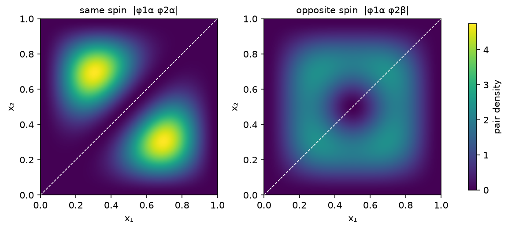

# 第 2 回　決定子とパウリの原理

!!! abstract "この回の道筋"
    電子の波動関数は、2 つの電子を入れ替えると符号が変わらなければなりません。この性質（反対称性）を満たすいちばん簡単な波動関数が Slater 決定子です。この回では、スピン軌道から Slater 決定子を作り、2 電子の例で、反対称性が「同じスピンの電子どうしを遠ざける」効果（交換の効果）を生むことを確かめます。

    | 節 | 内容 |
    |---|---|
    | 1 | スピン軌道：空間の関数とスピンの関数の積 |
    | 2 | 反対称性の要請とパウリの原理 |
    | 3 | Slater 決定子 |
    | 4 | 2 電子の例：交換の効果 |

    **前に読んでおく回**：量子化学の理論 [第 1 回](01-born-oppenheimer.md)

## 1. スピン軌道：空間の関数とスピンの関数の積

第 1 回で、核を止めたときの電子のハミルトニアン $\hat H_\mathrm{el}$ を書きました。
$\hat H_\mathrm{el}$ には電子の位置しか出てきません。
しかし電子にはスピンがあり、波動関数はスピンの状態も表す必要があります。

電子 1 個のスピンの状態は、上向き $\alpha$ と下向き $\beta$ の 2 つです。
スピンの座標を $\omega$ と書き、$\alpha(\omega)$、$\beta(\omega)$ を、互いに直交し規格化された関数として扱います。

$$
\langle\alpha|\alpha\rangle = \langle\beta|\beta\rangle = 1,\qquad \langle\alpha|\beta\rangle = 0
$$

ここで $\langle\cdot|\cdot\rangle$ は、スピンの座標についての積分（和）です。

電子 1 個の状態を表す関数を軌道と呼びます。
位置だけの関数 $\phi(\mathbf r)$ を空間軌道（spatial orbital）と呼び、空間軌道にスピンの関数をかけたもの

$$
\chi(\mathbf x) = \phi(\mathbf r)\,\alpha(\omega)\quad\text{または}\quad \chi(\mathbf x) = \phi(\mathbf r)\,\beta(\omega)
$$

をスピン軌道（spin orbital）と呼びます。
$\mathbf x = (\mathbf r, \omega)$ は、位置とスピンをまとめた電子の座標です。

1 つの空間軌道から、$\alpha$ と $\beta$ の 2 つのスピン軌道ができます。
空間軌道が規格直交なら、スピン軌道も規格直交です。
スピンが違うスピン軌道は、空間の部分が同じでも、スピンの積分が 0 になるので直交します。

**ここまでで分かったこと**：電子 1 個の状態は、空間軌道とスピンの関数の積であるスピン軌道で表します。

## 2. 反対称性の要請とパウリの原理

### 2.1 ハートリー積とその問題

電子が $N$ 個あるとき、いちばん素朴な波動関数は、スピン軌道の積

$$
\Psi^\mathrm{HP}(\mathbf x_1, \mathbf x_2, \dots, \mathbf x_N) = \chi_1(\mathbf x_1)\,\chi_2(\mathbf x_2)\cdots\chi_N(\mathbf x_N)
$$

です。これをハートリー積（Hartree product）と呼びます。
ハートリー積は「電子 1 は軌道 $\chi_1$ に、電子 2 は軌道 $\chi_2$ に入る」と、電子を区別しています。
しかし、電子は互いに区別できません。
したがって、ハートリー積は電子の波動関数として不十分です。

### 2.2 反対称性の要請

電子のように区別できない粒子では、2 つの粒子の座標を入れ替えても、観測できる量（$|\Psi|^2$ など）は変わりません。
電子（フェルミ粒子）の場合、波動関数そのものは、入れ替えで符号が変わります。

$$
\Psi(\dots, \mathbf x_i, \dots, \mathbf x_j, \dots) = -\Psi(\dots, \mathbf x_j, \dots, \mathbf x_i, \dots)
$$

これを反対称性の要請（antisymmetry principle）と呼びます。
この要請はシュレーディンガー方程式からは出てこない、独立した原理です。
1926 年に Heisenberg と Dirac が、それぞれ多電子の波動関数の対称性としてこの考え方を示しました [Heisenberg 1926; Dirac 1926]。

反対称性から、すぐに次のことが分かります。
2 つの電子が同じ座標（同じ位置かつ同じスピン）$\mathbf x_i = \mathbf x_j$ にあると、上の式は $\Psi = -\Psi$ となります。
したがって、そのような配置では $\Psi = 0$ です。
次の節で見るように、このことから「2 つの電子が同じスピン軌道に入ることはできない」というパウリの排他原理が出てきます。
パウリの排他原理は、原子のスペクトルを説明するために 1925 年に Pauli が導入しました [Pauli 1925]。
反対称性の要請は、それをより一般的な形にしたものです。

**ここまでで分かったこと**：電子の波動関数は、2 つの電子を入れ替えると符号が変わる（反対称である）必要があります。ハートリー積はこれを満たしません。

## 3. Slater 決定子

### 3.1 2 電子の場合

2 つのスピン軌道 $\chi_1$、$\chi_2$ に 2 個の電子を入れます。
ハートリー積 $\chi_1(\mathbf x_1)\chi_2(\mathbf x_2)$ と、電子を入れ替えたもの $\chi_1(\mathbf x_2)\chi_2(\mathbf x_1)$ の差を作ると、

$$
\Psi(\mathbf x_1, \mathbf x_2) = \frac{1}{\sqrt 2}\Big[\chi_1(\mathbf x_1)\chi_2(\mathbf x_2) - \chi_2(\mathbf x_1)\chi_1(\mathbf x_2)\Big]
$$

となります。
$\mathbf x_1$ と $\mathbf x_2$ を入れ替えると、確かに符号が変わります。
$1/\sqrt 2$ は、$\chi_1$ と $\chi_2$ が規格直交のときに $\Psi$ を規格化するための因子です。
この式は、2 行 2 列の行列式の形に書けます。

$$
\Psi(\mathbf x_1, \mathbf x_2) = \frac{1}{\sqrt 2}
\begin{vmatrix}
\chi_1(\mathbf x_1) & \chi_2(\mathbf x_1)\\
\chi_1(\mathbf x_2) & \chi_2(\mathbf x_2)
\end{vmatrix}
$$

### 3.2 N 電子の場合

一般に、$N$ 個のスピン軌道 $\chi_1, \dots, \chi_N$ に $N$ 個の電子を入れた波動関数を、次の行列式で作ります。

$$
\Psi(\mathbf x_1, \dots, \mathbf x_N) = \frac{1}{\sqrt{N!}}
\begin{vmatrix}
\chi_1(\mathbf x_1) & \chi_2(\mathbf x_1) & \cdots & \chi_N(\mathbf x_1)\\
\chi_1(\mathbf x_2) & \chi_2(\mathbf x_2) & \cdots & \chi_N(\mathbf x_2)\\
\vdots & \vdots & & \vdots\\
\chi_1(\mathbf x_N) & \chi_2(\mathbf x_N) & \cdots & \chi_N(\mathbf x_N)
\end{vmatrix}
$$

行が電子、列がスピン軌道に対応します。
これを Slater 決定子（Slater determinant）、または単に決定子と呼びます。
Slater が 1929 年に、原子のスペクトルの理論でこの形を使いました [Slater 1929]。
教科書では、Szabo–Ostlund の 2.2.3 節に詳しい説明があります [Szabo 1996]。
この連載では、対角に並ぶスピン軌道だけを書いた略記

$$
|\chi_1\chi_2\cdots\chi_N\rangle
$$

を使います。

行列式の性質から、Slater 決定子は次の性質を持ちます。

1. **反対称性**：2 つの電子を入れ替えると、2 つの行が入れ替わるので、符号が変わります。反対称性の要請は自動的に満たされます。
2. **パウリの排他原理**：同じスピン軌道を 2 回使う（$\chi_i = \chi_j$）と、2 つの列が等しくなるので、行列式は 0 です。つまり、1 つのスピン軌道には電子が 1 個しか入れません。1 つの空間軌道には、$\alpha$ と $\beta$ の 2 個まで入れます。
3. **軌道の並べ方と符号**：スピン軌道の並べ方を入れ替えると、列が入れ替わり、符号が変わります。たとえば $|\chi_2\chi_1\rangle = -|\chi_1\chi_2\rangle$ です。決定子を扱うときは、軌道の順番を決めておく必要があります。
4. **軌道の混ぜ方によらない**：占有された軌道どうしを混ぜ合わせても（正則な一次変換をしても）、決定子は定数倍しか変わりません。行列式の列に別の列の定数倍を足しても値が変わらないためです。決定子は、個々の軌道よりも「どの軌道の組を占有したか」で決まります。

4 番目の性質は、第 3 回で Hartree–Fock 法の軌道を考えるときに使います。

**ここまでで分かったこと**：スピン軌道を並べた行列式（Slater 決定子）は、反対称性の要請を自動的に満たします。同じスピン軌道に 2 個の電子は入れません。

## 4. 2 電子の例：交換の効果

反対称にしたことで、電子の振る舞いがどう変わるかを見ます。
2 つの空間軌道 $\phi_1$、$\phi_2$ に、2 個の電子を 1 個ずつ入れる場合を考えます。
スピンの入れ方によって、次の 2 つの決定子を比べます。

- 同じスピン：$|\phi_1\alpha\;\phi_2\alpha\rangle$
- 反対のスピン：$|\phi_1\alpha\;\phi_2\beta\rangle$

### 4.1 2 個の電子が見つかる確率

決定子 $\Psi$ の $|\Psi|^2$ を、2 つの電子のスピンについて足し合わせます。すると、「電子 1 が $\mathbf r_1$ に、電子 2 が $\mathbf r_2$ に見つかる確率密度」になります（全空間で積分すると 1 です）。
これを 2 電子密度（ペア密度）と呼び、$P(\mathbf r_1, \mathbf r_2)$ と書きます。
付録 A の計算を使うと、次のようになります。

$$
P_{\uparrow\uparrow}(\mathbf r_1, \mathbf r_2) = \frac12\Big|\phi_1(\mathbf r_1)\phi_2(\mathbf r_2) - \phi_2(\mathbf r_1)\phi_1(\mathbf r_2)\Big|^2
$$

$$
P_{\uparrow\downarrow}(\mathbf r_1, \mathbf r_2) = \frac12\Big[|\phi_1(\mathbf r_1)\phi_2(\mathbf r_2)|^2 + |\phi_2(\mathbf r_1)\phi_1(\mathbf r_2)|^2\Big]
$$

同じスピンの場合、$\mathbf r_1 = \mathbf r_2$ とおくと括弧の中が 0 になります。
つまり、同じスピンの 2 個の電子が同じ場所に見つかる確率は 0 です。
電子のまわりにできるこの「穴」を、フェルミ孔（Fermi hole）、または交換孔（exchange hole）と呼びます。
反対のスピンの場合は、$\mathbf r_1 = \mathbf r_2$ でも 0 になりません。

この違いを、1 次元の箱（長さ 1）の中の 2 つの軌道 $\phi_n(x) = \sqrt 2\sin(n\pi x)$（$n = 1, 2$）で描いてみます。
電子間の反発は入れていません。決定子の形だけで、どのような違いが出るかを見るための例です。

```python
import numpy as np

x = np.linspace(0, 1, 201)
p1 = np.sqrt(2) * np.sin(np.pi * x)
p2 = np.sqrt(2) * np.sin(2 * np.pi * x)
X1, X2 = np.meshgrid(x, x, indexing="ij")
a = np.outer(p1, p2)   # phi1(x1) phi2(x2)
b = np.outer(p2, p1)   # phi2(x1) phi1(x2)
same = 0.5 * (a - b) ** 2        # 同じスピン
opp = 0.5 * (a ** 2 + b ** 2)    # 反対のスピン
dx = x[1] - x[0]
for name, P in [("same", same), ("opposite", opp)]:
    norm = P.sum() * dx * dx
    d = (np.abs(X1 - X2) * P).sum() * dx * dx / norm
    print(f"{name:8s}: 規格化 {norm:.4f}, 平均の距離 <|x1-x2|> = {d:.4f}, 対角線上の最大 = {np.diag(P).max():.4f}")
```

```text
same    : 規格化 1.0000, 平均の距離 <|x1-x2|> = 0.3826, 対角線上の最大 = 0.0000
opposite: 規格化 1.0000, 平均の距離 <|x1-x2|> = 0.2700, 対角線上の最大 = 2.3703
```



左の図（同じスピン）では、対角線 $x_1 = x_2$ の上で密度が 0 になっています。
2 個の電子は、箱の左右に分かれて見つかりやすくなります。
2 電子の平均の距離は 0.383 で、反対のスピンの場合の 0.270 より大きくなりました。

右の図（反対のスピン）では、対角線の上にも密度があります。
中央 $x_1 = x_2 = 0.5$ で密度が 0 なのは、$\phi_2$ が $x = 0.5$ に節を持つためで、反対称性とは関係ありません。
右の図の密度は、2 個の電子がそれぞれの軌道で独立に動くとしたとき（ハートリー積）の密度を、電子を入れ替えて平均したものと同じです。
つまり、1 個の決定子は、反対のスピンの電子どうしの動きを、まったく関連づけていません。

### 4.2 エネルギーへの影響：クーロン積分と交換積分

この違いは、電子間の反発のエネルギーに現れます。
1 電子の部分（運動エネルギーと核からの引力）をまとめた演算子を $\hat h$ とし、その積分を $h_{ii} = \langle\phi_i|\hat h|\phi_i\rangle$ と書きます。
電子反発積分は、化学者の表記

$$
(ij|kl) = \iint \phi_i^*(\mathbf r_1)\phi_j(\mathbf r_1)\,\frac{1}{r_{12}}\,\phi_k^*(\mathbf r_2)\phi_l(\mathbf r_2)\,d\mathbf r_1\,d\mathbf r_2
$$

で書きます。
導出は付録 A に回しますが、2 つの決定子のエネルギー（原子単位、核の反発を除く）は次のとおりです。

$$
E_{\uparrow\uparrow} = h_{11} + h_{22} + J_{12} - K_{12},\qquad
E_{\uparrow\downarrow} = h_{11} + h_{22} + J_{12}
$$

$$
J_{12} = (11|22),\qquad K_{12} = (12|21)
$$

$J_{12}$ をクーロン積分（Coulomb integral）と呼びます。
電子の密度 $|\phi_1|^2$ と $|\phi_2|^2$ の間の、古典的な静電反発のエネルギーです。
$K_{12}$ を交換積分（exchange integral）と呼びます。
古典的な対応物がなく、反対称性から生じる項です。
$K_{12}$ は、電荷の分布 $\phi_1^*\phi_2$ が自分自身と反発するエネルギーの形をしているので、正（少なくとも 0 以上）です。

したがって、同じスピンの決定子は、反対のスピンの決定子より $K_{12}$ だけエネルギーが低くなります。
同じスピンの電子どうしはフェルミ孔によって遠ざけられ、反発が減るためです。
このように反対称性によって生じる効果を、交換の効果と呼びます。

!!! note "交換は「スピンが同じ電子どうし」にだけ働く"
    交換積分の項は、スピン軌道のスピンが同じときにだけ現れます。スピンの積分 $\langle\alpha|\beta\rangle = 0$ が、反対のスピンどうしの交換の項を消すためです。反対のスピンの電子どうしの動きの関連（電子相関）は、決定子 1 個では表せません。これを取り入れる方法は[第 7 回](07-electron-correlation.md)以降で扱います。

なお、反対のスピンの決定子 $|\phi_1\alpha\;\phi_2\beta\rangle$ は、一重項でも三重項でもない状態です。
一重項と三重項のエネルギーは $h_{11} + h_{22} + J_{12} \pm K_{12}$ となることが知られていますが、その説明は第 5 回のスピンの回で行います。

**ここまでで分かったこと**：決定子では、同じスピンの電子どうしが互いに避け合います（フェルミ孔）。その結果、エネルギーに交換積分 $-K$ の項が現れます。反対のスピンの電子どうしには、この効果はありません。

## まとめ

- 電子 1 個の状態は、空間軌道とスピンの関数の積であるスピン軌道で表します。
- 電子の波動関数は、2 つの電子を入れ替えると符号が変わらなければなりません（反対称性の要請）。
- スピン軌道を並べた Slater 決定子は、反対称性を自動的に満たし、同じスピン軌道に 2 個の電子を入れることを禁じます（パウリの排他原理）。
- 決定子では、同じスピンの電子どうしが避け合い、エネルギーに交換積分 $-K$ が現れます。反対のスピンの電子どうしの相関は、決定子 1 個では表せません。

## 付録 A　2 電子の決定子のエネルギーと 2 電子密度

### A.1 準備

スピン軌道を $\chi_1 = \phi_1\sigma_1$、$\chi_2 = \phi_2\sigma_2$ とします（$\sigma_1, \sigma_2$ は $\alpha$ か $\beta$）。
$\chi_1$ と $\chi_2$ は規格直交とします。
決定子は

$$
\Psi = \frac{1}{\sqrt 2}\big[\chi_1(1)\chi_2(2) - \chi_2(1)\chi_1(2)\big]
$$

です。$(1)$ は $\mathbf x_1$ の略です。
ハミルトニアンは、$\hat H = \hat h(1) + \hat h(2) + 1/r_{12}$ です。

### A.2 1 電子の部分

$\langle\Psi|\hat h(1)|\Psi\rangle$ を展開すると 4 つの項が出ます。
そのうち、電子 2 の軌道が両側で違う 2 つの項は、$\langle\chi_1|\chi_2\rangle = 0$ により消えます。
残りは $\frac12(\langle\chi_1|\hat h|\chi_1\rangle + \langle\chi_2|\hat h|\chi_2\rangle)$ です。
$\hat h(2)$ も同じ値を与えるので、和は $h_{11} + h_{22}$ になります。
$\hat h$ はスピンに作用しないので、スピンの積分は 1 です。

### A.3 2 電子の部分

$\langle\Psi|1/r_{12}|\Psi\rangle$ を展開すると、

$$
\frac12\Big[\langle\chi_1\chi_2|\chi_1\chi_2\rangle - \langle\chi_1\chi_2|\chi_2\chi_1\rangle - \langle\chi_2\chi_1|\chi_1\chi_2\rangle + \langle\chi_2\chi_1|\chi_2\chi_1\rangle\Big]
$$

となります。ここでの $\langle ab|cd\rangle = \iint a^*(1)b^*(2)\,r_{12}^{-1}\,c(1)d(2)\,d\mathbf x_1 d\mathbf x_2$ は、この付録の中だけで使う物理学者の表記です。
1 番目と 4 番目は、電子の番号を付け替えると同じ値で、空間の積分は $J_{12} = (11|22)$、スピンの積分は 1 です。
2 番目と 3 番目は、空間の積分が $K_{12} = (12|21)$ で、スピンの積分は $\langle\sigma_1|\sigma_2\rangle^2$ です。
これは、スピンが同じなら 1、違えば 0 です。
したがって、

$$
\langle\Psi|\frac{1}{r_{12}}|\Psi\rangle = J_{12} - \delta_{\sigma_1\sigma_2}K_{12}
$$

となり、本文の $E_{\uparrow\uparrow}$ と $E_{\uparrow\downarrow}$ が得られます。

### A.4 2 電子密度

$|\Psi|^2$ を展開し、スピンの座標 $\omega_1, \omega_2$ について和をとります。
2 乗の項からは $\frac12(|\phi_1(\mathbf r_1)\phi_2(\mathbf r_2)|^2 + |\phi_2(\mathbf r_1)\phi_1(\mathbf r_2)|^2)$ が出ます。
交差項は、スピンの積分 $\langle\sigma_1|\sigma_2\rangle^2$ をかけた $-\mathrm{Re}[\phi_1^*(\mathbf r_1)\phi_2^*(\mathbf r_2)\phi_2(\mathbf r_1)\phi_1(\mathbf r_2)]$ です。
スピンが同じなら交差項が残り、全体が $\frac12|\phi_1(\mathbf r_1)\phi_2(\mathbf r_2) - \phi_2(\mathbf r_1)\phi_1(\mathbf r_2)|^2$ にまとまります。
スピンが違えば交差項は消えます。
これが本文の $P_{\uparrow\uparrow}$ と $P_{\uparrow\downarrow}$ です。

## 参考文献

- A. Szabo, N. S. Ostlund, "Modern Quantum Chemistry" (Dover, 1996). ISBN: 9780486691862
- W. Pauli, "Über den Zusammenhang des Abschlusses der Elektronengruppen im Atom mit der Komplexstruktur der Spektren", Z. Phys. 31, 765 (1925). DOI: [10.1007/BF02980631](https://doi.org/10.1007/BF02980631)
- W. Heisenberg, "Mehrkörperproblem und Resonanz in der Quantenmechanik", Z. Phys. 38, 411 (1926). DOI: [10.1007/BF01397160](https://doi.org/10.1007/BF01397160)
- P. A. M. Dirac, "On the theory of quantum mechanics", Proc. R. Soc. Lond. A 112, 661 (1926). DOI: [10.1098/rspa.1926.0133](https://doi.org/10.1098/rspa.1926.0133)
- J. C. Slater, "The Theory of Complex Spectra", Phys. Rev. 34, 1293 (1929). DOI: [10.1103/PhysRev.34.1293](https://doi.org/10.1103/PhysRev.34.1293)
