# 第 2 回　多電子の波動関数：Born–Oppenheimer 近似と Slater 決定子

!!! abstract "この回の道筋"
    量子化学の計算プログラムが解いているのは、分子全体のシュレーディンガー方程式ではありません。核を止めたときの「電子のシュレーディンガー方程式」です。この回の前半では、その方程式がどこから来るのか（Born–Oppenheimer 近似）と、その答えから何が分かるのか（ポテンシャルエネルギー曲面）を説明します。後半では、その方程式の解である電子の波動関数が満たすべき性質（反対称性）を述べ、それを満たすいちばん簡単な波動関数である Slater 決定子を作ります。2 電子の例で、反対称性が「同じスピンの電子どうしを遠ざける」効果（交換の効果）を生むことも確かめます。Szabo–Ostlund の 2.1〜2.2 節に当たります。

    | 節 | 内容 |
    |---|---|
    | 1 | 分子のハミルトニアン：5 つの項 |
    | 2 | 原子単位：式から定数を消す |
    | 3 | Born–Oppenheimer 近似：核と電子を分ける |
    | 4 | ポテンシャルエネルギー曲面：H₂ の計算例 |
    | 5 | Born–Oppenheimer 近似が悪くなるとき |
    | 6 | スピン軌道：空間の関数とスピンの関数の積 |
    | 7 | 反対称性の要請とパウリの原理 |
    | 8 | Slater 決定子 |
    | 9 | 2 電子の例：交換の効果 |

    **前に読んでおく回**：量子化学の理論 [第 1 回](01-mathematics.md)（ベクトル、行列式、固有値問題、変分法）

!!! tip "物理的なイメージ"
    量子化学の計算が求めているのは、原子核を止めたときの電子のエネルギーと、そのときの電子の波動関数です。いちばん軽い原子核の陽子でも電子の 1836 倍の質量があり、電子から見ると原子核はほぼ止まって見えます。そこで、原子核の位置ごとに電子のエネルギーを計算し、それを原子核の位置の関数としてつなげると、原子核が動く「地形」（ポテンシャルエネルギー曲面）ができます。分子の安定な構造は地形の谷底、反応の遷移状態は峠、分子の振動は谷底のまわりの揺れです。
    
    一方、止めた核の中の電子の波動関数は、2 個の電子を入れ替えると符号が変わる形でなければなりません。Slater 決定子は、「どの軌道に電子が 1 個ずつ入っているか」という最も簡単な電子の入り方を、この性質を満たすように行列式で組み立てたものです。行列式は 2 つの行を入れ替えると符号が変わり、2 つの列が同じだと 0 になります。この性質から、同じスピンの 2 個の電子は同じ場所に来られず、互いのまわりに相手の来にくい領域をつくります。電子どうしの反発が下がるこの効果が、交換の効果です。

## 1. 分子のハミルトニアン：5 つの項

分子は、いくつかの原子核と電子でできています。
量子力学では、分子の状態は波動関数 $\Psi$ で表され、時間によらない状態はシュレーディンガー方程式

$$
\hat H \Psi = E \Psi
$$

を満たします。
$\hat H$ はハミルトニアン（Hamiltonian）と呼ばれ、系の全エネルギーを表す演算子です。
$E$ はその状態のエネルギーです。
この式は、演算子 $\hat H$ の固有値問題（第 1 回 3 節）の形をしています。

分子のハミルトニアンを書くために、記号を決めます。

- 電子に $i, j$ の番号を付け、位置を $\mathbf r_i$ とします。電子の数を $N$ とします。
- 原子核に $A, B$ の番号を付け、位置を $\mathbf R_A$、質量を $M_A$、原子番号を $Z_A$ とします。核の数を $M$ とします。
- $r_{iA} = |\mathbf r_i - \mathbf R_A|$（電子 $i$ と核 $A$ の距離）、$r_{ij} = |\mathbf r_i - \mathbf r_j|$（電子どうしの距離）、$R_{AB} = |\mathbf R_A - \mathbf R_B|$（核どうしの距離）と書きます。
- 電子の質量を $m_\mathrm e$、電気素量を $e$、真空の誘電率を $\varepsilon_0$、プランク定数を $2\pi$ で割ったものを $\hbar$ とします。

図 1 は、いちばん簡単な分子 H₂ の 4 個の粒子（核 2 個と電子 2 個）と、それらを結ぶ距離です。

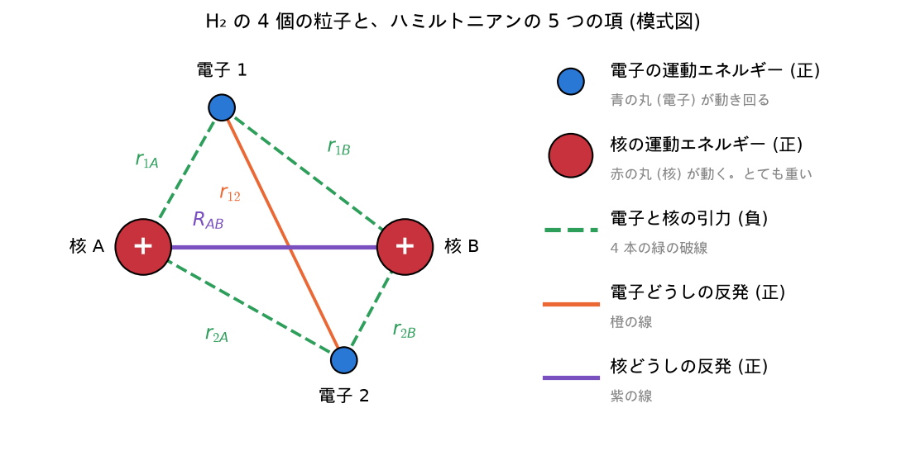

**図 1**　H₂ の核 A、B（赤）と電子 1、2（青）。緑の破線 4 本が電子と核の引力、橙の線が電子どうしの反発、紫の線が核どうしの反発に対応します。これに、電子と核のそれぞれが動き回る運動エネルギーが加わり、全部で 5 種類の項になります。

相対論の効果と、スピンが関わる磁気的な相互作用を無視すると、分子のハミルトニアンは次の 5 つの項の和です。

$$
\hat H =
\underbrace{-\sum_{i}\frac{\hbar^2}{2m_\mathrm e}\nabla_i^2}_{\hat T_\mathrm e}
\underbrace{-\sum_{A}\frac{\hbar^2}{2M_A}\nabla_A^2}_{\hat T_\mathrm N}
\underbrace{-\sum_{i}\sum_{A}\frac{Z_A e^2}{4\pi\varepsilon_0\, r_{iA}}}_{\hat V_\mathrm{eN}}
\underbrace{+\sum_{i<j}\frac{e^2}{4\pi\varepsilon_0\, r_{ij}}}_{\hat V_\mathrm{ee}}
\underbrace{+\sum_{A<B}\frac{Z_A Z_B e^2}{4\pi\varepsilon_0\, R_{AB}}}_{\hat V_\mathrm{NN}}
$$

各項の意味は次のとおりです。

| 項 | 意味 | 符号 | H₂ での項の数 |
|---|---|---|---|
| $\hat T_\mathrm e$ | 電子の運動エネルギー | 正 | 電子 2 個分 |
| $\hat T_\mathrm N$ | 核の運動エネルギー | 正 | 核 2 個分 |
| $\hat V_\mathrm{eN}$ | 電子と核の引き合い（クーロン引力） | 負 | 4（図 1 の緑の破線） |
| $\hat V_\mathrm{ee}$ | 電子どうしの反発 | 正 | 1（橙の線） |
| $\hat V_\mathrm{NN}$ | 核どうしの反発 | 正 | 1（紫の線） |

$\nabla_i^2$ は電子 $i$ の座標についてのラプラシアン（$x, y, z$ についての 2 階微分の和）、$\nabla_A^2$ は核 $A$ の座標についてのラプラシアンです。
和の $i<j$ は、同じ組を 2 回数えないための書き方です。
たとえば H₂ の $\hat V_\mathrm{ee}$ は、組 $(1, 2)$ の 1 項 $e^2/(4\pi\varepsilon_0 r_{12})$ だけです。

この方程式は、水素原子のように電子が 1 個で核が 1 個なら厳密に解けます。
しかし電子が 2 個以上になると、$\hat V_\mathrm{ee}$ の $1/r_{ij}$ が 2 個の電子の座標を同時に含むため、電子ごとに分けて解けなくなります。
さらに核も動くので、変数の数は $3N + 3M$ に増えます。
たとえば H₂O（電子 10 個、核 3 個）では $3\times 10 + 3\times 3 = 39$ 個です。
そこで、まず変数を減らす工夫が必要になります。それが第 3 節の Born–Oppenheimer 近似です。
その前に、式を見やすくするために単位を決めます。

**ここまでで分かったこと**：分子のハミルトニアンは、電子と核の運動エネルギー、電子と核の引力、電子どうしと核どうしの反発の 5 項でできています。

## 2. 原子単位：式から定数を消す

上の式には $\hbar$、$m_\mathrm e$、$e$、$4\pi\varepsilon_0$ が何度も出てきます。
これらをすべて 1 とする単位系を、原子単位（atomic units）と呼びます。
量子化学の論文やプログラムの出力は、ほとんどがこの単位で書かれています。

### 2.1 長さとエネルギーの単位

原子単位では、長さとエネルギーを、次の 2 つの量で測ります。

$$
a_0 = \frac{4\pi\varepsilon_0\hbar^2}{m_\mathrm e e^2},\qquad
E_\mathrm h = \frac{e^2}{4\pi\varepsilon_0\, a_0}
$$

$a_0$ をボーア（bohr）、$E_\mathrm h$ をハートリー（hartree）と呼びます。
$a_0$ の式を $E_\mathrm h$ の式に入れると、$E_\mathrm h = \hbar^2/(m_\mathrm e a_0^2)$ とも書けます。
この 2 つの書き方が、次の 2.2 節で使う鍵です。

| 量 | 原子単位での名前 | SI などでの値 |
|---|---|---|
| 長さ | ボーア（bohr）、$a_0$ | 0.529177 Å |
| エネルギー | ハートリー（hartree）、$E_\mathrm h$ | 27.211 eV ＝ 627.5 kcal/mol ＝ 2625.5 kJ/mol |
| 質量 | 電子の質量 $m_\mathrm e$ | — |
| 電荷 | 電気素量 $e$ | — |

数値は CODATA の推奨値 [Tiesinga 2021] によります。
たとえば 4 節で求める H₂ の平衡距離 0.76 Å は、$0.76/0.529177 = 1.44$ ボーアです（図 2 (a)）。

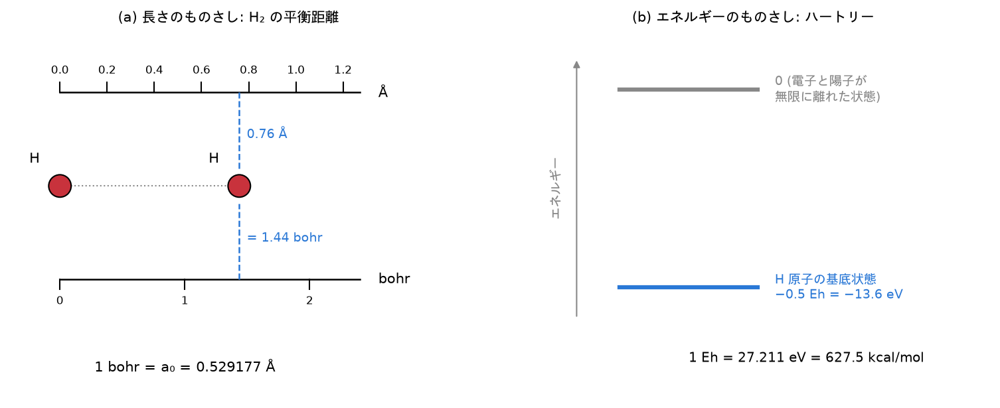

**図 2**　(a) 長さのものさし。上が Å、下が bohr の目盛りで、H₂ の平衡距離 0.76 Å（4 節）が 1.44 bohr に当たることを見てください。(b) エネルギーのものさし。電子と陽子が無限に離れた状態を 0 とすると、水素原子の基底状態は $-0.5$ ハートリー（$-13.6$ eV）です（2.2 節）。

### 2.2 定数が消えるしくみ

水素原子（核は止めたとする）のハミルトニアンで確かめます。

$$
\hat H = -\frac{\hbar^2}{2m_\mathrm e}\nabla^2 - \frac{e^2}{4\pi\varepsilon_0\, r}
$$

距離をボーアで測った数 $r'$ を使い、$r = a_0 r'$ とおきます。
微分は $\nabla^2 = \nabla'^2/a_0^2$ になります（長さが $a_0$ 倍になると、2 階微分は $1/a_0^2$ 倍になるため）。
これを代入すると、

$$
\hat H = -\frac{\hbar^2}{m_\mathrm e a_0^2}\cdot\frac12\nabla'^2 - \frac{e^2}{4\pi\varepsilon_0\, a_0}\cdot\frac{1}{r'}
$$

です。
2.1 節の 2 つの書き方から、どちらの項の係数もちょうど $E_\mathrm h$ です。
したがって

$$
\hat H = E_\mathrm h\left(-\frac12\nabla'^2 - \frac1{r'}\right)
$$

となり、エネルギーをハートリーで測れば、括弧の中の定数のない式だけが残ります。
この式の基底状態のエネルギーは、ちょうど $-\tfrac12\,E_\mathrm h$ です（図 2 (b)）。

分子のハミルトニアンでも同じことが起きます。
原子単位では、分子のハミルトニアンは次のように短くなります。

$$
\hat H =
-\sum_{i}\frac12\nabla_i^2
-\sum_{A}\frac{1}{2M_A}\nabla_A^2
-\sum_{i}\sum_{A}\frac{Z_A}{r_{iA}}
+\sum_{i<j}\frac{1}{r_{ij}}
+\sum_{A<B}\frac{Z_A Z_B}{R_{AB}}
$$

ここで $M_A$ は、電子の質量を 1 とした核の質量です。
核の運動エネルギーの項だけは、$m_\mathrm e$ のかわりに $M_A$ が入るので、$1/M_A$ が残ります。
陽子の質量は電子の約 1836 倍です [Tiesinga 2021]。
したがって、いちばん軽い水素の核でも $1/(2M_A)$ は $1/(2\cdot 1836)$ ほどしかありません。
この「核はとても重い」という事実が、次の節の出発点です。

**ここまでで分かったこと**：原子単位では $\hbar = m_\mathrm e = e = 4\pi\varepsilon_0 = 1$ とし、エネルギーをハートリー、長さをボーアで測ります。この連載でも、断りがなければ原子単位を使います。

## 3. Born–Oppenheimer 近似：核と電子を分ける

### 3.1 考え方：速い電子と遅い核

核は電子より 1800 倍以上重いので、同じ程度の力を受けても、核はずっとゆっくり動きます。
電子から見ると、核はほとんど止まっているように見えます。
逆に核から見ると、電子はとても速く動くので、その時々の核の配置に合わせた「平均の雲」になっています。
そこで、次の 2 段階に分けて問題を解きます。

1. 核の位置 $\mathbf R = (\mathbf R_1, \mathbf R_2, \dots)$ を固定し、その中で電子の状態を求める。
2. 求めた電子のエネルギーを、核が感じるポテンシャルとして使い、核の運動を考える。

この分け方を Born–Oppenheimer 近似と呼びます。
教科書では、Szabo–Ostlund の 2.1.2 節に分かりやすい説明があります [Szabo 1996]。

この分け方がうまくいくのは、電子の動きと核の動きのエネルギーの大きさが、桁で違うからです。
付録 B で見積もるように、電子の励起のエネルギーの大きさを $\varepsilon_\mathrm{el}$ とすると、分子の振動と回転のエネルギーの間隔はおよそ

$$
\varepsilon_\mathrm{vib} \sim \left(\frac{m_\mathrm e}{M}\right)^{1/2}\varepsilon_\mathrm{el},\qquad
\varepsilon_\mathrm{rot} \sim \frac{m_\mathrm e}{M}\,\varepsilon_\mathrm{el}
$$

です（$M$ は核の質量の目安）。
$m_\mathrm e/M = 1/1836$ なら、$(m_\mathrm e/M)^{1/2} \approx 0.023$ です。
電子の励起が数 eV なら、振動は 0.1 eV ほど、回転は数 meV ほどになります。
Born と Oppenheimer は 1927 年に、質量比の 4 乗根 $\kappa = (m_\mathrm e/M)^{1/4}$ を小さなパラメータとして分子のエネルギーを展開し、電子・振動・回転のエネルギーが $\kappa$ の 0 乗、2 乗、4 乗の大きさで順に現れることを示しました [Born 1927]。
上の 2 つの式は、$\kappa^2 = (m_\mathrm e/M)^{1/2}$、$\kappa^4 = m_\mathrm e/M$ と書き直すと、この順番そのものです。

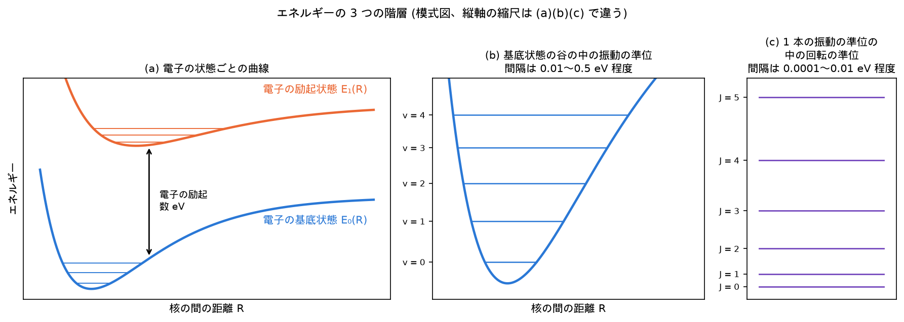

**図 3**　(a) 電子の状態ごとに 1 本ずつ、核の間の距離 $R$ の関数としてのエネルギーの曲線があります（青が基底状態、橙が励起状態）。曲線どうしの間隔が電子の励起のエネルギーです。(b) 1 本の曲線の谷の中に、核の振動の準位（横線）が並びます。(c) さらに 1 本の振動の準位の中に、分子の回転の準位が並びます。(a)(b)(c) の順に、間隔が桁で小さくなることを見てください。

### 3.2 電子のシュレーディンガー方程式

核を止めると、核の運動エネルギー $\hat T_\mathrm N$ を考えなくてよくなります。
残りの項のうち、電子の座標を含むものを集めたのが、電子のハミルトニアンです。

$$
\hat H_\mathrm{el}
= -\sum_{i}\frac12\nabla_i^2
-\sum_{i}\sum_{A}\frac{Z_A}{r_{iA}}
+\sum_{i<j}\frac{1}{r_{ij}}
$$

核どうしの反発 $V_\mathrm{NN} = \sum_{A<B} Z_A Z_B / R_{AB}$ は、核を止めればただの数です。
そこで、電子の方程式を次のように書きます。

$$
\hat H_\mathrm{el}\,\psi_k(\mathbf r;\mathbf R) = E_k^\mathrm{el}(\mathbf R)\,\psi_k(\mathbf r;\mathbf R)
$$

$\mathbf r$ はすべての電子の座標をまとめたもの、$k = 0, 1, 2, \dots$ は電子の状態の番号（0 が基底状態）です。
「$;\mathbf R$」は、核の位置が変数ではなく、外から与える値（パラメータ）であることを表します。
$\hat H_\mathrm{el}$ の中で $\mathbf R$ が現れるのは、$r_{iA} = |\mathbf r_i - \mathbf R_A|$ の中だけです。
核の位置を変えるたびに $r_{iA}$ が変わるので、この方程式を解き直します。

量子化学の計算プログラムが解いているのは、この電子のシュレーディンガー方程式です。
プログラムが「全エネルギー」として出力するのは、電子のエネルギーに核の反発を足した値

$$
E_k(\mathbf R) = E_k^\mathrm{el}(\mathbf R) + V_\mathrm{NN}(\mathbf R)
$$

です。
この連載の[第 5 回](05-hartree-fock.md)以降で扱う手法（Hartree–Fock 法、電子相関の方法、密度汎関数理論）は、どれもこの方程式を近似的に解く方法です。
その解 $\psi_k$ がどんな形の関数であるべきかは、6 節以降で考えます。
図 4 に、この手順の流れをまとめます。

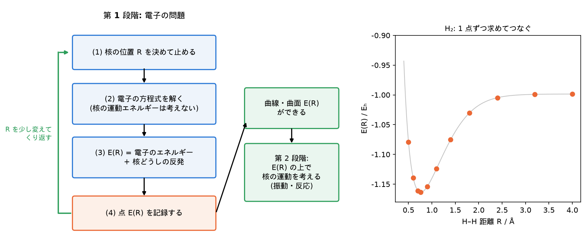

**図 4**　左：第 1 段階では、核の位置 $R$ を決めて止め、電子の方程式を解き、核の反発を足して 1 点 $E(R)$ を得ます。これを $R$ を少しずつ変えてくり返します（緑の矢印）。集めた点をつなぐと曲線（曲面）$E(R)$ ができ、第 2 段階ではその上で核の運動を考えます。右：H₂ で、こうして求めた点（橙）と、それをつないだ曲線（灰）。

### 3.3 核の運動

次に、核の運動を考えます。
分子全体の波動関数を、電子の状態 $\psi_k$ と核の波動関数 $\chi(\mathbf R)$ の積

$$
\Psi(\mathbf r, \mathbf R) \approx \chi(\mathbf R)\,\psi_k(\mathbf r;\mathbf R)
$$

で近似します。
この積の形は、「核がどこにいても、電子はその核の位置での状態 $\psi_k$ にすぐに合わせている」という 3.1 節の絵を式にしたものです。
すべての段階は付録 A で導きますが、核の波動関数は次の方程式を満たします。

$$
\left[\,-\sum_A \frac{1}{2M_A}\nabla_A^2 + E_k(\mathbf R)\right]\chi(\mathbf R) = E\,\chi(\mathbf R)
$$

この式は、ポテンシャル $E_k(\mathbf R)$ の中を核が動く、というシュレーディンガー方程式の形をしています。
つまり、電子のエネルギー $E_k(\mathbf R)$ が、核にとってのポテンシャルの役目をします。
分子の振動や化学反応は、このポテンシャルの上での核の運動として理解できます。

何を捨てたのかを、行列の形で見ておきます。
近似をしない場合、全体の波動関数は $\Psi = \sum_l \chi_l(\mathbf R)\,\psi_l(\mathbf r;\mathbf R)$ と、すべての電子状態についての和になります（付録 A の式 (A.1)）。
電子状態を基底状態 0 と励起状態 1 の 2 つだけに限ると、付録 A の式 (A.6) は次の 2 行 2 列の形になります。

$$
\begin{pmatrix}
\hat T_\mathrm N + E_0(\mathbf R) + \Lambda_{00} & \Lambda_{01}\\
\Lambda_{10} & \hat T_\mathrm N + E_1(\mathbf R) + \Lambda_{11}
\end{pmatrix}
\begin{pmatrix}\chi_0\\ \chi_1\end{pmatrix}
= E\begin{pmatrix}\chi_0\\ \chi_1\end{pmatrix}
$$

$\hat T_\mathrm N = -\sum_A \nabla_A^2/(2M_A)$ は核の運動エネルギーの演算子です。
$\Lambda_{kl}$（非断熱結合）は、核が動いたときに電子の状態 $\psi_l$ が変わる速さを表す演算子で、式 (A.5) で定義します。
非対角の $\Lambda_{01}$ と $\Lambda_{10}$ は、核の運動によって電子の状態が 0 から 1 へ（またはその逆へ）移る効果です。

Born–Oppenheimer 近似では、$\Lambda_{kl}$ をすべて捨てます。
すると行列は対角になり、$\chi_0$ と $\chi_1$ の方程式は互いに関係しなくなります。
1 行目だけを取り出したものが、上の核の方程式（$k = 0$）です。
付録 A で示すように、$\Lambda_{kl}$ には $1/M_A$ がかかっているため、核が重いほど近似がよくなります。

**ここまでで分かったこと**：核を止めて電子の方程式を解き、得られたエネルギー $E_k(\mathbf R)$ を核のポテンシャルとして使います。これが Born–Oppenheimer 近似で、電子状態どうしを結ぶ非断熱結合を捨てています。

## 4. ポテンシャルエネルギー曲面：H₂ の計算例

### 4.1 曲面から読み取れること

核の位置 $\mathbf R$ の関数としての $E_k(\mathbf R)$ を、ポテンシャルエネルギー曲面（potential energy surface、PES）と呼びます。
核が $M$ 個ある分子では、核の座標は $3M$ 個あります。
ただし、分子全体を平行移動（3 方向）しても、回転（3 つの軸のまわり）しても、エネルギーは変わりません。
そこでこの 6 個を除いた、$3M-6$ 個の変数の関数になります。
直線分子では、分子の軸のまわりの回転が意味をもたないので、除くのは 5 個で、$3M - 5$ 個です。
たとえば H₂O は $3\cdot 3 - 6 = 3$ 個（2 本の O–H 距離と H–O–H 角）、H₂ は $3\cdot 2 - 5 = 1$ 個（H–H 距離）です。
変数が 1 個の場合は、ポテンシャルエネルギー曲線と呼ぶこともあります。

ポテンシャルエネルギー曲面から、化学で使う多くの量が分かります（図 5）。

- **平衡構造**：曲面の極小点（谷底）。
- **振動数**：極小点のまわりの曲がり具合（2 階微分）。4.3 節で、曲がり具合から振動数を求める式を導きます。
- **反応のエネルギー**：反応物と生成物の極小点のエネルギー差。
- **活性化エネルギー**：反応物の極小点と、反応経路の上でいちばん高い点（遷移状態）のエネルギー差。遷移状態は、経路の方向には極大、それ以外の方向には極小になる点（1 次の鞍点、峠）です。

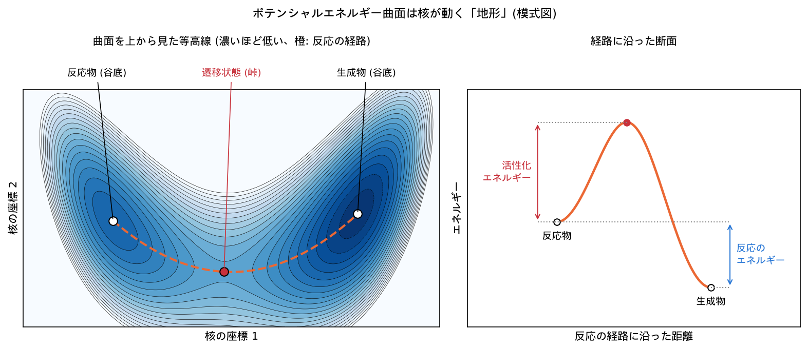

**図 5**　核の座標が 2 個の場合の模式図。左：曲面を上から見た等高線で、色が濃いほどエネルギーが低い所です。反応物と生成物は 2 つの谷底（白い点）にあり、その間を結ぶ最も楽な道（橙の破線）は、峠（赤い点、遷移状態）を越えます。右：その道に沿ったエネルギーの断面。峠の高さが活性化エネルギー、2 つの谷底の高さの差が反応のエネルギーです。

### 4.2 H₂ の曲線を計算する

いちばん簡単な例として、H₂ 分子のポテンシャルエネルギー曲線を計算してみます。
変数は H–H の距離 $R$ だけです。
距離ごとに電子の方程式を解きます。
解き方には、使った基底関数（[第 6 回](06-basis-sets.md)で説明します）の範囲で厳密な解を与える完全 CI（full CI、[第 8 回](08-configuration-interaction.md)で説明します）を使います。
計算には PySCF [Sun 2020] を使い、基底関数は cc-pVDZ [Dunning 1989] とします。

```python
import numpy as np
from pyscf import gto, scf, fci

def e_h2(r):
    # r は H–H 距離（Å）。全エネルギー E(R)（ハートリー）を返す
    mol = gto.M(atom=f"H 0 0 0; H 0 0 {r}", basis="cc-pvdz", unit="Angstrom", verbose=0)
    mf = scf.RHF(mol).run()
    return fci.FCI(mf).kernel()[0]

R = np.round(np.arange(0.40, 4.001, 0.02), 2)
E = np.array([e_h2(r) for r in R])
i = np.argmin(E)

# 遠く離れた 2 個の H 原子のエネルギー
h = gto.M(atom="H 0 0 0", basis="cc-pvdz", spin=1, verbose=0)
e_h = scf.UHF(h).run().e_tot
De = 2 * e_h - E[i]
print(f"最小の点      R = {R[i]:.2f} Å   E = {E[i]:.5f} Eh")
print(f"H 原子 2 個    2E(H) = {2*e_h:.5f} Eh")
print(f"解離エネルギー De = {De:.5f} Eh = {De*27.211386:.2f} eV")
```

出力は次のとおりです。

```text
最小の点      R = 0.76 Å   E = -1.16367 Eh
H 原子 2 個    2E(H) = -0.99856 Eh
解離エネルギー De = 0.16512 Eh = 4.49 eV
```

曲線を図にすると、図 6 のようになります。

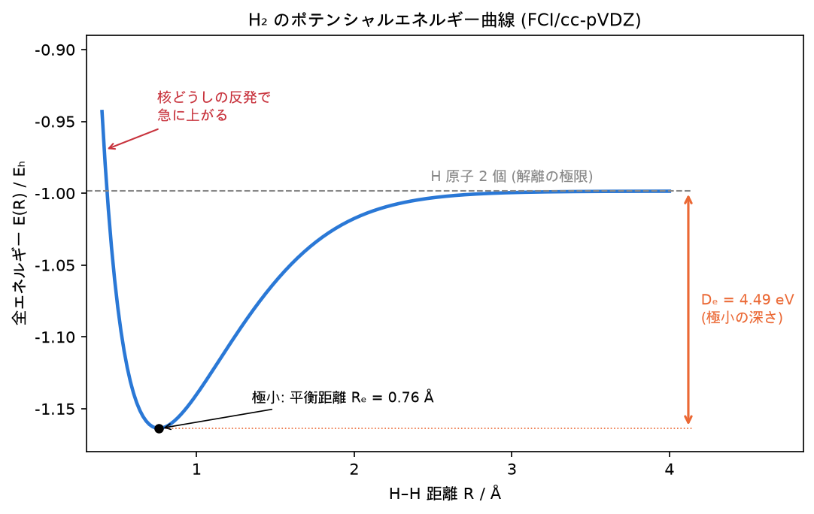

**図 6**　H₂ のポテンシャルエネルギー曲線（FCI/cc-pVDZ、青）。灰色の破線は 2 個の H 原子に分かれたときのエネルギー、橙の矢印がその破線から極小（黒の点）までの深さ $D_\mathrm e$ です。左端の急な立ち上がりが核どうしの反発、右に向かって破線に近づく部分が解離です。

この図から、次のことが読み取れます。

- 距離が短いと、核どうしの反発 $V_\mathrm{NN} = 1/R$ が大きくなり、エネルギーが急に上がります。
- 距離が長いと、エネルギーは 2 個の H 原子のエネルギーの和に近づきます。
- その間に極小があり、これが H₂ の平衡距離（この計算では 0.76 Å）です。極小の深さ $D_\mathrm e$ が、結合を切るのに必要なエネルギー（零点振動を含まない値）です。

H 原子のエネルギーは厳密には $-0.5\,E_\mathrm h$ なので、2 個で $-1\,E_\mathrm h$ のはずです。
上の計算では $-0.99856\,E_\mathrm h$ と、少し高く出ました。
この差は、電子の方程式の解き方ではなく、基底関数が有限であることから来ます。
基底関数の選び方は第 6 回で扱います。

### 4.3 谷底の曲がり具合から振動を求める

谷底の近くで、曲線を $R_\mathrm e$（極小の位置）のまわりでテイラー展開します。

$$
E(R) = E(R_\mathrm e) + E'(R_\mathrm e)\,(R - R_\mathrm e) + \frac12 E''(R_\mathrm e)\,(R - R_\mathrm e)^2 + \cdots
$$

極小では傾きが 0 なので、$E'(R_\mathrm e) = 0$ で第 2 項が消えます。
$k = E''(R_\mathrm e)$ とおき、3 次以上の項を捨てると、

$$
E(R) \approx E(R_\mathrm e) + \frac12 k\,(R - R_\mathrm e)^2
$$

です。
これは、ばね定数 $k$ のばねのポテンシャル（放物線）と同じ形です。
2 個の核の相対運動は、換算質量 $\mu = M_A M_B/(M_A + M_B)$ をもつ 1 個の粒子の運動と同じです。
H₂ では $\mu = M_\mathrm H/2$ です。
したがって核は、角振動数

$$
\omega = \sqrt{k/\mu}
$$

で振動します。
量子力学の調和振動子のエネルギーは $\hbar\omega(v + \tfrac12)$（$v = 0, 1, 2, \dots$）なので、いちばん低い状態でも谷底より $\tfrac12\hbar\omega$ だけ高くなります。
これが零点振動のエネルギーです。

このように、谷底の曲率 $k$ が分かれば振動数が決まります。
谷が鋭い（$k$ が大きい）ほど振動数は高く、核が重い（$\mu$ が大きい）ほど低くなります。
これが、4.1 節で「振動数は極小点のまわりの曲がり具合から分かる」と書いた理由です。
零点振動のエネルギーのため、実際に結合を切るのに必要なエネルギー $D_0$ は、極小の深さ $D_\mathrm e$ より $\tfrac12\hbar\omega$ だけ小さくなります。

$$
D_0 \approx D_\mathrm e - \frac12\hbar\omega
$$

（右辺は放物線で近似した場合の値で、実際の谷は放物線より広がっているので、目安です。）
3.1 節の見積もりのとおり、$\hbar\omega$ は電子の励起のエネルギーに $(m_\mathrm e/M)^{1/2}$ をかけた大きさで、$D_\mathrm e$（数 eV）よりずっと小さい量です。

**ここまでで分かったこと**：核の位置を変えながら電子の方程式を解くと、ポテンシャルエネルギー曲面が得られます。平衡構造、振動、反応のエネルギーは、この曲面の谷底、谷底の曲がり具合、谷と峠の高さから読み取ります。

## 5. Born–Oppenheimer 近似が悪くなるとき

第 3 節で捨てた非断熱結合 $\Lambda_{kl}$ は、付録 A の式 (A.5) のように、電子の状態 $\psi_l$ を核の座標で微分した量 $\langle\psi_k|\nabla_A\psi_l\rangle$ を含みます。
付録 A の式 (A.10) で示すように、この量は 2 つの電子状態のエネルギー差 $E_l - E_k$ に反比例します。
差が小さいほど、結合は大きくなります。
したがって、Born–Oppenheimer 近似が悪くなるのは、主に次の場合です（図 7）。

- 2 つの電子状態のエネルギーが近づく、または交わる場所（円錐交差など）。光化学反応や、励起状態からの緩和がこれに当たります。
- 核が軽く、速く動く場合（水素の移動など）。ただし多くの場合、近似はまだよく成り立ちます。

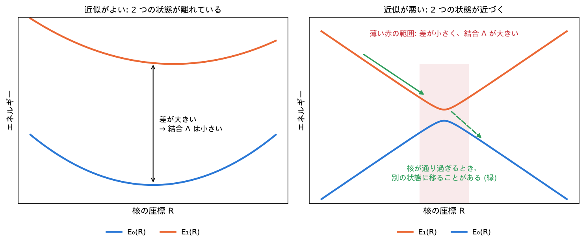

**図 7**　模式図。左：2 つの電子状態のエネルギーが大きく離れていると、非断熱結合は小さく、核は 1 本の曲線の上だけを動くと考えてよくなります。右：2 つの曲線が近づく所（薄い赤の範囲）では結合が大きくなり、上の曲線を進んできた核が、そこを通り過ぎるときに下の曲線へ移ることがあります（緑の破線の矢印）。

基底状態の平衡構造の近くで、励起状態とのエネルギー差が十分大きければ、Born–Oppenheimer 近似はたいへんよい近似です。
この連載の第 I〜IV 部は、すべてこの近似の中で話を進めます。
近似が破れる場合は、[第 22 回](22-conical-intersections.md)で扱います。

!!! note "「全エネルギー」の意味に注意"
    計算プログラムが出す全エネルギーは、静止した核の位置での電子のエネルギーと核の反発の和です。零点振動エネルギーや熱の寄与は含みません。反応熱などを実験と比べるときは、4.3 節のように、ポテンシャルエネルギー曲面の上で振動を別に計算して足します。

**ここまでで分かったこと**：Born–Oppenheimer 近似は、電子状態どうしのエネルギーが近いところで悪くなります。それ以外では、量子化学の計算の土台として信頼できます。

## 6. スピン軌道：空間の関数とスピンの関数の積

ここからは、核を止めた電子の方程式（3.2 節）に戻り、その解である電子の波動関数の形を考えます。
以下、核の位置は固定し、電子の波動関数を $\Psi$ と書きます。

### 6.1 スピンの関数

3.2 節の電子のハミルトニアン $\hat H_\mathrm{el}$ には、電子の位置しか出てきません。
しかし電子にはスピンがあり、波動関数はスピンの状態も表す必要があります。

電子 1 個のスピンの状態は、上向き $\alpha$ と下向き $\beta$ の 2 つです。
これを関数として扱うために、スピンの座標 $\omega$ を導入します。
$\omega$ は、スピンの $z$ 成分の値 $+\tfrac12$ と $-\tfrac12$ の 2 つの値だけをとる変数です。
$\alpha$ と $\beta$ は、次の値をとる関数と考えます。

| | $\omega = +\tfrac12$ | $\omega = -\tfrac12$ |
|---|---|---|
| $\alpha(\omega)$ | 1 | 0 |
| $\beta(\omega)$ | 0 | 1 |

$\omega$ は 2 つの値しかとらないので、スピンの座標についての「積分」は、2 つの値についての和です。
たとえば

$$
\langle\alpha|\beta\rangle = \sum_{\omega = \pm 1/2}\alpha(\omega)\,\beta(\omega) = 1\cdot 0 + 0\cdot 1 = 0,\qquad
\langle\alpha|\alpha\rangle = 1\cdot 1 + 0\cdot 0 = 1
$$

です。
同じように $\langle\beta|\beta\rangle = 1$ なので、

$$
\langle\alpha|\alpha\rangle = \langle\beta|\beta\rangle = 1,\qquad \langle\alpha|\beta\rangle = 0
$$

となり、$\alpha$ と $\beta$ は互いに直交し規格化されています。
上の表の行を縦に並べたベクトル $\alpha = \begin{pmatrix}1\\0\end{pmatrix}$、$\beta = \begin{pmatrix}0\\1\end{pmatrix}$ の内積（第 1 回 1 節）だと考えても同じです。

### 6.2 空間軌道とスピン軌道

電子 1 個の状態を表す関数を軌道と呼びます。
位置だけの関数 $\phi(\mathbf r)$ を空間軌道（spatial orbital）と呼び、空間軌道にスピンの関数をかけたもの

$$
\chi(\mathbf x) = \phi(\mathbf r)\,\alpha(\omega)\quad\text{または}\quad \chi(\mathbf x) = \phi(\mathbf r)\,\beta(\omega)
$$

をスピン軌道（spin orbital）と呼びます。
$\mathbf x = (\mathbf r, \omega)$ は、位置とスピンをまとめた電子の座標です。
以下、$\mathbf x$ についての積分は、$\mathbf r$ についての積分と $\omega$ についての和の両方を行うことを意味します。
なお、3 節の核の波動関数 $\chi(\mathbf R)$ とは別のものです。ここから先の $\chi$ は、すべてスピン軌道を表します。

図 8 のように、1 つの空間軌道から、$\alpha$ と $\beta$ の 2 つのスピン軌道ができます。

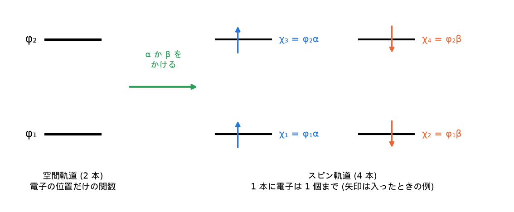

**図 8**　左：2 本の空間軌道 $\phi_1$、$\phi_2$。右：それぞれに $\alpha$ か $\beta$ をかけてできる 4 本のスピン軌道 $\chi_1, \dots, \chi_4$。横線 1 本が 1 つのスピン軌道で、電子は 1 本に 1 個まで入れます（8 節で示します）。青の上向きの矢印は $\alpha$ の電子、橙の下向きの矢印は $\beta$ の電子が入った場合を表します。

スピン軌道どうしの重なりの積分は、空間の積分とスピンの和に分かれます。

$$
\langle\phi_i\sigma|\phi_j\tau\rangle = \langle\phi_i|\phi_j\rangle\,\langle\sigma|\tau\rangle
$$

$\sigma$、$\tau$ は $\alpha$ か $\beta$ です。
空間軌道が規格直交（$\langle\phi_i|\phi_j\rangle = \delta_{ij}$）なら、スピン軌道も規格直交です。
たとえば図 8 の $\chi_1 = \phi_1\alpha$ と $\chi_2 = \phi_1\beta$ は、空間の部分は同じ（$\langle\phi_1|\phi_1\rangle = 1$）ですが、スピンの部分が $\langle\alpha|\beta\rangle = 0$ なので直交します。

**ここまでで分かったこと**：電子 1 個の状態は、空間軌道とスピンの関数の積であるスピン軌道で表します。1 つの空間軌道から、$\alpha$ と $\beta$ の 2 つのスピン軌道ができます。

## 7. 反対称性の要請とパウリの原理

### 7.1 ハートリー積とその問題

電子が $N$ 個あるとき、いちばん素朴な波動関数は、スピン軌道の積

$$
\Psi^\mathrm{HP}(\mathbf x_1, \mathbf x_2, \dots, \mathbf x_N) = \chi_1(\mathbf x_1)\,\chi_2(\mathbf x_2)\cdots\chi_N(\mathbf x_N)
$$

です。これをハートリー積（Hartree product）と呼びます。
ハートリー積は「電子 1 は軌道 $\chi_1$ に、電子 2 は軌道 $\chi_2$ に入る」と、電子に名札を付けて区別しています（図 9 (a)）。

2 電子で、名札が問題になることを確かめます。
$|\Psi^\mathrm{HP}(\mathbf x_1, \mathbf x_2)|^2 = |\chi_1(\mathbf x_1)|^2|\chi_2(\mathbf x_2)|^2$ は、「電子 1 が $\mathbf x_1$ に、電子 2 が $\mathbf x_2$ に見つかる確率密度」です。
2 個の電子を入れ替えた配置の確率密度は $|\chi_1(\mathbf x_2)|^2|\chi_2(\mathbf x_1)|^2$ で、ふつうは最初のものと違う値です。
しかし、電子は互いに区別できないので、「電子 1 が点 P、電子 2 が点 Q」と「電子 1 が点 Q、電子 2 が点 P」は、観測では区別できない同じ配置です。
同じ配置に違う確率を与えるので、ハートリー積は電子の波動関数として不十分です。

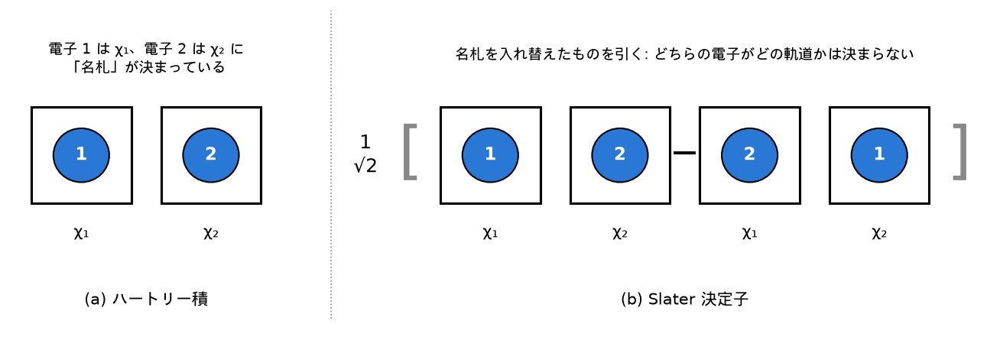

**図 9**　(a) ハートリー積では、電子 1 は $\chi_1$、電子 2 は $\chi_2$ と、名札が決まっています。(b) Slater 決定子（8 節）は、名札を入れ替えたものを引いた組み合わせです。どちらの電子がどちらの軌道に入っているかは決まらず、「$\chi_1$ と $\chi_2$ に 1 個ずつ入っている」ことだけが決まります。

### 7.2 反対称性の要請

2 つの電子 $i$、$j$ の座標を入れ替える操作を $\hat P_{ij}$ と書きます。
電子は区別できないので、入れ替えても確率密度 $|\Psi|^2$ は変わりません。
したがって、入れ替えた波動関数は、もとの波動関数の定数倍 $\lambda$（$|\lambda| = 1$）です。

$$
\hat P_{ij}\Psi = \lambda\,\Psi
$$

入れ替えを 2 回行うと元に戻るので、$\hat P_{ij}^2\Psi = \lambda^2\Psi = \Psi$、つまり $\lambda^2 = 1$ で、$\lambda = +1$ か $-1$ です。
自然界では、粒子の種類によってどちらかが決まっています。
電子（フェルミ粒子）は $\lambda = -1$ で、波動関数そのものは入れ替えで符号が変わります。

$$
\Psi(\dots, \mathbf x_i, \dots, \mathbf x_j, \dots) = -\Psi(\dots, \mathbf x_j, \dots, \mathbf x_i, \dots)
$$

これを反対称性の要請（antisymmetry principle）と呼びます。
$\lambda$ が $+1$ か $-1$ のどちらかであることは上のように導けますが、電子が $-1$ をとることはシュレーディンガー方程式からは出てこない、独立した原理です。
1926 年に Heisenberg と Dirac が、それぞれ多電子の波動関数の対称性としてこの考え方を示しました [Heisenberg 1926; Dirac 1926]。

反対称性から、すぐに次のことが分かります。
2 つの電子が同じ座標（同じ位置かつ同じスピン）$\mathbf x_i = \mathbf x_j$ にあると、入れ替えても波動関数は同じものなので、上の式は $\Psi = -\Psi$ となります。
したがって、そのような配置では $\Psi = 0$ です。
次の節で見るように、このことから「2 つの電子が同じスピン軌道に入ることはできない」というパウリの排他原理が出てきます。
パウリの排他原理は、原子のスペクトルを説明するために 1925 年に Pauli が導入しました [Pauli 1925]。
反対称性の要請は、それをより一般的な形にしたものです。

**ここまでで分かったこと**：電子の波動関数は、2 つの電子を入れ替えると符号が変わる（反対称である）必要があります。ハートリー積は電子に名札を付けていて、これを満たしません。

## 8. Slater 決定子

### 8.1 2 電子の場合

2 つのスピン軌道 $\chi_1$、$\chi_2$ に 2 個の電子を入れます。
ハートリー積 $\chi_1(\mathbf x_1)\chi_2(\mathbf x_2)$ から、名札を入れ替えたもの $\chi_1(\mathbf x_2)\chi_2(\mathbf x_1)$ を引くと、

$$
\Psi(\mathbf x_1, \mathbf x_2) = \frac{1}{\sqrt 2}\Big[\chi_1(\mathbf x_1)\chi_2(\mathbf x_2) - \chi_2(\mathbf x_1)\chi_1(\mathbf x_2)\Big]
$$

となります。

**反対称性の確認**：$\mathbf x_1$ と $\mathbf x_2$ を入れ替えると、

$$
\Psi(\mathbf x_2, \mathbf x_1) = \frac{1}{\sqrt 2}\Big[\chi_1(\mathbf x_2)\chi_2(\mathbf x_1) - \chi_2(\mathbf x_2)\chi_1(\mathbf x_1)\Big]
$$

です。
括弧の中の 2 つの項は、もとの式の第 2 項と第 1 項を、符号を変えて並べたものです。
したがって $\Psi(\mathbf x_2, \mathbf x_1) = -\Psi(\mathbf x_1, \mathbf x_2)$ で、確かに符号が変わります。

**規格化の確認**：$\chi_1$ と $\chi_2$ が規格直交のとき、$\langle\Psi|\Psi\rangle$ を展開すると 4 つの項が出ます。
各項は、電子 1 の座標の積分と電子 2 の座標の積分の積に分かれます。

$$
\begin{aligned}
\langle\Psi|\Psi\rangle = \frac12\Big[&\underbrace{\langle\chi_1|\chi_1\rangle\langle\chi_2|\chi_2\rangle}_{1\cdot 1} - \underbrace{\langle\chi_1|\chi_2\rangle\langle\chi_2|\chi_1\rangle}_{0\cdot 0}\\
&- \underbrace{\langle\chi_2|\chi_1\rangle\langle\chi_1|\chi_2\rangle}_{0\cdot 0} + \underbrace{\langle\chi_2|\chi_2\rangle\langle\chi_1|\chi_1\rangle}_{1\cdot 1}\Big] = 1
\end{aligned}
$$

$1/\sqrt 2$ は、この「2 つの項が 1 ずつ残る」分を打ち消すための因子です。

この式は、2 行 2 列の行列式 $\begin{vmatrix}a & b\\ c & d\end{vmatrix} = ad - bc$ の形に書けます。

$$
\Psi(\mathbf x_1, \mathbf x_2) = \frac{1}{\sqrt 2}
\begin{vmatrix}
\chi_1(\mathbf x_1) & \chi_2(\mathbf x_1)\\
\chi_1(\mathbf x_2) & \chi_2(\mathbf x_2)
\end{vmatrix}
$$

1 行目が電子 1、2 行目が電子 2、1 列目が $\chi_1$、2 列目が $\chi_2$ です。

### 8.2 N 電子の場合

一般に、$N$ 個のスピン軌道 $\chi_1, \dots, \chi_N$ に $N$ 個の電子を入れた波動関数を、次の行列式で作ります。

$$
\Psi(\mathbf x_1, \dots, \mathbf x_N) = \frac{1}{\sqrt{N!}}
\begin{vmatrix}
\chi_1(\mathbf x_1) & \chi_2(\mathbf x_1) & \cdots & \chi_N(\mathbf x_1)\\
\chi_1(\mathbf x_2) & \chi_2(\mathbf x_2) & \cdots & \chi_N(\mathbf x_2)\\
\vdots & \vdots & & \vdots\\
\chi_1(\mathbf x_N) & \chi_2(\mathbf x_N) & \cdots & \chi_N(\mathbf x_N)
\end{vmatrix}
$$

図 10 (a) のように、行が電子、列がスピン軌道に対応します。
これを Slater 決定子（Slater determinant）、または単に決定子と呼びます。
Slater が 1929 年に、原子のスペクトルの理論でこの形を使いました [Slater 1929]。
教科書では、Szabo–Ostlund の 2.2.3 節に詳しい説明があります [Szabo 1996]。

**3 電子の例**：Li 原子の基底状態の電子配置 $1s^2 2s^1$ を、スピン軌道 $\chi_1 = 1s\,\alpha$、$\chi_2 = 1s\,\beta$、$\chi_3 = 2s\,\alpha$ で表します。
$\chi_j(\mathbf x_i)$ を $\chi_j(i)$ と略して行列式を書き、展開すると、

$$
\Psi = \frac{1}{\sqrt 6}
\begin{vmatrix}
\chi_1(1) & \chi_2(1) & \chi_3(1)\\
\chi_1(2) & \chi_2(2) & \chi_3(2)\\
\chi_1(3) & \chi_2(3) & \chi_3(3)
\end{vmatrix}
$$

$$
\begin{aligned}
= \frac{1}{\sqrt 6}\Big[
&\chi_1(1)\chi_2(2)\chi_3(3) - \chi_1(1)\chi_3(2)\chi_2(3)\\
&- \chi_2(1)\chi_1(2)\chi_3(3) + \chi_2(1)\chi_3(2)\chi_1(3)\\
&+ \chi_3(1)\chi_1(2)\chi_2(3) - \chi_3(1)\chi_2(2)\chi_1(3)
\Big]
\end{aligned}
$$

です。
各項は、3 個の電子を 3 本のスピン軌道に 1 個ずつ割り当てる 1 つの方法（ハートリー積）です。
割り当て方は $3! = 6$ 通りあり、決定子はそのすべてを足し合わせています。
符号は、最初の項 $\chi_1(1)\chi_2(2)\chi_3(3)$ から、電子の入れ替えを奇数回して作れる項が $-$、偶数回なら $+$ です。
たとえば 2 番目の項は、電子 2 と 3 を 1 回入れ替えたものなので $-$ です。
$N$ 電子では $N!$ 個の項があり、$1/\sqrt{N!}$ が規格化の因子です（8.1 節と同じく、$N!$ 個の項が 1 ずつ残るため）。

この連載では、対角に並ぶスピン軌道だけを書いた略記

$$
|\chi_1\chi_2\cdots\chi_N\rangle
$$

を使います。
上の Li の決定子は $|1s\alpha\;1s\beta\;2s\alpha\rangle$ と書きます。

### 8.3 決定子の 4 つの性質

行列式の性質（第 1 回 2 節）から、Slater 決定子は次の性質を持ちます。図 10 と合わせて見てください。

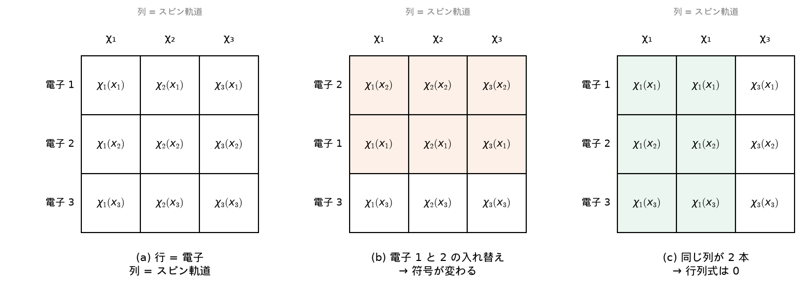

**図 10**　(a) 決定子の行列。行が電子、列がスピン軌道です。(b) 電子 1 と電子 2 を入れ替えると、行列の 1 行目と 2 行目が入れ替わります（橙の行）。行列式は 2 つの行を入れ替えると符号が変わるので、決定子の符号が変わります。(c) 同じスピン軌道 $\chi_1$ を 2 回使うと、1 列目と 2 列目が同じになります（緑の列）。2 つの列が同じ行列式は 0 です。

1. **反対称性**：2 つの電子を入れ替えると、2 つの行が入れ替わるので、符号が変わります（図 10 (b)）。反対称性の要請は自動的に満たされます。
2. **パウリの排他原理**：同じスピン軌道を 2 回使う（$\chi_i = \chi_j$）と、2 つの列が等しくなるので、行列式は 0 です（図 10 (c)）。2 電子で確かめると、$\chi_1 = \chi_2$ のとき $\chi_1(\mathbf x_1)\chi_1(\mathbf x_2) - \chi_1(\mathbf x_1)\chi_1(\mathbf x_2) = 0$ です。つまり、1 つのスピン軌道には電子が 1 個しか入れません。1 つの空間軌道には、$\alpha$ と $\beta$ の 2 個まで入れます。
3. **軌道の並べ方と符号**：スピン軌道の並べ方を入れ替えると、列が入れ替わり、符号が変わります。たとえば $|\chi_2\chi_1\rangle = -|\chi_1\chi_2\rangle$ です。決定子を扱うときは、軌道の順番を決めておく必要があります。
4. **占有した軌道どうしの混ぜ方によらない**：占有された軌道どうしを混ぜ合わせても（正則な一次変換をしても）、決定子は定数倍しか変わりません。決定子は、個々の軌道よりも「どの軌道の組を占有したか」で決まります。

4 番目の性質を 2 電子で確かめます。
新しい軌道を $\chi_1' = a\chi_1 + b\chi_2$、$\chi_2' = c\chi_1 + d\chi_2$ とします。
$\chi_1'(\mathbf x_1)\chi_2'(\mathbf x_2) - \chi_2'(\mathbf x_1)\chi_1'(\mathbf x_2)$ を展開すると、

$$
\begin{aligned}
&(a\chi_1 + b\chi_2)(1)\,(c\chi_1 + d\chi_2)(2) - (c\chi_1 + d\chi_2)(1)\,(a\chi_1 + b\chi_2)(2)\\
&= ac\,\chi_1(1)\chi_1(2) + ad\,\chi_1(1)\chi_2(2) + bc\,\chi_2(1)\chi_1(2) + bd\,\chi_2(1)\chi_2(2)\\
&\quad - ca\,\chi_1(1)\chi_1(2) - cb\,\chi_1(1)\chi_2(2) - da\,\chi_2(1)\chi_1(2) - db\,\chi_2(1)\chi_2(2)\\
&= (ad - bc)\,\big[\chi_1(1)\chi_2(2) - \chi_2(1)\chi_1(2)\big]
\end{aligned}
$$

です。
2 行目から 3 行目では、$\chi_1(1)\chi_1(2)$ と $\chi_2(1)\chi_2(2)$ の項が打ち消し合い、残りを $\chi_1(1)\chi_2(2)$ と $\chi_2(1)\chi_1(2)$ についてまとめました。
つまり、新しい決定子はもとの決定子の $ad - bc$ 倍です。
$ad - bc$ は混ぜ方の行列 $\begin{pmatrix}a & b\\ c & d\end{pmatrix}$ の行列式で、混ぜ方が正則なら 0 ではありません。
この性質は、[第 5 回](05-hartree-fock.md)で Hartree–Fock 法の軌道を考えるときに使います。

**ここまでで分かったこと**：スピン軌道を並べた行列式（Slater 決定子）は、電子をスピン軌道に割り当てるすべての方法を符号付きで足したもので、反対称性の要請を自動的に満たします。同じスピン軌道に 2 個の電子は入れません。

## 9. 2 電子の例：交換の効果

反対称にしたことで、電子の振る舞いがどう変わるかを見ます。
2 つの空間軌道 $\phi_1$、$\phi_2$ に、2 個の電子を 1 個ずつ入れる場合を考えます。
スピンの入れ方によって、次の 2 つの決定子を比べます。

- 同じスピン：$|\phi_1\alpha\;\phi_2\alpha\rangle$
- 反対のスピン：$|\phi_1\alpha\;\phi_2\beta\rangle$

### 9.1 2 個の電子が見つかる確率

決定子 $\Psi$ の $|\Psi|^2$ を、2 つの電子のスピン $\omega_1$、$\omega_2$ について足し合わせます。すると、「電子 1 が $\mathbf r_1$ に、電子 2 が $\mathbf r_2$ に見つかる確率密度」になります（全空間で積分すると 1 です）。
これを 2 電子密度（ペア密度）と呼び、$P(\mathbf r_1, \mathbf r_2)$ と書きます。
付録 C.4 で 1 段ずつ計算しますが、結果は次のとおりです（軌道は実数とします）。

$$
P_{\uparrow\uparrow}(\mathbf r_1, \mathbf r_2) = \frac12\Big[\phi_1(\mathbf r_1)\phi_2(\mathbf r_2) - \phi_2(\mathbf r_1)\phi_1(\mathbf r_2)\Big]^2
$$

$$
P_{\uparrow\downarrow}(\mathbf r_1, \mathbf r_2) = \frac12\Big[\big(\phi_1(\mathbf r_1)\phi_2(\mathbf r_2)\big)^2 + \big(\phi_2(\mathbf r_1)\phi_1(\mathbf r_2)\big)^2\Big]
$$

2 つの式の違いは、$P_{\uparrow\uparrow}$ にだけ交差項 $-\phi_1(\mathbf r_1)\phi_2(\mathbf r_2)\phi_2(\mathbf r_1)\phi_1(\mathbf r_2)$ があることです。
反対のスピンでは、交差項にかかるスピンの和 $\langle\alpha|\beta\rangle$ が 0 なので、交差項が消えます。

同じスピンの場合、$\mathbf r_1 = \mathbf r_2$ とおくと、括弧の中が $\phi_1(\mathbf r_1)\phi_2(\mathbf r_1) - \phi_2(\mathbf r_1)\phi_1(\mathbf r_1) = 0$ になります。
つまり、同じスピンの 2 個の電子が同じ場所に見つかる確率は 0 です。
電子のまわりにできるこの「穴」を、フェルミ孔（Fermi hole）、または交換孔（exchange hole）と呼びます。
反対のスピンの場合は、$\mathbf r_1 = \mathbf r_2$ でも 0 になりません。

この違いを、1 次元の箱（長さ 1）の中の 2 つの軌道 $\phi_n(x) = \sqrt 2\sin(n\pi x)$（$n = 1, 2$）で描いてみます。
電子間の反発は入れていません。決定子の形だけで、どのような違いが出るかを見るための例です。

```python
import numpy as np

x = np.linspace(0, 1, 201)
p1 = np.sqrt(2) * np.sin(np.pi * x)
p2 = np.sqrt(2) * np.sin(2 * np.pi * x)
X1, X2 = np.meshgrid(x, x, indexing="ij")
a = np.outer(p1, p2)   # phi1(x1) phi2(x2)
b = np.outer(p2, p1)   # phi2(x1) phi1(x2)
same = 0.5 * (a - b) ** 2        # 同じスピン
opp = 0.5 * (a ** 2 + b ** 2)    # 反対のスピン
dx = x[1] - x[0]
for name, P in [("same", same), ("opposite", opp)]:
    norm = P.sum() * dx * dx
    d = (np.abs(X1 - X2) * P).sum() * dx * dx / norm
    print(f"{name:8s}: 規格化 {norm:.4f}, 平均の距離 <|x1-x2|> = {d:.4f}, 対角線上の最大 = {np.diag(P).max():.4f}")
```

```text
same    : 規格化 1.0000, 平均の距離 <|x1-x2|> = 0.3826, 対角線上の最大 = 0.0000
opposite: 規格化 1.0000, 平均の距離 <|x1-x2|> = 0.2700, 対角線上の最大 = 2.3703
```

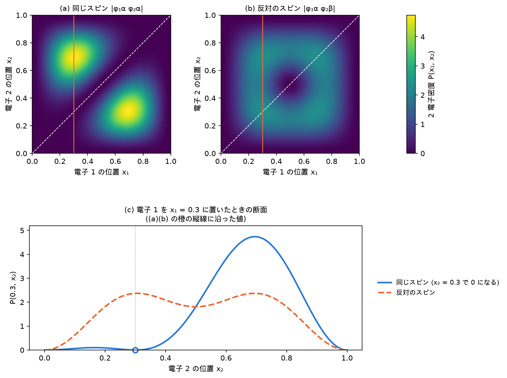

**図 11**　1 次元の箱の中の 2 電子密度。横軸が電子 1 の位置、縦軸が電子 2 の位置で、明るいほど見つかりやすい配置です。白の破線は $x_1 = x_2$（2 個の電子が同じ場所にいる配置）の線です。(a) 同じスピン。(b) 反対のスピン。(c) 電子 1 を $x_1 = 0.3$ に置いたとき、電子 2 がどこに見つかりやすいか（(a)(b) の橙の縦線に沿った値）。同じスピン（青）では、電子 1 のいる $x_2 = 0.3$ で 0 になります（白丸）。これがフェルミ孔です。

図 11 (a)（同じスピン）では、対角線 $x_1 = x_2$ の上で密度が 0 になっています。
2 個の電子は、箱の左右に分かれて見つかりやすくなります。
2 電子の平均の距離は 0.383 で、反対のスピンの場合の 0.270 より大きくなりました。
図 11 (c) の青の曲線を見ると、電子 1 を $x_1 = 0.3$ に置いたとき、電子 2 は電子 1 のまわりを避け、反対側の $x_2 \approx 0.7$ に見つかりやすくなっています。

図 11 (b)（反対のスピン）では、対角線の上にも密度があります。
中央 $x_1 = x_2 = 0.5$ で密度が 0 なのは、$\phi_2$ が $x = 0.5$ に節を持つためで、反対称性とは関係ありません。
図 11 (c) の橙の破線は、電子 1 のいる $x_2 = 0.3$ でむしろ大きな値をとります。
(b) の密度は、2 個の電子がそれぞれの軌道で独立に動くとしたとき（ハートリー積）の密度を、電子を入れ替えて平均したものと同じです（$P_{\uparrow\downarrow}$ の式の 2 つの項がそれぞれ、名札を付けたハートリー積の確率密度です）。
つまり、1 個の決定子は、反対のスピンの電子どうしの動きを、まったく関連づけていません。

### 9.2 エネルギーへの影響：クーロン積分と交換積分

この違いは、電子間の反発のエネルギーに現れます。
1 電子の部分（運動エネルギーと核からの引力）をまとめた演算子を $\hat h = -\frac12\nabla^2 - \sum_A Z_A/r_A$ とし、その積分を $h_{ii} = \langle\phi_i|\hat h|\phi_i\rangle$ と書きます。
$\hat h$ は、3.2 節の $\hat H_\mathrm{el}$ のうち、電子 1 個だけを含む項です。
電子反発積分は、化学者の表記

$$
(ij|kl) = \iint \phi_i^*(\mathbf r_1)\phi_j(\mathbf r_1)\,\frac{1}{r_{12}}\,\phi_k^*(\mathbf r_2)\phi_l(\mathbf r_2)\,d\mathbf r_1\,d\mathbf r_2
$$

で書きます。
左の組 $ij$ が電子 1 の座標、右の組 $kl$ が電子 2 の座標の関数です。
すべての段階は付録 C で導きますが、2 つの決定子のエネルギー（原子単位、核の反発を除く）は次のとおりです。

$$
E_{\uparrow\uparrow} = h_{11} + h_{22} + J_{12} - K_{12},\qquad
E_{\uparrow\downarrow} = h_{11} + h_{22} + J_{12}
$$

$$
J_{12} = (11|22),\qquad K_{12} = (12|21)
$$

$J_{12}$ をクーロン積分（Coulomb integral）と呼びます。
$J_{12} = \iint |\phi_1(\mathbf r_1)|^2\,r_{12}^{-1}\,|\phi_2(\mathbf r_2)|^2\,d\mathbf r_1 d\mathbf r_2$ と書くと分かるように、電子の雲 $|\phi_1|^2$ と $|\phi_2|^2$ の間の、古典的な静電反発のエネルギーです。
$K_{12}$ を交換積分（exchange integral）と呼びます。
古典的な対応物がなく、反対称性から生じる項です。

$K_{12}$ は正です（少なくとも 0 以上）。
理由は次のとおりです。
$\rho_{12}(\mathbf r) = \phi_1^*(\mathbf r)\phi_2(\mathbf r)$ とおくと、$K_{12} = \iint \rho_{12}^*(\mathbf r_1)\,r_{12}^{-1}\,\rho_{12}(\mathbf r_2)\,d\mathbf r_1 d\mathbf r_2$ です。
これは、電荷の分布 $\rho_{12}$ が自分自身と反発する静電エネルギーの形をしています。
電荷の分布の静電エネルギーは、分布の形によらず 0 以上です（静電場のエネルギーが、電場の 2 乗の積分で書けるため）。

したがって、同じスピンの決定子は、反対のスピンの決定子より $K_{12}$ だけエネルギーが低くなります。
9.1 節で見たように、同じスピンの電子どうしはフェルミ孔によって遠ざけられ、反発が減るためです。
このように反対称性によって生じる効果を、交換の効果と呼びます。

図 12 に、2 つの決定子とそのエネルギーの関係をまとめます。

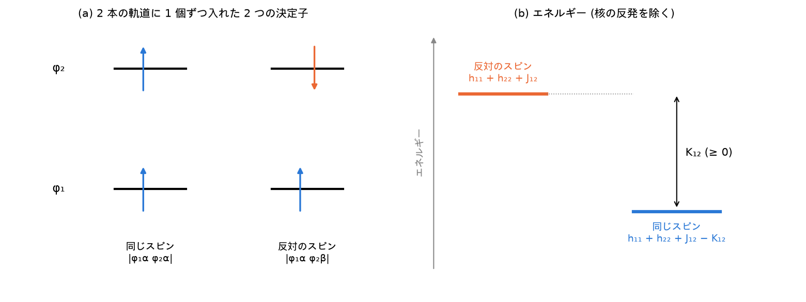

**図 12**　模式図。(a) 2 本の空間軌道 $\phi_1$、$\phi_2$ に 1 個ずつ電子を入れた 2 つの決定子。左はスピンが同じ、右はスピンが反対です。(b) 2 つの決定子のエネルギー。1 電子の部分 $h_{11} + h_{22}$ とクーロンの反発 $J_{12}$ は共通で、同じスピンの決定子（青）だけが、交換積分 $K_{12}$ の分だけ低くなります。

!!! note "交換は「スピンが同じ電子どうし」にだけ働く"
    交換積分の項は、スピン軌道のスピンが同じときにだけ現れます。スピンの積分 $\langle\alpha|\beta\rangle = 0$ が、反対のスピンどうしの交換の項を消すためです。反対のスピンの電子どうしの動きの関連（電子相関）は、決定子 1 個では表せません。これを取り入れる方法は[第 7 回](07-electron-correlation.md)以降で扱います。

なお、反対のスピンの決定子 $|\phi_1\alpha\;\phi_2\beta\rangle$ は、一重項でも三重項でもない状態です。
一重項と三重項のエネルギーは $h_{11} + h_{22} + J_{12} \pm K_{12}$ となることが知られていますが、その説明はスピンの回（[第 4 回](04-spin.md)）で行います。
決定子のエネルギーを、電子が何個あっても機械的に求める規則（Slater–Condon 則）は、[第 3 回](03-second-quantization.md)で導きます。

**ここまでで分かったこと**：決定子では、同じスピンの電子どうしが互いに避け合います（フェルミ孔）。その結果、エネルギーに交換積分 $-K$ の項が現れます。反対のスピンの電子どうしには、この効果はありません。

## まとめ

- 分子のハミルトニアンは、電子と核の運動エネルギー、電子と核の引力、電子どうしと核どうしの反発の 5 項でできています。原子単位では $\hbar = m_\mathrm e = e = 4\pi\varepsilon_0 = 1$ とし、1 $E_\mathrm h$ = 27.211 eV = 627.5 kcal/mol です。
- Born–Oppenheimer 近似では、核を止めて電子のシュレーディンガー方程式を解きます。量子化学の計算プログラムが解いているのはこの方程式です。電子・振動・回転のエネルギーが桁で違うことが、この近似の根拠です。
- 電子のエネルギーを核の位置の関数として見たものがポテンシャルエネルギー曲面で、構造・振動・反応はここから読み取ります。電子状態のエネルギーが近づくところでは、この近似が悪くなります。
- 電子 1 個の状態は、空間軌道とスピンの関数の積であるスピン軌道で表します。電子の波動関数は、2 つの電子を入れ替えると符号が変わらなければなりません（反対称性の要請）。
- スピン軌道を並べた Slater 決定子は、反対称性を自動的に満たし、同じスピン軌道に 2 個の電子を入れることを禁じます（パウリの排他原理）。決定子では、同じスピンの電子どうしが避け合い、エネルギーに交換積分 $-K$ が現れます。反対のスピンの電子どうしの相関は、決定子 1 個では表せません。

## 付録 A　核の方程式と非断熱結合の導出

### A.1 全体の波動関数の展開

分子全体のシュレーディンガー方程式 $\hat H\Psi = E\Psi$ から出発します。
ハミルトニアンを $\hat H = \hat T_\mathrm N + \hat H_\mathrm{el} + V_\mathrm{NN}$ と分けます。
$\hat T_\mathrm N = -\sum_A \nabla_A^2/(2M_A)$ です。
本文 3.2 節の記号で、$(\hat H_\mathrm{el} + V_\mathrm{NN})\psi_l = E_l(\mathbf R)\,\psi_l$ です（$E_l = E_l^\mathrm{el} + V_\mathrm{NN}$）。

各 $\mathbf R$ で、電子の状態 $\{\psi_k(\mathbf r;\mathbf R)\}$ は規格直交な完全系になるとします。
すると、全体の波動関数は、各 $\mathbf R$ で $\psi_l$ の一次結合に展開できます。
その係数は $\mathbf R$ によって変わるので、$\mathbf R$ の関数 $\chi_l(\mathbf R)$ と書きます。

$$
\Psi(\mathbf r,\mathbf R) = \sum_l \chi_l(\mathbf R)\,\psi_l(\mathbf r;\mathbf R) \tag{A.1}
$$

これを Born–Huang の展開と呼びます [Born 1954]。
ここまでは近似を使っていません。

### A.2 方程式に代入する

式 (A.1) を $\hat H\Psi = E\Psi$ に代入します。
$\hat H_\mathrm{el} + V_\mathrm{NN}$ は核の座標で微分しないので、$\chi_l$ をそのまま素通りし、$\psi_l$ にかかって $E_l$ を出します。

$$
\sum_l \Big[\hat T_\mathrm N\big(\chi_l\psi_l\big) + E_l\,\chi_l\psi_l\Big] = E\sum_l \chi_l\psi_l \tag{A.2}
$$

$\hat T_\mathrm N$ は核の座標での微分なので、$\chi_l$ と $\psi_l$ の両方にかかります。
積の 2 階微分の公式

$$
\nabla_A^2(\chi_l\psi_l) = (\nabla_A^2\chi_l)\,\psi_l + 2(\nabla_A\chi_l)\cdot(\nabla_A\psi_l) + \chi_l\,\nabla_A^2\psi_l \tag{A.3}
$$

を使い、両辺に $-1/(2M_A)$ をかけて $A$ について足すと、

$$
\hat T_\mathrm N(\chi_l\psi_l) = \psi_l\,(\hat T_\mathrm N\chi_l) - \sum_A\frac{1}{2M_A}\Big[2(\nabla_A\chi_l)\cdot(\nabla_A\psi_l) + \chi_l\,\nabla_A^2\psi_l\Big] \tag{A.4}
$$

です。

### A.3 電子の座標で積分する

式 (A.2) に式 (A.4) を入れ、左から $\psi_k^*$ をかけて、電子の座標 $\mathbf r$ で積分します。
以下、$\langle\cdots\rangle$ は電子の座標だけについての積分を表します。
$\chi_l$ と $\hat T_\mathrm N\chi_l$ は $\mathbf R$ だけの関数なので、積分の外に出せます。
項ごとに見ます。

- $\psi_l\,(\hat T_\mathrm N\chi_l)$ の項：$\langle\psi_k|\psi_l\rangle\,\hat T_\mathrm N\chi_l = \delta_{kl}\,\hat T_\mathrm N\chi_l$。
- $E_l\chi_l\psi_l$ の項：$\delta_{kl}\,E_l\chi_l$。
- 右辺：$E\,\delta_{kl}\,\chi_l$。
- 残りの 2 つの項：$-\sum_A\frac{1}{2M_A}\big[2\langle\psi_k|\nabla_A\psi_l\rangle\cdot\nabla_A\chi_l + \langle\psi_k|\nabla_A^2\psi_l\rangle\,\chi_l\big]$。

最後の項をまとめて、$\chi_l$ にかかる演算子として

$$
\Lambda_{kl} = -\sum_A \frac{1}{2M_A}\Big[\,2\,\langle\psi_k|\nabla_A\psi_l\rangle\cdot\nabla_A + \langle\psi_k|\nabla_A^2\psi_l\rangle\Big] \tag{A.5}
$$

と定義します（$\nabla_A$ は右の $\chi_l$ にかかります）。
$l$ について和をとると、$\delta_{kl}$ の付いた項は $l = k$ だけが残ります。
したがって、

$$
\left[\hat T_\mathrm N + E_k(\mathbf R)\right]\chi_k + \sum_l \Lambda_{kl}\,\chi_l = E\,\chi_k \tag{A.6}
$$

が得られます。
ここまでも近似を使っていません。
$k = 0, 1$ の 2 本を並べて行列の形に書いたものが、本文 3.3 節の 2 行 2 列の式です。

### A.4 Born–Oppenheimer 近似と断熱近似

$\Lambda_{kl}$ には $1/M_A$ がかかっていて、核が重いほど小さくなります。
$\Lambda_{kl}$ をすべて捨てると、式 (A.6) は異なる $k$ の間で結び付かなくなり、本文の核の方程式になります。
これが Born–Oppenheimer 近似です。
対角項 $\Lambda_{kk}$ だけを残す近似は、断熱近似と呼ばれ、$\Lambda_{kk}$ の寄与は断熱補正（diagonal Born–Oppenheimer correction）と呼ばれます。

### A.5 非対角の結合の大きさ

最後に、非対角の結合 $\langle\psi_k|\nabla_A\psi_l\rangle$（$k\neq l$）の大きさを見積もります。
出発点は、電子の方程式 $\hat H_\mathrm{el}\psi_l = E_l^\mathrm{el}\psi_l$ です。

**段階 1**：両辺を核の座標 $\mathbf R_A$ で微分します。左辺は積の微分で 2 つの項になります。

$$
(\nabla_A\hat H_\mathrm{el})\,\psi_l + \hat H_\mathrm{el}\,\nabla_A\psi_l = (\nabla_A E_l^\mathrm{el})\,\psi_l + E_l^\mathrm{el}\,\nabla_A\psi_l \tag{A.7}
$$

$\hat H_\mathrm{el}$ の中で $\mathbf R_A$ を含むのは $-\sum_i Z_A/r_{iA}$ だけなので、$\nabla_A\hat H_\mathrm{el}$ は、電子が核 $A$ に及ぼす力（の符号を変えたもの）を表す関数です。

**段階 2**：左から $\psi_k^*$（$k\neq l$）をかけて、電子の座標で積分します。右辺第 1 項は $\langle\psi_k|\psi_l\rangle = 0$ で消えます。

$$
\langle\psi_k|(\nabla_A\hat H_\mathrm{el})|\psi_l\rangle + \langle\psi_k|\hat H_\mathrm{el}|\nabla_A\psi_l\rangle = E_l^\mathrm{el}\,\langle\psi_k|\nabla_A\psi_l\rangle \tag{A.8}
$$

**段階 3**：左辺第 2 項で、$\hat H_\mathrm{el}$ がエルミートであることを使い、$\hat H_\mathrm{el}$ を左の $\psi_k$ にかけます。$\hat H_\mathrm{el}\psi_k = E_k^\mathrm{el}\psi_k$ なので、

$$
\langle\psi_k|\hat H_\mathrm{el}|\nabla_A\psi_l\rangle = E_k^\mathrm{el}\,\langle\psi_k|\nabla_A\psi_l\rangle \tag{A.9}
$$

です。

**段階 4**：式 (A.9) を式 (A.8) に入れ、$\langle\psi_k|\nabla_A\psi_l\rangle$ の項を右辺にまとめて、$E_l^\mathrm{el} - E_k^\mathrm{el}$ で割ります。

$$
\langle\psi_k|\nabla_A\psi_l\rangle = \frac{\langle\psi_k|(\nabla_A\hat H_\mathrm{el})|\psi_l\rangle}{E_l^\mathrm{el} - E_k^\mathrm{el}} \qquad (k\neq l) \tag{A.10}
$$

分子は、ふつう核の位置によってゆっくり変わる大きさの量です。
分母がエネルギー差なので、2 つの状態が近づくと結合が大きくなります。
本文の第 5 節は、この式にもとづいています。
なお、全エネルギー $E_k = E_k^\mathrm{el} + V_\mathrm{NN}$ では、どちらの状態にも同じ $V_\mathrm{NN}$ が足されます。そのため、分母は全エネルギーの差 $E_l - E_k$ と書いても同じです。

## 付録 B　電子・振動・回転のエネルギーの大きさの見積もり

本文 3.1 節の見積もりを、桁の大きさだけに注目して導きます。
分子の大きさ（結合の長さ）を $a$ とします。

**電子**：電子は大きさ $a$ の領域に閉じ込められています。
不確定性関係から運動量は $\hbar/a$ ほどなので、電子の運動エネルギーの大きさは

$$
\varepsilon_\mathrm{el} \sim \frac{\hbar^2}{m_\mathrm e a^2}
$$

です。
電子の励起のエネルギーも、この大きさです。

**振動**：結合を $a$ ほど伸ばすと、エネルギーは $\varepsilon_\mathrm{el}$ ほど変わります（結合が切れるため）。
したがって、谷底の曲率（ばね定数）の大きさは $k \sim \varepsilon_\mathrm{el}/a^2$ です。
質量 $M$ の核がこのばねで振動するときの振動の量子は、

$$
\hbar\omega = \hbar\sqrt{\frac{k}{M}} \sim \hbar\sqrt{\frac{\varepsilon_\mathrm{el}}{M a^2}}
$$

です。
ここに $\varepsilon_\mathrm{el} = \hbar^2/(m_\mathrm e a^2)$ を入れると、

$$
\hbar\omega \sim \hbar\sqrt{\frac{\hbar^2}{m_\mathrm e M a^4}} = \frac{\hbar^2}{m_\mathrm e a^2}\sqrt{\frac{m_\mathrm e}{M}} = \left(\frac{m_\mathrm e}{M}\right)^{1/2}\varepsilon_\mathrm{el}
$$

となります。

**回転**：分子の回転のエネルギーは、慣性モーメント $I \sim M a^2$ を使って $\hbar^2/(2I)$ ほどです。
したがって

$$
\varepsilon_\mathrm{rot} \sim \frac{\hbar^2}{M a^2} = \frac{\hbar^2}{m_\mathrm e a^2}\cdot\frac{m_\mathrm e}{M} = \frac{m_\mathrm e}{M}\,\varepsilon_\mathrm{el}
$$

です。
どちらも係数を無視した見積もりで、桁の大きさだけが意味をもちます。

## 付録 C　2 電子の決定子のエネルギーと 2 電子密度

### C.1 準備

スピン軌道を $\chi_1 = \phi_1\sigma_1$、$\chi_2 = \phi_2\sigma_2$ とします（$\sigma_1, \sigma_2$ は $\alpha$ か $\beta$）。
$\phi_1$ と $\phi_2$ は規格直交な実数の関数とします。
決定子は

$$
\Psi = \frac{1}{\sqrt 2}\big[\chi_1(1)\chi_2(2) - \chi_2(1)\chi_1(2)\big]
$$

です。$(1)$ は $\mathbf x_1$ の略です。
ハミルトニアンは、$\hat H = \hat h(1) + \hat h(2) + 1/r_{12}$ です。

計算で何度も使う事実を、先にまとめます。

- 電子 1 だけに作用する演算子の積分は、電子 1 の積分と電子 2 の積分の積に分かれます。
- スピン軌道の積分は、空間の積分とスピンの和の積に分かれます。$\hat h$ も $1/r_{12}$ もスピンには作用しないので、スピンの部分は $\langle\sigma|\tau\rangle$ の形の和になります。これは $\sigma = \tau$ なら 1、違えば 0 です。この値を $\delta_{\sigma\tau}$ と書きます。

### C.2 1 電子の部分

$\langle\Psi|\hat h(1)|\Psi\rangle$ を展開すると、4 つの項が出ます。

$$
\begin{aligned}
\langle\Psi|\hat h(1)|\Psi\rangle = \frac12\Big[
&\langle\chi_1|\hat h|\chi_1\rangle\langle\chi_2|\chi_2\rangle
- \langle\chi_1|\hat h|\chi_2\rangle\langle\chi_2|\chi_1\rangle\\
&- \langle\chi_2|\hat h|\chi_1\rangle\langle\chi_1|\chi_2\rangle
+ \langle\chi_2|\hat h|\chi_2\rangle\langle\chi_1|\chi_1\rangle\Big]
\end{aligned}
$$

各項で、左の因子が電子 1 の積分（$\hat h$ を含む）、右の因子が電子 2 の重なりの積分です。

- 第 1 項：$\langle\chi_2|\chi_2\rangle = 1$ なので $\langle\chi_1|\hat h|\chi_1\rangle$。空間とスピンに分けると $\langle\phi_1|\hat h|\phi_1\rangle\langle\sigma_1|\sigma_1\rangle = h_{11}$。
- 第 2 項、第 3 項：電子 2 の重なり $\langle\chi_2|\chi_1\rangle = \langle\phi_2|\phi_1\rangle\langle\sigma_2|\sigma_1\rangle$ は、空間の部分が 0 なので 0。
- 第 4 項：同じように $h_{22}$。

したがって $\langle\Psi|\hat h(1)|\Psi\rangle = \frac12(h_{11} + h_{22})$ です。
$\hat h(2)$ も、電子の番号を付け替えれば同じ値を与えるので、1 電子の部分の和は $h_{11} + h_{22}$ になります。

### C.3 2 電子の部分

$\langle\Psi|1/r_{12}|\Psi\rangle$ を展開すると、

$$
\langle\Psi|\frac{1}{r_{12}}|\Psi\rangle = \frac12\big[T_1 - T_2 - T_3 + T_4\big]
$$

です。
各項は次の積分です。

$$
\begin{aligned}
T_1 &= \iint \chi_1^*(1)\chi_2^*(2)\,\frac{1}{r_{12}}\,\chi_1(1)\chi_2(2)\,d\mathbf x_1 d\mathbf x_2, \\
T_2 &= \iint \chi_1^*(1)\chi_2^*(2)\,\frac{1}{r_{12}}\,\chi_2(1)\chi_1(2)\,d\mathbf x_1 d\mathbf x_2, \\
T_3 &= \iint \chi_2^*(1)\chi_1^*(2)\,\frac{1}{r_{12}}\,\chi_1(1)\chi_2(2)\,d\mathbf x_1 d\mathbf x_2, \\
T_4 &= \iint \chi_2^*(1)\chi_1^*(2)\,\frac{1}{r_{12}}\,\chi_2(1)\chi_1(2)\,d\mathbf x_1 d\mathbf x_2
\end{aligned}
$$

1 つずつ、空間の積分とスピンの和に分けます。

- $T_1$：電子 1 のスピンの和は $\langle\sigma_1|\sigma_1\rangle = 1$、電子 2 は $\langle\sigma_2|\sigma_2\rangle = 1$。空間の部分は $\iint \phi_1(\mathbf r_1)^2\,r_{12}^{-1}\,\phi_2(\mathbf r_2)^2 = (11|22) = J_{12}$。
- $T_4$：電子 1 と電子 2 の番号を付け替えると $T_1$ と同じ積分なので、$J_{12}$。
- $T_2$：電子 1 のスピンの和は $\langle\sigma_1|\sigma_2\rangle = \delta_{\sigma_1\sigma_2}$、電子 2 は $\langle\sigma_2|\sigma_1\rangle = \delta_{\sigma_1\sigma_2}$。空間の部分は $\iint \phi_1(\mathbf r_1)\phi_2(\mathbf r_1)\,r_{12}^{-1}\,\phi_2(\mathbf r_2)\phi_1(\mathbf r_2) = (12|21) = K_{12}$。したがって $T_2 = \delta_{\sigma_1\sigma_2}K_{12}$。
- $T_3$：$T_2$ の複素共役で、実数の軌道では同じ値 $\delta_{\sigma_1\sigma_2}K_{12}$。

まとめると、

$$
\langle\Psi|\frac{1}{r_{12}}|\Psi\rangle = \frac12\big[2J_{12} - 2\,\delta_{\sigma_1\sigma_2}K_{12}\big] = J_{12} - \delta_{\sigma_1\sigma_2}K_{12}
$$

となります。
C.2 の結果と足すと、同じスピン（$\delta = 1$）で本文の $E_{\uparrow\uparrow}$、反対のスピン（$\delta = 0$）で $E_{\uparrow\downarrow}$ が得られます。

### C.4 2 電子密度

$|\Psi|^2 = \Psi^*\Psi$ を展開すると、

$$
\begin{aligned}
|\Psi|^2 = \frac12\Big[&|\chi_1(1)|^2|\chi_2(2)|^2 + |\chi_2(1)|^2|\chi_1(2)|^2\\
&- \chi_1^*(1)\chi_2^*(2)\chi_2(1)\chi_1(2) - \chi_2^*(1)\chi_1^*(2)\chi_1(1)\chi_2(2)\Big]
\end{aligned}
$$

です。
これを $\omega_1$ と $\omega_2$ について足します。

- 第 1 項：$|\chi_1(1)|^2 = \phi_1(\mathbf r_1)^2\,\sigma_1(\omega_1)^2$ で、$\sum_{\omega_1}\sigma_1(\omega_1)^2 = 1$。電子 2 も同じなので、$\phi_1(\mathbf r_1)^2\phi_2(\mathbf r_2)^2$。
- 第 2 項：同じように $\phi_2(\mathbf r_1)^2\phi_1(\mathbf r_2)^2$。
- 第 3 項：スピンの部分は $\sum_{\omega_1}\sigma_1(\omega_1)\sigma_2(\omega_1)\cdot\sum_{\omega_2}\sigma_2(\omega_2)\sigma_1(\omega_2) = \delta_{\sigma_1\sigma_2}^2 = \delta_{\sigma_1\sigma_2}$。空間の部分は $\phi_1(\mathbf r_1)\phi_2(\mathbf r_2)\phi_2(\mathbf r_1)\phi_1(\mathbf r_2)$。
- 第 4 項：第 3 項と同じ値。

$a = \phi_1(\mathbf r_1)\phi_2(\mathbf r_2)$、$b = \phi_2(\mathbf r_1)\phi_1(\mathbf r_2)$ とおくと、

$$
P(\mathbf r_1, \mathbf r_2) = \frac12\big[a^2 + b^2 - 2\,\delta_{\sigma_1\sigma_2}\,ab\big]
$$

です。
同じスピン（$\delta = 1$）なら $\frac12(a^2 + b^2 - 2ab) = \frac12(a - b)^2$ で、本文の $P_{\uparrow\uparrow}$ です。
反対のスピン（$\delta = 0$）なら $\frac12(a^2 + b^2)$ で、本文の $P_{\uparrow\downarrow}$ です。

## 参考文献

- A. Szabo, N. S. Ostlund, "Modern Quantum Chemistry" (Dover, 1996). ISBN: 9780486691862
- M. Born, R. Oppenheimer, "Zur Quantentheorie der Molekeln", Ann. Phys. 389, 457 (1927). DOI: [10.1002/andp.19273892002](https://doi.org/10.1002/andp.19273892002)
- M. Born, K. Huang, "Dynamical Theory of Crystal Lattices" (Oxford University Press, 1954). ISBN: 9780198503699
- E. Tiesinga, P. J. Mohr, D. B. Newell, B. N. Taylor, "CODATA recommended values of the fundamental physical constants: 2018", Rev. Mod. Phys. 93, 025010 (2021). DOI: [10.1103/RevModPhys.93.025010](https://doi.org/10.1103/RevModPhys.93.025010)
- Q. Sun et al., "Recent developments in the PySCF program package", J. Chem. Phys. 153, 024109 (2020). DOI: [10.1063/5.0006074](https://doi.org/10.1063/5.0006074)
- T. H. Dunning Jr., "Gaussian basis sets for use in correlated molecular calculations. I. The atoms boron through neon and hydrogen", J. Chem. Phys. 90, 1007 (1989). DOI: [10.1063/1.456153](https://doi.org/10.1063/1.456153)
- W. Pauli, "Über den Zusammenhang des Abschlusses der Elektronengruppen im Atom mit der Komplexstruktur der Spektren", Z. Phys. 31, 765 (1925). DOI: [10.1007/BF02980631](https://doi.org/10.1007/BF02980631)
- W. Heisenberg, "Mehrkörperproblem und Resonanz in der Quantenmechanik", Z. Phys. 38, 411 (1926). DOI: [10.1007/BF01397160](https://doi.org/10.1007/BF01397160)
- P. A. M. Dirac, "On the theory of quantum mechanics", Proc. R. Soc. Lond. A 112, 661 (1926). DOI: [10.1098/rspa.1926.0133](https://doi.org/10.1098/rspa.1926.0133)
- J. C. Slater, "The Theory of Complex Spectra", Phys. Rev. 34, 1293 (1929). DOI: [10.1103/PhysRev.34.1293](https://doi.org/10.1103/PhysRev.34.1293)
