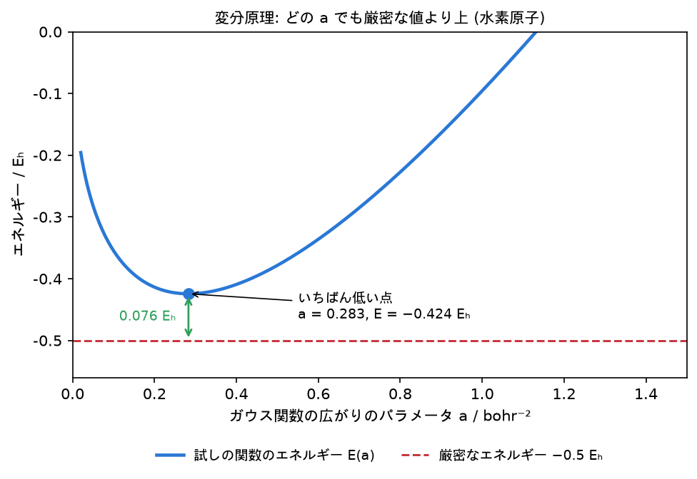
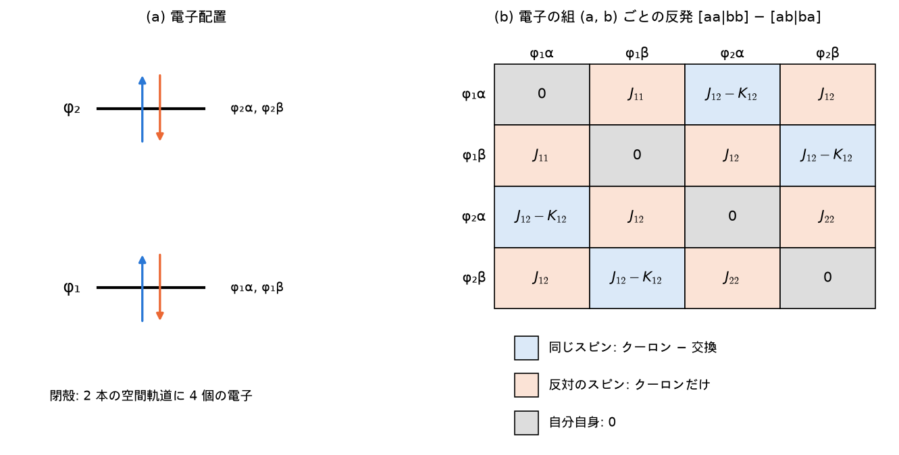
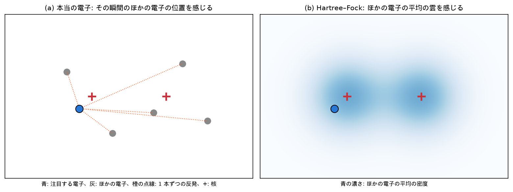
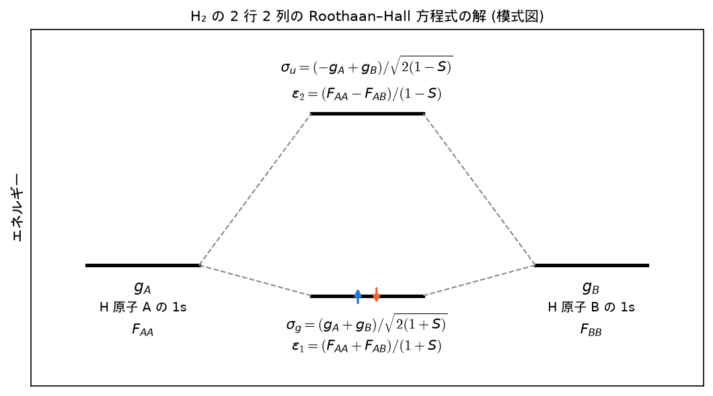
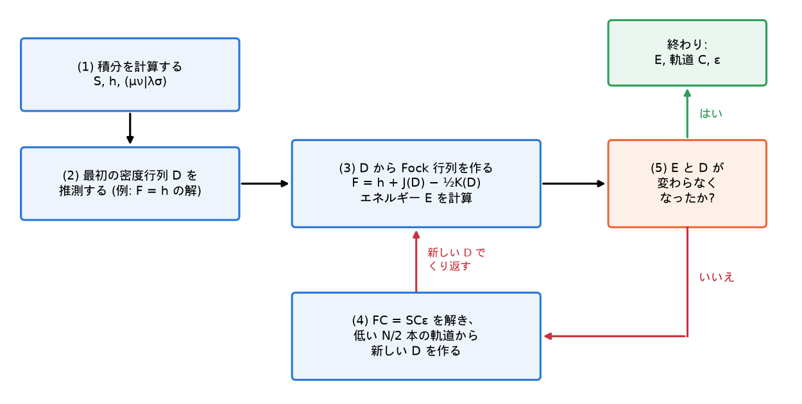
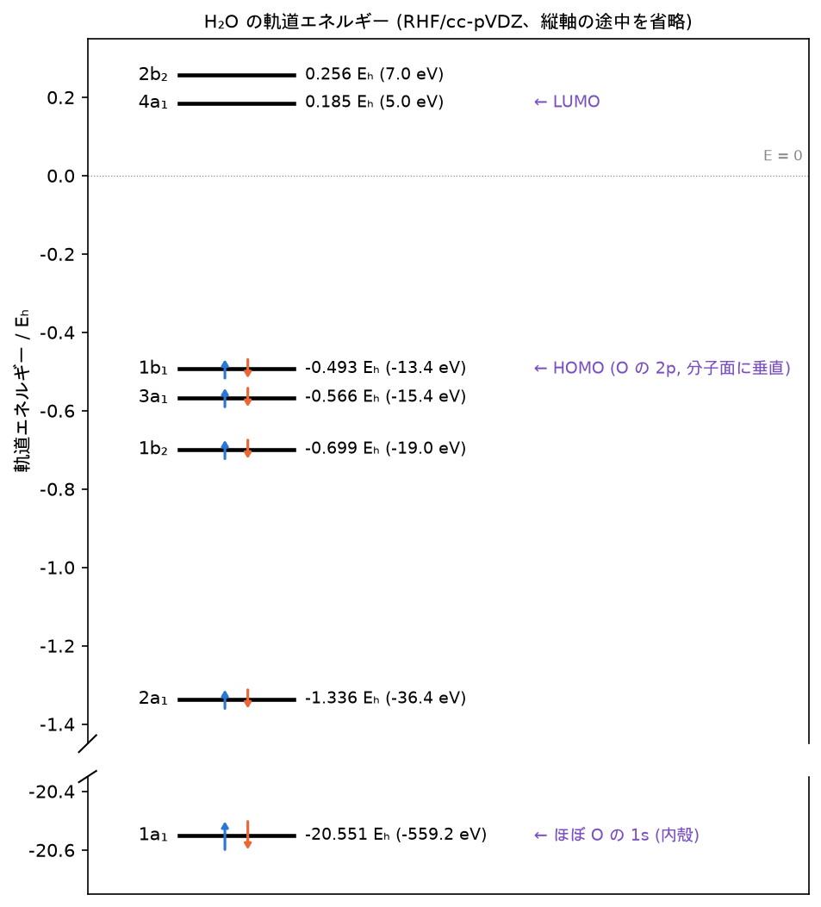
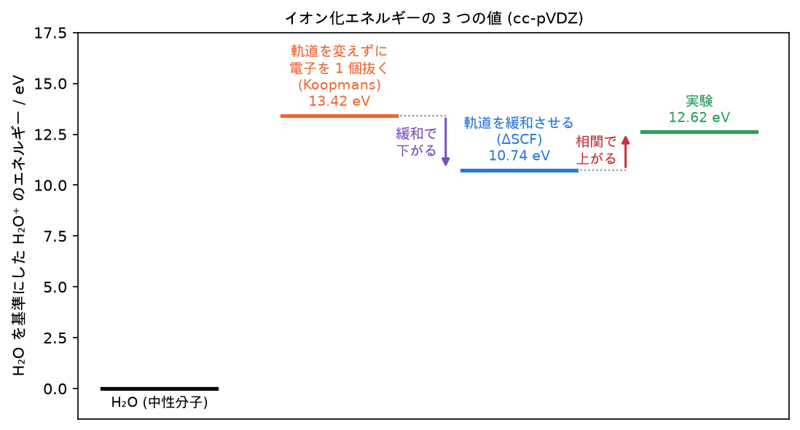

# 第 3 回　Hartree–Fock 法のおさらい

!!! abstract "この回の道筋"
    Hartree–Fock 法は、波動関数を 1 個の Slater 決定子に限ったときに、いちばんエネルギーが低くなる軌道を求める方法です。この回では、変分原理から Hartree–Fock 方程式を導き、基底関数で展開した Roothaan–Hall 方程式を、自己無撞着場（SCF）の繰り返しで解く手順を確かめます。最後に、軌道エネルギーの意味（Koopmans の定理）を、H₂O の計算で確かめます。

    | 節 | 内容 |
    |---|---|
    | 1 | 変分原理：エネルギーの上限 |
    | 2 | 決定子 1 個のエネルギー |
    | 3 | Fock 演算子：クーロンと交換 |
    | 4 | Roothaan–Hall 方程式 |
    | 5 | SCF の手順：H₂O を自分で解く |
    | 6 | 軌道エネルギーと Koopmans の定理 |

    **前に読んでおく回**：量子化学の理論 [第 1 回](01-born-oppenheimer.md)、[第 2 回](02-determinants.md)

!!! tip "物理的なイメージ"
    Hartree–Fock 法が求めているのは、各電子が「ほかのすべての電子がつくる平均の場」（平均のクーロン反発と、交換の効果）の中を独立に動くとしたときの、最もよい軌道です。ところが、その平均の場は、求めたい軌道そのものから決まります。そこで、軌道を仮に決める、平均の場をつくる、その中で軌道を解き直す、という手順を、軌道が変わらなくなるまで繰り返します。これが自己無撞着場（SCF）の考え方です。電子どうしが瞬間ごとに避け合う動きは、平均にならされて失われます。これが第 7 回で扱う電子相関です。

この回では原子単位（エネルギーはハートリー $E_\mathrm h$、1 $E_\mathrm h$ = 27.211 eV）を使います。2 電子積分は、化学者の表記 $(ij|kl)$（第 2 回 4.2 節）で書きます。

## 1. 変分原理：エネルギーの上限

### 1.1 変分原理とその理由

第 1 回で見たように、量子化学では電子のシュレーディンガー方程式 $\hat H\Psi = E\Psi$ を解きます。
電子が 2 個以上あると、これは厳密には解けません。
そこで、近似の波動関数を作り、その「よさ」をエネルギーで測ります。
その根拠になるのが変分原理です。

**変分原理**：規格化された任意の波動関数 $\tilde\Psi$ について、

$$
\tilde E = \langle\tilde\Psi|\hat H|\tilde\Psi\rangle \ \ge\ E_0
$$

が成り立ちます。$E_0$ は基底状態の厳密なエネルギーです。

理由を 1 段ずつ示します。
$\hat H$ の固有関数を $\Psi_n$（エネルギー $E_0 \le E_1 \le E_2 \le \cdots$）とします。
固有関数は規格直交な完全系をなすので、$\tilde\Psi$ を

$$
\tilde\Psi = \sum_n c_n\Psi_n
$$

と展開できます。
$\tilde\Psi$ が規格化されているので、$\langle\tilde\Psi|\tilde\Psi\rangle = \sum_{m,n}c_m^*c_n\langle\Psi_m|\Psi_n\rangle = \sum_n|c_n|^2 = 1$ です。
次に、エネルギーを計算します。$\hat H\Psi_n = E_n\Psi_n$ を使い、$\langle\Psi_m|\Psi_n\rangle = \delta_{mn}$ で $m = n$ の項だけを残すと、

$$
\tilde E = \sum_{m,n}c_m^*c_n\langle\Psi_m|\hat H|\Psi_n\rangle = \sum_{m,n}c_m^*c_n E_n\delta_{mn} = \sum_n|c_n|^2E_n
$$

です。
最後に、すべての $E_n$ を、それ以下の $E_0$ で置き換えると、

$$
\tilde E = \sum_n|c_n|^2E_n \ \ge\ \sum_n|c_n|^2E_0 = E_0
$$

となります。
つまり $\tilde E$ は、各固有状態のエネルギーを重み $|c_n|^2$ で平均したものです。
平均は、いちばん小さい $E_0$ より小さくなれません。

**2 状態の例**：$\tilde\Psi = \cos\theta\,\Psi_0 + \sin\theta\,\Psi_1$ とすると、

$$
\tilde E = \cos^2\theta\,E_0 + \sin^2\theta\,E_1 = E_0 + \sin^2\theta\,(E_1 - E_0) \ \ge\ E_0
$$

です。
励起状態が混ざる割合 $\sin^2\theta$ に比例して、エネルギーが上がります。
等号は、$\theta = 0$（厳密な基底状態そのもの）のときだけ成り立ちます。

### 1.2 パラメータを調節する

したがって、波動関数にいくつかの調節できる部分（パラメータ）を持たせ、$\tilde E$ がいちばん低くなるように選べば、その範囲で最もよい近似が得られます。

水素原子で試してみます。
厳密な基底状態は $e^{-r}$ の形で、エネルギーは $-0.5\,E_\mathrm h$ です。
これを、わざと形の違うガウス関数 $\tilde\psi = (2a/\pi)^{3/4}e^{-ar^2}$ で近似します。
$a$ が、関数の広がりを決めるパラメータです。
付録 A で計算するように、エネルギーは

$$
\tilde E(a) = \frac{3a}{2} - 2\sqrt{\frac{2a}{\pi}}
$$

です。
第 1 項が運動エネルギー、第 2 項が核からの引力です。
$d\tilde E/da = 0$ から、いちばん低くなるのは $a = 8/(9\pi) = 0.283$ のときで、$\tilde E = -4/(3\pi) = -0.424\,E_\mathrm h$ です。



**図 1**　水素原子をガウス関数で近似したときのエネルギー $\tilde E(a)$（青）。$a$ が小さい（関数が広がりすぎる）と核からの引力が弱まり、$a$ が大きい（狭すぎる）と運動エネルギーが大きくなります。いちばん低い点でも、厳密なエネルギー（赤の破線）より $0.076\,E_\mathrm h$ 高いままです。どの $a$ でも赤の破線の下には来ないことを見てください。

Hartree–Fock 法では、波動関数を 1 個の Slater 決定子に限り、その中の軌道の形をパラメータとして調節します。

**ここまでで分かったこと**：近似の波動関数のエネルギーは、厳密なエネルギーより必ず高くなります。エネルギーが低いほど、よい近似です。

## 2. 決定子 1 個のエネルギー

### 2.1 スピン軌道で書いた式

$N$ 個のスピン軌道 $\chi_a$（$a = 1, \dots, N$）を占有した決定子のエネルギーは、次の式で書けます（核の反発を除く）。

$$
E = \sum_{a}^{N} h_{aa} + \frac12\sum_{a}^{N}\sum_{b}^{N}\Big([aa|bb] - [ab|ba]\Big)
$$

$h_{aa} = \langle\chi_a|\hat h|\chi_a\rangle$ は、電子 1 個の運動エネルギーと核からの引力（$\hat h = -\frac12\nabla^2 - \sum_A Z_A/r_A$）です。
$[ab|cd]$ は、スピン軌道についての化学者の表記の 2 電子積分です（空間とスピンの両方について積分します）。
第 2 回で求めた 2 電子の場合の式を、$N$ 電子に広げたものです。
すべての段階は付録 B で導きます。

式の意味は次のとおりです。

- 第 1 項：各電子が、自分の軌道で運動エネルギーと核からの引力をもちます。
- 第 2 項：電子の組 $(a, b)$ ごとに、クーロンの反発 $[aa|bb]$ から交換 $[ab|ba]$ を引いたものを足します。$a, b$ の両方について和をとると、同じ組を $(a, b)$ と $(b, a)$ で 2 回数えるので、$\frac12$ をかけます。$a = b$ の項は $[aa|aa] - [aa|aa] = 0$ で、自分自身との反発は入りません。

### 2.2 閉殻の場合

以下では、閉殻の分子を考えます。
閉殻とは、$N$ 個の電子が $N/2$ 個の空間軌道 $\phi_1, \dots, \phi_{N/2}$ に、$\alpha$ と $\beta$ の対で入っている状態です。
各空間軌道に同じ形の $\alpha$ と $\beta$ の軌道を使う方法を、制限 Hartree–Fock（restricted Hartree–Fock、RHF）と呼びます。
空間軌道は実数で、規格直交であるとします。

スピン軌道の式を、空間軌道の積分で書き直します。
スピン軌道 $a = \phi_i\sigma$、$b = \phi_j\tau$ について、第 2 回の付録 A と同じようにスピンの和をとると、

$$
[aa|bb] = (ii|jj) = J_{ij},\qquad [ab|ba] = (ij|ji)\,\delta_{\sigma\tau} = K_{ij}\,\delta_{\sigma\tau}
$$

です。
$J_{ij}$ はクーロン積分、$K_{ij}$ は交換積分です（第 2 回 4.2 節）。
クーロンはスピンによらず、交換は同じスピン（$\sigma = \tau$）の組にだけ現れます。

**4 電子の例**：2 本の空間軌道 $\phi_1$、$\phi_2$ に 4 個の電子が入った閉殻を考えます（図 2 (a)）。
スピン軌道は $\phi_1\alpha$、$\phi_1\beta$、$\phi_2\alpha$、$\phi_2\beta$ の 4 本です。
組 $(a, b)$ ごとの $[aa|bb] - [ab|ba]$ を、4 行 4 列の表にすると次のようになります。

$$
\begin{array}{c|cccc}
 & \phi_1\alpha & \phi_1\beta & \phi_2\alpha & \phi_2\beta \\ \hline
\phi_1\alpha & 0 & J_{11} & J_{12} - K_{12} & J_{12} \\
\phi_1\beta & J_{11} & 0 & J_{12} & J_{12} - K_{12} \\
\phi_2\alpha & J_{12} - K_{12} & J_{12} & 0 & J_{22} \\
\phi_2\beta & J_{12} & J_{12} - K_{12} & J_{22} & 0
\end{array}
$$

対角は自分自身なので 0 です。
$\phi_1\alpha$ と $\phi_1\beta$ の組は、同じ空間軌道に入った反対のスピンの電子の反発 $J_{11}$ です（交換はスピンが違うので 0）。
16 個の要素をすべて足すと $2J_{11} + 2J_{22} + 8J_{12} - 4K_{12}$ です。
$\frac12$ をかけると、2 電子の部分は

$$
J_{11} + J_{22} + 4J_{12} - 2K_{12}
$$

になります。



**図 2**　(a) 2 本の空間軌道に 4 個の電子が入った閉殻。(b) 上の 4 行 4 列の表を色分けしたもの。青のマスは同じスピンの組でクーロンから交換を引いたもの、橙のマスは反対のスピンの組でクーロンだけ、灰色の対角は自分自身で 0 です。交換（青）は、スピンが同じ組にしか現れないことを見てください。

一般の閉殻では、スピン軌道の和を、空間軌道 $i, j$ とスピン $\sigma, \tau$ の和に分けます。
1 電子の項は、各空間軌道に 2 個の電子が入るので $2\sum_i h_{ii}$ です。
2 電子の項は、空間軌道の組 $(i, j)$ ごとに、スピンの組み合わせが $\alpha\alpha$、$\alpha\beta$、$\beta\alpha$、$\beta\beta$ の 4 通りあります。
4 通りすべてにクーロン $J_{ij}$ があり、交換 $K_{ij}$ は同じスピンの 2 通りだけです。
したがって 4 通りの和は $4J_{ij} - 2K_{ij}$ で、$\frac12$ をかけて $2J_{ij} - K_{ij}$ になります。
まとめると、閉殻の決定子 $\Phi_0$ のエネルギーは次のようになります（核の反発を除く）。

$$
E_\mathrm{HF} = \langle\Phi_0|\hat H_\mathrm{el}|\Phi_0\rangle
= 2\sum_{i}^{N/2} h_{ii} + \sum_{i}^{N/2}\sum_{j}^{N/2}\big(2J_{ij} - K_{ij}\big)
$$

4 電子の例で確かめると、$\sum_{ij}(2J_{ij} - K_{ij}) = (2J_{11} - K_{11}) + (2J_{22} - K_{22}) + 2(2J_{12} - K_{12})$ です。
$K_{ii} = (ii|ii) = J_{ii}$ なので、これは $J_{11} + J_{22} + 4J_{12} - 2K_{12}$ となり、表から求めた値と一致します。
$i = j$ の項 $2J_{ii} - K_{ii} = J_{ii}$ は、同じ軌道に入った $\alpha$ と $\beta$ の電子の反発です。

**ここまでで分かったこと**：閉殻の決定子のエネルギーは、1 電子の積分 $h_{ii}$ と、クーロン積分 $J_{ij}$・交換積分 $K_{ij}$ で書けます。交換は、同じスピンの電子の組にだけ現れます。

## 3. Fock 演算子：クーロンと交換

### 3.1 Hartree–Fock 方程式

前の節の $E_\mathrm{HF}$ を、軌道が規格直交であるという条件のもとで最小にします。
すべての段階は付録 C で導きますが、最小になる軌道は次の方程式を満たします。

$$
\hat f\,\phi_i = \varepsilon_i\,\phi_i
$$

これを Hartree–Fock 方程式と呼びます。
$\hat f$ は Fock 演算子（Fock operator）、$\varepsilon_i$ は軌道エネルギー（orbital energy）です。
閉殻の場合、Fock 演算子は次の形です。

$$
\hat f = \hat h + \sum_{j}^{N/2}\big(2\hat J_j - \hat K_j\big)
$$

$\hat J_j$ はクーロン演算子、$\hat K_j$ は交換演算子で、任意の関数 $\phi$ に次のように作用します。

$$
\hat J_j\,\phi(\mathbf r_1) = \left[\int \frac{|\phi_j(\mathbf r_2)|^2}{r_{12}}\,d\mathbf r_2\right]\phi(\mathbf r_1)
$$

$$
\hat K_j\,\phi(\mathbf r_1) = \left[\int \frac{\phi_j^*(\mathbf r_2)\,\phi(\mathbf r_2)}{r_{12}}\,d\mathbf r_2\right]\phi_j(\mathbf r_1)
$$

2 つの式の違いは、角括弧の中の積分に、作用する相手 $\phi$ が入っているかどうかです。
$\hat J_j$ では、角括弧の中は $\phi_j$ だけで決まる $\mathbf r_1$ の関数で、それを $\phi$ にかけるだけです。
$\hat K_j$ では、$\phi$ が積分の中に入り、外には $\phi_j$ が出てきます。

これらの期待値は、第 2 節の積分になります。
$\langle\phi_i|\hat J_j|\phi_i\rangle = (ii|jj) = J_{ij}$、$\langle\phi_i|\hat K_j|\phi_i\rangle = (ij|ji) = K_{ij}$ です。

### 3.2 方程式の意味：平均場

クーロン演算子 $\hat J_j$ の角括弧の中は、軌道 $\phi_j$ の電子の雲 $|\phi_j|^2$ が、点 $\mathbf r_1$ につくる静電ポテンシャルです。
各空間軌道には $\alpha$ と $\beta$ の 2 個の電子が入っているので、$\sum_j 2\hat J_j$ は、すべての電子の雲がつくる平均の静電ポテンシャルを表します。
Hartree–Fock 法では、各電子が、ほかの電子の瞬間の位置ではなく、この平均のポテンシャルの中を動くと考えます（図 3）。
このため、Hartree–Fock 法は平均場（mean-field）の方法と呼ばれます。



**図 3**　模式図。(a) 本当の電子（青）は、その瞬間のほかの電子（灰）の位置から、1 本ずつ反発を受けます。ほかの電子が近くに来れば、それを避けるように動きます。(b) Hartree–Fock 法では、ほかの電子を、平均の密度の雲（青の濃淡）にならして考えます。電子は、この動かない雲がつくる滑らかなポテンシャルの中を動きます。(a) の「瞬間ごとに避け合う動き」が失われることが、第 7 回の電子相関の出発点です。

交換演算子 $\hat K_j$ は、作用する関数 $\phi$ を積分の中に入れてしまうので、ある点でのポテンシャルの値として書けません（非局所的な演算子です）。
これは第 2 回で見た交換の効果、つまり同じスピンの電子が避け合う効果を表します。
$\hat K_j$ の係数が $2\hat J_j$ の半分なのは、軌道 $\phi_j$ の 2 個の電子のうち、交換が働くのは同じスピンの 1 個だけだからです（図 2 と同じ数え方です）。

和の中には $j = i$ の項も含まれます。
これは、電子が自分自身の雲と反発しているように見えます。
しかし、$\hat K_i$ を $\phi_i$ 自身に作用させると、定義の $\phi$ に $\phi_i$ を入れて

$$
\hat K_i\,\phi_i(\mathbf r_1) = \left[\int \frac{\phi_i^*(\mathbf r_2)\,\phi_i(\mathbf r_2)}{r_{12}}\,d\mathbf r_2\right]\phi_i(\mathbf r_1) = \hat J_i\,\phi_i(\mathbf r_1)
$$

となります。
したがって、$j = i$ の項は $(2\hat J_i - \hat K_i)\phi_i = \hat J_i\phi_i$ で、残るのは同じ軌道に入った反対のスピンの電子 1 個分の反発だけです。
同じスピンの自分自身との反発は、交換の項でちょうど打ち消されます。
Hartree–Fock 法には、このような自己相互作用の誤差がありません。

### 3.3 自己無撞着場

Fock 演算子は、占有軌道 $\phi_j$ を使って作られています。
つまり、方程式の答え（軌道）が、方程式そのものに入っています。
このため、Hartree–Fock 方程式は一度では解けず、次の繰り返しで解きます。

1. 軌道を推測する。
2. その軌道で Fock 演算子（平均の場）を作る。
3. Hartree–Fock 方程式を解いて、新しい軌道を得る。
4. 軌道が変わらなくなるまで 2〜3 を繰り返す。

軌道がつくる場と、その場の中の軌道が一致した状態を、自己無撞着場（self-consistent field、SCF）と呼びます。
この考え方は Hartree が 1928 年に導入し [Hartree 1928]、Fock と Slater が 1930 年に反対称化した波動関数（決定子）に広げました [Fock 1930; Slater 1930]。
5 節で、この繰り返しを行列の言葉で書き、実際に計算します。

**ここまでで分かったこと**：Hartree–Fock の軌道は、Fock 演算子の固有関数です。Fock 演算子は、ほかの電子の平均の雲による反発と交換を表し、占有軌道に依存するので、繰り返し計算（SCF）で解きます。

## 4. Roothaan–Hall 方程式

### 4.1 基底関数で展開する

Hartree–Fock 方程式は微分と積分を含む方程式で、分子ではそのままでは解けません。
そこで、軌道を、あらかじめ決めた $K$ 個の関数 $g_\mu(\mathbf r)$ の一次結合で表します。

$$
\phi_i(\mathbf r) = \sum_{\nu=1}^{K} C_{\nu i}\,g_\nu(\mathbf r)
$$

$g_\mu$ を基底関数（basis function）と呼び、ふつうは各原子を中心とする原子軌道のような関数を使います（第 6 回で詳しく扱います）。
これは、学部で学んだ LCAO（原子軌道の一次結合）の考え方そのものです。
未知のものは、関数 $\phi_i$ から、係数 $C_{\nu i}$ の組に変わりました。

この展開を Hartree–Fock 方程式 $\hat f\phi_i = \varepsilon_i\phi_i$ に代入すると、

$$
\sum_{\nu} C_{\nu i}\,\hat f g_\nu = \varepsilon_i\sum_{\nu} C_{\nu i}\,g_\nu
$$

です。
両辺に左から $g_\mu^*$ をかけて、$\mathbf r$ で積分します。
$F_{\mu\nu} = \int g_\mu^*\,\hat f\,g_\nu\,d\mathbf r$、$S_{\mu\nu} = \int g_\mu^*\,g_\nu\,d\mathbf r$ と書くと、

$$
\sum_{\nu} F_{\mu\nu}C_{\nu i} = \varepsilon_i\sum_{\nu} S_{\mu\nu}C_{\nu i}\qquad(\mu = 1, \dots, K)
$$

になります。
左辺は行列 $\mathbf F$ と、$\mathbf C$ の第 $i$ 列の積の第 $\mu$ 成分、右辺は $\mathbf S$ と第 $i$ 列の積に $\varepsilon_i$ をかけたものです。
すべての軌道 $i$ の式を、列として横に並べると、

$$
\mathbf F\mathbf C = \mathbf S\mathbf C\boldsymbol\varepsilon
$$

になります。
これを Roothaan–Hall 方程式と呼びます。
1951 年に Roothaan と Hall がそれぞれ示しました [Roothaan 1951; Hall 1951]。
各記号は $K\times K$ の行列です。

- $\mathbf S$：重なり行列。$S_{\mu\nu} = \int g_\mu^*\,g_\nu\,d\mathbf r$。基底関数は互いに直交しないので、単位行列になりません。
- $\mathbf C$：各列が 1 つの軌道の係数。
- $\boldsymbol\varepsilon$：軌道エネルギーを並べた対角行列。
- $\mathbf F$：Fock 行列。$F_{\mu\nu} = \int g_\mu^*\,\hat f\,g_\nu\,d\mathbf r$。

$\mathbf S$ が単位行列なら、ふつうの固有値問題 $\mathbf F\mathbf C = \mathbf C\boldsymbol\varepsilon$ です。
単位行列でないときは、$\mathbf C = \mathbf S^{-1/2}\mathbf C'$ とおいて両辺に左から $\mathbf S^{-1/2}$ をかけると、$(\mathbf S^{-1/2}\mathbf F\mathbf S^{-1/2})\mathbf C' = \mathbf C'\boldsymbol\varepsilon$ という、ふつうの固有値問題に直せます。
このような形の問題を、一般化固有値問題と呼びます。

### 4.2 2 行 2 列の例：H₂

いちばん小さい例として、H₂ の各水素原子に 1s の基底関数を 1 個ずつ置いた場合（$K = 2$）を書き出します。
原子 A の基底関数を $g_A$、原子 B の基底関数を $g_B$ とします。
2 つの原子は同じなので、対角の要素は等しくなります。
$F_{AA} = F_{BB}$、$S_{AA} = S_{BB} = 1$ とし、非対角の要素を $F_{AB}$、$S_{AB} = S$ と書きます。
Roothaan–Hall 方程式は

$$
\begin{pmatrix} F_{AA} & F_{AB}\\ F_{AB} & F_{AA}\end{pmatrix}
\begin{pmatrix} C_{A1} & C_{A2}\\ C_{B1} & C_{B2}\end{pmatrix}
=
\begin{pmatrix} 1 & S\\ S & 1\end{pmatrix}
\begin{pmatrix} C_{A1} & C_{A2}\\ C_{B1} & C_{B2}\end{pmatrix}
\begin{pmatrix} \varepsilon_1 & 0\\ 0 & \varepsilon_2\end{pmatrix}
$$

です。
1 列目（軌道 1）だけを取り出すと、$\begin{pmatrix} F_{AA} - \varepsilon_1 & F_{AB} - \varepsilon_1 S\\ F_{AB} - \varepsilon_1 S & F_{AA} - \varepsilon_1\end{pmatrix}\begin{pmatrix} C_{A1}\\ C_{B1}\end{pmatrix} = 0$ です。
係数が 0 でない解をもつには、この行列の行列式が 0 でなければなりません。

$$
(F_{AA} - \varepsilon)^2 - (F_{AB} - \varepsilon S)^2 = 0
$$

2 乗の差なので、$F_{AA} - \varepsilon = \pm(F_{AB} - \varepsilon S)$ です。
それぞれを $\varepsilon$ について解くと、

$$
\varepsilon_1 = \frac{F_{AA} + F_{AB}}{1 + S},\qquad
\varepsilon_2 = \frac{F_{AA} - F_{AB}}{1 - S}
$$

が得られます。
$\varepsilon_1$ を元の式に入れると $C_{A1} = C_{B1}$（同じ符号で足し合わせる結合性の軌道 $\sigma_g$）、$\varepsilon_2$ では $C_{A2} = -C_{B2}$（反結合性の軌道 $\sigma_u$）です。
規格化 $\langle\phi_1|\phi_1\rangle = C_{A1}^2 + C_{B1}^2 + 2C_{A1}C_{B1}S = 2C_{A1}^2(1 + S) = 1$ から $C_{A1} = 1/\sqrt{2(1+S)}$、同じように $C_{A2} = 1/\sqrt{2(1-S)}$ です。
これは、学部で学んだ Hückel 法の 2 原子の計算と同じ形です。
違いは、$F_{AA}$ と $F_{AB}$ が経験的なパラメータではなく、次の 4.3 節の式で電子の分布から計算されることです。

図 4 に、この解をエネルギー準位図で表します。



**図 4**　模式図。H₂ の 2 行 2 列の Roothaan–Hall 方程式の解。左右が 2 つの基底関数（各原子の 1s、Fock 行列の対角要素 $F_{AA}$）、中央が分子軌道です。結合性の $\sigma_g$（$\varepsilon_1$）に 2 個の電子（$\alpha$ と $\beta$）が入り、反結合性の $\sigma_u$（$\varepsilon_2$）は空のままです。$F_{AB} - SF_{AA} < 0$（結合性の軌道が下がる、ふつうの場合）のとき、$\varepsilon_1 - F_{AA} = (F_{AB} - SF_{AA})/(1+S)$、$\varepsilon_2 - F_{AA} = -(F_{AB} - SF_{AA})/(1-S)$ なので、分母の違いから、$\sigma_u$ の上がり幅は $\sigma_g$ の下がり幅より大きくなります。

### 4.3 Fock 行列を密度行列で書く

基底関数を実数とすると、閉殻の Fock 行列は次のように書けます。
すべての段階は付録 D で導きます。

$$
F_{\mu\nu} = h_{\mu\nu} + \sum_{\lambda\sigma} D_{\lambda\sigma}\Big[(\mu\nu|\lambda\sigma) - \tfrac12(\mu\lambda|\nu\sigma)\Big],
\qquad
D_{\lambda\sigma} = 2\sum_{i}^{N/2} C_{\lambda i}C_{\sigma i}
$$

$D_{\lambda\sigma}$ は密度行列です。
電子密度 $\rho(\mathbf r) = 2\sum_i\phi_i(\mathbf r)^2$ に軌道の展開を入れると、

$$
\rho(\mathbf r) = 2\sum_i\sum_{\lambda\sigma}C_{\lambda i}C_{\sigma i}\,g_\lambda(\mathbf r)g_\sigma(\mathbf r) = \sum_{\lambda\sigma}D_{\lambda\sigma}\,g_\lambda(\mathbf r)g_\sigma(\mathbf r)
$$

なので、$\mathbf D$ は電子密度を基底関数で表す係数の表です。
$\rho$ を全空間で積分すると電子の数になるので、$\sum_{\lambda\sigma}D_{\lambda\sigma}S_{\lambda\sigma} = N$ です。
4.2 節の H₂ で確かめます。占有軌道は $\sigma_g$ の 1 本で、$C_{A1} = C_{B1} = 1/\sqrt{2(1+S)}$ なので、

$$
\mathbf D = 2\begin{pmatrix} C_{A1}C_{A1} & C_{A1}C_{B1}\\ C_{B1}C_{A1} & C_{B1}C_{B1}\end{pmatrix} = \frac{1}{1+S}\begin{pmatrix} 1 & 1\\ 1 & 1\end{pmatrix}
$$

です。
$\sum_{\lambda\sigma}D_{\lambda\sigma}S_{\lambda\sigma} = \frac{1}{1+S}(1 + S + S + 1) = 2$ となり、確かに電子 2 個分になります。

$(\mu\nu|\lambda\sigma)$ は、基底関数についての電子反発積分（化学者の表記）です。
括弧の第 1 項がクーロン（3.1 節の $2\hat J_j$）、第 2 項が交換（$\hat K_j$）の寄与です。
エネルギーは、同じ記号で次のように書けます（付録 D）。

$$
E_\mathrm{HF} = \frac12\sum_{\mu\nu}D_{\mu\nu}\big(h_{\mu\nu} + F_{\mu\nu}\big) + V_\mathrm{NN}
$$

$V_\mathrm{NN}$ は核どうしの反発です。
基底関数を有限にしたので、問題は「行列を作り、一般化固有値問題を解く」ことに変わりました。
得られる $K$ 個の軌道のうち、エネルギーの低い $N/2$ 個を占有軌道、残りを仮想軌道（空軌道）と呼びます。

**ここまでで分かったこと**：軌道を基底関数で展開すると、Hartree–Fock 方程式は行列の方程式 $\mathbf F\mathbf C = \mathbf S\mathbf C\boldsymbol\varepsilon$ になります。$\mathbf F$ は密度行列 $\mathbf D$ を通して $\mathbf C$ に依存します。

## 5. SCF の手順：H₂O を自分で解く

第 3.3 節の繰り返しを、行列の言葉で書き直すと次のようになります（図 5）。

1. 積分 $\mathbf S$、$\mathbf h$、$(\mu\nu|\lambda\sigma)$ を計算する。これらは軌道によらないので、最初に 1 回だけ計算します。
2. 最初の密度行列 $\mathbf D$ を推測する。
3. $\mathbf D$ から Fock 行列 $\mathbf F$ を作り、エネルギーを計算する。
4. $\mathbf F\mathbf C = \mathbf S\mathbf C\boldsymbol\varepsilon$ を解き、エネルギーの低い $N/2$ 個の軌道から新しい $\mathbf D$ を作る。
5. エネルギー（と $\mathbf D$）が変わらなくなるまで 3〜4 を繰り返す。



**図 5**　SCF の手順。(3)「密度から平均の場（Fock 行列）を作る」と (4)「その場の中の軌道を解いて新しい密度を作る」を、赤の矢印のように、(5) で変化がなくなったと判定されるまで繰り返します。

この手順を、H₂O について numpy で書いてみます。
構造は O–H 距離 0.958 Å、H–O–H 角 104.5° とし、基底関数は cc-pVDZ [Dunning 1989] を使います。
積分の計算だけを PySCF [Sun 2020] に任せます。
最初の推測には、電子間の反発を無視した $\mathbf F = \mathbf h$ の解を使います。
コードの `J` と `K` は、4.3 節の式の括弧の第 1 項と第 2 項を、$\mathbf D$ と足し合わせたものです。

```python
import numpy as np
import scipy.linalg
from pyscf import gto, scf

r, th = 0.958, np.deg2rad(104.5)   # O–H 距離（Å）と H–O–H 角
geom = [["O", (0, 0, 0)],
        ["H", (0,  r*np.sin(th/2), r*np.cos(th/2))],
        ["H", (0, -r*np.sin(th/2), r*np.cos(th/2))]]
mol = gto.M(atom=geom, basis="cc-pvdz", unit="Angstrom", verbose=0)

S = mol.intor("int1e_ovlp")                              # 重なり行列 S
Hcore = mol.intor("int1e_kin") + mol.intor("int1e_nuc")  # 1 電子の部分 h
eri = mol.intor("int2e")                                 # (μν|λσ)（化学者の表記）
nocc = mol.nelectron // 2
Enuc = mol.energy_nuc()
print("基底関数の数 K =", mol.nao, "  占有軌道の数 =", nocc)

def density(F):
    eps, C = scipy.linalg.eigh(F, S)        # FC = SCε を解く
    return 2 * C[:, :nocc] @ C[:, :nocc].T

D = density(Hcore)                          # 最初の推測：電子間反発を無視
E_old = 0.0
for it in range(1, 100):
    J = np.einsum("pqrs,rs->pq", eri, D)
    K = np.einsum("prqs,rs->pq", eri, D)
    F = Hcore + J - 0.5 * K                 # Fock 行列
    E = 0.5 * np.sum(D * (Hcore + F)) + Enuc
    if it <= 5 or it % 5 == 0 or abs(E - E_old) < 1e-10:
        print(f"{it:3d}  E = {E:.10f}  ΔE = {E-E_old:.1e}")
    if abs(E - E_old) < 1e-10:
        break
    E_old = E
    D = density(F)

mf = scf.RHF(mol).run()
print(f"自作の SCF  : {E:.8f} Eh")
print(f"PySCF の RHF: {mf.e_tot:.8f} Eh（{mf.cycles} 回で収束）")
```

出力は次のとおりです（途中の行は一部だけ表示しています）。

```text
基底関数の数 K = 24   占有軌道の数 = 5
  1  E = -68.8742008387  ΔE = -6.9e+01
  2  E = -69.9500047151  ΔE = -1.1e+00
  3  E = -73.3054234635  ΔE = -3.4e+00
  4  E = -73.4268430572  ΔE = -1.2e-01
  5  E = -74.6944568108  ΔE = -1.3e+00
 10  E = -76.0199831017  ΔE = -1.3e-02
 15  E = -76.0267330389  ΔE = -5.6e-05
 20  E = -76.0267606207  ΔE = -2.3e-07
 25  E = -76.0267607333  ΔE = -9.3e-10
 28  E = -76.0267607338  ΔE = -3.4e-11
自作の SCF  : -76.02676073 Eh
PySCF の RHF: -76.02676073 Eh（8 回で収束）
```

短いコードの繰り返しで、PySCF と同じエネルギー $-76.02676\,E_\mathrm h$ が得られました。
表示した行では、エネルギーは繰り返しのたびに下がり、28 回で $10^{-10}\,E_\mathrm h$ の範囲で変わらなくなりました。
1 回目のエネルギーが $-68.87\,E_\mathrm h$ と大きくずれているのは、最初の推測が電子間の反発を無視して作った軌道で、Hartree–Fock の軌道から大きく離れているためです。

PySCF は同じ答えに 8 回で到達しています。
これは、これまでの何回かの Fock 行列と誤差を組み合わせて次の Fock 行列を作る、DIIS という加速法を使っているためです [Pulay 1980; Pulay 1982]。
上の単純な繰り返しは、分子によっては振動して収束しないこともあります。
実際のプログラムは、よい初期推測と DIIS などの加速法を組み合わせています。

**ここまでで分かったこと**：SCF は「密度行列から Fock 行列を作り、対角化して新しい密度行列を作る」ことの繰り返しです。H₂O でも数十行のコードで解けます。

## 6. 軌道エネルギーと Koopmans の定理

### 6.1 H₂O の軌道エネルギー

前の節の計算で得た軌道エネルギーを表示します。

```python
for i, e in enumerate(mf.mo_energy[:7]):
    tag = "占有" if i < nocc else "空  "
    print(f"  {i+1}  {tag}  {e:10.5f}  {e*27.211386:9.3f}")
```

```text
  1  占有   -20.55057   -559.209
  2  占有    -1.33632    -36.363
  3  占有    -0.69887    -19.017
  4  占有    -0.56646    -15.414
  5  占有    -0.49310    -13.418
  6  空       0.18544      5.046
  7  空       0.25614      6.970
```

左の列がハートリー、右の列が eV です。
これをエネルギー準位図にしたのが図 6 です。



**図 6**　H₂O の軌道エネルギー（RHF/cc-pVDZ）。横線が軌道、青の上向きと橙の下向きの矢印が $\alpha$ と $\beta$ の電子です。5 本の占有軌道に 10 個の電子が対で入り、その上に空の仮想軌道が並びます。いちばん低い $1a_1$ は、ほかよりけた違いに低いので、縦軸の途中を省略して下に描いています。

5 個の占有軌道は、対称性の記号でエネルギーの低い順に $1a_1$、$2a_1$、$1b_2$、$3a_1$、$1b_1$ です。
いちばん低い $1a_1$ は、ほぼ酸素の 1s 軌道（内殻）です。
最高被占軌道（HOMO）の $1b_1$ は、分子面に垂直な酸素の 2p 軌道で、非共有電子対に当たります。

### 6.2 軌道エネルギーの意味

軌道エネルギーは、Fock 演算子の期待値です。
$\hat f\phi_i = \varepsilon_i\phi_i$ の両辺に左から $\phi_i^*$ をかけて積分し、3.1 節の期待値の式を使うと、

$$
\varepsilon_i = \langle\phi_i|\hat f|\phi_i\rangle = h_{ii} + \sum_{j}^{N/2}\big(2J_{ij} - K_{ij}\big)
$$

です。
これは、軌道 $\phi_i$ の電子 1 個の運動エネルギーと核からの引力に、ほかのすべての電子との反発を足したものです。
第 2 節の $E_\mathrm{HF}$ と比べるために、$\varepsilon_i$ を $i$ について足すと、

$$
\sum_i\varepsilon_i = \sum_i h_{ii} + \sum_i\sum_j\big(2J_{ij} - K_{ij}\big)
$$

です。
右辺の第 2 項は、$E_\mathrm{HF}$ の電子間の反発の項とまったく同じです。
したがって、$E_\mathrm{HF}$ の式の 2 電子の項をこれで置き換えると、

$$
E_\mathrm{HF} - V_\mathrm{NN} = 2\sum_i h_{ii} + \Big(\sum_i\varepsilon_i - \sum_i h_{ii}\Big) = \sum_{i}^{N/2}\big(h_{ii} + \varepsilon_i\big)
$$

となります。
一方、軌道エネルギーを電子の数だけ（各軌道 2 個）足した $2\sum_i\varepsilon_i$ は、電子間の反発を 2 回含みます。
軌道 $i$ の電子の $\varepsilon_i$ にも、軌道 $j$ の電子の $\varepsilon_j$ にも、$i$ と $j$ の間の反発が入っているからです。
したがって $E_\mathrm{HF} - V_\mathrm{NN} \neq 2\sum_i\varepsilon_i$ で、全エネルギーは軌道エネルギーの和ではありません。

### 6.3 Koopmans の定理

それでは、軌道エネルギーそのものは何を表すのでしょうか。
答えを与えるのが、1934 年に Koopmans が示した Koopmans の定理です [Koopmans 1934]。教科書では Szabo–Ostlund の 3.3.1 節で詳しく扱われています [Szabo 1996]。
すべての段階は付録 E で導きますが、結果は次のとおりです。

**Koopmans の定理**：$N$ 電子の Hartree–Fock の決定子から、占有軌道 $\phi_i$ の電子を 1 個取り除いた決定子を作ります。このとき、ほかの軌道は変えずにそのまま使います。そのエネルギーの差は

$$
E_{N-1} - E_N = -\varepsilon_i
$$

です。

直観的には、$\varepsilon_i$ は「軌道 $i$ の電子 1 個が、核とほかのすべての電子から受けるエネルギー」なので、その電子を取り去るとちょうどその分だけエネルギーが変わる、ということです。
つまり、占有軌道のエネルギーの符号を変えたものは、イオン化エネルギーの近似になります。
H₂O では、HOMO から $-\varepsilon_\mathrm{HOMO} = 13.42$ eV が得られます。
実験のイオン化エネルギーは、NIST Chemistry WebBook の評価値で 12.621 eV です（関連リンク）。
近似としては、それなりによい値です。

この近似には、2 つの誤差があります。

1. **軌道の緩和を無視している**：電子が 1 個抜けると、残りの電子は互いの反発が減った分だけ核に引き寄せられ、軌道の形を変えてエネルギーを下げます。Koopmans の定理はこれを無視するので、陽イオンのエネルギーを高く、つまりイオン化エネルギーを大きめに見積もります。
2. **電子相関を無視している**：Hartree–Fock 法そのものの誤差です。ふつうは、中性分子の方が電子が多いぶん相関エネルギーが大きく、これを入れると中性分子がより大きく安定になるので、イオン化エネルギーは大きくなります。

2 つの誤差は逆向きなので、一部が打ち消し合います。
これを確かめるために、陽イオン H₂O⁺ を別に Hartree–Fock 法で解き、エネルギー差（ΔSCF 法）を求めます。
陽イオンは電子の数が奇数で閉殻ではないので、$\alpha$ と $\beta$ の電子に別々の空間軌道を許す非制限 Hartree–Fock（unrestricted Hartree–Fock、UHF）法 [Pople 1954] を使います。

```python
neu = gto.M(atom=geom, basis="cc-pvdz", verbose=0)                     # geom は前の節と同じ構造
cat = gto.M(atom=geom, basis="cc-pvdz", charge=1, spin=1, verbose=0)  # H2O+（2 重項）
e0 = scf.RHF(neu).run()
e1 = scf.UHF(cat).run()
print(f"Koopmans  : -ε(HOMO)        = {-e0.mo_energy[4]*27.211386:.2f} eV")
print(f"ΔSCF      : E(H2O+) - E(H2O) = {(e1.e_tot-e0.e_tot)*27.211386:.2f} eV")
```

```text
Koopmans  : -ε(HOMO)        = 13.42 eV
ΔSCF      : E(H2O+) - E(H2O) = 10.74 eV
```



**図 7**　中性の H₂O を 0 としたときの、H₂O⁺ のエネルギー（イオン化エネルギー）の 3 つの値。軌道を変えずに電子を抜く Koopmans の値（橙、13.42 eV）から、軌道の緩和を入れると 10.74 eV（青）まで下がり（紫の矢印）、そこに電子相関を入れると実験値 12.62 eV（緑）まで上がります（赤の矢印）。2 つの矢印が逆向きなので、Koopmans の値は実験値に比較的近くなります。

陽イオンの軌道を緩和させると、イオン化エネルギーは 10.74 eV まで下がり、実験値の 12.62 eV を大きく下回りました。
緩和だけを入れると、相関の誤差だけが残るためです。
Koopmans の定理がそれなりによい値を与えたのは、2 つの誤差が打ち消し合ったためだと分かります。

!!! warning "仮想軌道のエネルギーには注意"
    Koopmans の定理を仮想軌道に使うと、電子親和力の近似が得られるように見えます。しかし、仮想軌道の場合は緩和と相関の誤差が同じ向きに働くので、誤差が大きくなります [Szabo 1996]。また、仮想軌道のエネルギーは基底関数によって大きく変わります。上の H₂O の LUMO のエネルギーが正なのは、そのまま「電子が付かない」ことを意味するわけではありません。

**ここまでで分かったこと**：占有軌道のエネルギーの符号を変えたものは、イオン化エネルギーの近似です（Koopmans の定理）。軌道の緩和と電子相関の誤差が打ち消し合うので、それなりによい値になります。

## まとめ

- 変分原理により、近似の波動関数のエネルギーは厳密なエネルギーより高くなります。Hartree–Fock 法は、決定子 1 個の中でエネルギーが最も低くなる軌道を選びます。
- Hartree–Fock の軌道は Fock 演算子 $\hat f = \hat h + \sum_j(2\hat J_j - \hat K_j)$ の固有関数で、各電子はほかの電子の平均の場の中を動きます。
- 軌道を基底関数で展開すると、Roothaan–Hall 方程式 $\mathbf F\mathbf C = \mathbf S\mathbf C\boldsymbol\varepsilon$ になり、密度行列を更新する SCF の繰り返しで解けます。
- 全エネルギーは軌道エネルギーの和ではありません。占有軌道のエネルギーの符号を変えたものが、イオン化エネルギーの近似になります（Koopmans の定理）。

## 付録 A　水素原子のガウス関数によるエネルギー

試しの関数を $\tilde\psi = N e^{-ar^2}$、$N = (2a/\pi)^{3/4}$ とします。
$N$ は規格化の定数です。
以下、ガウス関数の積分の公式

$$
\int_0^\infty r^2 e^{-br^2}dr = \frac{\sqrt\pi}{4b^{3/2}},\qquad
\int_0^\infty r^4 e^{-br^2}dr = \frac{3\sqrt\pi}{8b^{5/2}},\qquad
\int_0^\infty r\, e^{-br^2}dr = \frac{1}{2b}
$$

を使います。$|\tilde\psi|^2$ には $e^{-2ar^2}$ が現れるので、$b = 2a$ です。

**運動エネルギー**：球対称な関数 $f(r)$ のラプラシアンは $\nabla^2 f = f'' + \frac{2}{r}f'$ です。
$f = e^{-ar^2}$ では $f' = -2ar\,f$、$f'' = (-2a + 4a^2r^2)f$ なので、

$$
-\frac12\nabla^2 f = -\frac12\big(-2a + 4a^2r^2 - 4a\big)f = \big(3a - 2a^2r^2\big)f
$$

です。
したがって $\langle\hat T\rangle = 3a - 2a^2\langle r^2\rangle$ です。
$\langle r^2\rangle$ は、上の公式の 2 番目を 1 番目で割って、$\frac{3}{2b} = \frac{3}{4a}$ です。
よって $\langle\hat T\rangle = 3a - \frac{3a}{2} = \frac{3a}{2}$ です。

**核からの引力**：体積要素 $4\pi r^2dr$ を使うと、

$$
\Big\langle\frac1r\Big\rangle = N^2\int_0^\infty \frac1r e^{-2ar^2}\,4\pi r^2dr = 4\pi N^2\cdot\frac{1}{4a} = \frac{\pi}{a}\Big(\frac{2a}{\pi}\Big)^{3/2} = 2\sqrt{\frac{2a}{\pi}}
$$

です。
最後の等号は、$\frac{\pi}{a}\cdot\frac{(2a)^{3/2}}{\pi^{3/2}} = \frac{2\sqrt2\,a^{3/2}}{a\sqrt\pi} = 2\sqrt{2a/\pi}$ という整理です。

**合計と最小**：$\tilde E(a) = \frac{3a}{2} - 2\sqrt{\frac{2a}{\pi}}$ です。
$a$ で微分して 0 とおくと、$\frac32 - \sqrt{\frac{2}{\pi}}\,a^{-1/2} = 0$、つまり $\sqrt a = \frac23\sqrt{\frac2\pi}$、$a = \frac{8}{9\pi}$ です。
これを代入すると、$\tilde E = \frac32\cdot\frac{8}{9\pi} - 2\sqrt{\frac2\pi}\cdot\frac23\sqrt{\frac2\pi} = \frac{4}{3\pi} - \frac{8}{3\pi} = -\frac{4}{3\pi}$ です。

## 付録 B　N 電子の決定子のエネルギー

### B.1 決定子の展開

第 2 回 3.2 節で見たように、決定子は、$N$ 個の電子を $N$ 本のスピン軌道に割り当てる $N!$ 通りの方法（ハートリー積）を、符号付きで足したものです。

$$
\Psi = \frac{1}{\sqrt{N!}}\sum_{P}(-1)^{p}\,\chi_{P(1)}(1)\,\chi_{P(2)}(2)\cdots\chi_{P(N)}(N)
$$

$P$ は割り当て方（電子 $k$ を軌道 $\chi_{P(k)}$ に入れる）で、$p$ はその割り当てを作るのに必要な入れ替えの回数です。
エネルギー $\langle\Psi|\hat H|\Psi\rangle$ は、左の割り当て $P$ と右の割り当て $Q$ のすべての組についての和になります。
以下、スピン軌道が規格直交であることを使い、どの組が 0 にならずに残るかを数えます。

### B.2 1 電子の部分

$\hat h(1)$（電子 1 だけに作用）を考えます。
組 $(P, Q)$ の積分は、電子 1 の積分 $\langle\chi_{P(1)}|\hat h|\chi_{Q(1)}\rangle$ と、電子 2 から $N$ の重なりの積 $\prod_{k\ge2}\langle\chi_{P(k)}|\chi_{Q(k)}\rangle$ の積です。
重なりが 0 にならないのは、電子 2 から $N$ について $P(k) = Q(k)$ のときだけです。
そのとき、残りの電子 1 の軌道も一致するので、$P = Q$ です。
$P = Q$ の項は $(-1)^{2p} = 1$ で、値は $h_{P(1)P(1)}$ です。
電子 1 を軌道 $\chi_a$ に入れる割り当ては、残りの $N-1$ 個の並べ方の $(N-1)!$ 通りあるので、

$$
\langle\Psi|\hat h(1)|\Psi\rangle = \frac{(N-1)!}{N!}\sum_a h_{aa} = \frac1N\sum_a h_{aa}
$$

です。
電子 $1, \dots, N$ のすべてが同じ値を与えるので、$N$ 倍して、1 電子の部分は $\sum_a h_{aa}$ です。

### B.3 2 電子の部分

$1/r_{12}$（電子 1 と 2 に作用）を考えます。
電子 3 から $N$ の重なりが 0 にならないためには、それらの電子について $P(k) = Q(k)$ でなければなりません。
すると、電子 1 と 2 には同じ 2 本の軌道 $\chi_a$、$\chi_b$（$a\neq b$）が残り、次の 2 通りがあります。

- $Q = P$（電子 1 と 2 の軌道も同じ）：符号は $+$ で、値は $\iint\chi_a^*(1)\chi_b^*(2)\,r_{12}^{-1}\,\chi_a(1)\chi_b(2) = [aa|bb]$。
- $Q$ は $P$ の電子 1 と 2 を入れ替えたもの：入れ替えが 1 回多いので符号は $-$ で、値は $\iint\chi_a^*(1)\chi_b^*(2)\,r_{12}^{-1}\,\chi_b(1)\chi_a(2) = [ab|ba]$。

電子 1 に $\chi_a$、電子 2 に $\chi_b$ を入れる割り当ては、残りの並べ方の $(N-2)!$ 通りあります。
したがって

$$
\Big\langle\Psi\Big|\frac{1}{r_{12}}\Big|\Psi\Big\rangle = \frac{(N-2)!}{N!}\sum_{a\neq b}\big([aa|bb] - [ab|ba]\big)
$$

です。
電子の組は $N(N-1)/2$ 個あり、どの組も同じ値を与えるので、それをかけると $\frac{(N-2)!}{N!}\cdot\frac{N(N-1)}{2} = \frac12$ です。
$a = b$ の項は $[aa|aa] - [aa|aa] = 0$ なので、和に含めても変わりません。
以上で、本文 2.1 節の式

$$
E = \sum_a h_{aa} + \frac12\sum_a\sum_b\big([aa|bb] - [ab|ba]\big)
$$

が得られます。

## 付録 C　Hartree–Fock 方程式の導出

軌道は実数とします。
規格直交の条件 $\langle\phi_i|\phi_j\rangle = \delta_{ij}$ のもとで $E_\mathrm{HF}$ を最小にするため、ラグランジュの未定乗数 $\lambda_{ji}$（$\lambda_{ji} = \lambda_{ij}$ の実数）を使って

$$
\mathcal L = E_\mathrm{HF} - 2\sum_{ij}^{N/2}\lambda_{ji}\big(\langle\phi_i|\phi_j\rangle - \delta_{ij}\big)
$$

を考えます（係数 2 は後の式を見やすくするためです）。
1 本の軌道 $\phi_k$ だけを $\phi_k \to \phi_k + \delta\phi_k$ と少し変えたときの $\mathcal L$ の変化を、$\delta\phi_k$ の 1 次まで求めます。

**1 電子の項**：$2\sum_i h_{ii}$ のうち変わるのは $2h_{kk}$ だけです。
$\delta h_{kk} = \langle\delta\phi_k|\hat h|\phi_k\rangle + \langle\phi_k|\hat h|\delta\phi_k\rangle = 2\langle\delta\phi_k|\hat h|\phi_k\rangle$（$\hat h$ はエルミートで、関数は実数）なので、変化は $4\langle\delta\phi_k|\hat h|\phi_k\rangle$ です。

**クーロンの項**：$J_{ij} = \iint\phi_i(1)^2\,r_{12}^{-1}\,\phi_j(2)^2$ で $\phi_i$ だけを変えると、$\phi_i^2$ の変化は $2\phi_i\delta\phi_i$ なので、

$$
\delta_i J_{ij} = 2\iint\delta\phi_i(1)\phi_i(1)\,\frac{1}{r_{12}}\,\phi_j(2)^2 = 2\langle\delta\phi_i|\hat J_j|\phi_i\rangle
$$

です。
$\sum_{ij}J_{ij}$ の中で $\phi_k$ が現れるのは、$i = k$ の項と $j = k$ の項です。
$J_{ij} = J_{ji}$ なので両者は同じ寄与を与え、

$$
\delta\sum_{ij}J_{ij} = 2\sum_j 2\langle\delta\phi_k|\hat J_j|\phi_k\rangle = 4\sum_j\langle\delta\phi_k|\hat J_j|\phi_k\rangle
$$

です（$i = j = k$ の項 $J_{kk}$ は、$\phi_k$ が 4 か所に現れるので変化が $4\langle\delta\phi_k|\hat J_k|\phi_k\rangle$ になり、この式に正しく含まれています）。

**交換の項**：$K_{ij} = \iint\phi_i(1)\phi_j(1)\,r_{12}^{-1}\,\phi_j(2)\phi_i(2)$ では $\phi_i$ が 2 か所に現れ、どちらを変えても同じ値なので、

$$
\delta_i K_{ij} = 2\iint\delta\phi_i(1)\phi_j(1)\,\frac{1}{r_{12}}\,\phi_j(2)\phi_i(2) = 2\langle\delta\phi_i|\hat K_j|\phi_i\rangle
$$

です（3.1 節の定義から、$\hat K_j\phi_i(\mathbf r_1) = [\int\phi_j(2)\phi_i(2)/r_{12}]\,\phi_j(\mathbf r_1)$）。
クーロンと同じように、$\delta\sum_{ij}K_{ij} = 4\sum_j\langle\delta\phi_k|\hat K_j|\phi_k\rangle$ です。

**エネルギーの変化**：3 つをまとめると、

$$
\delta E_\mathrm{HF} = 4\Big\langle\delta\phi_k\Big|\,\hat h + \sum_j\big(2\hat J_j - \hat K_j\big)\Big|\phi_k\Big\rangle = 4\langle\delta\phi_k|\hat f|\phi_k\rangle
$$

です。

**条件の項**：$-2\sum_{ij}\lambda_{ji}\langle\phi_i|\phi_j\rangle$ で $\phi_k$ が現れるのは $i = k$ と $j = k$ の項で、

$$
-2\Big[\sum_j\lambda_{jk}\langle\delta\phi_k|\phi_j\rangle + \sum_i\lambda_{ki}\langle\phi_i|\delta\phi_k\rangle\Big] = -4\sum_j\lambda_{jk}\langle\delta\phi_k|\phi_j\rangle
$$

です（$\lambda$ は対称なので 2 つの和は等しい）。

**停留条件**：合わせると、

$$
\delta\mathcal L = 4\Big\langle\delta\phi_k\Big|\,\hat f\phi_k - \sum_j\lambda_{jk}\phi_j\Big\rangle
$$

です。
任意の $\delta\phi_k$ で $\delta\mathcal L = 0$ となるためには、右側の関数が 0 でなければなりません。

$$
\hat f\,\phi_k = \sum_j^{N/2}\lambda_{jk}\,\phi_j
$$

**正準軌道**：$\boldsymbol\lambda$ は実対称行列なので、直交行列 $\mathbf U$ で対角化できます（$\mathbf U^\mathrm T\boldsymbol\lambda\mathbf U = \boldsymbol\varepsilon$）。
新しい軌道 $\phi_i' = \sum_j\phi_j U_{ji}$ を作ります。
第 2 回の性質 4 から、決定子は $\det\mathbf U = \pm1$ 倍しか変わりません。
また、$\sum_i\phi_i'(\mathbf r)\phi_i'(\mathbf r') = \sum_{jl}\phi_j(\mathbf r)\phi_l(\mathbf r')\sum_i U_{ji}U_{li} = \sum_j\phi_j(\mathbf r)\phi_j(\mathbf r')$（$\mathbf U\mathbf U^\mathrm T = \mathbf 1$ のため）なので、この量だけで決まる $\sum_j\hat J_j$ と $\sum_j\hat K_j$、つまり $\hat f$ も変わりません。
新しい軌道で上の式を書き直すと $\hat f\phi_i' = \varepsilon_i\phi_i'$ となり、本文の Hartree–Fock 方程式になります。
この軌道を正準軌道（canonical orbital）と呼びます。

## 付録 D　Fock 行列とエネルギーを密度行列で書く

**Fock 行列**：$F_{\mu\nu} = \langle g_\mu|\hat f|g_\nu\rangle = h_{\mu\nu} + \sum_j\langle g_\mu|2\hat J_j - \hat K_j|g_\nu\rangle$ です。
基底関数と係数は実数とします。
クーロンの部分は、$\hat J_j$ の定義に $\phi_j = \sum_\lambda C_{\lambda j}g_\lambda$ を入れて、

$$
\sum_j 2\langle g_\mu|\hat J_j|g_\nu\rangle = \sum_j 2\iint g_\mu(1)g_\nu(1)\,\frac{1}{r_{12}}\,\phi_j(2)\phi_j(2)
= \sum_{\lambda\sigma}\Big(2\sum_j C_{\lambda j}C_{\sigma j}\Big)(\mu\nu|\lambda\sigma) = \sum_{\lambda\sigma}D_{\lambda\sigma}(\mu\nu|\lambda\sigma)
$$

です。
交換の部分は、$\hat K_j g_\nu(\mathbf r_1) = [\int\phi_j(2)g_\nu(2)/r_{12}]\,\phi_j(\mathbf r_1)$ なので、

$$
\sum_j\langle g_\mu|\hat K_j|g_\nu\rangle = \sum_j\iint g_\mu(1)\phi_j(1)\,\frac{1}{r_{12}}\,\phi_j(2)g_\nu(2)
= \sum_{\lambda\sigma}\Big(\sum_j C_{\lambda j}C_{\sigma j}\Big)(\mu\lambda|\sigma\nu) = \frac12\sum_{\lambda\sigma}D_{\lambda\sigma}(\mu\lambda|\nu\sigma)
$$

です（実数の関数では $(\mu\lambda|\sigma\nu) = (\mu\lambda|\nu\sigma)$）。
2 つを合わせると、本文 4.3 節の $F_{\mu\nu}$ の式になります。

**エネルギー**：本文 6.2 節と同じ式変形で、$E_\mathrm{HF} - V_\mathrm{NN} = \sum_i(h_{ii} + \varepsilon_i)$ です。
ここで $\varepsilon_i = \langle\phi_i|\hat f|\phi_i\rangle$ です。
軌道の展開を入れると、

$$
\sum_i h_{ii} = \sum_i\sum_{\mu\nu}C_{\mu i}C_{\nu i}\,h_{\mu\nu} = \frac12\sum_{\mu\nu}D_{\mu\nu}h_{\mu\nu},\qquad
\sum_i\varepsilon_i = \frac12\sum_{\mu\nu}D_{\mu\nu}F_{\mu\nu}
$$

です。
足し合わせると、本文の $E_\mathrm{HF} = \frac12\sum_{\mu\nu}D_{\mu\nu}(h_{\mu\nu} + F_{\mu\nu}) + V_\mathrm{NN}$ が得られます。

## 付録 E　Koopmans の定理の導出

付録 B の式で、$N$ 電子の決定子のエネルギーは

$$
E_N = \sum_a^{N} h_{aa} + \frac12\sum_{a}^{N}\sum_{b}^{N}\big([aa|bb] - [ab|ba]\big)
$$

です。
スピン軌道 $\chi_c$ を取り除き、ほかの軌道は変えない決定子のエネルギー $E_{N-1}$ は、同じ式で和から $c$ を除いたものです。
差 $E_N - E_{N-1}$ には、$c$ を含む項だけが残ります。

- 1 電子の項からは $h_{cc}$ が残ります。
- 2 電子の項からは、$a = c$ の行 $\frac12\sum_b([cc|bb] - [cb|bc])$ と、$b = c$ の列 $\frac12\sum_a([aa|cc] - [ac|ca])$ が残ります。$a = b = c$ の項は両方に含まれますが、値が 0 なので数えすぎの心配はありません。
- 列の和は、電子 1 と 2 の番号を付け替えると行の和と同じ値です（$[aa|cc] = [cc|aa]$、$[ac|ca] = [ca|ac]$）。

したがって

$$
E_N - E_{N-1} = h_{cc} + \sum_{b}^{N}\big([cc|bb] - [cb|bc]\big)
$$

です。
右辺は、スピン軌道 $\chi_c$ の軌道エネルギー $\varepsilon_c = \langle\chi_c|\hat f|\chi_c\rangle$ そのものです（スピン軌道で書いた Fock 演算子は $\hat f = \hat h + \sum_b(\hat J_b - \hat K_b)$）。
よって $E_{N-1} - E_N = -\varepsilon_c$ となります。

閉殻の場合、$\chi_c = \phi_i\alpha$ とし、$b$ を空間軌道 $j$ とスピンの和に分けます。
$[cc|bb]$ は $b = \phi_j\alpha$ と $\phi_j\beta$ の両方で $J_{ij}$ を与えるので $2J_{ij}$、$[cb|bc]$ は同じスピンの $b = \phi_j\alpha$ だけで $K_{ij}$ を与えます。
したがって $\varepsilon_c = h_{ii} + \sum_j(2J_{ij} - K_{ij})$ となり、本文 6.2 節の $\varepsilon_i$ に一致します。

## 参考文献

- A. Szabo, N. S. Ostlund, "Modern Quantum Chemistry" (Dover, 1996). ISBN: 9780486691862
- D. R. Hartree, "The Wave Mechanics of an Atom with a Non-Coulomb Central Field. Part I. Theory and Methods", Math. Proc. Camb. Philos. Soc. 24, 89 (1928). DOI: [10.1017/S0305004100011919](https://doi.org/10.1017/S0305004100011919)
- V. Fock, "Näherungsmethode zur Lösung des quantenmechanischen Mehrkörperproblems", Z. Phys. 61, 126 (1930). DOI: [10.1007/BF01340294](https://doi.org/10.1007/BF01340294)
- J. C. Slater, "Note on Hartree's Method", Phys. Rev. 35, 210 (1930). DOI: [10.1103/PhysRev.35.210.2](https://doi.org/10.1103/PhysRev.35.210.2)
- C. C. J. Roothaan, "New Developments in Molecular Orbital Theory", Rev. Mod. Phys. 23, 69 (1951). DOI: [10.1103/RevModPhys.23.69](https://doi.org/10.1103/RevModPhys.23.69)
- G. G. Hall, "The molecular orbital theory of chemical valency VIII. A method of calculating ionization potentials", Proc. R. Soc. Lond. A 205, 541 (1951). DOI: [10.1098/rspa.1951.0048](https://doi.org/10.1098/rspa.1951.0048)
- J. A. Pople, R. K. Nesbet, "Self-Consistent Orbitals for Radicals", J. Chem. Phys. 22, 571 (1954). DOI: [10.1063/1.1740120](https://doi.org/10.1063/1.1740120)
- T. Koopmans, "Über die Zuordnung von Wellenfunktionen und Eigenwerten zu den einzelnen Elektronen eines Atoms", Physica 1, 104 (1934). DOI: [10.1016/S0031-8914(34)90011-2](https://doi.org/10.1016/S0031-8914(34)90011-2)
- P. Pulay, "Convergence acceleration of iterative sequences. The case of SCF iteration", Chem. Phys. Lett. 73, 393 (1980). DOI: [10.1016/0009-2614(80)80396-4](https://doi.org/10.1016/0009-2614(80)80396-4)
- P. Pulay, "Improved SCF convergence acceleration", J. Comput. Chem. 3, 556 (1982). DOI: [10.1002/jcc.540030413](https://doi.org/10.1002/jcc.540030413)
- T. H. Dunning Jr., "Gaussian basis sets for use in correlated molecular calculations. I. The atoms boron through neon and hydrogen", J. Chem. Phys. 90, 1007 (1989). DOI: [10.1063/1.456153](https://doi.org/10.1063/1.456153)
- Q. Sun et al., "Recent developments in the PySCF program package", J. Chem. Phys. 153, 024109 (2020). DOI: [10.1063/5.0006074](https://doi.org/10.1063/5.0006074)

## 関連リンク

- NIST Chemistry WebBook, Water（イオン化エネルギーの評価値）：<https://webbook.nist.gov/cgi/cbook.cgi?ID=C7732185&Mask=20>
