# 第 3 回　演算子と行列要素：Slater–Condon 則と第二量子化

!!! abstract "この回の道筋"
    量子化学の計算では、Slater 決定子どうしのハミルトニアンの行列要素を何度も使います。この回の前半では、ハミルトニアンを 1 電子演算子と 2 電子演算子に分け、2 つの決定子がいくつのスピン軌道で違うかで行列要素が決まる規則（Slater–Condon 則）を学びます。その結果として、決定子 1 個のエネルギーを、スピン軌道と空間軌道の積分で書きます。これは第 5 回の Hartree–Fock 法の出発点です。後半では、同じ規則を、電子を出し入れする演算子（第二量子化）で導き直し、numpy で H₂ のハミルトニアン行列を組み立てて確かめます。

    | 節 | 内容 |
    |---|---|
    | 1 | 1 電子演算子と 2 電子演算子 |
    | 2 | 決定子の記法と、励起した決定子 |
    | 3 | 2 電子積分の 2 つの表記 |
    | 4 | Slater–Condon 則 |
    | 5 | 決定子 1 個のエネルギー |
    | 6 | 閉殻の決定子のエネルギーを空間軌道で書く |
    | 7 | 例：H₂ の最小基底の CI 行列 |
    | 8 | 占有数表示 |
    | 9 | 生成・消滅演算子 |
    | 10 | 反交換関係 |
    | 11 | ハミルトニアンを演算子で書く |
    | 12 | Slater–Condon 則を第二量子化で導き直す |
    | 13 | numpy で確かめる：H₂ の 2 軌道 2 電子 |

    **前に読んでおく回**：量子化学の理論 [第 1 回](01-mathematics.md)、[第 2 回](02-many-electron-wavefunctions.md)

!!! tip "物理的なイメージ"
    ハミルトニアンは、電子 1 個ずつに働く部分（運動エネルギーと核の引力）と、電子 2 個の組に働く部分（電子反発）だけでできています。そのため、ハミルトニアンは 1 回の作用で、電子を多くても 2 個しか別の軌道へ動かせません。決定子どうしの行列要素は、「何個の電子が別の軌道に移ったか」で形が決まり、3 個以上違えば 0 になります。これが Slater–Condon 則です。第二量子化は、決定子を「どの席（スピン軌道）が埋まっているか」の名簿として見る見方で、ハミルトニアンを「電子を 1 個または 2 個、席から席へ動かす操作」の和として書きます。電子を入れ替えると符号が変わること（反対称性）と、同じ席に 2 個入れないこと（パウリの原理）は、席を出し入れする演算子の規則（反交換関係）が自動的に守ります。

この回では原子単位（エネルギーはハートリー $E_\mathrm h$）を使います。
スピン軌道（空間の関数とスピンの関数の積、第 2 回）を $\chi$ と書き、位置とスピンをまとめた座標を $\mathbf x = (\mathbf r, \omega)$ と書きます。
スピン軌道は規格直交とします。
添字は、次の約束で使い分けます。

| 記号 | 意味 |
|---|---|
| $i, j, k, l$ | 一般のスピン軌道 |
| $a, b, c, \dots$ | 基準の決定子 $\vert\Psi_0\rangle$ で占有されたスピン軌道（6 節では空間軌道） |
| $r, s, t, \dots$ | $\vert\Psi_0\rangle$ で占有されていない（仮想の）スピン軌道 |
| $m, n$ と $p, q$ | Slater–Condon 則で比べる 2 つの決定子のスピン軌道（4 節） |
| $\mu, \nu$ | 電子の番号 |
| $P, Q, R, S$ | 空間軌道（11.3 節） |

## 1. 1 電子演算子と 2 電子演算子

第 2 回で見たように、核を止めたときの電子のハミルトニアンは、次の 3 つの項の和です。

$$
\hat H = -\sum_{\mu=1}^{N}\frac12\nabla_\mu^2 - \sum_{\mu=1}^{N}\sum_{A}\frac{Z_A}{r_{\mu A}} + \sum_{\mu=1}^{N}\sum_{\nu>\mu}^{N}\frac{1}{r_{\mu\nu}}
$$

$N$ は電子の数、$Z_A$ は核 $A$ の電荷、$r_{\mu A}$ は電子 $\mu$ と核 $A$ の距離、$r_{\mu\nu}$ は電子 $\mu$ と電子 $\nu$ の距離です。
（核どうしの反発は定数なので、ここでは除きます。）

はじめの 2 つの項は、電子 1 個の座標だけを含む項の和です。
そこで、電子 $\mu$ の運動エネルギーと、すべての核からの引力をまとめて、

$$
\hat h(\mu) = -\frac12\nabla_\mu^2 - \sum_A\frac{Z_A}{r_{\mu A}}
$$

と書きます。これを核の場の中の 1 電子ハミルトニアン（core Hamiltonian）と呼びます。
すると、ハミルトニアンは 2 つの部分に分かれます。

$$
\hat H = \hat{\mathcal O}_1 + \hat{\mathcal O}_2,
\qquad
\hat{\mathcal O}_1 = \sum_{\mu=1}^{N}\hat h(\mu),
\qquad
\hat{\mathcal O}_2 = \sum_{\mu=1}^{N}\sum_{\nu>\mu}^{N}\frac{1}{r_{\mu\nu}}
$$

$\hat{\mathcal O}_1$ のように、電子 1 個ずつに別々に働く演算子の和を、**1 電子演算子**と呼びます。
$\hat{\mathcal O}_2$ のように、電子 2 個の組に働く演算子の和を、**2 電子演算子**と呼びます。
$N$ 電子では、$\hat{\mathcal O}_1$ は $N$ 項、$\hat{\mathcal O}_2$ は組の数 $N(N-1)/2$ 項の和です。
$\nu > \mu$ の和は、$\mu \ne \nu$ のすべての組を 2 回ずつ数えた和の半分なので、$\hat{\mathcal O}_2 = \frac12\sum_{\mu\ne\nu}1/r_{\mu\nu}$ とも書けます。

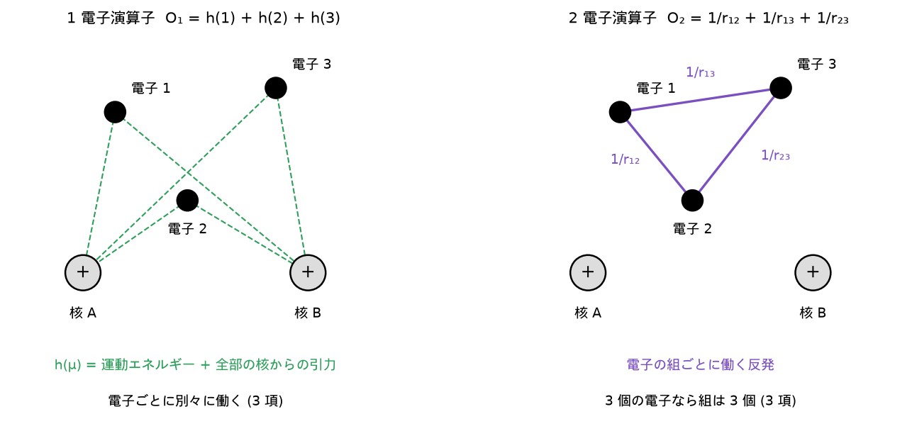

**図 1**　電子 3 個、核 2 個の例。左：1 電子演算子は、各電子に別々に働きます（緑の破線は核からの引力）。項は電子の数と同じ 3 個です。右：2 電子演算子は、電子の組ごとに働きます（紫の線）。項は組の数と同じ 3 個です。

2 つの演算子には、共通の性質が 2 つあります。

1. **電子の番号を入れ替えても変わりません。** どの電子も同じ形の項をもつからです。決定子（反対称な関数）にかけても、反対称性は崩れません。
2. **スピンに働きません。** どちらもスピンの座標 $\omega$ を含まないからです。6 節で、スピンについての積分をするときに使います。

この回の前半の目的は、決定子 $|K\rangle$、$|L\rangle$ の間の行列要素 $\langle K|\hat{\mathcal O}_1|L\rangle$ と $\langle K|\hat{\mathcal O}_2|L\rangle$ を、軌道の積分で書くことです。
鍵になるのは、$\hat h(\mu)$ が電子 1 個にしか働かず、$1/r_{\mu\nu}$ が電子 2 個にしか働かないことです。

**ここまでで分かったこと**：ハミルトニアンは、電子 1 個ずつに働く 1 電子演算子 $\hat{\mathcal O}_1 = \sum_\mu\hat h(\mu)$ と、電子の組に働く 2 電子演算子 $\hat{\mathcal O}_2 = \sum_{\mu<\nu}1/r_{\mu\nu}$ の和です。

## 2. 決定子の記法と、励起した決定子

### 2.1 決定子の短い書き方

第 2 回で見たように、$N$ 個のスピン軌道 $\chi_i, \chi_j, \dots, \chi_k$ から作る Slater 決定子は、

$$
\Psi(\mathbf x_1, \dots, \mathbf x_N) = \frac{1}{\sqrt{N!}}
\begin{vmatrix}
\chi_i(\mathbf x_1) & \chi_j(\mathbf x_1) & \cdots & \chi_k(\mathbf x_1)\\
\chi_i(\mathbf x_2) & \chi_j(\mathbf x_2) & \cdots & \chi_k(\mathbf x_2)\\
\vdots & \vdots & & \vdots\\
\chi_i(\mathbf x_N) & \chi_j(\mathbf x_N) & \cdots & \chi_k(\mathbf x_N)
\end{vmatrix}
$$

です。行が電子、列がスピン軌道です。
これを、列のスピン軌道を左から順に並べて、

$$
\Psi = |\chi_i\,\chi_j\cdots\chi_k\rangle
$$

と書きます。さらに短く $|ij\cdots k\rangle$ とも書きます [Szabo 1996]。
2 本の列を入れ替えると行列式の符号が変わるので、並べる順番には意味があります。

$$
|\cdots\chi_i\cdots\chi_j\cdots\rangle = -|\cdots\chi_j\cdots\chi_i\cdots\rangle
$$

### 2.2 基準の決定子と励起した決定子

$K$ 個の空間軌道からは、$\alpha$ と $\beta$ を合わせて $2K$ 個のスピン軌道ができます。
そのうち $N$ 個を選んで電子を入れた決定子を、計算の基準にします。

$$
|\Psi_0\rangle = |\chi_1\chi_2\cdots\chi_a\chi_b\cdots\chi_N\rangle
$$

たとえば、第 5 回で求める Hartree–Fock の決定子がこれに当たります。
$|\Psi_0\rangle$ で占有されたスピン軌道を $a, b, c, \dots$、占有されていない（仮想の）スピン軌道を $r, s, t, \dots$ と書きます。

$|\Psi_0\rangle$ の $\chi_a$ を $\chi_r$ に取り替えた決定子を、**1 電子励起の決定子**と呼び、$|\Psi_a^r\rangle$ と書きます。
$\chi_a$ と $\chi_b$ を、$\chi_r$ と $\chi_s$ に取り替えた決定子を **2 電子励起の決定子**と呼び、$|\Psi_{ab}^{rs}\rangle$ と書きます。

$$
|\Psi_a^r\rangle = |\chi_1\cdots\chi_r\chi_b\cdots\chi_N\rangle,
\qquad
|\Psi_{ab}^{rs}\rangle = |\chi_1\cdots\chi_r\chi_s\cdots\chi_N\rangle
$$

大事な約束は、**取り替えたスピン軌道を、元のスピン軌道と同じ列に置く**ことです。
$\chi_r$ は $\chi_a$ がいた列に、$\chi_s$ は $\chi_b$ がいた列に入ります。
こうしておくと、4 節で行列要素を求めるときに、列を並べ替える符号を考えなくて済みます。

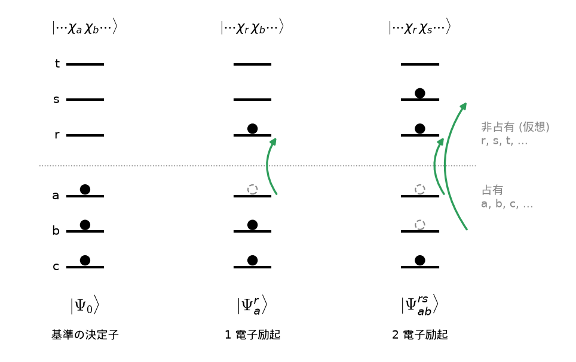

**図 2**　横線はスピン軌道、黒丸は電子、破線の丸は電子が抜けた席です。点線より下が $|\Psi_0\rangle$ で占有されたスピン軌道 $a, b, c$、上が仮想のスピン軌道 $r, s, t$ です。緑の矢印が、電子を移した先を示します。上の式は、取り替えたスピン軌道が、元と同じ列に入ることを表しています。

$|\Psi_{ab}^{rs}\rangle$ と、$a, b$ を入れ替えた $|\Psi_{ba}^{rs}\rangle$ は、$\chi_r$ と $\chi_s$ の列が入れ替わっただけなので、符号だけが違う同じ決定子です。
そこで、$a < b$、$r < s$ の組だけを数えます。
$N$ 個の占有と $2K - N$ 個の仮想のスピン軌道から、1 電子励起の決定子は $N(2K - N)$ 個、2 電子励起の決定子は $\binom{N}{2}\binom{2K-N}{2}$ 個できます。

**H₂ の最小基底の例**：2 つの水素原子の 1s 関数から、結合性の空間軌道 $\phi_1$ と反結合性の $\phi_2$ ができます（$K = 2$）。
スピン軌道は 4 個です。$\beta$ のスピン軌道に上線をつけて、次のように書きます [Szabo 1996]。

$$
\chi_1 = \phi_1\alpha \equiv 1,\qquad
\chi_2 = \phi_1\beta \equiv \bar 1,\qquad
\chi_3 = \phi_2\alpha \equiv 2,\qquad
\chi_4 = \phi_2\beta \equiv \bar 2
$$

基準の決定子は $|\Psi_0\rangle = |\chi_1\chi_2\rangle = |1\bar 1\rangle$ です。
2 電子励起の決定子は、$\chi_1 \to \chi_3$、$\chi_2 \to \chi_4$ と移した $|\Psi_{12}^{34}\rangle = |\chi_3\chi_4\rangle = |2\bar 2\rangle$ の 1 個です。上線の記法では $|\Psi_{1\bar 1}^{2\bar 2}\rangle$ と書きます。
1 電子励起の決定子は $2 \times 2 = 4$ 個です。たとえば $|\Psi_1^3\rangle = |\chi_3\chi_2\rangle = |2\bar 1\rangle$ で、上線の記法では $|\Psi_1^2\rangle$ と書きます。
$|\Psi_0\rangle$ と合わせて $1 + 4 + 1 = 6 = \binom{4}{2}$ 個で、4 個のスピン軌道に 2 個の電子を入れる方法をすべて数えています。

連載の後半（第 10 回など）では、占有のスピン軌道を $i, j$、仮想のスピン軌道を $a, b$ と書き、励起した決定子を $\Phi_i^a$ と書く記法も使います。記号が違うだけで、意味は同じです。

**ここまでで分かったこと**：決定子は、列のスピン軌道を並べて $|\chi_i\chi_j\cdots\rangle$ と書きます。励起した決定子 $|\Psi_a^r\rangle$、$|\Psi_{ab}^{rs}\rangle$ は、取り替えたスピン軌道を元と同じ列に置いて作ります。

## 3. 2 電子積分の 2 つの表記

行列要素は、軌道についての積分で書けます。
1 電子の積分は、次の 1 種類だけです。

$$
\langle i|h|j\rangle = h_{ij} = \int \chi_i^*(\mathbf x_1)\,\hat h(1)\,\chi_j(\mathbf x_1)\,d\mathbf x_1
$$

2 電子の積分には、関数を並べる順番の違う 2 つの表記があります。どちらもよく使われるので、ここで整理します。

**物理学者の表記**：関数を電子の番号の順に並べます。左に複素共役をとる関数を電子 1、2 の順に、右に残りの関数を電子 1、2 の順に書きます。

$$
\langle ij|kl\rangle = \iint \chi_i^*(\mathbf x_1)\,\chi_j^*(\mathbf x_2)\,\frac{1}{r_{12}}\,\chi_k(\mathbf x_1)\,\chi_l(\mathbf x_2)\,d\mathbf x_1\,d\mathbf x_2
$$

**化学者の表記**：関数を電子ごとにまとめます。左に電子 1 の 2 個の関数、右に電子 2 の 2 個の関数を書きます。スピン軌道の積分は角括弧で書きます。

$$
[ij|kl] = \iint \chi_i^*(\mathbf x_1)\,\chi_j(\mathbf x_1)\,\frac{1}{r_{12}}\,\chi_k^*(\mathbf x_2)\,\chi_l(\mathbf x_2)\,d\mathbf x_1\,d\mathbf x_2
$$

化学者の表記は、電子 1 の「電荷の分布」$\chi_i^*\chi_j$ と、電子 2 の電荷の分布 $\chi_k^*\chi_l$ の静電的な相互作用、と読めます。
2 つの定義を見比べると、同じ積分は次のように書き換えられます（図 3）。

$$
\langle ij|kl\rangle = [ik|jl],
\qquad
[ij|kl] = \langle ik|jl\rangle
$$

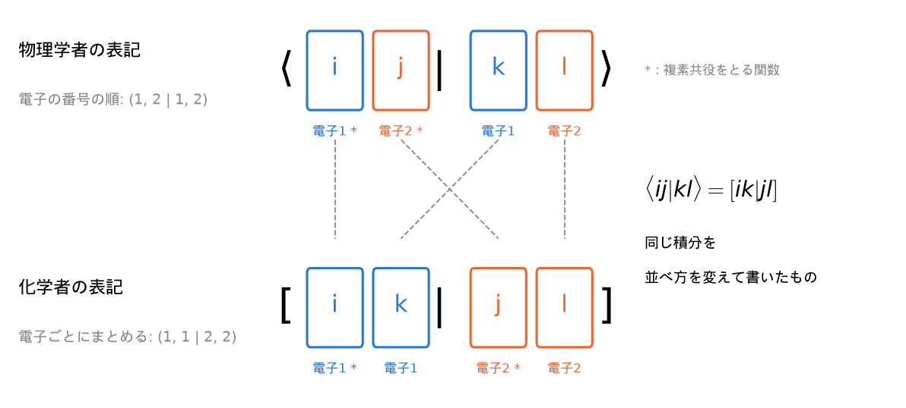

**図 3**　同じ積分を 2 つの表記で書いたもの。青は電子 1 の関数、橙は電子 2 の関数、* は複素共役をとる関数です。物理学者の表記は「電子 1、電子 2 | 電子 1、電子 2」、化学者の表記は「電子 1、電子 1 | 電子 2、電子 2」の順に並べます。破線が、同じ関数の位置の対応です。

Slater–Condon 則では、次の**反対称化した積分**が自然に出てきます。

$$
\langle ij||kl\rangle = \langle ij|kl\rangle - \langle ij|lk\rangle = [ik|jl] - [il|jk]
$$

たとえば $\langle ij||ij\rangle = \langle ij|ij\rangle - \langle ij|ji\rangle$ では、第 1 項がクーロン型、第 2 項が交換型の積分です（下の表）。

空間軌道 $\phi$ についての積分は、丸括弧で書きます（第 2 回）。

$$
h_{ij} = (i|h|j) = \int \phi_i^*(\mathbf r_1)\,\hat h(1)\,\phi_j(\mathbf r_1)\,d\mathbf r_1,
\qquad
(ij|kl) = \iint \phi_i^*(\mathbf r_1)\phi_j(\mathbf r_1)\,\frac{1}{r_{12}}\,\phi_k^*(\mathbf r_2)\phi_l(\mathbf r_2)\,d\mathbf r_1\,d\mathbf r_2
$$

クーロン積分は $J_{ij} = (ii|jj)$、交換積分は $K_{ij} = (ij|ji)$ です。
ここまでの表記を表にまとめます。

| 表記 | 電子 1 の関数 | 電子 2 の関数 | この回で使う所 |
|---|---|---|---|
| $\langle ij\vert kl\rangle$（物理学者、スピン軌道） | $\chi_i^*\,\chi_k$ | $\chi_j^*\,\chi_l$ | Slater–Condon 則（4 節）、第二量子化（11 節） |
| $[ij\vert kl]$（化学者、スピン軌道） | $\chi_i^*\,\chi_j$ | $\chi_k^*\,\chi_l$ | スピンの積分（6 節）、numpy のコード（13 節） |
| $\langle ij\vert\vert kl\rangle$（反対称化） | $\langle ij\vert kl\rangle - \langle ij\vert lk\rangle$ | | Slater–Condon 則（4 節） |
| $(ij\vert kl)$（化学者、空間軌道） | $\phi_i^*\,\phi_j$ | $\phi_k^*\,\phi_l$ | 閉殻のエネルギー（6 節） |

よく出てくる組み合わせの対応は、次のとおりです。

| 物理学者の表記 | 化学者の表記 | 意味 |
|---|---|---|
| $\langle ij\vert ij\rangle$ | $[ii\vert jj]$ | クーロン型（電子の雲 $\vert\chi_i\vert^2$ と $\vert\chi_j\vert^2$ の反発） |
| $\langle ij\vert ji\rangle$ | $[ij\vert ji]$ | 交換型 |
| $\langle ij\vert\vert ij\rangle$ | $[ii\vert jj] - [ij\vert ji]$ | クーロン − 交換 |

積分には、次の対称性があります。

- 積分の変数 $\mathbf x_1$ と $\mathbf x_2$ の名前を入れ替えても値は同じなので、$\langle ij|kl\rangle = \langle ji|lk\rangle$ です。化学者の表記では $[ij|kl] = [kl|ij]$ です。
- これを使うと、$\langle ij||kl\rangle = -\langle ij||lk\rangle = -\langle ji||kl\rangle$ です。特に $\langle ii||kl\rangle = \langle ii|kl\rangle - \langle ii|lk\rangle = 0$ です（第 2 項に $\langle ij|kl\rangle = \langle ji|lk\rangle$ を $i = j$ で使うと、第 1 項と同じになります）。
- 軌道が実数なら、化学者の表記の積分は、$i$ と $j$ を入れ替えても、$k$ と $l$ を入れ替えても変わりません。たとえば $(21|21) = (12|21)$ です。

**ここまでで分かったこと**：2 電子積分は、電子の番号順に並べる物理学者の表記 $\langle ij|kl\rangle$ と、電子ごとにまとめる化学者の表記 $[ij|kl]$ で書け、$\langle ij|kl\rangle = [ik|jl]$ です。Slater–Condon 則には、反対称化した積分 $\langle ij||kl\rangle = \langle ij|kl\rangle - \langle ij|lk\rangle$ が出てきます。

## 4. Slater–Condon 則

### 4.1 2 つの決定子の列をそろえる

同じ規格直交なスピン軌道から作った、2 つの $N$ 電子の決定子 $|K\rangle$ と $|L\rangle$ を考えます。
行列要素を求める前に、$|L\rangle$ の列を並べ替えて、**共通のスピン軌道が $|K\rangle$ と同じ列に来るように**します。
これを最大一致（maximum coincidence）の並べ方と呼びます。
列を 1 回入れ替えるごとに、符号が 1 回変わります。

例：$|K\rangle = |\chi_1\chi_2\chi_3\rangle$、$|L\rangle = |\chi_4\chi_1\chi_3\rangle$ とします。
共通のスピン軌道は $\chi_1$ と $\chi_3$ です。
$|L\rangle$ の 1 列目と 2 列目を入れ替えると、

$$
|L\rangle = |\chi_4\chi_1\chi_3\rangle = -|\chi_1\chi_4\chi_3\rangle
$$

になります。$|K\rangle$ と比べると、2 列目の $\chi_2$ が $\chi_4$ に変わっただけです。
したがって $\langle K|\hat H|L\rangle = -\langle\chi_1\chi_2\chi_3|\hat H|\chi_1\chi_4\chi_3\rangle$ で、右辺は次の 4.2 節の「1 個違う」場合です。

2 節の励起した決定子 $|\Psi_a^r\rangle$、$|\Psi_{ab}^{rs}\rangle$ は、はじめから $|\Psi_0\rangle$ と最大一致の並べ方になっています。

### 4.2 4 つの場合

最大一致に並べた 2 つの決定子が、いくつの列で違うかで、行列要素は次の 4 つの場合に分かれます。
$|K\rangle$ の列にあるスピン軌道を $m, n$、それを $|L\rangle$ で取り替えたスピン軌道を $p, q$ と書きます [Szabo 1996]。
和の $m$、$n$ は、$|K\rangle$ で占有されたすべてのスピン軌道についてとります。

| 場合 | $\vert L\rangle$ | $\langle K\vert\hat{\mathcal O}_1\vert L\rangle$ | $\langle K\vert\hat{\mathcal O}_2\vert L\rangle$ |
|---|---|---|---|
| 1：同じ | $\vert K\rangle = \vert\cdots mn\cdots\rangle$ | $\sum_m\langle m\vert h\vert m\rangle$ | $\frac12\sum_m\sum_n\langle mn\vert\vert mn\rangle$ |
| 2：1 個違う（$m \to p$） | $\vert\cdots pn\cdots\rangle$ | $\langle m\vert h\vert p\rangle$ | $\sum_n\langle mn\vert\vert pn\rangle$ |
| 3：2 個違う（$m \to p$、$n \to q$） | $\vert\cdots pq\cdots\rangle$ | $0$ | $\langle mn\vert\vert pq\rangle$ |
| 4：3 個以上違う | | $0$ | $0$ |

これを Slater–Condon 則と呼びます [Slater 1929; Condon 1930]。
場合 2 の和の $n$ は、$m$ を含めても構いません。$\langle mm||pm\rangle = 0$ だからです（3 節の $\langle ii||kl\rangle = 0$ と同じ理由）。
場合 1 の $m = n$ の項も、$\langle mm||mm\rangle = 0$ で消えます。電子が自分自身と反発する項は入りません。

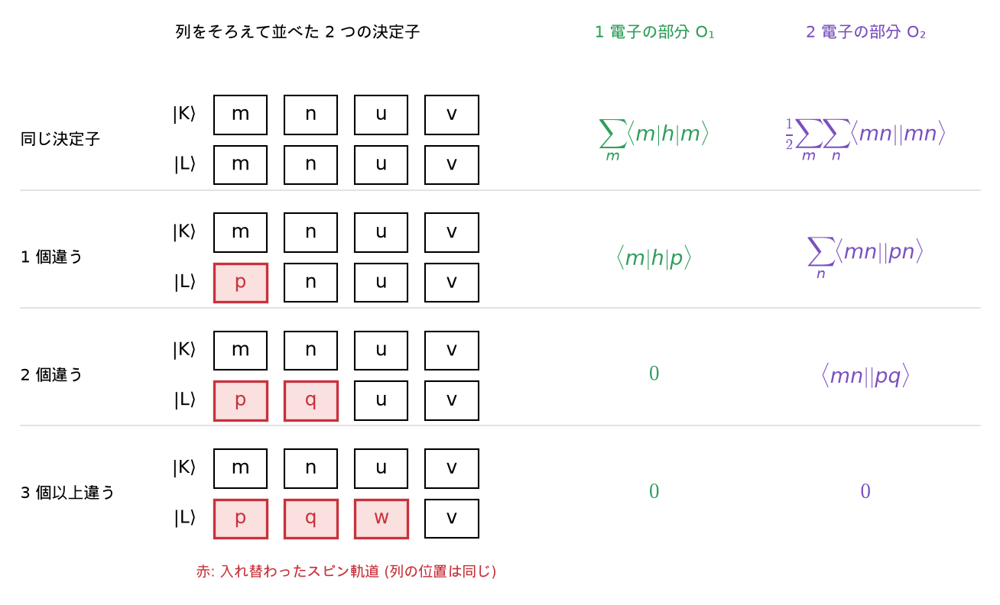

**図 4**　最大一致に並べた 2 つの決定子 $|K\rangle$、$|L\rangle$ を、列ごとの箱で描きました。赤い箱が、$|L\rangle$ で入れ替わったスピン軌道です。右の 2 列が、1 電子の部分と 2 電子の部分の行列要素です。1 電子の部分は 2 個違うと 0、2 電子の部分は 3 個違うと 0 になることを見てください。

### 4.3 なぜ 0 になるのか

場合 4 と、場合 3 の 1 電子の部分が 0 になる理由は、次のとおりです。
各場合の式のすべての段階は、付録 A で行列式を展開して導きます。

決定子は、$N$ 個の電子をスピン軌道に割り当てた積（ハートリー積）を、符号付きで足したものでした（第 2 回）。
$\langle K|\hat h(1)|L\rangle$ を展開すると、各項は「電子 1 の積分 $\langle\chi|\hat h|\chi'\rangle$」と「電子 2〜$N$ の重なり $\langle\chi|\chi'\rangle$ の積」の積になります。
$\hat h(1)$ は電子 1 にしか働かないので、電子 2〜$N$ については、ただの重なりの積分が残るのです。
スピン軌道は規格直交なので、重なりは、同じスピン軌道どうしなら 1、違えば 0 です。
2 つの決定子が 2 列以上で違うと、電子 2〜$N$ の $N - 1$ 個の電子のどこかに、違うスピン軌道の組が必ず残ります。
そのため、どの項も 0 になります。

$1/r_{12}$ は電子 1 と 2 にしか働かないので、重なりが残るのは電子 3〜$N$ の $N - 2$ 個です。
2 つの決定子が 3 列以上で違うと、そのどこかに違うスピン軌道の組が残り、0 になります。

つまり、**1 電子演算子は電子を 1 個まで、2 電子演算子は電子を 2 個まで、別の軌道に移せます**。
ハミルトニアン全体では、3 個以上違う決定子どうしを直接つなぎません。

### 4.4 基準の決定子との行列要素

4.2 節の表を、$|K\rangle = |\Psi_0\rangle$ と 2 節の励起した決定子に当てはめます。
1 個違いでは $m = a$、$p = r$、2 個違いでは $m = a$、$n = b$、$p = r$、$q = s$ です。
和の $n$ は、$|\Psi_0\rangle$ の占有スピン軌道 $b$ についてとります。

$$
\begin{aligned}
\langle\Psi_0|\hat H|\Psi_0\rangle &= \sum_a\langle a|h|a\rangle + \frac12\sum_a\sum_b\langle ab||ab\rangle\\
\langle\Psi_0|\hat H|\Psi_a^r\rangle &= \langle a|h|r\rangle + \sum_b\langle ab||rb\rangle\\
\langle\Psi_0|\hat H|\Psi_{ab}^{rs}\rangle &= \langle ab||rs\rangle\\
\langle\Psi_0|\hat H|\Psi_{abc}^{rst}\rangle &= 0
\end{aligned}
$$

ハミルトニアンはエルミートなので、bra と ket を入れ替えた要素は複素共役になります（$\langle\Psi_a^r|\hat H|\Psi_0\rangle = \langle\Psi_0|\hat H|\Psi_a^r\rangle^*$）。

**ここまでで分かったこと**：最大一致に並べた 2 つの決定子の行列要素は、違う列の数だけで形が決まります。1 電子の部分は 2 個以上、2 電子の部分は 3 個以上違うと 0 です。

## 5. 決定子 1 個のエネルギー

4.4 節の 1 行目が、決定子 1 個のエネルギーです（核の反発を除く）。

$$
E_0 = \langle\Psi_0|\hat H|\Psi_0\rangle = \sum_a^N\langle a|h|a\rangle + \frac12\sum_a^N\sum_b^N\langle ab||ab\rangle
$$

3 節の対応表で $\langle ab||ab\rangle = \langle ab|ab\rangle - \langle ab|ba\rangle = [aa|bb] - [ab|ba]$ と書き換えると、

$$
E_0 = \sum_a^N h_{aa} + \frac12\sum_a^N\sum_b^N\Big([aa|bb] - [ab|ba]\Big)
$$

です。第 2 回で求めた 2 電子の決定子のエネルギーを、$N$ 電子に広げた形です。
式の意味は次のとおりです。

- 第 1 項：各電子が、自分のスピン軌道で、運動エネルギーと核からの引力 $h_{aa}$ をもちます。
- 第 2 項：電子の組 $(a, b)$ ごとに、クーロンの反発 $[aa|bb]$ から交換 $[ab|ba]$ を引いたものを足します。$a, b$ の両方について和をとると、同じ組を $(a, b)$ と $(b, a)$ で 2 回数えるので、$\frac12$ をかけます。$a = b$ の項は $[aa|aa] - [aa|aa] = 0$ で、自分自身との反発は入りません。

この式は、決定子を展開して直接導けます（第一量子化での導出）。
すべての段階は付録 A に書きました。流れは次のとおりです。

1. 決定子を、$N!$ 個のハートリー積の符号付きの和に展開します。エネルギーは、bra の割り当てと ket の割り当てのすべての組の和になります。
2. 1 電子の部分 $\hat h(1)$ では、電子 2〜$N$ の重なりが 0 にならないために、bra と ket の割り当てが完全に同じでなければなりません。残るのは、電子 1 が入ったスピン軌道 $\chi_a$ の $h_{aa}$ です。
3. 2 電子の部分 $1/r_{12}$ では、電子 3〜$N$ の割り当てが同じでなければなりません。電子 1 と 2 には、同じ 2 個のスピン軌道 $\chi_a$、$\chi_b$ が残ります。その割り当て方は、bra と同じか、入れ替えたかの 2 通りです（図 5）。
4. 同じ割り当ての項は符号 $+$ でクーロンの積分 $[aa|bb]$、入れ替えた項は入れ替えが 1 回多いので符号 $-$ で交換の積分 $[ab|ba]$ になります。
5. 電子の番号のとり方と、割り当ての数を数えると、1 電子の部分は $\sum_a h_{aa}$、2 電子の部分は $\frac12\sum_{ab}([aa|bb] - [ab|ba])$ になります。

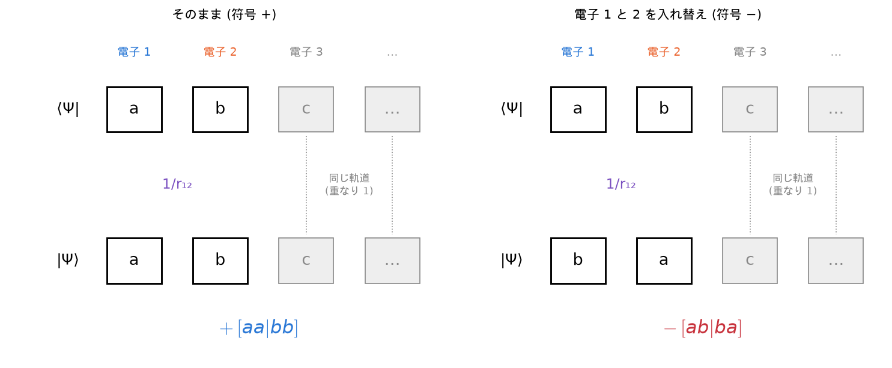

**図 5**　$\langle\Psi|1/r_{12}|\Psi\rangle$ の展開で残る 2 種類の項。上の行が bra、下の行が ket の割り当てです。灰色の電子 3 以降は、bra と ket で同じスピン軌道でないと重なりが 0 になります。左：電子 1 と 2 の割り当ても同じ項は、符号 $+$ でクーロンの積分になります。右：電子 1 と 2 の割り当てを入れ替えた項は、符号 $-$ で交換の積分になります。

**ここまでで分かったこと**：決定子 1 個のエネルギーは $E_0 = \sum_a h_{aa} + \frac12\sum_{ab}\langle ab||ab\rangle$ です。2 電子の部分は、電子の組ごとのクーロンから交換を引いたものです。

## 6. 閉殻の決定子のエネルギーを空間軌道で書く

### 6.1 スピンについて積分する

5 節の式は、スピン軌道の積分で書かれています。
ここでは、閉殻の決定子について、スピンの積分を 1 つずつ実行し、空間軌道の積分で書き直します。
この結果は、第 5 回の制限 Hartree–Fock 法（RHF）で使います。

閉殻とは、$N$ 個の電子が $N/2$ 個の空間軌道 $\phi_1, \dots, \phi_{N/2}$ に、$\alpha$ と $\beta$ の対で入っている状態です。
この節では、空間軌道も $a, b$ で表し、各空間軌道 $\phi_a$ から作る 2 つのスピン軌道を、2 節と同じく上線で区別します。

$$
a = \phi_a\alpha,\qquad \bar a = \phi_a\beta
$$

スピン軌道についての和は、空間軌道の和と、$\alpha$・$\beta$ の 2 つの和に分かれます。

$$
\sum_a^{N}\chi_a = \sum_a^{N/2}\big(a + \bar a\big)
$$

スピンの関数は規格直交です（第 2 回）。

$$
\langle\alpha|\alpha\rangle = \langle\beta|\beta\rangle = 1,\qquad \langle\alpha|\beta\rangle = \langle\beta|\alpha\rangle = 0
$$

**1 電子の部分**：$\hat h$ はスピンに働かないので、積分は空間の部分とスピンの部分の積に分かれます。

$$
\begin{aligned}
\langle a|h|a\rangle
&= \int d\mathbf r_1\,d\omega_1\;\phi_a^*(\mathbf r_1)\alpha^*(\omega_1)\,\hat h(\mathbf r_1)\,\phi_a(\mathbf r_1)\alpha(\omega_1)\\
&= \int d\mathbf r_1\,\phi_a^*(\mathbf r_1)\,\hat h(\mathbf r_1)\,\phi_a(\mathbf r_1)\;\int d\omega_1\,\alpha^*(\omega_1)\alpha(\omega_1)
&&\text{（空間とスピンに分けた）}\\
&= h_{aa}\,\langle\alpha|\alpha\rangle = h_{aa}
\end{aligned}
$$

$\bar a$ でも同じく $\langle\bar a|h|\bar a\rangle = h_{aa}\langle\beta|\beta\rangle = h_{aa}$ です。したがって、

$$
\sum_a^N\langle a|h|a\rangle = \sum_a^{N/2}\Big(\langle a|h|a\rangle + \langle\bar a|h|\bar a\rangle\Big) = 2\sum_a^{N/2}h_{aa}
$$

**2 電子の部分**：和を空間軌道 $a, b$ と、それぞれのスピンの 4 通り（$\alpha\alpha$、$\alpha\beta$、$\beta\alpha$、$\beta\beta$）に分けます。

$$
\begin{aligned}
&\frac12\sum_a^{N}\sum_b^{N}\Big([aa|bb] - [ab|ba]\Big)\\
&= \frac12\sum_a^{N/2}\sum_b^{N/2}\Big([aa|bb] + [aa|\bar b\bar b] + [\bar a\bar a|bb] + [\bar a\bar a|\bar b\bar b]\\
&\qquad\qquad\qquad - [ab|ba] - [a\bar b|\bar ba] - [\bar ab|b\bar a] - [\bar a\bar b|\bar b\bar a]\Big)
\end{aligned}
$$

各積分も、空間の部分とスピンの部分に分かれます。
化学者の表記では、左の 2 個の関数が電子 1、右の 2 個が電子 2 なので、スピンの積分は「左の 2 個のスピンの重なり」と「右の 2 個のスピンの重なり」の積です。
クーロン型の 4 つは、次のとおりです。

$$
\begin{aligned}
{}[aa|bb] &= (aa|bb)\,\langle\alpha|\alpha\rangle\langle\alpha|\alpha\rangle = J_{ab}\\
{}[aa|\bar b\bar b] &= (aa|bb)\,\langle\alpha|\alpha\rangle\langle\beta|\beta\rangle = J_{ab}\\
{}[\bar a\bar a|bb] &= (aa|bb)\,\langle\beta|\beta\rangle\langle\alpha|\alpha\rangle = J_{ab}\\
{}[\bar a\bar a|\bar b\bar b] &= (aa|bb)\,\langle\beta|\beta\rangle\langle\beta|\beta\rangle = J_{ab}
\end{aligned}
$$

クーロン型では、各電子の 2 個の関数が同じスピンなので、どれも $J_{ab}$ です。
交換型の 4 つは、次のとおりです。

$$
\begin{aligned}
{}[ab|ba] &= (ab|ba)\,\langle\alpha|\alpha\rangle\langle\alpha|\alpha\rangle = K_{ab}\\
{}[a\bar b|\bar ba] &= (ab|ba)\,\langle\alpha|\beta\rangle\langle\beta|\alpha\rangle = 0\\
{}[\bar ab|b\bar a] &= (ab|ba)\,\langle\beta|\alpha\rangle\langle\alpha|\beta\rangle = 0\\
{}[\bar a\bar b|\bar b\bar a] &= (ab|ba)\,\langle\beta|\beta\rangle\langle\beta|\beta\rangle = K_{ab}
\end{aligned}
$$

交換型では、電子 1 の 2 個の関数のスピンが $a$ のスピンと $b$ のスピンなので、両者が同じときだけ残ります。
8 個を足すと $4J_{ab} - 2K_{ab}$ で、$\frac12$ をかけると $2J_{ab} - K_{ab}$ です（図 6）。

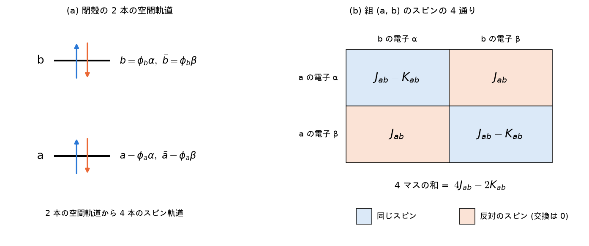

**図 6**　(a) 閉殻の 2 本の空間軌道 $\phi_a$、$\phi_b$ と、そこから作る 4 本のスピン軌道。(b) $a$ の電子と $b$ の電子のスピンの 4 通りごとの、クーロン − 交換。クーロン $J_{ab}$ は 4 マスすべてにあり、交換 $K_{ab}$ は同じスピンの 2 マス（青）だけにあります。

まとめると、閉殻の決定子のエネルギーは、空間軌道の積分で次のように書けます（核の反発を除く）[Szabo 1996]。

$$
E_0 = 2\sum_a^{N/2}h_{aa} + \sum_a^{N/2}\sum_b^{N/2}\big(2J_{ab} - K_{ab}\big)
$$

$a = b$ の項は、$K_{aa} = (aa|aa) = J_{aa}$ なので $2J_{aa} - K_{aa} = J_{aa}$ です。
これは、同じ空間軌道に入った $\alpha$ と $\beta$ の 2 個の電子の反発です。

### 6.2 4 電子の例

2 本の空間軌道 $\phi_1$、$\phi_2$ に 4 個の電子が入った閉殻で、上の式を確かめます（図 7 (a)）。
スピン軌道は $\phi_1\alpha$、$\phi_1\beta$、$\phi_2\alpha$、$\phi_2\beta$ の 4 本です。
組 $(a, b)$ ごとの $[aa|bb] - [ab|ba]$ を、6.1 節の結果を使って 4 行 4 列の表にすると、次のようになります。

$$
\begin{array}{c|cccc}
 & \phi_1\alpha & \phi_1\beta & \phi_2\alpha & \phi_2\beta \\ \hline
\phi_1\alpha & 0 & J_{11} & J_{12} - K_{12} & J_{12} \\
\phi_1\beta & J_{11} & 0 & J_{12} & J_{12} - K_{12} \\
\phi_2\alpha & J_{12} - K_{12} & J_{12} & 0 & J_{22} \\
\phi_2\beta & J_{12} & J_{12} - K_{12} & J_{22} & 0
\end{array}
$$

対角は自分自身なので 0 です。
$\phi_1\alpha$ と $\phi_1\beta$ の組は、同じ空間軌道に入った反対のスピンの電子の反発 $J_{11}$ です（交換はスピンが違うので 0）。
16 個の要素をすべて足すと $2J_{11} + 2J_{22} + 8J_{12} - 4K_{12}$ です。
$\frac12$ をかけると、2 電子の部分は

$$
J_{11} + J_{22} + 4J_{12} - 2K_{12}
$$

になります。

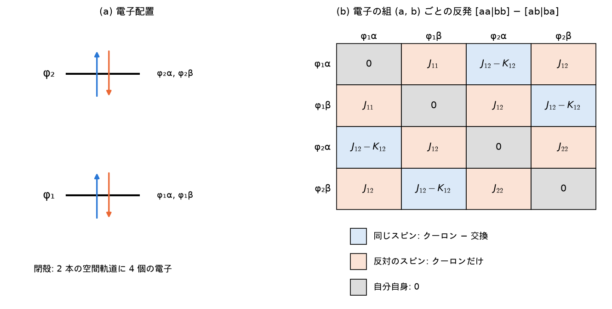

**図 7**　(a) 2 本の空間軌道に 4 個の電子が入った閉殻。(b) 上の 4 行 4 列の表を色分けしたもの。青のマスは同じスピンの組でクーロンから交換を引いたもの、橙のマスは反対のスピンの組でクーロンだけ、灰色の対角は自分自身で 0 です。交換（青）は、スピンが同じ組にしか現れないことを見てください。

6.1 節の式では、$\sum_{ab}(2J_{ab} - K_{ab}) = (2J_{11} - K_{11}) + (2J_{22} - K_{22}) + 2(2J_{12} - K_{12})$ です。
$K_{11} = J_{11}$、$K_{22} = J_{22}$ なので、これは $J_{11} + J_{22} + 4J_{12} - 2K_{12}$ となり、表から求めた値と一致します。

**ここまでで分かったこと**：閉殻の決定子のエネルギーは $E_0 = 2\sum_a h_{aa} + \sum_{ab}(2J_{ab} - K_{ab})$ です。スピンの積分で、交換は同じスピンの電子の組にだけ残ります。

## 7. 例：H₂ の最小基底の CI 行列

Slater–Condon 則を、2 節の H₂ の最小基底に当てはめます [Szabo 1996]。
基底状態を、$|\Psi_0\rangle = |1\bar 1\rangle$ と、2 電子励起の決定子 $|\Psi_{1\bar 1}^{2\bar 2}\rangle = |2\bar 2\rangle$ の線形結合で表します。

$$
|\Phi\rangle = c_0|\Psi_0\rangle + c_1|\Psi_{1\bar 1}^{2\bar 2}\rangle
$$

このように、決定子の線形結合で波動関数を表す方法を、配置間相互作用（configuration interaction、CI）と呼びます（[第 8 回](08-configuration-interaction.md)）。
係数とエネルギーは、ハミルトニアンの 2 行 2 列の行列の固有値問題（第 1 回）から決まります。

$$
\mathbf H =
\begin{pmatrix}
\langle\Psi_0|\hat H|\Psi_0\rangle & \langle\Psi_0|\hat H|\Psi_{1\bar 1}^{2\bar 2}\rangle\\
\langle\Psi_{1\bar 1}^{2\bar 2}|\hat H|\Psi_0\rangle & \langle\Psi_{1\bar 1}^{2\bar 2}|\hat H|\Psi_{1\bar 1}^{2\bar 2}\rangle
\end{pmatrix}
$$

空間軌道は実数とします。各要素を、4.2 節の表で求めます。

**左上（場合 1）**：占有スピン軌道は $1$ と $\bar 1$ です。

$$
\begin{aligned}
\langle\Psi_0|\hat H|\Psi_0\rangle
&= \langle 1|h|1\rangle + \langle\bar 1|h|\bar 1\rangle + \frac12\Big(\langle 1\bar 1||1\bar 1\rangle + \langle\bar 1 1||\bar 1 1\rangle\Big)
&&\text{（} m = n \text{ の項は 0）}\\
&= 2h_{11} + \langle 1\bar 1||1\bar 1\rangle
&&\text{（2 つの項は等しい）}\\
&= 2h_{11} + \langle 1\bar 1|1\bar 1\rangle - \langle 1\bar 1|\bar 1 1\rangle
&&\text{（反対称化した積分の定義）}\\
&= 2h_{11} + [11|\bar 1\bar 1] - [1\bar 1|\bar 1 1]
&&\text{（化学者の表記に直した）}\\
&= 2h_{11} + J_{11} - 0
&&\text{（第 2 項はスピンが合わず 0）}
\end{aligned}
$$

6 節の閉殻の式で $N/2 = 1$ とおいた $2h_{11} + (2J_{11} - K_{11}) = 2h_{11} + J_{11}$ と一致します。

**右下（場合 1）**：占有スピン軌道が $2$ と $\bar 2$ なので、同じ計算で $2h_{22} + J_{22}$ です。

**右上（場合 3）**：$|2\bar 2\rangle$ は、$|1\bar 1\rangle$ の 1 列目を $1 \to 2$、2 列目を $\bar 1 \to \bar 2$ と取り替えたもので、最大一致の並べ方になっています。$m = 1$、$n = \bar 1$、$p = 2$、$q = \bar 2$ とおきます。

$$
\begin{aligned}
\langle\Psi_0|\hat H|\Psi_{1\bar 1}^{2\bar 2}\rangle
&= \langle 1\bar 1||2\bar 2\rangle
= \langle 1\bar 1|2\bar 2\rangle - \langle 1\bar 1|\bar 2 2\rangle\\
&= [12|\bar 1\bar 2] - [1\bar 2|\bar 1 2]
&&\text{（化学者の表記に直した）}\\
&= (12|12) - 0
&&\text{（第 2 項はスピンが合わない）}\\
&= K_{12}
&&\text{（実数の軌道では } (12|12) = (12|21)\text{）}
\end{aligned}
$$

行列は実対称なので、左下も $K_{12}$ です。まとめると、

$$
\mathbf H =
\begin{pmatrix}
2h_{11} + J_{11} & K_{12}\\
K_{12} & 2h_{22} + J_{22}
\end{pmatrix}
\begin{matrix} \leftarrow |1\bar 1\rangle \\ \leftarrow |2\bar 2\rangle \end{matrix}
$$

です。

**1 電子励起の決定子が入らない理由**：たとえば $|\Psi_1^2\rangle = |2\bar 1\rangle$ との要素は、4.4 節の 2 行目で、和の $b$ が $1$ と $\bar 1$ です。$b = 1$ の項は $\langle 11||21\rangle = 0$、$b = \bar 1$ の項は $\langle 1\bar 1||2\bar 1\rangle = (12|11) - 0$ なので、

$$
\langle\Psi_0|\hat H|\Psi_1^2\rangle = h_{12} + (12|11)
$$

です。$\phi_1$ は分子の中心についての反転で符号を変えず（g）、$\phi_2$ は符号を変えます（u）。
$h_{12}$ と $(12|11)$ の被積分関数は $\phi_2$ を 1 個だけ含むので、反転で符号を変え、積分は 0 です。
2 電子励起の決定子との要素も、同じ理由で 0 です。
スピンの向きを変える 1 電子励起（たとえば $|\Psi_1^{\bar 2}\rangle = |\bar 2\bar 1\rangle$）との要素は、$\langle 1|h|\bar 2\rangle$ などのスピンの積分 $\langle\alpha|\beta\rangle = 0$ から、どれも 0 です。
したがって、基底状態には $|\Psi_0\rangle$ と $|\Psi_{1\bar 1}^{2\bar 2}\rangle$ の 2 個だけが寄与します（図 8）。

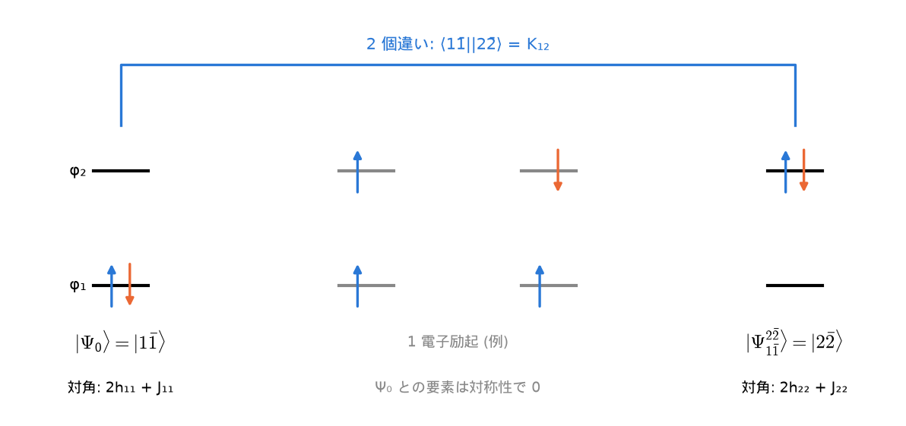

**図 8**　H₂ の最小基底の決定子。青の上向きの矢印が $\alpha$ 電子、橙の下向きの矢印が $\beta$ 電子です。左の $|\Psi_0\rangle$ と右の $|\Psi_{1\bar 1}^{2\bar 2}\rangle$ は 2 個違いで、$K_{12}$ でつながります。中央の 1 電子励起の決定子（灰色）は、$|\Psi_0\rangle$ との要素が対称性で 0 になります。

**固有値**：対角要素の差の半分を $\Delta = \frac12\big[(2h_{22} + J_{22}) - (2h_{11} + J_{11})\big]$ とおきます。
2 行 2 列の実対称行列の固有値は、対角要素の平均 $\pm\sqrt{(\text{差の半分})^2 + (\text{非対角要素})^2}$ です（第 1 回）。
対角要素の平均は $E_0 + \Delta$（$E_0 = 2h_{11} + J_{11}$）なので、小さい方の固有値は

$$
E = E_0 + \Delta - \sqrt{\Delta^2 + K_{12}^2}
$$

です。$\Delta > 0$ なので $\Delta - \sqrt{\Delta^2 + K_{12}^2} < 0$ で、$|\Psi_{1\bar 1}^{2\bar 2}\rangle$ を混ぜるとエネルギーは $E_0$ より下がります。
この下がり $E - E_0$ が、この基底での電子相関のエネルギーです（[第 7 回](07-electron-correlation.md)）。
13 節で、STO-3G 基底の数値を入れて確かめます。

**ここまでで分かったこと**：H₂ の最小基底の CI 行列は、Slater–Condon 則から、対角要素 $2h_{11}+J_{11}$、$2h_{22}+J_{22}$ と非対角要素 $K_{12}$ の 2 行 2 列の行列になります。2 電子励起の決定子が交換積分 $K_{12}$ で混ざり、エネルギーが下がります。

## 8. 占有数表示

ここから後半です。前半の規則を、電子を出し入れする演算子で導き直します。

規格直交なスピン軌道を $M$ 個用意し、番号 $\chi_1, \chi_2, \dots, \chi_M$ を付けます。
たとえば H₂ の最小基底では、2 節の 4 個のスピン軌道（$M = 4$）がこれに当たります。
この中から $N$ 個を選んで電子を入れると、決定子が 1 つ決まります。

2 節で見たように、決定子は「どのスピン軌道を占有したか」で決まります。
軌道の並べ方を変えても、行列式の列を入れ替えるだけなので、符号が変わるだけです。
そこで、軌道は**番号の小さい順に並べる**と約束します。
すると、決定子は、各スピン軌道の占有数 $n_i$（電子がいれば 1、いなければ 0）の並びで表せます。

$$
|\chi_1\chi_3\rangle \;\longleftrightarrow\; |n_1 n_2 n_3 n_4\rangle = |1\,0\,1\,0\rangle
\qquad(M = 4,\ N = 2\ \text{の例})
$$

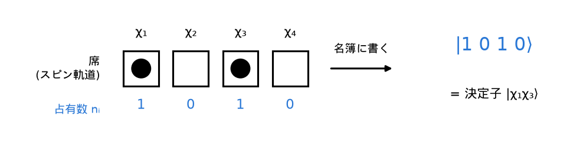

**図 9**　4 個のスピン軌道を 4 つの席（四角）で、電子を黒丸で描きました。席 $\chi_1$ と $\chi_3$ が埋まっています。席ごとの占有数（青の数字）を左から並べた $|1\,0\,1\,0\rangle$ が、決定子 $|\chi_1\chi_3\rangle$ を表します。

これを占有数表示（occupation-number representation）と呼びます。
電子が 1 個もない状態 $|0\,0\cdots 0\rangle$ を真空（vacuum）と呼び、$|\mathrm{vac}\rangle$ と書きます。

$M = 4$、$N = 2$ のとき、2 個の席の選び方は $\binom{4}{2} = 6$ 通りなので、決定子は次の 6 個です。

$$
|1100\rangle,\ |1010\rangle,\ |1001\rangle,\ |0110\rangle,\ |0101\rangle,\ |0011\rangle
$$

2 節で数えた H₂ の 6 個の決定子（$|\Psi_0\rangle$、1 電子励起 4 個、2 電子励起 1 個）と同じものです。たとえば $|\Psi_0\rangle = |1\bar 1\rangle = |1100\rangle$、$|\Psi_{1\bar 1}^{2\bar 2}\rangle = |2\bar 2\rangle = |0011\rangle$ です。

占有数の並びが違う決定子どうしは直交します。
少なくとも 1 つのスピン軌道が片方にだけ含まれ、そのスピン軌道は他方のどのスピン軌道とも直交するからです（4.3 節と同じ理由）。
並びが同じなら、内積は 1 です。式で書くと、次のようになります。

$$
\langle \mathbf n|\mathbf m\rangle = \prod_{i=1}^{M}\delta_{n_i m_i}
$$

**ここまでで分かったこと**：軌道の順番を決めておけば、決定子は占有数の並び $|n_1 n_2\cdots n_M\rangle$ で表せます。

## 9. 生成・消滅演算子

### 9.1 定義

スピン軌道 $\chi_i$ に電子を 1 個加える演算子 $\hat a_i^\dagger$ を、生成演算子（creation operator）と呼びます。
次のように定義します。

$$
\hat a_i^\dagger\,|\cdots n_i\cdots\rangle =
\begin{cases}
\Gamma_i\,|\cdots 1_i\cdots\rangle & (n_i = 0)\\
0 & (n_i = 1)
\end{cases}
\qquad
\Gamma_i = (-1)^{\sum_{j<i} n_j}
$$

すでに電子がいる席に加えようとすると、結果は 0 になります。これがパウリの排他原理です。
符号 $\Gamma_i$ は、$i$ より番号の小さい席に座っている電子の数が奇数なら $-1$、偶数なら $+1$ です。
$\Gamma_i$ は $n_i$ 自身を含まないことに注意してください。

同じように、$\chi_i$ から電子を 1 個取り除く演算子 $\hat a_i$ を、消滅演算子（annihilation operator）と呼びます。

$$
\hat a_i\,|\cdots n_i\cdots\rangle =
\begin{cases}
\Gamma_i\,|\cdots 0_i\cdots\rangle & (n_i = 1)\\
0 & (n_i = 0)
\end{cases}
$$

空いた席から電子は取り除けないので、$n_i = 0$ なら結果は 0 です。

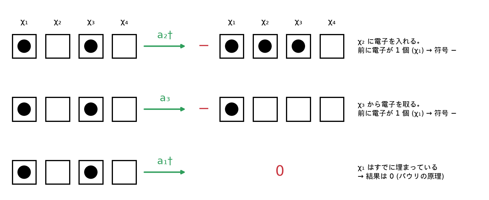

**図 10**　$|1\,0\,1\,0\rangle$ に演算子をかけた 3 つの例。上：$\hat a_2^\dagger$ は空いた席 $\chi_2$ に電子を入れます。$\chi_2$ より前の席に電子が 1 個（$\chi_1$）あるので、符号は $\Gamma_2 = -1$ です。中：$\hat a_3$ は $\chi_3$ の電子を取り除きます。前の席の電子は 1 個なので、符号は $\Gamma_3 = -1$ です。下：$\chi_1$ はすでに埋まっているので、$\hat a_1^\dagger$ をかけると 0 になります。

図 10 を式で書くと、次のとおりです。

$$
\hat a_2^\dagger|1\,0\,1\,0\rangle = -|1\,1\,1\,0\rangle,\qquad
\hat a_3|1\,0\,1\,0\rangle = -|1\,0\,0\,0\rangle,\qquad
\hat a_1^\dagger|1\,0\,1\,0\rangle = 0
$$

### 9.2 符号の意味

符号 $\Gamma_i$ は、決定子の反対称性を占有数表示に持ち込むためのものです。
占有数の並び $|\mathbf n\rangle$ を、**生成演算子を番号の小さい順に左から並べて真空にかけたもの**と約束します。

$$
|\mathbf n\rangle = \big(\hat a_1^\dagger\big)^{n_1}\big(\hat a_2^\dagger\big)^{n_2}\cdots\big(\hat a_M^\dagger\big)^{n_M}|\mathrm{vac}\rangle
$$

$(\hat a_i^\dagger)^0$ は「何もしない」（恒等演算子）、$(\hat a_i^\dagger)^1 = \hat a_i^\dagger$ です。
たとえば $|1\,0\,1\,0\rangle = \hat a_1^\dagger\hat a_3^\dagger|\mathrm{vac}\rangle$ です。
生成演算子の並びの左から $k$ 番目が、行列式の $k$ 列目のスピン軌道に当たります。

ここに $\hat a_2^\dagger$ を左からかけると、$\hat a_2^\dagger\hat a_1^\dagger\hat a_3^\dagger|\mathrm{vac}\rangle$ になります。
これは約束の順番（番号の小さい順）になっていません。
約束の順番に直すには、$\hat a_2^\dagger$ と $\hat a_1^\dagger$ を 1 回入れ替える必要があります。
入れ替えると符号が変わる（次の 10 節の反交換関係、行列式では列の入れ替え）ので、

$$
\hat a_2^\dagger\hat a_1^\dagger\hat a_3^\dagger|\mathrm{vac}\rangle
= -\hat a_1^\dagger\hat a_2^\dagger\hat a_3^\dagger|\mathrm{vac}\rangle
= -|1\,1\,1\,0\rangle
$$

となります。
入れ替えの回数は、$\hat a_2^\dagger$ が追い越した生成演算子の数、つまり $\chi_2$ より前の占有軌道の数 $n_1 = 1$ です。
これが $\Gamma_2 = (-1)^{n_1} = -1$ の意味です。

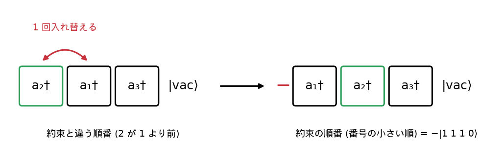

**図 11**　左：$\hat a_2^\dagger$（緑）を左からかけた直後は、番号の順番が約束と違います。右：$\hat a_2^\dagger$ を $\hat a_1^\dagger$ と 1 回入れ替えると約束の順番になり、そのとき符号が $-1$ 倍になります。追い越した演算子の数が、$\Gamma_i$ の指数です。

### 9.3 行列で書く

演算子は、決定子を並べた基底での行列で書けます。
最も小さい例として、スピン軌道が 2 個（$M = 2$）の場合を書き出します。
占有数の並びは $|n_1 n_2\rangle$ の 4 通りで、基底を $|00\rangle, |01\rangle, |10\rangle, |11\rangle$ の順に並べます。

定義に当てはめると、$\hat a_1$ が 0 にしない決定子は、$n_1 = 1$ の 2 個です。$\chi_1$ より前に席はないので、$\Gamma_1 = 1$ です。

$$
\hat a_1|10\rangle = |00\rangle,\qquad \hat a_1|11\rangle = |01\rangle
$$

$\hat a_2$ が 0 にしない決定子は、$n_2 = 1$ の 2 個です。$\Gamma_2 = (-1)^{n_1}$ なので、$|11\rangle$ では $-1$ になります。

$$
\hat a_2|01\rangle = |00\rangle,\qquad \hat a_2|11\rangle = -|10\rangle
$$

行列の $(\mathbf m, \mathbf n)$ 要素を $\langle\mathbf m|\hat a_i|\mathbf n\rangle$ とします。列が「かける前」、行が「かけた後」の決定子です。上の 4 つの式を並べると、

$$
\hat a_1 =
\begin{pmatrix}
0 & 0 & 1 & 0\\
0 & 0 & 0 & 1\\
0 & 0 & 0 & 0\\
0 & 0 & 0 & 0
\end{pmatrix},
\qquad
\hat a_2 =
\begin{pmatrix}
0 & 1 & 0 & 0\\
0 & 0 & 0 & 0\\
0 & 0 & 0 & -1\\
0 & 0 & 0 & 0
\end{pmatrix}
\begin{matrix} \leftarrow |00\rangle \\ \leftarrow |01\rangle \\ \leftarrow |10\rangle \\ \leftarrow |11\rangle \end{matrix}
$$

です。
生成演算子 $\hat a_i^\dagger$ は、$\hat a_i$ のエルミート共役（実数の行列では転置）です。
たとえば $\hat a_1^\dagger$ の $(|10\rangle, |00\rangle)$ 要素は 1 で、$\hat a_1^\dagger|00\rangle = |10\rangle$ を表します。
「$\chi_i$ から電子を取って $|\mathbf n\rangle$ から $|\mathbf m\rangle$ になる」ことと、「$\chi_i$ に電子を入れて $|\mathbf m\rangle$ から $|\mathbf n\rangle$ になる」ことは、同じ符号の裏表だからです。

$\hat a_2$ を 2 行 2 列ずつの塊に分けると、構造が見えます。

$$
\hat a_2 =
\left(\begin{array}{cc|cc}
0 & 1 & 0 & 0\\
0 & 0 & 0 & 0\\ \hline
0 & 0 & 0 & -1\\
0 & 0 & 0 & 0
\end{array}\right)
=
\begin{pmatrix} +\boldsymbol\sigma & \mathbf 0\\ \mathbf 0 & -\boldsymbol\sigma \end{pmatrix},
\qquad
\boldsymbol\sigma = \begin{pmatrix} 0 & 1\\ 0 & 0\end{pmatrix}
$$

左上の塊は $n_1 = 0$、右下の塊は $n_1 = 1$ の決定子の間の要素です。
どちらの塊でも、$\boldsymbol\sigma$ が $\chi_2$ の電子を消します。
$\chi_1$ に電子がいる右下の塊だけ、符号 $\Gamma_2 = -1$ が付きます。
13 節の計算では、この作り方を $M = 4$ に広げます。

**ここまでで分かったこと**：生成演算子 $\hat a_i^\dagger$ は電子を加え、消滅演算子 $\hat a_i$ は電子を取り除きます。決定子は、生成演算子を番号の順に真空にかけたものです。符号 $\Gamma_i$ は、演算子を約束の順番に並べ直すときの入れ替えの回数から来ます。

## 10. 反交換関係

生成・消滅演算子の性質は、次の 3 つの反交換関係にまとめられます。

$$
\{\hat a_i, \hat a_j^\dagger\} = \delta_{ij},\qquad
\{\hat a_i, \hat a_j\} = 0,\qquad
\{\hat a_i^\dagger, \hat a_j^\dagger\} = 0
$$

ここで $\{\hat A, \hat B\} = \hat A\hat B + \hat B\hat A$ は反交換子（anticommutator）です。
定義からの証明は、場合分けをすべて付録 B に書きました。ここでは 9.3 節の行列で確かめます。

**$i = j = 1$ の場合**：行列の積を計算すると、$\hat a_1\hat a_1^\dagger$ と $\hat a_1^\dagger\hat a_1$ は対角行列になります。

$$
\hat a_1\hat a_1^\dagger =
\begin{pmatrix}
1 & 0 & 0 & 0\\
0 & 1 & 0 & 0\\
0 & 0 & 0 & 0\\
0 & 0 & 0 & 0
\end{pmatrix},
\qquad
\hat a_1^\dagger\hat a_1 =
\begin{pmatrix}
0 & 0 & 0 & 0\\
0 & 0 & 0 & 0\\
0 & 0 & 1 & 0\\
0 & 0 & 0 & 1
\end{pmatrix}
$$

$\hat a_1\hat a_1^\dagger$ は「$\chi_1$ が空いていれば 1、埋まっていれば 0」を返します。入れてから取るので、空いていたときだけ元に戻るからです。
$\hat a_1^\dagger\hat a_1$ はその逆です。
2 つを足すと単位行列になり、$\{\hat a_1, \hat a_1^\dagger\} = 1$ が成り立ちます。

**$i = 1$、$j = 2$ の場合**：$\{\hat a_1, \hat a_2\}$ が 0 でない値を返しうるのは、2 個とも電子がいる $|11\rangle$ だけです。

$$
\hat a_1\hat a_2|11\rangle = \hat a_1\big(-|10\rangle\big) = -|00\rangle,
\qquad
\hat a_2\hat a_1|11\rangle = \hat a_2|01\rangle = +|00\rangle
$$

取り除く順番によって符号が逆になり、和は 0 です（図 12）。
$\chi_1$ を先に取ると、$\chi_2$ を取るときに前の席の電子がいなくなり、$\Gamma_2$ が $-1$ から $+1$ に変わるからです。

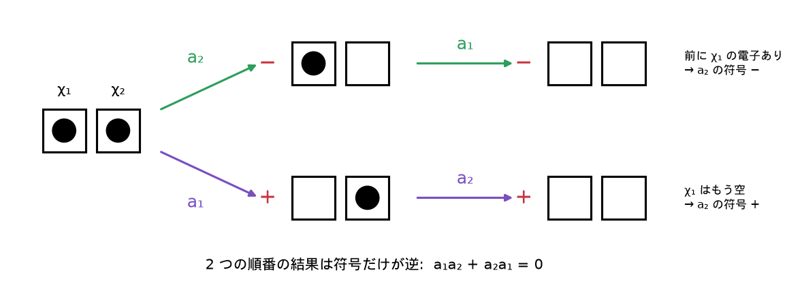

**図 12**　$|11\rangle$ から 2 個の電子を取り除く 2 つの順番。上（緑）：先に $\hat a_2$ をかけると、前の席 $\chi_1$ に電子がいるので符号 $-$ が付きます。下（紫）：先に $\hat a_1$ をかけると、$\hat a_2$ をかけるときには $\chi_1$ が空なので符号は $+$ です。結果は同じ真空で符号だけが逆なので、$\hat a_1\hat a_2 + \hat a_2\hat a_1 = 0$ です。

反交換関係から、次のことが分かります。

- $\hat a_i^\dagger\hat a_j^\dagger = -\hat a_j^\dagger\hat a_i^\dagger$：電子を加える順番を入れ替えると、符号が変わります。決定子の反対称性です。
- $i = j$ とおくと $\hat a_i^\dagger\hat a_i^\dagger = 0$：同じ席に 2 個の電子は加えられません。パウリの排他原理です。
- $\hat n_i = \hat a_i^\dagger\hat a_i$ を数演算子（number operator）と呼びます。$|\mathbf n\rangle$ にかけると $n_i$ を返します。電子がいれば取って同じ席に戻すので符号 $\Gamma_i^2 = 1$ で元に戻り、いなければ 0 だからです。上の $\hat a_1^\dagger\hat a_1$ の対角要素 $(0, 0, 1, 1)$ が、各決定子の $n_1$ です。
- $\hat N = \sum_i \hat n_i$ は、電子の数を返します。

フェルミ粒子の演算子に反交換関係を使うことは Jordan と Wigner が 1928 年に導入し [Jordan 1928]、Fock が 1932 年に多粒子の波動関数との関係を整理しました [Fock 1932]。
教科書では、Szabo–Ostlund の 2.4 節と、Helgaker らの第 1 章で詳しく扱われています [Szabo 1996; Helgaker 2000]。

第一量子化（行列式を書き下すやり方）では、反対称性は波動関数の側にありました。
第二量子化では、反対称性は演算子の反交換関係の側に移ります。
このため、波動関数は占有数の並びという単純なものになります。

**ここまでで分かったこと**：決定子の反対称性とパウリの排他原理は、生成・消滅演算子の反交換関係にすべて含まれています。

## 11. ハミルトニアンを演算子で書く

### 11.1 1 電子演算子

1 節の 1 電子演算子 $\hat{\mathcal O}_1 = \sum_{\mu=1}^{N}\hat h(\mu)$ は、第二量子化では次のように書けます。

$$
\sum_{\mu=1}^{N}\hat h(\mu) \;\longrightarrow\; \sum_{i,j=1}^{M} \langle i|h|j\rangle\,\hat a_i^\dagger\hat a_j
$$

$\hat a_i^\dagger\hat a_j$ は、$\chi_j$ の電子を取り除き、$\chi_i$ に入れます。つまり、電子を $\chi_j$ から $\chi_i$ へ移す演算子です（図 13 左）。
$i = j$ なら、数演算子 $\hat n_i$ です。

この形になる理由は、次のとおりです。

1. $\hat h$ を 1 個のスピン軌道 $\chi_j$ にかけた結果を、$M$ 個のスピン軌道で展開します。展開の係数は、規格直交性から $\langle\chi_i|\hat h|\chi_j\rangle = \langle i|h|j\rangle$ です。したがって $\hat h\chi_j = \sum_i \chi_i\,\langle i|h|j\rangle$ です（$M$ 個で表せない部分は捨てます）。
2. $\sum_\mu\hat h(\mu)$ を決定子にかけると、行列式の列を 1 本ずつ選んで、その列の $\chi_j$ を $\hat h\chi_j$ に置き換えたものの和になります。
3. 1 と 2 を合わせると、「占有された $\chi_j$ を、同じ列の $\chi_i$ に置き換えた決定子」に重み $\langle i|h|j\rangle$ をかけて足したものになります。
4. この「同じ列での置き換え」を、符号まで含めて行うのが $\hat a_i^\dagger\hat a_j$ です。

各段階の式は付録 C に書きました。
最も簡単な確かめは、電子が 1 個のときです。$\hat a_j^\dagger|\mathrm{vac}\rangle$ は「$\chi_j$ に電子が 1 個」の状態なので、

$$
\langle\mathrm{vac}|\hat a_i\Big(\sum_{kl}\langle k|h|l\rangle\,\hat a_k^\dagger\hat a_l\Big)\hat a_j^\dagger|\mathrm{vac}\rangle = \langle i|h|j\rangle
$$

となり、第一量子化の $\langle\chi_i|\hat h|\chi_j\rangle$ と一致します。和の中で残るのは、$l = j$（$\chi_j$ の電子を取る）かつ $k = i$（$\chi_i$ に入れる）の項だけだからです。

### 11.2 2 電子演算子

1 節の 2 電子演算子 $\hat{\mathcal O}_2 = \sum_{\mu<\nu}1/r_{\mu\nu}$ は、2 個の電子を同時に移す演算子で書けます。
3 節の物理学者の表記の積分 $\langle ij|kl\rangle$ を使うと、

$$
\sum_{\mu<\nu}\frac{1}{r_{\mu\nu}} \;\longrightarrow\; \frac12\sum_{i,j,k,l=1}^{M}\langle ij|kl\rangle\;\hat a_i^\dagger\hat a_j^\dagger\hat a_l\hat a_k
$$

です [Szabo 1996]。導き方は 11.1 節と同じで、付録 C に書きました。
$\langle ij|kl\rangle$ では、電子 1 が $\chi_k$ から $\chi_i$ へ、電子 2 が $\chi_l$ から $\chi_j$ へ移ります（図 13 右）。
化学者の表記では $\langle ij|kl\rangle = [ik|jl]$ なので、同じものを $\frac12\sum[ik|jl]\,\hat a_i^\dagger\hat a_j^\dagger\hat a_l\hat a_k$ とも書けます。

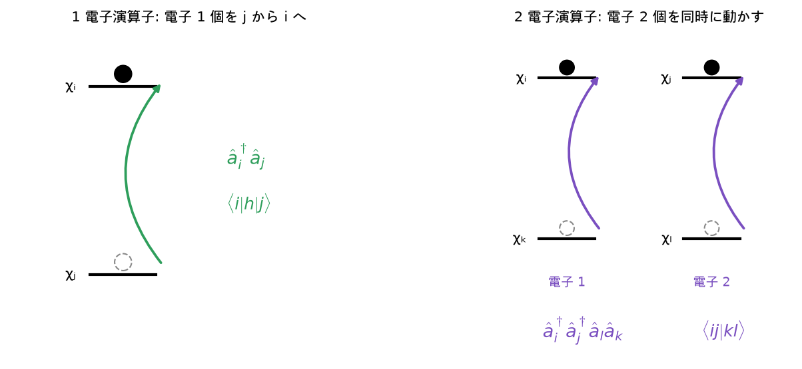

**図 13**　横線はスピン軌道、黒丸は電子、破線の丸は電子が抜けた席です。左：$\hat a_i^\dagger\hat a_j$ は電子 1 個を $\chi_j$ から $\chi_i$ へ移し、その重みが $\langle i|h|j\rangle$ です。右：$\hat a_i^\dagger\hat a_j^\dagger\hat a_l\hat a_k$ は、2 個の電子を同時に $\chi_k \to \chi_i$、$\chi_l \to \chi_j$ と移し、その重みが $\langle ij|kl\rangle$ です。

添字の並びには、3 つの注意があります。

**消滅演算子の順番は、生成演算子の順番と逆です。** 生成が $\hat a_i^\dagger\hat a_j^\dagger$ なら、消滅は $\hat a_l\hat a_k$ です。こうすると、$\chi_k$ が入っていた列に $\chi_i$ が、$\chi_l$ が入っていた列に $\chi_j$ が入ります。2 電子の決定子 $|\chi_k\chi_l\rangle = \hat a_k^\dagger\hat a_l^\dagger|\mathrm{vac}\rangle$（$k \ne l$）で確かめます。

$$
\begin{aligned}
\hat a_i^\dagger\hat a_j^\dagger\hat a_l\hat a_k\,\hat a_k^\dagger\hat a_l^\dagger|\mathrm{vac}\rangle
&= \hat a_i^\dagger\hat a_j^\dagger\hat a_l\big(1 - \hat a_k^\dagger\hat a_k\big)\hat a_l^\dagger|\mathrm{vac}\rangle
&&\text{（} \hat a_k\hat a_k^\dagger = 1 - \hat a_k^\dagger\hat a_k \text{ を使った）}\\
&= \hat a_i^\dagger\hat a_j^\dagger\hat a_l\hat a_l^\dagger|\mathrm{vac}\rangle
&&\text{（} \hat a_k\hat a_l^\dagger|\mathrm{vac}\rangle = -\hat a_l^\dagger\hat a_k|\mathrm{vac}\rangle = 0 \text{）}\\
&= \hat a_i^\dagger\hat a_j^\dagger|\mathrm{vac}\rangle
&&\text{（同じく } \hat a_l\hat a_l^\dagger|\mathrm{vac}\rangle = |\mathrm{vac}\rangle \text{）}
\end{aligned}
$$

1 列目の $\chi_k$ が $\chi_i$ に、2 列目の $\chi_l$ が $\chi_j$ に置き換わりました。
消滅を $\hat a_k\hat a_l$ の順にすると、結果の符号が逆になってしまいます。

**係数 $\frac12$ は、電子の組を 2 回数えないためのものです。** $\sum_{\mu<\nu}$ は $\frac12\sum_{\mu \ne \nu}$ と同じです。和 $\sum_{ijkl}$ は、$(k \to i,\ l \to j)$ と $(l \to j,\ k \to i)$ を別々に数えます。

**電子が自分自身と反発する項は、自動的に消えます。** 消滅演算子が 2 個あるので、電子が 1 個しかない状態にかけると 0 です。

### 11.3 電子のハミルトニアン

まとめると、1 節の電子のハミルトニアンは、次のように書けます。

$$
\hat H = \sum_{ij} \langle i|h|j\rangle\,\hat a_i^\dagger\hat a_j + \frac12\sum_{ijkl}\langle ij|kl\rangle\,\hat a_i^\dagger\hat a_j^\dagger\hat a_l\hat a_k
$$

この形には、2 つの特徴があります。

1. 電子の数 $N$ が式に出てきません。分子の情報は、すべて積分 $\langle i|h|j\rangle$ と $\langle ij|kl\rangle$ に入っています。演算子の部分（$\hat a^\dagger\hat a$ の並び）は、どの分子でも同じです。
2. 演算子が、$M$ 個のスピン軌道の上だけで定義されています。11.1 節の 1 で「$M$ 個で表せない部分は捨てる」としたので、$M$ 個のスピン軌道で作れる決定子の範囲での、ハミルトニアンの「射影」です。$M$ を無限に大きくすれば、元のハミルトニアンに一致します。

スピン軌道を、空間軌道 $\phi_P$ とスピン $\sigma$（$\alpha$ か $\beta$）に分けて $\chi_{P\sigma} = \phi_P\sigma$ と書きます。
6 節と同じスピンの積分から、$\langle i|h|j\rangle$ はスピンが同じときだけ 0 でありません。
$\langle ij|kl\rangle = [ik|jl]$ は、「$i$ と $k$ のスピンが同じ」かつ「$j$ と $l$ のスピンが同じ」ときだけ 0 でありません。
そこで、次の演算子でまとめて書くことがよくあります。

$$
\hat E_{PQ} = \sum_{\sigma=\alpha,\beta}\hat a_{P\sigma}^\dagger\hat a_{Q\sigma}
= \hat a_{P\alpha}^\dagger\hat a_{Q\alpha} + \hat a_{P\beta}^\dagger\hat a_{Q\beta}
$$

$\hat E_{PQ}$ は、スピンを変えずに、電子を空間軌道 $\phi_Q$ から $\phi_P$ へ移す演算子です。
これを使うと、

$$
\hat H = \sum_{PQ}h_{PQ}\hat E_{PQ} + \frac12\sum_{PQRS}(PQ|RS)\big(\hat E_{PQ}\hat E_{RS} - \delta_{QR}\hat E_{PS}\big)
$$

と書けます [Helgaker 2000]。
$h_{PQ} = (P|h|Q)$、$(PQ|RS)$ は空間軌道についての化学者の表記の積分です。
この式の導出は付録 D に書きました。
$\hat E_{PQ}$ はスピンを変えないので、この形は、第 4 回でスピンを扱うときに役立ちます。

**ここまでで分かったこと**：1 電子演算子は $\sum\langle i|h|j\rangle\hat a_i^\dagger\hat a_j$、2 電子演算子は $\frac12\sum\langle ij|kl\rangle\hat a_i^\dagger\hat a_j^\dagger\hat a_l\hat a_k$ と書けます。どちらも「電子を席から席へ動かす操作」に、積分の重みをかけた和です。

## 12. Slater–Condon 則を第二量子化で導き直す

4 節の Slater–Condon 則を、11 節のハミルトニアンと反交換関係から導き直します。
第一量子化（付録 A）では行列式を展開しましたが、第二量子化では演算子を並べ替えるだけで済みます。

$\hat H$ のどの項にも、消滅演算子は多くても 2 個しかありません。
したがって、$|\Psi_0\rangle$ に $\hat H$ をかけても、電子は多くても 2 個しか移りません（図 14）。
$\hat H|\Psi_0\rangle$ は、$|\Psi_0\rangle$ から多くても 2 個違う決定子の和なので、3 個以上違う決定子とは直交します。
これが 4 節の場合 4 です。

2 節の励起した決定子は、演算子で次のように書けます。

$$
|\Psi_a^r\rangle = \hat a_r^\dagger\hat a_a|\Psi_0\rangle,\qquad
|\Psi_{ab}^{rs}\rangle = \hat a_r^\dagger\hat a_s^\dagger\hat a_b\hat a_a|\Psi_0\rangle
$$

11.2 節で見たように、これは「$\chi_a$ が入っていた列に $\chi_r$ を、$\chi_b$ が入っていた列に $\chi_s$ を入れた決定子」です（付録 C）。
2 節の約束（同じ列に置く）と同じです。

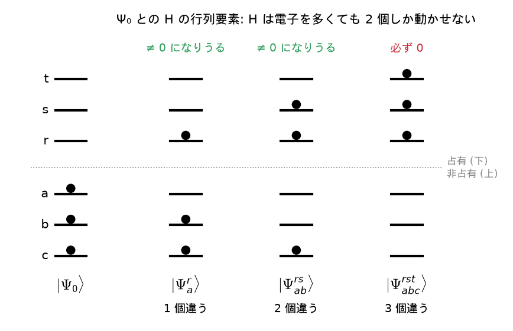

**図 14**　点線より下が $|\Psi_0\rangle$ で占有されたスピン軌道 $a, b, c$、上が仮想のスピン軌道 $r, s, t$ です。$|\Psi_0\rangle$ から電子を 1 個または 2 個移した決定子とは、ハミルトニアンの行列要素が 0 でありえます。3 個移した決定子との行列要素は、必ず 0 です。

第二量子化で求めた行列要素は、次のとおりです。$|\Psi_0\rangle$ を ket に置いた形で書きます。

| 2 つの決定子の違い | 行列要素 |
|---|---|
| 同じ | $\langle\Psi_0\vert\hat H\vert\Psi_0\rangle = \sum_a\langle a\vert h\vert a\rangle + \frac12\sum_{ab}\langle ab\vert\vert ab\rangle$ |
| スピン軌道 1 個 | $\langle\Psi_a^r\vert\hat H\vert\Psi_0\rangle = \langle r\vert h\vert a\rangle + \sum_b\langle rb\vert\vert ab\rangle$ |
| スピン軌道 2 個 | $\langle\Psi_{ab}^{rs}\vert\hat H\vert\Psi_0\rangle = \langle rs\vert\vert ab\rangle$ |
| スピン軌道 3 個以上 | 0 |

和の $a, b$ は、$|\Psi_0\rangle$ の占有スピン軌道すべてについてとります。
2 行目と 3 行目は、4.4 節の $\langle\Psi_0|\hat H|\Psi_a^r\rangle$、$\langle\Psi_0|\hat H|\Psi_{ab}^{rs}\rangle$ の複素共役です。たとえば $\langle ab||rs\rangle^* = \langle rs||ab\rangle$ です。
つまり、4 節の結果と一致します。
2 行目の値は、第 5 回の Fock 演算子 $\hat f$ の行列要素 $\langle r|\hat f|a\rangle$ に等しくなり、Hartree–Fock の軌道では 0 になります。これを Brillouin の定理と呼び、第 5 回で扱います。

1〜3 行目の求め方は、どれも同じです。

1. $\hat H$ の和の中から、$|\Psi_0\rangle$ を目的の決定子に変える項だけを選びます。たとえば 3 行目なら、2 電子の部分のうち、$\{k, l\} = \{a, b\}$ を取り除き、$\{i, j\} = \{r, s\}$ に入れる 4 つの項です。
2. 各項の演算子の並びを、反交換関係で定義の形（$\hat a_r^\dagger\hat a_s^\dagger\hat a_b\hat a_a$ など）に並べ直し、入れ替えの回数で符号を決めます。

3 行目の場合を書くと、4 つの項は次のようになります。

| $(i, j, k, l)$ | 積分 | 演算子を定義の形に直すと |
|---|---|---|
| $(r, s, a, b)$ | $\langle rs\vert ab\rangle$ | $\hat a_r^\dagger\hat a_s^\dagger\hat a_b\hat a_a$（そのまま） |
| $(s, r, b, a)$ | $\langle sr\vert ba\rangle = \langle rs\vert ab\rangle$ | $\hat a_s^\dagger\hat a_r^\dagger\hat a_a\hat a_b = (+1)\,\hat a_r^\dagger\hat a_s^\dagger\hat a_b\hat a_a$（入れ替え 2 回） |
| $(r, s, b, a)$ | $\langle rs\vert ba\rangle$ | $\hat a_r^\dagger\hat a_s^\dagger\hat a_a\hat a_b = (-1)\,\hat a_r^\dagger\hat a_s^\dagger\hat a_b\hat a_a$（入れ替え 1 回） |
| $(s, r, a, b)$ | $\langle sr\vert ab\rangle = \langle rs\vert ba\rangle$ | $\hat a_s^\dagger\hat a_r^\dagger\hat a_b\hat a_a = (-1)\,\hat a_r^\dagger\hat a_s^\dagger\hat a_b\hat a_a$（入れ替え 1 回） |

積分の等号は、3 節の $\langle ij|kl\rangle = \langle ji|lk\rangle$（電子 1 と電子 2 の名前の入れ替え）から来ます。
4 つの項を足して $\frac12$ をかけると、$\frac12\big(2\langle rs|ab\rangle - 2\langle rs|ba\rangle\big) = \langle rs||ab\rangle$ となり、表の 3 行目が得られます。
1 行目と 2 行目の各段階は、付録 E に書きました。

**ここまでで分かったこと**：Slater–Condon 則は、反交換関係から機械的に出てきます。結果は、4 節で行列式から求めたものと一致します。

## 13. numpy で確かめる：H₂ の 2 軌道 2 電子

ここまでの話を、いちばん小さな分子で確かめます。
H₂（核間距離 0.74 Å）を STO-3G 基底 [Hehre 1969] で解くと、空間軌道は結合性の $\phi_1$ と反結合性の $\phi_2$ の 2 個です。
スピン軌道は 4 個です。プログラムの中では、番号を 0 から始めて $0 = \phi_1\alpha$、$1 = \phi_1\beta$、$2 = \phi_2\alpha$、$3 = \phi_2\beta$ とします。

占有数の並びは $2^4 = 16$ 通りなので、演算子は $16\times 16$ の行列で表せます。
作り方は、9.3 節の $M = 2$ の例と同じです。
9.3 節の $\hat a_2$ は、「$\chi_1$ の席では、電子がいれば $-1$ をかける行列 $\mathbf Z$」と「$\chi_2$ の席では、電子を消す行列 $\boldsymbol\sigma$」を組み合わせたものでした。

$$
\mathbf Z = \begin{pmatrix} 1 & 0\\ 0 & -1\end{pmatrix},\qquad
\boldsymbol\sigma = \begin{pmatrix} 0 & 1\\ 0 & 0\end{pmatrix},\qquad
\hat a_1 = \boldsymbol\sigma\otimes\mathbf 1,\qquad
\hat a_2 = \mathbf Z\otimes\boldsymbol\sigma
$$

$\otimes$ はテンソル積（クロネッカー積、`np.kron`）で、席ごとの 2 行 2 列の行列を組み合わせて 4 行 4 列にします。
$\mathbf Z\otimes\boldsymbol\sigma$ を書き出すと、9.3 節の塊の形 $\begin{pmatrix} +\boldsymbol\sigma & \mathbf 0\\ \mathbf 0 & -\boldsymbol\sigma\end{pmatrix}$ になります。
$M = 4$ でも同じように、$i$ より前の席には $\mathbf Z$、$i$ の席には $\boldsymbol\sigma$、後ろの席には $\mathbf 1$ を置いて、テンソル積をとります。
前の席の $\mathbf Z$ が、符号 $\Gamma_i$ を表します。
この作り方は Jordan–Wigner 変換と呼ばれます [Jordan 1928]。
積分は PySCF [Sun 2020] で計算します。

コードでは、2 電子積分を化学者の表記の配列 `g[p, q, r, s]` $= [pq|rs]$ で持ちます。
11.2 節の和の項 $\langle ij|kl\rangle\,\hat a_i^\dagger\hat a_j^\dagger\hat a_l\hat a_k = [ik|jl]\,\hat a_i^\dagger\hat a_j^\dagger\hat a_l\hat a_k$ で、$p = i$、$q = k$、$r = j$、$s = l$ とおいたものが、コードの `g[p, q, r, s] * ad[p] @ ad[r] @ a[s] @ a[q]` です。

```python
import numpy as np
from functools import reduce
from pyscf import gto, scf, ao2mo, fci

# --- 1. H2/STO-3G の分子軌道の積分（空間軌道 2 個）---
mol = gto.M(atom="H 0 0 0; H 0 0 0.74", basis="sto-3g", verbose=0)
mf = scf.RHF(mol).run()
C = mf.mo_coeff
h_mo = C.T @ mf.get_hcore() @ C                       # h_PQ
eri_mo = ao2mo.restore(1, ao2mo.kernel(mol, C), 2)   # (PQ|RS) 化学者の表記

# --- 2. スピン軌道の積分 0=1α, 1=1β, 2=2α, 3=2β ---
M = 4
sp = lambda p: p // 2          # 空間軌道の番号
sg = lambda p: p % 2           # スピン（0=α, 1=β）
h = np.zeros((M, M)); g = np.zeros((M, M, M, M))
for p in range(M):
    for q in range(M):
        if sg(p) == sg(q):
            h[p, q] = h_mo[sp(p), sp(q)]
        for r in range(M):
            for s in range(M):
                if sg(p) == sg(q) and sg(r) == sg(s):
                    g[p, q, r, s] = eri_mo[sp(p), sp(q), sp(r), sp(s)]

# --- 3. 消滅演算子 a_p を 16×16 行列で作る ---
I2 = np.eye(2)
Z = np.diag([1.0, -1.0])                  # (-1)^n
low = np.array([[0.0, 1.0], [0.0, 0.0]])  # |0><1|：電子を 1 個消す
def annihilate(p):
    ops = [Z] * p + [low] + [I2] * (M - p - 1)
    return reduce(np.kron, ops)
a = [annihilate(p) for p in range(M)]
ad = [x.T for x in a]                     # 生成演算子 a_p^†

# 反交換関係を確かめる
ok = all(np.allclose(a[p] @ ad[q] + ad[q] @ a[p], np.eye(16) * (p == q))
         and np.allclose(a[p] @ a[q] + a[q] @ a[p], 0)
         for p in range(M) for q in range(M))
print("反交換関係が成り立つ:", ok)

# --- 4. 第二量子化のハミルトニアン ---
H = sum(h[p, q] * ad[p] @ a[q] for p in range(M) for q in range(M))
H = H + 0.5 * sum(g[p, q, r, s] * ad[p] @ ad[r] @ a[s] @ a[q]
                  for p in range(M) for q in range(M)
                  for r in range(M) for s in range(M))

# --- 5. 2 電子・Sz = 0 の決定子だけを取り出す ---
def index(occ):                         # 占有数 (n0,n1,n2,n3) → 行列の番号
    return int("".join(map(str, occ)), 2)
dets = {"|1α 1β>": (1, 1, 0, 0), "|1α 2β>": (1, 0, 0, 1),
        "|1β 2α>": (0, 1, 1, 0), "|2α 2β>": (0, 0, 1, 1)}
idx = [index(o) for o in dets.values()]
Hsub = H[np.ix_(idx, idx)]
np.set_printoptions(precision=5, suppress=True)
print("決定子:", list(dets.keys()))
print("ハミルトニアン行列（電子部分、Eh）:\n", Hsub)

# --- 6. 対角化して PySCF の FCI と比べる ---
w = np.linalg.eigvalsh(Hsub)
print("最低固有値 + V_NN :", w[0] + mol.energy_nuc())
print("PySCF の FCI       :", fci.FCI(mf).kernel()[0])
print("RHF                :", mf.e_tot)
print("K12 = (12|21) =", eri_mo[0, 1, 1, 0])
```

コードの中の `low` が $\boldsymbol\sigma$、`Z` が $\mathbf Z$ です。
`index` は、占有数の並びを 2 進数として読んで行列の番号にします。9.3 節で基底を $|00\rangle, |01\rangle, |10\rangle, |11\rangle$ の順に並べたのと同じ約束です。
出力は次のとおりです。

```text
反交換関係が成り立つ: True
決定子: ['|1α 1β>', '|1α 2β>', '|1β 2α>', '|2α 2β>']
ハミルトニアン行列（電子部分、Eh）:
 [[-1.83186 -0.       0.       0.18121]
 [ 0.      -1.06467 -0.18121 -0.     ]
 [-0.      -0.18121 -1.06467  0.     ]
 [ 0.18121  0.      -0.      -0.25249]]
最低固有値 + V_NN : -1.137283834488502
PySCF の FCI       : -1.1372838344885023
RHF                : -1.1167593073964255
K12 = (12|21) = 0.18121046201519703
```

$\hat S_z = 0$（$\alpha$ と $\beta$ の電子が 1 個ずつ）の決定子は 4 個です（図 15）。
決定子はすべて、スピン軌道の番号の小さい順に並べたものです。たとえば $|1\beta\,2\alpha\rangle$ は $\hat a_1^\dagger\hat a_2^\dagger|\mathrm{vac}\rangle$（プログラムの番号）です。
(1) が $|\Psi_0\rangle = |1\bar 1\rangle$、(4) が $|\Psi_{1\bar 1}^{2\bar 2}\rangle = |2\bar 2\rangle$ です。

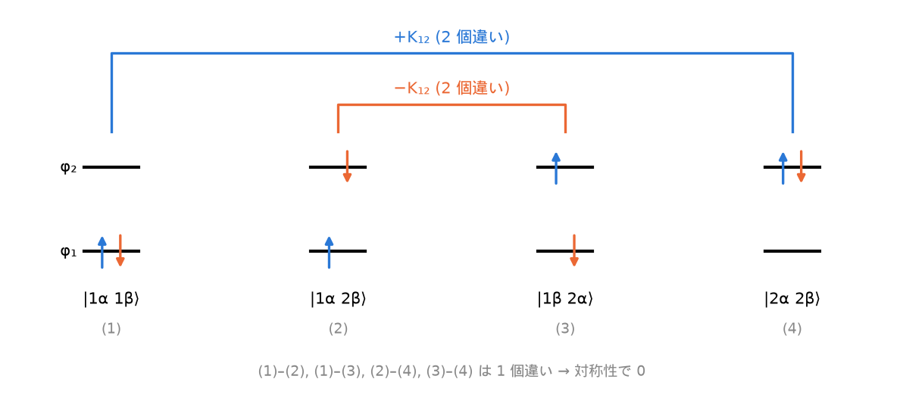

**図 15**　H₂ の $\hat S_z = 0$ の 4 つの決定子。青の上向きの矢印が $\alpha$ 電子、橙の下向きの矢印が $\beta$ 電子です。ハミルトニアンの非対角要素が 0 でないのは、2 個違いの (1)–(4) の組（$+K_{12}$）と、(2)–(3) の組（$-K_{12}$）だけです。1 個違いの組は、どれも 0 です。

出力の行列を、記号で書くと次の形です。行と列は図 15 の (1)〜(4) の順です。

$$
\mathbf H =
\begin{pmatrix}
E_1 & 0 & 0 & K_{12}\\
0 & A & -K_{12} & 0\\
0 & -K_{12} & A & 0\\
K_{12} & 0 & 0 & E_4
\end{pmatrix}
\begin{matrix} \leftarrow |1\alpha\,1\beta\rangle \\ \leftarrow |1\alpha\,2\beta\rangle \\ \leftarrow |1\beta\,2\alpha\rangle \\ \leftarrow |2\alpha\,2\beta\rangle \end{matrix}
$$

各要素の中身は次のとおりです。$J_{PQ} = (PP|QQ)$ はクーロン積分、$K_{12} = (12|21)$ は交換積分です（3 節）。

$$
\begin{aligned}
E_1 &= 2h_{11} + J_{11} = -1.83186, &
A &= h_{11} + h_{22} + J_{12} = -1.06467,\\
E_4 &= 2h_{22} + J_{22} = -0.25249, &
K_{12} &= (12|21) = 0.18121
\end{aligned}
$$

コードの `h_mo` と `eri_mo` から読むと、$h_{11} = -1.25331$、$h_{22} = -0.47507$、$J_{11} = 0.67476$、$J_{12} = 0.66371$、$J_{22} = 0.69765$ で、上の値と一致します。
各要素を、4 節の Slater–Condon 則と照らし合わせます。

- **対角要素**：場合 1 を使います。$|1\alpha\,2\beta\rangle$ では、占有スピン軌道は $1\alpha$ と $2\beta$ です。1 電子の部分は $h_{11} + h_{22}$ です。2 電子の部分は、$m = n$ の項が消え、$m \ne n$ の 2 項（$(m,n) = (1\alpha, 2\beta), (2\beta, 1\alpha)$）が残ります。どちらも $\langle 1\alpha\,2\beta||1\alpha\,2\beta\rangle$ に等しく、クーロンの部分は $[1\alpha\,1\alpha|2\beta\,2\beta] = (11|22) = J_{12}$ です。交換の部分 $[1\alpha\,2\beta|2\beta\,1\alpha]$ はスピンが合わないので 0 です。$\frac12 \times 2 \times J_{12}$ で、$A = h_{11} + h_{22} + J_{12}$ になります。$|1\alpha\,1\beta\rangle$ と $|2\alpha\,2\beta\rangle$ は、7 節で求めた $2h_{11} + J_{11}$ と $2h_{22} + J_{22}$ です。$E_1$ に核の反発 $V_\mathrm{NN}$ を足したものが、出力の RHF のエネルギーです。
- **(1) と (4) の間（2 個違い）**：7 節の右上の要素そのもので、$\langle 1\bar 1||2\bar 2\rangle = (12|12) = K_{12}$ です。実数の軌道では $(12|12) = (12|21)$ なので、値は出力の最後の行の $K_{12} = 0.18121$ に一致します。
- **(2) と (3) の間（2 個違い）**：値は $-K_{12}$ です。(2) $= |1\alpha\,2\beta\rangle$ と (3) $= |1\beta\,2\alpha\rangle$ には共通のスピン軌道がありません。(3) の列を入れ替えて $|2\alpha\,1\beta\rangle = -|1\beta\,2\alpha\rangle$ とすると、(2) と最大一致の並べ方になり、1 列目が $1\alpha \to 2\alpha$、2 列目が $2\beta \to 1\beta$ です。場合 3 の値は $\langle 1\alpha\,2\beta||2\alpha\,1\beta\rangle = [1\alpha\,2\alpha|2\beta\,1\beta] - [1\alpha\,1\beta|2\beta\,2\alpha] = (12|21) - 0 = K_{12}$ です。並べ替えの符号をかけて、$\langle(2)|\hat H|(3)\rangle = -K_{12}$ になります。演算子の行列は、この符号を自動的に扱っています。
- **1 個違いの組**：どれも 0 です。たとえば (1) と (2) の間は、7 節の $h_{12} + (12|11)$ と同じ形です。(2) と (4) の間は、場合 2 から $h_{12} + (12|22)$ です。結合性の $\phi_1$ と反結合性の $\phi_2$ は、分子の中心についての対称性が違うので、$\phi_2$ を奇数個含むこれらの積分は 0 です（7 節）。

この行列は、(1) と (4) の組と、(2) と (3) の組の、2 つの 2 行 2 列の塊に分かれます。
最低の固有値は、(1) と (4) の塊から出ます。これは 7 節の CI 行列そのものです。
2 行 2 列の行列 $\begin{pmatrix} E_1 & K_{12}\\ K_{12} & E_4\end{pmatrix}$ の小さい方の固有値は、7 節の式（$\Delta = \frac{E_4 - E_1}{2}$）で

$$
E_- = \frac{E_1 + E_4}{2} - \sqrt{\Big(\frac{E_4 - E_1}{2}\Big)^2 + K_{12}^2}
$$

です。数値を入れると、$\frac{E_1+E_4}{2} = -1.04218$、$\frac{E_4-E_1}{2} = 0.78969$ なので、$E_- = -1.04218 - \sqrt{0.78969^2 + 0.18121^2} = -1.04218 - 0.81021 = -1.85238$ です。
これに $V_\mathrm{NN} = 0.71510$ を足すと $-1.13728\,E_\mathrm h$ で、出力の最低固有値と PySCF の完全 CI のエネルギーに一致します。
RHF は (1) の決定子 1 個だけを使うので、$E_1 + V_\mathrm{NN} = -1.11676\,E_\mathrm h$ です。
$K_{12}$ を通して (4) の決定子 $|2\alpha\,2\beta\rangle$ が少し混ざることで、エネルギーが $0.0205\,E_\mathrm h$ 下がりました。
この差が、この基底での電子相関のエネルギーです。
完全 CI は[第 8 回](08-configuration-interaction.md)で詳しく扱います。

(2) と (3) の塊 $\begin{pmatrix} A & -K_{12}\\ -K_{12} & A\end{pmatrix}$ は、第 2 回で扱った「$\phi_1$ と $\phi_2$ に 1 個ずつ、反対のスピン」の決定子です。
固有ベクトルは $(1, 1)/\sqrt2$ と $(1, -1)/\sqrt2$ です。実際、

$$
\begin{pmatrix} A & -K_{12}\\ -K_{12} & A\end{pmatrix}\begin{pmatrix} 1\\ 1\end{pmatrix} = (A - K_{12})\begin{pmatrix} 1\\ 1\end{pmatrix}
$$

$$
\begin{pmatrix} A & -K_{12}\\ -K_{12} & A\end{pmatrix}\begin{pmatrix} 1\\ -1\end{pmatrix} = (A + K_{12})\begin{pmatrix} 1\\ -1\end{pmatrix}
$$

なので、エネルギーは $h_{11} + h_{22} + J_{12} \mp K_{12}$ に分かれます。
これが三重項と一重項に対応することは、[第 4 回](04-spin.md)で確かめます。

**ここまでで分かったこと**：生成・消滅演算子を行列で作り、積分をかけて足すだけで、ハミルトニアン行列ができます。その要素は Slater–Condon 則に一致し、対角化すると完全 CI のエネルギーが得られます。

## まとめ

- ハミルトニアンは、1 電子演算子 $\sum_\mu\hat h(\mu)$ と 2 電子演算子 $\sum_{\mu<\nu}1/r_{\mu\nu}$ の和です。2 電子積分には、物理学者の表記 $\langle ij|kl\rangle$ と化学者の表記 $[ij|kl]$ があり、$\langle ij|kl\rangle = [ik|jl]$ です。
- 最大一致に並べた 2 つの決定子の行列要素は、違うスピン軌道の数で決まります（Slater–Condon 則）。1 電子の部分は 2 個以上、2 電子の部分は 3 個以上違うと 0 です。
- 決定子 1 個のエネルギーは $E_0 = \sum_a\langle a|h|a\rangle + \frac12\sum_{ab}\langle ab||ab\rangle$ で、閉殻ではスピンの積分により $E_0 = 2\sum_a h_{aa} + \sum_{ab}(2J_{ab} - K_{ab})$ になります。
- 第二量子化では、決定子は占有数の並びで、反対称性とパウリの原理は反交換関係 $\{\hat a_i, \hat a_j^\dagger\} = \delta_{ij}$ などに含まれます。ハミルトニアンは $\sum\langle i|h|j\rangle\hat a_i^\dagger\hat a_j + \frac12\sum\langle ij|kl\rangle\hat a_i^\dagger\hat a_j^\dagger\hat a_l\hat a_k$ です。
- Slater–Condon 則は、反交換関係からも機械的に出てきます。numpy で作った H₂ のハミルトニアン行列は、この規則と完全 CI のエネルギーに一致しました。

## 付録 A　Slater–Condon 則の第一量子化での導出

### A.1 決定子の展開

第 2 回で見たように、決定子は、$N$ 個の電子を $N$ 本の列（スピン軌道）に割り当てる $N!$ 通りの方法（ハートリー積）を、符号付きで足したものです。
$|K\rangle$ の $k$ 列目のスピン軌道を $\chi_{k}^{K}$ と書くと、

$$
|K\rangle = \frac{1}{\sqrt{N!}}\sum_{P}(-1)^{\pi_P}\,\chi^K_{P(1)}(\mathbf x_1)\,\chi^K_{P(2)}(\mathbf x_2)\cdots\chi^K_{P(N)}(\mathbf x_N)
$$

です。$P$ は割り当て方（電子 $\mu$ を $P(\mu)$ 列目のスピン軌道に入れる）で、$\pi_P$ はその割り当てを作るのに必要な入れ替えの回数です。
$|L\rangle$ も、割り当て $Q$ について同じように展開します。
$|K\rangle$ と $|L\rangle$ は最大一致に並べてあるとします。
行列要素 $\langle K|\hat{\mathcal O}|L\rangle$ は、$P$ と $Q$ のすべての組についての和になります。
以下、スピン軌道が規格直交であることを使い、どの組が 0 にならずに残るかを数えます。

### A.2 1 電子の部分

$\hat h(1)$（電子 1 だけに作用）を考えます。
組 $(P, Q)$ の項は、電子 1 の積分 $\langle\chi^K_{P(1)}|\hat h|\chi^L_{Q(1)}\rangle$ と、電子 2 から $N$ の重なりの積 $\prod_{\mu\ge2}\langle\chi^K_{P(\mu)}|\chi^L_{Q(\mu)}\rangle$ の積に、符号 $(-1)^{\pi_P + \pi_Q}/N!$ をかけたものです。

**場合 1（同じ決定子）**：重なりが 0 にならないのは、電子 2 から $N$ について $P(\mu) = Q(\mu)$ のときだけです。
そのとき、残りの電子 1 の列も一致するので、$P = Q$ です。
$P = Q$ の項は符号 $(-1)^{2\pi_P} = 1$ で、値は $\langle\chi^K_{P(1)}|\hat h|\chi^K_{P(1)}\rangle$ です。
電子 1 を $\chi_m$ の列に入れる割り当ては、残りの $N-1$ 個の並べ方の $(N-1)!$ 通りあるので、

$$
\langle K|\hat h(1)|K\rangle = \frac{(N-1)!}{N!}\sum_m \langle m|h|m\rangle = \frac1N\sum_m \langle m|h|m\rangle
$$

です。
電子 $1, \dots, N$ のどれについても同じ値になる（1 節の性質 1）ので、$N$ 倍して、$\langle K|\hat{\mathcal O}_1|K\rangle = \sum_m\langle m|h|m\rangle$ です。

**場合 2（1 列目で $m \to p$）**：$|K\rangle$ と $|L\rangle$ は 1 列目だけが違うとします。
電子 2 から $N$ の重なりが 0 にならないためには、これらの電子が共通の列（2 列目以降）に、bra と ket で同じように割り当てられていなければなりません。
すると、電子 1 は bra でも ket でも 1 列目に入り、$P = Q$ です。値は $\langle m|h|p\rangle$ で、符号は $+$ です。
そのような割り当ては $(N-1)!$ 通りなので、$\langle K|\hat h(1)|L\rangle = \frac{(N-1)!}{N!}\langle m|h|p\rangle$、$N$ 倍して $\langle K|\hat{\mathcal O}_1|L\rangle = \langle m|h|p\rangle$ です。

**場合 3 以上（2 列以上が違う）**：電子 2 から $N$ の $N - 1$ 個の電子を、共通の列だけに割り当てることはできません（共通の列は $N - 2$ 本以下）。
どの項にも違うスピン軌道の重なり 0 が含まれるので、$\langle K|\hat{\mathcal O}_1|L\rangle = 0$ です。

### A.3 2 電子の部分

$1/r_{12}$（電子 1 と 2 に作用）を考えます。
電子 3 から $N$ の重なりが 0 にならないためには、それらの電子が共通の列に、bra と ket で同じように割り当てられていなければなりません。
すると、電子 1 と 2 には、bra と ket で同じ 2 本の列が残ります。その割り当て方は、次の 2 通りです（図 5）。

- $Q = P$（電子 1 と 2 の割り当ても同じ）：符号は $+$ です。
- $Q$ は $P$ の電子 1 と 2 を入れ替えたもの：入れ替えが 1 回多いので符号は $-$ です。

**場合 1（同じ決定子）**：残った 2 本の列のスピン軌道を $\chi_m$、$\chi_n$（$m \ne n$）とし、bra で電子 1 が $\chi_m$、電子 2 が $\chi_n$ に入っているとします。2 つの項の値は、

$$
+\iint\chi_m^*(1)\chi_n^*(2)\,\frac{1}{r_{12}}\,\chi_m(1)\chi_n(2) = \langle mn|mn\rangle,
$$

$$
-\iint\chi_m^*(1)\chi_n^*(2)\,\frac{1}{r_{12}}\,\chi_n(1)\chi_m(2) = -\langle mn|nm\rangle
$$

で、和は $\langle mn||mn\rangle$ です。
電子 1 に $\chi_m$、電子 2 に $\chi_n$ を入れる割り当ては、残りの並べ方の $(N-2)!$ 通りあります。
したがって

$$
\Big\langle K\Big|\frac{1}{r_{12}}\Big|K\Big\rangle = \frac{(N-2)!}{N!}\sum_{m\neq n}\langle mn||mn\rangle
$$

です。
電子の組は $N(N-1)/2$ 個あり、どの組も同じ値を与えるので、それをかけると係数は $\frac{(N-2)!}{N!}\cdot\frac{N(N-1)}{2} = \frac12$ です。
$m = n$ の項は $\langle mm||mm\rangle = 0$ なので、和に含めても変わりません。
以上で、

$$
\langle K|\hat{\mathcal O}_2|K\rangle = \frac12\sum_m\sum_n\langle mn||mn\rangle = \frac12\sum_m\sum_n\big([mm|nn] - [mn|nm]\big)
$$

が得られます。$|K\rangle = |\Psi_0\rangle$ とおけば、5 節の式です。

**場合 2（1 列目で $m \to p$）**：電子 3 から $N$ が共通の列のうち $N - 2$ 本を占めると、電子 1 と 2 には、1 列目と、共通の列の 1 本（スピン軌道 $\chi_n$）が残ります。
bra で電子 1 が 1 列目（$\chi_m$）、電子 2 が $\chi_n$ の列にいるとき、2 つの項の値は、ket の 1 列目が $\chi_p$ なので、

$$
+\langle mn|pn\rangle,\qquad -\langle mn|np\rangle
$$

で、和は $\langle mn||pn\rangle$ です。
bra で電子 1 と 2 の列が逆の割り当て（電子 1 が $\chi_n$、電子 2 が $\chi_m$）も、同じく $\langle nm||np\rangle = \langle mn||pn\rangle$（3 節の対称性）を与えます。
したがって、$\chi_n$ ごとに $2 \times (N-2)!$ 通りの割り当てが $\langle mn||pn\rangle$ を与えます。

$$
\Big\langle K\Big|\frac{1}{r_{12}}\Big|L\Big\rangle = \frac{2\,(N-2)!}{N!}\sum_{n}\langle mn||pn\rangle
$$

組の数 $N(N-1)/2$ をかけると係数は 1 で、$\langle K|\hat{\mathcal O}_2|L\rangle = \sum_n\langle mn||pn\rangle$ です。

**場合 3（1 列目で $m \to p$、2 列目で $n \to q$）**：電子 3 から $N$ が共通の $N - 2$ 本の列をすべて占めるので、電子 1 と 2 には、違う 2 本の列が残ります。
場合 2 と同じ数え方で、値は $\langle mn|pq\rangle - \langle mn|qp\rangle = \langle mn||pq\rangle$、割り当ての数は $2 \times (N-2)!$ 通りです。
組の数をかけて、$\langle K|\hat{\mathcal O}_2|L\rangle = \langle mn||pq\rangle$ です。

**場合 4（3 列以上が違う）**：電子 3 から $N$ の $N - 2$ 個の電子を、共通の列だけに割り当てることはできません（共通の列は $N - 3$ 本以下）。したがって 0 です。

## 付録 B　反交換関係の証明

定義（9.1 節）から、3 つの反交換関係を確かめます。
任意の決定子 $|\mathbf n\rangle$ にかけて、結果が右辺と一致することを示せば十分です。
大事な点は、$\Gamma_i = (-1)^{\sum_{j<i}n_j}$ が $n_i$ 自身を含まず、$i$ より番号の小さい席だけで決まることです。

**(1) $\{\hat a_i, \hat a_i^\dagger\} = 1$。** $n_i$ で場合を分けます。

- $n_i = 0$ のとき：$\hat a_i^\dagger$ で電子を入れると $\Gamma_i|\cdots 1_i\cdots\rangle$ です。続けて $\hat a_i$ で取ると、前の席は変わっていないので同じ $\Gamma_i$ がかかり、$\Gamma_i^2|\mathbf n\rangle = |\mathbf n\rangle$ です。一方、$\hat a_i^\dagger\hat a_i|\mathbf n\rangle$ は、空いた席から取るので 0 です。和は $|\mathbf n\rangle$ です。
- $n_i = 1$ のとき：$\hat a_i\hat a_i^\dagger|\mathbf n\rangle$ は、埋まった席に入れるので 0 です。$\hat a_i^\dagger\hat a_i|\mathbf n\rangle$ は、取って戻すので $\Gamma_i^2|\mathbf n\rangle = |\mathbf n\rangle$ です。和は $|\mathbf n\rangle$ です。

どちらの場合も、$\{\hat a_i, \hat a_i^\dagger\}|\mathbf n\rangle = |\mathbf n\rangle$ です。

**(2) $i \ne j$ のとき $\{\hat a_i, \hat a_j^\dagger\} = 0$。** $i < j$ とします（$i > j$ も同じです）。
$\hat a_i\hat a_j^\dagger|\mathbf n\rangle$ が 0 でないのは、$n_i = 1$、$n_j = 0$ のときだけです。このとき、

- $\hat a_j^\dagger$ を先にかける順番：$\hat a_j^\dagger$ の符号 $\Gamma_j$ は、前の席にある $\chi_i$ の電子を数えます。次の $\hat a_i$ の符号は $\Gamma_i$ です。全体で $\Gamma_i\Gamma_j$ です。
- $\hat a_i$ を先にかける順番（$\hat a_j^\dagger\hat a_i$）：$\hat a_i$ の符号は $\Gamma_i$ です。$\chi_i$ の電子がいなくなったので、次の $\hat a_j^\dagger$ の符号は $-\Gamma_j$ になります。全体で $-\Gamma_i\Gamma_j$ です。

どちらも同じ決定子を与え、符号だけが逆なので、和は 0 です。
$n_i = 0$ または $n_j = 1$ のときは、どちらの順番でも途中で 0 になります。

**(3) $\{\hat a_i, \hat a_j\} = 0$ と $\{\hat a_i^\dagger, \hat a_j^\dagger\} = 0$。** $i = j$ のときは、同じ席から 2 回取る（または 2 回入れる）ので、$\hat a_i\hat a_i = 0$ です。$i < j$ のときは (2) と同じ議論で、先に $\chi_i$ を操作すると $\chi_j$ の符号が 1 回反転するので、2 つの順番の和は 0 です。10 節の $\hat a_1\hat a_2|11\rangle$ の計算（図 12）が、その例です。

## 付録 C　1 電子演算子と 2 電子演算子の第二量子化表示

### C.1 演算子は「同じ列での置き換え」をする

占有されたスピン軌道 $\chi_k$ を含む決定子 $|\Phi\rangle$ を、生成演算子の並び（9.2 節）で書きます。
$\hat a_k^\dagger$ を並びの先頭まで動かすと、入れ替えの回数に応じた符号 $\eta = \pm 1$ が付きます。

$$
|\Phi\rangle = \eta\,\hat a_k^\dagger|\Psi\rangle
$$

$|\Psi\rangle$ は、$|\Phi\rangle$ から $\chi_k$ を除いた決定子です。$|\Psi\rangle$ では $\chi_k$ が空いているので $\hat a_k|\Psi\rangle = 0$ です。
これに $\hat a_i^\dagger\hat a_k$ をかけます（$\chi_i$ は $|\Psi\rangle$ で空いているとします）。

$$
\begin{aligned}
\hat a_i^\dagger\hat a_k|\Phi\rangle
&= \eta\,\hat a_i^\dagger\,\hat a_k\hat a_k^\dagger|\Psi\rangle\\
&= \eta\,\hat a_i^\dagger\big(1 - \hat a_k^\dagger\hat a_k\big)|\Psi\rangle
&&\text{（反交換関係 } \hat a_k\hat a_k^\dagger = 1 - \hat a_k^\dagger\hat a_k\text{）}\\
&= \eta\,\hat a_i^\dagger|\Psi\rangle
&&\text{（} \hat a_k|\Psi\rangle = 0\text{）}
\end{aligned}
$$

最後の式は、$|\Phi\rangle$ の並びの中の $\hat a_k^\dagger$ を $\hat a_i^\dagger$ に取り替えたものです。
$\hat a_i^\dagger$ を先頭から元の $\hat a_k^\dagger$ の位置まで戻せば、同じ回数の入れ替えで $\eta$ が打ち消されるからです。
並びの位置は行列式の列なので、$\hat a_i^\dagger\hat a_k$ は「$\chi_k$ が入っていた列に、$\chi_i$ を入れる」演算子です。
$\chi_i$ がすでに占有されていれば、結果は 0 で、行列式でも同じ列が 2 本になって 0 です。

2 個の場合も同じです。$k \ne l$ がどちらも占有されているとき、$|\Phi\rangle = \eta\,\hat a_k^\dagger\hat a_l^\dagger|\Psi\rangle$ と書き、11.2 節と同じ計算をすると、

$$
\hat a_i^\dagger\hat a_j^\dagger\hat a_l\hat a_k|\Phi\rangle = \eta\,\hat a_i^\dagger\hat a_j^\dagger|\Psi\rangle
$$

です。$\chi_k$ の列に $\chi_i$、$\chi_l$ の列に $\chi_j$ が入ります。

### C.2 1 電子演算子

第一量子化の決定子を、$N$ 個のスピン軌道 $\chi_{k_1}, \dots, \chi_{k_N}$ の行列式とします。
$\sum_\mu\hat h(\mu)$ は電子の入れ替えについて対称なので、行列式にかけると、各列に順番に $\hat h$ をかけたものの和になります。

$$
\sum_{\mu}\hat h(\mu)\,\big|\chi_{k_1}\cdots\chi_{k_n}\cdots\chi_{k_N}\big|
= \sum_{n=1}^{N}\big|\chi_{k_1}\cdots(\hat h\chi_{k_n})\cdots\chi_{k_N}\big|
$$

11.1 節のとおり $\hat h\chi_{k} = \sum_i \chi_i\,\langle i|h|k\rangle$ です（$M$ 個のスピン軌道の範囲で）。これを代入します。

$$
= \sum_{n=1}^{N}\sum_{i} \langle i|h|k_n\rangle\,\big|\chi_{k_1}\cdots\chi_i\cdots\chi_{k_N}\big|
$$

右辺の行列式は、$n$ 列目の $\chi_{k_n}$ を $\chi_i$ に置き換えたものなので、C.1 から $\hat a_i^\dagger\hat a_{k_n}|\Phi\rangle$ です。
占有されていない $j$ については $\hat a_j|\Phi\rangle = 0$ なので、和をすべてのスピン軌道 $j$ に広げても変わりません。

$$
= \sum_{ij} \langle i|h|j\rangle\,\hat a_i^\dagger\hat a_j|\Phi\rangle
$$

これが 11.1 節の式です。

### C.3 2 電子演算子

$\sum_{\mu<\nu}g(\mu,\nu)$（$g = 1/r_{12}$）は、$\frac12\sum_{\mu \ne \nu}g(\mu,\nu)$ と書けます。
C.2 と同じく、行列式にかけると、2 本の列 $n \ne n'$ を選んでその 2 つの関数に $g$ をかけたものの和になります。
2 個の関数の積に $g$ をかけた結果を、積 $\chi_i(\mathbf x_1)\chi_j(\mathbf x_2)$ で展開します。

$$
g(1,2)\,\chi_k(\mathbf x_1)\chi_l(\mathbf x_2) = \sum_{ij}\chi_i(\mathbf x_1)\chi_j(\mathbf x_2)\,\langle ij|kl\rangle
$$

係数は、両辺に $\chi_i^*(\mathbf x_1)\chi_j^*(\mathbf x_2)$ をかけて積分すると得られ、3 節の $\langle ij|kl\rangle$ の定義そのものです。
したがって、

$$
\frac12\sum_{n \ne n'}\sum_{ij}\langle ij|k_n k_{n'}\rangle\,\big|\cdots\chi_i\cdots\chi_j\cdots\big|
$$

になります。行列式は、$n$ 列目を $\chi_i$ に、$n'$ 列目を $\chi_j$ に置き換えたものです。
C.1 から、これは $\hat a_i^\dagger\hat a_j^\dagger\hat a_{k_{n'}}\hat a_{k_n}|\Phi\rangle$ です。
$k = l$ の項は $\hat a_k\hat a_k = 0$ で消え、占有されていない $k, l$ の項も消えるので、和をすべての $k, l$ に広げられます。

$$
= \frac12\sum_{ijkl}\langle ij|kl\rangle\,\hat a_i^\dagger\hat a_j^\dagger\hat a_l\hat a_k|\Phi\rangle
$$

これが 11.2 節の式です。

## 付録 D　空間軌道の演算子 Ê を使ったハミルトニアン

まず、演算子の並びを変える恒等式を導きます。スピン軌道の添字 $i, j, k, l$ について、

$$
\begin{aligned}
\hat a_i^\dagger\hat a_j^\dagger\hat a_l\hat a_k
&= -\hat a_i^\dagger\hat a_j^\dagger\hat a_k\hat a_l
&&\text{（} \hat a_l\hat a_k = -\hat a_k\hat a_l\text{）}\\
&= -\hat a_i^\dagger\big(\delta_{jk} - \hat a_k\hat a_j^\dagger\big)\hat a_l
&&\text{（} \hat a_j^\dagger\hat a_k = \delta_{jk} - \hat a_k\hat a_j^\dagger\text{）}\\
&= \hat a_i^\dagger\hat a_k\,\hat a_j^\dagger\hat a_l - \delta_{jk}\,\hat a_i^\dagger\hat a_l
&&\text{（括弧を展開）}
\end{aligned}
$$

です。
次に、スピン軌道を $i = P\sigma$、$k = Q\sigma'$、$j = R\tau$、$l = S\tau'$ と書きます。
11.3 節で見たとおり、$\langle ij|kl\rangle = [ik|jl] = (PQ|RS)\,\delta_{\sigma\sigma'}\delta_{\tau\tau'}$ です。
これを 2 電子の部分に代入すると、スピンの和は $\sigma' = \sigma$、$\tau' = \tau$ の項だけが残ります。

$$
\frac12\sum_{PQRS}(PQ|RS)\sum_{\sigma\tau}\Big(\hat a_{P\sigma}^\dagger\hat a_{Q\sigma}\,\hat a_{R\tau}^\dagger\hat a_{S\tau} - \delta_{QR}\delta_{\sigma\tau}\,\hat a_{P\sigma}^\dagger\hat a_{S\tau}\Big)
$$

第 1 項のスピンの和は $\hat E_{PQ}\hat E_{RS}$ です。
第 2 項は、$\delta_{jk}$ が $\delta_{QR}\delta_{\sigma\tau}$ になったものです。$\delta_{\sigma\tau}$ で $\tau = \sigma$ となり、$\delta_{QR}\sum_\sigma\hat a_{P\sigma}^\dagger\hat a_{S\sigma} = \delta_{QR}\hat E_{PS}$ です。
1 電子の部分も同じように $\sum_{PQ}h_{PQ}\hat E_{PQ}$ になるので、11.3 節の式が得られます。

## 付録 E　第二量子化での Slater–Condon 則の 1 行目と 2 行目

**1 行目（同じ決定子）。** $|\Phi\rangle$ を占有数 $n_i$ の決定子とします。
まず 1 電子の部分です。
$\hat a_i^\dagger\hat a_j|\Phi\rangle$ は、$i \ne j$ なら $|\Phi\rangle$ と違う決定子（または 0）なので、$|\Phi\rangle$ と直交します。$i = j$ なら数演算子なので $n_i$ を返します。

$$
\langle\Phi|\hat a_i^\dagger\hat a_j|\Phi\rangle = \delta_{ij}\,n_i
$$

次に 2 電子の部分です。
$\hat a_i^\dagger\hat a_j^\dagger\hat a_l\hat a_k|\Phi\rangle$ が $|\Phi\rangle$ に戻るには、取り除いた 2 つのスピン軌道 $\{k, l\}$ に、同じ 2 つのスピン軌道で電子を戻す必要があります。
その方法は、$i = k, j = l$ と $i = l, j = k$ の 2 通りです（$i \ne j$）。

- 前者は $\hat a_i^\dagger\hat a_j^\dagger\hat a_j\hat a_i$ です。$\hat a_j^\dagger\hat a_j = \hat n_j$ と $\hat a_i$ は、$i \ne j$ なら入れ替えても符号が変わりません（$\hat a_i$ を $\hat a_j$ と $\hat a_j^\dagger$ の 2 個と入れ替えるので、$(-1)^2 = 1$）。したがって $\hat a_i^\dagger\hat a_i\hat n_j = \hat n_i\hat n_j$ で、期待値は $n_i n_j$ です。
- 後者は $\hat a_i^\dagger\hat a_j^\dagger\hat a_i\hat a_j = -\hat a_i^\dagger\hat a_j^\dagger\hat a_j\hat a_i$ なので、期待値は $-n_i n_j$ です。

まとめると、

$$
\langle\Phi|\hat a_i^\dagger\hat a_j^\dagger\hat a_l\hat a_k|\Phi\rangle = n_i n_j\big(\delta_{ik}\delta_{jl} - \delta_{il}\delta_{jk}\big)
$$

です（$i = j$ のときは左辺が 0 ですが、右辺の括弧も $\delta_{ik}\delta_{il} - \delta_{il}\delta_{ik} = 0$ なので、この式はそのまま成り立ちます）。
これらを $\hat H$ に入れると、

$$
\langle\Phi|\hat H|\Phi\rangle = \sum_i n_i\langle i|h|i\rangle + \frac12\sum_{ij}n_i n_j\big(\langle ij|ij\rangle - \langle ij|ji\rangle\big)
$$

となります。$n_i = 1$ の $i$ を $a, b$ と書けば、12 節の表の 1 行目（4 節の場合 1）です。

**2 行目（1 個違う決定子）。** $|\Psi_a^r\rangle = \hat a_r^\dagger\hat a_a|\Psi_0\rangle$ との行列要素です。
1 電子の部分で $|\Psi_0\rangle$ を $|\Psi_a^r\rangle$ に変えるのは $i = r$、$j = a$ の項だけなので、寄与は $\langle r|h|a\rangle$ です。
2 電子の部分では、$\chi_a$ の電子を $\chi_r$ に移し、もう 1 個の電子は同じ席 $\chi_b$（$b \ne a$ の占有スピン軌道）に戻す項が残ります。

| $(i, j, k, l)$ | 積分 | 演算子を $\hat a_r^\dagger\hat a_b^\dagger\hat a_b\hat a_a$ の形に直すと |
|---|---|---|
| $(r, b, a, b)$ | $\langle rb\vert ab\rangle$ | $\hat a_r^\dagger\hat a_b^\dagger\hat a_b\hat a_a$（そのまま） |
| $(b, r, b, a)$ | $\langle br\vert ba\rangle = \langle rb\vert ab\rangle$ | $\hat a_b^\dagger\hat a_r^\dagger\hat a_a\hat a_b = \hat a_r^\dagger\hat a_b^\dagger\hat a_b\hat a_a$（入れ替え 2 回） |
| $(r, b, b, a)$ | $\langle rb\vert ba\rangle$ | $\hat a_r^\dagger\hat a_b^\dagger\hat a_a\hat a_b = -\hat a_r^\dagger\hat a_b^\dagger\hat a_b\hat a_a$（入れ替え 1 回） |
| $(b, r, a, b)$ | $\langle br\vert ab\rangle = \langle rb\vert ba\rangle$ | $\hat a_b^\dagger\hat a_r^\dagger\hat a_b\hat a_a = -\hat a_r^\dagger\hat a_b^\dagger\hat a_b\hat a_a$（入れ替え 1 回） |

$\hat a_r^\dagger\hat a_b^\dagger\hat a_b\hat a_a$ は、$\hat a_a$ を左へ 2 回入れ替えると $\hat a_r^\dagger\hat a_a\,\hat n_b$ になります。$\hat n_b|\Psi_0\rangle = |\Psi_0\rangle$ なので、どの演算子も $|\Psi_0\rangle$ を $\pm|\Psi_a^r\rangle$ に変えます。
4 つの項を足して $\frac12$ をかけると、各 $b$ について $\langle rb|ab\rangle - \langle rb|ba\rangle = \langle rb||ab\rangle$ です。
$b = a$ の項は $\langle ra||aa\rangle = -\langle ra||aa\rangle$（3 節の $\langle ij||kl\rangle = -\langle ij||lk\rangle$ で $k = l = a$）から 0 なので、和に含めても変わりません。
1 電子の部分と合わせて、

$$
\langle\Psi_a^r|\hat H|\Psi_0\rangle = \langle r|h|a\rangle + \sum_b\langle rb||ab\rangle
$$

が得られます。

## 参考文献

- A. Szabo, N. S. Ostlund, "Modern Quantum Chemistry" (Dover, 1996). ISBN: 9780486691862
- T. Helgaker, P. Jørgensen, J. Olsen, "Molecular Electronic-Structure Theory" (Wiley, 2000). ISBN: 9780471967552
- J. C. Slater, "The Theory of Complex Spectra", Phys. Rev. 34, 1293 (1929). DOI: [10.1103/PhysRev.34.1293](https://doi.org/10.1103/PhysRev.34.1293)
- E. U. Condon, "The Theory of Complex Spectra", Phys. Rev. 36, 1121 (1930). DOI: [10.1103/PhysRev.36.1121](https://doi.org/10.1103/PhysRev.36.1121)
- V. Fock, "Konfigurationsraum und zweite Quantelung", Z. Phys. 75, 622 (1932). DOI: [10.1007/BF01344458](https://doi.org/10.1007/BF01344458)
- P. Jordan, E. Wigner, "Über das Paulische Äquivalenzverbot", Z. Phys. 47, 631 (1928). DOI: [10.1007/BF01331938](https://doi.org/10.1007/BF01331938)
- W. J. Hehre, R. F. Stewart, J. A. Pople, "Self-Consistent Molecular-Orbital Methods. I. Use of Gaussian Expansions of Slater-Type Atomic Orbitals", J. Chem. Phys. 51, 2657 (1969). DOI: [10.1063/1.1672392](https://doi.org/10.1063/1.1672392)
- Q. Sun et al., "Recent developments in the PySCF program package", J. Chem. Phys. 153, 024109 (2020). DOI: [10.1063/5.0006074](https://doi.org/10.1063/5.0006074)
