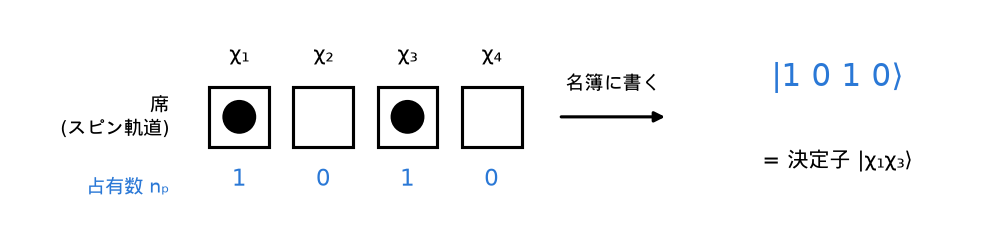
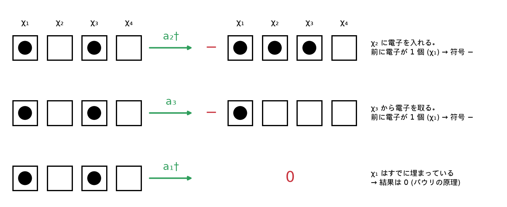
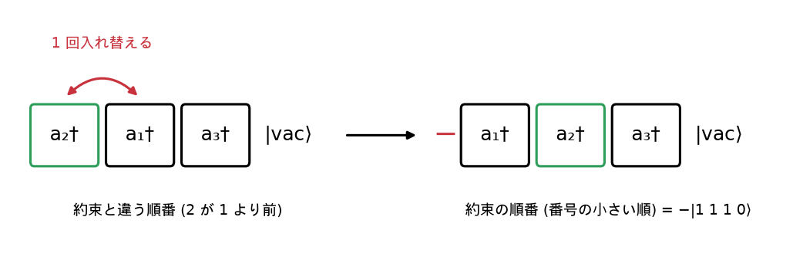
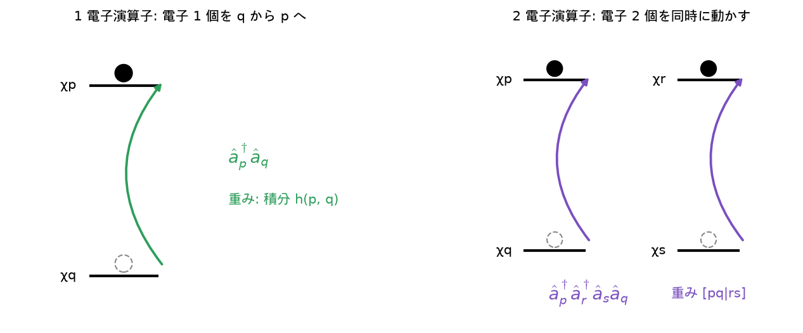
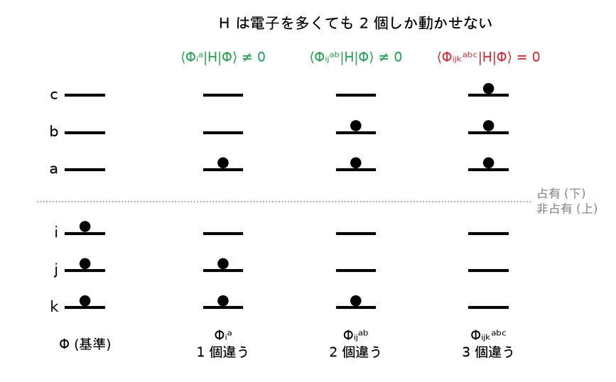
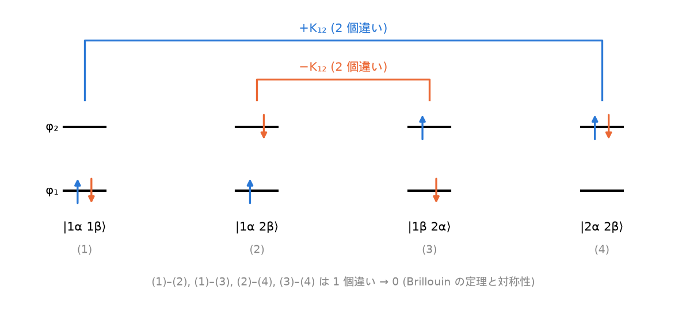

# 第 4 回　第二量子化：生成・消滅演算子

!!! abstract "この回の道筋"
    決定子をたくさん使う方法（電子相関の方法）では、行列式を毎回書き下すのは大変です。第二量子化では、決定子を「どのスピン軌道に電子がいるか」の並びで表し、電子を出し入れする演算子で計算します。この回では、生成・消滅演算子とその反交換関係を、小さな行列で具体的に見ながら導入し、ハミルトニアンを演算子で書き直します。最後に numpy で H₂ のハミルトニアン行列を組み立て、Slater–Condon 則と一致することを確かめます。

    | 節 | 内容 |
    |---|---|
    | 1 | 占有数表示 |
    | 2 | 生成・消滅演算子 |
    | 3 | 反交換関係 |
    | 4 | ハミルトニアンを演算子で書く |
    | 5 | Slater–Condon 則との対応 |
    | 6 | numpy で確かめる：H₂ の 2 軌道 2 電子 |

    **前に読んでおく回**：量子化学の理論 [第 2 回](02-determinants.md)、[第 3 回](03-hartree-fock.md)

!!! tip "物理的なイメージ"
    第二量子化は、電子の状態を「どの席（スピン軌道）が埋まっているか」の名簿として見る見方です。生成演算子は空いた席に電子を 1 個座らせ、消滅演算子は座っている電子を 1 個立たせます。電子は区別できないので、「どの電子がどの席にいるか」ではなく、「どの席が埋まっているか」だけが意味をもちます。演算子の反交換関係が、電子を入れ替えると符号が変わること（反対称性）と、同じ席に 2 個座れないこと（パウリの原理）を自動的に守ります。ハミルトニアンは、電子を 1 個または 2 個、席から席へ動かす操作の和として書けます。

この回では、スピン軌道（空間の関数とスピンの関数の積、第 2 回）を $\chi_p$ と書きます。積分の表記は 4.2 節で定義します。エネルギーは原子単位（ハートリー，$E_\mathrm h$）で書きます。

## 1. 占有数表示

規格直交なスピン軌道を $M$ 個用意し、番号 $\chi_1, \chi_2, \dots, \chi_M$ を付けます。
たとえば第 3 回の Hartree–Fock 法で得た軌道（占有軌道と仮想軌道）が、これに当たります。
この中から $N$ 個を選んで電子を入れると、決定子が 1 つ決まります。

第 2 回で見たように、決定子は「どのスピン軌道を占有したか」で決まります。
軌道の並べ方を変えても、行列式の列を入れ替えるだけなので、符号が変わるだけです。
そこで、軌道は**番号の小さい順に並べる**と約束します。
すると、決定子は、各スピン軌道の占有数 $n_p$（電子がいれば 1、いなければ 0）の並びで表せます。

$$
|\chi_1\chi_3\rangle \;\longleftrightarrow\; |n_1 n_2 n_3 n_4\rangle = |1\,0\,1\,0\rangle
\qquad(M = 4,\ N = 2\ \text{の例})
$$



**図 1**　4 個のスピン軌道を 4 つの席（四角）で、電子を黒丸で描きました。席 $\chi_1$ と $\chi_3$ が埋まっています。席ごとの占有数（青の数字）を左から並べた $|1\,0\,1\,0\rangle$ が、決定子 $|\chi_1\chi_3\rangle$ を表します。

これを占有数表示（occupation-number representation）と呼びます。
電子が 1 個もない状態 $|0\,0\cdots 0\rangle$ を真空（vacuum）と呼び、$|\mathrm{vac}\rangle$ と書きます。

$M = 4$、$N = 2$ のとき、2 個の席の選び方は $\binom{4}{2} = 6$ 通りなので、決定子は次の 6 個です。

$$
|1100\rangle,\ |1010\rangle,\ |1001\rangle,\ |0110\rangle,\ |0101\rangle,\ |0011\rangle
$$

占有数の並びが違う決定子どうしは直交します。
少なくとも 1 つのスピン軌道が片方にだけ含まれ、そのスピン軌道は他方のどのスピン軌道とも直交するからです（第 2 回）。
並びが同じなら、内積は 1 です。式で書くと、次のようになります。

$$
\langle \mathbf n|\mathbf m\rangle = \prod_{p=1}^{M}\delta_{n_p m_p}
$$

**ここまでで分かったこと**：軌道の順番を決めておけば、決定子は占有数の並び $|n_1 n_2\cdots n_M\rangle$ で表せます。

## 2. 生成・消滅演算子

### 2.1 定義

スピン軌道 $\chi_p$ に電子を 1 個加える演算子 $\hat a_p^\dagger$ を、生成演算子（creation operator）と呼びます。
次のように定義します。

$$
\hat a_p^\dagger\,|\cdots n_p\cdots\rangle =
\begin{cases}
\Gamma_p\,|\cdots 1_p\cdots\rangle & (n_p = 0)\\
0 & (n_p = 1)
\end{cases}
\qquad
\Gamma_p = (-1)^{\sum_{q<p} n_q}
$$

すでに電子がいる席に加えようとすると、結果は 0 になります。これがパウリの排他原理です。
符号 $\Gamma_p$ は、$p$ より番号の小さい席に座っている電子の数が奇数なら $-1$、偶数なら $+1$ です。
$\Gamma_p$ は $n_p$ 自身を含まないことに注意してください。

同じように、$\chi_p$ から電子を 1 個取り除く演算子 $\hat a_p$ を、消滅演算子（annihilation operator）と呼びます。

$$
\hat a_p\,|\cdots n_p\cdots\rangle =
\begin{cases}
\Gamma_p\,|\cdots 0_p\cdots\rangle & (n_p = 1)\\
0 & (n_p = 0)
\end{cases}
$$

空いた席から電子は取り除けないので、$n_p = 0$ なら結果は 0 です。



**図 2**　$|1\,0\,1\,0\rangle$ に演算子をかけた 3 つの例。上：$\hat a_2^\dagger$ は空いた席 $\chi_2$ に電子を入れます。$\chi_2$ より前の席に電子が 1 個（$\chi_1$）あるので、符号は $\Gamma_2 = -1$ です。中：$\hat a_3$ は $\chi_3$ の電子を取り除きます。前の席の電子は 1 個なので、符号は $\Gamma_3 = -1$ です。下：$\chi_1$ はすでに埋まっているので、$\hat a_1^\dagger$ をかけると 0 になります。

図 2 を式で書くと、次のとおりです。

$$
\hat a_2^\dagger|1\,0\,1\,0\rangle = -|1\,1\,1\,0\rangle,\qquad
\hat a_3|1\,0\,1\,0\rangle = -|1\,0\,0\,0\rangle,\qquad
\hat a_1^\dagger|1\,0\,1\,0\rangle = 0
$$

### 2.2 符号の意味

符号 $\Gamma_p$ は、決定子の反対称性を占有数表示に持ち込むためのものです。
占有数の並び $|\mathbf n\rangle$ を、**生成演算子を番号の小さい順に左から並べて真空にかけたもの**と約束します。

$$
|\mathbf n\rangle = \big(\hat a_1^\dagger\big)^{n_1}\big(\hat a_2^\dagger\big)^{n_2}\cdots\big(\hat a_M^\dagger\big)^{n_M}|\mathrm{vac}\rangle
$$

$(\hat a_p^\dagger)^0$ は「何もしない」（恒等演算子）、$(\hat a_p^\dagger)^1 = \hat a_p^\dagger$ です。
たとえば $|1\,0\,1\,0\rangle = \hat a_1^\dagger\hat a_3^\dagger|\mathrm{vac}\rangle$ です。
生成演算子の並びの左から $k$ 番目が、行列式の $k$ 列目のスピン軌道に当たります。

ここに $\hat a_2^\dagger$ を左からかけると、$\hat a_2^\dagger\hat a_1^\dagger\hat a_3^\dagger|\mathrm{vac}\rangle$ になります。
これは約束の順番（番号の小さい順）になっていません。
約束の順番に直すには、$\hat a_2^\dagger$ と $\hat a_1^\dagger$ を 1 回入れ替える必要があります。
入れ替えると符号が変わる（次の 3 節の反交換関係、行列式では列の入れ替え）ので、

$$
\hat a_2^\dagger\hat a_1^\dagger\hat a_3^\dagger|\mathrm{vac}\rangle
= -\hat a_1^\dagger\hat a_2^\dagger\hat a_3^\dagger|\mathrm{vac}\rangle
= -|1\,1\,1\,0\rangle
$$

となります。
入れ替えの回数は、$\hat a_2^\dagger$ が追い越した生成演算子の数、つまり $\chi_2$ より前の占有軌道の数 $n_1 = 1$ です。
これが $\Gamma_2 = (-1)^{n_1} = -1$ の意味です。



**図 3**　左：$\hat a_2^\dagger$（緑）を左からかけた直後は、番号の順番が約束と違います。右：$\hat a_2^\dagger$ を $\hat a_1^\dagger$ と 1 回入れ替えると約束の順番になり、そのとき符号が $-1$ 倍になります。追い越した演算子の数が、$\Gamma_p$ の指数です。

### 2.3 行列で書く

演算子は、決定子を並べた基底での行列で書けます。
最も小さい例として、スピン軌道が 2 個（$M = 2$）の場合を書き出します。
占有数の並びは $|n_1 n_2\rangle$ の 4 通りで、基底を $|00\rangle, |01\rangle, |10\rangle, |11\rangle$ の順に並べます。

定義に当てはめると、$\hat a_1$ が 0 にしない決定子は、$n_1 = 1$ の 2 個です。$\chi_1$ より前に席はないので、$\Gamma_1 = 1$ です。

$$
\hat a_1|10\rangle = |00\rangle,\qquad \hat a_1|11\rangle = |01\rangle
$$

$\hat a_2$ が 0 にしない決定子は、$n_2 = 1$ の 2 個です。$\Gamma_2 = (-1)^{n_1}$ なので、$|11\rangle$ では $-1$ になります。

$$
\hat a_2|01\rangle = |00\rangle,\qquad \hat a_2|11\rangle = -|10\rangle
$$

行列の $(\mathbf m, \mathbf n)$ 要素を $\langle\mathbf m|\hat a_p|\mathbf n\rangle$ とします。列が「かける前」、行が「かけた後」の決定子です。上の 4 つの式を並べると、

$$
\hat a_1 =
\begin{pmatrix}
0 & 0 & 1 & 0\\
0 & 0 & 0 & 1\\
0 & 0 & 0 & 0\\
0 & 0 & 0 & 0
\end{pmatrix},
\qquad
\hat a_2 =
\begin{pmatrix}
0 & 1 & 0 & 0\\
0 & 0 & 0 & 0\\
0 & 0 & 0 & -1\\
0 & 0 & 0 & 0
\end{pmatrix}
\begin{matrix} \leftarrow |00\rangle \\ \leftarrow |01\rangle \\ \leftarrow |10\rangle \\ \leftarrow |11\rangle \end{matrix}
$$

です。
生成演算子 $\hat a_p^\dagger$ は、$\hat a_p$ のエルミート共役（実数の行列では転置）です。
たとえば $\hat a_1^\dagger$ の $(|10\rangle, |00\rangle)$ 要素は 1 で、$\hat a_1^\dagger|00\rangle = |10\rangle$ を表します。
「$\chi_p$ から電子を取って $|\mathbf n\rangle$ から $|\mathbf m\rangle$ になる」ことと、「$\chi_p$ に電子を入れて $|\mathbf m\rangle$ から $|\mathbf n\rangle$ になる」ことは、同じ符号の裏表だからです。

$\hat a_2$ を 2 行 2 列ずつの塊に分けると、構造が見えます。

$$
\hat a_2 =
\left(\begin{array}{cc|cc}
0 & 1 & 0 & 0\\
0 & 0 & 0 & 0\\ \hline
0 & 0 & 0 & -1\\
0 & 0 & 0 & 0
\end{array}\right)
=
\begin{pmatrix} +\boldsymbol\sigma & \mathbf 0\\ \mathbf 0 & -\boldsymbol\sigma \end{pmatrix},
\qquad
\boldsymbol\sigma = \begin{pmatrix} 0 & 1\\ 0 & 0\end{pmatrix}
$$

左上の塊は $n_1 = 0$、右下の塊は $n_1 = 1$ の決定子の間の要素です。
どちらの塊でも、$\boldsymbol\sigma$ が $\chi_2$ の電子を消します。
$\chi_1$ に電子がいる右下の塊だけ、符号 $\Gamma_2 = -1$ が付きます。
6 節の計算では、この作り方を $M = 4$ に広げます。

**ここまでで分かったこと**：生成演算子 $\hat a_p^\dagger$ は電子を加え、消滅演算子 $\hat a_p$ は電子を取り除きます。決定子は、生成演算子を番号の順に真空にかけたものです。符号 $\Gamma_p$ は、演算子を約束の順番に並べ直すときの入れ替えの回数から来ます。

## 3. 反交換関係

生成・消滅演算子の性質は、次の 3 つの反交換関係にまとめられます。

$$
\{\hat a_p, \hat a_q^\dagger\} = \delta_{pq},\qquad
\{\hat a_p, \hat a_q\} = 0,\qquad
\{\hat a_p^\dagger, \hat a_q^\dagger\} = 0
$$

ここで $\{\hat A, \hat B\} = \hat A\hat B + \hat B\hat A$ は反交換子（anticommutator）です。
定義からの証明は、場合分けをすべて付録 A に書きました。ここでは 2.3 節の行列で確かめます。

**$p = q = 1$ の場合**：行列の積を計算すると、$\hat a_1\hat a_1^\dagger$ と $\hat a_1^\dagger\hat a_1$ は対角行列になります。

$$
\hat a_1\hat a_1^\dagger =
\begin{pmatrix}
1 & 0 & 0 & 0\\
0 & 1 & 0 & 0\\
0 & 0 & 0 & 0\\
0 & 0 & 0 & 0
\end{pmatrix},
\qquad
\hat a_1^\dagger\hat a_1 =
\begin{pmatrix}
0 & 0 & 0 & 0\\
0 & 0 & 0 & 0\\
0 & 0 & 1 & 0\\
0 & 0 & 0 & 1
\end{pmatrix}
$$

$\hat a_1\hat a_1^\dagger$ は「$\chi_1$ が空いていれば 1、埋まっていれば 0」を返します。入れてから取るので、空いていたときだけ元に戻るからです。
$\hat a_1^\dagger\hat a_1$ はその逆です。
2 つを足すと単位行列になり、$\{\hat a_1, \hat a_1^\dagger\} = 1$ が成り立ちます。

**$p = 1$、$q = 2$ の場合**：$\{\hat a_1, \hat a_2\}$ が 0 でない値を返しうるのは、2 個とも電子がいる $|11\rangle$ だけです。

$$
\hat a_1\hat a_2|11\rangle = \hat a_1\big(-|10\rangle\big) = -|00\rangle,
\qquad
\hat a_2\hat a_1|11\rangle = \hat a_2|01\rangle = +|00\rangle
$$

取り除く順番によって符号が逆になり、和は 0 です。
$\chi_1$ を先に取ると、$\chi_2$ を取るときに前の席の電子がいなくなり、$\Gamma_2$ が $-1$ から $+1$ に変わるからです。

反交換関係から、次のことが分かります。

- $\hat a_p^\dagger\hat a_q^\dagger = -\hat a_q^\dagger\hat a_p^\dagger$：電子を加える順番を入れ替えると、符号が変わります。決定子の反対称性です。
- $p = q$ とおくと $\hat a_p^\dagger\hat a_p^\dagger = 0$：同じ席に 2 個の電子は加えられません。パウリの排他原理です。
- $\hat n_p = \hat a_p^\dagger\hat a_p$ を数演算子（number operator）と呼びます。$|\mathbf n\rangle$ にかけると $n_p$ を返します。電子がいれば取って同じ席に戻すので符号 $\Gamma_p^2 = 1$ で元に戻り、いなければ 0 だからです。上の $\hat a_1^\dagger\hat a_1$ の対角要素 $(0, 0, 1, 1)$ が、各決定子の $n_1$ です。
- $\hat N = \sum_p \hat n_p$ は、電子の数を返します。

フェルミ粒子の演算子に反交換関係を使うことは Jordan と Wigner が 1928 年に導入し [Jordan 1928]、Fock が 1932 年に多粒子の波動関数との関係を整理しました [Fock 1932]。
教科書では、Szabo–Ostlund の 2.4 節と、Helgaker らの第 1 章で詳しく扱われています [Szabo 1996; Helgaker 2000]。

第一量子化（行列式を書き下すやり方）では、反対称性は波動関数の側にありました。
第二量子化では、反対称性は演算子の反交換関係の側に移ります。
このため、波動関数は占有数の並びという単純なものになります。

**ここまでで分かったこと**：決定子の反対称性とパウリの排他原理は、生成・消滅演算子の反交換関係にすべて含まれています。

## 4. ハミルトニアンを演算子で書く

### 4.1 1 電子演算子

第 3 回で使った 1 電子のハミルトニアン $\hat h$（運動エネルギーと核の引力）のように、各電子に別々に働く演算子の和 $\sum_{i=1}^{N}\hat h(i)$ を、1 電子演算子と呼びます。
1 電子演算子は、第二量子化では次のように書けます。

$$
\sum_{i=1}^{N}\hat h(i) \;\longrightarrow\; \sum_{p,q=1}^{M} h_{pq}\,\hat a_p^\dagger\hat a_q,
\qquad h_{pq} = \langle\chi_p|\hat h|\chi_q\rangle
$$

$\hat a_p^\dagger\hat a_q$ は、$\chi_q$ の電子を取り除き、$\chi_p$ に入れます。つまり、電子を $\chi_q$ から $\chi_p$ へ移す演算子です（図 4 左）。
$p = q$ なら、数演算子 $\hat n_p$ です。

この形になる理由は、次のとおりです。

1. $\hat h$ を 1 個のスピン軌道 $\chi_q$ にかけた結果を、$M$ 個のスピン軌道で展開します。展開の係数は、規格直交性から $\langle\chi_p|\hat h|\chi_q\rangle = h_{pq}$ です。したがって $\hat h\chi_q = \sum_p \chi_p\,h_{pq}$ です（$M$ 個で表せない部分は捨てます）。
2. $\sum_i\hat h(i)$ を決定子にかけると、行列式の列を 1 本ずつ選んで、その列の $\chi_q$ を $\hat h\chi_q$ に置き換えたものの和になります。
3. 1 と 2 を合わせると、「占有された $\chi_q$ を、同じ列の $\chi_p$ に置き換えた決定子」に重み $h_{pq}$ をかけて足したものになります。
4. この「同じ列での置き換え」を、符号まで含めて行うのが $\hat a_p^\dagger\hat a_q$ です。

各段階の式は付録 B に書きました。
最も簡単な確かめは、電子が 1 個のときです。$\hat a_q^\dagger|\mathrm{vac}\rangle$ は「$\chi_q$ に電子が 1 個」の状態なので、

$$
\langle\mathrm{vac}|\hat a_p\Big(\sum_{rs}h_{rs}\hat a_r^\dagger\hat a_s\Big)\hat a_q^\dagger|\mathrm{vac}\rangle = h_{pq}
$$

となり、第一量子化の $\langle\chi_p|\hat h|\chi_q\rangle$ と一致します。和の中で残るのは、$s = q$（$\chi_q$ の電子を取る）かつ $r = p$（$\chi_p$ に入れる）の項だけだからです。

### 4.2 2 電子演算子

電子反発 $\sum_{i<j}1/r_{ij}$ のように、電子の組に働く演算子を 2 電子演算子と呼びます。
2 電子演算子は、2 個の電子を同時に移す演算子で書けます。
ここでは、スピン軌道についての化学者の表記の積分を、角括弧で書きます。

$$
[pq|rs] = \iint \chi_p^*(\mathbf x_1)\chi_q(\mathbf x_1)\,\frac{1}{r_{12}}\,\chi_r^*(\mathbf x_2)\chi_s(\mathbf x_2)\,d\mathbf x_1\,d\mathbf x_2
$$

$\mathbf x$ は位置とスピンをまとめた座標です。電子 1 の側に $p, q$、電子 2 の側に $r, s$ が並びます。
これを使うと、

$$
\sum_{i<j}\frac{1}{r_{ij}} \;\longrightarrow\; \frac12\sum_{p,q,r,s=1}^{M}[pq|rs]\;\hat a_p^\dagger\hat a_r^\dagger\hat a_s\hat a_q
$$

です。導き方は 4.1 節と同じで、付録 B に書きました。
電子 1 が $\chi_q$ から $\chi_p$ へ、電子 2 が $\chi_s$ から $\chi_r$ へ移ります（図 4 右）。



**図 4**　横線はスピン軌道、黒丸は電子、破線の丸は電子が抜けた席です。左：$\hat a_p^\dagger\hat a_q$ は電子 1 個を $\chi_q$ から $\chi_p$ へ移し、その重みが $h_{pq}$ です。右：$\hat a_p^\dagger\hat a_r^\dagger\hat a_s\hat a_q$ は、2 個の電子を同時に $\chi_q \to \chi_p$、$\chi_s \to \chi_r$ と移し、その重みが $[pq|rs]$ です。

添字の並びには、3 つの注意があります。

**消滅演算子の順番は、生成演算子の順番と逆です。** 生成が $\hat a_p^\dagger\hat a_r^\dagger$ なら、消滅は $\hat a_s\hat a_q$ です。こうすると、$\chi_q$ が入っていた列に $\chi_p$ が、$\chi_s$ が入っていた列に $\chi_r$ が入ります。2 電子の決定子 $|\chi_q\chi_s\rangle = \hat a_q^\dagger\hat a_s^\dagger|\mathrm{vac}\rangle$（$q \ne s$）で確かめます。

$$
\begin{aligned}
\hat a_p^\dagger\hat a_r^\dagger\hat a_s\hat a_q\,\hat a_q^\dagger\hat a_s^\dagger|\mathrm{vac}\rangle
&= \hat a_p^\dagger\hat a_r^\dagger\hat a_s\big(1 - \hat a_q^\dagger\hat a_q\big)\hat a_s^\dagger|\mathrm{vac}\rangle
&&\text{（} \hat a_q\hat a_q^\dagger = 1 - \hat a_q^\dagger\hat a_q \text{ を使った）}\\
&= \hat a_p^\dagger\hat a_r^\dagger\hat a_s\hat a_s^\dagger|\mathrm{vac}\rangle
&&\text{（} \hat a_q\hat a_s^\dagger|\mathrm{vac}\rangle = -\hat a_s^\dagger\hat a_q|\mathrm{vac}\rangle = 0 \text{）}\\
&= \hat a_p^\dagger\hat a_r^\dagger|\mathrm{vac}\rangle
&&\text{（同じく } \hat a_s\hat a_s^\dagger|\mathrm{vac}\rangle = |\mathrm{vac}\rangle \text{）}
\end{aligned}
$$

1 列目の $\chi_q$ が $\chi_p$ に、2 列目の $\chi_s$ が $\chi_r$ に置き換わりました。
消滅を $\hat a_q\hat a_s$ の順にすると、結果の符号が逆になってしまいます。

**係数 $\frac12$ は、電子の組を 2 回数えないためのものです。** $\sum_{i<j}$ は $\frac12\sum_{i \ne j}$ と同じです。和 $\sum_{pqrs}$ は、$(q \to p,\ s \to r)$ と $(s \to r,\ q \to p)$ を別々に数えます。

**電子が自分自身と反発する項は、自動的に消えます。** 消滅演算子が 2 個あるので、電子が 1 個しかない状態にかけると 0 です。

### 4.3 電子のハミルトニアン

まとめると、第 1 回の電子のハミルトニアンは、次のように書けます。

$$
\hat H_\mathrm{el} = \sum_{pq} h_{pq}\,\hat a_p^\dagger\hat a_q + \frac12\sum_{pqrs}[pq|rs]\,\hat a_p^\dagger\hat a_r^\dagger\hat a_s\hat a_q
$$

この形には、2 つの特徴があります。

1. 電子の数 $N$ が式に出てきません。分子の情報は、すべて積分 $h_{pq}$ と $[pq|rs]$ に入っています。演算子の部分（$\hat a^\dagger\hat a$ の並び）は、どの分子でも同じです。
2. 演算子が、$M$ 個のスピン軌道の上だけで定義されています。4.1 節の 1 で「$M$ 個で表せない部分は捨てる」としたので、$M$ 個のスピン軌道で作れる決定子の範囲での、ハミルトニアンの「射影」です。$M$ を無限に大きくすれば、元のハミルトニアンに一致します。

スピン軌道を、空間軌道 $\phi_P$ とスピン $\sigma$（$\alpha$ か $\beta$）に分けて $\chi_{P\sigma} = \phi_P\sigma$ と書きます。
$h_{pq}$ はスピンが同じときだけ 0 でなく、$[pq|rs]$ は「$p$ と $q$ のスピンが同じ」かつ「$r$ と $s$ のスピンが同じ」ときだけ 0 でありません。スピンの関数の積分が、$\langle\alpha|\alpha\rangle = 1$、$\langle\alpha|\beta\rangle = 0$ だからです。
そこで、次の演算子でまとめて書くことがよくあります。

$$
\hat E_{PQ} = \sum_{\sigma=\alpha,\beta}\hat a_{P\sigma}^\dagger\hat a_{Q\sigma}
= \hat a_{P\alpha}^\dagger\hat a_{Q\alpha} + \hat a_{P\beta}^\dagger\hat a_{Q\beta}
$$

$\hat E_{PQ}$ は、スピンを変えずに、電子を空間軌道 $\phi_Q$ から $\phi_P$ へ移す演算子です。
これを使うと、

$$
\hat H_\mathrm{el} = \sum_{PQ}h_{PQ}\hat E_{PQ} + \frac12\sum_{PQRS}(PQ|RS)\big(\hat E_{PQ}\hat E_{RS} - \delta_{QR}\hat E_{PS}\big)
$$

と書けます [Helgaker 2000]。
$h_{PQ} = \langle\phi_P|\hat h|\phi_Q\rangle$、$(PQ|RS)$ は空間軌道についての化学者の表記の積分です。
この式の導出は付録 C に書きました。
$\hat E_{PQ}$ はスピンを変えないので、この形は、第 5 回でスピンを扱うときに役立ちます。

**ここまでで分かったこと**：1 電子演算子は $\sum h_{pq}\hat a_p^\dagger\hat a_q$、2 電子演算子は $\frac12\sum[pq|rs]\hat a_p^\dagger\hat a_r^\dagger\hat a_s\hat a_q$ と書けます。どちらも「電子を席から席へ動かす操作」に、積分の重みをかけた和です。

## 5. Slater–Condon 則との対応

決定子 $|\Phi\rangle$ と $|\Phi'\rangle$ の間のハミルトニアンの行列要素 $\langle\Phi'|\hat H_\mathrm{el}|\Phi\rangle$ を考えます。
これを行列式から直接求める規則を、Slater–Condon 則と呼びます [Slater 1929; Condon 1930]。
第二量子化では、この規則は反交換関係から機械的に出てきます。

$\hat H_\mathrm{el}$ のどの項にも、消滅演算子は多くても 2 個しかありません。
したがって、$|\Phi\rangle$ に $\hat H_\mathrm{el}$ をかけても、電子は多くても 2 個しか移りません。
このことから、2 つの決定子がいくつのスピン軌道で違うかで、場合分けができます。

記号を定義します。$i, j$ は $|\Phi\rangle$ で占有されたスピン軌道、$a, b$ は占有されていないスピン軌道です。
1 個違う決定子と 2 個違う決定子を、次のように定義します。

$$
|\Phi_i^a\rangle = \hat a_a^\dagger\hat a_i|\Phi\rangle,\qquad
|\Phi_{ij}^{ab}\rangle = \hat a_a^\dagger\hat a_b^\dagger\hat a_j\hat a_i|\Phi\rangle
$$

4.2 節で見たように、これは「$\chi_i$ が入っていた列に $\chi_a$ を、$\chi_j$ が入っていた列に $\chi_b$ を入れた決定子」です（付録 B）。



**図 5**　点線より下が $|\Phi\rangle$ で占有されたスピン軌道 $i, j, k$、上が占有されていないスピン軌道 $a, b, c$ です。$|\Phi\rangle$ から電子を 1 個または 2 個移した決定子とは、ハミルトニアンの行列要素が 0 でありえます。3 個移した決定子との行列要素は、必ず 0 です。

| 2 つの決定子の違い | 行列要素 |
|---|---|
| 同じ | $\langle\Phi\vert\hat H_\mathrm{el}\vert\Phi\rangle = \sum_i h_{ii} + \frac12\sum_{ij}\big([ii\vert jj] - [ij\vert ji]\big)$ |
| スピン軌道 1 個 | $\langle\Phi_i^a\vert\hat H_\mathrm{el}\vert\Phi\rangle = h_{ai} + \sum_j\big([ai\vert jj] - [aj\vert ji]\big)$ |
| スピン軌道 2 個 | $\langle\Phi_{ij}^{ab}\vert\hat H_\mathrm{el}\vert\Phi\rangle = [ai\vert bj] - [aj\vert bi]$ |
| スピン軌道 3 個以上 | 0 |

和の $i, j$ は、$|\Phi\rangle$ の占有スピン軌道すべてについてとります。
1 行目は、第 3 回の付録 B で使った決定子のエネルギーそのものです。
2 行目は、第 3 回の Fock 演算子 $\hat f$ の行列要素 $\langle\chi_a|\hat f|\chi_i\rangle$ に等しくなります。
Hartree–Fock の軌道では、この値が 0 になります。これを Brillouin の定理と呼びます。

4 行目が 0 になる理由は、上に書いたとおりです。$\hat H_\mathrm{el}|\Phi\rangle$ は、$|\Phi\rangle$ から多くても 2 個違う決定子の和なので、3 個以上違う決定子とは直交します。

1〜3 行目の求め方は、どれも同じです。

1. $\hat H_\mathrm{el}$ の和の中から、$|\Phi\rangle$ を目的の決定子に変える項だけを選びます。たとえば 3 行目なら、2 電子の部分のうち、$\{q, s\} = \{i, j\}$ を取り除き、$\{p, r\} = \{a, b\}$ に入れる 4 つの項です。
2. 各項の演算子の並びを、反交換関係で定義の形（$\hat a_a^\dagger\hat a_b^\dagger\hat a_j\hat a_i$ など）に並べ直し、入れ替えの回数で符号を決めます。

3 行目の場合を書くと、4 つの項は次のようになります。

| $(p, q, r, s)$ | 積分 | 演算子を定義の形に直すと |
|---|---|---|
| $(a, i, b, j)$ | $[ai\vert bj]$ | $\hat a_a^\dagger\hat a_b^\dagger\hat a_j\hat a_i$（そのまま） |
| $(b, j, a, i)$ | $[bj\vert ai] = [ai\vert bj]$ | $\hat a_b^\dagger\hat a_a^\dagger\hat a_i\hat a_j = (+1)\,\hat a_a^\dagger\hat a_b^\dagger\hat a_j\hat a_i$（入れ替え 2 回） |
| $(a, j, b, i)$ | $[aj\vert bi]$ | $\hat a_a^\dagger\hat a_b^\dagger\hat a_i\hat a_j = (-1)\,\hat a_a^\dagger\hat a_b^\dagger\hat a_j\hat a_i$（入れ替え 1 回） |
| $(b, i, a, j)$ | $[bi\vert aj] = [aj\vert bi]$ | $\hat a_b^\dagger\hat a_a^\dagger\hat a_j\hat a_i = (-1)\,\hat a_a^\dagger\hat a_b^\dagger\hat a_j\hat a_i$（入れ替え 1 回） |

積分の等号は、電子 1 と電子 2 の名前を入れ替えても積分が変わらないことから来ます。
4 つの項を足して $\frac12$ をかけると、$\frac12\big(2[ai|bj] - 2[aj|bi]\big) = [ai|bj] - [aj|bi]$ となり、表の 3 行目が得られます。
1 行目と 2 行目の各段階は、付録 D に書きました。

**ここまでで分かったこと**：Slater–Condon 則は、反交換関係から出てきます。ハミルトニアンは、電子が 3 個以上違う決定子どうしを直接つなぎません。

## 6. numpy で確かめる：H₂ の 2 軌道 2 電子

ここまでの話を、いちばん小さな分子で確かめます。
H₂（核間距離 0.74 Å）を STO-3G 基底 [Hehre 1969] で解くと、空間軌道は結合性の $\phi_1$ と反結合性の $\phi_2$ の 2 個です。
スピン軌道は 4 個です。プログラムの中では、番号を 0 から始めて $0 = \phi_1\alpha$、$1 = \phi_1\beta$、$2 = \phi_2\alpha$、$3 = \phi_2\beta$ とします。

占有数の並びは $2^4 = 16$ 通りなので、演算子は $16\times 16$ の行列で表せます。
作り方は、2.3 節の $M = 2$ の例と同じです。
2.3 節の $\hat a_2$ は、「$\chi_1$ の席では、電子がいれば $-1$ をかける行列 $\mathbf Z$」と「$\chi_2$ の席では、電子を消す行列 $\boldsymbol\sigma$」を組み合わせたものでした。

$$
\mathbf Z = \begin{pmatrix} 1 & 0\\ 0 & -1\end{pmatrix},\qquad
\boldsymbol\sigma = \begin{pmatrix} 0 & 1\\ 0 & 0\end{pmatrix},\qquad
\hat a_1 = \boldsymbol\sigma\otimes\mathbf 1,\qquad
\hat a_2 = \mathbf Z\otimes\boldsymbol\sigma
$$

$\otimes$ はテンソル積（クロネッカー積、`np.kron`）で、席ごとの 2 行 2 列の行列を組み合わせて 4 行 4 列にします。
$\mathbf Z\otimes\boldsymbol\sigma$ を書き出すと、2.3 節の塊の形 $\begin{pmatrix} +\boldsymbol\sigma & \mathbf 0\\ \mathbf 0 & -\boldsymbol\sigma\end{pmatrix}$ になります。
$M = 4$ でも同じように、$p$ より前の席には $\mathbf Z$、$p$ の席には $\boldsymbol\sigma$、後ろの席には $\mathbf 1$ を置いて、テンソル積をとります。
前の席の $\mathbf Z$ が、符号 $\Gamma_p$ を表します。
この作り方は Jordan–Wigner 変換と呼ばれます [Jordan 1928]。
積分は PySCF [Sun 2020] で計算します。

```python
import numpy as np
from functools import reduce
from pyscf import gto, scf, ao2mo, fci

# --- 1. H2/STO-3G の分子軌道の積分（空間軌道 2 個）---
mol = gto.M(atom="H 0 0 0; H 0 0 0.74", basis="sto-3g", verbose=0)
mf = scf.RHF(mol).run()
C = mf.mo_coeff
h_mo = C.T @ mf.get_hcore() @ C                       # h_PQ
eri_mo = ao2mo.restore(1, ao2mo.kernel(mol, C), 2)   # (PQ|RS) 化学者の表記

# --- 2. スピン軌道の積分 0=1α, 1=1β, 2=2α, 3=2β ---
M = 4
sp = lambda p: p // 2          # 空間軌道の番号
sg = lambda p: p % 2           # スピン（0=α, 1=β）
h = np.zeros((M, M)); g = np.zeros((M, M, M, M))
for p in range(M):
    for q in range(M):
        if sg(p) == sg(q):
            h[p, q] = h_mo[sp(p), sp(q)]
        for r in range(M):
            for s in range(M):
                if sg(p) == sg(q) and sg(r) == sg(s):
                    g[p, q, r, s] = eri_mo[sp(p), sp(q), sp(r), sp(s)]

# --- 3. 消滅演算子 a_p を 16×16 行列で作る ---
I2 = np.eye(2)
Z = np.diag([1.0, -1.0])                  # (-1)^n
low = np.array([[0.0, 1.0], [0.0, 0.0]])  # |0><1|：電子を 1 個消す
def annihilate(p):
    ops = [Z] * p + [low] + [I2] * (M - p - 1)
    return reduce(np.kron, ops)
a = [annihilate(p) for p in range(M)]
ad = [x.T for x in a]                     # 生成演算子 a_p^†

# 反交換関係を確かめる
ok = all(np.allclose(a[p] @ ad[q] + ad[q] @ a[p], np.eye(16) * (p == q))
         and np.allclose(a[p] @ a[q] + a[q] @ a[p], 0)
         for p in range(M) for q in range(M))
print("反交換関係が成り立つ:", ok)

# --- 4. 第二量子化のハミルトニアン ---
H = sum(h[p, q] * ad[p] @ a[q] for p in range(M) for q in range(M))
H = H + 0.5 * sum(g[p, q, r, s] * ad[p] @ ad[r] @ a[s] @ a[q]
                  for p in range(M) for q in range(M)
                  for r in range(M) for s in range(M))

# --- 5. 2 電子・Sz = 0 の決定子だけを取り出す ---
def index(occ):                         # 占有数 (n0,n1,n2,n3) → 行列の番号
    return int("".join(map(str, occ)), 2)
dets = {"|1α 1β>": (1, 1, 0, 0), "|1α 2β>": (1, 0, 0, 1),
        "|1β 2α>": (0, 1, 1, 0), "|2α 2β>": (0, 0, 1, 1)}
idx = [index(o) for o in dets.values()]
Hsub = H[np.ix_(idx, idx)]
np.set_printoptions(precision=5, suppress=True)
print("決定子:", list(dets.keys()))
print("ハミルトニアン行列（電子部分、Eh）:\n", Hsub)

# --- 6. 対角化して PySCF の FCI と比べる ---
w = np.linalg.eigvalsh(Hsub)
print("最低固有値 + V_NN :", w[0] + mol.energy_nuc())
print("PySCF の FCI       :", fci.FCI(mf).kernel()[0])
print("RHF                :", mf.e_tot)
print("K12 = (12|21) =", eri_mo[0, 1, 1, 0])
```

コードの中の `low` が $\boldsymbol\sigma$、`Z` が $\mathbf Z$ です。
`index` は、占有数の並びを 2 進数として読んで行列の番号にします。2.3 節で基底を $|00\rangle, |01\rangle, |10\rangle, |11\rangle$ の順に並べたのと同じ約束です。
出力は次のとおりです。

```text
反交換関係が成り立つ: True
決定子: ['|1α 1β>', '|1α 2β>', '|1β 2α>', '|2α 2β>']
ハミルトニアン行列（電子部分、Eh）:
 [[-1.83186 -0.       0.       0.18121]
 [ 0.      -1.06467 -0.18121 -0.     ]
 [-0.      -0.18121 -1.06467  0.     ]
 [ 0.18121  0.      -0.      -0.25249]]
最低固有値 + V_NN : -1.137283834488502
PySCF の FCI       : -1.1372838344885023
RHF                : -1.1167593073964255
K12 = (12|21) = 0.18121046201519703
```

$\hat S_z = 0$（$\alpha$ と $\beta$ の電子が 1 個ずつ）の決定子は 4 個です（図 6）。
決定子はすべて、スピン軌道の番号の小さい順に並べたものです。たとえば $|1\beta\,2\alpha\rangle$ は $\hat a_1^\dagger\hat a_2^\dagger|\mathrm{vac}\rangle$（プログラムの番号）です。



**図 6**　H₂ の $\hat S_z = 0$ の 4 つの決定子。青の上向きの矢印が $\alpha$ 電子、橙の下向きの矢印が $\beta$ 電子です。ハミルトニアンの非対角要素が 0 でないのは、2 個違いの (1)–(4) の組（$+K_{12}$）と、(2)–(3) の組（$-K_{12}$）だけです。1 個違いの組は、どれも 0 です。

出力の行列を、記号で書くと次の形です。行と列は図 6 の (1)〜(4) の順です。

$$
\mathbf H =
\begin{pmatrix}
E_1 & 0 & 0 & K_{12}\\
0 & A & -K_{12} & 0\\
0 & -K_{12} & A & 0\\
K_{12} & 0 & 0 & E_4
\end{pmatrix}
\begin{matrix} \leftarrow |1\alpha\,1\beta\rangle \\ \leftarrow |1\alpha\,2\beta\rangle \\ \leftarrow |1\beta\,2\alpha\rangle \\ \leftarrow |2\alpha\,2\beta\rangle \end{matrix}
$$

各要素の中身は次のとおりです。$J_{PQ} = (PP|QQ)$ はクーロン積分、$K_{12} = (12|21)$ は交換積分です（第 3 回）。

$$
\begin{aligned}
E_1 &= 2h_{11} + J_{11} = -1.83186, &
A &= h_{11} + h_{22} + J_{12} = -1.06467,\\
E_4 &= 2h_{22} + J_{22} = -0.25249, &
K_{12} &= (12|21) = 0.18121
\end{aligned}
$$

コードの `h_mo` と `eri_mo` から読むと、$h_{11} = -1.25331$、$h_{22} = -0.47507$、$J_{11} = 0.67476$、$J_{12} = 0.66371$、$J_{22} = 0.69765$ で、上の値と一致します。
各要素を、5 節の Slater–Condon 則と照らし合わせます。

- **対角要素**：表の 1 行目を使います。$|1\alpha\,2\beta\rangle$ では、占有スピン軌道は $1\alpha$ と $2\beta$ です。1 電子の部分は $h_{11} + h_{22}$ です。2 電子の部分は、$i = j$ の項が打ち消し合い、$i \ne j$ の 2 項（$(i,j) = (1\alpha, 2\beta), (2\beta, 1\alpha)$）が残ります。クーロンの部分は $[1\alpha\,1\alpha|2\beta\,2\beta] = (11|22) = J_{12}$ です。交換の部分 $[1\alpha\,2\beta|2\beta\,1\alpha]$ はスピンが合わないので 0 です。$\frac12 \times 2 \times J_{12}$ で、$A = h_{11} + h_{22} + J_{12}$ になります。$|1\alpha\,1\beta\rangle$ では同じ計算で $2h_{11} + J_{11}$ です。これに核の反発 $V_\mathrm{NN}$ を足したものが、RHF のエネルギーです。
- **(1) と (4) の間（2 個違い）**：表の 3 行目で $i = 1\alpha$、$j = 1\beta$、$a = 2\alpha$、$b = 2\beta$ とおくと、$[2\alpha\,1\alpha|2\beta\,1\beta] - [2\alpha\,1\beta|2\beta\,1\alpha]$ です。第 2 項はスピンが合わないので 0、第 1 項は空間の積分 $(21|21)$ です。実数の軌道では $(21|21) = (12|21) = K_{12}$ なので、値は出力の最後の行の $K_{12} = 0.18121$ に一致します。
- **(2) と (3) の間（2 個違い）**：値は $-K_{12}$ です。(2) $= |1\alpha\,2\beta\rangle$ を基準にすると、(3) は $1\alpha \to 2\alpha$、$2\beta \to 1\beta$ と 2 個移した決定子です。ただし、5 節の定義どおりに同じ列で置き換えると $|2\alpha\,1\beta\rangle$ になり、番号の順に並べ直すと $|2\alpha\,1\beta\rangle = -|1\beta\,2\alpha\rangle$ です。表の 3 行目の値は $[2\alpha\,1\alpha|1\beta\,2\beta] - [2\alpha\,2\beta|1\beta\,1\alpha] = (21|12) - 0 = K_{12}$ なので、並べ直しの符号で $-K_{12}$ になります。演算子の行列は、この符号を自動的に扱っています。
- **1 個違いの組**：どれも 0 です。(1) と (2)、(1) と (3) の間は、Brillouin の定理のとおりです。(2) と (4)、(3) と (4) の間は、表の 2 行目が $h_{12} + (12|22)$ の形になります。結合性の $\phi_1$ と反結合性の $\phi_2$ は、分子の中心についての対称性が違うので、$\phi_2$ を奇数個含むこれらの積分は 0 です。

この行列は、(1) と (4) の組と、(2) と (3) の組の、2 つの 2 行 2 列の塊に分かれます。
最低の固有値は、(1) と (4) の塊から出ます。2 行 2 列の行列 $\begin{pmatrix} E_1 & K_{12}\\ K_{12} & E_4\end{pmatrix}$ の小さい方の固有値は、

$$
E_- = \frac{E_1 + E_4}{2} - \sqrt{\Big(\frac{E_4 - E_1}{2}\Big)^2 + K_{12}^2}
$$

です。数値を入れると、$\frac{E_1+E_4}{2} = -1.04218$、$\frac{E_4-E_1}{2} = 0.78969$ なので、$E_- = -1.04218 - \sqrt{0.78969^2 + 0.18121^2} = -1.04218 - 0.81021 = -1.85238$ です。
これに $V_\mathrm{NN} = 0.71510$ を足すと $-1.13728\,E_\mathrm h$ で、出力の最低固有値と PySCF の完全 CI のエネルギーに一致します。
RHF は (1) の決定子 1 個だけを使うので、$E_1 + V_\mathrm{NN} = -1.11676\,E_\mathrm h$ です。
$K_{12}$ を通して (4) の決定子 $|2\alpha\,2\beta\rangle$ が少し混ざることで、エネルギーが $0.0205\,E_\mathrm h$ 下がりました。
この差が、この基底での電子相関のエネルギーです。
完全 CI は[第 8 回](08-configuration-interaction.md)で詳しく扱います。

(2) と (3) の塊 $\begin{pmatrix} A & -K_{12}\\ -K_{12} & A\end{pmatrix}$ は、第 2 回で扱った「$\phi_1$ と $\phi_2$ に 1 個ずつ、反対のスピン」の決定子です。
固有ベクトルは $(1, 1)/\sqrt2$ と $(1, -1)/\sqrt2$ です。実際、

$$
\begin{pmatrix} A & -K_{12}\\ -K_{12} & A\end{pmatrix}\begin{pmatrix} 1\\ 1\end{pmatrix} = (A - K_{12})\begin{pmatrix} 1\\ 1\end{pmatrix}
$$

$$
\begin{pmatrix} A & -K_{12}\\ -K_{12} & A\end{pmatrix}\begin{pmatrix} 1\\ -1\end{pmatrix} = (A + K_{12})\begin{pmatrix} 1\\ -1\end{pmatrix}
$$

なので、エネルギーは $h_{11} + h_{22} + J_{12} \mp K_{12}$ に分かれます。
これが三重項と一重項に対応することは、第 5 回で確かめます。

**ここまでで分かったこと**：生成・消滅演算子を行列で作り、積分をかけて足すだけで、ハミルトニアン行列ができます。その要素は Slater–Condon 則に一致し、対角化すると完全 CI のエネルギーが得られます。

## まとめ

- 決定子は、スピン軌道の占有数の並び $|n_1 n_2\cdots n_M\rangle$ で表せます。生成演算子を番号の順に真空にかけたものです。
- 生成・消滅演算子の反交換関係 $\{\hat a_p, \hat a_q^\dagger\} = \delta_{pq}$ などに、決定子の反対称性とパウリの排他原理がすべて含まれます。
- ハミルトニアンは $\sum h_{pq}\hat a_p^\dagger\hat a_q + \frac12\sum[pq|rs]\hat a_p^\dagger\hat a_r^\dagger\hat a_s\hat a_q$ と書け、分子の情報は積分の値に入ります。
- 決定子の間の行列要素（Slater–Condon 則）は、反交換関係から機械的に出てきます。numpy で作った H₂ のハミルトニアン行列は、この規則と完全 CI のエネルギーに一致しました。

## 付録 A　反交換関係の証明

定義（2.1 節）から、3 つの反交換関係を確かめます。
任意の決定子 $|\mathbf n\rangle$ にかけて、結果が右辺と一致することを示せば十分です。
大事な点は、$\Gamma_p = (-1)^{\sum_{q<p}n_q}$ が $n_p$ 自身を含まず、$p$ より番号の小さい席だけで決まることです。

**(1) $\{\hat a_p, \hat a_p^\dagger\} = 1$。** $n_p$ で場合を分けます。

- $n_p = 0$ のとき：$\hat a_p^\dagger$ で電子を入れると $\Gamma_p|\cdots 1_p\cdots\rangle$ です。続けて $\hat a_p$ で取ると、前の席は変わっていないので同じ $\Gamma_p$ がかかり、$\Gamma_p^2|\mathbf n\rangle = |\mathbf n\rangle$ です。一方、$\hat a_p^\dagger\hat a_p|\mathbf n\rangle$ は、空いた席から取るので 0 です。和は $|\mathbf n\rangle$ です。
- $n_p = 1$ のとき：$\hat a_p\hat a_p^\dagger|\mathbf n\rangle$ は、埋まった席に入れるので 0 です。$\hat a_p^\dagger\hat a_p|\mathbf n\rangle$ は、取って戻すので $\Gamma_p^2|\mathbf n\rangle = |\mathbf n\rangle$ です。和は $|\mathbf n\rangle$ です。

どちらの場合も、$\{\hat a_p, \hat a_p^\dagger\}|\mathbf n\rangle = |\mathbf n\rangle$ です。

**(2) $p \ne q$ のとき $\{\hat a_p, \hat a_q^\dagger\} = 0$。** $p < q$ とします（$p > q$ も同じです）。
$\hat a_p\hat a_q^\dagger|\mathbf n\rangle$ が 0 でないのは、$n_p = 1$、$n_q = 0$ のときだけです。このとき、

- $\hat a_q^\dagger$ を先にかける順番：$\hat a_q^\dagger$ の符号 $\Gamma_q$ は、前の席にある $\chi_p$ の電子を数えます。次の $\hat a_p$ の符号は $\Gamma_p$ です。全体で $\Gamma_p\Gamma_q$ です。
- $\hat a_p$ を先にかける順番（$\hat a_q^\dagger\hat a_p$）：$\hat a_p$ の符号は $\Gamma_p$ です。$\chi_p$ の電子がいなくなったので、次の $\hat a_q^\dagger$ の符号は $-\Gamma_q$ になります。全体で $-\Gamma_p\Gamma_q$ です。

どちらも同じ決定子を与え、符号だけが逆なので、和は 0 です。
$n_p = 0$ または $n_q = 1$ のときは、どちらの順番でも途中で 0 になります。

**(3) $\{\hat a_p, \hat a_q\} = 0$ と $\{\hat a_p^\dagger, \hat a_q^\dagger\} = 0$。** $p = q$ のときは、同じ席から 2 回取る（または 2 回入れる）ので、$\hat a_p\hat a_p = 0$ です。$p < q$ のときは (2) と同じ議論で、先に $\chi_p$ を操作すると $\chi_q$ の符号が 1 回反転するので、2 つの順番の和は 0 です。第 3 節の $\hat a_1\hat a_2|11\rangle$ の計算が、その例です。

## 付録 B　1 電子演算子と 2 電子演算子の第二量子化表示

### B.1 演算子は「同じ列での置き換え」をする

占有されたスピン軌道 $\chi_q$ を含む決定子 $|\Phi\rangle$ を、生成演算子の並び（2.2 節）で書きます。
$\hat a_q^\dagger$ を並びの先頭まで動かすと、入れ替えの回数に応じた符号 $\eta = \pm 1$ が付きます。

$$
|\Phi\rangle = \eta\,\hat a_q^\dagger|\Psi\rangle
$$

$|\Psi\rangle$ は、$|\Phi\rangle$ から $\chi_q$ を除いた決定子です。$|\Psi\rangle$ では $\chi_q$ が空いているので $\hat a_q|\Psi\rangle = 0$ です。
これに $\hat a_p^\dagger\hat a_q$ をかけます（$\chi_p$ は $|\Psi\rangle$ で空いているとします）。

$$
\begin{aligned}
\hat a_p^\dagger\hat a_q|\Phi\rangle
&= \eta\,\hat a_p^\dagger\,\hat a_q\hat a_q^\dagger|\Psi\rangle\\
&= \eta\,\hat a_p^\dagger\big(1 - \hat a_q^\dagger\hat a_q\big)|\Psi\rangle
&&\text{（反交換関係 } \hat a_q\hat a_q^\dagger = 1 - \hat a_q^\dagger\hat a_q\text{）}\\
&= \eta\,\hat a_p^\dagger|\Psi\rangle
&&\text{（} \hat a_q|\Psi\rangle = 0\text{）}
\end{aligned}
$$

最後の式は、$|\Phi\rangle$ の並びの中の $\hat a_q^\dagger$ を $\hat a_p^\dagger$ に取り替えたものです。
$\hat a_p^\dagger$ を先頭から元の $\hat a_q^\dagger$ の位置まで戻せば、同じ回数の入れ替えで $\eta$ が打ち消されるからです。
並びの位置は行列式の列なので、$\hat a_p^\dagger\hat a_q$ は「$\chi_q$ が入っていた列に、$\chi_p$ を入れる」演算子です。
$\chi_p$ がすでに占有されていれば、結果は 0 で、行列式でも同じ列が 2 本になって 0 です。

2 個の場合も同じです。$q \ne s$ がどちらも占有されているとき、$|\Phi\rangle = \eta\,\hat a_q^\dagger\hat a_s^\dagger|\Psi\rangle$ と書き、4.2 節と同じ計算をすると、

$$
\hat a_p^\dagger\hat a_r^\dagger\hat a_s\hat a_q|\Phi\rangle = \eta\,\hat a_p^\dagger\hat a_r^\dagger|\Psi\rangle
$$

です。$\chi_q$ の列に $\chi_p$、$\chi_s$ の列に $\chi_r$ が入ります。

### B.2 1 電子演算子

第一量子化の決定子を、$N$ 個のスピン軌道 $\chi_{q_1}, \dots, \chi_{q_N}$ の行列式とします。
$\sum_i\hat h(i)$ は電子の入れ替えについて対称なので、行列式にかけると、各列に順番に $\hat h$ をかけたものの和になります。

$$
\sum_{i}\hat h(i)\,\big|\chi_{q_1}\cdots\chi_{q_k}\cdots\chi_{q_N}\big|
= \sum_{k=1}^{N}\big|\chi_{q_1}\cdots(\hat h\chi_{q_k})\cdots\chi_{q_N}\big|
$$

4.1 節のとおり $\hat h\chi_{q_k} = \sum_p \chi_p\,h_{pq_k}$ です（$M$ 個のスピン軌道の範囲で）。これを代入します。

$$
= \sum_{k=1}^{N}\sum_{p} h_{pq_k}\,\big|\chi_{q_1}\cdots\chi_p\cdots\chi_{q_N}\big|
$$

右辺の行列式は、$k$ 列目の $\chi_{q_k}$ を $\chi_p$ に置き換えたものなので、B.1 から $\hat a_p^\dagger\hat a_{q_k}|\Phi\rangle$ です。
占有されていない $q$ については $\hat a_q|\Phi\rangle = 0$ なので、$q$ の和をすべてのスピン軌道に広げても変わりません。

$$
= \sum_{pq} h_{pq}\,\hat a_p^\dagger\hat a_q|\Phi\rangle
$$

これが 4.1 節の式です。

### B.3 2 電子演算子

$\sum_{i<j}g(i,j)$（$g = 1/r_{12}$）は、$\frac12\sum_{i \ne j}g(i,j)$ と書けます。
B.2 と同じく、行列式にかけると、2 本の列 $k \ne l$ を選んでその 2 つの関数に $g$ をかけたものの和になります。
2 個の関数の積に $g$ をかけた結果を、積 $\chi_p(\mathbf x_1)\chi_r(\mathbf x_2)$ で展開します。

$$
g(1,2)\,\chi_q(\mathbf x_1)\chi_s(\mathbf x_2) = \sum_{pr}\chi_p(\mathbf x_1)\chi_r(\mathbf x_2)\,[pq|rs]
$$

係数は、両辺に $\chi_p^*(\mathbf x_1)\chi_r^*(\mathbf x_2)$ をかけて積分すると得られ、4.2 節の $[pq|rs]$ の定義そのものです。
したがって、

$$
\frac12\sum_{k \ne l}\sum_{pr}[p\,q_k|r\,q_l]\,\big|\cdots\chi_p\cdots\chi_r\cdots\big|
$$

になります。行列式は、$k$ 列目を $\chi_p$ に、$l$ 列目を $\chi_r$ に置き換えたものです。
B.1 から、これは $\hat a_p^\dagger\hat a_r^\dagger\hat a_{q_l}\hat a_{q_k}|\Phi\rangle$ です。
$q = s$ の項は $\hat a_q\hat a_q = 0$ で消え、占有されていない $q, s$ の項も消えるので、和をすべての $q, s$ に広げられます。

$$
= \frac12\sum_{pqrs}[pq|rs]\,\hat a_p^\dagger\hat a_r^\dagger\hat a_s\hat a_q|\Phi\rangle
$$

これが 4.2 節の式です。

## 付録 C　空間軌道の演算子 Ê を使ったハミルトニアン

まず、演算子の並びを変える恒等式を導きます。スピン軌道の添字 $p, q, r, s$ について、

$$
\begin{aligned}
\hat a_p^\dagger\hat a_r^\dagger\hat a_s\hat a_q
&= -\hat a_p^\dagger\hat a_r^\dagger\hat a_q\hat a_s
&&\text{（} \hat a_s\hat a_q = -\hat a_q\hat a_s\text{）}\\
&= -\hat a_p^\dagger\big(\delta_{qr} - \hat a_q\hat a_r^\dagger\big)\hat a_s
&&\text{（} \hat a_r^\dagger\hat a_q = \delta_{qr} - \hat a_q\hat a_r^\dagger\text{）}\\
&= \hat a_p^\dagger\hat a_q\,\hat a_r^\dagger\hat a_s - \delta_{qr}\,\hat a_p^\dagger\hat a_s
&&\text{（括弧を展開）}
\end{aligned}
$$

です。
次に、スピン軌道を $p = P\sigma$、$q = Q\sigma'$、$r = R\tau$、$s = S\tau'$ と書きます。
4.3 節で見たとおり、$[pq|rs] = (PQ|RS)\,\delta_{\sigma\sigma'}\delta_{\tau\tau'}$ です。
これを 2 電子の部分に代入すると、スピンの和は $\sigma' = \sigma$、$\tau' = \tau$ の項だけが残ります。

$$
\frac12\sum_{PQRS}(PQ|RS)\sum_{\sigma\tau}\Big(\hat a_{P\sigma}^\dagger\hat a_{Q\sigma}\,\hat a_{R\tau}^\dagger\hat a_{S\tau} - \delta_{QR}\delta_{\sigma\tau}\,\hat a_{P\sigma}^\dagger\hat a_{S\tau}\Big)
$$

第 1 項のスピンの和は $\hat E_{PQ}\hat E_{RS}$ です。
第 2 項は $\delta_{\sigma\tau}$ で $\tau = \sigma$ となり、$\delta_{QR}\sum_\sigma\hat a_{P\sigma}^\dagger\hat a_{S\sigma} = \delta_{QR}\hat E_{PS}$ です。
1 電子の部分も同じように $\sum_{PQ}h_{PQ}\hat E_{PQ}$ になるので、4.3 節の式が得られます。

## 付録 D　Slater–Condon 則の 1 行目と 2 行目

**1 行目（同じ決定子）。** $|\Phi\rangle$ を占有数 $n_p$ の決定子とします。
まず 1 電子の部分です。
$\hat a_p^\dagger\hat a_q|\Phi\rangle$ は、$p \ne q$ なら $|\Phi\rangle$ と違う決定子（または 0）なので、$|\Phi\rangle$ と直交します。$p = q$ なら数演算子なので $n_p$ を返します。

$$
\langle\Phi|\hat a_p^\dagger\hat a_q|\Phi\rangle = \delta_{pq}\,n_p
$$

次に 2 電子の部分です。
$\hat a_p^\dagger\hat a_r^\dagger\hat a_s\hat a_q|\Phi\rangle$ が $|\Phi\rangle$ に戻るには、取り除いた 2 つのスピン軌道 $\{q, s\}$ に、同じ 2 つのスピン軌道で電子を戻す必要があります。
その方法は、$p = q, r = s$ と $p = s, r = q$ の 2 通りです（$p \ne r$）。

- 前者は $\hat a_p^\dagger\hat a_r^\dagger\hat a_r\hat a_p$ です。$\hat a_r^\dagger\hat a_r = \hat n_r$ と $\hat a_p$ は、$p \ne r$ なら入れ替えても符号が変わりません（$\hat a_p$ を $\hat a_r$ と $\hat a_r^\dagger$ の 2 個と入れ替えるので、$(-1)^2 = 1$）。したがって $\hat a_p^\dagger\hat a_p\hat n_r = \hat n_p\hat n_r$ で、期待値は $n_p n_r$ です。
- 後者は $\hat a_p^\dagger\hat a_r^\dagger\hat a_p\hat a_r = -\hat a_p^\dagger\hat a_r^\dagger\hat a_r\hat a_p$ なので、期待値は $-n_p n_r$ です。

まとめると、

$$
\langle\Phi|\hat a_p^\dagger\hat a_r^\dagger\hat a_s\hat a_q|\Phi\rangle = n_p n_r\big(\delta_{pq}\delta_{rs} - \delta_{ps}\delta_{rq}\big)
$$

です（$p = r$ のときは左辺が 0 ですが、右辺の括弧も $\delta_{pq}\delta_{ps} - \delta_{ps}\delta_{pq} = 0$ なので、この式はそのまま成り立ちます）。
これらを $\hat H_\mathrm{el}$ に入れると、

$$
\langle\Phi|\hat H_\mathrm{el}|\Phi\rangle = \sum_p n_p h_{pp} + \frac12\sum_{pr}n_p n_r\big([pp|rr] - [pr|rp]\big)
$$

となります。$n_p = 1$ の $p$ を $i, j$ と書けば、5 節の表の 1 行目です。

**2 行目（1 個違う決定子）。** $|\Phi_i^a\rangle = \hat a_a^\dagger\hat a_i|\Phi\rangle$ との行列要素です。
1 電子の部分で $|\Phi\rangle$ を $|\Phi_i^a\rangle$ に変えるのは $p = a$、$q = i$ の項だけなので、寄与は $h_{ai}$ です。
2 電子の部分では、$\chi_i$ を $\chi_a$ に移し、もう 1 個の電子は同じ席 $\chi_j$（$j \ne i$ の占有スピン軌道）に戻す項が残ります。

| $(p, q, r, s)$ | 積分 | 演算子を $\hat a_a^\dagger\hat a_j^\dagger\hat a_j\hat a_i$ の形に直すと |
|---|---|---|
| $(a, i, j, j)$ | $[ai\vert jj]$ | $\hat a_a^\dagger\hat a_j^\dagger\hat a_j\hat a_i$（そのまま） |
| $(j, j, a, i)$ | $[jj\vert ai] = [ai\vert jj]$ | $\hat a_j^\dagger\hat a_a^\dagger\hat a_i\hat a_j = \hat a_a^\dagger\hat a_j^\dagger\hat a_j\hat a_i$（入れ替え 2 回） |
| $(a, j, j, i)$ | $[aj\vert ji]$ | $\hat a_a^\dagger\hat a_j^\dagger\hat a_i\hat a_j = -\hat a_a^\dagger\hat a_j^\dagger\hat a_j\hat a_i$（入れ替え 1 回） |
| $(j, i, a, j)$ | $[ji\vert aj] = [aj\vert ji]$ | $\hat a_j^\dagger\hat a_a^\dagger\hat a_j\hat a_i = -\hat a_a^\dagger\hat a_j^\dagger\hat a_j\hat a_i$（入れ替え 1 回） |

$\hat a_a^\dagger\hat a_j^\dagger\hat a_j\hat a_i$ は、$\hat a_i$ を左へ 2 回入れ替えると $\hat a_a^\dagger\hat a_i\,\hat n_j$ になります。$\hat n_j|\Phi\rangle = |\Phi\rangle$ なので、どの演算子も $|\Phi\rangle$ を $\pm|\Phi_i^a\rangle$ に変えます。
4 つの項を足して $\frac12$ をかけると、各 $j$ について $[ai|jj] - [aj|ji]$ です。
$j = i$ の項は $[ai|ii] - [ai|ii] = 0$ なので、和に含めても変わりません。
1 電子の部分と合わせて、

$$
\langle\Phi_i^a|\hat H_\mathrm{el}|\Phi\rangle = h_{ai} + \sum_j\big([ai|jj] - [aj|ji]\big)
$$

が得られます。

## 参考文献

- A. Szabo, N. S. Ostlund, "Modern Quantum Chemistry" (Dover, 1996). ISBN: 9780486691862
- T. Helgaker, P. Jørgensen, J. Olsen, "Molecular Electronic-Structure Theory" (Wiley, 2000). ISBN: 9780471967552
- J. C. Slater, "The Theory of Complex Spectra", Phys. Rev. 34, 1293 (1929). DOI: [10.1103/PhysRev.34.1293](https://doi.org/10.1103/PhysRev.34.1293)
- E. U. Condon, "The Theory of Complex Spectra", Phys. Rev. 36, 1121 (1930). DOI: [10.1103/PhysRev.36.1121](https://doi.org/10.1103/PhysRev.36.1121)
- V. Fock, "Konfigurationsraum und zweite Quantelung", Z. Phys. 75, 622 (1932). DOI: [10.1007/BF01344458](https://doi.org/10.1007/BF01344458)
- P. Jordan, E. Wigner, "Über das Paulische Äquivalenzverbot", Z. Phys. 47, 631 (1928). DOI: [10.1007/BF01331938](https://doi.org/10.1007/BF01331938)
- W. J. Hehre, R. F. Stewart, J. A. Pople, "Self-Consistent Molecular-Orbital Methods. I. Use of Gaussian Expansions of Slater-Type Atomic Orbitals", J. Chem. Phys. 51, 2657 (1969). DOI: [10.1063/1.1672392](https://doi.org/10.1063/1.1672392)
- Q. Sun et al., "Recent developments in the PySCF program package", J. Chem. Phys. 153, 024109 (2020). DOI: [10.1063/5.0006074](https://doi.org/10.1063/5.0006074)
