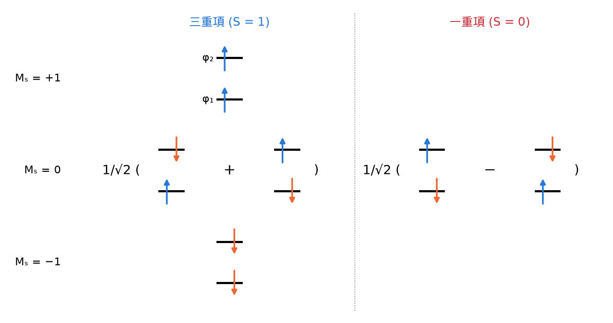
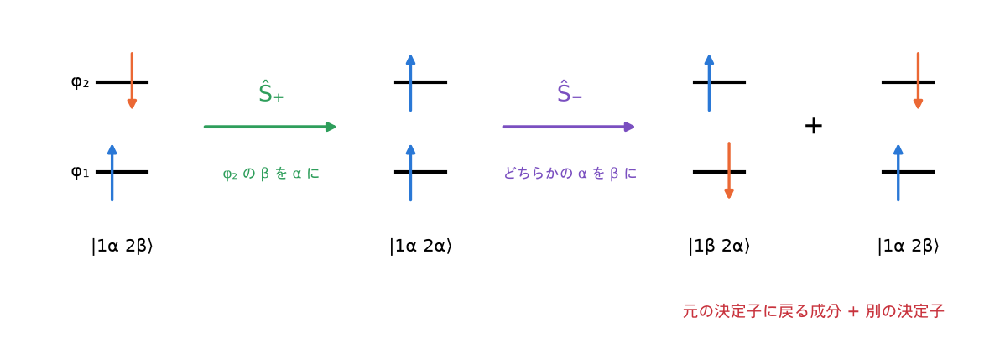
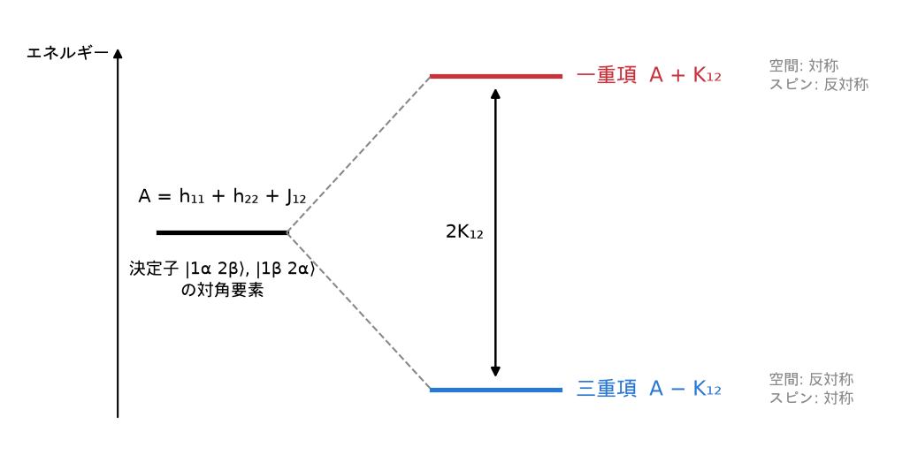
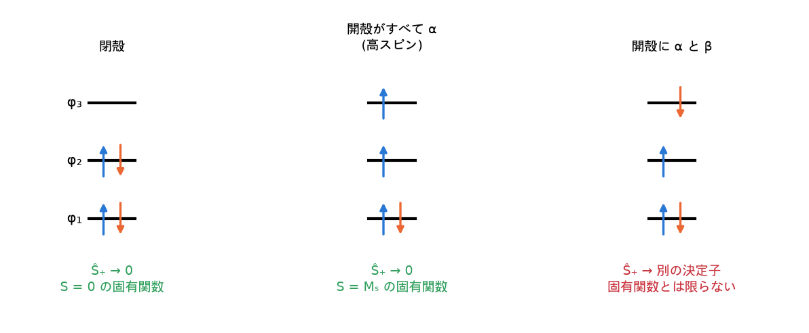
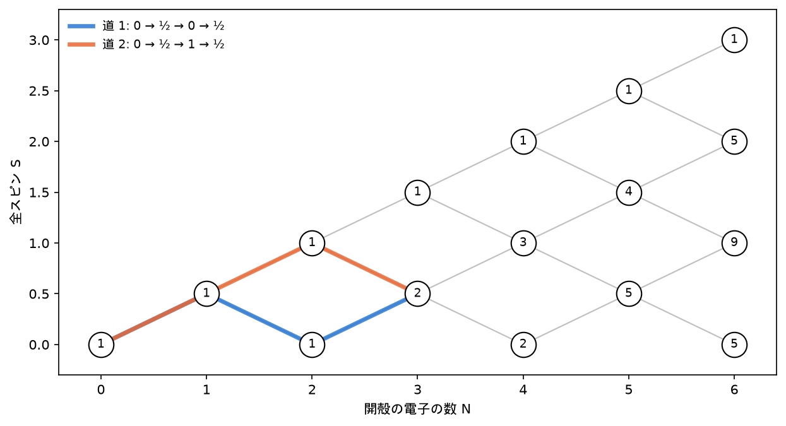
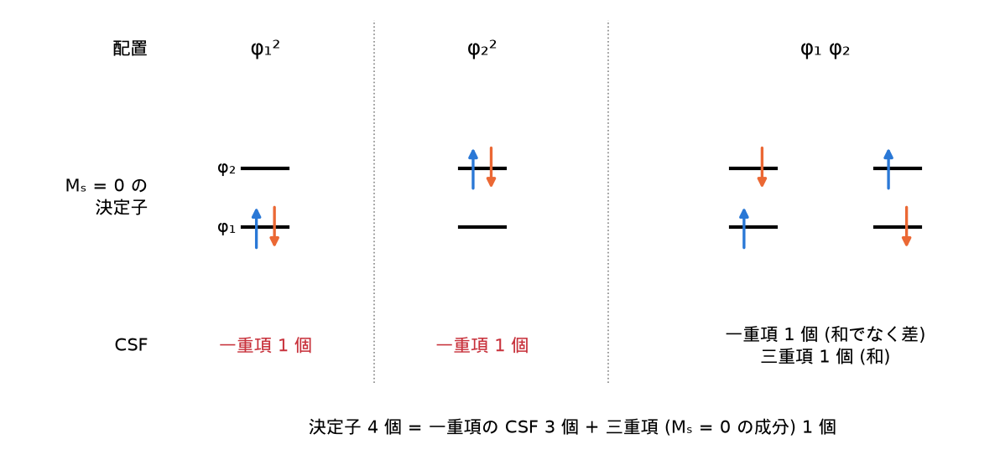
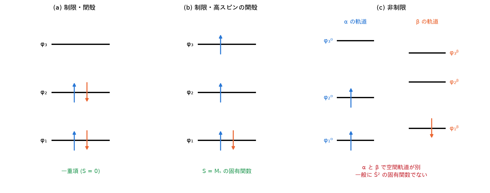
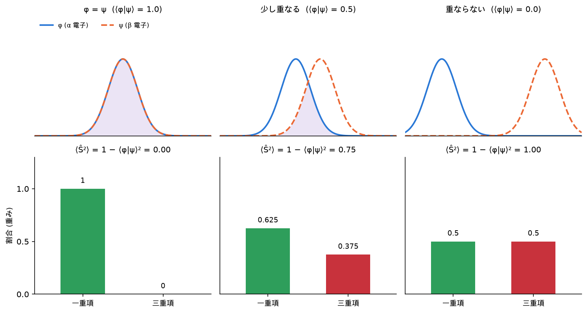

# 第 4 回　スピン：Ŝ²、制限・非制限の決定子、CSF

!!! abstract "この回の道筋"
    電子のハミルトニアンはスピンを含まないので、その固有状態は全スピン $\hat S^2$ の固有状態（一重項、二重項、三重項など）に選べます。ところが、決定子は $\hat S^2$ の固有関数になるとは限りません。この回では、$\hat S^2$ を第二量子化で書き、決定子に $\hat S^2$ をかけると何が起こるかを手で追いかけます。そのうえで、決定子を組み合わせてスピンの固有関数（配置状態関数、CSF）を作る方法と、その数え方を学びます。最後に、$\alpha$ と $\beta$ の電子に同じ空間軌道を使う制限された決定子と、別々の空間軌道を使う非制限の決定子を比べ、非制限の決定子で起こるスピン汚染の意味を学びます。

    | 節 | 内容 |
    |---|---|
    | 1 | スピン演算子と $\hat S^2$ |
    | 2 | $\hat S^2$ の第二量子化表示 |
    | 3 | 2 電子の一重項と三重項 |
    | 4 | 決定子がスピン固有関数になる条件 |
    | 5 | 配置状態関数（CSF）の作り方と数え方 |
    | 6 | 制限された決定子と非制限の決定子 |

    **前に読んでおく回**：量子化学の理論 [第 2 回](02-many-electron-wavefunctions.md)、[第 3 回](03-second-quantization.md)

!!! tip "物理的なイメージ"
    全スピン $\hat S^2$ が表しているのは、すべての電子のスピン（小さな磁石の向き）を合わせた大きさです。ハミルトニアンはスピンを含まないので、正しい状態は、全スピンの大きさが決まった状態（一重項、三重項など）に選べます。1 個の決定子は、各電子のスピンが上向きか下向きかを決めただけで、合わせた大きさは決まっていないことがあります。開殻の一重項と、三重項の $M_S = 0$ の成分のように、決定子を足したり引いたりして初めて、大きさの決まった状態（CSF）になります。$\alpha$ と $\beta$ の電子に別々の空間軌道を使う非制限の決定子では、この組み合わせが崩れ、一重項と三重項などが混ざります。これをスピン汚染と呼びます。

この回では原子単位を使い、$\hbar = 1$ とします。決定子の書き方と、生成・消滅演算子 $\hat a^\dagger$、$\hat a$ は第 3 回のものです。

## 1. スピン演算子と Ŝ²

### 1.1 電子 1 個のスピン

電子 1 個のスピンは、3 つの成分の演算子 $\hat s_x, \hat s_y, \hat s_z$ で表されます。
第 2 回のスピン関数 $\alpha$、$\beta$ は、$\hat s_z$ の固有関数です。

$$
\hat s_z\,\alpha = +\tfrac12\,\alpha,\qquad \hat s_z\,\beta = -\tfrac12\,\beta
$$

計算では、$x, y$ 成分の代わりに、**昇降演算子** $\hat s_\pm = \hat s_x \pm i\hat s_y$ を使うと便利です。
$\hat s_+$ は下向きのスピンを上向きに変え（$\hat s_+\beta = \alpha$）、上向きにかけると 0 です（$\hat s_+\alpha = 0$）。
$\hat s_-$ はその逆です（$\hat s_-\alpha = \beta$、$\hat s_-\beta = 0$）。

これらを、$\alpha$、$\beta$ を基底にした 2 行 2 列の行列で書きます（第 3 回 9.3 節と同じく、列が「かける前」、行が「かけた後」です）。

$$
\hat s_z = \begin{pmatrix} \tfrac12 & 0\\ 0 & -\tfrac12\end{pmatrix},\qquad
\hat s_+ = \begin{pmatrix} 0 & 1\\ 0 & 0\end{pmatrix},\qquad
\hat s_- = \begin{pmatrix} 0 & 0\\ 1 & 0\end{pmatrix}
\qquad
\begin{matrix} \leftarrow \alpha \\ \leftarrow \beta \end{matrix}
$$

$\hat s_x = (\hat s_+ + \hat s_-)/2$、$\hat s_y = (\hat s_+ - \hat s_-)/(2i)$ から、$\hat s_x^2 = \hat s_y^2 = \frac14\mathbf 1$ となり、

$$
\hat s^2 = \hat s_x^2 + \hat s_y^2 + \hat s_z^2 = \tfrac34\,\mathbf 1 = \tfrac12\big(\tfrac12 + 1\big)\mathbf 1
$$

です。電子 1 個のスピンの大きさは、いつも $s = \frac12$ です。

### 1.2 N 電子の全スピン

$N$ 個の電子の全スピンは、各電子のスピンの和 $\hat{\mathbf S} = \sum_i \hat{\mathbf s}(i)$ です。
その大きさの 2 乗 $\hat S^2 = \hat S_x^2 + \hat S_y^2 + \hat S_z^2$ と、$z$ 成分 $\hat S_z$ の固有値は、

$$
\hat S^2\,\Psi = S(S+1)\,\Psi,\qquad \hat S_z\,\Psi = M_S\,\Psi
$$

の形になります。
$S$ は $0, \tfrac12, 1, \tfrac32, \dots$ の値、$M_S$ は $-S, -S+1, \dots, S$ の $2S+1$ 個の値をとります。
$S = 0$ の状態を一重項、$S = \tfrac12$ を二重項、$S = 1$ を三重項と呼び、$2S+1$ を多重度（multiplicity）と呼びます。
同じ $S$ で $M_S$ だけが違う $2S+1$ 個の状態は、全スピンの大きさは同じで、向きだけが違う状態です（図 1）。



**図 1**　2 つの空間軌道 $\phi_1$（下）と $\phi_2$（上）に電子が 1 個ずつ入った場合。青の上向きの矢印が $\alpha$ 電子、橙の下向きの矢印が $\beta$ 電子です。三重項（左）には $M_S = +1, 0, -1$ の 3 つの成分があります。$M_S = \pm 1$ の成分は決定子 1 個ですが、$M_S = 0$ の成分は 2 個の決定子の和です。一重項（右）は、同じ 2 個の決定子の差です。この形は 3 節で導きます。

第 2 回の電子のハミルトニアンは、スピンを含みません。
$\hat H_\mathrm{el}$ は空間の座標だけに働き、$\hat S^2$ と $\hat S_z$ はスピンの座標だけに働くので、かける順番を変えても結果は同じです。

$$
[\hat H_\mathrm{el}, \hat S^2] = 0,\qquad [\hat H_\mathrm{el}, \hat S_z] = 0
$$

互いに交換する演算子は、同時に固有関数をとれます。
したがって、$\hat H_\mathrm{el}$ の固有状態は、$\hat S^2$ と $\hat S_z$ の固有状態に同時に選べます。
厳密な電子状態は、決まった多重度を持つということです。

### 1.3 Ŝ² を昇降演算子で書く

全スピンの昇降演算子 $\hat S_\pm = \hat S_x \pm i\hat S_y = \sum_i \hat s_\pm(i)$ も定義します。
$\hat S_+$ は $M_S$ を 1 増やし、$\hat S_-$ は 1 減らします。
$\hat S^2$ を $\hat S_\pm$ で書き直します。

$$
\begin{aligned}
\hat S_-\hat S_+ &= (\hat S_x - i\hat S_y)(\hat S_x + i\hat S_y)\\
&= \hat S_x^2 + \hat S_y^2 + i(\hat S_x\hat S_y - \hat S_y\hat S_x)
&&\text{（展開した）}\\
&= \hat S_x^2 + \hat S_y^2 + i\,[\hat S_x, \hat S_y]
&&\text{（交換子の定義）}\\
&= \hat S_x^2 + \hat S_y^2 + i\,(i\hat S_z)
&&\text{（角運動量の交換関係 } [\hat S_x, \hat S_y] = i\hat S_z\text{）}\\
&= \hat S_x^2 + \hat S_y^2 - \hat S_z
\end{aligned}
$$

両辺に $\hat S_z^2 + \hat S_z$ を足すと、左辺は $\hat S_-\hat S_+ + \hat S_z + \hat S_z^2$、右辺は $\hat S^2$ になります。

$$
\hat S^2 = \hat S_-\hat S_+ + \hat S_z + \hat S_z^2
$$

この式は、4 節で決定子の性質を判断するときの鍵になります。

**ここまでで分かったこと**：電子のハミルトニアンはスピンを含まないので、厳密な電子状態は $\hat S^2$ の固有状態（決まった多重度）に選べます。$\hat S^2$ は、昇降演算子を使って $\hat S_-\hat S_+ + \hat S_z + \hat S_z^2$ と書けます。

## 2. Ŝ² の第二量子化表示

### 2.1 スピン演算子を生成・消滅演算子で書く

空間軌道 $\phi_P$ の $\alpha$ と $\beta$ のスピン軌道 $\phi_P\alpha$、$\phi_P\beta$ の演算子を、$\hat a_{P\alpha}$、$\hat a_{P\beta}$ などと書きます。
空間軌道は規格直交で、$\alpha$ と $\beta$ で共通とします。

$\hat S_z$ と $\hat S_\pm$ は、各電子に別々に働く演算子の和なので、1 電子演算子です。
第 3 回 11.1 節の規則 $\sum_\mu\hat o(\mu) \to \sum_{ij}\langle\chi_i|\hat o|\chi_j\rangle\,\hat a_i^\dagger\hat a_j$ を使います。
スピン軌道の行列要素は、空間の部分とスピンの部分の積になります。

$$
\langle\phi_P\sigma|\hat s_+|\phi_Q\tau\rangle = \langle\phi_P|\phi_Q\rangle\,\langle\sigma|\hat s_+|\tau\rangle = \delta_{PQ}\,\delta_{\sigma\alpha}\,\delta_{\tau\beta}
$$

最後の等号は、1.1 節の行列で $\hat s_+$ の 0 でない要素が $\langle\alpha|\hat s_+|\beta\rangle = 1$ だけであることから来ます。
$\hat s_z$ と $\hat s_-$ も同じように計算すると、次の式が得られます。

$$
\hat S_z = \frac12\sum_P\big(\hat n_{P\alpha} - \hat n_{P\beta}\big),\qquad
\hat S_+ = \sum_P \hat a_{P\alpha}^\dagger\hat a_{P\beta},\qquad
\hat S_- = \sum_P \hat a_{P\beta}^\dagger\hat a_{P\alpha}
$$

$\hat S_z$ は、$\alpha$ の電子の数と $\beta$ の電子の数の差の半分です。
$\hat S_+$ は、同じ空間軌道の中で $\beta$ の電子を $\alpha$ に変えます。
$\hat S_-$ はその逆です。
$\hat S^2$ は、これらを 1.3 節の式 $\hat S^2 = \hat S_-\hat S_+ + \hat S_z + \hat S_z^2$ に入れたものです。
第二量子化でのスピンの扱いは、Helgaker らの第 2 章に詳しくまとめられています [Helgaker 2000]。

**スピン軌道の並べ方**：この回では、第 3 回 13 節と同じく、スピン軌道を $\phi_1\alpha, \phi_1\beta, \phi_2\alpha, \phi_2\beta, \dots$ の順に並べます。
同じ空間軌道の $\alpha$ と $\beta$ が隣り合うので、$\hat a_{P\alpha}^\dagger\hat a_{P\beta}$ で電子のスピンを変えても、ほかの電子との順番は変わらず、符号は $+1$ です。
つまり、$\hat S_\pm$ を決定子にかけると、**1 個の電子のスピンを、その場で反転させた決定子**が符号 $+$ で出てきます。

この表示から、次のことがすぐに分かります。

- **決定子は必ず $\hat S_z$ の固有関数です。** $\hat S_z$ は数演算子だけでできているので、決定子にかけると $M_S = (N_\alpha - N_\beta)/2$ を返します。$N_\alpha$、$N_\beta$ は $\alpha$ と $\beta$ の電子の数です。
- **$\hat S^2$ については、そうとは限りません。** $\hat S_-\hat S_+$ は、ある軌道の $\beta$ の電子を $\alpha$ に変え、別の（または同じ）軌道の $\alpha$ の電子を $\beta$ に戻します。別の軌道で戻すと、元とは違う決定子が出てきます。

### 2.2 例：|1α 2β⟩ に Ŝ² をかける

具体的に、$\phi_1$ に $\alpha$、$\phi_2$ に $\beta$ の電子が入った決定子 $|1\alpha\,2\beta\rangle$ に $\hat S^2$ をかけます（図 2）。

1. **$\hat S_+$ をかける。** $\hat S_+ = \hat a_{1\alpha}^\dagger\hat a_{1\beta} + \hat a_{2\alpha}^\dagger\hat a_{2\beta}$ の第 1 項は、$\phi_1$ に $\beta$ の電子がいないので 0 です。第 2 項は、$\phi_2$ の $\beta$ を $\alpha$ に変えます。したがって $\hat S_+|1\alpha\,2\beta\rangle = |1\alpha\,2\alpha\rangle$ です。
2. **$\hat S_-$ をかける。** $|1\alpha\,2\alpha\rangle$ の $\alpha$ の電子は 2 個あり、どちらを $\beta$ に変えてもよいので、$\hat S_-|1\alpha\,2\alpha\rangle = |1\beta\,2\alpha\rangle + |1\alpha\,2\beta\rangle$ です。
3. **$\hat S_z$ の項を足す。** $|1\alpha\,2\beta\rangle$ は $M_S = 0$ なので、$(\hat S_z + \hat S_z^2)|1\alpha\,2\beta\rangle = 0$ です。

合わせると、

$$
\hat S^2|1\alpha\,2\beta\rangle = |1\alpha\,2\beta\rangle + |1\beta\,2\alpha\rangle
$$

です。生成・消滅演算子の符号まで追った計算は、付録 A に書きました。



**図 2**　$\hat S_+$ は $\phi_2$ の $\beta$ 電子を $\alpha$ に変え、$|1\alpha\,2\alpha\rangle$ を作ります。続く $\hat S_-$ は、2 個の $\alpha$ 電子のどちらかを $\beta$ に戻します。$\phi_2$ の電子を戻すと元の決定子に、$\phi_1$ の電子を戻すと別の決定子 $|1\beta\,2\alpha\rangle$ になります。この「別の決定子」が出てくるので、$|1\alpha\,2\beta\rangle$ は $\hat S^2$ の固有関数ではありません。

**ここまでで分かったこと**：$\hat S_\pm$ は、同じ空間軌道の中でスピンを反転させる演算子です。決定子は $\hat S_z$ の固有関数ですが、$\hat S^2$ をかけると別の決定子が出てくることがあり、そのときは $\hat S^2$ の固有関数ではありません。

## 3. 2 電子の一重項と三重項

### 3.1 Ŝ² の行列と対角化

2.2 節の例を、行列で見ます。
2 つの空間軌道 $\phi_1$、$\phi_2$ に電子を 1 個ずつ入れた $M_S = 0$ の決定子は、$|1\alpha\,2\beta\rangle$ と $|1\beta\,2\alpha\rangle$ の 2 個です（スピン軌道は 2.1 節の順に並べます）。
2.2 節の結果と、同じ計算を $|1\beta\,2\alpha\rangle$ に行った結果 $\hat S^2|1\beta\,2\alpha\rangle = |1\alpha\,2\beta\rangle + |1\beta\,2\alpha\rangle$ を並べると、$\hat S^2$ の行列は

$$
\mathbf S^2 =
\begin{pmatrix} 1 & 1\\ 1 & 1\end{pmatrix}
\begin{matrix} \leftarrow |1\alpha\,2\beta\rangle \\ \leftarrow |1\beta\,2\alpha\rangle \end{matrix}
$$

です。
第 3 回 13 節と同じように、$\hat S^2$ を $16\times 16$ の行列で作り、この 2 個の決定子の間の要素を求めて確かめます。

```python
import numpy as np
from functools import reduce

def ops(M):                                   # 第 3 回と同じ作り方
    I2, Z = np.eye(2), np.diag([1.0, -1.0])
    low = np.array([[0.0, 1.0], [0.0, 0.0]])
    a = [reduce(np.kron, [Z]*p + [low] + [I2]*(M-p-1)) for p in range(M)]
    return a, [x.T for x in a]

def spin_ops(n):                              # 空間軌道 n 個。P α = 2P, P β = 2P+1
    a, ad = ops(2*n)
    Sz = 0.5 * sum(ad[2*P] @ a[2*P] - ad[2*P+1] @ a[2*P+1] for P in range(n))
    Sp = sum(ad[2*P] @ a[2*P+1] for P in range(n))     # S+ = Σ a†_Pα a_Pβ
    Sm = Sp.T
    return Sm @ Sp + Sz + Sz @ Sz, Sz                  # S^2, Sz

def state(occ):                               # 占有数の並び → 状態ベクトル
    v = np.zeros(2**len(occ)); v[int("".join(map(str, occ)), 2)] = 1; return v

S2, Sz = spin_ops(2)
d1 = state((1, 0, 0, 1)); d2 = state((0, 1, 1, 0))   # |1α 2β>, |1β 2α>
B = np.array([[x @ S2 @ y for y in (d1, d2)] for x in (d1, d2)])
print("S^2 の行列（|1α2β>, |1β2α>）:\n", B)
w, v = np.linalg.eigh(B)
for k in range(2):
    print(f"  固有値 {w[k]:.3f}  ベクトル {np.round(v[:, k], 4)}")
```

```text
S^2 の行列（|1α2β>, |1β2α>）:
 [[1. 1.]
 [1. 1.]]
  固有値 0.000  ベクトル [-0.7071  0.7071]
  固有値 2.000  ベクトル [0.7071 0.7071]
```

手で求めた行列と一致しました。
$\hat S^2$ の行列には非対角要素があるので、どちらの決定子も $\hat S^2$ の固有関数ではありません。
期待値（対角要素）はどちらも 1 で、これは $S(S+1)$ の形のどの値（0、2、6、…）にも当たりません。

この 2 行 2 列の行列は、手でも対角化できます。

$$
\begin{pmatrix} 1 & 1\\ 1 & 1\end{pmatrix}\begin{pmatrix} 1\\ 1\end{pmatrix} = 2\begin{pmatrix} 1\\ 1\end{pmatrix},
\qquad
\begin{pmatrix} 1 & 1\\ 1 & 1\end{pmatrix}\begin{pmatrix} -1\\ 1\end{pmatrix} = 0\begin{pmatrix} -1\\ 1\end{pmatrix}
$$

固有値 2 は $S(S+1)$ で $S = 1$（三重項）、固有値 0 は $S = 0$（一重項）です。
規格化した固有ベクトルが、それぞれの状態です。

$$
{}^1\Psi = \frac{1}{\sqrt 2}\Big(|1\beta\,2\alpha\rangle - |1\alpha\,2\beta\rangle\Big),\qquad
{}^3\Psi = \frac{1}{\sqrt 2}\Big(|1\alpha\,2\beta\rangle + |1\beta\,2\alpha\rangle\Big)
$$

全体の符号は任意です。
三重項の $M_S = 1$ の成分は $|1\alpha\,2\alpha\rangle$ そのもの、$M_S = -1$ の成分は $|1\beta\,2\beta\rangle$ です（図 1）。

### 3.2 空間の部分とスピンの部分に分ける

この 2 つの状態を、行列式を書き下して整理します。
2 電子の決定子は $|\chi_a\chi_b\rangle = \frac{1}{\sqrt2}\big[\chi_a(1)\chi_b(2) - \chi_b(1)\chi_a(2)\big]$ です（第 2 回）。
書き方を短くするため、空間の部分を $u = \phi_1(\mathbf r_1)\phi_2(\mathbf r_2)$、$v = \phi_2(\mathbf r_1)\phi_1(\mathbf r_2)$、スピンの部分を $\alpha\beta = \alpha(1)\beta(2)$、$\beta\alpha = \beta(1)\alpha(2)$ と書きます。
2 個の決定子は、次のようになります。

$$
|1\alpha\,2\beta\rangle = \frac{1}{\sqrt2}\big(u\,\alpha\beta - v\,\beta\alpha\big),\qquad
|1\beta\,2\alpha\rangle = \frac{1}{\sqrt2}\big(u\,\beta\alpha - v\,\alpha\beta\big)
$$

和をとり、$u$ と $v$ でまとめると、

$$
|1\alpha\,2\beta\rangle + |1\beta\,2\alpha\rangle = \frac{1}{\sqrt2}\big[u(\alpha\beta + \beta\alpha) - v(\alpha\beta + \beta\alpha)\big] = \frac{1}{\sqrt2}(u - v)(\alpha\beta + \beta\alpha)
$$

です。差をとると、

$$
|1\beta\,2\alpha\rangle - |1\alpha\,2\beta\rangle = \frac{1}{\sqrt2}\big[-u(\alpha\beta - \beta\alpha) - v(\alpha\beta - \beta\alpha)\big] = -\frac{1}{\sqrt2}(u + v)(\alpha\beta - \beta\alpha)
$$

です。$u$、$v$ などを元に戻すと、

$$
{}^1\Psi \propto \big[\phi_1(\mathbf r_1)\phi_2(\mathbf r_2) + \phi_2(\mathbf r_1)\phi_1(\mathbf r_2)\big]\big[\alpha(1)\beta(2) - \beta(1)\alpha(2)\big]
$$

$$
{}^3\Psi \propto \big[\phi_1(\mathbf r_1)\phi_2(\mathbf r_2) - \phi_2(\mathbf r_1)\phi_1(\mathbf r_2)\big]\big[\alpha(1)\beta(2) + \beta(1)\alpha(2)\big]
$$

となります。
一重項は「空間の部分が対称、スピンの部分が反対称」、三重項は「空間の部分が反対称、スピンの部分が対称」です。
どちらも、全体としては電子の入れ替えで反対称です。

三重項の空間の部分は、$\mathbf r_1 = \mathbf r_2$ で 0 になります（第 2 回で見たフェルミ孔）。
三重項では 2 個の電子が近づきにくく、電子反発が小さくなります。これが次のエネルギーの差の源です。

### 3.3 エネルギー

第 3 回 13 節の H₂ のハミルトニアン行列で、この 2 個の決定子の塊は

$$
\begin{pmatrix} A & -K_{12}\\ -K_{12} & A\end{pmatrix}
\begin{matrix} \leftarrow |1\alpha\,2\beta\rangle \\ \leftarrow |1\beta\,2\alpha\rangle \end{matrix}
,\qquad A = h_{11} + h_{22} + J_{12}
$$

でした。
$J_{12} = (11|22)$ はクーロン積分、$K_{12} = (12|21)$ は交換積分で、$K_{12} > 0$ です。
ベクトル $(1, 1)/\sqrt2$ の三重項にかけると $A - K_{12}$、$(1, -1)/\sqrt2$ の一重項（全体の符号を変えたもの）にかけると $A + K_{12}$ が出てきます（第 3 回 13 節の計算）。

$$
E({}^3\Psi) = h_{11} + h_{22} + J_{12} - K_{12},\qquad
E({}^1\Psi) = h_{11} + h_{22} + J_{12} + K_{12}
$$



**図 3**　模式図。2 個の決定子の対角要素は、どちらも $A = h_{11} + h_{22} + J_{12}$ です。交換積分 $-K_{12}$ で混ざると、三重項（和）が $K_{12}$ だけ下がり、一重項（差）が $K_{12}$ だけ上がります。右の灰色の文字は、3.2 節で見た空間とスピンの部分の対称性です。

同じ軌道の占有でも、三重項は一重項より $2K_{12}$ だけエネルギーが低くなります。
決定子 $|1\alpha\,2\beta\rangle$ のエネルギー $A$ は、ちょうどその平均です。
これは、$|1\alpha\,2\beta\rangle$ が一重項と三重項を半分ずつ含むことを表しています。実際、3.1 節の ${}^3\Psi$ から ${}^1\Psi$ を引くと、

$$
|1\alpha\,2\beta\rangle = \frac{1}{\sqrt2}\big({}^3\Psi - {}^1\Psi\big)
$$

です。6 節のスピン汚染で、この式をもう一度使います。

**ここまでで分かったこと**：2 つの軌道に 1 個ずつ電子が入るとき、反対のスピンの決定子はスピンの固有関数ではありません。2 個の決定子の和と差が三重項と一重項になり、エネルギーは $\mp K_{12}$ だけずれます。

## 4. 決定子がスピン固有関数になる条件

前の節の例を一般化します。
空間軌道は、$\alpha$ と $\beta$ で共通のものを使うとします（6 節で「制限された決定子」と呼ぶものです）。

- 電子が 2 個入っている空間軌道を、二重占有軌道（閉殻の軌道）と呼びます。
- 電子が 1 個だけ入っている空間軌道を、開殻軌道（単占有軌道）と呼びます。

判断の鍵は、次の性質です。

!!! note "判断の鍵"
    $\hat S_z\Psi = M_S\Psi$ で、さらに $\hat S_+\Psi = 0$ なら、$\Psi$ は $S = M_S$ の $\hat S^2$ の固有関数です。

1.3 節の式で $\hat S_-\hat S_+\Psi = \hat S_-(0) = 0$ なので、

$$
\hat S^2\Psi = (\hat S_-\hat S_+ + \hat S_z + \hat S_z^2)\Psi = (0 + M_S + M_S^2)\Psi = M_S(M_S + 1)\Psi
$$

となり、$S(S+1)$ の形で $S = M_S$ だからです。
「$M_S$ をこれ以上増やせない状態は、その $M_S$ が全スピンの最大の成分」という意味です。

これを決定子に当てはめます。$\hat S_+$ は、各空間軌道で「$\beta$ の電子を取って $\alpha$ に入れる」操作です。

- **二重占有軌道**では、$\alpha$ の席がすでに埋まっているので、$\hat S_+$ の項は 0 です。二重占有軌道は、全スピンに寄与しません。
- **$\alpha$ の電子だけが入った開殻軌道**では、取るべき $\beta$ の電子がいないので 0 です。
- **$\beta$ の電子だけが入った開殻軌道**では、$\beta$ を $\alpha$ に変えた別の決定子が出てきます。

したがって、閉殻の決定子と、開殻の電子がすべて $\alpha$ の決定子は、$\hat S_+$ をかけると 0 になり、$S = M_S$ の固有関数です。
閉殻の決定子は $M_S = 0$ なので $S = 0$ です。
開殻の電子がすべて $\beta$ の決定子も、$\hat S_+$ と $\hat S_-$ の役割を入れ替えた同じ議論で、$S = -M_S$ の固有関数です。
開殻に $\alpha$ と $\beta$ の電子が混ざっていると、$\hat S_+$ が別の決定子を作り、2.2 節のように $\hat S^2$ をかけると元と違う決定子が出てきます。
この場合、決定子 1 個は一般に $\hat S^2$ の固有関数になりません。



**図 4**　左：閉殻の決定子。中：開殻の電子がすべて $\alpha$ の決定子（高スピン）。右：開殻に $\alpha$ と $\beta$ の電子が混ざった決定子。左と中では $\hat S_+$ をかけると 0 になるので、$\hat S^2$ の固有関数です。右では、$\phi_3$ の $\beta$ 電子を $\alpha$ に変えた別の決定子が出てくるので、固有関数とは限りません。

まとめると、次のようになります。

| 決定子 | $\hat S^2$ の固有関数か |
|---|---|
| 閉殻 | はい（$S = 0$） |
| 開殻の電子がすべて同じスピン（高スピン） | はい（$S = \vert M_S\vert$） |
| 開殻に $\alpha$ と $\beta$ が混ざっている | 一般には、いいえ |

!!! note "開殻の一重項は決定子 1 個では書けない"
    第 3 節の一重項のように、開殻軌道を含む一重項は、少なくとも 2 個の決定子の組み合わせです。励起状態のスピン反転の手法（[第 20 回](20-spin-flip-tddft.md)）など、どのような決定子を使うかでスピンの純粋さが変わる場面で、この点が問題になります。

**ここまでで分かったこと**：$\hat S_+$ をかけて 0 になる決定子は、$S = M_S$ の固有関数です。閉殻の決定子と、開殻の電子がすべて同じスピンの決定子はこれに当たります。開殻に $\alpha$ と $\beta$ が混ざった決定子は、一般にそうではありません。

## 5. 配置状態関数（CSF）の作り方と数え方

### 5.1 CSF とは

空間軌道の占有の仕方（どの軌道に何個の電子が入るか）を、配置（configuration）と呼びます。
同じ配置に属する決定子を組み合わせて作った、$\hat S^2$ と $\hat S_z$ の固有関数を、配置状態関数（configuration state function、CSF）と呼びます。
第 3 節の ${}^1\Psi$ と ${}^3\Psi$ は、どちらも CSF です。

CSF を使う利点は、次の 2 つです。

1. 計算したい多重度の CSF だけを使えば、ほかの多重度の状態が混ざりません。
2. 同じ多重度の CSF の数は、$M_S$ が同じ決定子の数より少なく、計算が小さくなります（5.4 節で数えます）。

### 5.2 作り方 1：Ŝ₊ で 0 になる組み合わせを探す

4 節の鍵の性質を使うと、CSF を直接作れます。
「$M_S = S$ の決定子の組み合わせのうち、$\hat S_+$ をかけて 0 になるもの」が、スピン $S$ の CSF です。

例として、3 個の開殻軌道 $a, b, c$ に 1 個ずつ電子が入った二重項（$S = M_S = \tfrac12$）を作ります。
二重占有軌道はスピンに寄与しないので、開殻の電子だけを考えます。
$M_S = \tfrac12$ の決定子は、$\beta$ の電子をどの軌道に置くかで、次の 3 個です。軌道は $a, b, c$ の順に並べます。

$$
D_1 = |a\alpha\,b\alpha\,c\beta\rangle,\qquad
D_2 = |a\alpha\,b\beta\,c\alpha\rangle,\qquad
D_3 = |a\beta\,b\alpha\,c\alpha\rangle
$$

2.1 節で見たとおり、$\hat S_+$ は $\beta$ の電子 1 個をその場で $\alpha$ に変え、符号は $+$ です。
どの $D_k$ も、$\beta$ の電子を $\alpha$ に変えると、すべて $\alpha$ の決定子 $Q = |a\alpha\,b\alpha\,c\alpha\rangle$ になります。

$$
\hat S_+ D_1 = \hat S_+ D_2 = \hat S_+ D_3 = Q
$$

したがって、組み合わせ $\Psi = c_1 D_1 + c_2 D_2 + c_3 D_3$ に $\hat S_+$ をかけると、

$$
\hat S_+\Psi = (c_1 + c_2 + c_3)\,Q
$$

です。$\Psi$ が二重項になる条件は $c_1 + c_2 + c_3 = 0$ です。
この条件を満たすベクトル $(c_1, c_2, c_3)$ は 2 次元の平面をなすので、独立な二重項は 2 個です。
互いに直交する 2 個を選ぶと、たとえば次のようになります。

$$
\Psi_1 = \frac{1}{\sqrt2}\big(D_2 - D_3\big) = \frac{1}{\sqrt2}\Big(|a\alpha\,b\beta\,c\alpha\rangle - |a\beta\,b\alpha\,c\alpha\rangle\Big)
$$

$$
\Psi_2 = \frac{1}{\sqrt6}\big(2D_1 - D_2 - D_3\big) = \frac{1}{\sqrt6}\Big(2|a\alpha\,b\alpha\,c\beta\rangle - |a\alpha\,b\beta\,c\alpha\rangle - |a\beta\,b\alpha\,c\alpha\rangle\Big)
$$

係数の和は、どちらも 0 です（$1 - 1 = 0$、$2 - 1 - 1 = 0$）。
内積は $\frac{1}{\sqrt{12}}(0\cdot 2 + 1\cdot(-1) + (-1)\cdot(-1)) = 0$ で、直交しています。
残りの方向 $(1, 1, 1)/\sqrt3$ は、$\hat S_+$ で 0 にならない組み合わせで、四重項（$S = \tfrac32$）の $M_S = \tfrac12$ の成分です。

$\Psi_1$ と $\Psi_2$ の中身を見ると、それぞれの意味が分かります。

- $\Psi_1$ では、$a$ と $b$ の電子が、第 3 節の一重項の組（$|a\alpha\,b\beta\rangle - |a\beta\,b\alpha\rangle$）を作り、そこに $c$ の $\alpha$ の電子が加わっています。
- $\Psi_2$ では、$a$ と $b$ の電子が三重項の組を作っています。$M_S = 1$ の成分 $|a\alpha\,b\alpha\rangle$ に $c\beta$ を、$M_S = 0$ の成分 $|a\alpha\,b\beta\rangle + |a\beta\,b\alpha\rangle$ に $c\alpha$ を組み合わせて、全体で二重項にしています。

### 5.3 作り方 2：電子を 1 個ずつ足す（分岐図）

5.2 節の見方を一般化したのが、開殻の電子を 1 個ずつ足していく方法です。
系図的（genealogical）な方法と呼ばれます [Pauncz 2000]。

スピン $S$ の状態に電子（スピン $\tfrac12$）を 1 個足すと、全スピンは $S + \tfrac12$ か $S - \tfrac12$ になります（$S = 0$ からは $\tfrac12$ だけ）。
横軸に開殻の電子の数 $N$、縦軸に全スピン $S$ をとり、この足し方を線で結ぶと、図 5 になります。
これを分岐図（branching diagram）と呼びます。



**図 5**　分岐図。横軸は開殻の電子の数 $N$、縦軸は全スピン $S$ です。電子を 1 個足すごとに、$S$ が $\tfrac12$ 上がるか下がります。丸の中の数は、原点からその点までの道の数 $f(N, S)$ です。青と橙の太い線は、$(N, S) = (3, \tfrac12)$ に至る 2 本の道で、それぞれ 5.2 節の $\Psi_1$（最初の 2 個が一重項）と $\Psi_2$（最初の 2 個が三重項）に対応します。

原点から点 $(N, S)$ までの道 1 本が、CSF 1 個に対応します。
道の途中の各段階でのスピンが、その CSF の「系図」です。
丸の中の数は道の数で、$N$ 個の開殻の電子から作れる、スピン $S$ の独立な CSF の数 $f(N, S)$ です。
道の数は、1 つ前の 2 つの点の道の数の和なので、

$$
f(N, S) = f\big(N-1, S - \tfrac12\big) + f\big(N-1, S + \tfrac12\big)
$$

です（範囲の外の点の $f$ は 0 とします）。
たとえば $f(3, \tfrac12) = f(2, 0) + f(2, 1) = 1 + 1 = 2$ で、5.2 節で見つけた 2 個と一致します。

$f(N, S)$ は、決定子を数えても求まります。
$N$ 個の開殻の電子のうち $\beta$ を $k$ 個にした決定子は、$M_S = N/2 - k$ で、$\binom{N}{k}$ 個あります。
スピン $S' \ge S$ の状態は、どれも $M_S = S$ の成分をちょうど 1 個ずつもちます。
したがって、$M_S = S$ の決定子の数 $\binom{N}{N/2 - S}$ は、$S' \ge S$ のすべての状態の数の和です。
そこから $M_S = S + 1$ の決定子の数（$S' \ge S + 1$ の状態の数）を引けば、$S' = S$ の状態の数が残ります。

$$
f(N, S) = \binom{N}{\frac N2 - S} - \binom{N}{\frac N2 - S - 1}
$$

5.2 節の例では、$\binom{3}{1} - \binom{3}{0} = 3 - 1 = 2$ です。決定子 3 個のうち、1 個分が四重項に使われ、残りの 2 個分が二重項です。
この式を整理すると、次の閉じた形になります [Pauncz 2000]。整理の各段階は付録 C に書きました。

$$
f(N, S) = \frac{(2S+1)\,N!}{\left(\frac N2 + S + 1\right)!\left(\frac N2 - S\right)!}
$$

5.2 節の $\Psi_1$、$\Psi_2$ が本当に二重項になっていることを、第 3 節のコードの `spin_ops` と `state` を使って確かめます。

```python
S2, Sz = spin_ops(3)
def det(spins):                       # 軌道 a, b, c の順に α("a") / β("b") を指定
    occ = []
    for s in spins: occ += [1, 0] if s == "a" else [0, 1]
    return state(tuple(occ))
csf1 = (det("aba") - det("baa")) / np.sqrt(2)
csf2 = (2*det("aab") - det("aba") - det("baa")) / np.sqrt(6)
for name, c in [("CSF1", csf1), ("CSF2", csf2)]:
    print(f"{name}: <S^2> = {c @ S2 @ c:.3f}, S^2 の固有関数: {np.allclose(S2 @ c, 0.75*c)}")
print("CSF1・CSF2 の内積:", csf1 @ csf2)
```

```text
CSF1: <S^2> = 0.750, S^2 の固有関数: True
CSF2: <S^2> = 0.750, S^2 の固有関数: True
CSF1・CSF2 の内積: 0.0
```

どちらも $S(S+1) = \tfrac12\cdot\tfrac32 = \tfrac34$ の固有関数で、互いに直交しています。

### 5.4 数え方：決定子と CSF の数

ある配置の CSF の数は、開殻の電子の数だけで決まり、$f(N_\text{開殻}, S)$ です。
したがって、$n$ 個の空間軌道に $N$ 個の電子を入れたときの、スピン $S$ の CSF の総数は、すべての配置について $f$ を足せば求まります。

最も小さい例は、2 軌道 2 電子の一重項です（図 6）。
配置は $\phi_1^2$、$\phi_2^2$、$\phi_1\phi_2$ の 3 つです。
閉殻の 2 つの配置は開殻の電子が 0 個なので $f(0, 0) = 1$、$\phi_1\phi_2$ は開殻の電子が 2 個なので $f(2, 0) = 1$ です。
合計 3 個です。



**図 6**　2 軌道 2 電子の $M_S = 0$ の決定子は 4 個です（中段）。閉殻の 2 つの配置では、決定子 1 個がそのまま一重項の CSF です。$\phi_1\phi_2$ の配置の 2 個の決定子からは、差の一重項と、和の三重項（$M_S = 0$ の成分）が 1 個ずつできます。一重項の CSF は 3 個です。

配置についての和は、次の閉じた式になります。Paldus が CSF の数え方に用いた形で、Weyl–Paldus の公式とも呼ばれます [Paldus 1974]。
この式の導出には群論が必要なので、この回では結果を使い、下のコードで直接数えた結果と比べて確かめます。

$$
N_\mathrm{CSF}(n, N, S) = \frac{2S+1}{n+1}\binom{n+1}{\frac N2 - S}\binom{n+1}{\frac N2 + S + 1}
$$

2 軌道 2 電子の一重項では、$\frac{1}{3}\binom{3}{1}\binom{3}{2} = \frac13\cdot 3\cdot 3 = 3$ で、上の数え方と一致します。

一方、$M_S = S$ の決定子の数は、$\alpha$ の電子 $N_\alpha$ 個と $\beta$ の電子 $N_\beta$ 個の入れ方の数 $\binom{n}{N_\alpha}\binom{n}{N_\beta}$ です。
2 つを比べるコードと、その出力です。
CSF の数は、$\hat S^2$ の行列を直接対角化して固有値 $S(S+1)$ の数を数えた結果（「直接」の列。軌道 6 個まで）とも一致しました。

```python
from math import comb

def n_csf(n, N, S2x):                 # S2x = 2S
    S = S2x / 2
    return round((2*S+1)/(n+1) * comb(n+1, int(N/2-S)) * comb(n+1, int(N/2+S+1)))

def n_csf_direct(n, N, S2x):          # S^2 を対角化して数える（小さい n だけ）
    S2, Sz = spin_ops(n)
    sel = [o for o in range(4**n)
           if bin(o).count("1") == N and abs(Sz[o, o] - S2x/2) < 1e-9]
    w = np.linalg.eigvalsh(S2[np.ix_(sel, sel)])
    S = S2x / 2
    return int(np.sum(np.abs(w - S*(S+1)) < 1e-6))

for n, N, S2x in [(2, 2, 0), (2, 2, 2), (4, 4, 0), (6, 6, 0), (6, 6, 2), (10, 10, 0), (16, 16, 0)]:
    na = (N + S2x) // 2
    chk = n_csf_direct(n, N, S2x) if n <= 6 else "-"
    print(f"軌道 {n:2d}, 電子 {N:2d}, S = {S2x/2}: CSF {n_csf(n,N,S2x):>9d} (直接 {chk!s:>4}), "
          f"M_S = S の決定子 {comb(n,na)*comb(n,N-na):>10d}")
```

```text
軌道  2, 電子  2, S = 0.0: CSF         3 (直接    3), M_S = S の決定子          4
軌道  2, 電子  2, S = 1.0: CSF         1 (直接    1), M_S = S の決定子          1
軌道  4, 電子  4, S = 0.0: CSF        20 (直接   20), M_S = S の決定子         36
軌道  6, 電子  6, S = 0.0: CSF       175 (直接  175), M_S = S の決定子        400
軌道  6, 電子  6, S = 1.0: CSF       189 (直接  189), M_S = S の決定子        225
軌道 10, 電子 10, S = 0.0: CSF     19404 (直接    -), M_S = S の決定子      63504
軌道 16, 電子 16, S = 0.0: CSF  34763300 (直接    -), M_S = S の決定子  165636900
```

2 軌道 2 電子の一重項では、第 3 回 13 節の 4 個の決定子の代わりに、3 個の CSF（$|1\alpha\,1\beta\rangle$、$|2\alpha\,2\beta\rangle$、第 3 節の ${}^1\Psi$）で済みます。
決定子 4 個のうち、残りの 1 個分は三重項です。
一重項では、軌道と電子が増えると、CSF の数は決定子の数の半分から数分の一になります（出力では、6 軌道で 175 対 400、16 軌道で約 3,500 万対約 1 億 7,000 万）。
ただし、どちらも軌道の数とともに急激に増えることに変わりはありません。
この増え方が、多参照の計算で扱える活性空間の大きさを制限します（[第 12 回](12-casscf.md)）。

**ここまでで分かったこと**：CSF は、同じ配置の決定子を組み合わせたスピンの固有関数で、「$\hat S_+$ で 0 になる組み合わせ」として作れます。分岐図の道 1 本が CSF 1 個に対応し、その数は $f(N, S)$ や Weyl–Paldus の公式で数えられます。

## 6. 制限された決定子と非制限の決定子

ここまでは、$\alpha$ と $\beta$ の電子が同じ空間軌道の組を使う決定子を考えてきました。
この節では、空間軌道の選び方で決定子を 2 種類に分け、それぞれのスピンの性質をまとめます [Szabo 1996]。
この 2 種類の決定子は、第 5 回の Hartree–Fock 法の 2 つの形（制限と非制限）の出発点になります。

### 6.1 制限された決定子

各空間軌道 $\phi_i$ を、$\alpha$ と $\beta$ の両方に使ってスピン軌道 $\phi_i\alpha$、$\phi_i\beta$ を作ります。
このようなスピン軌道だけでできた決定子を、**制限された決定子**（restricted determinant）と呼びます。
1〜5 節で扱った決定子は、すべてこれです。
4 節の結果から、制限された決定子のスピンの性質は、次のようにまとめられます（図 7 (a)、(b)）。

- **閉殻**（すべての空間軌道が二重占有か空）：$\hat S_+$ をかけると 0 で、$M_S = 0$ なので一重項（$S = 0$）です。
- **高スピンの開殻**（開殻の電子がすべて $\alpha$）：$\hat S_+$ をかけると 0 なので、$S = M_S$ の固有関数です。たとえば $|1\alpha\,2\alpha\rangle$ は三重項です。
- **開殻に $\alpha$ と $\beta$ が混ざる場合**：一般に $\hat S^2$ の固有関数ではありません。たとえば $|1\alpha\,2\beta\rangle$ は、3.3 節で見たように一重項と三重項を半分ずつ含みます。スピンの固有関数にするには、5 節の CSF のように決定子を組み合わせます。

### 6.2 非制限の決定子

$\alpha$ の電子と $\beta$ の電子に、別々の空間軌道の組 $\{\phi_i^\alpha\}$、$\{\phi_j^\beta\}$ を使うこともできます。
このような決定子を、**非制限の決定子**（unrestricted determinant）と呼びます（図 7 (c)）。
$\alpha$ の軌道どうし、$\beta$ の軌道どうしは規格直交ですが、$\phi_i^\alpha$ と $\phi_j^\beta$ は一般に直交せず、重なり $\langle\phi_i^\alpha|\phi_j^\beta\rangle$ は 0 でも 1 でもない値をとります。
スピン軌道 $\phi_i^\alpha\alpha$ と $\phi_j^\beta\beta$ は、スピンの部分 $\langle\alpha|\beta\rangle = 0$ のおかげで直交するので、決定子はこれまでどおり作れます。



**図 7**　模式図。青の上向きの矢印が $\alpha$ 電子、橙の下向きの矢印が $\beta$ 電子です。(a) 制限された閉殻の決定子。(b) 制限された高スピンの開殻の決定子。$\alpha$ と $\beta$ は同じ横線（同じ空間軌道）に入ります。(c) 非制限の決定子。$\alpha$ の軌道（左の列）と $\beta$ の軌道（右の列）は別のもので、形もエネルギーも違ってよいことを、横線の高さをずらして表しました。

非制限の決定子を使う理由は、自由度が増えることです。
第 3 回 6 節で見たように、交換の項は同じスピンの電子の組にだけ現れます。
そのため、開殻の分子のように $\alpha$ と $\beta$ の電子の数が違うと、$\alpha$ の電子と $\beta$ の電子は違う環境にいます。
非制限の決定子では、それぞれに合った空間軌道を選べます。
その代わりに、スピンの純粋さが失われます。

決定子は、非制限でも $\hat S_z$ の固有関数です（2.1 節。$\hat S_z$ は数演算子だけでできています）。
ところが、$\hat S^2$ の固有関数にはなりません。
$\hat S_+$ で $\beta$ の電子を $\alpha$ に変えようとすると、$\phi_j^\beta$ のうち $\alpha$ の占有軌道と重ならない部分は、$\alpha$ の空いた軌道に入ってしまいます。
4 節の二重占有軌道のように 0 にはならないので、$\hat S_+$ をかけても 0 にならないのです。

$N_\alpha \ge N_\beta$ のとき、非制限の決定子の $\hat S^2$ の期待値は

$$
\langle\hat S^2\rangle = M_S(M_S+1) + N_\beta - \sum_{i}^{N_\alpha}\sum_{j}^{N_\beta}\big|\langle\phi_i^\alpha|\phi_j^\beta\rangle\big|^2
$$

です（Szabo–Ostlund の 2.5.3 節 [Szabo 1996]）。
和は、$\alpha$ の占有軌道 $i$ と $\beta$ の占有軌道 $j$ のすべての組についてとります。
この式は、$\langle\hat S^2\rangle = \langle\hat S_-\hat S_+\rangle + M_S + M_S^2$ の第 1 項を、上に書いた「$\beta$ の電子を $\alpha$ の空いた軌道に入れる」量として計算したものです。各段階は付録 B に書きました。

$\alpha$ と $\beta$ の軌道が同じ（制限された高スピンの決定子）なら、各 $\phi_j^\beta$ は $\alpha$ の占有軌道のどれか 1 個と完全に重なるので、最後の和は $N_\beta$ に等しくなります。
このとき $\langle\hat S^2\rangle = M_S(M_S+1)$ で、純粋な $S = M_S$ の値です。
軌道が違うほど和が小さくなり、$\langle\hat S^2\rangle$ は純粋な値より大きくなります。

これが「別のスピン状態が混ざっている」ことを意味する理由は、次のとおりです。
決定子 $\Phi$ を、同じ $M_S$ をもつ $\hat S^2$ の固有関数 $\Psi_S$ で展開します。$\hat S^2$ の固有関数は完全系をなすので、この展開はいつもできます。

$$
\Phi = \sum_{S} c_S\,\Psi_S,\qquad \sum_S |c_S|^2 = 1
$$

$M_S$ の成分をもつのは $S \ge |M_S|$ の状態だけなので、和は $S = |M_S|, |M_S| + 1, \dots$ についてとります（同じ $S$ の状態が複数あれば、それぞれを別の項として数えます）。
固有関数どうしは直交するので、期待値は

$$
\langle\hat S^2\rangle = \sum_S |c_S|^2\,S(S+1) \;\ge\; |M_S|\big(|M_S|+1\big)
$$

です。等号は、$S = |M_S|$ の状態だけからなるときに限ります。
したがって、$\langle\hat S^2\rangle$ が $M_S(M_S+1)$ より大きい分は、より大きな $S$ の状態が混ざった分です。
この混ざりを**スピン汚染**（spin contamination）と呼びます。

### 6.3 2 電子の例：|φα ψβ⟩

いちばん簡単な例で、6.2 節の式の意味を確かめます。
$\alpha$ の電子が空間軌道 $\phi$ に、$\beta$ の電子が別の空間軌道 $\psi$ に入った決定子 $|\phi\alpha\,\psi\beta\rangle$ を考えます。
$\phi$ と $\psi$ は規格化された実数の関数とし、重なりを $s = \langle\phi|\psi\rangle$ と書きます。
$N_\alpha = N_\beta = 1$、$M_S = 0$ なので、6.2 節の式は

$$
\langle\hat S^2\rangle = 0 + 1 - s^2 = 1 - s^2
$$

です。2 つの極端な場合を見ます。

- **$\phi = \psi$**（$s = 1$）：$\langle\hat S^2\rangle = 0$ です。決定子は $|\phi\alpha\,\phi\beta\rangle$ で、制限された閉殻の一重項そのものです。
- **重ならない**（$s = 0$）：$\langle\hat S^2\rangle = 1$ です。このとき $\phi$ と $\psi$ は直交するので、3 節の $|1\alpha\,2\beta\rangle$ で $\phi_1 = \phi$、$\phi_2 = \psi$ とおいたものと同じ形です。3.3 節の式 $|1\alpha\,2\beta\rangle = \frac{1}{\sqrt2}\big({}^3\Psi - {}^1\Psi\big)$ から、この決定子は三重項と一重項を $\big(\tfrac{1}{\sqrt2}\big)^2 = \tfrac12$ ずつ含みます。したがって $\langle\hat S^2\rangle = \tfrac12\cdot 0 + \tfrac12\cdot 2 = 1$ で、式と一致します。

その間の場合も、同じように分解できます。
$\psi$ を、$\phi$ の方向と、$\phi$ に直交する規格化された関数 $\phi_\perp$ の方向に分けます。

$$
\psi = s\,\phi + t\,\phi_\perp,\qquad t = \sqrt{1 - s^2}
$$

（$t$ は $\psi$ のノルムが 1 であることから決まります。）
行列式は各列について線形なので、2 列目の $\psi\beta$ を代入すると、

$$
|\phi\alpha\,\psi\beta\rangle = s\,|\phi\alpha\,\phi\beta\rangle + t\,|\phi\alpha\,\phi_\perp\beta\rangle
$$

です。第 1 項は閉殻の一重項です。
第 2 項は、直交する 2 つの軌道に 1 個ずつ入った決定子なので、3.3 節の式で $\frac{1}{\sqrt2}({}^3\Psi' - {}^1\Psi')$ と書けます（$\phi_1 = \phi$、$\phi_2 = \phi_\perp$）。
3 つの関数 $|\phi\alpha\,\phi\beta\rangle$、${}^1\Psi'$、${}^3\Psi'$ は互いに直交するので、各状態の割合は係数の 2 乗です。

$$
\text{一重項の割合} = s^2 + \frac{t^2}{2} = \frac{1 + s^2}{2},\qquad
\text{三重項の割合} = \frac{t^2}{2} = \frac{1 - s^2}{2}
$$

期待値は $\langle\hat S^2\rangle = 0\times\frac{1+s^2}{2} + 2\times\frac{1-s^2}{2} = 1 - s^2$ で、6.2 節の式と一致します。
$\alpha$ の電子と $\beta$ の電子の軌道が離れるほど、三重項が混ざり、$\langle\hat S^2\rangle$ は 0 から 1 へ増えます（図 8）。



**図 8**　上：$\alpha$ の電子の軌道 $\phi$（青）と $\beta$ の電子の軌道 $\psi$（橙の破線）の模式図。紫の部分が重なりです。下：決定子 $|\phi\alpha\,\psi\beta\rangle$ に含まれる一重項と三重項の割合。重なりが 1 なら純粋な一重項、重なりが 0 なら一重項と三重項が半分ずつで、$\langle\hat S^2\rangle = 1 - \langle\phi|\psi\rangle^2$ は 0 から 1 に増えます。

この状況は、結合を切るときに現れます。
たとえば、H₂ の 2 個の原子が十分に離れ、$\alpha$ の電子が左の原子の 1s 関数 $L$ に、$\beta$ の電子が右の原子の 1s 関数 $R$ に入った決定子 $|L\alpha\,R\beta\rangle$ では、$\langle L|R\rangle \approx 0$ なので $\langle\hat S^2\rangle \approx 1$ です。
2 個の電子を別々の原子に置けても、この決定子は一重項ではありません。
正しい一重項を表すには、3 節の ${}^1\Psi$ のように 2 個の決定子が必要です。

これらの決定子を使った HF 法（RHF・UHF・ROHF）と、H₂ の解離でのスピン汚染は、[第 5 回](05-hartree-fock.md) で扱います。

**ここまでで分かったこと**：$\alpha$ と $\beta$ で同じ空間軌道を使う制限された決定子は、閉殻なら一重項、高スピンの開殻なら $S = M_S$ の固有関数です。別々の空間軌道を使う非制限の決定子は、一般に $\hat S^2$ の固有関数ではなく、より大きな $S$ の状態が混ざります（スピン汚染）。2 電子の $|\phi\alpha\,\psi\beta\rangle$ では $\langle\hat S^2\rangle = 1 - \langle\phi|\psi\rangle^2$ で、軌道が重ならないと一重項と三重項が半分ずつになります。

## まとめ

- 電子のハミルトニアンは $\hat S^2$ と交換するので、厳密な電子状態は決まった多重度を持ちます。
- 第二量子化では $\hat S_+ = \sum_P\hat a_{P\alpha}^\dagger\hat a_{P\beta}$ などと書け、$\hat S^2 = \hat S_-\hat S_+ + \hat S_z + \hat S_z^2$ です。決定子は $\hat S_z$ の固有関数ですが、$\hat S^2$ の固有関数とは限りません。$\hat S_+$ で 0 になる状態は、$S = M_S$ の固有関数です。
- 2 つの軌道に 1 個ずつ電子が入ると、決定子の和と差が三重項と一重項になり、エネルギーは $h_{11} + h_{22} + J_{12} \mp K_{12}$ です。
- 同じ配置の決定子を組み合わせたスピンの固有関数が CSF です。分岐図の道の数 $f(N, S)$ と Weyl–Paldus の公式で数えられ、決定子より数が少なくなります。
- $\alpha$ と $\beta$ で同じ空間軌道を使う制限された決定子は、閉殻なら一重項、高スピンの開殻なら $S = M_S$ の固有関数です。別々の空間軌道を使う非制限の決定子は、一般に $\hat S^2$ の固有関数ではなく、$\langle\hat S^2\rangle$ は純粋な値より大きくなります（スピン汚染）。2 電子の $|\phi\alpha\,\psi\beta\rangle$ では $\langle\hat S^2\rangle = 1 - |\langle\phi|\psi\rangle|^2$ です。

## 付録 A　Ŝ²|1α 2β⟩ の計算

スピン軌道を $1\alpha, 1\beta, 2\alpha, 2\beta$ の順に並べ、$|1\alpha\,2\beta\rangle = \hat a_{1\alpha}^\dagger\hat a_{2\beta}^\dagger|\mathrm{vac}\rangle$ とします。
使うのは、第 3 回の反交換関係だけです。異なるスピン軌道の演算子は、入れ替えると符号が変わります。

**$\hat S_+$ をかける。** $\hat S_+ = \hat a_{1\alpha}^\dagger\hat a_{1\beta} + \hat a_{2\alpha}^\dagger\hat a_{2\beta}$ です。
第 1 項は、$\hat a_{1\beta}$ を右へ動かすと真空にかかって 0 になります（$1\beta$ は空いています）。
第 2 項は次のとおりです。1 行目では、$\hat a_{2\beta}$ と $\hat a_{1\alpha}^\dagger$ を入れ替えます。

$$
\begin{aligned}
\hat a_{2\alpha}^\dagger\hat a_{2\beta}\,\hat a_{1\alpha}^\dagger\hat a_{2\beta}^\dagger|\mathrm{vac}\rangle
&= -\hat a_{2\alpha}^\dagger\hat a_{1\alpha}^\dagger\,\hat a_{2\beta}\hat a_{2\beta}^\dagger|\mathrm{vac}\rangle
&&\text{（入れ替えで符号 } - \text{）}\\
&= -\hat a_{2\alpha}^\dagger\hat a_{1\alpha}^\dagger|\mathrm{vac}\rangle
&&\text{（} \hat a_{2\beta}\hat a_{2\beta}^\dagger|\mathrm{vac}\rangle = |\mathrm{vac}\rangle\text{）}\\
&= \hat a_{1\alpha}^\dagger\hat a_{2\alpha}^\dagger|\mathrm{vac}\rangle = |1\alpha\,2\alpha\rangle
&&\text{（番号の順に並べ替えた）}
\end{aligned}
$$

**$\hat S_-$ をかける。** $\hat S_- = \hat a_{1\beta}^\dagger\hat a_{1\alpha} + \hat a_{2\beta}^\dagger\hat a_{2\alpha}$ です。第 1 項は、

$$
\hat a_{1\beta}^\dagger\hat a_{1\alpha}\,\hat a_{1\alpha}^\dagger\hat a_{2\alpha}^\dagger|\mathrm{vac}\rangle
= \hat a_{1\beta}^\dagger\hat a_{2\alpha}^\dagger|\mathrm{vac}\rangle = |1\beta\,2\alpha\rangle
$$

です（$\hat a_{1\alpha}\hat a_{1\alpha}^\dagger$ は、$1\alpha$ が空いた状態 $\hat a_{2\alpha}^\dagger|\mathrm{vac}\rangle$ にかかるので 1 と同じ）。第 2 項は、1 行目で $\hat a_{2\alpha}$ と $\hat a_{1\alpha}^\dagger$ を入れ替えて、

$$
\begin{aligned}
\hat a_{2\beta}^\dagger\hat a_{2\alpha}\,\hat a_{1\alpha}^\dagger\hat a_{2\alpha}^\dagger|\mathrm{vac}\rangle
&= -\hat a_{2\beta}^\dagger\hat a_{1\alpha}^\dagger\,\hat a_{2\alpha}\hat a_{2\alpha}^\dagger|\mathrm{vac}\rangle
&&\text{（入れ替えで符号 } - \text{）}\\
&= -\hat a_{2\beta}^\dagger\hat a_{1\alpha}^\dagger|\mathrm{vac}\rangle
= \hat a_{1\alpha}^\dagger\hat a_{2\beta}^\dagger|\mathrm{vac}\rangle = |1\alpha\,2\beta\rangle
\end{aligned}
$$

です。したがって $\hat S_-\hat S_+|1\alpha\,2\beta\rangle = |1\beta\,2\alpha\rangle + |1\alpha\,2\beta\rangle$ です。

**$\hat S_z$ の項。** $|1\alpha\,2\beta\rangle$ は $\alpha$ と $\beta$ が 1 個ずつなので、$\hat S_z|1\alpha\,2\beta\rangle = 0$、$\hat S_z^2|1\alpha\,2\beta\rangle = 0$ です。

合わせて、$\hat S^2|1\alpha\,2\beta\rangle = |1\alpha\,2\beta\rangle + |1\beta\,2\alpha\rangle$ が得られます。
どの段階でも、スピンの反転は「その場で」起こり、最終的な符号は $+$ でした。2.1 節で述べた、スピン軌道の並べ方の効果です。

## 付録 B　非制限の決定子の ⟨Ŝ²⟩

非制限の決定子 $|\Phi\rangle$ は、$\alpha$ の占有軌道 $\phi_i^\alpha$（$i = 1, \dots, N_\alpha$）と $\beta$ の占有軌道 $\phi_j^\beta$（$j = 1, \dots, N_\beta$）からなります。
$\alpha$ と $\beta$ の軌道を、それぞれ同じ基底関数の空間で、占有軌道と空いた軌道を合わせた完全な規格直交系に広げておきます。
$\alpha$ の軌道 $\phi_p^\alpha$ に $\alpha$ の電子を入れる演算子を $\hat b_p^\dagger$、$\beta$ の軌道 $\phi_q^\beta$ の $\beta$ の電子を取る演算子を $\hat c_q$ と書きます。

**手順 1：$\hat S_+$ を書く。** 第 3 回 11.1 節の 1 電子演算子の規則で、行列要素は空間の重なりとスピンの部分の積です。

$$
\hat S_+ = \sum_{p,q} \langle\phi_p^\alpha|\phi_q^\beta\rangle\,\hat b_p^\dagger\hat c_q
$$

2.1 節の式は、$\alpha$ と $\beta$ の軌道が同じで、重なりが $\delta_{pq}$ の特別な場合です。

**手順 2：$\langle\hat S_-\hat S_+\rangle$ をノルムで書く。** $\hat S_-$ は $\hat S_+$ のエルミート共役なので、

$$
\langle\Phi|\hat S_-\hat S_+|\Phi\rangle = \big\|\hat S_+|\Phi\rangle\big\|^2
$$

です。

**手順 3：$\hat S_+|\Phi\rangle$ を求める。** $\hat c_q$ は占有された $\beta$ の軌道 $q = j$ でないと 0 です。$\hat b_p^\dagger$ は空いた $\alpha$ の軌道 $p = a$ でないと 0 です（占有された席には入れられません）。したがって、

$$
\hat S_+|\Phi\rangle = \sum_{a}^{\alpha\,\text{空}}\sum_{j}^{\beta\,\text{占有}} \langle\phi_a^\alpha|\phi_j^\beta\rangle\,\hat b_a^\dagger\hat c_j|\Phi\rangle
$$

です。$(a, j)$ の組が違う決定子 $\hat b_a^\dagger\hat c_j|\Phi\rangle$ は互いに直交し、どれもノルムが 1 です。

**手順 4：ノルムを計算する。** 直交する決定子の和なので、係数の絶対値の 2 乗の和がノルムの 2 乗です。

$$
\big\|\hat S_+|\Phi\rangle\big\|^2 = \sum_{j}^{N_\beta}\sum_{a}^{\alpha\,\text{空}}\big|\langle\phi_a^\alpha|\phi_j^\beta\rangle\big|^2
$$

**手順 5：空いた軌道の和を、占有軌道の和で書き直す。** $\alpha$ の軌道は完全系なので、$\phi_j^\beta$ をそれで展開した係数の 2 乗の和は、$\phi_j^\beta$ のノルムの 2 乗 1 です。

$$
\sum_{i}^{N_\alpha}\big|\langle\phi_i^\alpha|\phi_j^\beta\rangle\big|^2 + \sum_{a}^{\alpha\,\text{空}}\big|\langle\phi_a^\alpha|\phi_j^\beta\rangle\big|^2 = 1
$$

これを使って空いた軌道の和を消すと、

$$
\langle\hat S_-\hat S_+\rangle = \sum_{j}^{N_\beta}\Big(1 - \sum_{i}^{N_\alpha}\big|\langle\phi_i^\alpha|\phi_j^\beta\rangle\big|^2\Big) = N_\beta - \sum_{i}^{N_\alpha}\sum_{j}^{N_\beta}\big|\langle\phi_i^\alpha|\phi_j^\beta\rangle\big|^2
$$

です。

**手順 6：残りの項を足す。** 決定子は $\hat S_z$ の固有関数なので、$\langle\hat S_z\rangle = M_S$、$\langle\hat S_z^2\rangle = M_S^2$ です。1.3 節の式 $\hat S^2 = \hat S_-\hat S_+ + \hat S_z + \hat S_z^2$ に入れると、6.2 節の式

$$
\langle\hat S^2\rangle = M_S(M_S+1) + N_\beta - \sum_{i}^{N_\alpha}\sum_{j}^{N_\beta}\big|\langle\phi_i^\alpha|\phi_j^\beta\rangle\big|^2
$$

が得られます。

## 付録 C　f(N, S) の閉じた形

5.3 節の差の式から出発します。$k = \frac N2 - S$ とおくと、$\frac N2 + S = N - k$ です。

$$
\begin{aligned}
f(N, S) &= \binom{N}{k} - \binom{N}{k-1}\\
&= \frac{N!}{k!\,(N-k)!} - \frac{N!}{(k-1)!\,(N-k+1)!}
&&\text{（二項係数を階乗で書いた）}\\
&= \frac{N!}{k!\,(N-k+1)!}\Big[(N-k+1) - k\Big]
&&\text{（分母をそろえてくくった）}\\
&= \frac{N!\,(N - 2k + 1)}{k!\,(N-k+1)!}
\end{aligned}
$$

ここで $N - 2k + 1 = 2S + 1$、$N - k + 1 = \frac N2 + S + 1$、$k = \frac N2 - S$ を代入すると、

$$
f(N, S) = \frac{(2S+1)\,N!}{\left(\frac N2 + S + 1\right)!\left(\frac N2 - S\right)!}
$$

です。$S = \frac N2$（高スピン）のときは $k = 0$ で、$\binom{N}{-1} = 0$ とみなすと $f = 1$ になり、式とも一致します。
例：$f(4, 0) = \frac{1\cdot 24}{3!\,2!} = 2$、$f(4, 1) = \frac{3\cdot 24}{4!\,1!} = 3$ で、図 5 の数と一致します。

## 参考文献

- A. Szabo, N. S. Ostlund, "Modern Quantum Chemistry" (Dover, 1996). ISBN: 9780486691862
- T. Helgaker, P. Jørgensen, J. Olsen, "Molecular Electronic-Structure Theory" (Wiley, 2000). ISBN: 9780471967552
- R. Pauncz, "The Construction of Spin Eigenfunctions" (Kluwer Academic/Plenum, 2000). ISBN: 9780306464003
- J. Paldus, "Group theoretical approach to the configuration interaction and perturbation theory calculations for atomic and molecular systems", J. Chem. Phys. 61, 5321 (1974). DOI: [10.1063/1.1681883](https://doi.org/10.1063/1.1681883)
