# 第 5 回　Hartree–Fock 法：RHF、UHF、ROHF

!!! abstract "この回の道筋"
    Hartree–Fock 法は、波動関数を 1 個の Slater 決定子に限ったときに、いちばんエネルギーが低くなる軌道を求める方法です。この回では、Szabo–Ostlund の第 3 章の順序に沿って、まずスピン軌道で Hartree–Fock 方程式を導きます。次に、空間軌道の選び方の違いから生まれる 3 つの方法、制限 Hartree–Fock（RHF）、非制限 Hartree–Fock（UHF）、制限開殻 Hartree–Fock（ROHF）の構造を比べます。RHF では Roothaan–Hall 方程式を、UHF では Pople–Nesbet 方程式を導き、H₂ の解離で RHF が失敗し UHF が別の解を見つける様子を確かめます。最後に、軌道エネルギーの意味（Koopmans の定理）を扱います。

    | 節 | 内容 |
    |---|---|
    | 1 | Hartree–Fock 近似：決定子 1 個の中で最もよいもの |
    | 2 | Hartree–Fock 方程式：スピン軌道で書く |
    | 3 | 空間軌道の選び方：RHF、UHF、ROHF |
    | 4 | 閉殻の RHF と Roothaan–Hall 方程式 |
    | 5 | SCF の手順：H₂O を自分で解く |
    | 6 | UHF と Pople–Nesbet 方程式 |
    | 7 | H₂ の解離：RHF の失敗と UHF の解 |
    | 8 | ROHF：スピンの純粋さを保つ開殻の方法 |
    | 9 | 3 つの方法の比較：長所と短所 |
    | 10 | 軌道エネルギーと Koopmans の定理 |

    **前に読んでおく回**：量子化学の理論 [第 1 回](01-mathematics.md)（固有値問題、一般化固有値問題、変分法、Lagrange の未定乗数法）、[第 2 回](02-many-electron-wavefunctions.md)（Slater 決定子）、[第 3 回](03-second-quantization.md)（Slater–Condon 則、決定子 1 個のエネルギー）、[第 4 回](04-spin.md)（制限・非制限の決定子、⟨Ŝ²⟩）

!!! tip "物理的なイメージ"
    Hartree–Fock 法が求めているのは、各電子が「ほかのすべての電子がつくる平均の場」（平均のクーロン反発と、同じスピンの電子との交換の効果）の中を独立に動くとしたときの、最もよい軌道です。ところが、その平均の場は、求めたい軌道そのものから決まります。そこで、軌道を仮に決める、平均の場をつくる、その中で軌道を解き直す、という手順を、軌道が変わらなくなるまで繰り返します。これが自己無撞着場（SCF）の考え方です。

    RHF・UHF・ROHF の違いは、「$\alpha$ の電子と $\beta$ の電子に、同じ形の軌道を使わせるかどうか」です。交換の効果は同じスピンの電子どうしにしか働かないので、$\alpha$ の電子の方が多い開殻の分子では、$\alpha$ の電子と $\beta$ の電子は本当は違う平均の場を感じています。UHF は、それぞれのスピンに別々の平均の場と別々の軌道を許し、エネルギーを下げます。その代わり、波動関数は決まった多重度（$\hat S^2$ の固有関数）ではなくなります。RHF と ROHF は、軌道を共有させてスピンの純粋さを守る代わりに、自由度を手放します。どちらを取るかは、エネルギーとスピンの純粋さのどちらを優先するかの選択です。

この回では原子単位（エネルギーはハートリー $E_\mathrm h$、1 $E_\mathrm h$ = 27.211 eV）を使います。
スピン軌道を $\chi$、空間軌道を $\phi$、基底関数を $g_\mu$ と書きます。
スピン軌道の 2 電子積分は $[ij|kl]$、空間軌道と基底関数の 2 電子積分は化学者の表記 $(ij|kl)$ で書きます（第 3 回）。
軌道はすべて実数とします。

## 1. Hartree–Fock 近似：決定子 1 個の中で最もよいもの

$N$ 電子の波動関数を、$N$ 本のスピン軌道 $\chi_1, \dots, \chi_N$ でつくった 1 個の Slater 決定子で近似します。

$$
\Psi_0 = |\chi_1\chi_2\cdots\chi_N\rangle
$$

第 1 回の変分原理から、どんな $\Psi_0$ でもエネルギー $E_0 = \langle\Psi_0|\hat H|\Psi_0\rangle$ は厳密な基底状態のエネルギー以上です。
そこで、スピン軌道の形を変えながら $E_0$ を最も低くすれば、決定子 1 個の範囲で最もよい近似が得られます。
これが Hartree–Fock 近似です。

最小にする量は、第 3 回の Slater–Condon 則で求めた、決定子 1 個のエネルギーです（核どうしの反発 $V_\mathrm{NN}$ は定数なので省きます）。

$$
E_0 = \sum_{a}^{N}\langle a|\hat h|a\rangle + \frac12\sum_{a}^{N}\sum_{b}^{N}\Big([aa|bb] - [ab|ba]\Big)
$$

$\langle a|\hat h|a\rangle$ は、スピン軌道 $\chi_a$ の電子 1 個の運動エネルギーと核からの引力（$\hat h = -\frac12\nabla^2 - \sum_A Z_A/r_A$）です。
第 2 項は、電子の組ごとのクーロンの反発 $[aa|bb]$ から交換 $[ab|ba]$ を引いたものです。
$a = b$ の項は $[aa|aa] - [aa|aa] = 0$ なので、自分自身との反発は入りません。

最小にするときの条件は、スピン軌道が規格直交のままであること、$\langle\chi_a|\chi_b\rangle = \delta_{ab}$ です。
条件つきの最小化なので、第 1 回の Lagrange の未定乗数法を使います。

**ここまでで分かったこと**：Hartree–Fock 法は、「決定子 1 個」という形を決めたうえで、変分原理に従って、エネルギーが最も低くなるスピン軌道を探す方法です。

## 2. Hartree–Fock 方程式：スピン軌道で書く

### 2.1 方程式の形

規格直交の条件のもとで $E_0$ を最小にするスピン軌道は、次の方程式を満たします。
すべての段階は付録 A で導きます。

$$
\hat f(1)\,\chi_a(1) = \varepsilon_a\,\chi_a(1)
$$

これを Hartree–Fock 方程式と呼びます。
$\hat f$ は Fock 演算子、$\varepsilon_a$ は軌道エネルギーです。
引数の 1 は、電子 1 の座標（空間とスピン）$\mathbf x_1$ の略です。
Fock 演算子は次の形です。

$$
\hat f(1) = \hat h(1) + \sum_{b}^{N}\Big[\hat{\mathcal J}_b(1) - \hat{\mathcal K}_b(1)\Big]
$$

$\hat{\mathcal J}_b$ はクーロン演算子、$\hat{\mathcal K}_b$ は交換演算子で、任意のスピン軌道 $\chi$ に次のように作用します。

$$
\hat{\mathcal J}_b(1)\,\chi(1) = \left[\int \frac{\chi_b^*(2)\,\chi_b(2)}{r_{12}}\,d\mathbf x_2\right]\chi(1)
$$

$$
\hat{\mathcal K}_b(1)\,\chi(1) = \left[\int \frac{\chi_b^*(2)\,\chi(2)}{r_{12}}\,d\mathbf x_2\right]\chi_b(1)
$$

2 つの式の違いは、角括弧の中の積分に、作用する相手 $\chi$ が入っているかどうかです。
$\hat{\mathcal J}_b$ では、角括弧の中は $\chi_b$ だけで決まる電子 1 の関数で、それを $\chi$ にかけるだけです。
$\hat{\mathcal K}_b$ では、$\chi$ が積分の中に入り、外には $\chi_b$ が出てきます。
期待値をとると、$\langle\chi_a|\hat{\mathcal J}_b|\chi_a\rangle = [aa|bb]$、$\langle\chi_a|\hat{\mathcal K}_b|\chi_a\rangle = [ab|ba]$ で、第 1 節のエネルギーの式の積分になります。

### 2.2 方程式の意味：平均場

クーロン演算子 $\hat{\mathcal J}_b$ の角括弧の中は、スピン軌道 $\chi_b$ の電子の雲 $|\chi_b|^2$ が、電子 1 の位置につくる静電ポテンシャルです。
$\sum_b\hat{\mathcal J}_b$ は、すべての電子の雲がつくる平均の静電ポテンシャルを表します。
Hartree–Fock 法では、各電子が、ほかの電子の瞬間の位置ではなく、この平均のポテンシャルの中を動くと考えます（図 1）。
このため、Hartree–Fock 法は平均場（mean-field）の方法と呼ばれます。

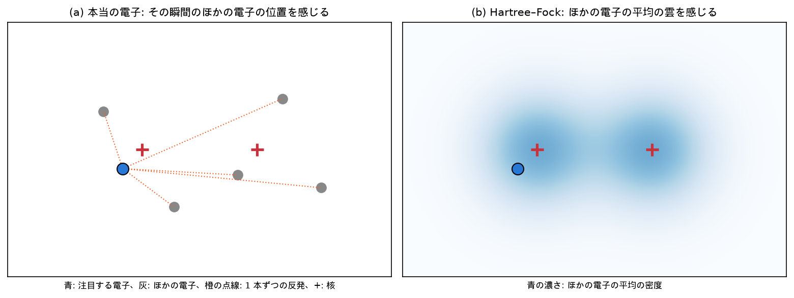

**図 1**　模式図。(a) 本当の電子（青）は、その瞬間のほかの電子（灰）の位置から、1 本ずつ反発を受けます。ほかの電子が近くに来れば、それを避けるように動きます。(b) Hartree–Fock 法では、ほかの電子を、平均の密度の雲（青の濃淡）にならして考えます。電子は、この動かない雲がつくる滑らかなポテンシャルの中を動きます。(a) の「瞬間ごとに避け合う動き」が失われることが、第 7 回の電子相関の出発点です。

交換演算子 $\hat{\mathcal K}_b$ は、作用する関数を積分の中に入れてしまうので、ある点でのポテンシャルの値として書けません（非局所的な演算子です）。
これは第 2 回で見た交換の効果、つまり同じスピンの電子が避け合う効果を表します。
$\hat{\mathcal K}_b$ の積分 $\int\chi_b^*(2)\chi(2)\,d\mathbf x_2$ にはスピンの積分が含まれるので、$\chi_b$ と $\chi$ のスピンが違えば 0 になります。
**交換は、同じスピンの電子どうしにしか働きません。**
この性質が、第 3 節以降で RHF・UHF・ROHF の違いを生みます。

和の中には $b = a$ の項も含まれます。
これは、電子が自分自身の雲と反発しているように見えます。
しかし、$\hat{\mathcal K}_a$ を $\chi_a$ 自身に作用させると、定義の $\chi$ に $\chi_a$ を入れて

$$
\hat{\mathcal K}_a\,\chi_a(1) = \left[\int \frac{\chi_a^*(2)\,\chi_a(2)}{r_{12}}\,d\mathbf x_2\right]\chi_a(1) = \hat{\mathcal J}_a\,\chi_a(1)
$$

となります。
したがって $b = a$ の項は $(\hat{\mathcal J}_a - \hat{\mathcal K}_a)\chi_a = 0$ で、自分自身との反発はちょうど打ち消されます。
Hartree–Fock 法には、このような自己相互作用の誤差がありません（密度汎関数法との違いは第 15 回で扱います）。

### 2.3 自己無撞着場

Fock 演算子は、占有されたスピン軌道 $\chi_b$ を使って作られています。
つまり、方程式の答え（軌道）が、方程式そのものに入っています。
このため、Hartree–Fock 方程式は一度では解けず、次の繰り返しで解きます。

1. 軌道を推測する。
2. その軌道で Fock 演算子（平均の場）を作る。
3. Hartree–Fock 方程式を解いて、新しい軌道を得る。
4. 軌道が変わらなくなるまで 2〜3 を繰り返す。

軌道がつくる場と、その場の中の軌道が一致した状態を、自己無撞着場（self-consistent field、SCF）と呼びます。
この考え方は Hartree が 1928 年に導入し [Hartree 1928]、Fock と Slater が 1930 年に反対称化した波動関数（決定子）に広げました [Fock 1930; Slater 1930]。

Fock 演算子の固有関数は、占有軌道 $N$ 本だけでなく、何本でも得られます。
エネルギーの低い $N$ 本を占有軌道、残りを仮想軌道（空軌道）と呼びます。
以下では、占有軌道を $a, b, \dots$、仮想軌道を $r, s, \dots$ と書きます（第 3 回の記法）。

### 2.4 Brillouin の定理

Hartree–Fock の決定子 $\Psi_0$ から、占有軌道 $\chi_a$ の電子 1 個を仮想軌道 $\chi_r$ に移した決定子を $\Psi_a^r$ と書きます。
第 3 回の Slater–Condon 則（スピン軌道が 1 本だけ違う場合）から、

$$
\langle\Psi_a^r|\hat H|\Psi_0\rangle = \langle r|\hat h|a\rangle + \sum_b^N\big([ra|bb] - [rb|ba]\big) = \langle\chi_r|\hat f|\chi_a\rangle
$$

です。
最後の等号は、2.1 節の Fock 演算子の定義そのものです。
Hartree–Fock の軌道では $\hat f\chi_a = \varepsilon_a\chi_a$ なので、$\langle\chi_r|\hat f|\chi_a\rangle = \varepsilon_a\langle\chi_r|\chi_a\rangle = 0$ です。

$$
\langle\Psi_a^r|\hat H|\Psi_0\rangle = 0
$$

これを Brillouin の定理と呼びます。
意味は次のとおりです。
$\Psi_0$ に $\Psi_a^r$ を少し混ぜることは、占有軌道 $\chi_a$ に仮想軌道 $\chi_r$ を少し混ぜて形を変えることと同じです（付録 D）。
エネルギーが最小なら、どの向きに軌道を変えても、エネルギーは 1 次では変わりません。
その条件が、「1 電子励起の決定子との行列要素が 0」という形で表れています。
この定理は、第 8 回の CI 法で、1 電子励起が基底状態に直接は混ざらない理由になります。
また 8 節では、ROHF の条件を、この「軌道を変えたときのエネルギーの 1 次の変化が 0」という形で導きます。

**ここまでで分かったこと**：Hartree–Fock の軌道は、Fock 演算子 $\hat f = \hat h + \sum_b(\hat{\mathcal J}_b - \hat{\mathcal K}_b)$ の固有関数です。Fock 演算子は、ほかの電子の平均の雲による反発と、同じスピンの電子との交換を表し、占有軌道に依存するので、繰り返し計算（SCF）で解きます。

## 3. 空間軌道の選び方：RHF、UHF、ROHF

第 2 節の方程式は、スピン軌道 $\chi$ についての方程式です。
実際の計算では、スピン軌道を、空間軌道 $\phi(\mathbf r)$ とスピンの関数 $\alpha$ または $\beta$ の積にします。

$$
\chi(\mathbf x) = \phi(\mathbf r)\,\alpha(\omega)\quad\text{または}\quad\chi(\mathbf x) = \phi(\mathbf r)\,\beta(\omega)
$$

$\omega$ はスピンの座標です。
問題は、$\alpha$ の電子と $\beta$ の電子の空間軌道を、同じものにするかどうかです。
第 4 回で見た「制限された決定子」と「非制限の決定子」の区別が、そのまま 3 つの Hartree–Fock 法になります（図 2）。

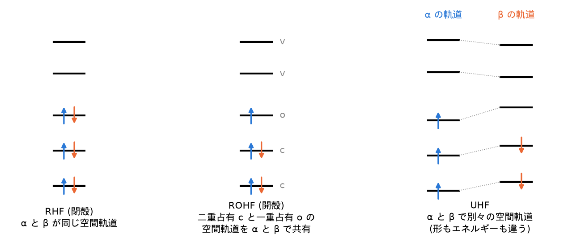

**図 2**　模式図。横線が空間軌道、青の上向きの矢印が $\alpha$ の電子、橙の下向きの矢印が $\beta$ の電子です。左：RHF。閉殻で、各空間軌道に $\alpha$ と $\beta$ の電子が対で入ります。中：ROHF。二重占有の軌道（c）と一重占有の軌道（o）があり、どちらの空間軌道も $\alpha$ と $\beta$ で共有します。右：UHF。$\alpha$ の電子と $\beta$ の電子が、それぞれ自分専用の空間軌道の組を持ちます。点線は「対応する」軌道を結んだもので、形もエネルギーも少しずつ違います。

| | 空間軌道 | 決定子 | 使う場面 |
|---|---|---|---|
| RHF（restricted HF） | $\alpha$ と $\beta$ で共通の $\phi_i$ | $\lvert\phi_1\alpha\,\phi_1\beta\cdots\phi_{N/2}\alpha\,\phi_{N/2}\beta\rangle$ | 閉殻 |
| ROHF（restricted open-shell HF） | 共通の $\phi_i$（二重占有 $n_c$ 本、一重占有 $n_o$ 本） | 二重占有の軌道に $\alpha\beta$、一重占有の軌道に $\alpha$ | 開殻（高スピン） |
| UHF（unrestricted HF） | $\alpha$ 用の $\phi_i^\alpha$ と $\beta$ 用の $\phi_j^\beta$ | $\lvert\phi_1^\alpha\alpha\cdots\phi_{N_\alpha}^\alpha\alpha\ \phi_1^\beta\beta\cdots\phi_{N_\beta}^\beta\beta\rangle$ | 開殻、結合の解離 |

3 つの方法は、変分の自由度の大きさで包含関係にあります。

- ROHF の決定子は、UHF で $\phi_i^\beta = \phi_i^\alpha$（$i \le N_\beta$）と制限した特別な場合です。
- 閉殻の RHF の決定子は、UHF で $N_\alpha = N_\beta$、$\phi_i^\beta = \phi_i^\alpha$ と制限した特別な場合です。

変分原理では、自由度が大きいほどエネルギーは低くなる（少なくとも高くはならない）ので、同じ分子と同じ基底関数では次の関係が成り立ちます。

$$
E_\mathrm{UHF} \le E_\mathrm{ROHF}\quad(\text{開殻}),\qquad E_\mathrm{UHF} \le E_\mathrm{RHF}\quad(\text{閉殻})
$$

閉殻の分子では、多くの場合 $E_\mathrm{UHF} = E_\mathrm{RHF}$ です。
UHF の方程式を解いても、$\phi_i^\alpha = \phi_i^\beta$ の解（RHF の解）に戻るからです。
等号が成り立たなくなる例が、第 7 節の H₂ の解離です。

一方、決定子がスピンの固有関数かどうかは、第 4 回の結果から次のようになります。

- 閉殻の RHF の決定子は一重項（$S = 0$）です。
- 高スピンの ROHF の決定子は、$S = M_S = n_o/2$ の固有関数です。
- UHF の決定子は、一般に $\hat S^2$ の固有関数ではありません（スピン汚染）。$\langle\hat S^2\rangle$ は純粋な値 $M_S(M_S+1)$ 以上になります。

以下の第 4〜8 節で、それぞれの方程式を導き、第 9 節で長所と短所をまとめます。

**ここまでで分かったこと**：RHF・ROHF・UHF は、スピン軌道の空間部分に課す制限の違いです。制限が少ないほどエネルギーは低くなりますが、UHF ではスピンの純粋さが失われます。

## 4. 閉殻の RHF と Roothaan–Hall 方程式

### 4.1 スピンを積分して空間軌道の方程式にする

閉殻の RHF では、$N$ 個の電子が $N/2$ 本の空間軌道 $\phi_1, \dots, \phi_{N/2}$ に対で入ります。
スピン軌道は $\phi_j\alpha$ と $\phi_j\beta$（$j = 1, \dots, N/2$）です。
第 2 節の方程式を、空間軌道 $\phi_i$ だけの方程式に直します（Szabo–Ostlund の 3.4.1 節 [Szabo 1996]）。

$\alpha$ のスピン軌道 $\chi_i = \phi_i\alpha$ について、Hartree–Fock 方程式は

$$
\hat f(\mathbf x_1)\,\phi_i(\mathbf r_1)\alpha(\omega_1) = \varepsilon_i\,\phi_i(\mathbf r_1)\alpha(\omega_1)
$$

です。
両辺に左から $\alpha^*(\omega_1)$ をかけ、スピンの座標 $\omega_1$ で積分します。
右辺は $\int\alpha^*\alpha\,d\omega = 1$ なので $\varepsilon_i\phi_i(\mathbf r_1)$ です。
左辺は Fock 演算子の 3 つの部分に分けて計算します。

**1 電子の部分**：$\hat h$ はスピンに作用しないので、$\hat h(\mathbf r_1)\phi_i(\mathbf r_1)$ です。

**クーロンの部分**：和 $\sum_b$ を、$b = \phi_j\alpha$ と $b = \phi_j\beta$ に分けます。
$\hat{\mathcal J}_b$ の角括弧の中は $\int|\chi_b(2)|^2/r_{12}\,d\mathbf x_2$ で、スピンの積分は $\int|\alpha|^2d\omega_2 = \int|\beta|^2d\omega_2 = 1$ です。
したがって、$\alpha$ と $\beta$ のどちらでも同じ $\int|\phi_j(\mathbf r_2)|^2/r_{12}\,d\mathbf r_2$ になり、合わせて $2\hat J_j\phi_i$ です。
ここで、空間軌道のクーロン演算子と交換演算子を次のように定義しました。

$$
\hat J_j\,\phi(\mathbf r_1) = \left[\int \frac{\phi_j(\mathbf r_2)\,\phi_j(\mathbf r_2)}{r_{12}}\,d\mathbf r_2\right]\phi(\mathbf r_1),\qquad
\hat K_j\,\phi(\mathbf r_1) = \left[\int \frac{\phi_j(\mathbf r_2)\,\phi(\mathbf r_2)}{r_{12}}\,d\mathbf r_2\right]\phi_j(\mathbf r_1)
$$

**交換の部分**：$\hat{\mathcal K}_b\chi_i$ の角括弧の中は $\int\chi_b^*(2)\chi_i(2)/r_{12}\,d\mathbf x_2$ で、スピンの積分 $\int\sigma_b^*(\omega_2)\alpha(\omega_2)\,d\omega_2$ を含みます。

- $b = \phi_j\alpha$ なら、スピンの積分は 1 で、$\hat K_j\phi_i$ が残ります。
- $b = \phi_j\beta$ なら、スピンの積分は $\int\beta^*\alpha\,d\omega = 0$ で、何も残りません。

したがって交換の部分は $\hat K_j\phi_i$ が 1 個だけです。

3 つをまとめると、閉殻の空間軌道の Hartree–Fock 方程式が得られます。

$$
\hat f(\mathbf r_1)\,\phi_i(\mathbf r_1) = \varepsilon_i\,\phi_i(\mathbf r_1),\qquad
\hat f = \hat h + \sum_{j}^{N/2}\big(2\hat J_j - \hat K_j\big)
$$

$\beta$ のスピン軌道 $\phi_i\beta$ から始めても、$\alpha$ と $\beta$ の役割を入れ替えるだけで、同じ式になります。
**$\alpha$ と $\beta$ の電子が同じ Fock 演算子を感じる**ので、同じ空間軌道を使うことが、方程式の上でも矛盾しません。
これが閉殻で RHF がうまくいく理由です。

$\hat K_j$ の係数が $2\hat J_j$ の半分なのは、空間軌道 $\phi_j$ の 2 個の電子のうち、交換が働くのは同じスピンの 1 個だけだからです。
$j = i$ の項は $(2\hat J_i - \hat K_i)\phi_i = \hat J_i\phi_i$ で、残るのは同じ軌道に入った反対のスピンの電子 1 個分の反発だけです。

閉殻の決定子のエネルギーは、第 3 回で求めたとおりです。

$$
E_\mathrm{RHF} = 2\sum_{i}^{N/2} h_{ii} + \sum_{i}^{N/2}\sum_{j}^{N/2}\big(2J_{ij} - K_{ij}\big) + V_\mathrm{NN}
$$

$J_{ij} = (ii|jj)$ はクーロン積分、$K_{ij} = (ij|ji)$ は交換積分です。
付録 B では、この式を空間軌道で直接最小にして、同じ方程式を導きます。

### 4.2 基底関数で展開する

Hartree–Fock 方程式は微分と積分を含む方程式で、分子ではそのままでは解けません。
そこで、軌道を、あらかじめ決めた $K$ 個の関数 $g_\mu(\mathbf r)$ の一次結合で表します。

$$
\phi_i(\mathbf r) = \sum_{\nu=1}^{K} C_{\nu i}\,g_\nu(\mathbf r)
$$

$g_\mu$ を基底関数（basis function）と呼び、ふつうは各原子を中心とする原子軌道のような関数を使います（第 6 回で詳しく扱います）。
これは、学部で学んだ LCAO（原子軌道の一次結合）の考え方そのものです。
第 1 回で見たように、関数を有限個の基底で展開すると、演算子の方程式は行列の方程式になります。
未知のものは、関数 $\phi_i$ から、係数 $C_{\nu i}$ の組に変わりました。

この展開を $\hat f\phi_i = \varepsilon_i\phi_i$ に代入すると、

$$
\sum_{\nu} C_{\nu i}\,\hat f g_\nu = \varepsilon_i\sum_{\nu} C_{\nu i}\,g_\nu
$$

です。
両辺に左から $g_\mu$ をかけて、$\mathbf r$ で積分します。
$F_{\mu\nu} = \int g_\mu\,\hat f\,g_\nu\,d\mathbf r$、$S_{\mu\nu} = \int g_\mu\,g_\nu\,d\mathbf r$ と書くと、

$$
\sum_{\nu} F_{\mu\nu}C_{\nu i} = \varepsilon_i\sum_{\nu} S_{\mu\nu}C_{\nu i}\qquad(\mu = 1, \dots, K)
$$

になります。
左辺は行列 $\mathbf F$ と、$\mathbf C$ の第 $i$ 列の積の第 $\mu$ 成分、右辺は $\mathbf S$ と第 $i$ 列の積に $\varepsilon_i$ をかけたものです。
すべての軌道 $i$ の式を、列として横に並べると、

$$
\mathbf F\mathbf C = \mathbf S\mathbf C\boldsymbol\varepsilon
$$

になります。
これを Roothaan–Hall 方程式と呼びます。
1951 年に Roothaan と Hall がそれぞれ示しました [Roothaan 1951; Hall 1951]。
各記号は $K\times K$ の行列です。

- $\mathbf S$：重なり行列。基底関数は互いに直交しないので、単位行列になりません。
- $\mathbf C$：各列が 1 つの軌道の係数。
- $\boldsymbol\varepsilon$：軌道エネルギーを並べた対角行列。
- $\mathbf F$：Fock 行列。

これは、第 1 回 4 節の一般化固有値問題です。
$\mathbf C = \mathbf S^{-1/2}\mathbf C'$ とおいて両辺に左から $\mathbf S^{-1/2}$ をかけると、$(\mathbf S^{-1/2}\mathbf F\mathbf S^{-1/2})\mathbf C' = \mathbf C'\boldsymbol\varepsilon$ という、ふつうの固有値問題に直せます。

### 4.3 2 行 2 列の例：H₂

いちばん小さい例として、H₂ の各水素原子に 1s の基底関数を 1 個ずつ置いた場合（$K = 2$）を書き出します。
原子 A の基底関数を $g_A$、原子 B の基底関数を $g_B$ とします。
2 つの原子は同じなので、対角の要素は等しくなります。
$F_{AA} = F_{BB}$、$S_{AA} = S_{BB} = 1$ とし、非対角の要素を $F_{AB}$、$S_{AB} = S$ と書きます。
Roothaan–Hall 方程式は

$$
\begin{pmatrix} F_{AA} & F_{AB}\\ F_{AB} & F_{AA}\end{pmatrix}
\begin{pmatrix} C_{A1} & C_{A2}\\ C_{B1} & C_{B2}\end{pmatrix}
=
\begin{pmatrix} 1 & S\\ S & 1\end{pmatrix}
\begin{pmatrix} C_{A1} & C_{A2}\\ C_{B1} & C_{B2}\end{pmatrix}
\begin{pmatrix} \varepsilon_1 & 0\\ 0 & \varepsilon_2\end{pmatrix}
$$

です。
1 列目（軌道 1）だけを取り出して、右辺を左辺に移すと

$$
\begin{pmatrix} F_{AA} - \varepsilon_1 & F_{AB} - \varepsilon_1 S\\ F_{AB} - \varepsilon_1 S & F_{AA} - \varepsilon_1\end{pmatrix}\begin{pmatrix} C_{A1}\\ C_{B1}\end{pmatrix} = \begin{pmatrix} 0\\ 0\end{pmatrix}
$$

です。
係数が 0 でない解をもつには、この行列の行列式が 0 でなければなりません。

$$
(F_{AA} - \varepsilon)^2 - (F_{AB} - \varepsilon S)^2 = 0
$$

2 乗の差なので、$F_{AA} - \varepsilon = \pm(F_{AB} - \varepsilon S)$ です。
それぞれを $\varepsilon$ について解くと、

$$
\varepsilon_1 = \frac{F_{AA} + F_{AB}}{1 + S},\qquad
\varepsilon_2 = \frac{F_{AA} - F_{AB}}{1 - S}
$$

が得られます。
$\varepsilon_1$ を元の式に入れると $C_{A1} = C_{B1}$（同じ符号で足し合わせる結合性の軌道 $\sigma_g$）、$\varepsilon_2$ では $C_{A2} = -C_{B2}$（反結合性の軌道 $\sigma_u$）です。
規格化 $\langle\phi_1|\phi_1\rangle = C_{A1}^2 + C_{B1}^2 + 2C_{A1}C_{B1}S = 2C_{A1}^2(1 + S) = 1$ から $C_{A1} = 1/\sqrt{2(1+S)}$、同じように $C_{A2} = 1/\sqrt{2(1-S)}$ です。
これは、学部で学んだ Hückel 法の 2 原子の計算と同じ形です。
違いは、$F_{AA}$ と $F_{AB}$ が経験的なパラメータではなく、次の 4.4 節の式で電子の分布から計算されることです。

図 3 に、この解をエネルギー準位図で表します。

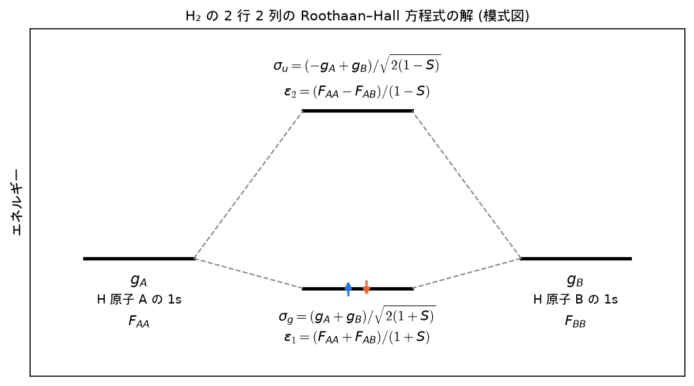

**図 3**　模式図。H₂ の 2 行 2 列の Roothaan–Hall 方程式の解。左右が 2 つの基底関数（各原子の 1s、Fock 行列の対角要素 $F_{AA}$）、中央が分子軌道です。結合性の $\sigma_g$（$\varepsilon_1$）に 2 個の電子（$\alpha$ と $\beta$）が入り、反結合性の $\sigma_u$（$\varepsilon_2$）は空のままです。$F_{AB} - SF_{AA} < 0$（結合性の軌道が下がる、ふつうの場合）のとき、$\varepsilon_1 - F_{AA} = (F_{AB} - SF_{AA})/(1+S)$、$\varepsilon_2 - F_{AA} = -(F_{AB} - SF_{AA})/(1-S)$ なので、分母の違いから、$\sigma_u$ の上がり幅は $\sigma_g$ の下がり幅より大きくなります。

### 4.4 Fock 行列を密度行列で書く

閉殻の Fock 行列は次のように書けます。
すべての段階は付録 C で導きます。

$$
F_{\mu\nu} = h_{\mu\nu} + \sum_{\lambda\sigma} P_{\lambda\sigma}\Big[(\mu\nu|\lambda\sigma) - \tfrac12(\mu\lambda|\nu\sigma)\Big],
\qquad
P_{\lambda\sigma} = 2\sum_{i}^{N/2} C_{\lambda i}C_{\sigma i}
$$

$P_{\lambda\sigma}$ は密度行列です（Szabo–Ostlund と同じ記号です）。
電子密度 $\rho(\mathbf r) = 2\sum_i\phi_i(\mathbf r)^2$ に軌道の展開を入れると、

$$
\rho(\mathbf r) = 2\sum_i\sum_{\lambda\sigma}C_{\lambda i}C_{\sigma i}\,g_\lambda(\mathbf r)g_\sigma(\mathbf r) = \sum_{\lambda\sigma}P_{\lambda\sigma}\,g_\lambda(\mathbf r)g_\sigma(\mathbf r)
$$

なので、$\mathbf P$ は電子密度を基底関数で表す係数の表です。
$\rho$ を全空間で積分すると電子の数になるので、$\sum_{\lambda\sigma}P_{\lambda\sigma}S_{\lambda\sigma} = N$ です。
4.3 節の H₂ で確かめます。占有軌道は $\sigma_g$ の 1 本で、$C_{A1} = C_{B1} = 1/\sqrt{2(1+S)}$ なので、

$$
\mathbf P = 2\begin{pmatrix} C_{A1}C_{A1} & C_{A1}C_{B1}\\ C_{B1}C_{A1} & C_{B1}C_{B1}\end{pmatrix} = \frac{1}{1+S}\begin{pmatrix} 1 & 1\\ 1 & 1\end{pmatrix}
$$

です。
$\sum_{\lambda\sigma}P_{\lambda\sigma}S_{\lambda\sigma} = \frac{1}{1+S}(1 + S + S + 1) = 2$ となり、確かに電子 2 個分になります。

$(\mu\nu|\lambda\sigma)$ は、基底関数についての電子反発積分（化学者の表記）です。
括弧の第 1 項がクーロン（4.1 節の $2\hat J_j$）、第 2 項が交換（$\hat K_j$）の寄与です。
エネルギーは、同じ記号で次のように書けます（付録 C）。

$$
E_\mathrm{RHF} = \frac12\sum_{\mu\nu}P_{\mu\nu}\big(h_{\mu\nu} + F_{\mu\nu}\big) + V_\mathrm{NN}
$$

基底関数を有限にしたので、問題は「行列を作り、一般化固有値問題を解く」ことに変わりました。
得られる $K$ 個の軌道のうち、エネルギーの低い $N/2$ 個を占有軌道、残りを仮想軌道と呼びます。

**ここまでで分かったこと**：閉殻では、$\alpha$ と $\beta$ の電子が同じ Fock 演算子を感じるので、空間軌道を共有させられます（RHF）。軌道を基底関数で展開すると、Roothaan–Hall 方程式 $\mathbf F\mathbf C = \mathbf S\mathbf C\boldsymbol\varepsilon$ になり、$\mathbf F$ は密度行列 $\mathbf P$ を通して $\mathbf C$ に依存します。

## 5. SCF の手順：H₂O を自分で解く

2.3 節の繰り返しを、行列の言葉で書き直すと次のようになります（図 4）。

1. 積分 $\mathbf S$、$\mathbf h$、$(\mu\nu|\lambda\sigma)$ を計算する。これらは軌道によらないので、最初に 1 回だけ計算します。
2. 最初の密度行列 $\mathbf P$ を推測する。
3. $\mathbf P$ から Fock 行列 $\mathbf F$ を作り、エネルギーを計算する。
4. $\mathbf F\mathbf C = \mathbf S\mathbf C\boldsymbol\varepsilon$ を解き、エネルギーの低い $N/2$ 個の軌道から新しい $\mathbf P$ を作る。
5. エネルギー（と $\mathbf P$）が変わらなくなるまで 3〜4 を繰り返す。

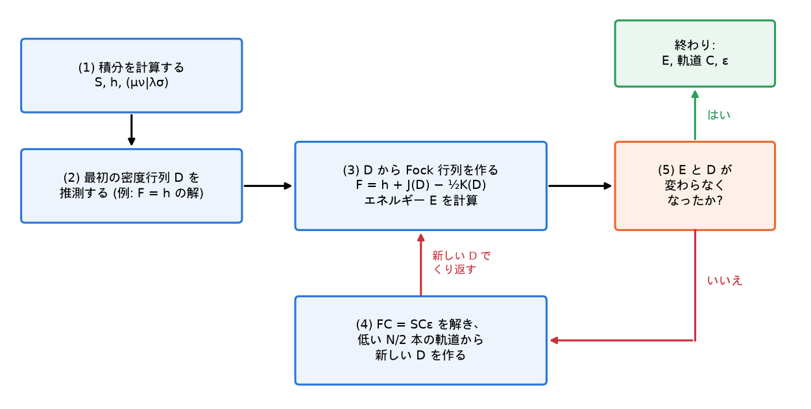

**図 4**　SCF の手順。(3)「密度から平均の場（Fock 行列）を作る」と (4)「その場の中の軌道を解いて新しい密度を作る」を、赤の矢印のように、(5) で変化がなくなったと判定されるまで繰り返します。

この手順を、H₂O について numpy で書いてみます。
構造は O–H 距離 0.958 Å、H–O–H 角 104.5° とし、基底関数は cc-pVDZ [Dunning 1989] を使います。
積分の計算だけを PySCF [Sun 2020] に任せます。
最初の推測には、電子間の反発を無視した $\mathbf F = \mathbf h$ の解を使います。
コードの `J` と `K` は、4.4 節の式の括弧の第 1 項と第 2 項を、$\mathbf P$ と足し合わせたものです。

```python
import numpy as np
import scipy.linalg
from pyscf import gto, scf

r, th = 0.958, np.deg2rad(104.5)   # O–H 距離（Å）と H–O–H 角
geom = [["O", (0, 0, 0)],
        ["H", (0,  r*np.sin(th/2), r*np.cos(th/2))],
        ["H", (0, -r*np.sin(th/2), r*np.cos(th/2))]]
mol = gto.M(atom=geom, basis="cc-pvdz", unit="Angstrom", verbose=0)

S = mol.intor("int1e_ovlp")                              # 重なり行列 S
Hcore = mol.intor("int1e_kin") + mol.intor("int1e_nuc")  # 1 電子の部分 h
eri = mol.intor("int2e")                                 # (μν|λσ)（化学者の表記）
nocc = mol.nelectron // 2
Enuc = mol.energy_nuc()
print("基底関数の数 K =", mol.nao, "  占有軌道の数 =", nocc)

def density(F):
    eps, C = scipy.linalg.eigh(F, S)        # FC = SCε を解く
    return 2 * C[:, :nocc] @ C[:, :nocc].T

P = density(Hcore)                          # 最初の推測：電子間反発を無視
E_old = 0.0
for it in range(1, 100):
    J = np.einsum("pqrs,rs->pq", eri, P)
    K = np.einsum("prqs,rs->pq", eri, P)
    F = Hcore + J - 0.5 * K                 # Fock 行列
    E = 0.5 * np.sum(P * (Hcore + F)) + Enuc
    if it <= 5 or it % 5 == 0 or abs(E - E_old) < 1e-10:
        print(f"{it:3d}  E = {E:.10f}  ΔE = {E-E_old:.1e}")
    if abs(E - E_old) < 1e-10:
        break
    E_old = E
    P = density(F)

mf = scf.RHF(mol).run()
print(f"自作の SCF  : {E:.8f} Eh")
print(f"PySCF の RHF: {mf.e_tot:.8f} Eh（{mf.cycles} 回で収束）")
```

出力は次のとおりです（途中の行は一部だけ表示しています）。

```text
基底関数の数 K = 24   占有軌道の数 = 5
  1  E = -68.8742008387  ΔE = -6.9e+01
  2  E = -69.9500047151  ΔE = -1.1e+00
  3  E = -73.3054234635  ΔE = -3.4e+00
  4  E = -73.4268430572  ΔE = -1.2e-01
  5  E = -74.6944568108  ΔE = -1.3e+00
 10  E = -76.0199831017  ΔE = -1.3e-02
 15  E = -76.0267330389  ΔE = -5.6e-05
 20  E = -76.0267606207  ΔE = -2.3e-07
 25  E = -76.0267607333  ΔE = -9.3e-10
 28  E = -76.0267607338  ΔE = -3.4e-11
自作の SCF  : -76.02676073 Eh
PySCF の RHF: -76.02676073 Eh（8 回で収束）
```

短いコードの繰り返しで、PySCF と同じエネルギー $-76.02676\,E_\mathrm h$ が得られました。
表示した行では、エネルギーは繰り返しのたびに下がり、28 回で $10^{-10}\,E_\mathrm h$ の範囲で変わらなくなりました。
1 回目のエネルギーが $-68.87\,E_\mathrm h$ と大きくずれているのは、最初の推測が電子間の反発を無視して作った軌道で、Hartree–Fock の軌道から大きく離れているためです。

PySCF は同じ答えに 8 回で到達しています。
これは、これまでの何回かの Fock 行列と誤差を組み合わせて次の Fock 行列を作る、DIIS という加速法を使っているためです [Pulay 1980; Pulay 1982]。
上の単純な繰り返しは、分子によっては振動して収束しないこともあります。
実際のプログラムは、よい初期推測と DIIS などの加速法を組み合わせています。

**ここまでで分かったこと**：SCF は「密度行列から Fock 行列を作り、対角化して新しい密度行列を作る」ことの繰り返しです。H₂O でも数十行のコードで解けます。

## 6. UHF と Pople–Nesbet 方程式

### 6.1 開殻では α と β の電子が違う場を感じる

ここからは、$\alpha$ の電子の数 $N_\alpha$ と $\beta$ の電子の数 $N_\beta$ が違う開殻の分子を考えます（$N_\alpha > N_\beta$ とします）。
UHF では、$\alpha$ の電子に空間軌道 $\phi_1^\alpha, \dots, \phi_{N_\alpha}^\alpha$、$\beta$ の電子に別の空間軌道 $\phi_1^\beta, \dots, \phi_{N_\beta}^\beta$ を使います。

$$
\Psi_\mathrm{UHF} = \big|\phi_1^\alpha\alpha\ \cdots\ \phi_{N_\alpha}^\alpha\alpha\ \ \phi_1^\beta\beta\ \cdots\ \phi_{N_\beta}^\beta\beta\big\rangle
$$

スピン軌道の Hartree–Fock 方程式（第 2 節）から、4.1 節と同じようにスピンを積分します。
$\alpha$ のスピン軌道 $\phi_i^\alpha\alpha$ について、左から $\alpha^*(\omega_1)$ をかけて $\omega_1$ で積分すると、次のようになります。

- クーロンの部分：$\alpha$ の占有軌道 $N_\alpha$ 本と、$\beta$ の占有軌道 $N_\beta$ 本の、すべてから寄与があります。
- 交換の部分：スピンの積分 $\int\sigma_b^*\alpha\,d\omega$ が残るのは、$b$ が $\alpha$ のスピン軌道のときだけです。

$\beta$ の電子についても同じです。
したがって、$\alpha$ と $\beta$ の電子は、それぞれ次の Fock 演算子の固有関数になります（Szabo–Ostlund の 3.8.1 節 [Szabo 1996]）。

$$
\hat f^\alpha = \hat h + \sum_{a}^{N_\alpha}\big(\hat J_a^\alpha - \hat K_a^\alpha\big) + \sum_{a}^{N_\beta}\hat J_a^\beta,
\qquad
\hat f^\alpha\phi_i^\alpha = \varepsilon_i^\alpha\phi_i^\alpha
$$

$$
\hat f^\beta = \hat h + \sum_{a}^{N_\beta}\big(\hat J_a^\beta - \hat K_a^\beta\big) + \sum_{a}^{N_\alpha}\hat J_a^\alpha,
\qquad
\hat f^\beta\phi_i^\beta = \varepsilon_i^\beta\phi_i^\beta
$$

$\hat J_a^\alpha$、$\hat K_a^\alpha$ は、4.1 節の $\hat J_j$、$\hat K_j$ で $\phi_j$ を $\phi_a^\alpha$ にしたものです（$\beta$ も同じ）。

2 つの Fock 演算子を比べます。
クーロンの部分 $\sum_a^{N_\alpha}\hat J_a^\alpha + \sum_a^{N_\beta}\hat J_a^\beta$ は、全電子の雲がつくる静電ポテンシャルで、$\hat f^\alpha$ と $\hat f^\beta$ に共通です。
違うのは交換の部分です。
$\alpha$ の電子は $N_\alpha$ 個の同じスピンの電子と交換をし、$\beta$ の電子は $N_\beta$ 個としかしません。
交換は、同じスピンの電子が避け合うことで反発を減らす効果なので、**同じスピンの仲間が多い $\alpha$ の電子の方が、平均として低いポテンシャルを感じます。**

閉殻では $N_\alpha = N_\beta$ で、$\phi_a^\alpha = \phi_a^\beta$ なら $\hat f^\alpha = \hat f^\beta$ になり、4.1 節の閉殻の Fock 演算子に戻ります。
開殻では $\hat f^\alpha \neq \hat f^\beta$ なので、$\alpha$ と $\beta$ の電子に同じ空間軌道を押しつけると、どちらの方程式も満たせません。
UHF は、2 つの方程式をそれぞれ解き、$\alpha$ と $\beta$ に別々の軌道を許します。
ROHF は、空間軌道を共有させたうえで、2 つの方程式の折り合いをつけます（第 8 節）。

### 6.2 Pople–Nesbet 方程式

$\alpha$ と $\beta$ の軌道を、同じ $K$ 個の基底関数で展開します。

$$
\phi_i^\alpha = \sum_{\nu}C_{\nu i}^\alpha\,g_\nu,\qquad
\phi_i^\beta = \sum_{\nu}C_{\nu i}^\beta\,g_\nu
$$

4.2 節と同じ手順（左から $g_\mu$ をかけて積分する）で、2 組の行列の方程式が得られます。

$$
\mathbf F^\alpha\mathbf C^\alpha = \mathbf S\mathbf C^\alpha\boldsymbol\varepsilon^\alpha,\qquad
\mathbf F^\beta\mathbf C^\beta = \mathbf S\mathbf C^\beta\boldsymbol\varepsilon^\beta
$$

これを Pople–Nesbet 方程式と呼びます [Pople 1954]。
重なり行列 $\mathbf S$ は共通で、Fock 行列と係数がスピンごとに別です。

Fock 行列を書くために、スピンごとの密度行列を定義します。

$$
P_{\lambda\sigma}^\alpha = \sum_{a}^{N_\alpha}C_{\lambda a}^\alpha C_{\sigma a}^\alpha,\qquad
P_{\lambda\sigma}^\beta = \sum_{a}^{N_\beta}C_{\lambda a}^\beta C_{\sigma a}^\beta
$$

閉殻の $\mathbf P$ と違い、係数 2 がつきません（各軌道に電子は 1 個だからです）。
和と差にも名前をつけます。

$$
\mathbf P^\mathrm T = \mathbf P^\alpha + \mathbf P^\beta\ \ (\text{全電子の密度}),\qquad
\mathbf P^\mathrm S = \mathbf P^\alpha - \mathbf P^\beta\ \ (\text{スピン密度})
$$

付録 C と同じ計算で、Fock 行列は次のようになります。

$$
F_{\mu\nu}^\alpha = h_{\mu\nu} + \sum_{\lambda\sigma}\Big[P_{\lambda\sigma}^\mathrm T(\mu\nu|\lambda\sigma) - P_{\lambda\sigma}^\alpha(\mu\lambda|\nu\sigma)\Big]
$$

$$
F_{\mu\nu}^\beta = h_{\mu\nu} + \sum_{\lambda\sigma}\Big[P_{\lambda\sigma}^\mathrm T(\mu\nu|\lambda\sigma) - P_{\lambda\sigma}^\beta(\mu\lambda|\nu\sigma)\Big]
$$

6.1 節の構造が、そのまま行列に表れています。

- クーロンの項は全密度 $\mathbf P^\mathrm T$ で決まり、$\mathbf F^\alpha$ と $\mathbf F^\beta$ に共通です。
- 交換の項は、$\mathbf F^\alpha$ では $\mathbf P^\alpha$ だけ、$\mathbf F^\beta$ では $\mathbf P^\beta$ だけで決まります。

2 つの方程式は、クーロンの項の $\mathbf P^\mathrm T$ を通してだけつながっています。
$\alpha$ の軌道が変わると $\mathbf P^\mathrm T$ が変わり、$\beta$ の電子が感じる場も変わります。
そのため、2 つを同時に SCF で解きます（図 5）。

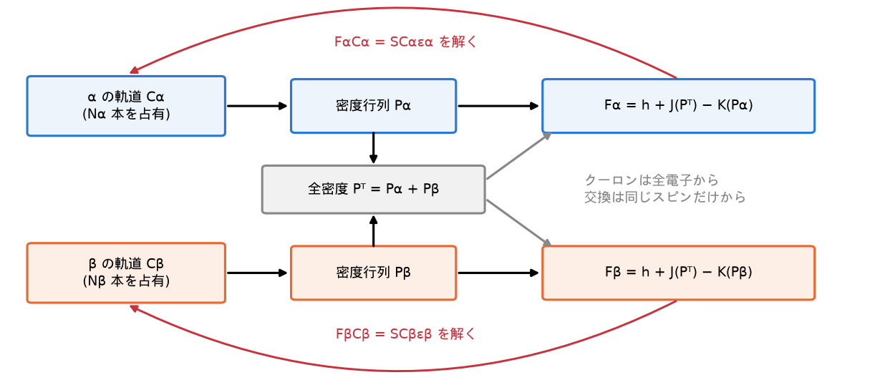

**図 5**　UHF の SCF の手順。$\alpha$ の軌道（青）と $\beta$ の軌道（橙）から、それぞれの密度行列を作ります。クーロンの項は全密度 $\mathbf P^\mathrm T$（灰）から両方の Fock 行列に入り、交換の項は同じスピンの密度だけから入ります。2 つの一般化固有値問題を解いて（赤の矢印）、新しい軌道に更新し、変化がなくなるまで繰り返します。

**閉殻で RHF に戻ることの確認**：$N_\alpha = N_\beta$ で $\mathbf C^\alpha = \mathbf C^\beta$ なら、$\mathbf P^\alpha = \mathbf P^\beta = \tfrac12\mathbf P$（$\mathbf P$ は 4.4 節の閉殻の密度行列）、$\mathbf P^\mathrm T = \mathbf P$ です。
これを $F_{\mu\nu}^\alpha$ に入れると、

$$
F_{\mu\nu}^\alpha = h_{\mu\nu} + \sum_{\lambda\sigma}\Big[P_{\lambda\sigma}(\mu\nu|\lambda\sigma) - \tfrac12P_{\lambda\sigma}(\mu\lambda|\nu\sigma)\Big]
$$

となり、4.4 節の閉殻の Fock 行列と一致します。
$F^\beta$ も同じです。

**エネルギー**：UHF のエネルギーは次の式で書けます（付録 C）。

$$
E_\mathrm{UHF} = \frac12\sum_{\mu\nu}\Big[P_{\nu\mu}^\mathrm T h_{\mu\nu} + P_{\nu\mu}^\alpha F_{\mu\nu}^\alpha + P_{\nu\mu}^\beta F_{\mu\nu}^\beta\Big] + V_\mathrm{NN}
$$

閉殻の場合を入れると $\frac12\sum P(h + \frac12F + \frac12F) = \frac12\sum P(h + F)$ で、4.4 節の式に戻ります。

**計算の手間**：Fock 行列が 2 つ、対角化も 2 回になります。
ただし、いちばん手間のかかる 2 電子積分と密度行列の掛け合わせは、クーロンの項（$\mathbf P^\mathrm T$ との 1 回）と交換の項（$\mathbf P^\alpha$ と $\mathbf P^\beta$ の 2 回）で、RHF の 1.5 倍程度の量です。

### 6.3 スピン分極：Li 原子の例

UHF で $\alpha$ と $\beta$ の軌道が違ってくる様子を、いちばん簡単な開殻の原子、Li（$1s^2 2s^1$、二重項）で見ます。
$\alpha$ の電子は $1s\alpha$ と $2s\alpha$ の 2 個、$\beta$ の電子は $1s\beta$ の 1 個です。

ROHF では、$1s$ の空間軌道を $\alpha$ と $\beta$ で共有します。
UHF では、$1s\alpha$ と $1s\beta$ が別々の軌道になります。
6.1 節の議論から、$1s\alpha$ の電子は $2s\alpha$ の電子と交換をしますが、$1s\beta$ の電子はしません。
そのため、$1s\alpha$ の電子は少し低いポテンシャルを感じ、$1s\beta$ と違う形になります（図 6 左）。
この効果をスピン分極（spin polarization）と呼びます。

```python
import numpy as np
from pyscf import gto, scf

# 非縮約の cc-pCVQZ 基底（内殻の形を柔軟に表せる）
basis = gto.uncontract(gto.load("cc-pcvqz", "Li"))
mol = gto.M(atom="Li 0 0 0", spin=1, basis=basis, verbose=0)   # spin = Nα − Nβ = 1
rohf = scf.ROHF(mol).run(conv_tol=1e-10)
uhf = scf.UHF(mol).run(conv_tol=1e-10)

print(f"E(ROHF) = {rohf.e_tot:.6f}   E(UHF) = {uhf.e_tot:.6f}")
print(f"<S^2>(UHF) = {uhf.spin_square()[0]:.5f}")
print(f"UHF  : ε(1sα) = {uhf.mo_energy[0][0]:.4f}   ε(1sβ) = {uhf.mo_energy[1][0]:.4f}")

ao = mol.eval_gto("GTOval", np.zeros((1, 3)))       # 原子核の位置での基底関数の値
for name, mf in [("ROHF", rohf), ("UHF ", uhf)]:
    da, db = mf.make_rdm1()
    rho_s = (ao @ (da - db) @ ao.T).item()          # スピン密度 ρα − ρβ
    print(f"{name}: 原子核の位置のスピン密度 = {rho_s:.4f}")
```

```text
E(ROHF) = -7.432695   E(UHF) = -7.432719
<S^2>(UHF) = 0.75002
UHF  : ε(1sα) = -2.4867   ε(1sβ) = -2.4687
ROHF: 原子核の位置のスピン密度 = 0.1631
UHF : 原子核の位置のスピン密度 = 0.2200
```

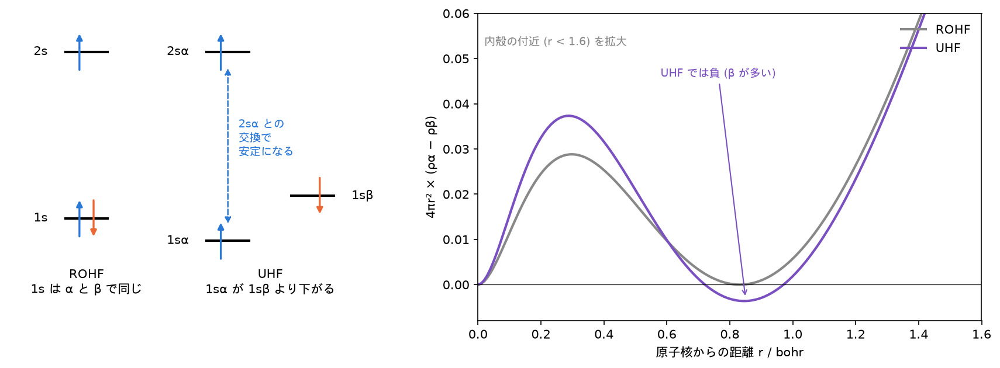

**図 6**　Li 原子の ROHF と UHF。左：軌道の準位の模式図。ROHF では $1s$ の軌道を $\alpha$ と $\beta$ で共有しますが、UHF では $2s\alpha$ との交換で $1s\alpha$ が安定になり、$1s\beta$ より $0.018\,E_\mathrm h$ 低くなります（上の出力の値）。右：原子核の付近のスピン密度 $\rho_\alpha - \rho_\beta$ に $4\pi r^2$ をかけたもの。ROHF（灰）は $2s$ の電子の密度そのもので、負になりません。UHF（紫）は、原子核のごく近くで大きくなり、$r \approx 0.85$ bohr の付近で負（$\beta$ の電子の方が多い）になります。

結果は次のように読めます。

- エネルギーの差は $0.024$ m$E_\mathrm h$ とわずかです。
- $\langle\hat S^2\rangle = 0.75002$ で、純粋な二重項の値 0.75 からのずれ（スピン汚染）もごくわずかです。
- それでも、**原子核の位置のスピン密度は、UHF で ROHF より約 35% 大きくなります**（0.1631 から 0.2200）。

原子核の位置のスピン密度は、電子スピン共鳴（ESR）で測る超微細結合定数（フェルミ接触相互作用）を決める量です。
ROHF では、内殻の $1s$ の電子は $\alpha$ と $\beta$ で完全に打ち消し合うので、スピン密度は $2s$ の電子 1 個からしか来ません。
実際には、不対電子が内殻の電子を「分極」させ、内殻からもスピン密度が生じます。
この内殻の分極（core polarization）は ROHF には入らず、UHF には入ります。
これは UHF の大きな長所の 1 つです。

### 6.4 スピン汚染

UHF の決定子は、$\alpha$ と $\beta$ の空間軌道が違うので、一般に $\hat S^2$ の固有関数ではありません。
第 4 回で導いた式から、$N_\alpha \ge N_\beta$ のとき

$$
\langle\hat S^2\rangle_\mathrm{UHF} = M_S(M_S+1) + N_\beta - \sum_{i}^{N_\alpha}\sum_{j}^{N_\beta}\big|\langle\phi_i^\alpha|\phi_j^\beta\rangle\big|^2,
\qquad M_S = \frac{N_\alpha - N_\beta}{2}
$$

です。
$\alpha$ と $\beta$ の軌道が同じなら、最後の和は $N_\beta$ に等しく、$\langle\hat S^2\rangle = M_S(M_S+1)$（純粋な $S = M_S$ の値）になります。
軌道が違うほど和が小さくなり、$\langle\hat S^2\rangle$ は純粋な値より大きくなります。
これは、波動関数に、より大きな $S$ の状態が混ざっていることを意味します（スピン汚染、spin contamination）。

Li では軌道の違いが小さいので、汚染は 0.00002 でした。
分子では、汚染が大きくなることがあります。
3 つの開殻の分子で、ROHF と UHF を比べます。

```python
import numpy as np
from pyscf import gto, scf

t = np.deg2rad(133.9 / 2)          # CH2 の三重項：C–H 1.075 Å、H–C–H 133.9°
mols = {
    "CH2 (3B1)": (f"C 0 0 0; H 0 {1.075*np.sin(t):.4f} {1.075*np.cos(t):.4f};"
                  f" H 0 {-1.075*np.sin(t):.4f} {1.075*np.cos(t):.4f}", 2),
    "CN (2Σ+) ": ("C 0 0 0; N 0 0 1.172", 1),
    "O2 (3Σg-)": ("O 0 0 0; O 0 0 1.208", 2),
}
print("             E(ROHF)      E(UHF)    差/mEh  <S^2>UHF  純粋な値")
for name, (geom, spin) in mols.items():
    mol = gto.M(atom=geom, spin=spin, basis="cc-pvdz", verbose=0)
    ro = scf.ROHF(mol).run()
    u = scf.UHF(mol).run()
    s = spin / 2
    print(f"{name}  {ro.e_tot:11.5f} {u.e_tot:11.5f} {(u.e_tot-ro.e_tot)*1e3:8.2f}"
          f"  {u.spin_square()[0]:7.4f}  {s*(s+1):6.3f}")
```

```text
             E(ROHF)      E(UHF)    差/mEh  <S^2>UHF  純粋な値
CH2 (3B1)    -38.92139   -38.92671    -5.32   2.0158   2.000
CN (2Σ+)     -92.19605   -92.21289   -16.84   1.1505   0.750
O2 (3Σg-)   -149.60799  -149.62767   -19.68   2.0331   2.000
```

どの分子でも、UHF のエネルギーは ROHF より低くなっています（第 3 節の $E_\mathrm{UHF} \le E_\mathrm{ROHF}$）。
CH₂ と O₂ では、$\langle\hat S^2\rangle$ の純粋な値からのずれは 1〜2% です。
CN ラジカルでは、$\langle\hat S^2\rangle = 1.15$ で、純粋な二重項の 0.75 を大きく超えています。
二重項（0.75）と四重項（3.75）が混ざっていると考えると、四重項の割合は $(1.15 - 0.75)/(3.75 - 0.75) \approx 13\%$ です（ほかの多重度が混ざらないとした場合の目安）。
CN のように、汚染が大きい UHF の解は、エネルギーは低くても、波動関数としては「二重項」とは言いにくくなります。

**ここまでで分かったこと**：UHF では、$\alpha$ と $\beta$ の電子が別々の Fock 行列 $\mathbf F^\alpha$、$\mathbf F^\beta$ を持ち、2 つの方程式（Pople–Nesbet 方程式）はクーロンの項を通してつながります。交換の違いを取り込めるのでスピン分極を表せ、エネルギーは ROHF より低くなりますが、スピン汚染が生じます。

## 7. H₂ の解離：RHF の失敗と UHF の解

### 7.1 最小基底で見る：RHF は解離の極限を表せない

閉殻の分子でも、UHF が RHF と違う解を持つことがあります。
典型的な例が、結合の解離です（Szabo–Ostlund の 3.8.7 節 [Szabo 1996]）。
4.3 節の最小基底の H₂ で、2 つの原子が無限に離れた極限を考えます。

この極限では、異なる原子にまたがる量（重なり $S$、$h_{AB}$、$(AA|AB)$ などの積分、相手の原子核からの引力と相手の電子からの反発）が 0 になります。
残るのは、原子 1 個の 1 電子のエネルギー $h = h_{AA} = h_{BB}$（水素原子の 1s のエネルギー）と、同じ原子の上の 2 電子の反発

$$
U = (AA|AA) = (BB|BB)
$$

だけです。
$U$ は、1 個の原子の上に 2 個の電子が乗ったときの反発です。

**RHF**：4.4 節の密度行列で $S = 0$ とおくと、

$$
\mathbf P = \begin{pmatrix} 1 & 1\\ 1 & 1\end{pmatrix}
$$

です。
各原子の上に、電子が平均 1 個（$\alpha$ 半分と $\beta$ 半分）います。
4.4 節の式で Fock 行列の要素を計算します。
$F_{AA}$ のクーロンの項は $\sum_{\lambda\sigma}P_{\lambda\sigma}(AA|\lambda\sigma) = P_{AA}(AA|AA) = U$、交換の項は $-\frac12\sum_{\lambda\sigma}P_{\lambda\sigma}(A\lambda|A\sigma) = -\frac12P_{AA}(AA|AA) = -\frac12U$ です（ほかの積分は 0）。
$F_{AB}$ には、0 でない積分が残りません。

$$
\mathbf F_\mathrm{RHF} = \begin{pmatrix} h + \tfrac12U & 0\\ 0 & h + \tfrac12U\end{pmatrix}
$$

各電子は、自分の原子の上にいる「もう 1 個の電子の半分」から、$\frac12U$ の反発を受けています。
エネルギーは 4.4 節の式から

$$
E_\mathrm{RHF} = \frac12\sum_{\mu\nu}P_{\mu\nu}(h_{\mu\nu} + F_{\mu\nu}) = \frac12\Big[1\cdot\big(2h + \tfrac12U\big) + 1\cdot\big(2h + \tfrac12U\big)\Big] = 2h + \frac12U
$$

です。
正しい解離の極限は、2 個の水素原子のエネルギー $2h$ です。
RHF は $\frac12U$ だけ高すぎます。

この誤差の原因は、波動関数を見ると分かります。
$\sigma_g = (g_A + g_B)/\sqrt2$ に 2 個の電子を入れた RHF の決定子の空間部分は、

$$
\sigma_g(1)\sigma_g(2) = \frac12\Big[\underbrace{g_A(1)g_B(2) + g_B(1)g_A(2)}_{\text{H}\cdot\ \cdots\ \cdot\text{H（共有結合的）}} + \underbrace{g_A(1)g_A(2) + g_B(1)g_B(2)}_{\text{H}^-\ \cdots\ \text{H}^+\text{（イオン的）}}\Big]
$$

です。
共有結合的な成分とイオン的な成分が、核間距離によらず半分ずつ混ざっています。
イオン的な成分では 1 個の原子に 2 個の電子が乗るので、反発 $U$ がかかります。
その重み $\frac12$ をかけた $\frac12U$ が、RHF の誤差です。
RHF は、2 個の電子に同じ空間軌道を使わせるので、この割合を変えられません。

**UHF**：$\alpha$ の電子を原子 A に、$\beta$ の電子を原子 B に置く解を考えます。

$$
\mathbf P^\alpha = \begin{pmatrix} 1 & 0\\ 0 & 0\end{pmatrix},\qquad
\mathbf P^\beta = \begin{pmatrix} 0 & 0\\ 0 & 1\end{pmatrix},\qquad
\mathbf P^\mathrm T = \begin{pmatrix} 1 & 0\\ 0 & 1\end{pmatrix}
$$

6.2 節の式で Fock 行列を計算します。
$F_{AA}^\alpha$ のクーロンの項は $P_{AA}^\mathrm T U = U$、交換の項は $-P_{AA}^\alpha U = -U$ で、打ち消し合います（自分自身との反発が消えます）。
$F_{BB}^\alpha$ のクーロンの項は $P_{BB}^\mathrm TU = U$（原子 B の $\beta$ の電子からの反発）で、交換の項は $P_{BB}^\alpha = 0$ なので 0 です。

$$
\mathbf F^\alpha = \begin{pmatrix} h & 0\\ 0 & h + U\end{pmatrix},\qquad
\mathbf F^\beta = \begin{pmatrix} h + U & 0\\ 0 & h\end{pmatrix}
$$

$\alpha$ の電子にとっては、原子 A の軌道（$h$）の方が原子 B の軌道（$h + U$）より低いので、$\alpha$ の電子は A に入ります。
$\beta$ の電子にとっては逆で、B に入ります。
最初に置いた配置が、そのまま方程式の解になっています（自己無撞着）。
エネルギーは 6.2 節の式から

$$
E_\mathrm{UHF} = \frac12\Big[\underbrace{(h + h)}_{\mathbf P^\mathrm T\mathbf h} + \underbrace{h}_{\mathbf P^\alpha\mathbf F^\alpha} + \underbrace{h}_{\mathbf P^\beta\mathbf F^\beta}\Big] = 2h
$$

で、正しい解離の極限になります。

水素原子の 1s 軌道（Slater 型、指数 1）では $U = \frac58\,E_\mathrm h \approx 17$ eV なので、RHF の誤差 $\frac12U$ は約 8.5 eV にもなります。

### 7.2 PySCF で曲線を描く

RHF、UHF、完全 CI で、核間距離を変えながら計算します。基底関数は cc-pVDZ です。

UHF は、何もしないと RHF と同じ解に落ちることがあります。
そこで、7.1 節の UHF の解のように、$\alpha$ の電子を一方の原子に、$\beta$ の電子をもう一方の原子に偏らせた初期推測から始めます。
具体的には、RHF の結合性軌道 $\sigma_g$ と反結合性軌道 $\sigma_u$ の和と差 $(\sigma_g \pm \sigma_u)/\sqrt2$ を、$\alpha$ と $\beta$ の占有軌道の初期値にします。
$\sigma_g$ は 2 つの原子の 1s 関数の和、$\sigma_u$ は差に近いので、和と差はそれぞれ左と右の原子に寄った軌道になります。

```python
import numpy as np
from pyscf import gto, scf, fci

print("  R/Å     RHF        UHF        FCI     <S^2>(UHF)")
for r in [0.74, 1.0, 1.2, 1.5, 2.0, 2.5, 3.0]:
    mol = gto.M(atom=f"H 0 0 0; H 0 0 {r}", basis="cc-pvdz", verbose=0)
    rhf = scf.RHF(mol).run()
    # 初期推測：α と β の HOMO を、結合性軌道と反結合性軌道を混ぜて左右に偏らせる
    C = rhf.mo_coeff
    ca, cb = C.copy(), C.copy()
    ca[:, 0] = (C[:, 0] + C[:, 1]) / np.sqrt(2)
    cb[:, 0] = (C[:, 0] - C[:, 1]) / np.sqrt(2)
    dm = (ca[:, :1] @ ca[:, :1].T, cb[:, :1] @ cb[:, :1].T)
    uhf = scf.UHF(mol).run(dm)
    efci = fci.FCI(rhf).kernel()[0]
    s2 = uhf.spin_square()[0]
    print(f"{r:5.2f}  {rhf.e_tot:9.5f}  {uhf.e_tot:9.5f}  {efci:9.5f}  {s2:6.3f}")
```

```text
  R/Å     RHF        UHF        FCI     <S^2>(UHF)
 0.74   -1.12870   -1.12870   -1.16337  -0.000
 1.00   -1.10015   -1.10015   -1.14007   0.000
 1.20   -1.06111   -1.06111   -1.10686   0.000
 1.50   -1.00219   -1.02138   -1.06153   0.583
 2.00   -0.92191   -1.00278   -1.01759   0.904
 2.50   -0.86533   -0.99936   -1.00313   0.978
 3.00   -0.82645   -0.99872   -0.99955   0.995
```

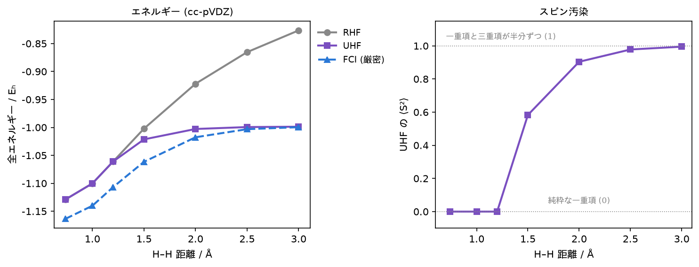

**図 7**　上の出力をグラフにしたもの。左：RHF（灰）は結合を伸ばすと上がりすぎます。UHF（紫）は 1.2 Å と 1.5 Å の間で RHF から分かれ、完全 CI（青の破線）に近づきます。右：UHF の $\langle\hat S^2\rangle$。RHF から分かれたところから増え始め、長い距離では 1 に近づきます。

結果は次のように読めます。

- **平衡距離の近く（1.2 Å まで）**：UHF は、偏らせた初期推測から始めても RHF と同じ解に戻ります。$\langle\hat S^2\rangle = 0$ で、スピン汚染はありません（0.74 Å の $-0.000$ は、丸めの誤差による 0 です）。
- **1.2 Å と 1.5 Å の間**：UHF の解が RHF から分かれ、エネルギーが RHF より低くなります。この分かれ目は Coulson–Fischer 点と呼ばれます [Coulson 1949]。
- **長い距離**：RHF のエネルギーは高すぎます。7.1 節で見たイオン的な成分の誤差です。UHF は、$\alpha$ の電子と $\beta$ の電子を別々の原子に置くことで、完全 CI に近いエネルギーを与えます（図 8）。
- **その代わり、$\langle\hat S^2\rangle$ は 1 に近づきます。**

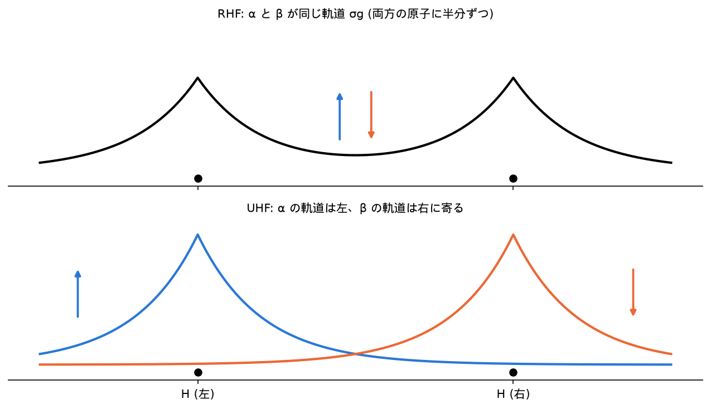

**図 8**　模式図。上：RHF では、$\alpha$ 電子（青）と $\beta$ 電子（橙）が同じ軌道 $\sigma_g$ に入ります。この軌道は 2 つの原子に半分ずつ広がっているので、2 個の電子が同じ原子に来る確率が残ります。下：解離の極限の UHF では、$\alpha$ の軌道は左の原子に、$\beta$ の軌道は右の原子に寄ります。2 個の電子は別々の原子にいますが、この決定子は一重項ではありません。

$\langle\hat S^2\rangle$ が 1 に近づく理由は、第 4 回の結果で説明できます。
解離の極限の UHF の決定子は $|g_A\alpha\,g_B\beta\rangle$ で、2 つの軌道に 1 個ずつ電子が入った決定子です。
第 4 回で見たように、この決定子は一重項と三重項（$M_S = 0$ の成分）を半分ずつ含みます。

$$
|g_A\alpha\,g_B\beta\rangle = \frac{1}{\sqrt2}\big({}^3\Psi - {}^1\Psi\big)
\quad\Longrightarrow\quad
\langle\hat S^2\rangle = \tfrac12\cdot 0 + \tfrac12\cdot 2 = 1
$$

6.4 節の式でも、$M_S = 0$、$N_\beta = 1$ で、離れた原子の $g_A$ と $g_B$ は重ならないので、$\langle\hat S^2\rangle = 0 + 1 - 0 = 1$ となり、一致します。

### 7.3 対称性のジレンマと RHF の不安定性

H₂ の解離からは、次の教訓が得られます。

- 正しい対称性（一重項、2 つの原子が等価）を守る RHF は、エネルギーを大きく誤ります。
- 対称性を破った UHF は、エネルギーは正しくなりますが、波動関数は一重項でも、原子の入れ替えについて対称でもありません。

決定子 1 個の範囲では、両方を同時に満たすことはできません。
この状況は、Löwdin によって「対称性のジレンマ」と呼ばれました [Lykos 1963]。
本当の解決は、決定子を 2 個以上使うことです。
解離の極限の正しい一重項は、第 4 回で見たように $|g_A\alpha\,g_B\beta\rangle$ と $|g_B\alpha\,g_A\beta\rangle$ の 2 個の決定子の組み合わせです。
これは、第 8 回の CI 法や第 12 回の CASSCF 法の出発点になります。

Coulson–Fischer 点より先では、RHF の解はまだ方程式の解（停留点）ですが、エネルギーの最小点ではなくなっています。
$\alpha$ と $\beta$ の軌道を逆向きに少し変えるとエネルギーが下がる、つまり RHF の解は UHF の方向に「不安定」です。
この不安定性は、第 19 回で扱う三重項の不安定性（線形応答の三重項の励起エネルギーが虚数になること）と同じものです。
実際の計算で UHF を使うときは、得られた解が本当に最小かどうかを、安定性の解析で確かめるのが安全です。

**ここまでで分かったこと**：RHF は、結合が切れた極限でも 2 個の電子を同じ軌道に入れるので、イオン的な成分を半分含み、エネルギーが高すぎます。UHF は、$\alpha$ と $\beta$ を別々の原子に置いて正しいエネルギーに近づきますが、スピン汚染（$\langle\hat S^2\rangle \to 1$）という代価を払います。

## 8. ROHF：スピンの純粋さを保つ開殻の方法

### 8.1 エネルギーの式

ROHF は、開殻の分子で、空間軌道を $\alpha$ と $\beta$ で共有させる方法です [Roothaan 1960]。
ここでは、高スピンの場合（一重占有の電子がすべて $\alpha$）を考えます。
空間軌道を 3 種類に分けます（図 2 中）。

- 閉殻の軌道 c：$\alpha$ と $\beta$ の 2 個の電子が入る（$n_c$ 本）
- 開殻の軌道 o：$\alpha$ の電子 1 個だけが入る（$n_o$ 本）
- 仮想軌道 v：空

$N_\alpha = n_c + n_o$、$N_\beta = n_c$ です。
この決定子は、第 4 回で見たように $S = M_S = n_o/2$ の固有関数です。

エネルギーは、第 1 節のスピン軌道の式で、電子の組を同じスピンと反対のスピンに分けて数えると求まります。

- $\alpha\alpha$ の組：$\alpha$ の軌道は c と o の全部。各組 $J - K$ で、$\frac12\sum_{p,q\in c+o}(J_{pq} - K_{pq})$。
- $\beta\beta$ の組：$\beta$ の軌道は c だけ。$\frac12\sum_{c,c'}(J_{cc'} - K_{cc'})$。
- $\alpha\beta$ の組：交換はなく、クーロンだけ。$\sum_{p\in c+o}\sum_{c'}J_{pc'}$。

これらを、軌道の種類の組（cc、co、oo）ごとに集めると、次の式になります。

$$
\begin{aligned}
E_\mathrm{ROHF} ={}& 2\sum_{c}h_{cc} + \sum_{o}h_{oo}
+ \sum_{c}\sum_{c'}\big(2J_{cc'} - K_{cc'}\big)\\
&+ \sum_{c}\sum_{o}\big(2J_{co} - K_{co}\big)
+ \frac12\sum_{o}\sum_{o'}\big(J_{oo'} - K_{oo'}\big)
+ V_\mathrm{NN}
\end{aligned}
$$

たとえば cc の組は、$\alpha\alpha$ から $\frac12(J - K)$、$\beta\beta$ から $\frac12(J - K)$、$\alpha\beta$ から $J$ で、合わせて $2J - K$ です。
co の組は、$\alpha\alpha$ の和で $(c, o)$ と $(o, c)$ の 2 回現れて $J - K$、$\alpha\beta$ の和で（o の $\alpha$ と c の $\beta$）$J$ で、合わせて $2J - K$ です。
oo の組は $\alpha\alpha$ からだけで、$\frac12(J - K)$ です。

この式は、6.2 節の UHF のエネルギーで $\phi_c^\beta = \phi_c^\alpha$ と制限したものです。
したがって、ROHF の軌道で作った $\mathbf F^\alpha$、$\mathbf F^\beta$（6.2 節の式）を使って議論できます。

### 8.2 最小の条件：軌道の回転ごとに Fock 行列が違う

RHF と UHF では、エネルギーが最小になる条件は「Fock 行列の固有ベクトルになること」でした。
ROHF では、そう単純にはいきません。
理由を、軌道を少し回転させたときのエネルギーの変化で考えます（すべての段階は付録 D）。

基本になるのは、2.4 節の Brillouin の定理の裏返しです。
占有のスピン軌道 $\chi_a$ に、空のスピン軌道 $\chi_r$ を小さな量 $\kappa$ だけ混ぜると、エネルギーは 1 次で

$$
\delta E = 2\kappa\,\langle\chi_r|\hat f|\chi_a\rangle
$$

だけ変わります。
最小では、どの $\kappa$ でも $\delta E = 0$ なので、占有と空の間の Fock 演算子の要素が 0 でなければなりません。

ROHF では、空間軌道を回転させると、$\alpha$ と $\beta$ のスピン軌道が一緒に変わります。
3 種類の回転について、どのスピンの電子が「占有から空へ」動くかを数えます（図 9 左）。

- **c と o の回転**：$\alpha$ では c も o も占有されているので、占有どうしの回転で決定子は変わりません。$\beta$ では c が占有、o が空なので、変化が生じます。条件は $F^\beta_{oc} = 0$ です。
- **o と v の回転**：$\alpha$ では o が占有、v が空なので、変化が生じます。$\beta$ では o も v も空なので、変わりません。条件は $F^\alpha_{vo} = 0$ です。
- **c と v の回転**：$\alpha$ でも $\beta$ でも、c が占有、v が空なので、両方に変化が生じます。条件は $F^\alpha_{vc} + F^\beta_{vc} = 0$ です。

ここで $F^\alpha_{pq} = \langle\phi_p|\hat f^\alpha|\phi_q\rangle$ は、ROHF の空間軌道で表した $\hat f^\alpha$ の行列要素です。
3 つの条件は、それぞれ違う Fock 行列についての条件です。
1 つの行列を対角化するだけでは、3 つを同時に満たせません。

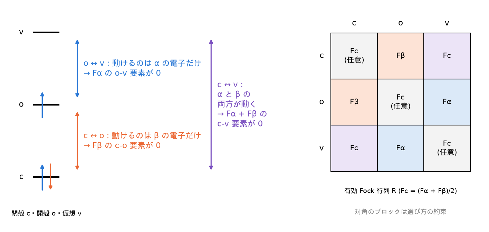

**図 9**　左：ROHF の 3 種類の軌道（閉殻 c、開殻 o、仮想 v）と、その間の回転。c と o の回転で動けるのは $\beta$ の電子だけ（橙）、o と v の回転では $\alpha$ の電子だけ（青）、c と v の回転では両方（紫）です。右：それぞれの条件を非対角のブロックに入れた有効 Fock 行列 $\mathbf R$。対角のブロック（灰）は、条件に関係しないので、選び方は約束ごとです。この図では、PySCF などで使われる $F_c = (F^\alpha + F^\beta)/2$ の選び方を示しています。

### 8.3 有効 Fock 行列

そこで、3 つの条件を 1 つの行列にまとめた「有効 Fock 行列」$\mathbf R$ を作ります。
軌道を c、o、v の順に並べ、行列をブロックに分けて書くと、次のようになります。

$$
\mathbf R =
\begin{pmatrix}
\mathbf R_{cc} & \mathbf F^\beta_{co} & \tfrac12\big(\mathbf F^\alpha + \mathbf F^\beta\big)_{cv}\\[4pt]
\mathbf F^\beta_{oc} & \mathbf R_{oo} & \mathbf F^\alpha_{ov}\\[4pt]
\tfrac12\big(\mathbf F^\alpha + \mathbf F^\beta\big)_{vc} & \mathbf F^\alpha_{vo} & \mathbf R_{vv}
\end{pmatrix}
$$

$\mathbf R$ を対角化して得られる軌道では、非対角のブロックがすべて 0 になります。
これは 8.2 節の 3 つの条件そのものです（c–v のブロックの係数 $\frac12$ は、0 かどうかには影響しません）。
したがって、「$\mathbf R$ を作る → 対角化する → 新しい軌道で $\mathbf F^\alpha$、$\mathbf F^\beta$ を作り直す」という SCF の繰り返しで、ROHF の解が得られます。

問題は、対角のブロック $\mathbf R_{cc}$、$\mathbf R_{oo}$、$\mathbf R_{vv}$ です。
これらは最小の条件に関係しないので、どう選んでも同じ ROHF の決定子とエネルギーが得られます。
しかし、軌道エネルギー（$\mathbf R$ の固有値）と、各ブロックの中での軌道の混ざり方は、選び方によって変わります。
これまでにいくつもの選び方が提案されており、プログラムによって違います。
図 9 の右は、PySCF で使われている、対角のブロックをすべて $\frac12(\mathbf F^\alpha + \mathbf F^\beta)$ にする選び方です。

**ROHF の軌道エネルギーは一意に決まりません。**
そのため、第 10 節の Koopmans の定理を ROHF の軌道エネルギーにそのまま使うことはできません。
これは、RHF と UHF にはない、ROHF の短所です。

### 8.4 ROHF でできること、できないこと

- **スピンが純粋**：高スピンの ROHF の決定子は、$\hat S^2$ の固有関数です。スピン汚染はありません。
- **スピン分極を表せない**：c の軌道は $\alpha$ と $\beta$ で同じ形に固定されます。6.3 節の Li のように、不対電子が内殻の電子を分極させる効果は、ROHF には入りません。原子核の位置のスピン密度は、開殻の軌道の電子だけから来ます。
- **エネルギーは UHF より高い**：UHF の特別な場合なので、$E_\mathrm{ROHF} \ge E_\mathrm{UHF}$ です（6.4 節の表）。
- **相関の計算の出発点として使われる**：スピンが純粋なので、ROHF の決定子は、開殻の分子の摂動論や結合クラスター法の参照としてよく使われます。第 20 回のスピン反転 TDDFT でも、高スピンの ROHF（または ROKS）の参照を使う方法を扱います。

**ここまでで分かったこと**：ROHF は、空間軌道を $\alpha$ と $\beta$ で共有して、スピンの純粋さを守ります。その代わり、最小の条件は軌道の回転の種類ごとに違う Fock 行列で書かれ、それをまとめた有効 Fock 行列の対角のブロックは選び方に任されます。軌道エネルギーが一意でないことと、スピン分極を表せないことが短所です。

## 9. 3 つの方法の比較：長所と短所

ここまでの内容を、表にまとめます（Szabo–Ostlund の 3.8 節も参照 [Szabo 1996]）。

| | RHF | UHF | ROHF |
|---|---|---|---|
| 空間軌道 | $\alpha$ と $\beta$ で共通、1 組 | $\alpha$ 用と $\beta$ 用の 2 組 | $\alpha$ と $\beta$ で共通、1 組 |
| 対象 | 閉殻 | 開殻、閉殻（解離） | 開殻（高スピン） |
| 方程式 | Roothaan–Hall：$\mathbf F\mathbf C = \mathbf S\mathbf C\boldsymbol\varepsilon$ | Pople–Nesbet：$\mathbf F^\alpha\mathbf C^\alpha = \mathbf S\mathbf C^\alpha\boldsymbol\varepsilon^\alpha$ と $\beta$ の式 | 有効 Fock 行列 $\mathbf R$ の固有値問題 |
| $\hat S^2$ の固有関数か | はい（一重項） | いいえ（スピン汚染） | はい（$S = M_S$） |
| エネルギー | 閉殻では UHF と同じことが多い | 最も低い | UHF 以上 |
| スピン分極 | 閉殻なので問題にならない | 表せる | 表せない |
| 軌道エネルギー | 一意、Koopmans の定理が使える | スピンごとに一意、Koopmans の定理が使える | 選び方に依存する |
| 結合の解離 | 誤った極限（イオン的な成分） | エネルギーは正しい極限、スピンは汚染 | ― |
| 計算の手間 | 基準 | Fock 行列と対角化が 2 組 | UHF と同程度 |

**RHF**

- 長所：閉殻の分子では、スピンも空間の対称性も正しく、計算も最も簡単です。平衡構造の近くの多くの分子で、相関の計算の出発点になります。
- 短所：開殻には使えません。結合が切れる過程では、イオン的な成分を含むために誤った極限を与えます。

**UHF**

- 長所：開殻にそのまま使え、エネルギーは 3 つの中で最も低くなります。スピン分極を表せるので、スピン密度の分布（超微細結合定数など）の定性的な傾向を捉えられます。結合の解離でも、エネルギーは正しい極限に近づきます。解の求め方も、2 組の Roothaan–Hall 方程式とほとんど同じで簡単です。
- 短所：スピン汚染があります。汚染が大きいと、波動関数は決まった多重度の状態を表しません。UHF を出発点にした Møller–Plesset 摂動論は、参照のスピン汚染が大きいと収束が遅くなることが知られています [Gill 1988]。また、閉殻の分子で RHF の解のほかに対称性を破った UHF の解が現れたり、複数の解の中から最も低いものを探す必要が生じたりします。

**ROHF**

- 長所：開殻でもスピンが純粋です。スピンの純粋さが重要な性質（多重度の違う状態のエネルギー差など）や、相関の計算の参照に向いています。
- 短所：エネルギーは UHF より高く、スピン分極を表せません。有効 Fock 行列の対角のブロックが一意でないので、軌道エネルギーと Koopmans の定理の解釈があいまいになります。SCF が収束しにくい場合もあります。

実際の計算では、次のように使い分けるのが目安です。

- 閉殻の分子の平衡構造の近く：RHF。
- 開殻の分子：まず UHF を試し、$\langle\hat S^2\rangle$ が純粋な値に近いかを確かめます。汚染が小さければ、UHF の結果はそのまま使いやすいです。汚染が大きければ、ROHF を使うか、決定子 1 個で足りない状況（第 12 回の多参照の方法が必要な状況）を疑います。
- 結合の解離や、ほぼ縮退した軌道がある分子：UHF の汚染は「決定子 1 個では足りない」という合図です。

**ここまでで分かったこと**：RHF・UHF・ROHF は、エネルギーの低さ（変分の自由度）と、スピンの純粋さのどちらを優先するかの選択です。UHF は自由度が最も大きくスピン分極も表せますが、スピン汚染があります。ROHF はスピンを純粋に保ちますが、軌道エネルギーが一意でなく、スピン分極を表せません。

## 10. 軌道エネルギーと Koopmans の定理

### 10.1 H₂O の軌道エネルギー

第 5 節の計算で得た RHF の軌道エネルギーを表示します。

```python
for i, e in enumerate(mf.mo_energy[:7]):
    tag = "占有" if i < nocc else "空  "
    print(f"  {i+1}  {tag}  {e:10.5f}  {e*27.211386:9.3f}")
```

```text
  1  占有   -20.55057   -559.209
  2  占有    -1.33632    -36.363
  3  占有    -0.69887    -19.017
  4  占有    -0.56646    -15.414
  5  占有    -0.49310    -13.418
  6  空       0.18544      5.046
  7  空       0.25614      6.970
```

左の列がハートリー、右の列が eV です。
これをエネルギー準位図にしたのが図 10 です。

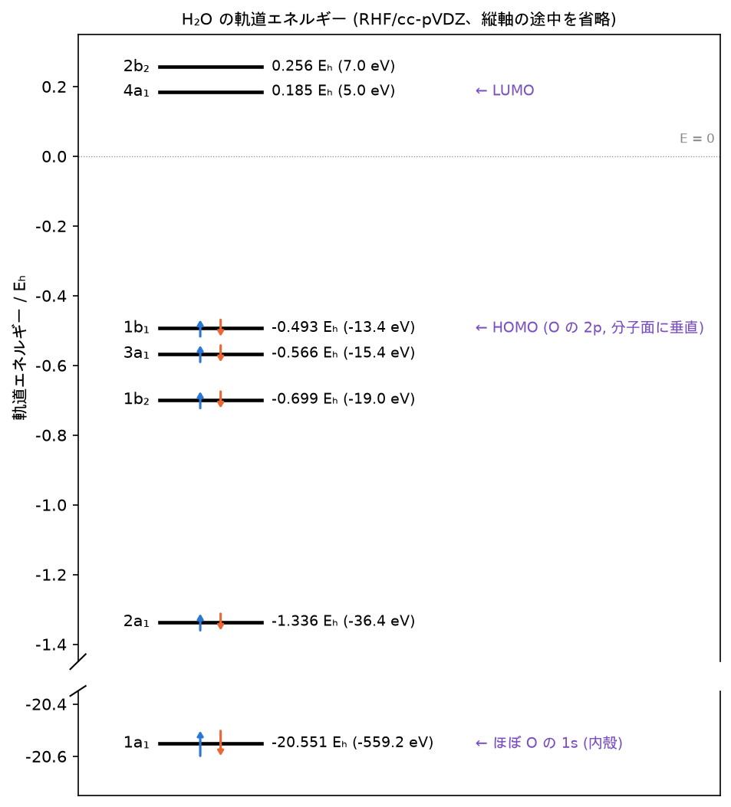

**図 10**　H₂O の軌道エネルギー（RHF/cc-pVDZ）。横線が軌道、青の上向きと橙の下向きの矢印が $\alpha$ と $\beta$ の電子です。5 本の占有軌道に 10 個の電子が対で入り、その上に空の仮想軌道が並びます。いちばん低い $1a_1$ は、ほかよりけた違いに低いので、縦軸の途中を省略して下に描いています。

5 個の占有軌道は、対称性の記号でエネルギーの低い順に $1a_1$、$2a_1$、$1b_2$、$3a_1$、$1b_1$ です。
いちばん低い $1a_1$ は、ほぼ酸素の 1s 軌道（内殻）です。
最高被占軌道（HOMO）の $1b_1$ は、分子面に垂直な酸素の 2p 軌道で、非共有電子対に当たります。

### 10.2 軌道エネルギーの意味

軌道エネルギーは、Fock 演算子の期待値です。
閉殻では、$\hat f\phi_i = \varepsilon_i\phi_i$ の両辺に左から $\phi_i$ をかけて積分し、$\langle\phi_i|\hat J_j|\phi_i\rangle = J_{ij}$、$\langle\phi_i|\hat K_j|\phi_i\rangle = K_{ij}$ を使うと、

$$
\varepsilon_i = \langle\phi_i|\hat f|\phi_i\rangle = h_{ii} + \sum_{j}^{N/2}\big(2J_{ij} - K_{ij}\big)
$$

です。
これは、軌道 $\phi_i$ の電子 1 個の運動エネルギーと核からの引力に、ほかのすべての電子との反発を足したものです。
4.1 節の $E_\mathrm{RHF}$ と比べるために、$\varepsilon_i$ を $i$ について足すと、

$$
\sum_i\varepsilon_i = \sum_i h_{ii} + \sum_i\sum_j\big(2J_{ij} - K_{ij}\big)
$$

です。
右辺の第 2 項は、$E_\mathrm{RHF}$ の電子間の反発の項とまったく同じです。
したがって、$E_\mathrm{RHF}$ の式の 2 電子の項をこれで置き換えると、

$$
E_\mathrm{RHF} - V_\mathrm{NN} = 2\sum_i h_{ii} + \Big(\sum_i\varepsilon_i - \sum_i h_{ii}\Big) = \sum_{i}^{N/2}\big(h_{ii} + \varepsilon_i\big)
$$

となります。
一方、軌道エネルギーを電子の数だけ（各軌道 2 個）足した $2\sum_i\varepsilon_i$ は、電子間の反発を 2 回含みます。
軌道 $i$ の電子の $\varepsilon_i$ にも、軌道 $j$ の電子の $\varepsilon_j$ にも、$i$ と $j$ の間の反発が入っているからです。
したがって $E_\mathrm{RHF} - V_\mathrm{NN} \neq 2\sum_i\varepsilon_i$ で、全エネルギーは軌道エネルギーの和ではありません。

### 10.3 Koopmans の定理

それでは、軌道エネルギーそのものは何を表すのでしょうか。
答えを与えるのが、1934 年に Koopmans が示した Koopmans の定理です [Koopmans 1934]。教科書では Szabo–Ostlund の 3.3.1 節で詳しく扱われています [Szabo 1996]。
すべての段階は付録 E で導きますが、結果は次のとおりです。

**Koopmans の定理**：$N$ 電子の Hartree–Fock の決定子から、占有スピン軌道 $\chi_a$ の電子を 1 個取り除いた決定子を作ります。このとき、ほかの軌道は変えずにそのまま使います。そのエネルギーの差は

$$
E_{N-1} - E_N = -\varepsilon_a
$$

です。

直観的には、$\varepsilon_a$ は「軌道 $a$ の電子 1 個が、核とほかのすべての電子から受けるエネルギー」なので、その電子を取り去るとちょうどその分だけエネルギーが変わる、ということです。
つまり、占有軌道のエネルギーの符号を変えたものは、イオン化エネルギーの近似になります。
導出はスピン軌道の Hartree–Fock 方程式だけを使うので、RHF だけでなく UHF の $\varepsilon_i^\alpha$、$\varepsilon_i^\beta$ にもそのまま成り立ちます。
ROHF の軌道エネルギーは 8.3 節で見たように一意でないので、この定理はそのままでは使えません。

H₂O では、HOMO から $-\varepsilon_\mathrm{HOMO} = 13.42$ eV が得られます。
実験のイオン化エネルギーは、NIST Chemistry WebBook の評価値で 12.621 eV です（関連リンク）。
近似としては、それなりによい値です。

この近似には、2 つの誤差があります。

1. **軌道の緩和を無視している**：電子が 1 個抜けると、残りの電子は互いの反発が減った分だけ核に引き寄せられ、軌道の形を変えてエネルギーを下げます。Koopmans の定理はこれを無視するので、陽イオンのエネルギーを高く、つまりイオン化エネルギーを大きめに見積もります。
2. **電子相関を無視している**：Hartree–Fock 法そのものの誤差です。ふつうは、中性分子の方が電子が多いぶん相関エネルギーが大きく、これを入れると中性分子がより大きく安定になるので、イオン化エネルギーは大きくなります。

2 つの誤差は逆向きなので、一部が打ち消し合います。
これを確かめるために、陽イオン H₂O⁺ を別に Hartree–Fock 法で解き、エネルギー差（ΔSCF 法）を求めます。
陽イオンは電子の数が奇数で閉殻ではないので、第 6 節の UHF を使います。

```python
neu = gto.M(atom=geom, basis="cc-pvdz", verbose=0)                     # geom は第 5 節と同じ構造
cat = gto.M(atom=geom, basis="cc-pvdz", charge=1, spin=1, verbose=0)  # H2O+（2 重項）
e0 = scf.RHF(neu).run()
e1 = scf.UHF(cat).run()
print(f"Koopmans  : -ε(HOMO)        = {-e0.mo_energy[4]*27.211386:.2f} eV")
print(f"ΔSCF      : E(H2O+) - E(H2O) = {(e1.e_tot-e0.e_tot)*27.211386:.2f} eV")
```

```text
Koopmans  : -ε(HOMO)        = 13.42 eV
ΔSCF      : E(H2O+) - E(H2O) = 10.74 eV
```

この H₂O⁺ の UHF の解について、PySCF の `e1.spin_square()` で $\langle\hat S^2\rangle$ を求めると 0.756 になります。
純粋な二重項の値 0.75 に近く、スピン汚染は小さいと言えます。

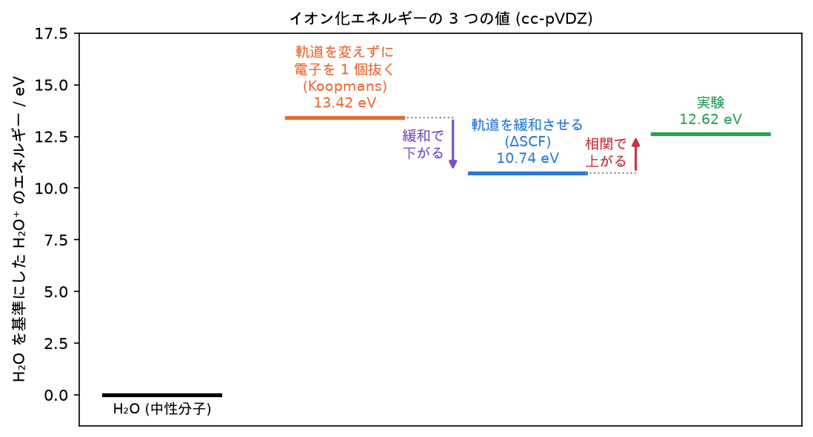

**図 11**　中性の H₂O を 0 としたときの、H₂O⁺ のエネルギー（イオン化エネルギー）の 3 つの値。軌道を変えずに電子を抜く Koopmans の値（橙、13.42 eV）から、軌道の緩和を入れると 10.74 eV（青）まで下がり（紫の矢印）、そこに電子相関を入れると実験値 12.62 eV（緑）まで上がります（赤の矢印）。2 つの矢印が逆向きなので、Koopmans の値は実験値に比較的近くなります。

陽イオンの軌道を緩和させると、イオン化エネルギーは 10.74 eV まで下がり、実験値の 12.62 eV を大きく下回りました。
緩和だけを入れると、相関の誤差だけが残るためです。
Koopmans の定理がそれなりによい値を与えたのは、2 つの誤差が打ち消し合ったためだと分かります。

!!! warning "仮想軌道のエネルギーには注意"
    Koopmans の定理を仮想軌道に使うと、電子親和力の近似が得られるように見えます。しかし、仮想軌道の場合は緩和と相関の誤差が同じ向きに働くので、誤差が大きくなります [Szabo 1996]。また、仮想軌道のエネルギーは基底関数によって大きく変わります。上の H₂O の LUMO のエネルギーが正なのは、そのまま「電子が付かない」ことを意味するわけではありません。

**ここまでで分かったこと**：占有軌道のエネルギーの符号を変えたものは、イオン化エネルギーの近似です（Koopmans の定理）。RHF と UHF の軌道エネルギーに使えます。軌道の緩和と電子相関の誤差が打ち消し合うので、それなりによい値になります。

## まとめ

- Hartree–Fock 法は、決定子 1 個の中でエネルギーが最も低くなるスピン軌道を選びます。その軌道は Fock 演算子 $\hat f = \hat h + \sum_b(\hat{\mathcal J}_b - \hat{\mathcal K}_b)$ の固有関数で、各電子はほかの電子の平均の場の中を動きます。交換は同じスピンの電子どうしにしか働きません。
- 空間軌道の選び方で、RHF（閉殻、軌道を共有）、UHF（$\alpha$ と $\beta$ で別々の軌道）、ROHF（開殻、軌道を共有）に分かれます。自由度が大きいほどエネルギーは低く、$E_\mathrm{UHF} \le E_\mathrm{ROHF}$ です。
- RHF は Roothaan–Hall 方程式 $\mathbf F\mathbf C = \mathbf S\mathbf C\boldsymbol\varepsilon$ に、UHF は 2 組の Pople–Nesbet 方程式になります。UHF の $\mathbf F^\alpha$ と $\mathbf F^\beta$ は、クーロンの項（全密度）を共有し、交換の項（同じスピンの密度）が違います。
- UHF はスピン分極を表せ、結合の解離でも正しいエネルギーに近づきますが、スピン汚染があります。RHF は解離の極限でイオン的な成分を半分含み、$\frac12U$ だけ高すぎるエネルギーになります。
- ROHF はスピンを純粋に保ちますが、最小の条件が回転の種類ごとに違う Fock 行列で書かれ、有効 Fock 行列の対角のブロックが一意でないので、軌道エネルギーも一意ではありません。スピン分極も表せません。
- 全エネルギーは軌道エネルギーの和ではありません。占有軌道のエネルギーの符号を変えたものが、イオン化エネルギーの近似になります（Koopmans の定理）。

## 付録 A　スピン軌道の Hartree–Fock 方程式の導出

スピン軌道は実数とします。
規格直交の条件 $\langle\chi_a|\chi_b\rangle = \delta_{ab}$ のもとで $E_0$ を最小にするため、第 1 回の Lagrange の未定乗数法を使い、未定乗数 $\lambda_{ba}$（$\lambda_{ba} = \lambda_{ab}$ の実数）を使って

$$
\mathcal L = E_0 - \sum_{a}^{N}\sum_{b}^{N}\lambda_{ba}\big(\langle\chi_a|\chi_b\rangle - \delta_{ab}\big)
$$

を考えます。
1 本のスピン軌道 $\chi_c$ だけを $\chi_c \to \chi_c + \delta\chi_c$ と少し変えたときの $\mathcal L$ の変化を、$\delta\chi_c$ の 1 次まで求めます。

**1 電子の項**：$\sum_a\langle a|\hat h|a\rangle$ のうち変わるのは $a = c$ の項だけです。
$\delta\langle c|\hat h|c\rangle = \langle\delta c|\hat h|c\rangle + \langle c|\hat h|\delta c\rangle = 2\langle\delta c|\hat h|c\rangle$ です（$\hat h$ はエルミートで、関数は実数）。

**クーロンの項**：$[aa|bb] = \iint\chi_a(1)^2\,r_{12}^{-1}\,\chi_b(2)^2$ で $\chi_a$ だけを変えると、$\chi_a^2$ の変化は $2\chi_a\delta\chi_a$ なので、

$$
\delta_a[aa|bb] = 2\iint\delta\chi_a(1)\chi_a(1)\,\frac{1}{r_{12}}\,\chi_b(2)^2 = 2\langle\delta\chi_a|\hat{\mathcal J}_b|\chi_a\rangle
$$

です。
$\frac12\sum_{ab}[aa|bb]$ の中で $\chi_c$ が現れるのは、$a = c$ の項と $b = c$ の項です。
$[aa|bb] = [bb|aa]$ なので両者は同じ寄与を与え、

$$
\delta\,\frac12\sum_{ab}[aa|bb] = \frac12\cdot 2\sum_b 2\langle\delta\chi_c|\hat{\mathcal J}_b|\chi_c\rangle = 2\sum_b\langle\delta\chi_c|\hat{\mathcal J}_b|\chi_c\rangle
$$

です（$a = b = c$ の項 $[cc|cc]$ は、$\chi_c$ が 4 か所に現れるので変化が $4\langle\delta\chi_c|\hat{\mathcal J}_c|\chi_c\rangle$ になり、$\frac12$ をかけてこの式に正しく含まれています）。

**交換の項**：$[ab|ba] = \iint\chi_a(1)\chi_b(1)\,r_{12}^{-1}\,\chi_b(2)\chi_a(2)$ では $\chi_a$ が 2 か所に現れ、どちらを変えても同じ値なので、

$$
\delta_a[ab|ba] = 2\iint\delta\chi_a(1)\chi_b(1)\,\frac{1}{r_{12}}\,\chi_b(2)\chi_a(2) = 2\langle\delta\chi_a|\hat{\mathcal K}_b|\chi_a\rangle
$$

です（2.1 節の定義から、$\hat{\mathcal K}_b\chi_a(1) = [\int\chi_b(2)\chi_a(2)/r_{12}\,d\mathbf x_2]\,\chi_b(1)$）。
クーロンと同じように、$\delta\,\frac12\sum_{ab}[ab|ba] = 2\sum_b\langle\delta\chi_c|\hat{\mathcal K}_b|\chi_c\rangle$ です。

**エネルギーの変化**：3 つをまとめると、

$$
\delta E_0 = 2\Big\langle\delta\chi_c\Big|\,\hat h + \sum_b\big(\hat{\mathcal J}_b - \hat{\mathcal K}_b\big)\Big|\chi_c\Big\rangle = 2\langle\delta\chi_c|\hat f|\chi_c\rangle
$$

です。

**条件の項**：$-\sum_{ab}\lambda_{ba}\langle\chi_a|\chi_b\rangle$ で $\chi_c$ が現れるのは $a = c$ と $b = c$ の項で、

$$
-\Big[\sum_b\lambda_{bc}\langle\delta\chi_c|\chi_b\rangle + \sum_a\lambda_{ca}\langle\chi_a|\delta\chi_c\rangle\Big] = -2\sum_b\lambda_{bc}\langle\delta\chi_c|\chi_b\rangle
$$

です（$\lambda$ は対称なので 2 つの和は等しい）。

**停留条件**：合わせると、

$$
\delta\mathcal L = 2\Big\langle\delta\chi_c\Big|\,\hat f\chi_c - \sum_b\lambda_{bc}\chi_b\Big\rangle
$$

です。
任意の $\delta\chi_c$ で $\delta\mathcal L = 0$ となるためには、右側の関数が 0 でなければなりません。

$$
\hat f\,\chi_c = \sum_b^{N}\lambda_{bc}\,\chi_b
$$

**正準軌道**：$\boldsymbol\lambda$ は実対称行列なので、第 1 回 3 節のように、直交行列 $\mathbf U$ で対角化できます（$\mathbf U^\mathrm T\boldsymbol\lambda\mathbf U = \boldsymbol\varepsilon$）。
新しい軌道 $\chi_a' = \sum_b\chi_b U_{ba}$ を作ります。
第 2 回で見た行列式の性質から、決定子は $\det\mathbf U = \pm1$ 倍しか変わりません。
また、$\sum_a\chi_a'(\mathbf x)\chi_a'(\mathbf x') = \sum_{bd}\chi_b(\mathbf x)\chi_d(\mathbf x')\sum_a U_{ba}U_{da} = \sum_b\chi_b(\mathbf x)\chi_b(\mathbf x')$（$\mathbf U\mathbf U^\mathrm T = \mathbf 1$ のため）なので、この量だけで決まる $\sum_b\hat{\mathcal J}_b$ と $\sum_b\hat{\mathcal K}_b$、つまり $\hat f$ も変わりません。
新しい軌道で上の式を書き直すと $\hat f\chi_a' = \varepsilon_a\chi_a'$ となり、本文の Hartree–Fock 方程式になります。
この軌道を正準軌道（canonical orbital）と呼びます。

## 付録 B　閉殻の Hartree–Fock 方程式を空間軌道で直接導く

4.1 節ではスピン軌道の方程式からスピンを積分しましたが、閉殻のエネルギーの式を空間軌道で直接最小にしても、同じ方程式が得られます。
空間軌道は実数とします。
規格直交の条件 $\langle\phi_i|\phi_j\rangle = \delta_{ij}$ のもとで $E_\mathrm{RHF}$ を最小にするため、未定乗数 $\lambda_{ji}$（$\lambda_{ji} = \lambda_{ij}$ の実数）を使って

$$
\mathcal L = E_\mathrm{RHF} - 2\sum_{ij}^{N/2}\lambda_{ji}\big(\langle\phi_i|\phi_j\rangle - \delta_{ij}\big)
$$

を考えます（係数 2 は後の式を見やすくするためです）。
1 本の軌道 $\phi_k$ だけを $\phi_k \to \phi_k + \delta\phi_k$ と少し変えたときの $\mathcal L$ の変化を、$\delta\phi_k$ の 1 次まで求めます。

**1 電子の項**：$2\sum_i h_{ii}$ のうち変わるのは $2h_{kk}$ だけです。
$\delta h_{kk} = 2\langle\delta\phi_k|\hat h|\phi_k\rangle$ なので、変化は $4\langle\delta\phi_k|\hat h|\phi_k\rangle$ です。

**クーロンの項**：付録 A と同じ計算で $\delta_i J_{ij} = 2\langle\delta\phi_i|\hat J_j|\phi_i\rangle$ です。
$\sum_{ij}J_{ij}$ の中で $\phi_k$ が現れるのは、$i = k$ の項と $j = k$ の項で、$J_{ij} = J_{ji}$ なので両者は同じ寄与を与えます。

$$
\delta\sum_{ij}J_{ij} = 2\sum_j 2\langle\delta\phi_k|\hat J_j|\phi_k\rangle = 4\sum_j\langle\delta\phi_k|\hat J_j|\phi_k\rangle
$$

**交換の項**：同じように $\delta_i K_{ij} = 2\langle\delta\phi_i|\hat K_j|\phi_i\rangle$ で、$\delta\sum_{ij}K_{ij} = 4\sum_j\langle\delta\phi_k|\hat K_j|\phi_k\rangle$ です。

**エネルギーの変化**：$E_\mathrm{RHF}$ の 2 電子の項は $\sum_{ij}(2J_{ij} - K_{ij})$ なので、

$$
\delta E_\mathrm{RHF} = 4\Big\langle\delta\phi_k\Big|\,\hat h + \sum_j\big(2\hat J_j - \hat K_j\big)\Big|\phi_k\Big\rangle = 4\langle\delta\phi_k|\hat f|\phi_k\rangle
$$

です。

**条件の項**：$-2\sum_{ij}\lambda_{ji}\langle\phi_i|\phi_j\rangle$ の変化は、付録 A と同じ数え方で $-4\sum_j\lambda_{jk}\langle\delta\phi_k|\phi_j\rangle$ です。

**停留条件**：$\delta\mathcal L = 4\langle\delta\phi_k|\hat f\phi_k - \sum_j\lambda_{jk}\phi_j\rangle = 0$ から $\hat f\phi_k = \sum_j\lambda_{jk}\phi_j$ です。
付録 A と同じように $\boldsymbol\lambda$ を対角化すると、4.1 節の $\hat f\phi_i = \varepsilon_i\phi_i$ が得られます。

## 付録 C　Fock 行列とエネルギーを密度行列で書く

**閉殻の Fock 行列**：$F_{\mu\nu} = \langle g_\mu|\hat f|g_\nu\rangle = h_{\mu\nu} + \sum_j\langle g_\mu|2\hat J_j - \hat K_j|g_\nu\rangle$ です。
基底関数と係数は実数とします。
クーロンの部分は、$\hat J_j$ の定義に $\phi_j = \sum_\lambda C_{\lambda j}g_\lambda$ を入れて、

$$
\sum_j 2\langle g_\mu|\hat J_j|g_\nu\rangle = \sum_j 2\iint g_\mu(1)g_\nu(1)\,\frac{1}{r_{12}}\,\phi_j(2)\phi_j(2)
= \sum_{\lambda\sigma}\Big(2\sum_j C_{\lambda j}C_{\sigma j}\Big)(\mu\nu|\lambda\sigma) = \sum_{\lambda\sigma}P_{\lambda\sigma}(\mu\nu|\lambda\sigma)
$$

です。
交換の部分は、$\hat K_j g_\nu(\mathbf r_1) = [\int\phi_j(2)g_\nu(2)/r_{12}]\,\phi_j(\mathbf r_1)$ なので、

$$
\sum_j\langle g_\mu|\hat K_j|g_\nu\rangle = \sum_j\iint g_\mu(1)\phi_j(1)\,\frac{1}{r_{12}}\,\phi_j(2)g_\nu(2)
= \sum_{\lambda\sigma}\Big(\sum_j C_{\lambda j}C_{\sigma j}\Big)(\mu\lambda|\sigma\nu) = \frac12\sum_{\lambda\sigma}P_{\lambda\sigma}(\mu\lambda|\nu\sigma)
$$

です（実数の関数では $(\mu\lambda|\sigma\nu) = (\mu\lambda|\nu\sigma)$）。
2 つを合わせると、本文 4.4 節の $F_{\mu\nu}$ の式になります。

**閉殻のエネルギー**：本文 10.2 節と同じ式変形で、$E_\mathrm{RHF} - V_\mathrm{NN} = \sum_i(h_{ii} + \varepsilon_i)$ です。
ここで $\varepsilon_i = \langle\phi_i|\hat f|\phi_i\rangle$ です。
軌道の展開を入れると、

$$
\sum_i h_{ii} = \sum_i\sum_{\mu\nu}C_{\mu i}C_{\nu i}\,h_{\mu\nu} = \frac12\sum_{\mu\nu}P_{\mu\nu}h_{\mu\nu},\qquad
\sum_i\varepsilon_i = \frac12\sum_{\mu\nu}P_{\mu\nu}F_{\mu\nu}
$$

です。
足し合わせると、本文の $E_\mathrm{RHF} = \frac12\sum_{\mu\nu}P_{\mu\nu}(h_{\mu\nu} + F_{\mu\nu}) + V_\mathrm{NN}$ が得られます。

**UHF の Fock 行列**：6.1 節の $\hat f^\alpha$ の行列要素を同じように計算します。
クーロンの部分は、$\alpha$ の占有軌道から $\sum_{\lambda\sigma}P^\alpha_{\lambda\sigma}(\mu\nu|\lambda\sigma)$、$\beta$ の占有軌道から $\sum_{\lambda\sigma}P^\beta_{\lambda\sigma}(\mu\nu|\lambda\sigma)$ で、合わせて $\sum_{\lambda\sigma}P^\mathrm T_{\lambda\sigma}(\mu\nu|\lambda\sigma)$ です（各軌道の電子は 1 個なので、閉殻の係数 2 がありません）。
交換の部分は $\alpha$ の占有軌道からだけで、$-\sum_{\lambda\sigma}P^\alpha_{\lambda\sigma}(\mu\lambda|\nu\sigma)$ です（閉殻の $\frac12$ がないのは、$\mathbf P^\alpha$ に係数 2 がないためです）。
これで 6.2 節の $F^\alpha_{\mu\nu}$ の式が得られます。$F^\beta_{\mu\nu}$ も同じです。

**UHF のエネルギー**：スピン軌道のエネルギーの式を、$\alpha$ と $\beta$ に分けて書くと

$$
E_\mathrm{UHF} - V_\mathrm{NN} = \sum_a^{N_\alpha}h_{aa}^\alpha + \sum_a^{N_\beta}h_{aa}^\beta + \frac12\Big[\sum_a^{N_\alpha}\big(\varepsilon_a^\alpha - h_{aa}^\alpha\big) + \sum_a^{N_\beta}\big(\varepsilon_a^\beta - h_{aa}^\beta\big)\Big]
$$

です。
角括弧の中は、閉殻の 10.2 節と同じく、$\varepsilon_a - h_{aa}$（電子 $a$ がほかのすべての電子から受ける反発）を足し、2 回数えた分を $\frac12$ で直したものです。
$\sum_a h^\alpha_{aa} = \sum_{\mu\nu}P^\alpha_{\nu\mu}h_{\mu\nu}$、$\sum_a\varepsilon^\alpha_a = \sum_{\mu\nu}P^\alpha_{\nu\mu}F^\alpha_{\mu\nu}$（$\beta$ も同じ）を入れて整理すると、

$$
E_\mathrm{UHF} - V_\mathrm{NN} = \frac12\sum_{\mu\nu}\Big[(P^\alpha_{\nu\mu} + P^\beta_{\nu\mu})h_{\mu\nu} + P^\alpha_{\nu\mu}F^\alpha_{\mu\nu} + P^\beta_{\nu\mu}F^\beta_{\mu\nu}\Big]
$$

となり、6.2 節の式が得られます。

## 付録 D　軌道を回転させたときのエネルギーの変化

**スピン軌道 1 本の回転**：Hartree–Fock に限らず、規格直交なスピン軌道でつくった決定子 $\Psi_0$ を考えます。
占有のスピン軌道 $\chi_a$ と空のスピン軌道 $\chi_r$ を、小さな角度 $\kappa$ だけ回転させます。

$$
\chi_a' = \chi_a + \kappa\chi_r,\qquad \chi_r' = \chi_r - \kappa\chi_a\qquad(\kappa\text{ の 1 次まで})
$$

この回転で軌道は規格直交のまま（$\kappa$ の 1 次まで）です。
新しい決定子は、$\chi_a$ を $\chi_a'$ に置き換えたものなので、決定子が各列について線形であること（第 2 回）から

$$
\Psi_0' = |\cdots\chi_a'\cdots\rangle = |\cdots\chi_a\cdots\rangle + \kappa\,|\cdots\chi_r\cdots\rangle = \Psi_0 + \kappa\,\Psi_a^r
$$

です（$\chi_r'$ は空なので決定子に入りません）。
エネルギーを $\kappa$ の 1 次まで展開すると、

$$
E' = \langle\Psi_0 + \kappa\Psi_a^r|\hat H|\Psi_0 + \kappa\Psi_a^r\rangle = E_0 + 2\kappa\,\langle\Psi_a^r|\hat H|\Psi_0\rangle + O(\kappa^2)
$$

です（実数の場合）。
2.4 節の Slater–Condon 則から $\langle\Psi_a^r|\hat H|\Psi_0\rangle = \langle\chi_r|\hat f|\chi_a\rangle$ なので、

$$
\delta E = 2\kappa\,\langle\chi_r|\hat f|\chi_a\rangle
$$

です。
エネルギーが最小なら、すべての $a, r$ について $\langle\chi_r|\hat f|\chi_a\rangle = 0$ です（Brillouin の定理）。
占有どうし、空どうしの回転では、決定子は定数倍しか変わらない（第 2 回の行列式の性質）ので、エネルギーは変わりません。

**UHF**：$\alpha$ と $\beta$ のスピン軌道を別々に回転できるので、条件は $F^\alpha_{ra} = 0$（$\alpha$ の占有 $a$、空 $r$）と $F^\beta_{ra} = 0$ です。
それぞれ、$\mathbf F^\alpha$ と $\mathbf F^\beta$ を対角化すれば満たされます。

**ROHF**：空間軌道 $\phi_p$ と $\phi_q$ を回転させると、$\phi_p\alpha$ と $\phi_q\alpha$、$\phi_p\beta$ と $\phi_q\beta$ が同時に回転します。
エネルギーの変化は、$\alpha$ と $\beta$ のそれぞれで「占有から空への回転」になっている分の和です。

- c と o：$\alpha$ では両方占有なので変化なし。$\beta$ では c が占有、o が空なので、$\delta E = 2\kappa F^\beta_{oc}$。
- o と v：$\alpha$ では o が占有、v が空なので $2\kappa F^\alpha_{vo}$。$\beta$ では両方空なので変化なし。
- c と v：両方のスピンで c が占有、v が空なので、$\delta E = 2\kappa(F^\alpha_{vc} + F^\beta_{vc})$。

ここで $\hat f^\alpha$、$\hat f^\beta$ は 6.1 節の UHF の Fock 演算子に、ROHF の軌道を入れたものです。
最小の条件は、これらがすべて 0 になることで、8.2 節の 3 つの条件が得られます。

## 付録 E　Koopmans の定理の導出

第 3 回で求めた決定子 1 個のエネルギーの式で、$N$ 電子の決定子のエネルギーは

$$
E_N = \sum_a^{N} h_{aa} + \frac12\sum_{a}^{N}\sum_{b}^{N}\big([aa|bb] - [ab|ba]\big)
$$

です。
スピン軌道 $\chi_c$ を取り除き、ほかの軌道は変えない決定子のエネルギー $E_{N-1}$ は、同じ式で和から $c$ を除いたものです。
差 $E_N - E_{N-1}$ には、$c$ を含む項だけが残ります。

- 1 電子の項からは $h_{cc}$ が残ります。
- 2 電子の項からは、$a = c$ の行 $\frac12\sum_b([cc|bb] - [cb|bc])$ と、$b = c$ の列 $\frac12\sum_a([aa|cc] - [ac|ca])$ が残ります。$a = b = c$ の項は両方に含まれますが、値が 0 なので数えすぎの心配はありません。
- 列の和は、電子 1 と 2 の番号を付け替えると行の和と同じ値です（$[aa|cc] = [cc|aa]$、$[ac|ca] = [ca|ac]$）。

したがって

$$
E_N - E_{N-1} = h_{cc} + \sum_{b}^{N}\big([cc|bb] - [cb|bc]\big)
$$

です。
右辺は、スピン軌道 $\chi_c$ の軌道エネルギー $\varepsilon_c = \langle\chi_c|\hat f|\chi_c\rangle$ そのものです（2.1 節の Fock 演算子）。
よって $E_{N-1} - E_N = -\varepsilon_c$ となります。
この導出はスピン軌道だけで書かれているので、RHF でも UHF でも成り立ちます。

閉殻の場合、$\chi_c = \phi_i\alpha$ とし、$b$ を空間軌道 $j$ とスピンの和に分けます。
$[cc|bb]$ は $b = \phi_j\alpha$ と $\phi_j\beta$ の両方で $J_{ij}$ を与えるので $2J_{ij}$、$[cb|bc]$ は同じスピンの $b = \phi_j\alpha$ だけで $K_{ij}$ を与えます。
したがって $\varepsilon_c = h_{ii} + \sum_j(2J_{ij} - K_{ij})$ となり、本文 10.2 節の $\varepsilon_i$ に一致します。

## 参考文献

- A. Szabo, N. S. Ostlund, "Modern Quantum Chemistry" (Dover, 1996). ISBN: 9780486691862
- D. R. Hartree, "The Wave Mechanics of an Atom with a Non-Coulomb Central Field. Part I. Theory and Methods", Math. Proc. Camb. Philos. Soc. 24, 89 (1928). DOI: [10.1017/S0305004100011919](https://doi.org/10.1017/S0305004100011919)
- V. Fock, "Näherungsmethode zur Lösung des quantenmechanischen Mehrkörperproblems", Z. Phys. 61, 126 (1930). DOI: [10.1007/BF01340294](https://doi.org/10.1007/BF01340294)
- J. C. Slater, "Note on Hartree's Method", Phys. Rev. 35, 210 (1930). DOI: [10.1103/PhysRev.35.210.2](https://doi.org/10.1103/PhysRev.35.210.2)
- C. C. J. Roothaan, "New Developments in Molecular Orbital Theory", Rev. Mod. Phys. 23, 69 (1951). DOI: [10.1103/RevModPhys.23.69](https://doi.org/10.1103/RevModPhys.23.69)
- G. G. Hall, "The molecular orbital theory of chemical valency VIII. A method of calculating ionization potentials", Proc. R. Soc. Lond. A 205, 541 (1951). DOI: [10.1098/rspa.1951.0048](https://doi.org/10.1098/rspa.1951.0048)
- J. A. Pople, R. K. Nesbet, "Self-Consistent Orbitals for Radicals", J. Chem. Phys. 22, 571 (1954). DOI: [10.1063/1.1740120](https://doi.org/10.1063/1.1740120)
- C. C. J. Roothaan, "Self-Consistent Field Theory for Open Shells of Electronic Systems", Rev. Mod. Phys. 32, 179 (1960). DOI: [10.1103/RevModPhys.32.179](https://doi.org/10.1103/RevModPhys.32.179)
- C. A. Coulson, I. Fischer, "XXXIV. Notes on the molecular orbital treatment of the hydrogen molecule", Philos. Mag. 40, 386 (1949). DOI: [10.1080/14786444908521726](https://doi.org/10.1080/14786444908521726)
- P. Lykos, G. W. Pratt, "Discussion on The Hartree-Fock Approximation", Rev. Mod. Phys. 35, 496 (1963). DOI: [10.1103/RevModPhys.35.496](https://doi.org/10.1103/RevModPhys.35.496)
- P. M. W. Gill, J. A. Pople, L. Radom, R. H. Nobes, "Why does unrestricted Møller–Plesset perturbation theory converge so slowly for spin-contaminated wave functions?", J. Chem. Phys. 89, 7307 (1988). DOI: [10.1063/1.455312](https://doi.org/10.1063/1.455312)
- T. Koopmans, "Über die Zuordnung von Wellenfunktionen und Eigenwerten zu den einzelnen Elektronen eines Atoms", Physica 1, 104 (1934). DOI: [10.1016/S0031-8914(34)90011-2](https://doi.org/10.1016/S0031-8914(34)90011-2)
- P. Pulay, "Convergence acceleration of iterative sequences. The case of SCF iteration", Chem. Phys. Lett. 73, 393 (1980). DOI: [10.1016/0009-2614(80)80396-4](https://doi.org/10.1016/0009-2614(80)80396-4)
- P. Pulay, "Improved SCF convergence acceleration", J. Comput. Chem. 3, 556 (1982). DOI: [10.1002/jcc.540030413](https://doi.org/10.1002/jcc.540030413)
- T. H. Dunning Jr., "Gaussian basis sets for use in correlated molecular calculations. I. The atoms boron through neon and hydrogen", J. Chem. Phys. 90, 1007 (1989). DOI: [10.1063/1.456153](https://doi.org/10.1063/1.456153)
- Q. Sun et al., "Recent developments in the PySCF program package", J. Chem. Phys. 153, 024109 (2020). DOI: [10.1063/5.0006074](https://doi.org/10.1063/5.0006074)

## 関連リンク

- NIST Chemistry WebBook, Water（イオン化エネルギーの評価値）：<https://webbook.nist.gov/cgi/cbook.cgi?ID=C7732185&Mask=20>
