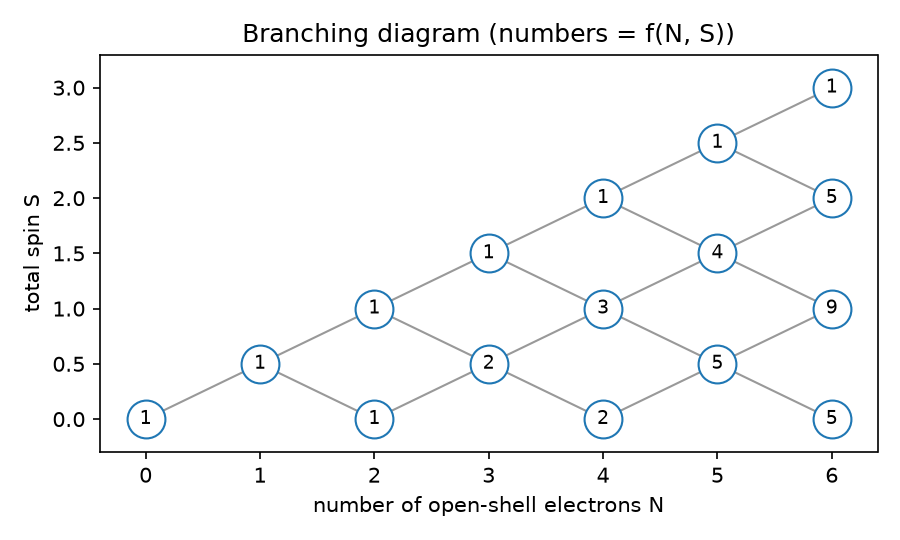

# 第 5 回　スピン：$\hat S^2$、決定子と配置状態関数（CSF）

!!! abstract "この回の道筋"
    電子のハミルトニアンはスピンを含まないので、その固有状態は全スピン $\hat S^2$ の固有状態（一重項、二重項、三重項など）に選べます。ところが、決定子は $\hat S^2$ の固有関数になるとは限りません。この回では、$\hat S^2$ を第二量子化で書き、決定子を組み合わせてスピンの固有関数（配置状態関数、CSF）を作る方法と、その数え方を学びます。最後に、非制限 Hartree–Fock 法で起こるスピン汚染の意味を、H₂ の解離で確かめます。

    | 節 | 内容 |
    |---|---|
    | 1 | スピン演算子と $\hat S^2$ |
    | 2 | $\hat S^2$ の第二量子化表示 |
    | 3 | 2 電子の一重項と三重項 |
    | 4 | 決定子がスピン固有関数になる条件 |
    | 5 | 配置状態関数（CSF）の作り方と数え方 |
    | 6 | スピン汚染 |

    **前に読んでおく回**：量子化学の理論 [第 2 回](02-determinants.md)、[第 3 回](03-hartree-fock.md)、[第 4 回](04-second-quantization.md)

!!! tip "物理的なイメージ"
    全スピン $\hat S^2$ が表しているのは、すべての電子のスピン（小さな磁石の向き）を合わせた大きさです。ハミルトニアンはスピンを含まないので、正しい状態は、全スピンの大きさが決まった状態（一重項、三重項など）に選べます。1 個の決定子は、各電子のスピンが上向きか下向きかを決めただけで、合わせた大きさは決まっていないことがあります。開殻の一重項と、三重項の $M_S = 0$ の成分のように、決定子を足したり引いたりして初めて、大きさの決まった状態（CSF）になります。UHF の解が一重項と三重項の混ざりものになるスピン汚染は、この組み合わせが崩れた結果です。

## 1. スピン演算子と $\hat S^2$

電子 1 個のスピンは、3 つの成分の演算子 $\hat s_x, \hat s_y, \hat s_z$ で表されます（原子単位で $\hbar = 1$）。
第 2 回の $\alpha$、$\beta$ は、$\hat s_z$ の固有関数です。

$$
\hat s_z\,\alpha = +\tfrac12\,\alpha,\qquad \hat s_z\,\beta = -\tfrac12\,\beta
$$

$N$ 個の電子の全スピンは、各電子のスピンの和 $\hat{\mathbf S} = \sum_i \hat{\mathbf s}(i)$ です。
その大きさの 2 乗 $\hat S^2 = \hat S_x^2 + \hat S_y^2 + \hat S_z^2$ と、$z$ 成分 $\hat S_z$ の固有値は

$$
\hat S^2\,\Psi = S(S+1)\,\Psi,\qquad \hat S_z\,\Psi = M_S\,\Psi
$$

の形になります。
$S$ は $0, \tfrac12, 1, \tfrac32, \dots$、$M_S$ は $-S, -S+1, \dots, S$ の値をとります。
$S = 0$ の状態を一重項、$S = \tfrac12$ を二重項、$S = 1$ を三重項と呼びます。
$2S+1$ を多重度（multiplicity）と呼びます。

第 1 回の電子のハミルトニアンは、スピンを含みません。
このため、$\hat H_\mathrm{el}$ は $\hat S^2$ とも $\hat S_z$ とも交換します。

$$
[\hat H_\mathrm{el}, \hat S^2] = 0,\qquad [\hat H_\mathrm{el}, \hat S_z] = 0
$$

したがって、$\hat H_\mathrm{el}$ の固有状態は、$\hat S^2$ と $\hat S_z$ の固有状態に同時に選べます。
厳密な電子状態は、決まった多重度を持つということです。

計算では、$x, y$ 成分の代わりに、昇降演算子 $\hat S_\pm = \hat S_x \pm i\hat S_y$ を使うと便利です。
$\hat S_+$ は $M_S$ を 1 増やし、$\hat S_-$ は 1 減らします。
交換関係 $[\hat S_x, \hat S_y] = i\hat S_z$ を使うと、$\hat S_-\hat S_+ = \hat S_x^2 + \hat S_y^2 - \hat S_z$ なので、

$$
\hat S^2 = \hat S_-\hat S_+ + \hat S_z + \hat S_z^2
$$

と書けます。

**ここまでで分かったこと**：電子のハミルトニアンはスピンを含まないので、厳密な電子状態は $\hat S^2$ の固有状態（決まった多重度）に選べます。

## 2. $\hat S^2$ の第二量子化表示

第 4 回の生成・消滅演算子で、スピンの演算子を書きます。
空間軌道 $\phi_P$ の $\alpha$ と $\beta$ のスピン軌道の演算子を、$\hat a_{P\alpha}$、$\hat a_{P\beta}$ などと書きます。
空間軌道は規格直交とします。

$$
\hat S_z = \frac12\sum_P\big(\hat n_{P\alpha} - \hat n_{P\beta}\big),\qquad
\hat S_+ = \sum_P \hat a_{P\alpha}^\dagger\hat a_{P\beta},\qquad
\hat S_- = \sum_P \hat a_{P\beta}^\dagger\hat a_{P\alpha}
$$

$\hat S_z$ は、$\alpha$ の電子の数と $\beta$ の電子の数の差の半分です。
$\hat S_+$ は、同じ空間軌道の中で $\beta$ の電子を $\alpha$ に変えます。
$\hat S_-$ はその逆です。
$\hat S^2$ は、これらを第 1 節の式 $\hat S^2 = \hat S_-\hat S_+ + \hat S_z + \hat S_z^2$ に入れたものです。
第二量子化でのスピンの扱いは、Helgaker らの第 2 章に詳しくまとめられています [Helgaker 2000]。

この表示から、次のことがすぐに分かります。

- **決定子は必ず $\hat S_z$ の固有関数です。** $\hat S_z$ は数演算子だけでできているので、決定子にかけると $M_S = (N_\alpha - N_\beta)/2$ を返します。
- **$\hat S^2$ については、そうとは限りません。** $\hat S_-\hat S_+$ は、ある軌道の $\beta$ の電子を $\alpha$ に変え、別の（または同じ）軌道の $\alpha$ の電子を $\beta$ に戻します。その結果、元とは違う決定子が出てくることがあります。

**ここまでで分かったこと**：$\hat S_\pm$ は、同じ空間軌道の中でスピンを反転させる演算子です。決定子は $\hat S_z$ の固有関数ですが、$\hat S^2$ の固有関数とは限りません。

## 3. 2 電子の一重項と三重項

第 2 回と第 4 回で扱った、2 つの空間軌道 $\phi_1$、$\phi_2$ に電子を 1 個ずつ入れる場合を考えます。
$M_S = 0$ の決定子は、$|1\alpha\,2\beta\rangle$ と $|1\beta\,2\alpha\rangle$ の 2 個です（軌道は番号の小さい順に並べます）。

第 4 回と同じように、$\hat S^2$ を $16\times 16$ の行列で作り、この 2 個の決定子の間の行列要素を求めます。

```python
import numpy as np
from functools import reduce

def ops(M):                                   # 第 4 回と同じ作り方
    I2, Z = np.eye(2), np.diag([1.0, -1.0])
    low = np.array([[0.0, 1.0], [0.0, 0.0]])
    a = [reduce(np.kron, [Z]*p + [low] + [I2]*(M-p-1)) for p in range(M)]
    return a, [x.T for x in a]

def spin_ops(n):                              # 空間軌道 n 個。P α = 2P, P β = 2P+1
    a, ad = ops(2*n)
    Sz = 0.5 * sum(ad[2*P] @ a[2*P] - ad[2*P+1] @ a[2*P+1] for P in range(n))
    Sp = sum(ad[2*P] @ a[2*P+1] for P in range(n))     # S+ = Σ a†_Pα a_Pβ
    Sm = Sp.T
    return Sm @ Sp + Sz + Sz @ Sz, Sz                  # S^2, Sz

def state(occ):                               # 占有数の並び → 状態ベクトル
    v = np.zeros(2**len(occ)); v[int("".join(map(str, occ)), 2)] = 1; return v

S2, Sz = spin_ops(2)
d1 = state((1, 0, 0, 1)); d2 = state((0, 1, 1, 0))   # |1α 2β>, |1β 2α>
B = np.array([[x @ S2 @ y for y in (d1, d2)] for x in (d1, d2)])
print("S^2 の行列（|1α2β>, |1β2α>）:\n", B)
w, v = np.linalg.eigh(B)
for k in range(2):
    print(f"  固有値 {w[k]:.3f}  ベクトル {np.round(v[:, k], 4)}")
```

```text
S^2 の行列（|1α2β>, |1β2α>）:
 [[1. 1.]
 [1. 1.]]
  固有値 0.000  ベクトル [-0.7071  0.7071]
  固有値 2.000  ベクトル [0.7071 0.7071]
```

$\hat S^2$ の行列には非対角要素があるので、どちらの決定子も $\hat S^2$ の固有関数ではありません。
期待値はどちらも 1 で、これは $S(S+1)$ の形のどの値（0、2、…）にも当たりません。
行列を対角化すると、固有値 0（一重項）と 2（三重項、$S = 1$）の組み合わせが得られます。

$$
{}^1\Psi = \frac{1}{\sqrt 2}\Big(|1\beta\,2\alpha\rangle - |1\alpha\,2\beta\rangle\Big),\qquad
{}^3\Psi = \frac{1}{\sqrt 2}\Big(|1\alpha\,2\beta\rangle + |1\beta\,2\alpha\rangle\Big)
$$

全体の符号は任意です。
行列式を書き下して整理すると、次の形になります。

$$
{}^1\Psi \propto \big[\phi_1(\mathbf r_1)\phi_2(\mathbf r_2) + \phi_2(\mathbf r_1)\phi_1(\mathbf r_2)\big]\big[\alpha(1)\beta(2) - \beta(1)\alpha(2)\big]
$$

$$
{}^3\Psi \propto \big[\phi_1(\mathbf r_1)\phi_2(\mathbf r_2) - \phi_2(\mathbf r_1)\phi_1(\mathbf r_2)\big]\big[\alpha(1)\beta(2) + \beta(1)\alpha(2)\big]
$$

一重項は「空間の部分が対称、スピンの部分が反対称」、三重項は「空間の部分が反対称、スピンの部分が対称」です。
どちらも、全体としては電子の入れ替えで反対称です。

三重項の空間の部分は、第 2 回で見た同じスピンの決定子と同じ形で、$\mathbf r_1 = \mathbf r_2$ で 0 になります（フェルミ孔）。
三重項の $M_S = 1$ の成分は、$|1\alpha\,2\alpha\rangle$ そのものです。

エネルギーも確かめます。
第 4 回の H₂ のハミルトニアン行列で、この 2 個の決定子のブロックは

$$
\begin{pmatrix} A & -K_{12}\\ -K_{12} & A\end{pmatrix},\qquad A = h_{11} + h_{22} + J_{12}
$$

でした。
ベクトル $(1, 1)/\sqrt2$ の三重項は $A - K_{12}$、$(1, -1)/\sqrt2$ の一重項は $A + K_{12}$ になります。

$$
E({}^3\Psi) = h_{11} + h_{22} + J_{12} - K_{12},\qquad
E({}^1\Psi) = h_{11} + h_{22} + J_{12} + K_{12}
$$

同じ軌道の占有でも、三重項は一重項より $2K_{12}$ だけエネルギーが低くなります。
決定子 $|1\alpha\,2\beta\rangle$ のエネルギー $A$ は、ちょうどその平均です。

**ここまでで分かったこと**：2 つの軌道に 1 個ずつ電子が入るとき、反対のスピンの決定子はスピンの固有関数ではありません。2 個の決定子の和と差が三重項と一重項になり、エネルギーは $\mp K_{12}$ だけずれます。

## 4. 決定子がスピン固有関数になる条件

前の節の例を一般化します。
空間軌道は、$\alpha$ と $\beta$ で共通のもの（第 3 回の RHF と同じ）を使うとします。
このとき、決定子が $\hat S^2$ の固有関数になるかどうかは、次のように判断できます。

- 電子が 2 個入っている空間軌道（閉殻）を、二重占有軌道と呼びます。
- 電子が 1 個だけ入っている空間軌道を、開殻軌道（単占有軌道）と呼びます。

二重占有軌道では、$\hat S_+$ で $\beta$ を $\alpha$ に変えようとしても、$\alpha$ がすでに入っているので 0 になります。
二重占有軌道は、全スピンに寄与しません。
開殻軌道の電子がすべて同じスピン（たとえばすべて $\alpha$）なら、$\hat S_+$ をかけると 0 になります。
このとき $\hat S^2 = \hat S_z + \hat S_z^2$ となり、決定子は $S = M_S$ の固有関数です。
閉殻の決定子（開殻軌道なし）は $S = 0$ の固有関数です。

開殻軌道に $\alpha$ と $\beta$ の電子が混ざっていると、$\hat S_-\hat S_+$ がスピンを入れ替えた別の決定子を作ります。
この場合、決定子 1 個は一般に $\hat S^2$ の固有関数になりません。

まとめると、次のようになります。

| 決定子 | $\hat S^2$ の固有関数か |
|---|---|
| 閉殻 | はい（$S = 0$） |
| 開殻の電子がすべて同じスピン（高スピン） | はい（$S = M_S$） |
| 開殻に $\alpha$ と $\beta$ が混ざっている | 一般には、いいえ |

!!! note "開殻の一重項は決定子 1 個では書けない"
    第 3 節の一重項のように、開殻軌道を含む一重項は、少なくとも 2 個の決定子の組み合わせです。励起状態のスピン反転の手法（[第 20 回](20-spin-flip-tddft.md)）など、どのような決定子を使うかでスピンの純粋さが変わる場面で、この点が問題になります。

**ここまでで分かったこと**：閉殻の決定子と、開殻の電子がすべて同じスピンの決定子は $\hat S^2$ の固有関数です。開殻に $\alpha$ と $\beta$ が混ざった決定子は、一般にそうではありません。

## 5. 配置状態関数（CSF）の作り方と数え方

### 5.1 CSF とは

空間軌道の占有の仕方（どの軌道に何個の電子が入るか）を、配置（configuration）と呼びます。
同じ配置に属する決定子を組み合わせて作った、$\hat S^2$ と $\hat S_z$ の固有関数を、配置状態関数（configuration state function、CSF）と呼びます。
第 3 節の ${}^1\Psi$ と ${}^3\Psi$ は、どちらも CSF です。

CSF を使う利点は、次の 2 つです。

1. 計算したい多重度の CSF だけを使えば、ほかの多重度の状態が混ざりません。
2. 同じ多重度の CSF の数は、$M_S$ が同じ決定子の数より少なく、計算が小さくなります（5.3 で数えます）。

### 5.2 作り方：電子を 1 個ずつ足す（分岐図）

CSF を作る代表的な方法は、開殻の電子を 1 個ずつ足していく方法です。
系図的（genealogical）な方法と呼ばれます [Pauncz 2000]。
二重占有軌道はスピンに寄与しないので、開殻の電子だけを考えます。

スピン $S$ の状態に電子（スピン $\tfrac12$）を 1 個足すと、全スピンは $S + \tfrac12$ か $S - \tfrac12$ になります（$S = 0$ からは $\tfrac12$ だけ）。
横軸に電子の数 $N$、縦軸に全スピン $S$ をとり、この足し方を線で結ぶと、次の図になります。
これを分岐図（branching diagram）と呼びます。



原点から点 $(N, S)$ までの道 1 本が、CSF 1 個に対応します。
道の途中の各段階でのスピンが、その CSF の「系図」です。
丸の中の数は道の数で、$N$ 個の開殻の電子から作れる、スピン $S$ の独立な CSF の数 $f(N, S)$ です。
この数は、次の式で与えられます [Pauncz 2000]。

$$
f(N, S) = \frac{(2S+1)\,N!}{\left(\frac N2 + S + 1\right)!\left(\frac N2 - S\right)!}
$$

たとえば、3 個の開殻軌道 $a, b, c$ に 1 個ずつ電子が入った二重項（$S = \tfrac12$）は、$f(3, \tfrac12) = 2$ 個あります。
2 つの道は、最初の 2 個の電子を一重項（$S = 0$）にしたものと、三重項（$S = 1$）にしたものです。
$M_S = \tfrac12$ の決定子で書くと、次のようになります。
ここで、たとえば $|a\alpha\,b\beta\,c\alpha\rangle$ は、軌道を $a, b, c$ の順に並べた決定子です。

$$
\Psi_1 = \frac{1}{\sqrt2}\Big(|a\alpha\,b\beta\,c\alpha\rangle - |a\beta\,b\alpha\,c\alpha\rangle\Big)
$$

$$
\Psi_2 = \frac{1}{\sqrt6}\Big(2|a\alpha\,b\alpha\,c\beta\rangle - |a\alpha\,b\beta\,c\alpha\rangle - |a\beta\,b\alpha\,c\alpha\rangle\Big)
$$

$\Psi_1$ では、$a$ と $b$ の電子が第 3 節の一重項の組を作り、そこに $c$ の $\alpha$ の電子が加わっています。
$\Psi_2$ では、$a$ と $b$ の電子が三重項の組を作り、$c$ の電子と組み合わせて全体で二重項にしています。
これが本当に二重項になっていることを、第 3 節のコードの `spin_ops` と `state` を使って確かめます。

```python
S2, Sz = spin_ops(3)
def det(spins):                       # 軌道 a, b, c の順に α("a") / β("b") を指定
    occ = []
    for s in spins: occ += [1, 0] if s == "a" else [0, 1]
    return state(tuple(occ))
csf1 = (det("aba") - det("baa")) / np.sqrt(2)
csf2 = (2*det("aab") - det("aba") - det("baa")) / np.sqrt(6)
for name, c in [("CSF1", csf1), ("CSF2", csf2)]:
    print(f"{name}: <S^2> = {c @ S2 @ c:.3f}, S^2 の固有関数: {np.allclose(S2 @ c, 0.75*c)}")
print("CSF1・CSF2 の内積:", csf1 @ csf2)
```

```text
CSF1: <S^2> = 0.750, S^2 の固有関数: True
CSF2: <S^2> = 0.750, S^2 の固有関数: True
CSF1・CSF2 の内積: 0.0
```

どちらも $S(S+1) = \tfrac34$ の固有関数で、互いに直交しています。

### 5.3 数え方：決定子と CSF の数

ある配置の CSF の数は、開殻の電子の数だけで決まり、$f(N_\text{開殻}, S)$ です。
したがって、$n$ 個の空間軌道に $N$ 個の電子を入れたときの、スピン $S$ の CSF の総数は、すべての配置について $f$ を足せば求まります。
この和は、次の閉じた式になります。Paldus が CSF の数え方に用いた形で、Weyl–Paldus の公式とも呼ばれます [Paldus 1974]。

$$
N_\mathrm{CSF}(n, N, S) = \frac{2S+1}{n+1}\binom{n+1}{\frac N2 - S}\binom{n+1}{\frac N2 + S + 1}
$$

一方、$M_S = S$ の決定子の数は、$\alpha$ の電子 $N_\alpha$ 個と $\beta$ の電子 $N_\beta$ 個の入れ方の数 $\binom{n}{N_\alpha}\binom{n}{N_\beta}$ です。
2 つを比べるコードと、その出力です。
CSF の数は、$\hat S^2$ の行列を直接対角化して固有値 $S(S+1)$ の数を数えた結果（「直接」の列。軌道 6 個まで）とも一致しました。

```python
from math import comb

def n_csf(n, N, S2x):                 # S2x = 2S
    S = S2x / 2
    return round((2*S+1)/(n+1) * comb(n+1, int(N/2-S)) * comb(n+1, int(N/2+S+1)))

def n_csf_direct(n, N, S2x):          # S^2 を対角化して数える（小さい n だけ）
    S2, Sz = spin_ops(n)
    sel = [o for o in range(4**n)
           if bin(o).count("1") == N and abs(Sz[o, o] - S2x/2) < 1e-9]
    w = np.linalg.eigvalsh(S2[np.ix_(sel, sel)])
    S = S2x / 2
    return int(np.sum(np.abs(w - S*(S+1)) < 1e-6))

for n, N, S2x in [(2, 2, 0), (2, 2, 2), (4, 4, 0), (6, 6, 0), (6, 6, 2), (10, 10, 0), (16, 16, 0)]:
    na = (N + S2x) // 2
    chk = n_csf_direct(n, N, S2x) if n <= 6 else "-"
    print(f"軌道 {n:2d}, 電子 {N:2d}, S = {S2x/2}: CSF {n_csf(n,N,S2x):>9d} (直接 {chk!s:>4}), "
          f"M_S = S の決定子 {comb(n,na)*comb(n,N-na):>10d}")
```

```text
軌道  2, 電子  2, S = 0.0: CSF         3 (直接    3), M_S = S の決定子          4
軌道  2, 電子  2, S = 1.0: CSF         1 (直接    1), M_S = S の決定子          1
軌道  4, 電子  4, S = 0.0: CSF        20 (直接   20), M_S = S の決定子         36
軌道  6, 電子  6, S = 0.0: CSF       175 (直接  175), M_S = S の決定子        400
軌道  6, 電子  6, S = 1.0: CSF       189 (直接  189), M_S = S の決定子        225
軌道 10, 電子 10, S = 0.0: CSF     19404 (直接    -), M_S = S の決定子      63504
軌道 16, 電子 16, S = 0.0: CSF  34763300 (直接    -), M_S = S の決定子  165636900
```

2 軌道 2 電子の一重項では、第 4 回の 4 個の決定子の代わりに、3 個の CSF（$|1\alpha\,1\beta\rangle$、$|2\alpha\,2\beta\rangle$、第 3 節の ${}^1\Psi$）で済みます。
決定子 4 個のうち、残りの 1 個分は三重項です。
一重項では、軌道と電子が増えると、CSF の数は決定子の数の半分から数分の一になります。
ただし、どちらも軌道の数とともに急激に増えることに変わりはありません。
この増え方が、多参照の計算で扱える活性空間の大きさを制限します（[第 12 回](12-casscf.md)）。

**ここまでで分かったこと**：CSF は、同じ配置の決定子を組み合わせたスピンの固有関数です。分岐図の道 1 本が CSF 1 個に対応し、その数は $f(N, S)$ や Weyl の公式で数えられます。

## 6. スピン汚染

### 6.1 非制限 Hartree–Fock 法とスピン汚染

第 3 回の最後で、陽イオン H₂O⁺ を非制限 Hartree–Fock（UHF）法で解きました。
UHF 法では、$\alpha$ の電子と $\beta$ の電子に、別々の空間軌道 $\{\phi_i^\alpha\}$、$\{\phi_j^\beta\}$ を使います。
$\beta$ の電子の軌道 $\phi_j^\beta$ は、一般に $\alpha$ の占有軌道とぴったり同じ形にはなりません。
そのため、$\hat S_+$ で $\beta$ の電子を $\alpha$ に変えても、第 4 節の二重占有軌道のように 0 にはなりません。
したがって、UHF の決定子は一般に $\hat S^2$ の固有関数ではありません。

$N_\alpha \ge N_\beta$ のとき、UHF の決定子の $\hat S^2$ の期待値は

$$
\langle\hat S^2\rangle_\mathrm{UHF} = M_S(M_S+1) + N_\beta - \sum_{i}^{N_\alpha}\sum_{j}^{N_\beta}\big|\langle\phi_i^\alpha|\phi_j^\beta\rangle\big|^2
$$

です（Szabo–Ostlund の 2.5.3 節 [Szabo 1996]）。
$\alpha$ と $\beta$ の軌道が同じなら、最後の和は $N_\beta$ に等しく、$\langle\hat S^2\rangle = M_S(M_S+1)$ となって純粋な $S = M_S$ の値です。
軌道が違うほど和が小さくなり、$\langle\hat S^2\rangle$ は純粋な値より大きくなります。
これは、波動関数に、より大きな $S$ の状態が混ざっていることを意味します。
この混ざりをスピン汚染（spin contamination）と呼びます。

第 3 回の H₂O⁺（二重項）の UHF の解について、PySCF の `e1.spin_square()` で $\langle\hat S^2\rangle$ を求めると 0.756 になります。
純粋な二重項の値 $\tfrac12\cdot\tfrac32 = 0.75$ に近く、汚染は小さいと言えます。

### 6.2 H₂ の解離で見るスピン汚染

スピン汚染が大きくなる典型的な例は、結合の解離です。
H₂ の基底状態（一重項）を、RHF、UHF、完全 CI で、核間距離を変えながら計算します。計算には PySCF [Sun 2020] を使い、基底関数は cc-pVDZ とします。
UHF は、何もしないと RHF と同じ解に落ちることがあります。
そこで、$\alpha$ の電子を一方の原子に、$\beta$ の電子をもう一方の原子に偏らせた初期推測から始めます。

```python
import numpy as np
from pyscf import gto, scf, fci

print("  R/Å     RHF        UHF        FCI     <S^2>(UHF)")
for r in [0.74, 1.0, 1.2, 1.5, 2.0, 2.5, 3.0]:
    mol = gto.M(atom=f"H 0 0 0; H 0 0 {r}", basis="cc-pvdz", verbose=0)
    rhf = scf.RHF(mol).run()
    # 初期推測：α と β の HOMO を、結合性軌道と反結合性軌道を混ぜて左右に偏らせる
    C = rhf.mo_coeff
    ca, cb = C.copy(), C.copy()
    ca[:, 0] = (C[:, 0] + C[:, 1]) / np.sqrt(2)
    cb[:, 0] = (C[:, 0] - C[:, 1]) / np.sqrt(2)
    dm = (ca[:, :1] @ ca[:, :1].T, cb[:, :1] @ cb[:, :1].T)
    uhf = scf.UHF(mol).run(dm)
    efci = fci.FCI(rhf).kernel()[0]
    s2 = uhf.spin_square()[0]
    print(f"{r:5.2f}  {rhf.e_tot:9.5f}  {uhf.e_tot:9.5f}  {efci:9.5f}  {s2:6.3f}")
```

```text
  R/Å     RHF        UHF        FCI     <S^2>(UHF)
 0.74   -1.12870   -1.12870   -1.16337  -0.000
 1.00   -1.10015   -1.10015   -1.14007   0.000
 1.20   -1.06111   -1.06111   -1.10686   0.000
 1.50   -1.00219   -1.02138   -1.06153   0.583
 2.00   -0.92191   -1.00278   -1.01759   0.904
 2.50   -0.86533   -0.99936   -1.00313   0.978
 3.00   -0.82645   -0.99872   -0.99955   0.995
```

結果は次のように読めます。

- **平衡距離の近く（1.2 Å まで）**：UHF は、偏らせた初期推測から始めても RHF と同じ解に戻ります。$\langle\hat S^2\rangle = 0$ で、スピン汚染はありません（0.74 Å の $-0.000$ は、丸めの誤差による 0 です）。
- **1.2 Å と 1.5 Å の間**：UHF の解が RHF から分かれ、エネルギーが RHF より低くなります。この分かれ目は Coulson–Fischer 点と呼ばれます [Coulson 1949]。
- **長い距離**：RHF のエネルギーは高すぎます。RHF は 2 個の電子を同じ空間軌道に入れるので、「両方の電子が同じ原子にいる」イオン的な成分が常に半分混ざるためです。UHF は、$\alpha$ の電子と $\beta$ の電子を別々の原子に置くことで、完全 CI に近いエネルギーを与えます。
- **その代わり、$\langle\hat S^2\rangle$ は 1 に近づきます。** 離れた 2 個の原子に $\alpha$ と $\beta$ を 1 個ずつ置いた決定子は、第 3 節の $|1\alpha\,2\beta\rangle$ と同じ形で、一重項と三重項を半分ずつ含みます。その期待値は $\tfrac12\cdot 0 + \tfrac12\cdot 2 = 1$ です。

つまり、UHF は、スピンの純粋さを犠牲にしてエネルギーを下げています。
エネルギーだけを見るとよい近似ですが、波動関数は一重項ではありません。

### 6.3 スピン汚染の意味

スピン汚染の大きさは、計算の結果を読むときの目安になります。

- $\langle\hat S^2\rangle$ が純粋な値 $S(S+1)$ から大きくずれていたら、その波動関数には別の多重度の状態が混ざっています。スピン密度や、多重度の違う状態どうしのエネルギー差は、信頼性が下がります。
- 解離の途中のように汚染が大きくなる場面は、決定子 1 個ではうまく表せない状況（静的相関が大きい状況）であることが多いです。この場合は、複数の決定子や CSF を使う方法（[第 7 回](07-electron-correlation.md)、[第 12 回](12-casscf.md)）が必要になります。

**ここまでで分かったこと**：UHF の決定子は $\hat S^2$ の固有関数ではなく、別の多重度の状態が混ざります（スピン汚染）。$\langle\hat S^2\rangle$ の値は、その混ざり具合と、決定子 1 個で足りるかどうかの目安になります。

## まとめ

- 電子のハミルトニアンは $\hat S^2$ と交換するので、厳密な電子状態は決まった多重度を持ちます。
- 第二量子化では $\hat S_+ = \sum_P\hat a_{P\alpha}^\dagger\hat a_{P\beta}$ などと書け、$\hat S^2 = \hat S_-\hat S_+ + \hat S_z + \hat S_z^2$ です。決定子は $\hat S_z$ の固有関数ですが、$\hat S^2$ の固有関数とは限りません。
- 2 つの軌道に 1 個ずつ電子が入ると、決定子の和と差が三重項と一重項になり、エネルギーは $h_{11} + h_{22} + J_{12} \mp K_{12}$ です。
- 同じ配置の決定子を組み合わせたスピンの固有関数が CSF です。分岐図の道の数 $f(N, S)$ と Weyl の公式で数えられ、決定子より数が少なくなります。
- UHF の決定子にはスピン汚染があり、$\langle\hat S^2\rangle$ は純粋な値より大きくなります。汚染が大きいときは、決定子 1 個では足りない状況を疑います。

## 参考文献

- A. Szabo, N. S. Ostlund, "Modern Quantum Chemistry" (Dover, 1996). ISBN: 9780486691862
- T. Helgaker, P. Jørgensen, J. Olsen, "Molecular Electronic-Structure Theory" (Wiley, 2000). ISBN: 9780471967552
- R. Pauncz, "The Construction of Spin Eigenfunctions" (Kluwer Academic/Plenum, 2000). ISBN: 9780306464003
- J. Paldus, "Group theoretical approach to the configuration interaction and perturbation theory calculations for atomic and molecular systems", J. Chem. Phys. 61, 5321 (1974). DOI: [10.1063/1.1681883](https://doi.org/10.1063/1.1681883)
- C. A. Coulson, I. Fischer, "XXXIV. Notes on the molecular orbital treatment of the hydrogen molecule", Philos. Mag. 40, 386 (1949). DOI: [10.1080/14786444908521726](https://doi.org/10.1080/14786444908521726)
- Q. Sun et al., "Recent developments in the PySCF program package", J. Chem. Phys. 153, 024109 (2020). DOI: [10.1063/5.0006074](https://doi.org/10.1063/5.0006074)
