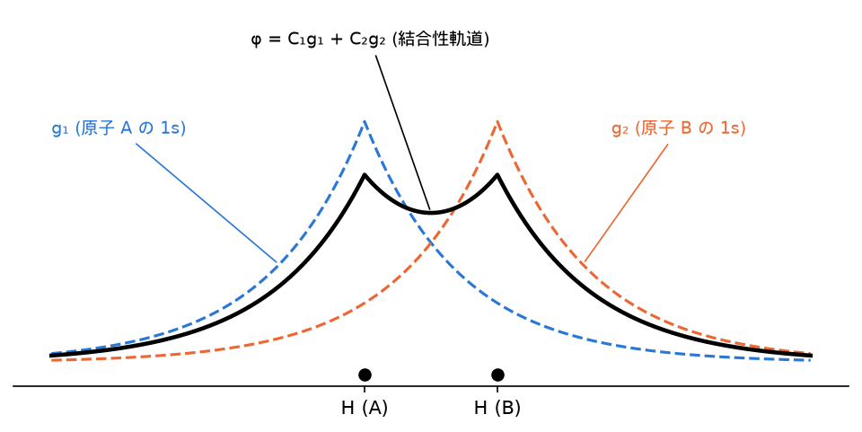
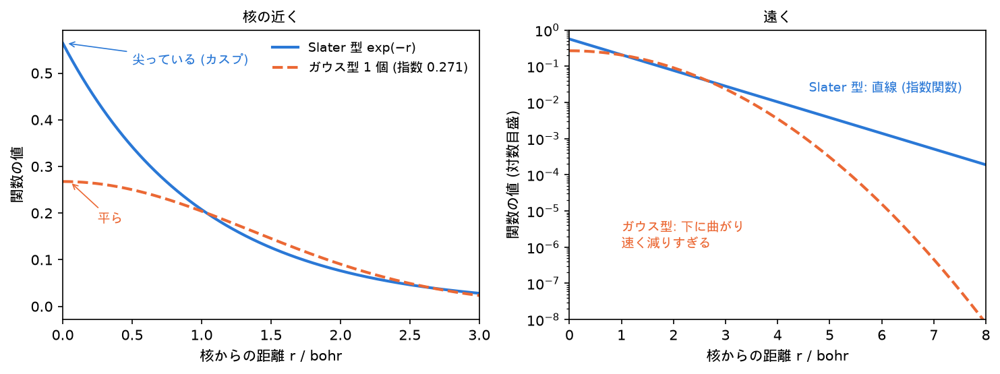
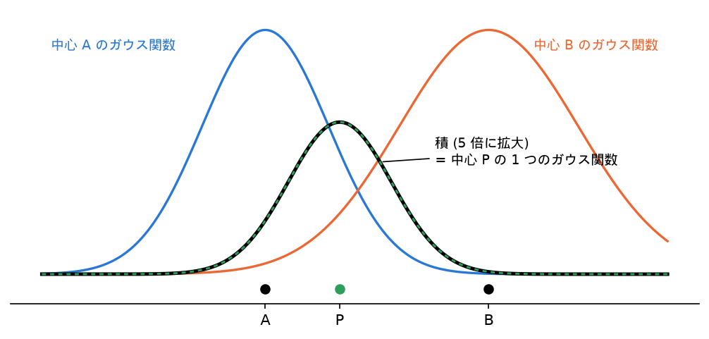
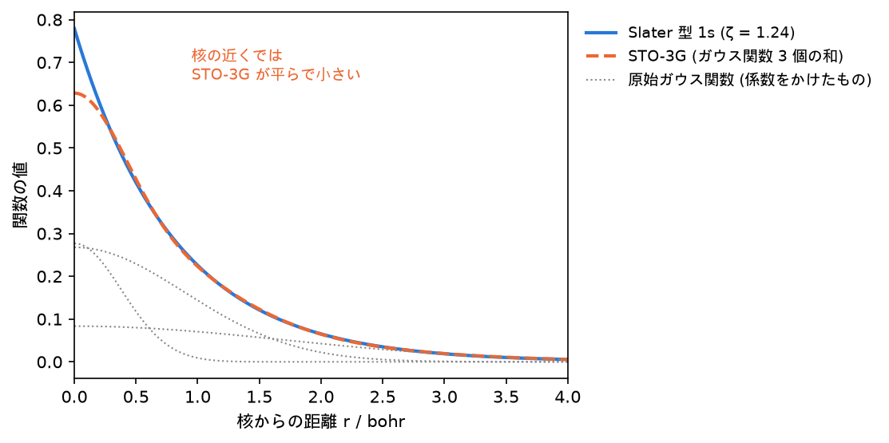
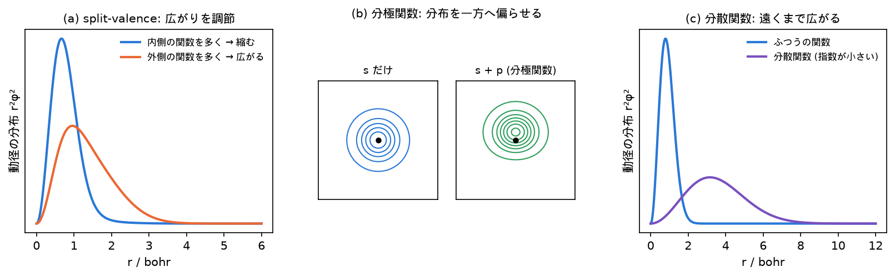
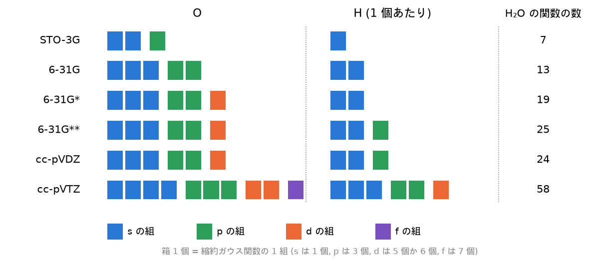
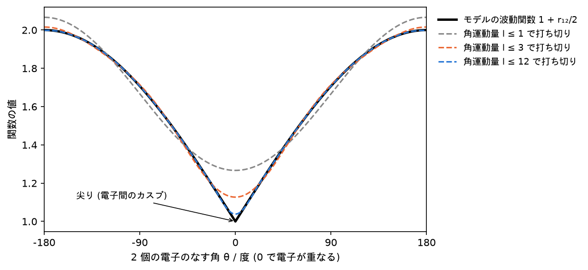
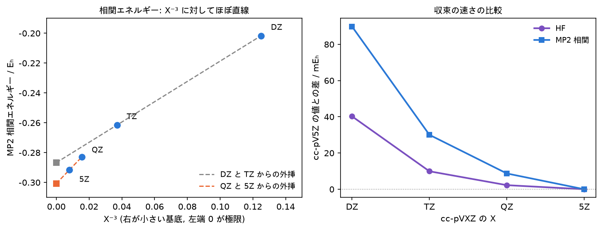
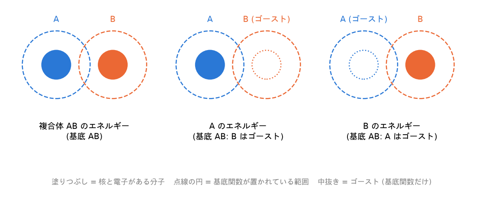

# 第 6 回　基底関数

!!! abstract "この回の道筋"
    分子の計算では、軌道を有限個の基底関数で展開します。基底関数の選び方は、計算の精度と時間を大きく左右します。この回では、基底関数の形（Slater 型とガウス型）、縮約、基底関数の名前の読み方（Pople 系、Dunning の相関無撞着基底、Karlsruhe の def2 系）を学びます。そのうえで、H₂O のエネルギーが基底関数でどう変わるかを PySCF で確かめ、基底関数の極限への外挿と、基底関数重なり誤差（BSSE）を扱います。

    | 節 | 内容 |
    |---|---|
    | 1 | 基底関数の役割 |
    | 2 | Slater 型とガウス型 |
    | 3 | 縮約 |
    | 4 | 基底関数の大きさ：最小基底、split-valence、分極関数、分散関数 |
    | 5 | 代表的な基底関数の系列 |
    | 6 | H₂O のエネルギーと基底関数の極限 |
    | 7 | 基底関数重なり誤差（BSSE） |

    **前に読んでおく回**：量子化学の理論 [第 5 回](05-hartree-fock.md)

!!! tip "物理的なイメージ"
    基底関数が決めているのは、軌道を描くための「画材の箱」です。軌道は、原子の位置に置いた決まった形の関数の重ね合わせで表すので、箱に入っていない形は描けません。関数を増やすほど正しい軌道に近づき、変分法の方法ではエネルギーが下がっていきます。電子相関を表すには、電子が互いを避けるための細かい形（角運動量の高い関数）が必要です。そのため、相関エネルギーは、HF のエネルギーよりも、基底関数への収束がずっと遅くなります。外挿は、箱を無限に大きくした極限を推定する方法です。

エネルギーは原子単位（ハートリー，$E_\mathrm h$）で書きます。1 $E_\mathrm h$ = 27.211 eV = 627.5 kcal/mol です。長さの原子単位は bohr（1 bohr = 0.529 Å）です。

## 1. 基底関数の役割

### 1.1 軌道を基底関数で展開する

第 5 回の Roothaan–Hall 方程式では、軌道 $\phi_i$ を $K$ 個の基底関数 $g_\mu$ の一次結合で表しました。

$$
\phi_i(\mathbf r) = \sum_{\mu=1}^{K} C_{\mu i}\,g_\mu(\mathbf r)
$$

最も小さい例は、H₂ の各原子に 1s 型の関数を 1 個ずつ置いた場合（$K = 2$）です（図 1）。
軌道は $\phi = C_1 g_1 + C_2 g_2$ の形に限られ、SCF で決めるのは係数 $C_1$、$C_2$ だけです。



**図 1**　模式図。原子 A と B に置いた 1s 型の関数 $g_1$、$g_2$（破線）を足し合わせて、結合性軌道 $\phi$（黒の実線）を作ります。軌道がとれる形は、置いた関数の重ね合わせだけです。

このとき、第 5 回の Roothaan–Hall 方程式 $\mathbf F\mathbf C = \mathbf S\mathbf C\boldsymbol\varepsilon$ は、2 行 2 列の行列の式になります。

$$
\begin{pmatrix} F_{11} & F_{12}\\ F_{21} & F_{22}\end{pmatrix}
\begin{pmatrix} C_{1i}\\ C_{2i}\end{pmatrix}
= \varepsilon_i
\begin{pmatrix} 1 & S_{12}\\ S_{12} & 1\end{pmatrix}
\begin{pmatrix} C_{1i}\\ C_{2i}\end{pmatrix}
$$

$F_{\mu\nu} = \langle g_\mu|\hat f|g_\nu\rangle$ は Fock 行列、$S_{\mu\nu} = \langle g_\mu|g_\nu\rangle$ は重なり行列です。
基底関数は規格化されているので、$S$ の対角要素は 1 です。
3 節で扱う STO-3G 基底で核間距離 0.74 Å の H₂ を計算すると、$S_{12} = 0.660$ です。違う原子の関数は直交していません。
基底関数を $K$ 個にすれば、この式は $K$ 行 $K$ 列になります。

### 1.2 関数を増やすとエネルギーは下がる

軌道は、基底関数が張る空間の中でしか形を変えられません。
したがって、基底関数が少ないと、本当の軌道を表しきれず、エネルギーは高めに出ます。

ある関数の組に別の関数を足した場合、エネルギーは下がるか変わらないかのどちらかです。
足す前にとれた軌道は、足した後も、新しい関数の係数を 0 にすればとれます。
変分原理では、とれる範囲の中でエネルギーが最も低いものを選ぶので、範囲が広がれば、最小値は下がるか同じままです。
基底関数を無限に増やした極限を、基底関数の極限（complete basis set limit、CBS 極限）と呼びます。

### 1.3 計算の手間

一方で、計算の手間は、基底関数の数とともに急に増えます。
たとえば電子反発積分 $(\mu\nu|\lambda\sigma)$ は、4 つの添字がそれぞれ $K$ 通りなので、$K^4$ 個あります。
実数の関数では、$(\mu\nu|\lambda\sigma) = (\nu\mu|\lambda\sigma) = (\mu\nu|\sigma\lambda) = (\lambda\sigma|\mu\nu)$ などの入れ替えで同じ値になる組が 8 個ずつあるので、計算すべき積分の数はおよそ $K^4/8$ です。
6 節の cc-pVDZ の H₂O（$K = 24$）では約 4 万個、cc-pV5Z（$K = 201$）では約 2 億個です。
そのため、「必要な精度に対して、なるべく少ない数で済む基底関数」を選ぶことが大切です。

量子化学のプログラムでは、ふつう、各原子を中心に、原子軌道に似た関数を置きます。
1 つの原子に置く関数の組を、その原子の基底関数（基底セット、basis set）と呼びます。
この回の内容は、教科書では Szabo–Ostlund の 3.6 節 [Szabo 1996] と Helgaker らの第 8 章 [Helgaker 2000]、総説では Jensen [Jensen 2013] に詳しく書かれています。

**ここまでで分かったこと**：基底関数は、軌道が取れる形の範囲を決めます。数を増やすと精度が上がり（エネルギーは下がるか変わらない）、計算の手間も増えます。

## 2. Slater 型とガウス型

### 2.1 Slater 型関数

水素原子の 1s 軌道は $e^{-Zr}$ の形をしています（$Z$ は核の電荷、$r$ は核からの距離）。
これにならい、原子を中心とする次の形の関数を、Slater 型関数（Slater-type orbital、STO）と呼びます。

$$
\chi^\mathrm{STO}(r, \theta, \varphi) = N\,r^{n-1}e^{-\zeta r}\,Y_{lm}(\theta, \varphi)
$$

$(r, \theta, \varphi)$ は原子の中心からの極座標、$N$ は規格化定数、$n$ は主量子数にあたる整数です。
$\zeta$ は広がりを決める指数で、大きいほど関数は核の近くに縮みます。
$Y_{lm}$ は球面調和関数で、関数の角度方向の形（s、p、d などの形）を決めます。
Slater が 1930 年に、原子の軌道を簡単に近似する方法としてこの形を提案しました [Slater 1930]。

Slater 型関数には、本当の軌道に近い 2 つの性質があります。

1. **核の位置での尖り（カスプ）**：$e^{-\zeta r}$ は $r = 0$ で尖っています。厳密な波動関数も核の位置で尖り、その傾きは核の電荷 $Z$ で決まります（Kato のカスプ条件 [Kato 1957]）。電子が核に近づくとクーロン引力 $-Z/r$ が発散するので、それを運動エネルギーで打ち消すために、波動関数が尖る必要があります。
2. **遠くでの減り方**：本当の軌道は、遠くで $e^{-(\text{定数})\,r}$ のように指数関数的に減ります。Slater 型関数も同じ減り方をします。

しかし、Slater 型関数は、分子の計算で使いにくい欠点があります。
異なる原子を中心とする関数を含む電子反発積分（3 中心・4 中心の積分）を、解析的に速く計算できないのです。

### 2.2 ガウス型関数

そこで、ほとんどの量子化学プログラムは、次のガウス型関数（Gaussian-type orbital、GTO）を使います。

$$
g(\mathbf r) = N\,x^{a}y^{b}z^{c}\,e^{-\alpha r^2}
$$

$x, y, z$ は原子の中心から測った座標、$a, b, c$ は 0 以上の整数、$\alpha$ は指数です。
$l = a + b + c$ が角運動量で、$l = 0, 1, 2, 3$ をそれぞれ s、p、d、f 型と呼びます。
たとえば p 型は $x e^{-\alpha r^2}$、$y e^{-\alpha r^2}$、$z e^{-\alpha r^2}$ の 3 個です。

ガウス型関数は、Slater 型の 2 つの性質を満たしません（図 2）。
$e^{-\alpha r^2}$ は $r = 0$ で平らで（カスプがない）、遠くでは $e^{-\alpha r^2}$ のように減るので、指数関数より速く減りすぎます。



**図 2**　$\zeta = 1$ の Slater 型の 1s 関数（青）と、それに最もよく重なるガウス関数 1 個（橙の破線、指数 0.271、重なり 0.978）。左：核の近くでは、Slater 型は尖り、ガウス型は平らです。右：縦軸を対数にすると、Slater 型は直線（指数関数的な減り方）ですが、ガウス型は下に曲がり、遠くで速く減りすぎます。

それでもガウス型関数が使われる理由は、**2 つのガウス関数の積が、別の 1 点を中心とする 1 つのガウス関数になる**ことです（図 3）。
1 次元で書くと、点 $A$ を中心とする指数 $a$ のガウス関数と、点 $B$ を中心とする指数 $b$ のガウス関数の積は、

$$
e^{-a(x - A)^2}\,e^{-b(x - B)^2} = K\,e^{-p(x - P)^2}
$$

です。ここで、新しい指数 $p$、中心 $P$、定数 $K$ は次のとおりです。

$$
p = a + b,\qquad P = \frac{aA + bB}{a + b},\qquad K = e^{-\frac{ab}{a+b}(A - B)^2}
$$

新しい中心 $P$ は、$A$ と $B$ を指数の重みで内分した点です。$K$ は中心の距離だけで決まる定数です。
3 次元でも、$x, y, z$ の方向ごとに同じ式が成り立ちます。
導出は、指数の部分を平方完成するだけです。各段階を付録 A に書きました。



**図 3**　点 A と点 B を中心とする 2 つのガウス関数（青と橙）の積（黒）は、A と B の間の点 P を中心とする 1 つのガウス関数（緑の点線）とぴったり重なります。積は小さいので、見やすいように 5 倍にしています。

この性質のおかげで、4 つの原子にまたがる電子反発積分 $(\mu\nu|\lambda\sigma)$ も、$\mu\nu$ の積と $\lambda\sigma$ の積をそれぞれ 1 つのガウス関数にまとめ、2 中心の積分にしてから計算できます。
Boys が 1950 年に、分子の計算にガウス型関数を使うことを提案しました [Boys 1950]。
形の不正確さは、次の節の縮約で補います。

!!! note "d 関数の成分の数：6 か 5 か"
    $l = 2$ の $x^ay^bz^c$ は $x^2, y^2, z^2, xy, yz, zx$ の 6 個です。このうち $x^2 + y^2 + z^2 = r^2$ の組み合わせ $r^2 e^{-\alpha r^2}$ は、角度によらない s 型の形をしています。そこで、残りの 5 個の組み合わせ（$xy$、$yz$、$zx$、$x^2 - y^2$、$2z^2 - x^2 - y^2$。球面調和関数の形）だけを使うこともあります。前者をデカルト型（6d）、後者を球面型（5d）と呼びます。同じ名前の基底関数でも、どちらを使うかで関数の数とエネルギーが少し変わります。Pople 系の 6-31G* などはデカルト型で作られ、Dunning 系や def2 系はふつう球面型で使います。

**ここまでで分かったこと**：Slater 型関数は形が正しいものの、分子の積分の計算が大変です。ガウス型関数は形が不正確ですが、積がまた 1 つのガウス関数になるので積分が速く計算でき、実際の計算に使われます。

## 3. 縮約

### 3.1 何個かのガウス関数を決まった係数で足す

ガウス関数 1 個では、Slater 型関数の形をうまく表せません（図 2）。
そこで、指数の違う何個かのガウス関数（原始ガウス関数、primitive）を、係数を決めて足し合わせ、1 つの基底関数として使います。

$$
g_\mu(\mathbf r) = \sum_{k=1}^{L} d_{k\mu}\,g_k^\mathrm{prim}(\mathbf r)
$$

係数 $d_{k\mu}$ は計算の前に決めておき、SCF の途中では変えません。
これを縮約（contraction）と呼び、$g_\mu$ を縮約ガウス関数と呼びます。
SCF で決める係数 $C_{\mu i}$ の数は、原始ガウス関数ではなく縮約ガウス関数の数で決まるので、計算が軽くなります。

### 3.2 例：STO-3G の水素の 1s 関数

例として、STO-3G 基底 [Hehre 1969] の水素の 1s 関数を見ます。
これは、指数 $\zeta = 1.24$ の Slater 型の 1s 関数を、3 個のガウス関数でなるべくよく近似したものです。
PySCF [Sun 2020] に入っている指数と係数を使い、2 つの関数を比べます。

```python
import numpy as np
from pyscf import gto

zeta = 1.24                                    # STO-3G で使う H 1s の指数
sto = lambda r: np.sqrt(zeta**3 / np.pi) * np.exp(-zeta * r)
bas = gto.basis.load("sto-3g", "H")[0]         # [l, [指数, 係数], ...]
prims = np.array(bas[1:])
print("STO-3G の H 1s（指数, 係数）:\n", prims)
def gto3(r):                                   # 規格化した原始ガウス関数の和
    return sum(c * (2*a/np.pi)**0.75 * np.exp(-a * r**2) for a, c in prims)
r = np.linspace(0, 6, 6001)                    # bohr
w = 4 * np.pi * r**2 * (r[1] - r[0])           # 動径方向の積分の重み
norm = np.sum(gto3(r)**2 * w)
print(f"STO-3G の規格化 {norm:.5f}, STO との重なり {np.sum(gto3(r)*sto(r)*w)/np.sqrt(norm):.5f}")
print(f"r = 0 での値   STO {sto(0):.4f}   STO-3G {gto3(0):.4f}")
```

```text
STO-3G の H 1s（指数, 係数）:
 [[3.42525091 0.15432897]
 [0.62391373 0.53532814]
 [0.1688554  0.44463454]]
STO-3G の規格化 1.00000, STO との重なり 0.99982
r = 0 での値   STO 0.7790   STO-3G 0.6282
```

出力の指数と係数を式に書くと、STO-3G の水素の 1s 関数は

$$
g_\mathrm{1s}(r) = 0.1543\,\tilde g(3.425; r) + 0.5353\,\tilde g(0.6239; r) + 0.4446\,\tilde g(0.1689; r)
$$

です。$\tilde g(\alpha; r)$ は、規格化した原始ガウス関数です。

$$
\tilde g(\alpha; r) = \Big(\frac{2\alpha}{\pi}\Big)^{3/4}e^{-\alpha r^2}
$$

指数 3.425 の狭い関数が核の近くを、指数 0.169 の広い関数が遠くを受け持ちます（図 4 の点線）。



**図 4**　水素の 1s の Slater 型関数（青の実線）と、それを 3 個のガウス関数で近似した STO-3G（橙の破線）。灰色の点線は、係数をかけた 3 個の原始ガウス関数です。3 本の点線を足すと橙の破線になります。

2 つの関数の重なりは 0.99982 で、全体としてはよく一致しています。
図 2 のガウス関数 1 個（重なり 0.978）より、ずっと Slater 型に近づきました。
ただし、核の近く（$r \lesssim 0.3$ bohr）では、STO-3G は平らになり、尖った Slater 型関数より小さくなります（$r = 0$ で 0.6282 と 0.7790）。
指数の大きい（狭い）ガウス関数を増やせば核の近くも改善しますが、ガウス関数の和では、カスプを完全には再現できません。

### 3.3 縮約を行列で書く

縮約は、原始ガウス関数から縮約ガウス関数への変換を表す行列 $\mathbf d$（行が原始ガウス関数、列が縮約ガウス関数）で書けます。
STO-3G の水素は、原始 3 個を縮約 1 個にまとめるので、$\mathbf d$ は 3 行 1 列です。

$$
\mathbf d^\text{STO-3G} = \begin{pmatrix} 0.1543\\ 0.5353\\ 0.4446\end{pmatrix}
\begin{matrix} \leftarrow \alpha = 3.425 \\ \leftarrow \alpha = 0.6239 \\ \leftarrow \alpha = 0.1689 \end{matrix}
$$

5 節の 3-21G 基底 [Binkley 1980] の水素は、原始 3 個を、2 個を縮約した関数と 1 個そのままの関数の、2 個の縮約ガウス関数にまとめます。
PySCF に入っている値では、

$$
\mathbf d^\text{3-21G} =
\begin{pmatrix} 0.1563 & 0\\ 0.9047 & 0\\ 0 & 1\end{pmatrix}
\begin{matrix} \leftarrow \alpha = 5.447 \\ \leftarrow \alpha = 0.8245 \\ \leftarrow \alpha = 0.1832 \end{matrix}
$$

です。
1 列目は内側の関数、2 列目は外側に広がった関数です。
SCF では、この 2 列の混ぜ方 $C_{\mu i}$ を決めるので、軌道の広がりを調節できます（4.2 節）。
STO-3G では列が 1 本なので、広がりは固定です。

**ここまでで分かったこと**：何個かのガウス関数を決まった係数で足し合わせ（縮約）、Slater 型関数に近い形の基底関数を作ります。縮約は、原始ガウス関数から縮約ガウス関数への行列で表せます。

## 4. 基底関数の大きさ：最小基底、split-valence、分極関数、分散関数

### 4.1 最小基底

原子の占有された殻ごとに 1 組の関数だけを置く基底を、最小基底（minimal basis）と呼びます。
たとえば水素には 1s の 1 個、酸素には 1s、2s、2p（$p_x, p_y, p_z$ の 3 個）の計 5 個を置きます。
H₂O では $5 + 1 + 1 = 7$ 個です。
STO-3G は最小基底の代表です。

最小基底では、原子の軌道の広がりが固定されています。
分子の中で原子が電子を受け取って広がったり、失って縮んだりする変化を表せません。

### 4.2 split-valence

そこで、1 つの軌道に、広がりの違う 2 組以上の関数を置きます。
1 つの軌道あたり 2 組なら double-zeta（DZ）、3 組なら triple-zeta（TZ）と呼びます。
名前の zeta は、2.1 節の指数 $\zeta$ のことで、「広がりの違う関数が何組あるか」を表します。
内側の関数と外側の関数の混ぜ方を SCF で決めることで、軌道の広がりを調節できるようになります（図 5 (a)）。

化学結合で大きく形を変えるのは、価電子の軌道です。
内殻の軌道は、分子の中でもほとんど変わりません。
そこで、内殻には 1 組だけ、価電子の軌道には 2 組以上の関数を置く基底がよく使われます。
これを split-valence 基底と呼びます。

### 4.3 分極関数

split-valence 基底でも、水素には s 型、酸素には s 型と p 型の関数しかありません。
しかし分子の中では、隣の原子に引かれて、電子の分布が原子の中心から一方に偏ります。
s 型の関数は球対称なので、何個足しても中心から偏った分布は作れません。
この偏りを表すには、占有された軌道より角運動量が 1 つ大きい関数（水素に p 型、酸素に d 型など）を足す必要があります。
これを分極関数（polarization function）と呼びます。

s 関数に $p_z$ 関数を少し混ぜた $s + \lambda p_z$（$\lambda$ は小さな係数）を考えます。
$p_z$ 関数は $z > 0$ で正、$z < 0$ で負なので、$z > 0$ の側では s 関数と足し合わさって大きくなり、反対側では打ち消し合って小さくなります。
こうして、分布を $+z$ の方向に偏らせることができます（図 5 (b)）。

分極関数は、結合角や結合の長さを正しく出すために重要です。
また、[第 7 回](07-electron-correlation.md)以降で扱う電子相関のエネルギーを求めるには、さらに高い角運動量（f、g、…）の関数が必要になります（6.2 節）。

### 4.4 分散関数

陰イオンや励起状態、水素結合などの弱い相互作用では、電子が原子から遠くまで広がります。
これを表すために、指数の小さい（広がった）関数を足します（図 5 (c)）。
これを分散関数（diffuse function）と呼びます。



**図 5**　模式図。(a) split-valence：内側の関数と外側の関数の混ぜ方を変えると、動径方向の分布 $r^2\phi^2$ が縮んだり（青）広がったり（橙）します。(b) 分極関数：s 関数だけ（左）では分布は原子の中心（黒の点）について球対称ですが、p 関数を混ぜる（右）と、分布の中心が上に偏ります。(c) 分散関数：指数の小さい関数（紫）は、ふつうの関数（青）よりずっと遠くまで広がります。

**ここまでで分かったこと**：価電子の軌道に広がりの違う関数を複数置き（split-valence）、角運動量の大きい関数（分極関数）と広がった関数（分散関数）を必要に応じて足します。

## 5. 代表的な基底関数の系列

よく使われる 3 つの系列の、名前の読み方を説明します。
その前に、基底関数の大きさの書き方を決めます。
縮約ガウス関数の数を角括弧で $[3s2p1d]$（s 型 3 組、p 型 2 組、d 型 1 組）と書きます。
縮約する前の原始ガウス関数の数を丸括弧で $(9s4p1d)$ と書き、合わせて $(9s4p1d)/[3s2p1d]$ と書くこともあります。
1 組あたりの関数の数は、s 型が 1 個、p 型が 3 個、d 型が 5 個（球面型）か 6 個（デカルト型）、f 型が 7 個（球面型）です。

### 5.1 Pople 系

Pople らが作った系列です。
名前の数字は、縮約に使う原始ガウス関数の数を表します。

- **STO-3G** [Hehre 1969]：最小基底。各関数を 3 個のガウス関数で表します。
- **3-21G** [Binkley 1980]：split-valence。内殻は 3 個のガウス関数を縮約した 1 組、価電子は 2 個を縮約した組と 1 個の組の 2 組です。3.3 節の行列が、水素の場合です。
- **6-31G** [Hehre 1972]：内殻は 6 個、価電子は 3 個と 1 個の 2 組です。たとえば酸素では、1s が 6 個の原始ガウス関数の縮約 1 組、2s と 2p がそれぞれ 3 個の縮約と 1 個の 2 組です（Pople 系では、2s と 2p で同じ指数を共有します）。全体で $[3s2p]$、9 個の関数です。
- **6-31G\***（6-31G(d)）：水素以外の原子に d 型の分極関数を足します [Hariharan 1973]。
- **6-31G\*\***（6-31G(d,p)）：さらに水素に p 型の分極関数を足します [Hariharan 1973]。
- 分散関数を足したものは、6-31+G\* のように「+」を付けて表します（「++」は水素にも足したもの）。

### 5.2 Dunning の相関無撞着基底

Dunning が 1989 年に作った cc-pV$X$Z（correlation-consistent polarized valence $X$-zeta）の系列です [Dunning 1989]。
$X$ = D、T、Q、5、… は、価電子の軌道に置く関数の組の数（zeta の数）です。
この系列は、電子相関のエネルギーへの寄与が同じくらいの関数をまとめて足すように作られています。
たとえば酸素の cc-pVDZ は $(9s4p1d)/[3s2p1d]$、cc-pVTZ は $(10s5p2d1f)/[4s3p2d1f]$ です。
$X$ を 1 つ上げると、すべての角運動量の関数が 1 組ずつ増え、さらに角運動量が 1 つ大きい関数が加わります。
cc-pVDZ の $[3s2p1d]$ から cc-pVTZ の $[4s3p2d1f]$ への変化で、s、p、d が 1 組ずつ増え、f が加わっているのが、その例です。

このように規則正しく大きくなるので、$X$ を変えた結果から基底関数の極限を推定（外挿）できます（第 6 節）。
分散関数を足したものは aug-cc-pV$X$Z と書きます [Kendall 1992]。

### 5.3 Karlsruhe の def2 系

Weigend と Ahlrichs が 2005 年にまとめた系列です [Weigend 2005]。

- **def2-SVP**：split-valence に分極関数を足したもの。
- **def2-TZVP**：価電子が triple-zeta で、分極関数を足したもの。
- **def2-QZVP**：価電子が quadruple-zeta のもの。

水素からラドンまでの元素について、同じ考え方でそろえて作られています。
ルビジウム（Rb）以降の重い元素では、内殻の電子を有効内殻ポテンシャル（effective core potential、ECP）で置き換えて使います [Weigend 2005]。
遷移金属を含む分子の計算でよく使われます。

どの系列の指数と係数も、Basis Set Exchange [Pritchard 2019]（関連リンク）から、各プログラムの入力の形式で取り出せます。

### 5.4 H₂O での関数の数

6 節で使う基底関数について、H₂O の関数の数を数えます（図 6）。
酸素の $[3s2p1d]$ は、球面型の d なら $3 + 2\times 3 + 5 = 14$ 個です。
水素の $[2s1p]$ は $2 + 3 = 5$ 個です。
cc-pVDZ の H₂O は、$14 + 5 + 5 = 24$ 個になります。
6-31G\* は、酸素の $[3s2p]$（9 個）にデカルト型の d（6 個）を足して 15 個、水素は $[2s]$（2 個）なので、$15 + 2 + 2 = 19$ 個です。



**図 6**　各基底関数で、酸素（左）と水素 1 個（中）に置く縮約ガウス関数の組。色は角運動量（青 s、緑 p、橙 d、紫 f）で、箱 1 個が 1 組です。右の数は H₂O 全体の関数の数で、6 節の出力の「関数の数」と同じです。6-31G\* と 6-31G\*\* の d はデカルト型（6 個）、cc-pV$X$Z の d と f は球面型で数えています。

**ここまでで分かったこと**：Pople 系の名前は原始ガウス関数の数を、cc-pV$X$Z の $X$ と def2 系の SVP・TZVP・QZVP は価電子の関数の組の数を表します。

## 6. H₂O のエネルギーと基底関数の極限

### 6.1 計算例

第 5 回と同じ構造（O–H 0.958 Å、H–O–H 角 104.5°）の H₂O について、基底関数を変えて計算します。
Hartree–Fock（HF）のエネルギーに加えて、電子相関のエネルギーの例として、2 次の Møller–Plesset 摂動論（MP2）[Møller 1934] の相関エネルギーも求めます。
MP2 は[第 9 回](09-mp2.md)で扱います。ここでは、HF では入らない電子相関のエネルギーを近似的に求める方法の一つ、とだけ考えてください。
MP2 では、酸素の 1s 電子は相関させません（凍結内殻近似）。

```python
import numpy as np
from pyscf import gto, scf, mp

r, th = 0.958, np.deg2rad(104.5)
geom = [["O", (0, 0, 0)],
        ["H", (0,  r*np.sin(th/2), r*np.cos(th/2))],
        ["H", (0, -r*np.sin(th/2), r*np.cos(th/2))]]

print(f"{'基底':12s} {'関数の数':>6s} {'E(HF)':>12s} {'MP2 相関':>10s}")
res = {}
for b in ["sto-3g", "3-21g", "6-31g", "6-31g*", "6-31g**",
          "def2-svp", "def2-tzvp", "def2-qzvp",
          "cc-pvdz", "cc-pvtz", "cc-pvqz", "cc-pv5z", "aug-cc-pvdz", "aug-cc-pvtz"]:
    pople = b[0].isdigit() or b.startswith("sto")
    mol = gto.M(atom=geom, basis=b, cart=pople, verbose=0)  # Pople 系は d を 6 成分で使う
    mf = scf.RHF(mol).run()
    ec = mp.MP2(mf, frozen=1).run().e_corr                   # O の 1s は相関させない
    res[b] = (mf.e_tot, ec)
    print(f"{b:12s} {mol.nao:6d} {mf.e_tot:12.6f} {ec:10.6f}")
```

```text
基底             関数の数        E(HF)     MP2 相関
sto-3g            7   -74.963049  -0.035461
3-21g            13   -75.585423  -0.120638
6-31g            13   -75.983979  -0.127833
6-31g*           19   -76.010496  -0.186137
6-31g**          25   -76.023115  -0.196641
def2-svp         24   -75.960972  -0.201152
def2-tzvp        43   -76.058992  -0.254028
def2-qzvp       117   -76.066723  -0.282622
cc-pvdz          24   -76.026761  -0.201680
cc-pvtz          58   -76.057113  -0.261521
cc-pvqz         115   -76.064776  -0.282857
cc-pv5z         201   -76.067032  -0.291567
aug-cc-pvdz      41   -76.041382  -0.219408
aug-cc-pvtz      92   -76.060559  -0.268411
```

エネルギーの単位はハートリーです。
この表から、次のことが読み取れます。

- **最小基底は大きく外れます。** STO-3G の HF のエネルギーは、cc-pV5Z より $1.10\,E_\mathrm h$（約 690 kcal/mol）も高く、相関エネルギーは cc-pV5Z の 1 割余りしか得られません。
- **関数の数が同じでも、エネルギーは違います。** 3-21G と 6-31G はどちらも 13 個ですが、内殻を表すガウス関数が多い 6-31G の方が $0.4\,E_\mathrm h$ 低くなります。全エネルギーの大部分は、核に強く引きつけられた内殻の電子から来るためです。def2-SVP と cc-pVDZ も、同じ 24 個で $0.066\,E_\mathrm h$ 違います。
- **分極関数は、相関エネルギーに特に効きます。** 6-31G から 6-31G\* への変化は、HF では $0.027\,E_\mathrm h$ ですが、相関エネルギーでは $0.058\,E_\mathrm h$ です。
- **HF のエネルギーは速く収束し、相関エネルギーは遅く収束します。** cc-pVQZ から cc-pV5Z への変化は、HF では $0.0023\,E_\mathrm h$ ですが、相関エネルギーでは $0.0087\,E_\mathrm h$（約 5.5 kcal/mol）あります。

### 6.2 相関エネルギーが遅く収束する理由

相関エネルギーの収束が遅いのは、電子どうしが近づいたときの波動関数の形のためです。
2.1 節で、核の位置では、クーロン引力の発散を打ち消すために波動関数が尖ることを見ました。
電子どうしのクーロン反発 $1/r_{12}$ も、2 個の電子が重なる点 $r_{12} = 0$ で発散します。
そのため、厳密な波動関数は、2 個の電子が重なる点でも尖っています（電子間のカスプ [Kato 1957]）。

ところが、軌道は 1 個の電子の関数で、その積で作った決定子は、$r_{12}$ について滑らかです。
滑らかな関数を足し合わせて尖りを表すには、角度方向に細かく変化する関数、つまり角運動量の大きい関数がたくさん必要になります。
そのようすを、簡単なモデルで見ます（図 7）。



**図 7**　モデル関数による模式図。半径 1 の球面上に 2 個の電子を置き、そのなす角を $\theta$ とすると、電子間の距離は $r_{12} = 2\sin(\theta/2)$ です。黒の実線は、電子間のカスプ条件を満たすモデル $1 + r_{12}/2$ で、$\theta = 0$ で尖っています。破線は、これを角度の関数（ルジャンドル多項式）で展開し、角運動量 $l$ の小さい項だけで打ち切ったものです。$l \le 12$ まで使っても、尖りの付近はまだ丸く、少しずつしか近づきません。

cc-pV$X$Z の系列では、$X$ を 1 つ上げるごとに、角運動量の大きい関数が加わります（5.2 節）。
この打ち切りの改善がゆっくりなので、相関エネルギーは $X$ とともにゆっくり極限に近づきます。
HF のエネルギーは、電子どうしの瞬間的な避け合いを含まないので、この尖りの影響を受けず、速く収束します（図 8 右）。

### 6.3 外挿

cc-pV$X$Z の系列では、相関エネルギーが $X$ とともにおよそ $X^{-3}$ で極限に近づくことが知られています [Helgaker 1997]。
そこで、極限の値 $E_\mathrm{corr}(\mathrm{CBS})$ と定数 $A$ を使って、

$$
E_\mathrm{corr}(X) = E_\mathrm{corr}(\mathrm{CBS}) + A\,X^{-3}
$$

と仮定します。
未知数は $E_\mathrm{corr}(\mathrm{CBS})$ と $A$ の 2 つなので、2 つの $X$（$X < Y$）の結果から決められます [Halkier 1998]。

$$
E_\mathrm{corr}(X) = E_\mathrm{corr}(\mathrm{CBS}) + A\,X^{-3},\qquad
E_\mathrm{corr}(Y) = E_\mathrm{corr}(\mathrm{CBS}) + A\,Y^{-3}
$$

1 つ目の式の両辺に $X^3$、2 つ目の式の両辺に $Y^3$ をかけます。

$$
X^3E_\mathrm{corr}(X) = X^3E_\mathrm{corr}(\mathrm{CBS}) + A,\qquad
Y^3E_\mathrm{corr}(Y) = Y^3E_\mathrm{corr}(\mathrm{CBS}) + A
$$

2 つ目の式から 1 つ目の式を引くと、$A$ が消えます。

$$
Y^3E_\mathrm{corr}(Y) - X^3E_\mathrm{corr}(X) = (Y^3 - X^3)\,E_\mathrm{corr}(\mathrm{CBS})
$$

両辺を $Y^3 - X^3$ で割ると、極限の推定値が得られます。

$$
E_\mathrm{corr}(\mathrm{CBS}) \approx \frac{Y^3 E_\mathrm{corr}(Y) - X^3 E_\mathrm{corr}(X)}{Y^3 - X^3}
$$

これは、横軸に $X^{-3}$、縦軸に $E_\mathrm{corr}$ をとったグラフで、2 点を通る直線を引き、$X^{-3} = 0$（$X \to \infty$）での値を読むことと同じです（図 8 左）。
上の計算の結果に使います。

```python
for (x, bx), (y, by) in [((2, "cc-pvdz"), (3, "cc-pvtz")),
                         ((3, "cc-pvtz"), (4, "cc-pvqz")),
                         ((4, "cc-pvqz"), (5, "cc-pv5z"))]:
    ex, ey = res[bx][1], res[by][1]
    ecbs = (y**3 * ey - x**3 * ex) / (y**3 - x**3)
    print(f"相関エネルギーの外挿 X = {x},{y}: {ecbs:.6f}")
```

```text
相関エネルギーの外挿 X = 2,3: -0.286718
相関エネルギーの外挿 X = 3,4: -0.298426
相関エネルギーの外挿 X = 4,5: -0.300705
```

たとえば TZ と QZ（$X = 3$、$Y = 4$）では、$\frac{64\times(-0.282857) - 27\times(-0.261521)}{64 - 27} = \frac{-18.1028 + 7.0611}{37} = -0.29843$ で、出力と一致します。



**図 8**　6.1 節の cc-pV$X$Z の結果をグラフにしたもの。左：横軸を $X^{-3}$ にすると、相関エネルギー（青の点）はほぼ直線に並びます。2 点を通る直線を左端（$X^{-3} = 0$、極限）まで延ばした値が外挿値です。DZ と TZ からの直線（灰）は、QZ と 5Z からの直線（橙）より上で止まります。右：cc-pV5Z の値との差。HF（紫）は QZ でほぼ収束していますが、相関エネルギー（青）は差が大きく、ゆっくり減ります。

cc-pV5Z の値そのもの（$-0.2916\,E_\mathrm h$）より、TZ と QZ からの外挿値（$-0.2984\,E_\mathrm h$）の方が、QZ と 5Z からの外挿値（$-0.3007\,E_\mathrm h$）に近くなりました。
つまり、外挿を使うと、小さな基底の計算から、より大きな基底の計算以上の精度が得られます。
ただし、DZ と TZ からの外挿は $0.014\,E_\mathrm h$ ずれていて、小さすぎる基底では外挿の前提（$X^{-3}$ の形）が成り立ちません。
外挿には、TZ 以上の 2 つの基底を使うのが安全です。

HF のエネルギーは、相関エネルギーより速く（指数関数的に近い形で）収束します。
そのため、HF の部分は大きな基底の値をそのまま使うか、別の式で外挿するのがふつうです。

**ここまでで分かったこと**：HF のエネルギーは基底関数について速く収束し、相関エネルギーは電子間のカスプのために $X^{-3}$ のように遅く収束します。cc-pV$X$Z の系列では、2 つの $X$ の結果から極限を外挿できます。

## 7. 基底関数重なり誤差（BSSE）

### 7.1 BSSE とは

2 つの分子 A と B の相互作用エネルギーを、次の差で求めることを考えます。

$$
\Delta E = E_\mathrm{AB} - E_\mathrm A - E_\mathrm B
$$

$E_\mathrm{AB}$ は複合体のエネルギー、$E_\mathrm A$ と $E_\mathrm B$ は、それぞれの分子を単独で計算したエネルギーです。
負の $\Delta E$ が、引き合う相互作用を表します。

複合体 AB の計算では、分子 A の電子は、A 自身の基底関数に加えて、近くにある B の基底関数も使えます。
基底関数が不完全だと、A は B の関数を「借りて」軌道の形をよくし、自分のエネルギーを下げます（1.2 節の「関数を増やすとエネルギーは下がる」）。
一方、A だけの計算では、B の関数は使えません。
このため $\Delta E$ は、本当の相互作用より引力が強く出ます。
この誤差を、基底関数重なり誤差（basis set superposition error、BSSE）と呼びます。

### 7.2 カウンターポイズ補正

BSSE を補正する代表的な方法が、Boys と Bernardi のカウンターポイズ（counterpoise、CP）補正です [Boys 1970]。
単量体のエネルギーも、複合体と同じ基底関数の組で計算します。
相手の分子の位置には、核と電子を置かずに基底関数だけを置きます。これをゴースト原子と呼びます（図 9）。

$$
\Delta E^\mathrm{CP} = E_\mathrm{AB}^\mathrm{AB} - E_\mathrm A^\mathrm{AB} - E_\mathrm B^\mathrm{AB}
$$

上付きの添字は、計算に使った基底関数の組です。たとえば $E_\mathrm A^\mathrm{AB}$ は、「A の核と電子だけを置き、基底関数は A と B の両方の位置に置いた」計算のエネルギーです。
3 つの計算で使える関数の組がそろうので、関数を借りることによる見かけの安定化が打ち消されます。
差 $\Delta E - \Delta E^\mathrm{CP}$ が、BSSE の見積もりです。



**図 9**　カウンターポイズ補正で行う 3 つの計算。塗りつぶしの円は核と電子がある分子、外側の点線の円はその分子の基底関数が置かれている範囲、中抜きの円はゴースト（基底関数だけを置き、核と電子はない）です。3 つの計算すべてで、A と B の両方の位置に基底関数があります。

### 7.3 計算例：水の二量体

水の二量体で確かめます。
構造は説明のために組み立てたもので、各単量体は上と同じ形、O…O の距離は 2.91 Å、一方の水の O–H が他方の O を向く配置です。
単量体は、二量体の中と同じ構造のまま計算します。
PySCF では、原子の記号の前に `ghost-` を付けるとゴースト原子になります。

```python
import numpy as np
from pyscf import gto, scf, mp

# 説明のための水二量体の構造（単量体は O–H 0.958 Å、角 104.5°、O…O 2.91 Å）
r, th, R = 0.958, np.deg2rad(104.5), 2.91
A = [("O", (0.0, 0.0, 0.0)),
     ("H", (r, 0.0, 0.0)),                                   # 水素結合に使う H
     ("H", (r*np.cos(th), r*np.sin(th), 0.0))]
tilt = np.deg2rad(57)                                        # 受け手の二等分線の傾き
u = np.array([np.cos(tilt), -np.sin(tilt), 0.0])             # 受け手の二等分線の向き
z = np.array([0.0, 0.0, 1.0])
O2 = np.array([R, 0.0, 0.0])
B = [("O", tuple(O2)),
     ("H", tuple(O2 + r*(np.cos(th/2)*u + np.sin(th/2)*z))),
     ("H", tuple(O2 + r*(np.cos(th/2)*u - np.sin(th/2)*z)))]

def ghost(atoms):
    return [("ghost-" + s, xyz) for s, xyz in atoms]

def energies(atoms, basis):
    mol = gto.M(atom=atoms, basis=basis, verbose=0)
    mf = scf.RHF(mol).run(conv_tol=1e-10)
    ncore = sum(1 for s, _ in atoms if s == "O")            # 実在の O の 1s は相関させない
    return mf.e_tot, mf.e_tot + mp.MP2(mf, frozen=ncore).run().e_corr

au2kcal = 627.5095
print(f"{'基底':12s} {'方法':4s} {'補正なし':>8s} {'CP 補正':>8s} {'BSSE':>6s}  (kcal/mol)")
for b in ["cc-pvdz", "aug-cc-pvdz", "aug-cc-pvtz"]:
    eAB = energies(A + B, b)
    eA, eB = energies(A, b), energies(B, b)
    eAg, eBg = energies(A + ghost(B), b), energies(ghost(A) + B, b)
    for k, name in enumerate(["HF", "MP2"]):
        raw = (eAB[k] - eA[k] - eB[k]) * au2kcal
        cp = (eAB[k] - eAg[k] - eBg[k]) * au2kcal
        print(f"{b:12s} {name:4s} {raw:8.2f} {cp:8.2f} {raw-cp:6.2f}")
```

コードの `eA`、`eB` が単独の計算の $E_\mathrm A$、$E_\mathrm B$、`eAg`、`eBg` がゴーストを置いた計算の $E_\mathrm A^\mathrm{AB}$、$E_\mathrm B^\mathrm{AB}$ です。

```text
基底           方法       補正なし    CP 補正   BSSE  (kcal/mol)
cc-pvdz      HF      -5.73    -3.61  -2.13
cc-pvdz      MP2     -7.34    -3.85  -3.49
aug-cc-pvdz  HF      -3.71    -3.47  -0.25
aug-cc-pvdz  MP2     -5.09    -4.24  -0.85
aug-cc-pvtz  HF      -3.52    -3.44  -0.08
aug-cc-pvtz  MP2     -5.04    -4.56  -0.47
```

BSSE の列は「補正なし − CP 補正」で、負の値は、補正なしの方が引力を強く見積もっていることを表します。
結果は次のように読めます。

- **cc-pVDZ では BSSE が大きい**：MP2 では 3.5 kcal/mol で、補正後の相互作用エネルギー（3.9 kcal/mol）と同じくらいの大きさです。小さな基底で、補正なしの相互作用エネルギーを信用してはいけません。
- **分散関数を足すと BSSE が大きく減る**：aug-cc-pVDZ では MP2 の BSSE は 0.85 kcal/mol に減ります。分子自身の関数で遠くまで広がった分布を表せるようになり、相手の関数を借りる必要が減るためです。弱い相互作用の計算に分散関数が勧められる理由の一つです。
- **相関の計算の方が BSSE が大きい**：同じ基底で、MP2 の BSSE は HF より大きくなっています。相関エネルギーの方が基底関数への依存が強いためです（第 6 節）。
- **基底を大きくすると、補正なしと CP 補正の値が近づく**：BSSE は基底関数が不完全なことによる誤差なので、基底関数の極限では 0 になります。

**ここまでで分かったこと**：複合体の計算では、各分子が相手の基底関数を借りてエネルギーを下げるため、相互作用が強く出ます（BSSE）。カウンターポイズ補正で見積もれ、基底関数を大きくすると小さくなります。

## まとめ

- 基底関数は、軌道が取れる形の範囲を決めます。実際の計算では、積がまた 1 つのガウス関数になるため積分が速く計算できるガウス型関数を、縮約して使います。
- 基底関数は、価電子の関数の組の数（DZ、TZ、…）、分極関数、分散関数で大きくしていきます。Pople 系、cc-pV$X$Z、def2 系は、この考え方にもとづく代表的な系列です。
- HF のエネルギーは基底関数について速く収束し、相関エネルギーは電子間のカスプのために遅く（cc-pV$X$Z で $X^{-3}$ のように）収束します。2 つの $X$ の結果から、基底関数の極限を外挿できます。
- 分子間の相互作用エネルギーには BSSE が入ります。カウンターポイズ補正で見積もり、分散関数を含む十分大きな基底を使います。

## 付録 A　ガウス関数の積の定理

1 次元で、点 $A$ を中心とする指数 $a$ のガウス関数と、点 $B$ を中心とする指数 $b$ のガウス関数の積を考えます。
積の指数の部分は、2 つの指数の和です。

$$
e^{-a(x - A)^2}\,e^{-b(x - B)^2} = e^{-Q(x)},\qquad Q(x) = a(x - A)^2 + b(x - B)^2
$$

$Q(x)$ を展開し、$x$ の次数で整理します。

$$
Q(x) = (a + b)\,x^2 - 2(aA + bB)\,x + (aA^2 + bB^2)
$$

$p = a + b$、$P = (aA + bB)/p$ とおくと、$x$ の 2 次と 1 次の項は $p\,x^2 - 2pP\,x$ です。
平方完成すると、$p\,x^2 - 2pP\,x = p(x - P)^2 - pP^2$ なので、

$$
Q(x) = p(x - P)^2 + \big(aA^2 + bB^2 - pP^2\big)
$$

です。最後の括弧を計算します。$pP^2 = (aA + bB)^2/p$ を代入して分母を $p$ にそろえ（1 行目）、分子を展開し（2 行目）、打ち消し合う項を消します（3 行目）。

$$
\begin{aligned}
aA^2 + bB^2 - pP^2
&= \frac{(a + b)(aA^2 + bB^2) - (aA + bB)^2}{p}\\
&= \frac{a^2A^2 + abB^2 + abA^2 + b^2B^2 - a^2A^2 - 2abAB - b^2B^2}{p}\\
&= \frac{ab\,(A^2 - 2AB + B^2)}{p}\\
&= \frac{ab}{a + b}(A - B)^2
\end{aligned}
$$

したがって、

$$
e^{-a(x - A)^2}\,e^{-b(x - B)^2} = e^{-\frac{ab}{a+b}(A - B)^2}\;e^{-p(x - P)^2}
$$

で、2.2 節の式が得られます。
右辺の第 1 因子は $x$ によらない定数 $K$、第 2 因子は点 $P$ を中心とする指数 $p$ のガウス関数です。

3 次元では、$e^{-a|\mathbf r - \mathbf A|^2} = e^{-a(x - A_x)^2}\,e^{-a(y - A_y)^2}\,e^{-a(z - A_z)^2}$ のように方向ごとの積に分かれるので、方向ごとに上の式を使えます。
結果は、中心 $\mathbf P = (a\mathbf A + b\mathbf B)/(a + b)$、指数 $p = a + b$、定数 $K = e^{-\frac{ab}{a+b}|\mathbf A - \mathbf B|^2}$ の 1 つのガウス関数です。
$x^a y^b z^c$ の多項式の部分がある場合も、多項式を点 $P$ のまわりに展開し直せば、点 $P$ を中心とするガウス型関数の和で書けます。

## 参考文献

- A. Szabo, N. S. Ostlund, "Modern Quantum Chemistry" (Dover, 1996). ISBN: 9780486691862
- T. Helgaker, P. Jørgensen, J. Olsen, "Molecular Electronic-Structure Theory" (Wiley, 2000). ISBN: 9780471967552
- F. Jensen, "Atomic orbital basis sets", WIREs Comput. Mol. Sci. 3, 273 (2013). DOI: [10.1002/wcms.1123](https://doi.org/10.1002/wcms.1123)
- J. C. Slater, "Atomic Shielding Constants", Phys. Rev. 36, 57 (1930). DOI: [10.1103/PhysRev.36.57](https://doi.org/10.1103/PhysRev.36.57)
- T. Kato, "On the eigenfunctions of many-particle systems in quantum mechanics", Commun. Pure Appl. Math. 10, 151 (1957). DOI: [10.1002/cpa.3160100201](https://doi.org/10.1002/cpa.3160100201)
- S. F. Boys, "Electronic wave functions - I. A general method of calculation for the stationary states of any molecular system", Proc. R. Soc. Lond. A 200, 542 (1950). DOI: [10.1098/rspa.1950.0036](https://doi.org/10.1098/rspa.1950.0036)
- W. J. Hehre, R. F. Stewart, J. A. Pople, "Self-Consistent Molecular-Orbital Methods. I. Use of Gaussian Expansions of Slater-Type Atomic Orbitals", J. Chem. Phys. 51, 2657 (1969). DOI: [10.1063/1.1672392](https://doi.org/10.1063/1.1672392)
- J. S. Binkley, J. A. Pople, W. J. Hehre, "Self-consistent molecular orbital methods. 21. Small split-valence basis sets for first-row elements", J. Am. Chem. Soc. 102, 939 (1980). DOI: [10.1021/ja00523a008](https://doi.org/10.1021/ja00523a008)
- W. J. Hehre, R. Ditchfield, J. A. Pople, "Self-Consistent Molecular Orbital Methods. XII. Further Extensions of Gaussian-Type Basis Sets for Use in Molecular Orbital Studies of Organic Molecules", J. Chem. Phys. 56, 2257 (1972). DOI: [10.1063/1.1677527](https://doi.org/10.1063/1.1677527)
- P. C. Hariharan, J. A. Pople, "The influence of polarization functions on molecular orbital hydrogenation energies", Theor. Chim. Acta 28, 213 (1973). DOI: [10.1007/BF00533485](https://doi.org/10.1007/BF00533485)
- T. H. Dunning Jr., "Gaussian basis sets for use in correlated molecular calculations. I. The atoms boron through neon and hydrogen", J. Chem. Phys. 90, 1007 (1989). DOI: [10.1063/1.456153](https://doi.org/10.1063/1.456153)
- R. A. Kendall, T. H. Dunning Jr., R. J. Harrison, "Electron affinities of the first-row atoms revisited. Systematic basis sets and wave functions", J. Chem. Phys. 96, 6796 (1992). DOI: [10.1063/1.462569](https://doi.org/10.1063/1.462569)
- F. Weigend, R. Ahlrichs, "Balanced basis sets of split valence, triple zeta valence and quadruple zeta valence quality for H to Rn: Design and assessment of accuracy", Phys. Chem. Chem. Phys. 7, 3297 (2005). DOI: [10.1039/b508541a](https://doi.org/10.1039/b508541a)
- C. Møller, M. S. Plesset, "Note on an Approximation Treatment for Many-Electron Systems", Phys. Rev. 46, 618 (1934). DOI: [10.1103/PhysRev.46.618](https://doi.org/10.1103/PhysRev.46.618)
- T. Helgaker, W. Klopper, H. Koch, J. Noga, "Basis-set convergence of correlated calculations on water", J. Chem. Phys. 106, 9639 (1997). DOI: [10.1063/1.473863](https://doi.org/10.1063/1.473863)
- A. Halkier, T. Helgaker, P. Jørgensen, W. Klopper, H. Koch, J. Olsen, A. K. Wilson, "Basis-set convergence in correlated calculations on Ne, N2, and H2O", Chem. Phys. Lett. 286, 243 (1998). DOI: [10.1016/S0009-2614(98)00111-0](https://doi.org/10.1016/S0009-2614(98)00111-0)
- S. F. Boys, F. Bernardi, "The calculation of small molecular interactions by the differences of separate total energies. Some procedures with reduced errors", Mol. Phys. 19, 553 (1970). DOI: [10.1080/00268977000101561](https://doi.org/10.1080/00268977000101561)
- Q. Sun et al., "Recent developments in the PySCF program package", J. Chem. Phys. 153, 024109 (2020). DOI: [10.1063/5.0006074](https://doi.org/10.1063/5.0006074)
- B. P. Pritchard, D. Altarawy, B. Didier, T. D. Gibson, T. L. Windus, "New Basis Set Exchange: An Open, Up-to-Date Resource for the Molecular Sciences Community", J. Chem. Inf. Model. 59, 4814 (2019). DOI: [10.1021/acs.jcim.9b00725](https://doi.org/10.1021/acs.jcim.9b00725)

## 関連リンク

- Basis Set Exchange（基底関数のデータベース。各プログラムの形式で取り出せます）：<https://www.basissetexchange.org/>
