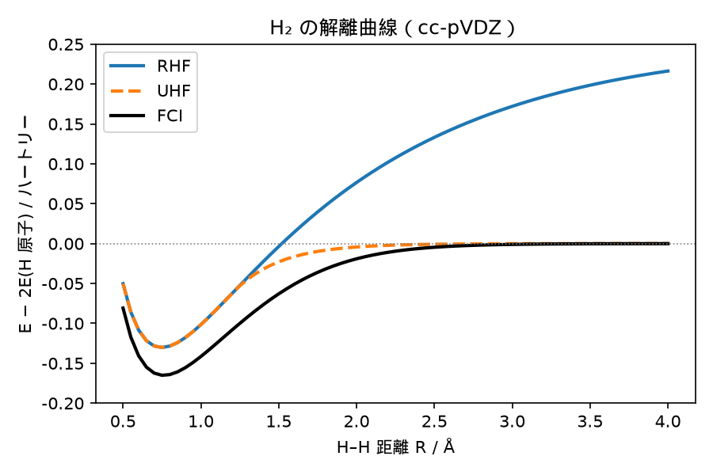

# 第 7 回　電子相関とは：動的相関と静的相関

!!! abstract "この回の道筋"
    Hartree–Fock 法（HF 法）で取りこぼすエネルギーを「相関エネルギー」と呼びます。この回では、その定義を確かめ、H₂ の解離を例に、HF 法がどこで、なぜ破綻するのかを計算で見ます。最後に、相関を「動的相関」と「静的相関」の二つに分けて考える見方を紹介します。

    | 節 | 内容 |
    |---|---|
    | 1 | 相関エネルギーの定義 |
    | 2 | H₂ の解離曲線を計算する |
    | 3 | RHF が解離で破綻する理由 |
    | 4 | UHF とスピン汚染 |
    | 5 | 動的相関と静的相関 |

    **前に読んでおく回**：[量子化学の理論 第 3 回](03-hartree-fock.md)、[第 5 回](05-spin.md)

この回では、エネルギーに原子単位（ハートリー，$E_\mathrm{h}$）を使います。換算は 1 $E_\mathrm{h}$ = 27.211 eV = 627.5 kcal/mol です。

## 1. 相関エネルギーの定義

HF 法では、波動関数を 1 個の Slater 決定子で表します。このとき各電子は、ほかの電子がつくる**平均の場**の中を動きます。ほかの電子が「いまどこにいるか」には反応しません。

このため、HF 法には次の性質があります。

- 同じ向きのスピンの電子どうしは、Pauli の原理のおかげで、互いに近づかないように動きます（Fermi 孔と呼びます）。これは決定子の反対称性から自動的に入ります。
- 逆向きのスピンの電子どうしは、互いの位置と無関係に動きます。実際の電子はクーロン反発で互いに避け合いますが、その避け合い（クーロン孔）が入りません。

電子が互いの位置に応じて動きを変えることを、**電子相関**（electron correlation）と呼びます。HF 法で欠けているのは、主にこの部分です。

Löwdin は、**相関エネルギー**（correlation energy）を、ハミルトニアンの厳密な固有値と、HF 近似で求めたエネルギーとの差として定義しました。この定義の経緯は、Löwdin 自身の総説にまとめられています [Löwdin 1995]。

$$
E_\mathrm{corr} = E_\mathrm{exact} - E_\mathrm{HF}
$$

ここで、$E_\mathrm{exact}$ は（相対論を入れない）電子のハミルトニアンの厳密な固有値、$E_\mathrm{HF}$ は基底関数を十分に大きくしたときの HF エネルギー（HF 極限）です。HF 法は変分法なので $E_\mathrm{HF} \ge E_\mathrm{exact}$ であり、$E_\mathrm{corr}$ は負になります。

実際の計算では、有限の基底関数を使います。そこで、同じ基底関数の中での差

$$
E_\mathrm{corr} = E_\mathrm{FCI} - E_\mathrm{HF}
$$

を相関エネルギーと呼ぶことが多いです。$E_\mathrm{FCI}$ は、その基底関数の中で Schrödinger 方程式を厳密に解いたエネルギーです（完全 CI、第 8 回で説明します）。

**ここまでで分かったこと**：相関エネルギーは、HF 法の平均場の近似で失われるエネルギーで、厳密なエネルギーと HF エネルギーの差として定義されます。

## 2. H₂ の解離曲線を計算する

相関エネルギーの大きさと、それが化学にどう効くかを、H₂ で見ます。PySCF [Sun 2020] で、H–H 距離 $R$ を変えながら次の三つを計算します。

- **RHF**（制限 HF）：α スピンと β スピンの電子に同じ空間軌道を使う HF 法です。
- **UHF**（非制限 HF）：α と β で別の空間軌道を使ってよい HF 法です [Pople 1954]。
- **FCI**：この基底関数の中での厳密解です。

基底関数は cc-pVDZ です（[第 6 回](06-basis-sets.md)を参照）。UHF は、RHF と同じ解に落ちることがあるので、安定性解析（`stability`）で、もっとエネルギーの低い解があるかを調べ、あればそちらへ移ります。

```python
from pyscf import gto, scf, fci

def uhf_lowest(mol):
    """UHF を解き、不安定なら（もっと低い解があれば）そちらへ移る。"""
    mf = scf.UHF(mol).run()
    for _ in range(10):
        mo, _, stable, _ = mf.stability(return_status=True)
        if stable:
            break
        mf.kernel(mf.make_rdm1(mo, mf.mo_occ))
    return mf

print(" R/Å    E(RHF)     E(UHF)    <S^2>    E(FCI)    E_corr")
for r in [0.74, 1.0, 1.2, 1.5, 2.0, 3.0, 5.0]:
    mol = gto.M(atom=f"H 0 0 0; H 0 0 {r}", basis="cc-pvdz", verbose=0)
    rhf = scf.RHF(mol).run()
    uhf = uhf_lowest(mol)
    s2 = uhf.spin_square()[0]
    e_fci = fci.FCI(rhf).kernel()[0]
    print(f"{r:4.2f} {rhf.e_tot:10.5f} {uhf.e_tot:10.5f} {s2:6.3f}"
          f" {e_fci:10.5f} {e_fci - rhf.e_tot:9.5f}")

h = gto.M(atom="H 0 0 0", basis="cc-pvdz", spin=1, verbose=0)
print("2 × E(H 原子) =", f"{2 * scf.UHF(h).run().e_tot:.5f}")
```

出力は次のとおりです（エネルギーの単位は $E_\mathrm{h}$。`E_corr` は FCI と RHF の差）。

```
 R/Å    E(RHF)     E(UHF)    <S^2>    E(FCI)    E_corr
0.74   -1.12870   -1.12870  0.000   -1.16337  -0.03467
1.00   -1.10015   -1.10015  0.000   -1.14007  -0.03992
1.20   -1.06111   -1.06111  0.000   -1.10686  -0.04574
1.50   -1.00219   -1.02138  0.583   -1.06153  -0.05934
2.00   -0.92191   -1.00278  0.904   -1.01759  -0.09569
3.00   -0.82645   -0.99872  0.995   -0.99955  -0.17310
5.00   -0.76204   -0.99856  1.000   -0.99856  -0.23652
2 × E(H 原子) = -0.99856
```

H 原子は電子が 1 個なので、UHF がそのまま厳密解です。したがって、十分に離れた H₂ の正しいエネルギーは $2E(\mathrm{H}) = -0.99856\ E_\mathrm{h}$ です。同じ計算を 0.05 Å 刻みで行い、この値を基準にして描いたのが次の図です。



表と図から、次の二つが読み取れます。

1. **平衡距離付近**（$R = 0.74$ Å）では、RHF と FCI の差は $-0.035\ E_\mathrm{h}$（約 22 kcal/mol）です。全エネルギーから見れば 3% ほどですが、結合エネルギーで見ると大きな差です。FCI の結合エネルギーは $-0.99856 - (-1.16337) = 0.165\ E_\mathrm{h}$（約 103 kcal/mol）なのに、RHF では $0.130\ E_\mathrm{h}$（約 82 kcal/mol）しかありません。
2. **解離の極限**では、RHF のエネルギーは $2E(\mathrm{H})$ に近づかず、どんどん高くなります。$R = 5$ Å での相関エネルギーは $-0.237\ E_\mathrm{h}$ で、平衡距離の 7 倍近くあります。

**ここまでで分かったこと**：平衡距離付近でも相関エネルギーは結合エネルギーの 2 割ほどを占めます。さらに、結合を切ると RHF は定性的に間違った答えを出します。

## 3. RHF が解離で破綻する理由

RHF が解離で破綻する理由は、最小基底（各 H 原子に 1s 軌道を 1 個だけ置く）で考えると分かります。原子 A と B の 1s 軌道を $a$、$b$ とします。結合性軌道は

$$
\sigma_g = \frac{a + b}{\sqrt{2(1+S)}}, \qquad S = \int a(\mathbf r)\, b(\mathbf r)\, d\mathbf r
$$

です。RHF の基底状態では、この $\sigma_g$ に 2 個の電子が逆向きのスピンで入ります。空間部分は $\sigma_g(1)\sigma_g(2)$ です。これを展開すると、次の式になります。

$$
\sigma_g(1)\sigma_g(2) = \frac{1}{2(1+S)} \Big[ \underbrace{a(1)b(2) + b(1)a(2)}_{\text{共有結合型}} + \underbrace{a(1)a(2) + b(1)b(2)}_{\text{イオン型}} \Big]
$$

イオン型の項は、2 個の電子が同じ原子の上にいる状態、つまり H⁻ と H⁺ の組です。RHF の波動関数では、どんな距離でも、共有結合型とイオン型が**同じ重み**で混ざっています。

結合距離では、これは大きな問題になりません。ところが原子が離れると、正しい状態は H + H、つまり共有結合型だけです。RHF はイオン型を半分含んだままなので、H⁻ + H⁺ のエネルギーが混ざり、エネルギーが高すぎます。距離 $R$ が有限のうちは H⁺ と H⁻ のクーロン引力が少し残るので、RHF の曲線は $R$ とともにゆっくり上がり続けます。表の RHF の値が $R = 5$ Å でもまだ上がっているのは、このためです。

どの距離でも共有結合型とイオン型を同じ重みで混ぜてしまうのは、「1 個の空間軌道に 2 個の電子を入れる」という RHF の形そのものが原因です。軌道をいくら最適化しても直りません。

**ここまでで分かったこと**：RHF の波動関数は、共有結合型とイオン型を常に同じ重みで含みます。そのため、結合を切った極限で、余分なイオン型の分だけエネルギーが高くなります。

## 4. UHF とスピン汚染

UHF では、α 電子と β 電子に別の空間軌道を使えます。原子が離れると、α 電子の軌道は原子 A に、β 電子の軌道は原子 B に寄っていきます。極限では、波動関数は「A に α 電子、B に β 電子」という決定子になり、イオン型を含みません。このため、表と図のとおり、UHF のエネルギーは $2E(\mathrm{H})$ に正しく近づきます。

近い距離では、UHF の最もエネルギーの低い解は RHF と同じ解です。距離を伸ばすと、ある距離から、α と β の軌道が分かれた、よりエネルギーの低い解が現れます。この分かれ目を **Coulson–Fischer 点**と呼びます [Coulson 1949]。今回の計算（cc-pVDZ）では、1.2 Å と 1.3 Å の間にありました。

UHF には代償があります。正しい H₂ の基底状態は一重項で、スピンの二乗の期待値は $\langle \hat S^2 \rangle = S(S+1) = 0$ です。ところが表の UHF では、$\langle \hat S^2 \rangle$ が距離とともに増え、極限で 1 になります。

極限の値が 1 になる理由は、次のとおりです。「A に α、B に β」の決定子は、一重項（$S = 0$）と三重項の $M_S = 0$ 成分（$S = 1$）を、ちょうど半分ずつ混ぜたものです。したがって

$$
\langle \hat S^2 \rangle = \frac12 \times 0 + \frac12 \times 1(1+1) = 1
$$

となります。このように、本来のスピン状態に別のスピン状態が混ざることを**スピン汚染**（spin contamination）と呼びます（$\hat S^2$ の扱いとスピン汚染の一般論は [第 5 回](05-spin.md) を参照）。

スピン汚染があると、UHF の波動関数は $\hat S^2$ の固有関数ではありません。エネルギーの曲線は正しい極限に近づいても、波動関数は一重項と三重項の混ざりものです。このため、スピン密度などの性質や、一重項と三重項のエネルギー差を議論するときには注意が必要です。また、図の UHF の曲線は FCI の曲線より上にあります。表のとおり、UHF と FCI の差は、2 Å までは 0.015 $E_\mathrm{h}$（約 9 kcal/mol）以上あり、3 Å を超えてようやく小さくなります。

**ここまでで分かったこと**：UHF は解離の極限のエネルギーを正しく与えますが、そのためにスピン対称性を破り、スピン汚染を起こします。1 個の決定子だけでは、正しいエネルギーと正しいスピンを両立できません。

## 5. 動的相関と静的相関

では、FCI の波動関数はどうなっているのでしょうか。FCI の波動関数を、HF の軌道でつくった決定子の和として書き、主な二つの係数を見ます。一つは $\sigma_g^2$（HF の決定子）、もう一つは 2 個の電子を反結合性軌道に移した $\sigma_u^2$ です。

```python
from pyscf import gto, scf, fci

for r in [0.74, 3.0]:
    mol = gto.M(atom=f"H 0 0 0; H 0 0 {r}", basis="cc-pvdz", verbose=0)
    rhf = scf.RHF(mol).run()
    e, ci = fci.FCI(rhf).kernel()
    print(f"R = {r} Å: c(σg²) = {ci[0, 0]:.3f}, c(σu²) = {ci[1, 1]:.3f}")
```

```
R = 0.74 Å: c(σg²) = 0.992, c(σu²) = -0.053
R = 3.0 Å: c(σg²) = 0.748, c(σu²) = -0.643
```

（`ci[i, j]` は、α 電子が $i$ 番目、β 電子が $j$ 番目の軌道にいる決定子の係数です。0 番目が $\sigma_g$、1 番目が $\sigma_u$ です。係数の符号は計算ごとに全体で反転することがあります。）

二つの距離で、FCI の波動関数の形はまったく違います。

- **$R = 0.74$ Å**：HF の決定子の係数が 0.99 で、波動関数はほぼ HF の決定子です。残りの小さな係数の決定子がたくさん集まって、相関エネルギー $-0.035\ E_\mathrm{h}$ を生みます。
- **$R = 3.0$ Å**：$\sigma_g^2$ と $\sigma_u^2$ が同じくらいの大きさで混ざります。最小基底で考えると、$\sigma_g^2 - \sigma_u^2$ の組み合わせではイオン型の項が打ち消し合い、共有結合型だけが残ります（付録 A）。1 個の決定子ではこれを表せないので、RHF は破綻しました。

この違いに対応して、電子相関を次の二つに分けて考えることがよくあります。

**動的相関**（dynamic correlation）は、電子どうしが近づいたときに互いを避ける動きによる相関です。HF の決定子が波動関数の大部分を占め、小さな係数の励起配置がたくさん集まってエネルギーを下げます。平衡構造の閉殻分子の相関は、ほとんどがこれです。

**静的相関**（static correlation、非動的相関とも呼びます）は、エネルギーの近い配置が複数あり、それらが大きな重みで混ざることによる相関です。結合の解離、ビラジカル、遷移金属錯体などで重要になります。1 個の決定子から出発すること自体が、定性的に間違っている状態です。

この区別は、どの手法を使うかの目安になります。動的相関には、1 個の決定子から出発する手法が向いています。第 8 回の CI、第 9 回の MP2、第 10 回の結合クラスター法がそうです。静的相関には、複数の配置を最初から扱う多参照の手法が必要です（第 12 回（準備中）の CASSCF など）。

ただし、二つの境界ははっきりしていません。H₂ の解離の途中（図の 1.5〜2 Å あたり）のように、両方が同時に大きい場合もあります。静的相関そのものにも、UHF で取り込める型と取り込めない型の二種類がある、という分析もあります [Hollett 2011]。動的・静的の区別は、厳密な定義ではなく、状況を整理するための見方だと考えてください。

**ここまでで分かったこと**：HF の決定子が波動関数の大部分を占め、小さな励起配置の寄与が多数集まるのが動的相関です。複数の配置が大きな重みで混ざるのが静的相関です。どちらが主かによって、使うべき手法が変わります。

## まとめ

- 相関エネルギーは $E_\mathrm{corr} = E_\mathrm{exact} - E_\mathrm{HF}$ と定義され、HF 法の平均場の近似で失われるエネルギーです。
- H₂（cc-pVDZ）の平衡距離では、相関エネルギーは約 22 kcal/mol で、結合エネルギーの 2 割ほどを占めます。
- RHF は共有結合型とイオン型を常に同じ重みで含むため、解離の極限でエネルギーが高すぎます。
- UHF は解離の極限のエネルギーを正しく与えますが、スピン汚染を起こします。
- 電子相関は、動的相関（多数の小さな寄与）と静的相関（少数の配置の強い混ざり合い）に分けて考えると、手法を選ぶ目安になります。

## 付録 A　最小基底の H₂ で $\sigma_g^2$ と $\sigma_u^2$ を混ぜる

反結合性軌道は $\sigma_u = (a - b)/\sqrt{2(1-S)}$ です。本文と同じように展開すると、

$$
\sigma_u(1)\sigma_u(2) = \frac{1}{2(1-S)} \Big[ a(1)a(2) + b(1)b(2) - a(1)b(2) - b(1)a(2) \Big]
$$

となります。共有結合型の項の符号が、$\sigma_g(1)\sigma_g(2)$ と逆です。

原子が十分に離れて $S \to 0$ となる極限で、二つの差をとります。

$$
\frac{1}{\sqrt 2}\Big[\sigma_g(1)\sigma_g(2) - \sigma_u(1)\sigma_u(2)\Big] \;\to\; \frac{1}{\sqrt 2}\Big[a(1)b(2) + b(1)a(2)\Big]
$$

イオン型の項は打ち消し合い、共有結合型（Heitler–London 型）の関数だけが残ります。したがって、解離の極限の正しい一重項は、$\sigma_g^2$ と $\sigma_u^2$ の二つの配置を、同じ大きさ・逆の符号で混ぜたものです。本文の $R = 3.0$ Å の FCI の係数（0.748 と −0.643）は、この極限に近づく途中の値です。

（スピン部分はどちらの配置も一重項の $[\alpha(1)\beta(2) - \beta(1)\alpha(2)]/\sqrt 2$ で共通なので、空間部分だけを比べれば十分です。）

## 参考文献

- A. Szabo, N. S. Ostlund, "Modern Quantum Chemistry" (Dover, 1996). ISBN: 9780486691862
- T. Helgaker, P. Jørgensen, J. Olsen, "Molecular Electronic-Structure Theory" (Wiley, 2000). ISBN: 9780471967552
- P.-O. Löwdin, "The historical development of the electron correlation problem", Int. J. Quantum Chem. 55, 77 (1995). DOI: [10.1002/qua.560550203](https://doi.org/10.1002/qua.560550203)
- J. A. Pople, R. K. Nesbet, "Self-Consistent Orbitals for Radicals", J. Chem. Phys. 22, 571 (1954). DOI: [10.1063/1.1740120](https://doi.org/10.1063/1.1740120)
- C. A. Coulson, I. Fischer, "XXXIV. Notes on the molecular orbital treatment of the hydrogen molecule", Philos. Mag. 40, 386 (1949). DOI: [10.1080/14786444908521726](https://doi.org/10.1080/14786444908521726)
- J. W. Hollett, P. M. W. Gill, "The two faces of static correlation", J. Chem. Phys. 134, 114111 (2011). DOI: [10.1063/1.3570574](https://doi.org/10.1063/1.3570574)
- Q. Sun et al., "Recent developments in the PySCF program package", J. Chem. Phys. 153, 024109 (2020). DOI: [10.1063/5.0006074](https://doi.org/10.1063/5.0006074)
