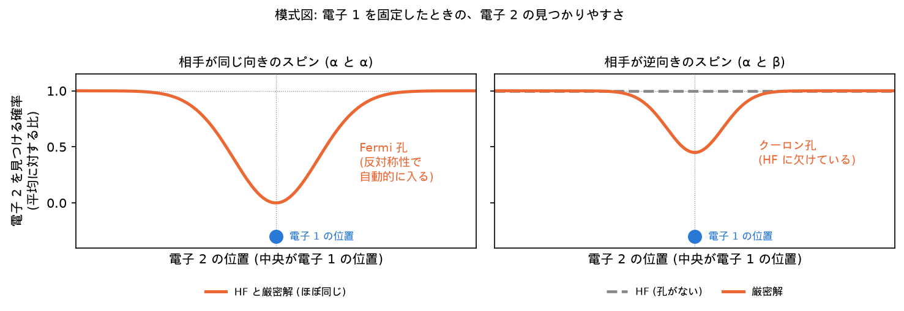
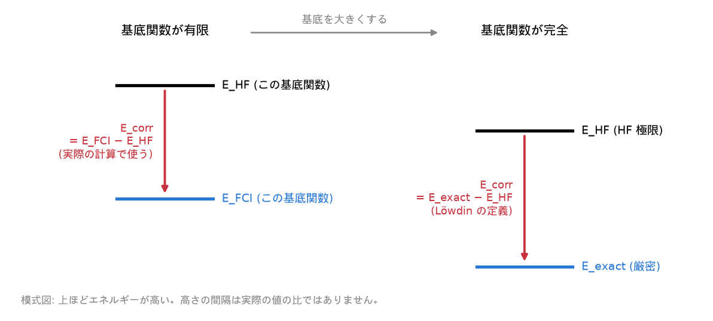
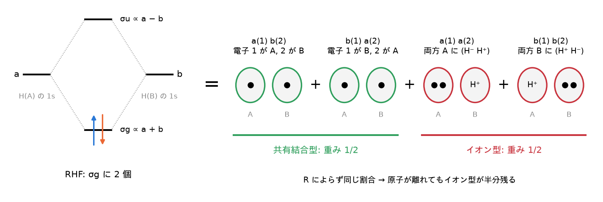
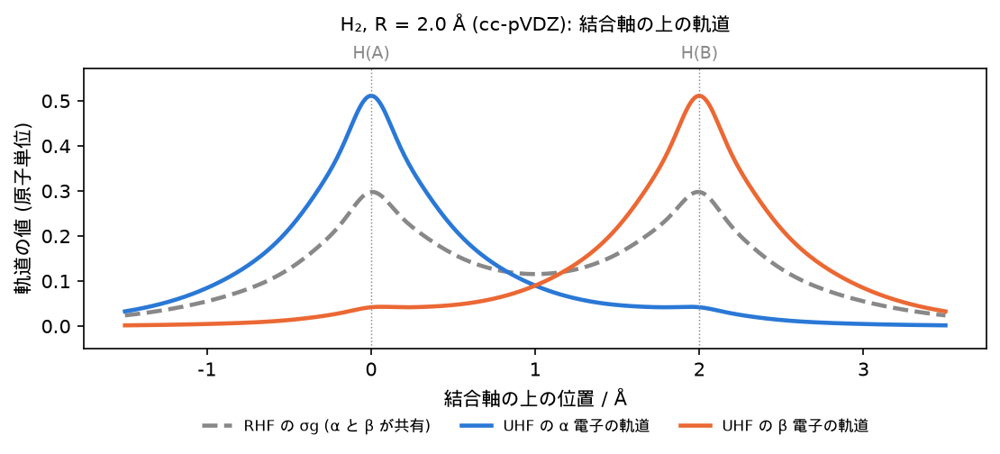
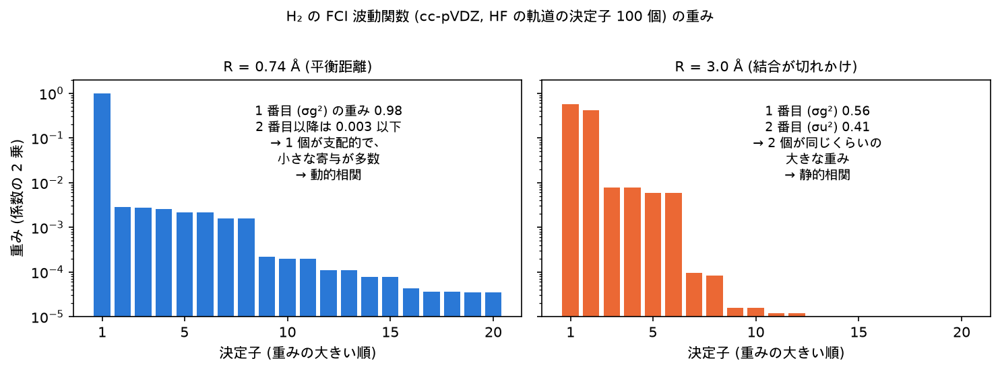
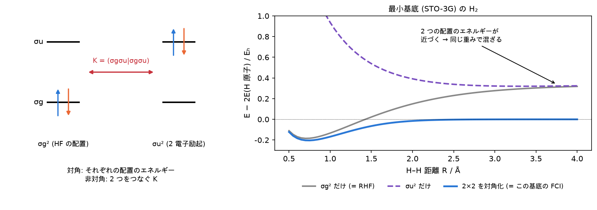

# 第 7 回　電子相関とは：動的相関と静的相関

!!! abstract "この回の道筋"
    Hartree–Fock 法（HF 法）で取りこぼすエネルギーを「相関エネルギー」と呼びます。この回では、その定義を確かめ、H₂ の解離を例に、HF 法がどこで、なぜ破綻するのかを計算で見ます。最後に、相関を「動的相関」と「静的相関」の二つに分けて考える見方を、2 つの配置の 2×2 行列を使って説明します。

    | 節 | 内容 |
    |---|---|
    | 1 | 相関エネルギーの定義 |
    | 2 | H₂ の解離曲線を計算する |
    | 3 | RHF が解離で破綻する理由 |
    | 4 | UHF とスピン汚染 |
    | 5 | 動的相関と静的相関 |

    **前に読んでおく回**：[量子化学の理論 第 3 回](03-hartree-fock.md)、[第 4 回](04-second-quantization.md)、[第 5 回](05-spin.md)

!!! tip "物理的なイメージ"
    相関エネルギーが表しているのは、電子どうしが瞬間ごとに避け合う動きによるエネルギーの低下です。HF 法では、各電子はほかの電子の平均の電場しか感じないので、相手がどこにいるかに合わせて避けることができません。避け方には 2 種類あると考えると便利です。近づいた電子が短い距離で互いを避ける「動的相関」と、H₂ の解離のように、電子の入り方（配置）そのものが一つに決められない「静的相関」です。前者は小さな補正の積み重ね、後者は出発点そのものの作り直しが必要になります。

この回では、エネルギーに原子単位（ハートリー，$E_\mathrm{h}$）を使います。換算は 1 $E_\mathrm{h}$ = 27.211 eV = 627.5 kcal/mol です。

## 1. 相関エネルギーの定義

### 1.1 HF 法に欠けているもの

HF 法では、波動関数を 1 個の Slater 決定子で表します（第 2 回、第 3 回）。このとき各電子は、ほかの電子がつくる**平均の場**の中を動きます。ほかの電子が「いまどこにいるか」には反応しません。

このため、HF 法には次の性質があります。

- **同じ向きのスピンの電子どうし**は、互いに近づかないように動きます。決定子は電子の入れ替えで符号を変える（反対称）ので、同じスピンの 2 個の電子が同じ場所にいる確率は 0 になるからです。電子の周りにできるこの「近づけない領域」を **Fermi 孔**（Fermi hole）と呼びます。
- **逆向きのスピンの電子どうし**は、互いの位置と無関係に動きます。実際の電子はクーロン反発で互いに避け合い、相手の周りに「近づきにくい領域」をつくります。これを**クーロン孔**（Coulomb hole）と呼びますが、HF 法にはこれが入りません。



**図 1**　電子 1 を中央に固定したとき、電子 2 がどこに見つかりやすいかの模式図（縦軸は、相手がいないときの平均に対する比）。左：同じスピンの相手は、HF でも厳密解でも、電子 1 の近くでは確率が 0 に落ちます（Fermi 孔）。右：逆スピンの相手は、HF（灰の破線）では電子 1 がどこにいても確率が変わりませんが、厳密解（橙）では電子 1 の近くで確率が下がります（クーロン孔）。HF 法に欠けているのは、右の図の灰の線と橙の線の差です。

電子が互いの位置に応じて動きを変えることを、**電子相関**（electron correlation）と呼びます。HF 法で欠けているのは、主に図 1 の右の、逆スピンの電子の避け合いです。

### 1.2 相関エネルギー

Löwdin は、**相関エネルギー**（correlation energy）を、ハミルトニアンの厳密な固有値と、HF 近似で求めたエネルギーとの差として定義しました。この定義の経緯は、Löwdin 自身の総説にまとめられています [Löwdin 1995]。

$$
E_\mathrm{corr} = E_\mathrm{exact} - E_\mathrm{HF}
$$

ここで、$E_\mathrm{exact}$ は（相対論を入れない）電子のハミルトニアンの厳密な固有値、$E_\mathrm{HF}$ は基底関数を十分に大きくしたときの HF エネルギー（HF 極限）です。

$E_\mathrm{corr}$ の符号は、変分原理（第 3 回）から決まります。HF の決定子は、厳密な波動関数を近似する試行関数の一つです。試行関数のエネルギーは、厳密な基底状態のエネルギーより下がりません。したがって $E_\mathrm{HF} \ge E_\mathrm{exact}$ で、$E_\mathrm{corr} \le 0$ です。

実際の計算では、有限の基底関数を使います。そこで、同じ基底関数の中での差

$$
E_\mathrm{corr} = E_\mathrm{FCI} - E_\mathrm{HF}
$$

を相関エネルギーと呼ぶことが多いです。$E_\mathrm{FCI}$ は、その基底関数の中で Schrödinger 方程式を厳密に解いたエネルギーです（完全 CI、[第 8 回](08-configuration-interaction.md)で説明します）。この回で「相関エネルギー」と書くときは、こちらの意味です。



**図 2**　相関エネルギーの 2 つの定義の模式図。左の列は、実際に使う有限の基底関数での HF と FCI、右の列は、基底関数を完全にした極限での HF と厳密解です。どちらの列でも、赤の矢印（HF から相関を入れた値までの差）が相関エネルギーです。基底関数を大きくすると、どちらのエネルギーも下がります。

**ここまでで分かったこと**：相関エネルギーは、HF 法の平均場の近似で失われるエネルギーで、厳密なエネルギーと HF エネルギーの差として定義されます。HF に欠けているのは、主に逆スピンの電子がクーロン反発で避け合う動き（クーロン孔）です。

## 2. H₂ の解離曲線を計算する

相関エネルギーの大きさと、それが化学にどう効くかを、H₂ で見ます。PySCF [Sun 2020] で、H–H 距離 $R$ を変えながら次の三つを計算します。

- **RHF**（制限 HF）：α スピンと β スピンの電子に同じ空間軌道を使う HF 法です。
- **UHF**（非制限 HF）：α と β で別の空間軌道を使ってよい HF 法です [Pople 1954]。
- **FCI**：この基底関数の中での厳密解です。

基底関数は cc-pVDZ です（[第 6 回](06-basis-sets.md)を参照）。UHF は、RHF と同じ解に落ちることがあります。そこで**安定性解析**（`stability`）を行います。これは、得られた解から軌道を少しずつ回したときに、エネルギーが下がる向きがあるかを調べる計算です。下がる向きがあれば、その向きへ移って解き直します。

```python
from pyscf import gto, scf, fci

def uhf_lowest(mol):
    """UHF を解き、不安定なら（もっと低い解があれば）そちらへ移る。"""
    mf = scf.UHF(mol).run()
    for _ in range(10):
        mo, _, stable, _ = mf.stability(return_status=True)
        if stable:
            break
        mf.kernel(mf.make_rdm1(mo, mf.mo_occ))
    return mf

print(" R/Å    E(RHF)     E(UHF)    <S^2>    E(FCI)    E_corr")
for r in [0.74, 1.0, 1.2, 1.5, 2.0, 3.0, 5.0]:
    mol = gto.M(atom=f"H 0 0 0; H 0 0 {r}", basis="cc-pvdz", verbose=0)
    rhf = scf.RHF(mol).run()
    uhf = uhf_lowest(mol)
    s2 = uhf.spin_square()[0]
    e_fci = fci.FCI(rhf).kernel()[0]
    print(f"{r:4.2f} {rhf.e_tot:10.5f} {uhf.e_tot:10.5f} {s2:6.3f}"
          f" {e_fci:10.5f} {e_fci - rhf.e_tot:9.5f}")

h = gto.M(atom="H 0 0 0", basis="cc-pvdz", spin=1, verbose=0)
print("2 × E(H 原子) =", f"{2 * scf.UHF(h).run().e_tot:.5f}")
```

出力は次のとおりです（エネルギーの単位は $E_\mathrm{h}$。`E_corr` は FCI と RHF の差）。

```
 R/Å    E(RHF)     E(UHF)    <S^2>    E(FCI)    E_corr
0.74   -1.12870   -1.12870  0.000   -1.16337  -0.03467
1.00   -1.10015   -1.10015  0.000   -1.14007  -0.03992
1.20   -1.06111   -1.06111  0.000   -1.10686  -0.04574
1.50   -1.00219   -1.02138  0.583   -1.06153  -0.05934
2.00   -0.92191   -1.00278  0.904   -1.01759  -0.09569
3.00   -0.82645   -0.99872  0.995   -0.99955  -0.17310
5.00   -0.76204   -0.99856  1.000   -0.99856  -0.23652
2 × E(H 原子) = -0.99856
```

H 原子は電子が 1 個なので、電子どうしの反発がなく、UHF がそのまま厳密解です。したがって、十分に離れた H₂ の正しいエネルギーは $2E(\mathrm{H}) = -0.99856\ E_\mathrm{h}$ です。同じ計算を 0.05 Å 刻みで行い、この値を基準にして描いたのが図 3 です。


**図 3**　H₂ の解離曲線（cc-pVDZ）。縦軸は、離れた H 原子 2 個のエネルギーを 0 としたものです。FCI（黒）は、距離を伸ばすと 0 に近づきます。RHF（青）は、平衡距離でも FCI より上にあり、距離を伸ばすと 0 を超えて上がり続けます。UHF（橙の破線）は、1.2 Å 付近までは RHF と重なり、そこから RHF と分かれて 0 に近づきます。

表と図 3 から、次の二つが読み取れます。

1. **平衡距離付近**（$R = 0.74$ Å）では、RHF と FCI の差は $-0.035\ E_\mathrm{h}$（約 22 kcal/mol）です。全エネルギーから見れば 3% ほどですが、結合エネルギーで見ると大きな差です。結合エネルギーは「離れた H 原子 2 個のエネルギー − 平衡距離のエネルギー」なので、次のように計算できます。
    - FCI：$-0.99856 - (-1.16337) = 0.16481\ E_\mathrm{h}$（約 103 kcal/mol）
    - RHF：$-0.99856 - (-1.12870) = 0.13014\ E_\mathrm{h}$（約 82 kcal/mol）

    差の $0.035\ E_\mathrm{h}$ は、FCI の結合エネルギーの 21% にあたります。
2. **解離の極限**では、RHF のエネルギーは $2E(\mathrm{H})$ に近づかず、どんどん高くなります。$R = 5$ Å での相関エネルギーは $-0.237\ E_\mathrm{h}$ で、平衡距離の 7 倍近くあります。

**ここまでで分かったこと**：平衡距離付近でも、相関エネルギーは結合エネルギーの 2 割ほどを占めます。さらに、結合を切ると RHF は定性的に間違った答えを出します。

## 3. RHF が解離で破綻する理由

### 3.1 σg² を原子の軌道で展開する

RHF が解離で破綻する理由は、最小基底（各 H 原子に 1s 軌道を 1 個だけ置く）で考えると分かります。原子 A と B の 1s 軌道を $a$、$b$ とします（それぞれ規格化されているとします）。二つの重なりを $S = \int a(\mathbf r)\, b(\mathbf r)\, d\mathbf r$ とすると、結合性軌道と反結合性軌道は

$$
\sigma_g = \frac{a + b}{\sqrt{2(1+S)}}, \qquad
\sigma_u = \frac{a - b}{\sqrt{2(1-S)}}
$$

です（分母は規格化の定数です）。RHF の基底状態では、$\sigma_g$ に 2 個の電子が逆向きのスピンで入ります。スピン部分は一重項の $[\alpha(1)\beta(2) - \beta(1)\alpha(2)]/\sqrt 2$ で、空間部分は $\sigma_g(1)\sigma_g(2)$ です。この空間部分を、原子の軌道で展開します。

まず、$\sigma_g$ の式を 2 個の電子の座標に入れます。

$$
\sigma_g(1)\sigma_g(2) = \frac{1}{2(1+S)} \big[a(1) + b(1)\big]\big[a(2) + b(2)\big]
$$

次に、かっこの積を展開します。

$$
\sigma_g(1)\sigma_g(2) = \frac{1}{2(1+S)} \Big[ a(1)a(2) + a(1)b(2) + b(1)a(2) + b(1)b(2) \Big]
$$

最後に、4 つの項を意味で 2 組に並べ替えます。

$$
\sigma_g(1)\sigma_g(2) = \frac{1}{2(1+S)} \Big[ \underbrace{a(1)b(2) + b(1)a(2)}_{\text{共有結合型}} + \underbrace{a(1)a(2) + b(1)b(2)}_{\text{イオン型}} \Big]
$$

$a(1)b(2)$ は「電子 1 が A に、電子 2 が B にいる」状態です。最初の 2 項は、各原子に電子が 1 個ずついる**共有結合型**の項です。後の 2 項は、2 個の電子が同じ原子の上にいる状態、つまり H⁻ と H⁺ の組で、**イオン型**の項と呼びます。

### 3.2 イオン型の重みが変わらない

上の式では、共有結合型とイオン型の係数が、どんな距離でも同じです。原子が離れて $S \to 0$ になると、二つの組はそれぞれ $\sqrt 2$ で規格化され、

$$
\sigma_g(1)\sigma_g(2) \;\to\; \frac{1}{\sqrt 2} \cdot \underbrace{\frac{a(1)b(2) + b(1)a(2)}{\sqrt 2}}_{\text{共有結合型}} + \frac{1}{\sqrt 2} \cdot \underbrace{\frac{a(1)a(2) + b(1)b(2)}{\sqrt 2}}_{\text{イオン型}}
$$

となります。係数の 2 乗が重みなので、共有結合型とイオン型の重みは $1/2$ ずつです。



**図 4**　左：最小基底の H₂ の軌道の準位図。原子の 1s 軌道 $a$、$b$ から、結合性の $\sigma_g$ と反結合性の $\sigma_u$ ができ、RHF では $\sigma_g$ に α 電子（青）と β 電子（橙）が 1 個ずつ入ります（係数の規格化の定数は省いています）。右：その空間部分を原子の軌道で展開した 4 つの項。丸が原子、黒い点が電子です。緑の 2 項（各原子に 1 個ずつ）と赤の 2 項（片方に 2 個）が、同じ重みで入っています。

結合距離では、これは大きな問題になりません。2 個の電子が同じ原子の近くにいることも、実際にある程度は起こるからです。ところが原子が離れると、正しい状態は H + H、つまり共有結合型だけです。RHF はイオン型を半分含んだままなので、H⁻ + H⁺ のエネルギーが混ざり、エネルギーが高すぎます。距離 $R$ が有限のうちは、H⁺ と H⁻ のクーロン引力が少し残ります。そのため RHF の曲線は、$R$ とともにゆっくり上がり続けます。表の RHF の値が $R = 5$ Å でもまだ上がっているのは、このためです。

1 節の「避け合い」の言葉で言うと、RHF の電子は、相手の電子が A にいても B にいても、自分の居場所の確率を変えません。そのため、2 個が同じ原子に乗る確率が、離れた距離でも $1/2$ のまま残ります。本当の電子は、相手が A にいれば自分は B へ行くように、互いの位置に合わせて動きます。

どの距離でも共有結合型とイオン型を同じ重みで混ぜてしまうのは、「1 個の空間軌道に 2 個の電子を入れる」という RHF の形そのものが原因です。軌道をいくら最適化しても直りません。

**ここまでで分かったこと**：RHF の波動関数は、共有結合型とイオン型を常に同じ重みで含みます。そのため、結合を切った極限で、余分なイオン型の分だけエネルギーが高くなります。

## 4. UHF とスピン汚染

### 4.1 UHF は電子を左右に分ける

UHF では、α 電子と β 電子に別の空間軌道を使えます。原子が離れると、α 電子の軌道は原子 A に、β 電子の軌道は原子 B に寄っていきます（図 5）。極限では、波動関数は「A に α 電子、B に β 電子」という決定子になり、イオン型を含みません。このため、表と図 3 のとおり、UHF のエネルギーは $2E(\mathrm{H})$ に正しく近づきます。



**図 5**　$R = 2.0$ Å の H₂（cc-pVDZ）で、結合軸の上の軌道の値を描いたもの。灰の破線は RHF の $\sigma_g$ で、2 個の原子に均等に広がり、α 電子と β 電子が共有します。UHF では、α 電子の軌道（青）が A に、β 電子の軌道（橙）が B に寄っています。片方の電子が A にいれば、もう片方は B にいやすくなるので、イオン型の配置が減ります。

近い距離では、UHF の最もエネルギーの低い解は RHF と同じ解です。距離を伸ばすと、ある距離から、α と β の軌道が分かれた、よりエネルギーの低い解が現れます。この分かれ目を **Coulson–Fischer 点**と呼びます [Coulson 1949]。今回の計算（cc-pVDZ）では、1.2 Å と 1.3 Å の間にありました。

### 4.2 スピン汚染

UHF には代償があります。正しい H₂ の基底状態は一重項で、スピンの二乗の期待値は $\langle \hat S^2 \rangle = S(S+1) = 0$ です。ところが表の UHF では、$\langle \hat S^2 \rangle$ が距離とともに増え、極限で 1 になります。

極限の値が 1 になる理由は、次のとおりです。「A に α、B に β」の決定子は、一重項（$S = 0$）と三重項の $M_S = 0$ 成分（$S = 1$）を、ちょうど半分ずつ混ぜたものです（この分解は付録 B で 1 段ずつ示します）。一重項の $\langle \hat S^2 \rangle$ は $0 \times (0 + 1) = 0$、三重項は $1 \times (1 + 1) = 2$ です。重み $1/2$ ずつで平均をとると、

$$
\langle \hat S^2 \rangle = \frac12 \times 0 + \frac12 \times 2 = 1
$$

となります。このように、本来のスピン状態に別のスピン状態が混ざることを**スピン汚染**（spin contamination）と呼びます（$\hat S^2$ の扱いとスピン汚染の一般論は [第 5 回](05-spin.md) を参照）。

スピン汚染があると、UHF の波動関数は $\hat S^2$ の固有関数ではありません。エネルギーの曲線は正しい極限に近づいても、波動関数は一重項と三重項の混ざりものです。このため、スピン密度などの性質や、一重項と三重項のエネルギー差を議論するときには注意が必要です。

また、図 3 の UHF の曲線は FCI の曲線より上にあります。表のとおり、UHF と FCI の差は、2 Å までは 0.015 $E_\mathrm{h}$（約 9 kcal/mol）以上あり、3 Å を超えてようやく小さくなります。

**ここまでで分かったこと**：UHF は、α 電子と β 電子を別々の原子に寄せることで、解離の極限のエネルギーを正しく与えます。その代わりにスピン対称性を破り、スピン汚染を起こします。1 個の決定子だけでは、正しいエネルギーと正しいスピンを両立できません。

## 5. 動的相関と静的相関

### 5.1 FCI の波動関数を見る

では、FCI の波動関数はどうなっているのでしょうか。FCI の波動関数を、RHF の軌道でつくった決定子の和として書き、主な二つの係数を見ます。一つは $\sigma_g^2$（HF の決定子）、もう一つは 2 個の電子を反結合性軌道に移した $\sigma_u^2$ です。

```python
from pyscf import gto, scf, fci

for r in [0.74, 3.0]:
    mol = gto.M(atom=f"H 0 0 0; H 0 0 {r}", basis="cc-pvdz", verbose=0)
    rhf = scf.RHF(mol).run()
    e, ci = fci.FCI(rhf).kernel()
    print(f"R = {r} Å: c(σg²) = {ci[0, 0]:.3f}, c(σu²) = {ci[1, 1]:.3f}")
```

```
R = 0.74 Å: c(σg²) = 0.992, c(σu²) = -0.053
R = 3.0 Å: c(σg²) = 0.748, c(σu²) = -0.643
```

`ci[i, j]` は、α 電子が $i$ 番目、β 電子が $j$ 番目の軌道にいる決定子の係数です。0 番目の軌道が $\sigma_g$、1 番目が $\sigma_u$ です。係数の符号は、計算ごとに全体で反転することがあります。

cc-pVDZ では空間軌道が 10 個あるので、α 電子 1 個と β 電子 1 個の決定子は $10 \times 10 = 100$ 個です。その全部の係数の 2 乗（重み）を、大きい順に並べたのが図 6 です。



**図 6**　H₂ の FCI 波動関数の、決定子ごとの重み（係数の 2 乗、縦軸は対数）。上位 20 個を示します。左（平衡距離）：$\sigma_g^2$ の重みが 0.98 で、残りの決定子の重みはどれも 0.003 以下です。右（3.0 Å）：$\sigma_g^2$ と $\sigma_u^2$ の 2 個が 0.56 と 0.41 で、同じくらいの大きさです。

二つの距離で、FCI の波動関数の形はまったく違います。

- **$R = 0.74$ Å**：HF の決定子の係数が 0.99 で、波動関数はほぼ HF の決定子です。残りの小さな係数の決定子がたくさん集まって、相関エネルギー $-0.035\ E_\mathrm{h}$ を生みます。
- **$R = 3.0$ Å**：$\sigma_g^2$ と $\sigma_u^2$ が同じくらいの大きさで混ざります。最小基底で考えると、$\sigma_g^2 - \sigma_u^2$ の組み合わせでは、イオン型の項が打ち消し合い、共有結合型だけが残ります（付録 A）。1 個の決定子ではこれを表せないので、RHF は破綻しました。

### 5.2 2 つの配置の 2×2 行列

なぜ距離によって混ざり方がこれほど違うのかを、最小基底（STO-3G）の H₂ で、2 行 2 列の行列を使って見ます。最小基底では空間軌道が $\sigma_g$ と $\sigma_u$ の 2 個だけです。

一重項の基底状態に混ざりうるのは、$\sigma_g^2$ と $\sigma_u^2$ の 2 つの配置だけです。電子を 1 個だけ $\sigma_g$ から $\sigma_u$ に移した配置は混ざりません。$\sigma_g$ は分子の中心に対して対称（g）、$\sigma_u$ は反対称（u）なので、その配置は全体として u の対称性をもち、g の対称性の $\sigma_g^2$ とはハミルトニアンでつながらないからです。

そこで、2 つの配置を基底にしてハミルトニアンの行列を書きます。軌道は実数とし、記号を次のように決めます。

- $h_{pp}$：軌道 $p$ の 1 電子積分（運動エネルギーと核の引力）
- $(pq|rs)$：空間軌道の 2 電子積分（化学者の表記）

対角要素は、第 3 回の閉殻の決定子のエネルギーの式から、$E(\sigma_g^2) = 2h_{gg} + (gg|gg)$、$E(\sigma_u^2) = 2h_{uu} + (uu|uu)$ です。非対角要素は、2 つの決定子が 2 個のスピン軌道で違う場合の Slater–Condon 則（第 4 回 5 節の表の 3 行目）から、$K = (gu|gu)$ です。並べて書くと、

$$
\mathbf H =
\begin{pmatrix}
E(\sigma_g^2) & K \\
K & E(\sigma_u^2)
\end{pmatrix}
\begin{matrix} \leftarrow \sigma_g^2 \\ \leftarrow \sigma_u^2 \end{matrix}
$$

です。PySCF で積分を計算して値を入れると、次のようになります（電子部分のエネルギーで、核間の反発は含めていません。単位は $E_\mathrm{h}$）。

$$
R = 0.74\ \text{Å}:\quad
\mathbf H = \begin{pmatrix} -1.83186 & 0.18121 \\ 0.18121 & -0.25249 \end{pmatrix}
$$

$$
R = 3.0\ \text{Å}:\quad
\mathbf H = \begin{pmatrix} -0.83244 & 0.29921 \\ 0.29921 & -0.78750 \end{pmatrix}
$$

0.74 Å の行列は、第 4 回 6 節で組み立てた 4×4 の行列の、$|1\alpha\,1\beta\rangle$ と $|2\alpha\,2\beta\rangle$ の部分と同じです。二つの距離で違うのは、対角要素の差です。0.74 Å では 2 つの配置のエネルギーが 1.58 $E_\mathrm{h}$ も離れていますが、3.0 Å では 0.045 $E_\mathrm{h}$ しか離れていません。

この行列の最も低い固有値を求めます。$\sigma_g^2$ のエネルギーを基準にとり、相関エネルギーを $\varepsilon = E - E(\sigma_g^2)$、配置のエネルギーの差の半分を $\Delta = [E(\sigma_u^2) - E(\sigma_g^2)]/2$ と書きます。固有値の条件 $\det(\mathbf H - E\mathbf 1) = 0$ は、

$$
\begin{vmatrix} -\varepsilon & K \\ K & 2\Delta - \varepsilon \end{vmatrix} = 0
$$

です。行列式を展開すると、

$$
-\varepsilon\,(2\Delta - \varepsilon) - K^2 = 0
$$

です。整理すると、$\varepsilon$ の 2 次方程式になります。

$$
\varepsilon^2 - 2\Delta\,\varepsilon - K^2 = 0
$$

2 つの解のうち、低いほう（基底状態）は

$$
\varepsilon = \Delta - \sqrt{\Delta^2 + K^2}
$$

です。固有ベクトル $(c_g, c_u)$ は、行列の 1 行目の式 $-\varepsilon\, c_g + K c_u = 0$ から、$c_u / c_g = \varepsilon / K$ です。

値を入れて確かめます。

| | $\Delta$ | $K$ | $\varepsilon$ | $c_u / c_g$ | 規格化した $(c_g, c_u)$ |
|---|---|---|---|---|---|
| 0.74 Å | 0.78969 | 0.18121 | −0.02052 | −0.113 | (0.994, −0.113) |
| 3.0 Å | 0.02247 | 0.29921 | −0.27758 | −0.928 | (0.733, −0.680) |

$\varepsilon$ は、この基底の FCI の相関エネルギーと一致します（この基底では、この 2×2 行列が FCI そのものだからです）。



**図 7**　左：2 つの配置 $\sigma_g^2$ と $\sigma_u^2$ と、それらをつなぐ非対角要素 $K$。右：最小基底の H₂ で、各配置だけのエネルギー（行列の対角要素に核間の反発を足したもの）と、2×2 を対角化したエネルギー。灰の線（$\sigma_g^2$ だけ、つまり RHF）と紫の破線（$\sigma_u^2$ だけ）は、距離を伸ばすと近づきます。二つが近づくほど、対角化したエネルギー（青）は灰の線から大きく下がります。

$\Delta$ と $K$ の大小で、二つの場合に分かれます。

- **$\Delta \gg |K|$ のとき**（0.74 Å）：平方根を $\sqrt{\Delta^2 + K^2} \approx \Delta + K^2/(2\Delta)$ と近似できるので、$\varepsilon \approx -K^2/(2\Delta)$ です。値を入れると $-0.18121^2 / 1.57938 = -0.0208$ で、厳密な $-0.0205$ に近くなります。係数の比 $c_u/c_g \approx -K/(2\Delta)$ も小さく、$\sigma_u^2$ は少しだけ混ざります。相関エネルギーは「つながりの強さの 2 乗 ÷ エネルギー差」の形で、これは第 9 回の摂動論の 2 次のエネルギーと同じ形です。
- **$\Delta \to 0$ のとき**（3.0 Å 以上）：$\varepsilon \to -|K|$、$c_u/c_g \to -1$ です。2 つの配置が同じ重みで混ざり、どちらか一方を出発点に選ぶことはできません。

$\Delta$ が小さくなるのは、原子が離れると、$\sigma_u^2$ も $\sigma_g^2$ と同じく、共有結合型とイオン型を半分ずつ含むようになり（付録 A）、二つのエネルギーが等しくなるからです。

### 5.3 二つの相関

ここまでの違いに対応して、電子相関を次の二つに分けて考えることがよくあります。

**動的相関**（dynamic correlation）は、電子どうしが近づいたときに互いを避ける動きによる相関です。図 1 のクーロン孔をつくる動きにあたります。HF の決定子が波動関数の大部分を占め、小さな係数の励起配置がたくさん集まってエネルギーを下げます（図 6 の左）。一つ一つの配置は、5.2 節の $\Delta \gg |K|$ の場合のように少しだけ混ざります。平衡構造の閉殻分子の相関は、ほとんどがこれです。

**静的相関**（static correlation、非動的相関とも呼びます）は、エネルギーの近い配置が複数あり、それらが大きな重みで混ざることによる相関です（図 6 の右、5.2 節の $\Delta \to 0$ の場合）。結合の解離、ビラジカル、遷移金属錯体などで重要になります。1 個の決定子から出発すること自体が、定性的に間違っている状態です。

この区別は、どの手法を使うかの目安になります。動的相関には、1 個の決定子から出発する手法が向いています。第 8 回の CI、第 9 回の MP2、第 10 回の結合クラスター法がそうです。静的相関には、複数の配置を最初から扱う多参照の手法が必要です（[第 12 回](12-casscf.md)の CASSCF など）。

ただし、二つの境界ははっきりしていません。H₂ の解離の途中（図 3 の 1.5〜2 Å あたり）のように、両方が同時に大きい場合もあります。静的相関そのものにも、UHF で取り込める型と取り込めない型の二種類がある、という分析もあります [Hollett 2011]。動的・静的の区別は、厳密な定義ではなく、状況を整理するための見方だと考えてください。

**ここまでで分かったこと**：HF の決定子が波動関数の大部分を占め、小さな励起配置の寄与が多数集まるのが動的相関です。複数の配置が大きな重みで混ざるのが静的相関です。2×2 の行列で見ると、配置のエネルギー差 $2\Delta$ がつながり $K$ より十分大きいかどうかで、二つが分かれます。

## まとめ

- 相関エネルギーは $E_\mathrm{corr} = E_\mathrm{exact} - E_\mathrm{HF}$ と定義され、HF 法の平均場の近似で失われるエネルギーです。主に、逆スピンの電子がクーロン反発で避け合う動きが欠けています。
- H₂（cc-pVDZ）の平衡距離では、相関エネルギーは約 22 kcal/mol で、結合エネルギーの 2 割ほどを占めます。
- RHF は共有結合型とイオン型を常に同じ重みで含むため、解離の極限でエネルギーが高すぎます。
- UHF は解離の極限のエネルギーを正しく与えますが、スピン汚染を起こします。
- 電子相関は、動的相関（多数の小さな寄与）と静的相関（エネルギーの近い少数の配置の強い混ざり合い）に分けて考えると、手法を選ぶ目安になります。

## 付録 A　最小基底の H₂ で σg² と σu² を混ぜる

反結合性軌道 $\sigma_u = (a - b)/\sqrt{2(1-S)}$ について、本文 3.1 節と同じ手順で展開します。まず、2 個の電子の座標に入れます。

$$
\sigma_u(1)\sigma_u(2) = \frac{1}{2(1-S)} \big[a(1) - b(1)\big]\big[a(2) - b(2)\big]
$$

かっこの積を展開します。$a(1) \times (-b(2))$ と $(-b(1)) \times a(2)$ の 2 項が負になります。

$$
\sigma_u(1)\sigma_u(2) = \frac{1}{2(1-S)} \Big[ a(1)a(2) + b(1)b(2) - a(1)b(2) - b(1)a(2) \Big]
$$

イオン型の項の符号は $\sigma_g(1)\sigma_g(2)$ と同じで、共有結合型の項の符号が逆です。

原子が十分に離れて $S \to 0$ となる極限では、二つの展開の前の係数はどちらも $1/2$ になります。

$$
\sigma_g(1)\sigma_g(2) \to \frac12\Big[a(1)b(2) + b(1)a(2) + a(1)a(2) + b(1)b(2)\Big]
$$

$$
\sigma_u(1)\sigma_u(2) \to \frac12\Big[-a(1)b(2) - b(1)a(2) + a(1)a(2) + b(1)b(2)\Big]
$$

上の式から下の式を引くと、イオン型の 2 項は打ち消し合い、共有結合型の 2 項は 2 倍になります。

$$
\sigma_g(1)\sigma_g(2) - \sigma_u(1)\sigma_u(2) \;\to\; a(1)b(2) + b(1)a(2)
$$

両辺を $\sqrt 2$ で割ると、規格化された関数になります。

$$
\frac{1}{\sqrt 2}\Big[\sigma_g(1)\sigma_g(2) - \sigma_u(1)\sigma_u(2)\Big] \;\to\; \frac{1}{\sqrt 2}\Big[a(1)b(2) + b(1)a(2)\Big]
$$

右辺は共有結合型（Heitler–London 型）の関数だけです。したがって、解離の極限の正しい一重項は、$\sigma_g^2$ と $\sigma_u^2$ の二つの配置を、同じ大きさ・逆の符号で混ぜたものです。本文の $R = 3.0$ Å の FCI の係数（0.748 と −0.643）は、この極限に近づく途中の値です。

また、極限では $\sigma_g^2$ と $\sigma_u^2$ のどちらも、共有結合型とイオン型を同じ重みで含みます。そのため二つの配置のエネルギーは等しくなり、本文 5.2 節の $\Delta$ が 0 に近づきます。

（スピン部分は、どちらの配置も一重項の $[\alpha(1)\beta(2) - \beta(1)\alpha(2)]/\sqrt 2$ で共通なので、空間部分だけを比べれば十分です。）

## 付録 B　「A に α、B に β」の決定子を一重項と三重項に分ける

原子が十分に離れた極限で、UHF の決定子は、α 電子が軌道 $a$ に、β 電子が軌道 $b$ に入ったものです。$a$ と $b$ は重ならない（$S = 0$）とします。2 電子の決定子（第 2 回）を書き出すと、

$$
\Phi_\mathrm{UHF} = \frac{1}{\sqrt 2}\Big[a(1)\alpha(1)\, b(2)\beta(2) - b(1)\beta(1)\, a(2)\alpha(2)\Big]
$$

です。空間とスピンの部分を分けて書くために、次の 4 つの規格化された関数を使います。

$$
S_\pm = \frac{a(1)b(2) \pm b(1)a(2)}{\sqrt 2}
$$

$$
\sigma_0 = \frac{\alpha(1)\beta(2) - \beta(1)\alpha(2)}{\sqrt 2}, \qquad
\tau_0 = \frac{\alpha(1)\beta(2) + \beta(1)\alpha(2)}{\sqrt 2}
$$

$\sigma_0$ は一重項のスピン関数、$\tau_0$ は三重項の $M_S = 0$ 成分のスピン関数です（第 5 回）。電子の入れ替えで、$S_+$ と $\tau_0$ は符号を変えず、$S_-$ と $\sigma_0$ は符号を変えます。そのため、$S_+\sigma_0$ と $S_-\tau_0$ はどちらも全体として反対称で、それぞれ一重項と三重項の波動関数です。

$\Phi_\mathrm{UHF} = \frac{1}{\sqrt 2}(S_+\sigma_0 + S_-\tau_0)$ となることを確かめます。まず、$S_+\sigma_0$ を展開します。

$$
\begin{aligned}
S_+\sigma_0 = \frac12\Big[\,&a(1)b(2)\alpha(1)\beta(2) - a(1)b(2)\beta(1)\alpha(2) \\
&+ b(1)a(2)\alpha(1)\beta(2) - b(1)a(2)\beta(1)\alpha(2)\Big]
\end{aligned}
$$

同じように、$S_-\tau_0$ を展開します。

$$
\begin{aligned}
S_-\tau_0 = \frac12\Big[\,&a(1)b(2)\alpha(1)\beta(2) + a(1)b(2)\beta(1)\alpha(2) \\
&- b(1)a(2)\alpha(1)\beta(2) - b(1)a(2)\beta(1)\alpha(2)\Big]
\end{aligned}
$$

二つを足すと、2 番目と 3 番目の項は打ち消し合い、1 番目と 4 番目の項は 2 倍になります。

$$
S_+\sigma_0 + S_-\tau_0 = a(1)b(2)\alpha(1)\beta(2) - b(1)a(2)\beta(1)\alpha(2)
$$

右辺に $1/\sqrt 2$ をかけたものは、最初に書いた $\Phi_\mathrm{UHF}$ そのものです。したがって

$$
\Phi_\mathrm{UHF} = \frac{1}{\sqrt 2}\,\underbrace{S_+\sigma_0}_{\text{一重項}} + \frac{1}{\sqrt 2}\,\underbrace{S_-\tau_0}_{\text{三重項}}
$$

で、一重項と三重項の重みは $(1/\sqrt 2)^2 = 1/2$ ずつです。本文 4.2 節の $\langle \hat S^2 \rangle = 1$ は、この重みから得られます。

## 参考文献

- A. Szabo, N. S. Ostlund, "Modern Quantum Chemistry" (Dover, 1996). ISBN: 9780486691862
- T. Helgaker, P. Jørgensen, J. Olsen, "Molecular Electronic-Structure Theory" (Wiley, 2000). ISBN: 9780471967552
- P.-O. Löwdin, "The historical development of the electron correlation problem", Int. J. Quantum Chem. 55, 77 (1995). DOI: [10.1002/qua.560550203](https://doi.org/10.1002/qua.560550203)
- J. A. Pople, R. K. Nesbet, "Self-Consistent Orbitals for Radicals", J. Chem. Phys. 22, 571 (1954). DOI: [10.1063/1.1740120](https://doi.org/10.1063/1.1740120)
- C. A. Coulson, I. Fischer, "XXXIV. Notes on the molecular orbital treatment of the hydrogen molecule", Philos. Mag. 40, 386 (1949). DOI: [10.1080/14786444908521726](https://doi.org/10.1080/14786444908521726)
- J. W. Hollett, P. M. W. Gill, "The two faces of static correlation", J. Chem. Phys. 134, 114111 (2011). DOI: [10.1063/1.3570574](https://doi.org/10.1063/1.3570574)
- Q. Sun et al., "Recent developments in the PySCF program package", J. Chem. Phys. 153, 024109 (2020). DOI: [10.1063/5.0006074](https://doi.org/10.1063/5.0006074)
