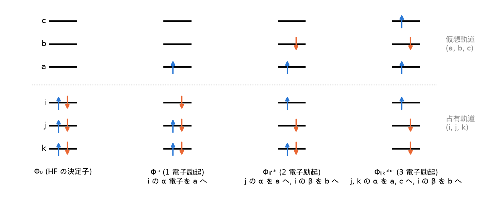
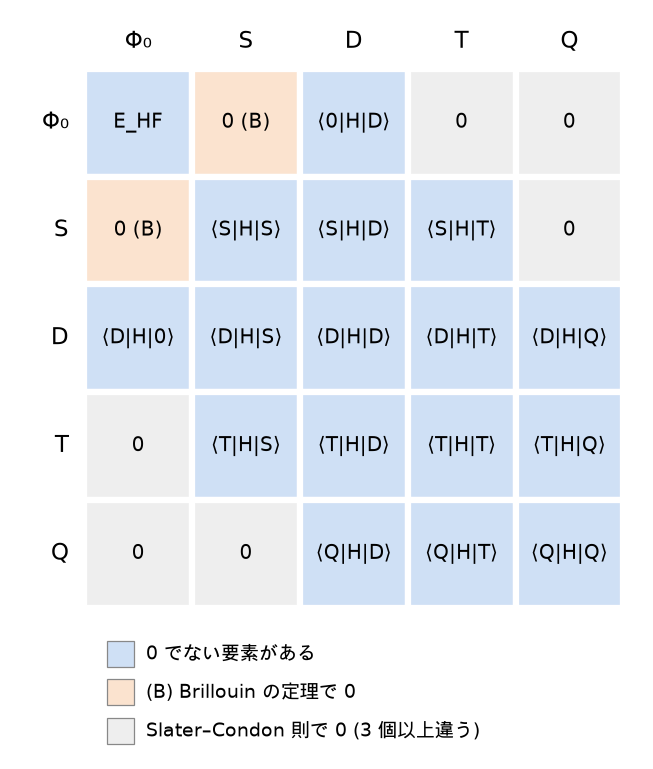
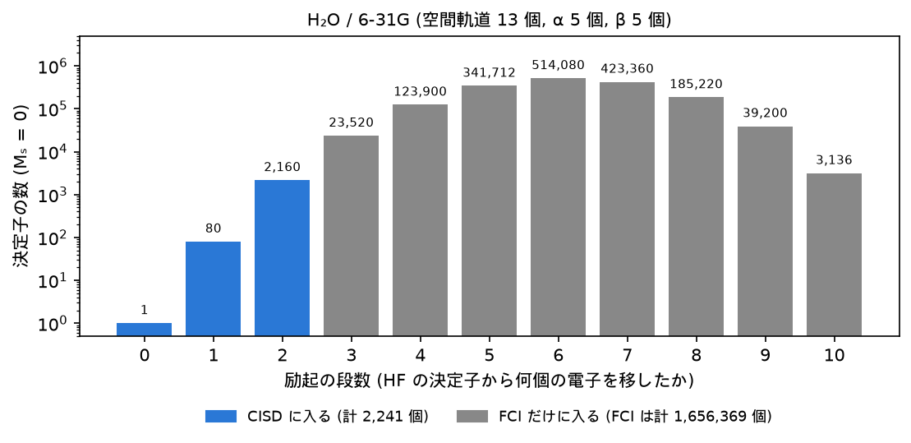
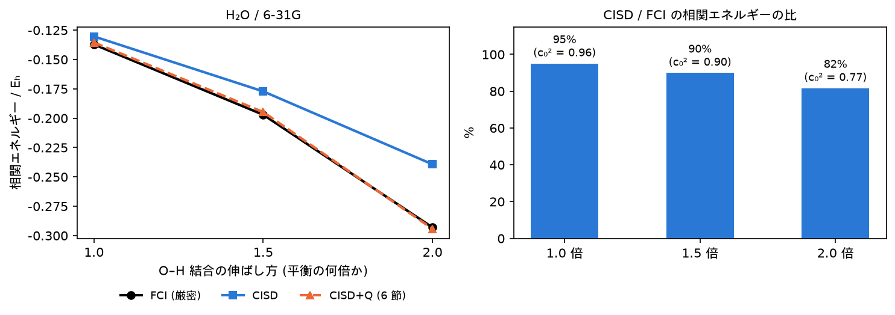
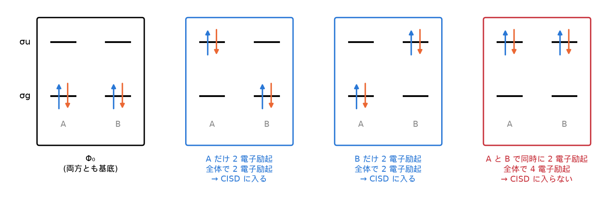
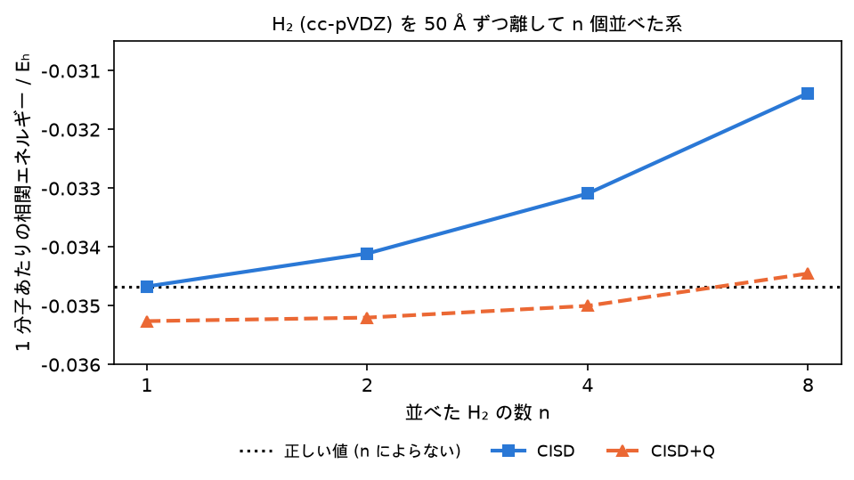

# 第 8 回　配置間相互作用（CI）

!!! abstract "この回の道筋"
    HF の決定子に、電子を励起させた決定子（励起配置）を足し合わせ、その係数を変分法で決める方法が配置間相互作用（CI）です。この回では、励起配置の記号を決め、CI の行列のブロック構造と Brillouin の定理から「2 電子励起が最も効く」ことを導きます。そのうえで CIS、CISD、FCI を順に見て、CISD の大きな弱点であるサイズ無矛盾性の欠如と、その補正（Davidson 補正）を計算で確かめます。

    | 節 | 内容 |
    |---|---|
    | 1 | 励起配置と CI の波動関数 |
    | 2 | CI の行列の形と Brillouin の定理 |
    | 3 | CIS、CISD、FCI |
    | 4 | 計算例：H₂O の CISD と FCI |
    | 5 | サイズ無矛盾性の欠如 |
    | 6 | Davidson 補正 |

    **前に読んでおく回**：[量子化学の理論 第 5 回](05-hartree-fock.md)、[第 3 回](03-second-quantization.md)、[第 7 回](07-electron-correlation.md)

!!! tip "物理的なイメージ"
    CI が求めているのは、HF の決定子を出発点にして、電子を別の軌道に移した決定子を混ぜることで、電子が避け合う動きを表した波動関数です。電子 2 個を同時に別の軌道へ移す配置（2 電子励起）を混ぜることは、2 個の電子が組になって互いを避けることにあたるので、最も効きます。ただし、励起の種類を途中で打ち切ると、離れた 2 つの分子のそれぞれで同時に起こる 2 電子励起（全体では 4 電子励起）が入りません。そのため、エネルギーが系の大きさに比例しなくなります（サイズ無矛盾性の欠如）。

エネルギーは原子単位（ハートリー，$E_\mathrm{h}$）で書きます。

## 1. 励起配置と CI の波動関数

### 1.1 励起配置の記号

HF 法で得たスピン軌道（空間軌道とスピン α または β の組、第 2 回）を、電子が入っているもの（占有軌道）と、空いているもの（仮想軌道）に分けます。記号は次のように決めます。

- $i, j, k, \dots$：占有スピン軌道
- $a, b, c, \dots$：仮想スピン軌道
- $p, q, r, s$：占有か仮想かを区別しないスピン軌道
- $\Phi_0$：HF の決定子

$\Phi_0$ から、占有軌道 $i$ の電子を仮想軌道 $a$ に移した決定子を $\Phi_i^a$ と書き、**1 電子励起配置**と呼びます。同じように、$i, j$ の 2 個の電子を $a, b$ に移した決定子 $\Phi_{ij}^{ab}$ を **2 電子励起配置**と呼びます。3 電子、4 電子の励起配置も同じように作れます。以下では、1、2、3、4 電子励起を、英語の頭文字で S（singles）、D（doubles）、T（triples）、Q（quadruples）とも書きます。



**図 1**　HF の決定子と励起配置の例。横線は空間軌道で、点線より下が占有軌道、上が仮想軌道です。青の上向きの矢印が α 電子、橙の下向きの矢印が β 電子です。1 電子励起では 1 個、2 電子励起では 2 個、3 電子励起では 3 個の電子が、占有軌道から仮想軌道へ移っています。どの配置でも、α 電子と β 電子の数は $\Phi_0$ と同じです。

### 1.2 CI の波動関数

これらの決定子は、どれも同じ HF 軌道からできていて、互いに直交します。しかも、0 電子から $N$ 電子までの励起配置をすべて集めると、その基底関数で作れる $N$ 電子の決定子を、すべて尽くします。そこで、厳密な波動関数をこれらの和で表します。

$$
\Psi = c_0 \Phi_0 + \sum_{i,a} c_i^a \Phi_i^a + \sum_{i<j,\,a<b} c_{ij}^{ab} \Phi_{ij}^{ab} + \sum_{i<j<k,\,a<b<c} c_{ijk}^{abc} \Phi_{ijk}^{abc} + \cdots
$$

和の $i<j$、$a<b$ は、同じ決定子を 2 回数えないための制限です（$\Phi_{ij}^{ab}$ と $\Phi_{ji}^{ba}$ は同じ決定子です）。

係数 $c$ は、エネルギーの期待値が最小になるように決めます（変分法）。これは、決定子を基底としてハミルトニアンの行列 $\mathbf H$（要素 $H_{IJ} = \langle \Phi_I | \hat H | \Phi_J \rangle$）をつくり、固有値問題

$$
\mathbf H \mathbf c = E \mathbf c
$$

を解くことと同じです。$I, J$ は決定子の番号、$\mathbf c$ は係数を並べたベクトルです。最も小さい固有値が基底状態、その次からが励起状態のエネルギーです。この方法を**配置間相互作用**（configuration interaction, CI）と呼びます。

**小さな例**：最小基底（STO-3G）の H₂ では、空間軌道は $\sigma_g$ と $\sigma_u$ の 2 個だけです（第 3 回 13 節、第 7 回 5.2 節）。α 電子 1 個と β 電子 1 個の入れ方は 4 通りなので、CI の波動関数は

$$
\Psi = c_0\, \underbrace{|\sigma_g\alpha\ \sigma_g\beta|}_{\Phi_0}
+ c_1\, \underbrace{|\sigma_g\alpha\ \sigma_u\beta|}_{\text{1 電子励起}}
+ c_2\, \underbrace{|\sigma_g\beta\ \sigma_u\alpha|}_{\text{1 電子励起}}
+ c_3\, \underbrace{|\sigma_u\alpha\ \sigma_u\beta|}_{\text{2 電子励起}}
$$

の 4 項です。$|\chi_1\ \chi_2|$ は、スピン軌道 $\chi_1$、$\chi_2$ からつくった決定子です。この 4 つの決定子の行列は 2 節で書き出します。

すべての励起配置を入れた CI を**完全 CI**（full CI, FCI）と呼びます。FCI は、その基底関数の中で Schrödinger 方程式を厳密に解いたことになります。ただし 3 節で見るように、決定子の数が爆発的に増えるので、FCI は小さな系でしか解けません。そこで、励起の段数で打ち切ります。

**ここまでで分かったこと**：CI は、HF の決定子と励起配置の線形結合で波動関数を表し、係数をハミルトニアンの行列の対角化で決める方法です。

## 2. CI の行列の形と Brillouin の定理

### 2.1 Slater–Condon 則

どの励起配置が大事かを考えるために、行列要素 $\langle \Phi_I | \hat H | \Phi_J \rangle$ を調べます。必要になるのは、決定子どうしのハミルトニアンの行列要素を与える **Slater–Condon 則**です。第 3 回 12 節で、生成・消滅演算子の反交換関係から導きました。この回で使う形に書き直すと、次のとおりです。

- 二つの決定子が **3 個以上**のスピン軌道で違うと、行列要素は 0 です。ハミルトニアンは 2 電子演算子までしか含まないので、1 つの決定子にかけても、電子は多くても 2 個しか移らないからです。
- 1 個だけ違う場合：$\langle \Phi_0 | \hat H | \Phi_i^a \rangle = \langle i | \hat h | a \rangle + \sum_j \langle ij \| aj \rangle$
- 2 個違う場合：$\langle \Phi_0 | \hat H | \Phi_{ij}^{ab} \rangle = \langle ij \| ab \rangle$

ここで $\hat h$ は 1 電子ハミルトニアン（運動エネルギーと核の引力）、和の $j$ は $\Phi_0$ の占有スピン軌道すべてです。2 電子積分は**物理学者の表記**で書きます。

$$
\langle pq | rs \rangle = \int\!\!\int \chi_p^*(\mathbf x_1)\, \chi_q^*(\mathbf x_2)\, \frac{1}{r_{12}}\, \chi_r(\mathbf x_1)\, \chi_s(\mathbf x_2)\, d\mathbf x_1 d\mathbf x_2
$$

$\chi_p$ はスピン軌道、$\mathbf x$ は空間とスピンの座標です。電子 1 が $p$ と $r$、電子 2 が $q$ と $s$ に対応します。第 3 回の化学者の表記 $[pq|rs]$ との関係は $\langle pq | rs \rangle = [pr|qs]$ です。反対称化したものを $\langle pq \| rs \rangle = \langle pq | rs \rangle - \langle pq | sr \rangle$ と書きます。第 2 項は電子 1 と 2 の行き先を入れ替えた交換の項です。

### 2.2 Brillouin の定理

1 個違う場合の式の右辺は、Fock 演算子 $\hat f$ の行列要素そのものです。第 5 回の Fock 演算子は、1 電子ハミルトニアンに、占有軌道の電子がつくる平均の場（クーロンと交換）を足したものでした。その行列要素をスピン軌道の積分で書くと

$$
f_{pq} = \langle p | \hat f | q \rangle = \langle p | \hat h | q \rangle + \sum_j \langle pj \| qj \rangle
$$

です（右辺の第 2 項が、平均の場のクーロンと交換の寄与です）。$p = i$、$q = a$ とおくと、1 個違う場合の式と一致します。

HF の軌道（正準軌道）は Fock 演算子の固有関数なので、$\hat f\chi_a = \varepsilon_a \chi_a$ です。左から $\chi_i^*$ をかけて積分すると、$f_{ia} = \varepsilon_a \langle i | a \rangle = 0$ です（$i$ と $a$ は別の軌道で直交するため）。したがって

$$
\langle \Phi_0 | \hat H | \Phi_i^a \rangle = f_{ia} = 0
$$

です。これを **Brillouin の定理**と呼びます。HF の解は、占有軌道と仮想軌道を少し混ぜる（軌道を回転させる）ときにエネルギーが 1 次では変わらない点（停留点）です。Brillouin の定理は、このことを行列要素で言い換えたものです。

PySCF で確かめます。HF の解の Fock 行列を分子軌道の基底に直し、占有と仮想の間の要素の最大値を見ます。

```python
import numpy as np
from pyscf import gto, scf

mol = gto.M(atom="O 0 0 0; H 0 0.759 0.588; H 0 -0.759 0.588", basis="6-31g", verbose=0)
mf = scf.RHF(mol).run()
C = mf.mo_coeff
F = C.T @ mf.get_fock() @ C          # MO 基底での Fock 行列
nocc = mol.nelectron // 2
print("max |F_ia| =", f"{np.abs(F[:nocc, nocc:]).max():.1e}")
```

```
max |F_ia| = 1.9e-07
```

0 でないのは、SCF の収束の判定が有限だからです。収束を厳しくすれば、もっと小さくなります。

### 2.3 CI の行列のブロック構造

Slater–Condon 則と Brillouin の定理を合わせると、CI の行列のどこが 0 になるかが分かります。決定子を励起の段数ごとにまとめ、$\Phi_0$、S、D、T、Q の順に並べると、行列は次のブロックの形になります。

$$
\mathbf H =
\begin{pmatrix}
E_\mathrm{HF} & \mathbf 0 & \langle \Phi_0 | \hat H | \mathrm D \rangle & \mathbf 0 & \mathbf 0 \\
\mathbf 0 & \langle \mathrm S | \hat H | \mathrm S \rangle & \langle \mathrm S | \hat H | \mathrm D \rangle & \langle \mathrm S | \hat H | \mathrm T \rangle & \mathbf 0 \\
\langle \mathrm D | \hat H | \Phi_0 \rangle & \langle \mathrm D | \hat H | \mathrm S \rangle & \langle \mathrm D | \hat H | \mathrm D \rangle & \langle \mathrm D | \hat H | \mathrm T \rangle & \langle \mathrm D | \hat H | \mathrm Q \rangle \\
\mathbf 0 & \langle \mathrm T | \hat H | \mathrm S \rangle & \langle \mathrm T | \hat H | \mathrm D \rangle & \langle \mathrm T | \hat H | \mathrm T \rangle & \langle \mathrm T | \hat H | \mathrm Q \rangle \\
\mathbf 0 & \mathbf 0 & \langle \mathrm Q | \hat H | \mathrm D \rangle & \langle \mathrm Q | \hat H | \mathrm T \rangle & \langle \mathrm Q | \hat H | \mathrm Q \rangle
\end{pmatrix}
\begin{matrix} \leftarrow \Phi_0 \\ \leftarrow \mathrm S \\ \leftarrow \mathrm D \\ \leftarrow \mathrm T \\ \leftarrow \mathrm Q \end{matrix}
$$

$\langle \mathrm S | \hat H | \mathrm D \rangle$ は、1 電子励起配置と 2 電子励起配置の間の要素をすべて並べた長方形のブロックです。0 のブロックは、次の理由で 0 です。

- $\Phi_0$ と S の間：Brillouin の定理。
- $\Phi_0$ と T、Q の間、S と Q の間：二つの決定子が 3 個以上のスピン軌道で違うので、Slater–Condon 則で 0。



**図 2**　上の行列の各ブロックを色で分けたもの。橙が Brillouin の定理で 0 のブロック、灰が Slater–Condon 則で 0 のブロック、青が 0 でない要素を含むブロックです。$\Phi_0$ の行（いちばん上の行）で 0 でないのは、自分自身と D のブロックだけです。実際の行列では、右下のブロックほどずっと大きくなります（3 節）。

**小さな例**：1.2 節の H₂（STO-3G、$R = 0.74$ Å）の 4×4 の行列を書き出します。空間軌道 $\sigma_g$、$\sigma_u$ を 1、2 と書き、$h_{pq}$ を空間軌道の 1 電子積分、$J_{pq} = (pp|qq)$、$K_{12} = (12|21)$ を空間軌道の 2 電子積分（化学者の表記）とします。決定子を $\Phi_0 = |1\alpha\,1\beta|$、$\Phi_\mathrm D = |2\alpha\,2\beta|$、二つの 1 電子励起 $|1\alpha\,2\beta|$、$|1\beta\,2\alpha|$ の順に並べると、

$$
\mathbf H =
\begin{pmatrix}
2h_{11} + J_{11} & K_{12} & 0 & 0 \\
K_{12} & 2h_{22} + J_{22} & 0 & 0 \\
0 & 0 & h_{11} + h_{22} + J_{12} & -K_{12} \\
0 & 0 & -K_{12} & h_{11} + h_{22} + J_{12}
\end{pmatrix}
$$

数値を入れると（単位は $E_\mathrm h$）

$$
\mathbf H =
\begin{pmatrix}
-1.83186 & 0.18121 & 0 & 0 \\
0.18121 & -0.25249 & 0 & 0 \\
0 & 0 & -1.06467 & -0.18121 \\
0 & 0 & -0.18121 & -1.06467
\end{pmatrix}
$$

です（数値は第 3 回 13 節で numpy を使って組み立てた行列と同じで、核間の反発を含まない電子部分です）。各要素の出どころは次のとおりです。

- 対角要素：それぞれの決定子のエネルギー（Slater–Condon 則の「同じ決定子」の場合）。
- $\Phi_0$ と $\Phi_\mathrm D$ の間：2 個違う場合の式で $\langle 1\alpha\,1\beta \| 2\alpha\,2\beta \rangle$ です。交換の項はスピンが合わないので 0 で、残る項は空間の積分 $(12|12) = K_{12}$ です（軌道は実数）。
- $\Phi_0$ と 1 電子励起の間：Brillouin の定理で 0 です。
- 2 つの 1 電子励起の間：$-K_{12}$ です（符号は決定子の中のスピン軌道の並べ方から来ます。第 3 回 13 節）。
- 1 電子励起と $\Phi_\mathrm D$ の間：0 です。H₂ では $\sigma_g$ と $\sigma_u$ の対称性が違い、必要な積分が対称性で 0 になるからです。

行列は 2×2 のブロック 2 つに分かれます。基底状態は左上のブロック（$\Phi_0$ と $\Phi_\mathrm D$）だけで決まり、これは第 7 回 5.2 節で解いた 2×2 の行列そのものです。

### 2.4 相関エネルギーは 2 電子励起の係数で決まる

ブロック構造から、相関エネルギーについて大事なことが言えます。$\Psi$ を厳密な固有関数とし、$\Phi_0$ の係数が 1 になるように規格化し直します（$c_0 = 1$。これを**中間規格化**と呼びます）。このとき $\langle \Phi_0 | \Psi \rangle = 1$ です。

固有値の式 $\hat H \Psi = E \Psi$ の両辺に、左から $\Phi_0$ をかけて積分します。

$$
\langle \Phi_0 | \hat H | \Psi \rangle = E \langle \Phi_0 | \Psi \rangle = E
$$

左辺の $\Psi$ に 1.2 節の展開を入れます。

$$
E = \langle \Phi_0 | \hat H | \Phi_0 \rangle
+ \sum_{i,a} c_i^a \langle \Phi_0 | \hat H | \Phi_i^a \rangle
+ \sum_{i<j,\,a<b} c_{ij}^{ab} \langle \Phi_0 | \hat H | \Phi_{ij}^{ab} \rangle
+ \sum_{i<j<k,\,a<b<c} c_{ijk}^{abc} \langle \Phi_0 | \hat H | \Phi_{ijk}^{abc} \rangle + \cdots
$$

各項を順に見ます。第 1 項は $E_\mathrm{HF}$ です。第 2 項は Brillouin の定理で 0 です。第 4 項から先は、Slater–Condon 則で 0 です（図 2 のいちばん上の行）。第 3 項の行列要素は $\langle ij \| ab \rangle$ です。残るのは次の式です。

$$
E = E_\mathrm{HF} + \sum_{i<j,\,a<b} c_{ij}^{ab} \langle ij \| ab \rangle
$$

つまり、**相関エネルギーは 2 電子励起配置の係数だけで決まります**。もちろん、その係数 $c_{ij}^{ab}$ の値は、ほかの励起配置との混ざり合い（図 2 の D の行の、S、T、Q のブロック）を通して、1 電子・3 電子・4 電子励起の影響も受けます。

H₂ の例で確かめます。上の 4×4 の行列の基底状態は、中間規格化で $\Psi = \Phi_0 + c_\mathrm D \Phi_\mathrm D$、$c_\mathrm D = -0.11327$ です（第 7 回 5.2 節の $c_u/c_g$）。式に入れると $E - E_\mathrm{HF} = c_\mathrm D K_{12} = -0.11327 \times 0.18121 = -0.02053\ E_\mathrm{h}$ で、FCI の相関エネルギー（$-0.0205\ E_\mathrm{h}$）と一致します。

同じ式は、2 電子励起までで打ち切った CISD（3 節）の波動関数でも成り立ちます。打ち切っても、$\Phi_0$ の行の形は変わらないからです。H₂O の CISD で確かめます。閉殻の分子では、スピンについての和を先にとり、空間軌道の式 $E - E_\mathrm{HF} = \sum_{ijab} c_{ij}^{ab}\,[2(ia|jb) - (ib|ja)] / c_0$ で計算します（スピンの和のとり方は第 9 回の付録 A と同じです）。ここで $c_{ij}^{ab}$ は、空間軌道 $i$ の α 電子を $a$ へ、$j$ の β 電子を $b$ へ移した決定子の係数です。PySCF は CI のベクトルを規格化して返すので、$c_0$ で割って中間規格化に直しています。

```python
import numpy as np
from pyscf import gto, scf, ci, ao2mo

mol = gto.M(atom="O 0 0 0; H 0 0.759 0.588; H 0 -0.759 0.588", basis="6-31g", verbose=0)
mf = scf.RHF(mol).run(conv_tol=1e-12)
myci = ci.CISD(mf).run(conv_tol=1e-10)
c0, c1, c2 = myci.cisdvec_to_amplitudes(myci.ci)   # 規格化した CISD の係数

nocc = mol.nelectron // 2
Co, Cv = mf.mo_coeff[:, :nocc], mf.mo_coeff[:, nocc:]
nvir = Cv.shape[1]
ovov = ao2mo.general(mol, (Co, Cv, Co, Cv), compact=False).reshape(nocc, nvir, nocc, nvir)  # (ia|jb)

# 2 電子励起の係数と積分だけから相関エネルギーを計算（c0 で割って中間規格化に直す）
e_d = np.einsum("ijab,iajb", c2, 2 * ovov - ovov.transpose(0, 3, 2, 1)) / c0
print(f"CISD の相関エネルギー     : {myci.e_corr:.8f}")
print(f"2 電子励起の係数から計算 : {e_d:.8f}")
print(f"c0 = {c0:.5f},  1 電子励起の係数の最大値 = {np.abs(c1).max():.4f}")
```

```
CISD の相関エネルギー     : -0.13031106
2 電子励起の係数から計算 : -0.13031106
c0 = 0.98004,  1 電子励起の係数の最大値 = 0.0082
```

2 電子励起の係数だけから計算した値が、CISD の相関エネルギーと 8 桁まで一致しました。1 電子励起の係数は 0 ではありませんが、エネルギーの式には直接入りません。

**ここまでで分かったこと**：Brillouin の定理により、HF の決定子は 1 電子励起配置と直接には混ざりません。CI の行列で $\Phi_0$ とつながるのは 2 電子励起だけなので、相関エネルギーは 2 電子励起の係数で表され、2 電子励起が最も重要です。

## 3. CIS、CISD、FCI

### 3.1 CIS

$\Phi_0$ と 1 電子励起配置だけを使う CI を **CIS**（CI singles）と呼びます。図 2 の左上の 2×2 のブロックだけを使うことにあたり、その行列は

$$
\mathbf H_\mathrm{CIS} =
\begin{pmatrix}
E_\mathrm{HF} & \mathbf 0 \\
\mathbf 0 & \langle \mathrm S | \hat H | \mathrm S \rangle
\end{pmatrix}
$$

です。$\Phi_0$ と 1 電子励起配置の間が 0 なので、行列は 2 つに分かれます。そのため、CIS の基底状態のエネルギーは HF のエネルギーと同じで、相関は入りません。

一方、右下の $\langle \mathrm S | \hat H | \mathrm S \rangle$ のブロックを対角化すると、励起状態のエネルギーと波動関数が得られます。CIS は、励起状態を調べる最も簡単な方法として使われてきました [Foresman 1992]（第 19 回でも扱います）。

### 3.2 CISD

基底状態の相関を入れる最も簡単な方法は、2 電子励起配置を加えることです。$\Phi_0$、1 電子励起、2 電子励起の配置を使う CI を **CISD**（CI singles and doubles）と呼びます。図 2 の左上の 3×3 のブロックを使います。1 電子励起配置は、$\Phi_0$ とは直接混ざりませんが、2 電子励起配置と混ざる（$\langle \mathrm S | \hat H | \mathrm D \rangle \ne 0$）ので、間接的にエネルギーに効きます。

CISD の計算量を見積もります。占有スピン軌道の数を $o$、仮想スピン軌道の数を $v$ とすると、2 電子励起配置の数は、占有から 2 個、仮想から 2 個を選ぶ組の数なので、およそ $o^2 v^2/4$ です。CISD の行列は大きすぎて全体を対角化できないので、行列をベクトル $\mathbf c$ にかける計算を繰り返して固有ベクトルを探します（Davidson 法などの反復法）。

1 回の反復で最も重いのは、D と D のブロックを $\mathbf c$ にかける計算のうち、

$$
\sigma_{ij}^{ab} = \sum_{c<d} \langle ab \| cd \rangle\, c_{ij}^{cd}
$$

の部分です。左辺の添字 $(i, j, a, b)$ の組がおよそ $o^2 v^2$ 個あり、その一つ一つについて $(c, d)$ の組およそ $v^2$ 個の和をとるので、計算量は $o^2 v^4$ に比例します。$o$ と $v$ はどちらも系の大きさ $N$ に比例するので、CISD の計算量は $N^6$ に比例します。

### 3.3 FCI

FCI の決定子の数は、空間軌道の数を $n$、α 電子と β 電子の数を $N_\alpha$、$N_\beta$ とすると

$$
\binom{n}{N_\alpha} \binom{n}{N_\beta}
$$

です。α 電子を入れる $N_\alpha$ 個の空間軌道の選び方と、β 電子を入れる $N_\beta$ 個の選び方を、独立に組み合わせるからです。たとえば 1.2 節の H₂（$n = 2$、$N_\alpha = N_\beta = 1$）では $\binom21\binom21 = 4$ 個で、1.2 節の 4 つの決定子と一致します。

次の節で使う H₂O の 6-31G 基底では、$n = 13$、$N_\alpha = N_\beta = 5$ なので、$\binom{13}{5}^2 = 1287^2 \approx 1.7 \times 10^6$ 個です。基底を cc-pVDZ（$n = 24$）にするだけで、$\binom{24}{5}^2 = 42504^2 \approx 1.8 \times 10^9$ 個に増えます。軌道と電子を増やすと、決定子の数は指数関数的に増えます。

H₂O/6-31G の FCI の決定子を、励起の段数ごとに数えたのが図 3 です。



**図 3**　H₂O/6-31G で、$\Phi_0$ から $k$ 個の電子を移した決定子の数（$M_S = 0$、縦軸は対数）。青の 3 本（0、1、2 電子励起）が CISD に入る決定子で、合わせて 2,241 個です。灰の棒は FCI だけに入る決定子で、6 電子励起の 51 万個が最大です。CISD は、FCI の決定子のうち 0.1% ほどしか使っていません。

それでも 4 節で見るように、平衡構造では CISD は相関エネルギーの大部分を取り込みます。2.4 節で見たとおり、エネルギーに直接効くのは 2 電子励起だけだからです。

**ここまでで分かったこと**：CIS は基底状態の相関を入れません。CISD は 2 電子励起までを入れて相関の大部分を取り込み、計算量は $N^6$ です。FCI は厳密ですが、決定子の数が指数関数的に増えます。

## 4. 計算例：H₂O の CISD と FCI

H₂O を 6-31G 基底で計算し、CISD と FCI の相関エネルギーを比べます。平衡に近い構造（O–H 0.96 Å、H–O–H 104.5°）から、二つの O–H 結合を同時に 1.5 倍、2 倍に伸ばした構造も計算します。最後の二つの列（CISD+Q と $c_0^2$）は 6 節で使います。

```python
import numpy as np
from pyscf import gto, scf, ci, fci

def h2o(scale):
    """平衡構造（O–H 0.96 Å、HOH 104.5°）の O–H 結合を scale 倍に伸ばす。"""
    r, th = 0.96 * scale, np.deg2rad(104.5) / 2
    return f"O 0 0 0; H 0 {r*np.sin(th):.6f} {r*np.cos(th):.6f}; H 0 {-r*np.sin(th):.6f} {r*np.cos(th):.6f}"

print("scale   E_c(CISD)  E_c(CISD+Q)  E_c(FCI)    c0^2")
for scale in [1.0, 1.5, 2.0]:
    mol = gto.M(atom=h2o(scale), basis="6-31g", verbose=0)
    mf = scf.RHF(mol).run()
    myci = ci.CISD(mf).run()
    c0 = myci.ci[0]                               # HF 決定子の係数（規格化済み）
    e_q = (1 - c0**2) * myci.e_corr               # Davidson 補正
    e_fci = fci.FCI(mf).kernel()[0]
    print(f"{scale:4.1f} {myci.e_corr:11.5f} {myci.e_corr + e_q:11.5f}"
          f" {e_fci - mf.e_tot:11.5f} {c0**2:7.3f}")
```

```
scale   E_c(CISD)  E_c(CISD+Q)  E_c(FCI)    c0^2
 1.0    -0.13030    -0.13545    -0.13712   0.960
 1.5    -0.17712    -0.19474    -0.19702   0.900
 2.0    -0.23926    -0.29421    -0.29305   0.770
```

この計算は、FCI の部分に 2 分ほどかかります（CISD は数秒です）。平衡構造の CISD の値が 2.4 節の値と最後の桁で違うのは、2.4 節では SCF と CISD の収束の条件を厳しくしたためです。



**図 4**　左：上の表の相関エネルギー。結合を伸ばすほど、CISD（青）と FCI（黒）の差が開きます。CISD+Q（橙の破線、6 節）は FCI に近いままです。右：CISD が取り込んだ相関エネルギーの割合と、HF の決定子の重み $c_0^2$。どちらも、結合を伸ばすと下がります。

CISD が取り込んだ相関エネルギーの割合は、平衡構造で $0.13030 / 0.13712 = 95\%$ です。結合を 1.5 倍に伸ばすと 90%、2 倍では 82% に下がります。結合を伸ばすと、第 7 回で見た静的相関が強くなります。HF の決定子の重み $c_0^2$ も 0.96 から 0.77 に下がります。HF の決定子から 2 段の励起までしか届かない CISD では、HF から遠い波動関数を表しにくくなります。

**ここまでで分かったこと**：平衡構造の H₂O では、CISD は相関エネルギーの 95% を取り込みます。結合を伸ばすと、その割合は下がります。

## 5. サイズ無矛盾性の欠如

### 5.1 離れた 2 つの分子

CISD には、もっと根本的な弱点があります。それを見るために、十分に離れていて相互作用しない二つの分子 A と B を考えます。正しいエネルギーは、それぞれのエネルギーの和 $E(\mathrm A) + E(\mathrm B)$ のはずです。手法がこの関係を満たすことを、**サイズ無矛盾性**（size consistency）と呼びます。

CISD はこれを満たしません。理由は次のとおりです。A と B が離れていると、厳密な波動関数は、それぞれの波動関数の積 $\Psi_\mathrm A \Psi_\mathrm B$（を反対称化したもの）です。$\Psi_\mathrm A$ と $\Psi_\mathrm B$ を、それぞれの HF の決定子と 2 電子励起配置の和で表すと、

$$
\Psi_\mathrm A \Psi_\mathrm B
= \big(\Phi_0^\mathrm A + c_\mathrm A \Phi_\mathrm D^\mathrm A + \cdots\big)\big(\Phi_0^\mathrm B + c_\mathrm B \Phi_\mathrm D^\mathrm B + \cdots\big)
$$

です。$\Phi_\mathrm D^\mathrm A$ は A の中の 2 電子励起配置をまとめて書いたもので、係数も $c_\mathrm A$ とまとめています。かっこを展開すると、

$$
\Psi_\mathrm A \Psi_\mathrm B
= \underbrace{\Phi_0^\mathrm A\Phi_0^\mathrm B}_{\Phi_0}
+ \underbrace{c_\mathrm A\, \Phi_\mathrm D^\mathrm A\Phi_0^\mathrm B + c_\mathrm B\, \Phi_0^\mathrm A\Phi_\mathrm D^\mathrm B}_{\text{全体で 2 電子励起}}
+ \underbrace{c_\mathrm A c_\mathrm B\, \Phi_\mathrm D^\mathrm A\Phi_\mathrm D^\mathrm B}_{\text{全体で 4 電子励起}}
+ \cdots
$$

となります。最後の項は「A で 2 電子励起、同時に B でも 2 電子励起」という配置で、全体から見ると 4 電子励起配置です。その係数は $c_\mathrm A c_\mathrm B$ で、片方ずつの励起の係数の積です。CISD は 4 電子励起配置を含まないので、A+B 全体を CISD で計算すると、この項を表せません。



**図 5**　離れた 2 つの H₂（A と B）の配置。左から、両方とも基底の配置（$\Phi_0$）、A だけが 2 電子励起した配置、B だけが 2 電子励起した配置、両方が同時に 2 電子励起した配置です。A と B を別々に CISD で解けば、それぞれの中の 2 電子励起（青の枠）がすべて入ります。全体を 1 つの系として CISD で解くと、右端の赤の枠の配置は全体で 4 電子励起なので入りません。

物理的には、A の中の 2 個の電子が避け合っているときに、遠く離れた B の中の 2 個の電子も同時に避け合ってよいはずです。CISD では「全体で 2 電子励起まで」という制限のために、A と B の電子が同時には避け合えません。

### 5.2 計算で確かめる

実際に計算します。平衡距離の H₂ を、互いに 50 Å 離して $n$ 個並べ、全体を CISD で計算します。電子が 2 個の H₂ 1 個では、2 電子励起までですべての配置が尽くされるので、CISD は FCI と同じです。したがって、正しい答えは「1 分子あたりの相関エネルギーが $n$ によらず一定」です。

```python
from pyscf import gto, scf, ci

print("n   E_c(CISD)/n   E_c(CISD+Q)/n")
for n in [1, 2, 4, 8]:
    # H2（R = 0.74 Å）を n 個、互いに 50 Å 離して並べる
    atoms = "; ".join(f"H {50*k} 0 0; H {50*k} 0 0.74" for k in range(n))
    mol = gto.M(atom=atoms, basis="cc-pvdz", verbose=0)
    mf = scf.RHF(mol).run()
    myci = ci.CISD(mf).run()
    e_q = (1 - myci.ci[0]**2) * myci.e_corr
    print(f"{n}  {myci.e_corr / n:12.5f}  {(myci.e_corr + e_q) / n:12.5f}")
```

```
n   E_c(CISD)/n   E_c(CISD+Q)/n
1      -0.03467      -0.03526
2      -0.03411      -0.03520
4      -0.03309      -0.03500
8      -0.03138      -0.03445
```



**図 6**　上の表をグラフにしたもの。黒の点線が正しい値（H₂ 1 個の FCI の値）です。CISD（青）は、分子の数 $n$ が増えるほど点線から上に離れます。CISD+Q（橙の破線、6 節）は、離れ方が小さくなりますが、$n = 1$ では点線より下にあります。

2 列目の CISD の値を見ます。$n = 1$ の $-0.03467\ E_\mathrm{h}$ は正しい値（第 7 回の FCI の値と同じ）です。ところが $n$ が増えると、1 分子あたりの相関エネルギーの絶対値は小さくなり、$n = 8$ では 1 割ほど減っています。分子の数を増やすほど、取りこぼす割合が増えます。

この振る舞いは、最小基底の H₂ を $n$ 個並べたモデルで、式として導けます。導出は付録 A に回しますが、結果は次のとおりです。H₂ 1 個の 2×2 の行列（第 7 回 5.2 節）の、配置のエネルギー差を $2\Delta$、非対角要素を $K$ とすると、

$$
E_\mathrm c^\mathrm{CISD}(n) = \Delta - \sqrt{\Delta^2 + n K^2}
$$

です。正しい答えは $n$ 個分の $n\varepsilon$（$\varepsilon = \Delta - \sqrt{\Delta^2 + K^2}$ は 1 個の相関エネルギー）ですが、$n$ が大きいと CISD の値は $-\sqrt n\, |K|$ に近づき、$n$ ではなく $\sqrt n$ にしか比例しません。

この欠点は、大きな分子ほど深刻です。たとえば反応エネルギーを計算するとき、大きさの違う分子どうしを比べると、誤差が打ち消し合いません。このため現在では、CISD を単独で使うことはあまりなく、サイズ無矛盾性を満たす結合クラスター法（第 10 回）が使われています。結合クラスター法は、5.1 節の $c_\mathrm A c_\mathrm B$ のような「励起の係数の積」を、波動関数の形に最初から組み込んだ方法です。

**ここまでで分かったこと**：CISD は、離れた分子の同時励起（全体としての 4 電子励起）を含まないため、サイズ無矛盾性を満たしません。系が大きくなるほど、取り込める相関の割合が減ります。

## 6. Davidson 補正

CISD で取りこぼした 4 電子励起などの寄与を、簡単に見積もる方法があります。CISD の波動関数を規格化したとき（係数の 2 乗の和を 1 にしたとき）の HF の決定子の係数を $c_0$、CISD の相関エネルギーを $\Delta E_\mathrm{CISD}$ として、

$$
\Delta E_\mathrm{Q} = (1 - c_0^2)\, \Delta E_\mathrm{CISD}
$$

を足します。これを **Davidson 補正**と呼び、補正したものを CISD+Q と書きます [Langhoff 1974]。Q は 4 電子励起（quadruples）の頭文字です。$1 - c_0^2$ は、波動関数の中の励起配置の重みの合計です。励起配置の重みが大きいほど、5.1 節の「係数の積」の項も大きくなるので、補正を大きくする、という形をしています。

この式がどのくらい正しいかは、付録 A の H₂ を $n$ 個並べたモデルで調べられます。$K$ が小さいとして $K^4$ の次数まで展開すると（付録 B）、

$$
\text{CISD の取りこぼし} \approx -\frac{n(n-1)K^4}{8\Delta^3}, \qquad
\Delta E_\mathrm Q \approx -\frac{n^2 K^4}{8\Delta^3}
$$

です。二つの比は $(n-1)/n$ なので、分子の数 $n$ が大きいと補正はほぼ正しく取りこぼしを埋めます。一方、$n = 1$ では取りこぼしは 0 なのに、補正は 0 になりません。

4 節と 5 節の表の CISD+Q の列で、これを確かめます。

- H₂O（4 節）：平衡構造では、FCI との差が $0.0068$ から $0.0017\ E_\mathrm{h}$ に縮みます。1.5 倍の構造でも同じように改善します。2 倍の構造では、CISD+Q（$-0.29421$）が FCI（$-0.29305$）を下回り、補正が大きすぎます。
- H₂ を $n$ 個並べた系（5 節、図 6）：1 分子あたりの値の $n$ による変化が、CISD より小さくなります。ただし $n = 8$ でもまだ一定ではありません。また $n = 1$ では、CISD がすでに厳密なのに補正が加わり、正しい値より低くなります。これは上のモデルの予想どおりです。

Davidson 補正は、こうした簡単な見積もりの式です。変分法ではないので、エネルギーが FCI より低くなることもあります。サイズ無矛盾性も、厳密には回復しません。CISD を使うときの手軽な改善策ですが、限界があることを知って使ってください。

**ここまでで分かったこと**：Davidson 補正は、CISD のエネルギーを手軽に改善し、サイズ無矛盾性の欠如を小さくします。ただし近似的な補正で、過大になることもあります。

## まとめ

- CI は、HF の決定子と励起配置の線形結合で波動関数を表し、係数を対角化で決める変分法です。
- Slater–Condon 則と Brillouin の定理から、CI の行列で HF の決定子とつながるのは 2 電子励起配置だけです。そのため相関エネルギーは 2 電子励起の係数で決まります。
- CIS は基底状態の相関を入れず、CISD は相関の大部分を入れます（計算量 $N^6$）。FCI は厳密ですが、決定子の数が指数関数的に増えます。
- CISD は、離れた分子の同時励起を含まないのでサイズ無矛盾性を満たさず、系が大きいほど相関を取りこぼします。
- Davidson 補正（CISD+Q）はこれを手軽に改善しますが、近似的で、過大になることもあります。

## 付録 A　最小基底の H₂ を n 個並べた系の CISD

### A.1 使う決定子と行列

各 H₂ に最小基底を使うと、軌道は $\sigma_g$ と $\sigma_u$ の 2 個だけです。H₂ 1 個の FCI の波動関数は、$\sigma_g^2$（HF）と $\sigma_u^2$（2 電子励起）の組み合わせになります（本文 2.3 節のとおり、1 電子励起は対称性で混ざりません）。

$n$ 個の H₂ が十分に離れているとき、CISD の空間で基底状態に混ざりうるのは、次の $n + 1$ 個の決定子です。

- $\Phi_0$：すべての H₂ が $\sigma_g^2$ にある HF の決定子
- $\Phi_k$（$k = 1, \dots, n$）：$k$ 番目の H₂ だけが $\sigma_u^2$ に励起した決定子

全体の 1 電子励起は、1 個の H₂ の中の励起（対称性が合わない）か、離れた分子の間の励起（軌道の重なりがない）です。どちらも、ここに挙げた決定子との行列要素が 0 なので、混ざりません。2 個の分子にまたがる 2 電子励起も、軌道の重なりがないので混ざりません。

ハミルトニアンの行列要素を、$E_\mathrm{HF}$ を基準にして書きます。

- $\langle \Phi_0 | \hat H - E_\mathrm{HF} | \Phi_k \rangle = K$：$k$ 番目の H₂ の中の 2 電子積分 $(\sigma_g\sigma_u|\sigma_g\sigma_u)$ で、$k$ によりません。
- $\langle \Phi_k | \hat H - E_\mathrm{HF} | \Phi_k \rangle = 2\Delta$：1 個の H₂ を $\sigma_g^2$ から $\sigma_u^2$ に励起するのに要するエネルギー（第 7 回 5.2 節の $2\Delta$、$\Delta > 0$）です。ほかの分子は変わらず、分子どうしの相互作用もないので、1 個の H₂ のときと同じ値です。
- $\langle \Phi_k | \hat H | \Phi_l \rangle = 0$（$k \ne l$）：二つの決定子は 4 個のスピン軌道で違うので、Slater–Condon 則で 0 です。

$n = 2$ のときの行列を書き出すと、次のようになります。

$$
\mathbf H - E_\mathrm{HF}\mathbf 1 =
\begin{pmatrix}
0 & K & K \\
K & 2\Delta & 0 \\
K & 0 & 2\Delta
\end{pmatrix}
\begin{matrix} \leftarrow \Phi_0 \\ \leftarrow \Phi_1 \\ \leftarrow \Phi_2 \end{matrix}
$$

右下の $\Phi_1$ と $\Phi_2$ の間が 0 なのは、二つの分子が同時に励起した配置（4 電子励起）を経由しないとつながらないからです。一般の $n$ でも、1 行目と 1 列目に $K$ が $n$ 個並び、右下が $2\Delta$ を対角に並べた $n \times n$ の対角行列になります。

### A.2 固有値を求める

基底状態では、すべての $\Phi_k$ の係数が等しくなります。$n$ 個の H₂ はどれも同じなので、番号を入れ替えてもハミルトニアンは変わらず、縮退のない基底状態はこの入れ替えで変わらないからです。そこで、中間規格化で $\Psi = \Phi_0 + c \sum_k \Phi_k$ とおきます。相関エネルギーを $E_\mathrm c = E - E_\mathrm{HF}$ とします。

$(\hat H - E_\mathrm{HF})\Psi = E_\mathrm c \Psi$ の $\Phi_0$ の成分（行列の 1 行目）は、$K$ が $n$ 個あるので

$$
nKc = E_\mathrm c
$$

です。$\Phi_k$ の成分（行列の $k + 1$ 行目）は、

$$
K + 2\Delta\, c = E_\mathrm c\, c
$$

です。第 2 式を $c$ について解くと、

$$
c = \frac{K}{E_\mathrm c - 2\Delta}
$$

です。これを第 1 式に代入すると、

$$
E_\mathrm c = \frac{nK^2}{E_\mathrm c - 2\Delta}
$$

です。両辺に $E_\mathrm c - 2\Delta$ をかけて整理すると、2 次方程式

$$
E_\mathrm c^2 - 2\Delta E_\mathrm c - nK^2 = 0
$$

になります。2 つの解のうち、負のほう（基底状態）をとると、

$$
E_\mathrm c = \Delta - \sqrt{\Delta^2 + nK^2}
$$

です。$n = 1$ ではこれが H₂ 1 個の厳密な相関エネルギー $\varepsilon = \Delta - \sqrt{\Delta^2 + K^2}$ です（第 7 回 5.2 節と同じ式）。正しい答えは $n\varepsilon$ ですが、$n$ が大きいと平方根の中の $nK^2$ が $\Delta^2$ より大きくなり、$E_\mathrm c \approx -\sqrt n\, |K|$ となって、$\sqrt n$ にしか比例しません。

### A.3 数値で確かめる

STO-3G の H₂（$R = 0.74$ Å）では、$2\Delta = 1.57938$、$K = 0.18121$ です（第 7 回 5.2 節）。上の式の値と、同じ系を PySCF の CISD で計算した値を比べると、次のとおりです（1 分子あたり、$E_\mathrm{h}$）。

| $n$ | 上の式 | PySCF の CISD | 正しい値 $\varepsilon$ |
|---|---|---|---|
| 1 | −0.020525 | −0.020525 | −0.020525 |
| 2 | −0.020271 | −0.020271 | −0.020525 |
| 4 | −0.019799 | −0.019799 | −0.020525 |
| 8 | −0.018969 | −0.018969 | −0.020525 |

式と PySCF の値は、表の桁まで一致します。本文の cc-pVDZ の計算と同じく、$n$ が増えるほど 1 分子あたりの値の絶対値が小さくなります。

## 付録 B　Davidson 補正をモデルで調べる

付録 A のモデルで、CISD の取りこぼしと Davidson 補正を、$K$ が小さいとして $K^4$ の次数まで展開して比べます。使うのは、$x$ が小さいときの平方根の展開

$$
\sqrt{\Delta^2 + x} = \Delta + \frac{x}{2\Delta} - \frac{x^2}{8\Delta^3} + \cdots
$$

です。

**正しい相関エネルギー**：$x = K^2$ とおくと、

$$
\varepsilon = \Delta - \sqrt{\Delta^2 + K^2} \approx -\frac{K^2}{2\Delta} + \frac{K^4}{8\Delta^3}
$$

です。$n$ 個分は、これを $n$ 倍して $n\varepsilon \approx -\dfrac{nK^2}{2\Delta} + \dfrac{nK^4}{8\Delta^3}$ です。

**CISD の相関エネルギー**：$x = nK^2$ とおくと、

$$
E_\mathrm c \approx -\frac{nK^2}{2\Delta} + \frac{n^2K^4}{8\Delta^3}
$$

です。

**取りこぼし**：二つの差をとると、$K^2$ の項は打ち消し合い、

$$
n\varepsilon - E_\mathrm c \approx \frac{(n - n^2)K^4}{8\Delta^3} = -\frac{n(n-1)K^4}{8\Delta^3}
$$

が残ります。CISD は $K^2$ の次数（第 9 回の MP2 にあたる次数）までは正しく、$K^4$ の次数で取りこぼします。

**Davidson 補正**：中間規格化の波動関数 $\Phi_0 + c\sum_k \Phi_k$ の長さの 2 乗は $1 + nc^2$ なので、規格化したときの係数は $c_0^2 = 1/(1 + nc^2)$ です。したがって

$$
1 - c_0^2 = \frac{nc^2}{1 + nc^2} \approx nc^2
$$

です。付録 A の $c = K/(E_\mathrm c - 2\Delta)$ で、$E_\mathrm c$ は $2\Delta$ に比べて小さいので、$c \approx -K/(2\Delta)$、$c^2 \approx K^2/(4\Delta^2)$ です。$E_\mathrm c$ の最初の項 $-nK^2/(2\Delta)$ と掛け合わせると、

$$
\Delta E_\mathrm Q = (1 - c_0^2)\,E_\mathrm c \approx \frac{nK^2}{4\Delta^2} \times \left(-\frac{nK^2}{2\Delta}\right) = -\frac{n^2K^4}{8\Delta^3}
$$

です。

取りこぼし $-n(n-1)K^4/(8\Delta^3)$ と比べると、補正は $n/(n-1)$ 倍だけ大きすぎます。$n$ が大きいほどこの比は 1 に近づき、$n = 1$ では取りこぼしが 0 なのに補正だけが残ります。本文 5 節の H₂ の表（図 6）で、$n = 1$ の CISD+Q が正しい値より低くなったのは、この過大な分です。

## 参考文献

- A. Szabo, N. S. Ostlund, "Modern Quantum Chemistry" (Dover, 1996). ISBN: 9780486691862
- T. Helgaker, P. Jørgensen, J. Olsen, "Molecular Electronic-Structure Theory" (Wiley, 2000). ISBN: 9780471967552
- S. R. Langhoff, E. R. Davidson, "Configuration interaction calculations on the nitrogen molecule", Int. J. Quantum Chem. 8, 61 (1974). DOI: [10.1002/qua.560080106](https://doi.org/10.1002/qua.560080106)
- J. B. Foresman, M. Head-Gordon, J. A. Pople, M. J. Frisch, "Toward a systematic molecular orbital theory for excited states", J. Phys. Chem. 96, 135 (1992). DOI: [10.1021/j100180a030](https://doi.org/10.1021/j100180a030)
- Q. Sun et al., "Recent developments in the PySCF program package", J. Chem. Phys. 153, 024109 (2020). DOI: [10.1063/5.0006074](https://doi.org/10.1063/5.0006074)
