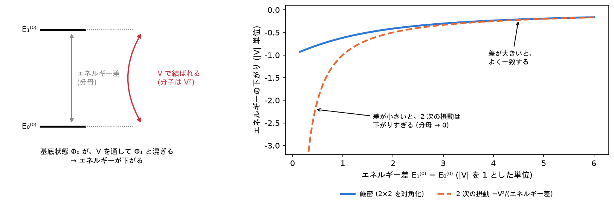
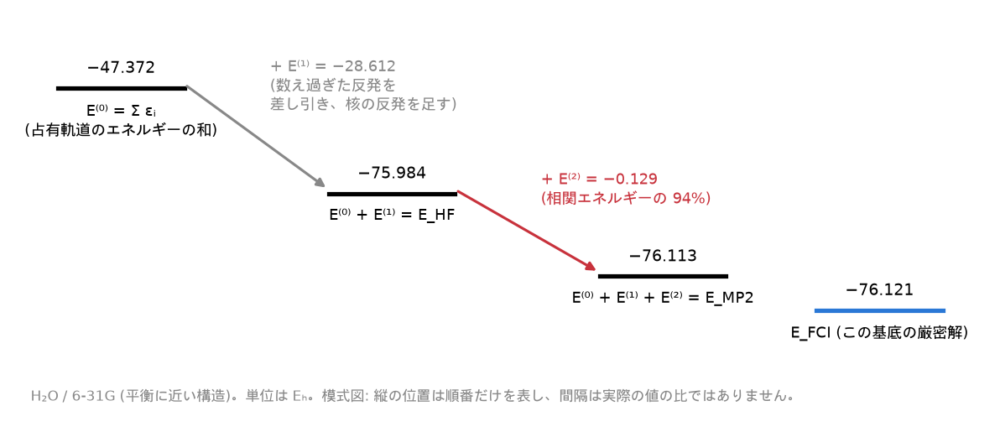
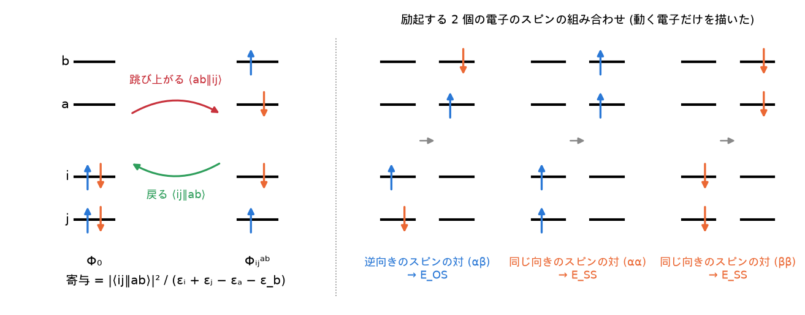
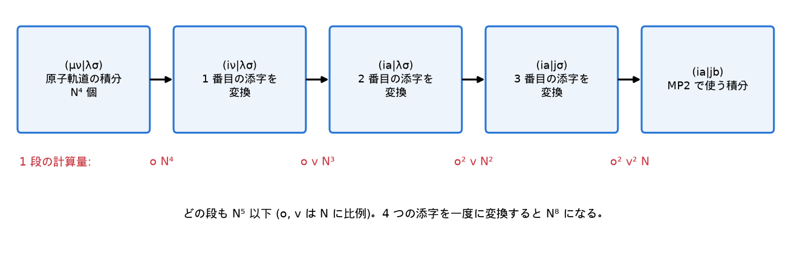
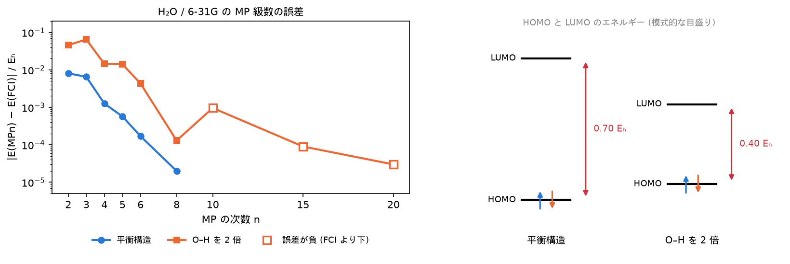
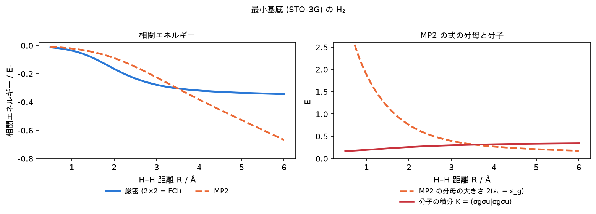

# 第 9 回　摂動論：MP2

!!! abstract "この回の道筋"
    HF 法の解を出発点にして、電子相関を摂動として足していく方法が Møller–Plesset 摂動論です。その 2 次の近似 MP2 は、相関を入れる手法の中で最も安く、広く使われています。この回では、摂動論の公式から MP2 のエネルギーの式を導き、積分から numpy で計算して PySCF の値と一致することを確かめます。最後に、摂動級数がいつもうまく収束するとは限らないことを、計算で見ます。

    | 節 | 内容 |
    |---|---|
    | 1 | Rayleigh–Schrödinger 摂動論 |
    | 2 | Møller–Plesset の分け方 |
    | 3 | MP2 のエネルギーの式 |
    | 4 | 計算例：MP2 を積分から計算する |
    | 5 | 計算コスト |
    | 6 | MP 級数の収束 |
    | 7 | MP2 の改良：SCS-MP2 など |

    **前に読んでおく回**：[量子化学の理論 第 7 回](07-electron-correlation.md)、[第 8 回](08-configuration-interaction.md)

!!! tip "物理的なイメージ"
    MP2 が求めているのは、HF の平均の場の世界を出発点にして、電子どうしの本当の反発と平均の場の差を「小さな揺さぶり」として加えたときの、エネルギーの補正です。2 次の補正は、2 個の電子が一瞬だけ空軌道へ跳び上がって戻ってくる過程の寄与を足し合わせたものです。各項は、跳び上がりを起こす結合の 2 乗を、跳び上がりに必要なエネルギー（軌道エネルギーの差）で割った形をしています。必要なエネルギーが小さい（占有軌道と空軌道のエネルギーが近い）と、補正が大きくなりすぎ、摂動の考え方が成り立たなくなります。

エネルギーは原子単位（ハートリー，$E_\mathrm{h}$）で書きます。記号は第 8 回と同じで、$i, j$ は占有軌道、$a, b$ は仮想軌道、$\Phi_0$ は HF の決定子です。$\varepsilon_p$ は軌道 $p$ の軌道エネルギー（Fock 演算子の固有値）です。

## 1. Rayleigh–Schrödinger 摂動論

### 1.1 公式

解きたいハミルトニアン $\hat H$ を、解ける部分 $\hat H_0$ と、残り $\hat V$ に分けます。

$$
\hat H = \hat H_0 + \hat V
$$

$\hat H_0$ の固有関数 $\Phi_n$ と固有値 $E_n^{(0)}$ は分かっているとします（$\hat H_0 \Phi_n = E_n^{(0)} \Phi_n$）。求めたいのは、基底状態 $\Phi_0$ から出発した $\hat H$ の固有値です。$\hat V$ が小さければ、エネルギーを $\hat V$ の次数ごとに展開できます。

$$
E = E^{(0)} + E^{(1)} + E^{(2)} + \cdots
$$

$E^{(n)}$ は $\hat V$ について $n$ 次の項です。この展開を **Rayleigh–Schrödinger 摂動論**（RS 摂動論）と呼びます。導出は付録 A に回しますが、最初の三つの項は次のとおりです。

$$
E^{(0)} = E_0^{(0)}, \qquad
E^{(1)} = \langle \Phi_0 | \hat V | \Phi_0 \rangle, \qquad
E^{(2)} = \sum_{n \ne 0} \frac{|\langle \Phi_n | \hat V | \Phi_0 \rangle|^2}{E_0^{(0)} - E_n^{(0)}}
$$

- $E^{(0)}$ は、$\hat H_0$ の世界での基底状態のエネルギーです。
- $E^{(1)}$ は、波動関数を $\Phi_0$ のまま変えずに、$\hat V$ の期待値を足したものです。
- $E^{(2)}$ は、$\hat V$ によって $\Phi_0$ に別の状態 $\Phi_n$ が少し混ざることで、エネルギーが下がる分です。

$E^{(2)}$ の分子は、摂動 $\hat V$ が基底状態と励起状態 $\Phi_n$ をどれだけ強く結ぶかを表します。分母は、その二つの状態の $\hat H_0$ でのエネルギー差です。基底状態では $E_0^{(0)} < E_n^{(0)}$ なので分母が負で、分子は 2 乗なので正です。したがって $E^{(2)}$ は必ず負になります。

### 1.2 2 状態で確かめる

状態が 2 つだけの場合で、公式を確かめます。$\hat H_0$ の固有関数を $\Phi_0$、$\Phi_1$ とし、ハミルトニアンの行列を

$$
\mathbf H =
\underbrace{\begin{pmatrix} E_0^{(0)} & 0 \\ 0 & E_1^{(0)} \end{pmatrix}}_{\mathbf H_0}
+
\underbrace{\begin{pmatrix} 0 & V \\ V & 0 \end{pmatrix}}_{\mathbf V}
= \begin{pmatrix} E_0^{(0)} & V \\ V & E_1^{(0)} \end{pmatrix}
$$

とします（$V$ は実数）。公式に当てはめると、$E^{(1)} = \langle \Phi_0 | \hat V | \Phi_0 \rangle$ は $\mathbf V$ の左上の要素なので 0 です。$E^{(2)}$ の和は $n = 1$ の 1 項だけで、

$$
E^{(2)} = \frac{V^2}{E_0^{(0)} - E_1^{(0)}}
$$

です。

一方、この行列は厳密に対角化できます。第 7 回 5.2 節と同じ計算で、エネルギー差の半分を $\Delta = (E_1^{(0)} - E_0^{(0)})/2$ とすると、低いほうの固有値は

$$
E = E_0^{(0)} + \Delta - \sqrt{\Delta^2 + V^2}
$$

です。$|V| \ll \Delta$ なら、$\sqrt{\Delta^2 + V^2} \approx \Delta + V^2/(2\Delta)$ と近似できます。すると $E \approx E_0^{(0)} - V^2/(2\Delta) = E_0^{(0)} + E^{(2)}$ となり、公式と一致します。

数値で比べます。

| エネルギー差 $2\Delta$ | $V$ | 厳密な下がり $E - E_0^{(0)}$ | 2 次の摂動 $E^{(2)}$ |
|---|---|---|---|
| 1.0 | 0.1 | −0.00990 | −0.01000 |
| 0.1 | 0.1 | −0.06180 | −0.10000 |

エネルギー差が結合 $V$ より十分大きいと、2 次の摂動はよく合います。エネルギー差が $V$ と同じくらいになると、2 次の摂動は下がりすぎます。



**図 1**　左：2 つの状態 $\Phi_0$、$\Phi_1$ と、それらを結ぶ摂動 $V$。2 次のエネルギーの分母は 2 つの状態のエネルギー差、分子は $V^2$ です。右：エネルギー差を変えたときの、厳密な下がり（青）と 2 次の摂動（橙の破線）。横軸と縦軸は $|V|$ を 1 とした単位です。エネルギー差が大きい右側では二つが重なり、エネルギー差が 0 に近づく左側では、2 次の摂動だけが分母 → 0 で下がり続けます。

**ここまでで分かったこと**：RS 摂動論では、$\hat H_0$ の固有関数を使って、エネルギーを摂動の次数ごとに足していきます。2 次の補正は、「結合の強さの 2 乗 ÷ エネルギー差」の和です。エネルギー差が結合より十分大きいときに正確です。

## 2. Møller–Plesset の分け方

### 2.1 Ĥ₀ を Fock 演算子の和にとる

摂動論の結果は、$\hat H_0$ をどう選ぶかで変わります。Møller と Plesset は、$\hat H_0$ を Fock 演算子 $\hat f$ の和にとりました [Møller 1934]。

$$
\hat H_0 = \sum_{\mu=1}^{N} \hat f(\mu), \qquad \hat V = \hat H - \hat H_0
$$

ここで $\mu$ は電子の番号、$N$ は電子の数、$\hat f(\mu)$ は電子 $\mu$ の座標に働く Fock 演算子です。これを **Møller–Plesset の分け方**（MP 分割）と呼びます。$\hat H_0$ は「各電子がほかの電子の平均の場の中を独立に動く」という HF の世界のハミルトニアンです。$\hat V$ は、本当の電子反発と、平均の場との差です。

### 2.2 Ĥ₀ の固有関数と固有値

この $\hat H_0$ の固有関数は、HF の軌道からつくったすべての決定子です。理由を 1 段ずつ見ます。

1. 各スピン軌道は $\hat f$ の固有関数です：$\hat f \chi_p = \varepsilon_p \chi_p$。
2. 決定子は、軌道の積 $\chi_{p_1}(1)\chi_{p_2}(2)\cdots\chi_{p_N}(N)$ の電子の番号を入れ替えて、符号をつけて足したものです（第 2 回）。
3. 1 つの積に $\hat H_0 = \sum_\mu \hat f(\mu)$ をかけると、$\hat f(\mu)$ は電子 $\mu$ の軌道にだけ働き、$\varepsilon$ を 1 つ出します。全部足すと、積は $(\varepsilon_{p_1} + \cdots + \varepsilon_{p_N})$ 倍になります。
4. 入れ替えた積でも、入っている軌道の組は同じなので、同じ数がかかります。したがって決定子全体も同じ数の倍になります。

つまり、決定子の $\hat H_0$ の固有値は、入っているスピン軌道のエネルギーの和です。

- HF の決定子：$\hat H_0 \Phi_0 = \left(\sum_k \varepsilon_k\right) \Phi_0$（$k$ は占有軌道すべて）
- 2 電子励起配置：$\hat H_0 \Phi_{ij}^{ab} = \left(\sum_k \varepsilon_k - \varepsilon_i - \varepsilon_j + \varepsilon_a + \varepsilon_b\right) \Phi_{ij}^{ab}$

2 電子励起配置では、$i$、$j$ の電子がいなくなった分のエネルギーを引き、$a$、$b$ に入った分を足しています。

### 2.3 0 次と 1 次のエネルギー

0 次のエネルギーは、占有軌道のエネルギーの和です。

$$
E^{(0)} = \sum_i \varepsilon_i
$$

これは HF のエネルギーではありません。軌道エネルギー $\varepsilon_i$ には、軌道 $i$ の電子とほかのすべての電子との反発が入っています。そのため、全部足すと、電子の組ごとの反発を 2 回ずつ数えてしまいます。

1 次のエネルギーを足すと、ちょうど HF のエネルギーになります。$E^{(1)} = \langle \Phi_0 | \hat V | \Phi_0 \rangle$ に $\hat V = \hat H - \hat H_0$ を入れると、

$$
E^{(0)} + E^{(1)} = \langle \Phi_0 | \hat H_0 | \Phi_0 \rangle + \langle \Phi_0 | \hat H - \hat H_0 | \Phi_0 \rangle = \langle \Phi_0 | \hat H | \Phi_0 \rangle = E_\mathrm{HF}
$$

だからです。中身を見ると、軌道エネルギーは $\varepsilon_i = h_{ii} + \sum_j \langle ij \| ij \rangle$、HF のエネルギーは $E_\mathrm{HF} = \sum_i h_{ii} + \frac12 \sum_{ij} \langle ij \| ij \rangle$ なので（第 5 回）、

$$
E^{(1)} = E_\mathrm{HF} - E^{(0)} = -\frac12 \sum_{ij} \langle ij \| ij \rangle
$$

で、2 回数えた反発の半分を差し引く項です（核どうしの反発 $V_\mathrm{NN}$ は定数なので、ここでは $E^{(1)}$ に含めて扱います）。

H₂O/6-31G（平衡に近い構造）で値を入れると、次のとおりです。

| | 値 / $E_\mathrm h$ |
|---|---|
| $E^{(0)} = \sum_i \varepsilon_i$ | −47.372 |
| $E^{(1)}$（電子の部分 −37.780、核の反発 +9.168） | −28.612 |
| $E^{(0)} + E^{(1)} = E_\mathrm{HF}$ | −75.984 |

$E^{(0)}$ と $E^{(1)}$ はどちらも大きく、HF の決定子を出発点に選んだことで、二つの和が HF のエネルギーにまとまります。したがって、相関エネルギーは **2 次以降**の項から始まります。$n$ 次までの和をとったものを **MP$n$** と呼びます。MP2 は 2 次までの和です。



**図 2**　H₂O/6-31G で、MP の各次数までの和を並べた模式図。$E^{(0)}$ は電子の反発を 2 回数えているので高すぎ、$E^{(1)}$ を足すと HF のエネルギーになります。そこに $E^{(2)}$ を足したものが MP2 で、この基底の厳密解（FCI、青）との差は $0.008\ E_\mathrm h$ です（6 節）。縦の位置は順番だけを表しています。

**ここまでで分かったこと**：MP 分割では、Fock 演算子の和を $\hat H_0$ にとります。その固有関数は HF の軌道の決定子で、固有値は軌道エネルギーの和です。1 次までの和は HF エネルギーなので、相関は 2 次から入ります。

## 3. MP2 のエネルギーの式

### 3.1 和に残るのは 2 電子励起だけ

1 節の $E^{(2)}$ の式の和は、$\Phi_0$ 以外のすべての決定子 $\Phi_n$ についてとります。どの決定子が残るかを調べます。

まず分子です。$\Phi_n \ne \Phi_0$ なら、$\Phi_n$ は $\hat H_0$ の固有関数で $\Phi_0$ と直交するので、$\langle \Phi_n | \hat H_0 | \Phi_0 \rangle = E_0^{(0)} \langle \Phi_n | \Phi_0 \rangle = 0$ です。したがって

$$
\langle \Phi_n | \hat V | \Phi_0 \rangle = \langle \Phi_n | \hat H | \Phi_0 \rangle - \langle \Phi_n | \hat H_0 | \Phi_0 \rangle = \langle \Phi_n | \hat H | \Phi_0 \rangle
$$

で、第 8 回の CI の行列の $\Phi_0$ の行と同じものです（第 8 回の図 2）。

- 1 電子励起配置との行列要素は、Brillouin の定理で 0 です。
- 3 電子以上の励起配置との行列要素は、Slater–Condon 則で 0 です。

残るのは 2 電子励起配置だけで、行列要素は $\langle \Phi_{ij}^{ab} | \hat H | \Phi_0 \rangle = \langle ab \| ij \rangle$ です（第 8 回と同じく、物理学者の表記で反対称化した積分 $\langle pq \| rs \rangle = \langle pq | rs \rangle - \langle pq | sr \rangle$）。その絶対値の 2 乗は $|\langle ij \| ab \rangle|^2$ と同じです。

次に分母です。2 節の固有値の差をとると、

$$
E_0^{(0)} - E_{ij}^{ab\,(0)} = \sum_k \varepsilon_k - \Big(\sum_k \varepsilon_k - \varepsilon_i - \varepsilon_j + \varepsilon_a + \varepsilon_b\Big) = \varepsilon_i + \varepsilon_j - \varepsilon_a - \varepsilon_b
$$

です。占有軌道の和の部分は打ち消し合い、動いた 4 つの軌道のエネルギーだけが残ります。

こうして、スピン軌道で書いた MP2 の式が得られます。

$$
E^{(2)} = \sum_{i<j} \sum_{a<b} \frac{|\langle ij \| ab \rangle|^2}{\varepsilon_i + \varepsilon_j - \varepsilon_a - \varepsilon_b}
$$

和の $i<j$、$a<b$ は、同じ決定子を 2 回数えないための制限です（第 8 回 1.2 節）。



**図 3**　左：MP2 の 1 つの項の絵。$\Phi_0$ の 2 個の電子が、結合 $\langle ab \| ij \rangle$ によって仮想軌道 $a$、$b$ へ跳び上がり（赤）、同じ結合で戻ってきます（緑）。寄与は結合の 2 乗を、跳び上がりに要する軌道エネルギーの差で割ったものです。右：跳び上がる 2 個の電子のスピンの組み合わせ（動く電子だけを描いています）。逆向きの組（αβ）と、同じ向きの組（αα、ββ）があります。3.3 節で、それぞれの寄与を $E_\mathrm{OS}$、$E_\mathrm{SS}$ と呼びます。

### 3.2 閉殻の空間軌道の式

実際の計算では、閉殻の分子に RHF を使うことが多いです。そのときは、スピンについての和を先にとり、**空間軌道**の式に直します。導出は付録 B に回しますが、結果は次のとおりです。

$$
E^{(2)} = \sum_{ij}^{\text{占有}} \sum_{ab}^{\text{仮想}} \frac{(ia|jb)\,\big[\,2(ia|jb) - (ib|ja)\,\big]}{\varepsilon_i + \varepsilon_j - \varepsilon_a - \varepsilon_b}
$$

ここで $i, j, a, b$ は空間軌道で、和はすべての組についてとります（$i<j$ のような制限はありません）。2 電子積分は**化学者の表記**です。

$$
(pq|rs) = \int\!\!\int \phi_p^*(\mathbf r_1)\, \phi_q(\mathbf r_1)\, \frac{1}{r_{12}}\, \phi_r^*(\mathbf r_2)\, \phi_s(\mathbf r_2)\, d\mathbf r_1 d\mathbf r_2
$$

$\phi_p$ は空間軌道です。物理学者の表記との関係は $(ia|jb) = \langle ij | ab \rangle$ です。二つの表記を混同すると添字の並びを間違えるので、プログラムを書くときは特に注意してください。

### 3.3 逆スピンと同スピンの成分

閉殻の式は、図 3 の右の 2 種類の電子対の寄与に分けられます（付録 B）。分母を $D_{ij}^{ab} = \varepsilon_i + \varepsilon_j - \varepsilon_a - \varepsilon_b$ と書くと、

$$
E^{(2)} = E_\mathrm{OS} + E_\mathrm{SS}
$$

$$
E_\mathrm{OS} = \sum_{ijab} \frac{(ia|jb)^2}{D_{ij}^{ab}}, \qquad
E_\mathrm{SS} = \sum_{ijab} \frac{(ia|jb)\big[(ia|jb) - (ib|ja)\big]}{D_{ij}^{ab}}
$$

です。$E_\mathrm{OS}$ は逆向きのスピンの電子対（opposite spin）、$E_\mathrm{SS}$ は同じ向きのスピンの電子対（same spin）からの寄与です。同スピンの対には、交換の項 $-(ib|ja)$ が入ります。同じスピンの電子は、HF の段階ですでに Fermi 孔で避け合っている（第 7 回 1.1 節）ので、相関による追加の下がりが小さくなるのです。7 節で使います。

### 3.4 小さな例：最小基底の H₂

最小基底（STO-3G）の H₂ では、占有軌道は $\sigma_g$ だけ、仮想軌道は $\sigma_u$ だけです。閉殻の式の和は $i = j = g$、$a = b = u$ の 1 項だけになり、$(ia|jb) = (ib|ja) = (gu|gu) = K$ なので、

$$
E^{(2)} = \frac{K\,(2K - K)}{2\varepsilon_g - 2\varepsilon_u} = \frac{K^2}{2(\varepsilon_g - \varepsilon_u)}
$$

です。これは 1.2 節の 2 状態の式で、$V = K$、エネルギー差を $2(\varepsilon_u - \varepsilon_g)$ としたものです。$R = 0.74$ Å の値（$K = 0.18121$、$\varepsilon_g = -0.57855$、$\varepsilon_u = 0.67114$）を入れると、

$$
E^{(2)} = \frac{0.18121^2}{2 \times (-0.57855 - 0.67114)} = -0.01314\ E_\mathrm{h}
$$

で、PySCF の `mp.MP2` の値 $-0.013138$ と一致します。この基底の厳密な相関エネルギー（第 7 回 5.2 節の 2×2 の行列）は $-0.0205\ E_\mathrm{h}$ なので、MP2 は 64% を取り込んでいます。

厳密な 2×2 の行列との違いは、分母にあります。厳密な行列では、二つの配置の本当のエネルギー差 $2\Delta = 1.579\ E_\mathrm h$ が分母に入りました。MP2 では、軌道エネルギーの差 $2(\varepsilon_u - \varepsilon_g) = 2.499\ E_\mathrm h$ が入ります。仮想軌道のエネルギー $\varepsilon_u$ は、もとの 2 個の電子すべての平均の場の中で計算されているので、実際に電子を移すのに要するエネルギーより大きくなっています。

**ここまでで分かったこと**：MP2 のエネルギーには 2 電子励起だけが寄与し、閉殻では $(ia|jb)$ 型の積分と軌道エネルギーだけで計算できます。逆スピンと同スピンの電子対の寄与に分けられます。

## 4. 計算例：MP2 を積分から計算する

3 節の式を、そのまま numpy で計算します。H₂O を cc-pVDZ 基底で計算します。

手順は次のとおりです。

1. RHF を解き、軌道係数と軌道エネルギーを得ます。
2. 原子軌道の 2 電子積分を、分子軌道の $(ia|jb)$ に変換します（`ao2mo.general`）。
3. 分母 $D_{ij}^{ab}$ をつくり、3 節の式で和をとります。

```python
import numpy as np
from pyscf import gto, scf, mp, ao2mo

mol = gto.M(atom="O 0 0 0; H 0 0.759 0.588; H 0 -0.759 0.588", basis="cc-pvdz", verbose=0)
mf = scf.RHF(mol).run()

nocc = mol.nelectron // 2
eps = mf.mo_energy
Co = mf.mo_coeff[:, :nocc]          # 占有軌道
Cv = mf.mo_coeff[:, nocc:]          # 仮想軌道
nvir = Cv.shape[1]

# (ia|jb)：化学者の表記の 2 電子積分を、分子軌道で求める
ovov = ao2mo.general(mol, (Co, Cv, Co, Cv), compact=False)
ovov = ovov.reshape(nocc, nvir, nocc, nvir)

# 分母 e_i + e_j - e_a - e_b
eo, ev = eps[:nocc], eps[nocc:]
D = eo[:, None, None, None] - ev[None, :, None, None] + eo[None, None, :, None] - ev[None, None, None, :]

iajb = ovov
ibja = ovov.transpose(0, 3, 2, 1)   # (ib|ja) を (i,a,j,b) の並びに
e_os = np.sum(iajb * iajb / D)              # 逆スピンの電子対
e_ss = np.sum(iajb * (iajb - ibja) / D)     # 同じスピンの電子対
e_mp2 = e_os + e_ss

print(f"手計算        E_MP2 = {e_mp2:.10f}")
print(f"PySCF (mp.MP2) E_MP2 = {mp.MP2(mf).run().e_corr:.10f}")
print(f"  逆スピン {e_os:.6f}, 同スピン {e_ss:.6f}")
print(f"SCS-MP2       E_c  = {1.2 * e_os + e_ss / 3:.6f}")
```

```
手計算        E_MP2 = -0.2041659213
PySCF (mp.MP2) E_MP2 = -0.2041659213
  逆スピン -0.152613, 同スピン -0.051553
SCS-MP2       E_c  = -0.200320
```

手で計算した MP2 の相関エネルギーは、PySCF の `mp.MP2` の値と 10 桁まで一致します。ここではすべての電子を相関させています（O の 1s 軌道も含めています）。

プログラムの 2 か所を説明します。

- 分母 `D` の行：`eo[:, None, None, None]` は、$\varepsilon_i$ を 4 次元の配列の 1 番目の軸に並べ、残りの軸の長さを 1 にしたものです。同じように $\varepsilon_a$ を 2 番目、$\varepsilon_j$ を 3 番目、$\varepsilon_b$ を 4 番目の軸に並べて足し引きすると、numpy は長さ 1 の軸を自動的に引き伸ばします。結果は `D[i, a, j, b]` $= \varepsilon_i - \varepsilon_a + \varepsilon_j - \varepsilon_b$ の 4 次元の配列です。
- `ovov.transpose(0, 3, 2, 1)` の行：`ovov[i, a, j, b]` が $(ia|jb)$ なので、$a$ と $b$ を入れ替えた `ovov[i, b, j, a]` が $(ib|ja)$ です。2 番目と 4 番目の軸を入れ替えて $(i, a, j, b)$ の順に並べ直すと、元の配列と要素ごとに掛け算できます。

逆スピンの寄与が全体の 4 分の 3 ほどを占めていることも分かります。3.3 節で見たとおり、同スピンの対は HF の段階ですでに避け合っているからです。

**ここまでで分かったこと**：MP2 の相関エネルギーは、$(ia|jb)$ と軌道エネルギーから数行で計算でき、PySCF の値と一致します。

## 5. 計算コスト

MP2 の計算で最も重いのは、2 電子積分を原子軌道から分子軌道 $(ia|jb)$ に変換する段階です。基底関数の数を $N$、占有軌道と仮想軌道の数を $o$、$v$ とします。分子軌道は原子軌道の線形結合 $\phi_i = \sum_\mu C_{\mu i}\, g_\mu$ なので、変換の式は

$$
(ia|jb) = \sum_{\mu\nu\lambda\sigma} C_{\mu i}\, C_{\nu a}\, C_{\lambda j}\, C_{\sigma b}\, (\mu\nu|\lambda\sigma)
$$

です。$(\mu\nu|\lambda\sigma)$ は原子軌道の積分で、$N^4$ 個あります。この式をそのまま計算すると、$(i, a, j, b)$ の $o^2v^2$ 個の組それぞれについて $N^4$ 項の和をとるので、計算量は $N^8$ に比例します。

そこで、添字を 1 個ずつ変換します。

$$
\begin{aligned}
(i\nu|\lambda\sigma) &= \sum_\mu C_{\mu i}\, (\mu\nu|\lambda\sigma) && \text{計算量 } o N^4 \\
(ia|\lambda\sigma) &= \sum_\nu C_{\nu a}\, (i\nu|\lambda\sigma) && \text{計算量 } o v N^3 \\
(ia|j\sigma) &= \sum_\lambda C_{\lambda j}\, (ia|\lambda\sigma) && \text{計算量 } o^2 v N^2 \\
(ia|jb) &= \sum_\sigma C_{\sigma b}\, (ia|j\sigma) && \text{計算量 } o^2 v^2 N
\end{aligned}
$$

各段の計算量は「左辺の要素の数 × 和の項の数」です。たとえば 1 段目では、左辺 $(i\nu|\lambda\sigma)$ が $oN^3$ 個あり、それぞれ $\mu$ について $N$ 項の和をとるので $oN^4$ です。$o$ と $v$ は $N$ に比例するので、どの段も $N^5$ 以下です。和をとる最後の段階（3 節の式）は $o^2 v^2$ で、変換より軽い計算です。



**図 4**　MP2 で使う積分 $(ia|jb)$ を、原子軌道の積分から 4 段に分けて作る流れ。各段で添字を 1 個だけ分子軌道に変換します。赤の字が各段の計算量で、最も重いのは最初の段の $oN^4$ です。

計算量の $N^5$ は、第 8 回の CISD（$N^6$）や、第 10 回で扱う CCSD（$N^6$）より一段低い次数です。しかも MP2 は反復を必要としません。これが、MP2 が「最も安い相関の手法」として使われる理由です。

実際のプログラムでは、2 電子積分を補助基底関数で展開して近似する **RI 近似**（resolution of the identity、密度フィッティングとも呼びます）をよく使います [Weigend 1997]。計算量の次数は $N^5$ のままですが、係数が大きく下がり、必要なメモリも減ります。

**ここまでで分かったこと**：MP2 の計算量は、積分の変換を 1 添字ずつ行うことで $N^5$ になり、反復も不要です。RI 近似でさらに速くできます。

## 6. MP 級数の収束

MP2 で足りなければ、MP3、MP4 と次数を上げれば厳密な答えに近づくでしょうか。いつもそうとは限りません。

### 6.1 計算で見る

小さな系なら、FCI と同じ決定子の空間で、MP 級数を高い次数まで計算できます（計算のプログラムは付録 C に回します）。H₂O の 6-31G 基底で、平衡に近い構造と、二つの O–H 結合を 2 倍に伸ばした構造を比べます。表は、MP$n$ のエネルギーと FCI のエネルギーの差（$E_\mathrm h$）です。

| | 平衡構造 | O–H を 2 倍 |
|---|---|---|
| HF | 0.13712 | 0.29305 |
| MP2 | 0.00807 | 0.04574 |
| MP3 | 0.00651 | 0.06464 |
| MP4 | 0.00126 | 0.01438 |
| MP5 | 0.00057 | 0.01411 |
| MP6 | 0.00017 | 0.00432 |
| MP8 | 0.00002 | 0.00013 |
| MP10 | 0.00000 | −0.00096 |
| MP15 | 0.00000 | −0.00009 |
| MP20 | 0.00000 | −0.00003 |



**図 5**　左：上の表の誤差の絶対値（縦軸は対数）。平衡構造（青）では、次数を上げると誤差がほぼ一様に小さくなります。O–H を 2 倍にした構造（橙）では、MP3 で誤差が増え、MP10 では FCI より下にずれ（白抜きの点は誤差が負）、ゆっくり 0 に近づきます。右：二つの構造の HOMO と LUMO の軌道エネルギー。結合を伸ばすと、二つの差が 0.70 $E_\mathrm h$ から 0.40 $E_\mathrm h$ に縮みます。

平衡構造では、MP2 が相関エネルギーの 94% を取り込み、次数を上げるとすなおに FCI に近づきます。結合を伸ばした構造では、様子が違います。

- MP2 の誤差は 0.046 $E_\mathrm{h}$（約 29 kcal/mol）と大きくなります。
- MP3 の誤差は MP2 より**大きく**なります。次数を一つ上げても良くなるとは限りません。
- 誤差は正負に揺れながら、ゆっくり小さくなります。

この例では最終的に収束しますが、収束しない例も知られています。Olsen らは、Ne や HF 分子のように 1 個の配置が支配的な系でも、空間的に広がった基底関数（拡散関数）を加えると MP 級数が発散する例を示しました [Olsen 1996]。また、Leininger らは、MP 級数の収束の仕方が分子と基底関数によって大きく違うことを示しました。級数が正負に揺れる場合には、結合距離などの分光学的定数を FCI と比べると、低い次数の MP$n$ のほうが高い次数より正確なことが多いと報告しています [Leininger 2000]。

### 6.2 分母が小さいと危ない

伸ばした構造で MP2 が悪くなる理由は、MP2 の式の分母から分かります。分母 $\varepsilon_i + \varepsilon_j - \varepsilon_a - \varepsilon_b$ の大きさは、占有軌道と仮想軌道のエネルギー差で決まります。今回の H₂O では、最高被占軌道（HOMO）と最低空軌道（LUMO）のエネルギー差が、平衡構造の $0.70\ E_\mathrm{h}$ から、結合を 2 倍に伸ばすと $0.40\ E_\mathrm{h}$ に縮みました（図 5 の右）。分母が小さくなると、その項が大きくなり、摂動として扱えなくなります。1.2 節の 2 状態の例で、エネルギー差が結合と同じくらいになると 2 次の摂動が下がりすぎたのと同じです。

この様子は、3.4 節の最小基底の H₂ で、結合を伸ばしていくとはっきり見えます。



**図 6**　最小基底（STO-3G）の H₂。左：相関エネルギー。厳密な値（青）は、結合を伸ばすと一定の値に近づきます。MP2（橙の破線）は、3.5 Å 付近で厳密な値を追い越し、その先も下がり続けます。右：MP2 の式の分母の大きさ $2(\varepsilon_u - \varepsilon_g)$（橙の破線）と分子の積分 $K$（赤）。$K$ はほとんど変わりませんが、分母は結合を伸ばすと 0 に近づきます。

数値で見ると、次のとおりです（$E_\mathrm h$）。

| $R$ / Å | $2(\varepsilon_u - \varepsilon_g)$ | $K$ | MP2 | 厳密 |
|---|---|---|---|---|
| 0.75 | 2.471 | 0.182 | −0.013 | −0.021 |
| 1.5 | 1.160 | 0.230 | −0.045 | −0.087 |
| 3.0 | 0.397 | 0.299 | −0.225 | −0.278 |
| 4.0 | 0.270 | 0.321 | −0.382 | −0.318 |
| 6.0 | 0.176 | 0.343 | −0.668 | −0.343 |

原子が無限に離れると、$\sigma_g$ と $\sigma_u$ のエネルギーが等しくなり、分母は 0 に近づきます。$K$ は 0 にならないので、MP2 の相関エネルギーは際限なく下がります。厳密な答えは、第 7 回で見たとおり、$\sigma_g^2$ と $\sigma_u^2$ が同じ重みで混ざった状態で、相関エネルギーは有限です。

これは第 7 回の静的相関の状況そのものです。エネルギーの近い配置があると、HF の決定子は良い出発点ではなくなり、HF から出発する摂動論は信頼できません。MP2 は、HOMO–LUMO のエネルギー差が十分に大きい、閉殻の分子で使ってください。

**ここまでで分かったこと**：MP 級数は、次数を上げれば単調に良くなるとは限らず、発散することもあります。特に、軌道エネルギーの差が小さい系（静的相関が強い系）では、MP2 の分母が小さくなり、信頼できません。

## 7. MP2 の改良：SCS-MP2 など

MP2 の誤差を経験的に減らす簡単な方法があります。3.3 節で分けた逆スピン成分 $E_\mathrm{OS}$ と同スピン成分 $E_\mathrm{SS}$ に、別々の係数をかけます。

$$
E_\mathrm{SCS} = c_\mathrm{OS}\, E_\mathrm{OS} + c_\mathrm{SS}\, E_\mathrm{SS}
$$

Grimme は $c_\mathrm{OS} = 6/5$、$c_\mathrm{SS} = 1/3$ を提案し、これを **SCS-MP2**（spin-component scaled MP2）と名づけました [Grimme 2003]。係数は、反応エネルギーの参照データに合うように決めたものです。4 節の計算の最後の行が、この式の値です。たとえば 4 節の H₂O では、$1.2 \times (-0.152613) + (-0.051553)/3 = -0.200320\ E_\mathrm h$ です。

似た考えで、逆スピン成分だけを残して係数をかける **SOS-MP2**（scaled opposite-spin MP2）もあります [Jung 2004]。同スピン成分の計算を省けるので、工夫すると計算量を $N^4$ に下げられます。

これらの係数は経験的なもので、どんな性質にも最適というわけではありません。また、6 節で見た静的相関の問題（分母が小さくなること）は、係数を変えても直りません。

**ここまでで分かったこと**：MP2 のスピン成分に別々の係数をかける SCS-MP2 や SOS-MP2 は、手軽な改良法です。ただし係数は経験的です。

## まとめ

- MP 摂動論は、Fock 演算子の和を $\hat H_0$ にとる RS 摂動論で、0 次と 1 次の和が HF エネルギーになり、相関は 2 次から入ります。
- 閉殻の MP2 のエネルギーは $\sum_{ijab} (ia|jb)[2(ia|jb) - (ib|ja)] / (\varepsilon_i + \varepsilon_j - \varepsilon_a - \varepsilon_b)$ で、積分は化学者の表記です。各項は「2 個の電子が跳び上がって戻る過程」の寄与です。
- MP2 の計算量は $N^5$ で、反復が不要なため、最も安い相関の手法です。
- MP 級数は単調に収束するとは限らず、軌道エネルギーの差が小さい系（静的相関が強い系）では MP2 は信頼できません。
- SCS-MP2 などは、スピン成分に経験的な係数をかけて MP2 を改良します。

## 付録 A　RS 摂動論の公式の導出

摂動の大きさを表すパラメータ $\lambda$ を入れて、$\hat H(\lambda) = \hat H_0 + \lambda \hat V$ とします（最後に $\lambda = 1$ とおきます）。固有値と固有関数を $\lambda$ のべきで展開します。

$$
E = E^{(0)} + \lambda E^{(1)} + \lambda^2 E^{(2)} + \cdots, \qquad
\Psi = \Psi^{(0)} + \lambda \Psi^{(1)} + \lambda^2 \Psi^{(2)} + \cdots
$$

$\Psi^{(0)} = \Phi_0$ とし、補正の関数は $\Phi_0$ と直交するように選びます（$\langle \Phi_0 | \Psi^{(n)} \rangle = 0$、$n \ge 1$。中間規格化）。

$(\hat H_0 + \lambda \hat V)\Psi = E\Psi$ に展開を入れ、$\lambda$ の同じべきの項どうしを等しいとおきます。

**$\lambda^0$ の項**：

$$
\hat H_0 \Phi_0 = E^{(0)} \Phi_0
$$

なので、$E^{(0)} = E_0^{(0)}$ です。

**$\lambda^1$ の項**：

$$
\hat H_0 \Psi^{(1)} + \hat V \Phi_0 = E^{(0)} \Psi^{(1)} + E^{(1)} \Phi_0
$$

両辺に左から $\Phi_0$ をかけて積分します。左辺の第 1 項は、$\hat H_0$ がエルミートなので $\langle \Phi_0 | \hat H_0 | \Psi^{(1)} \rangle = E_0^{(0)} \langle \Phi_0 | \Psi^{(1)} \rangle = 0$ です。右辺の第 1 項も同じ理由で 0 です。残るのは

$$
E^{(1)} = \langle \Phi_0 | \hat V | \Phi_0 \rangle
$$

です。

次に、同じ式に左から $\Phi_n$（$n \ne 0$）をかけて積分します。$\langle \Phi_n | \hat H_0 | \Psi^{(1)} \rangle = E_n^{(0)} \langle \Phi_n | \Psi^{(1)} \rangle$、$\langle \Phi_n | \Phi_0 \rangle = 0$ なので、

$$
E_n^{(0)} \langle \Phi_n | \Psi^{(1)} \rangle + \langle \Phi_n | \hat V | \Phi_0 \rangle = E_0^{(0)} \langle \Phi_n | \Psi^{(1)} \rangle
$$

です。$\langle \Phi_n | \Psi^{(1)} \rangle$ について解くと、

$$
\langle \Phi_n | \Psi^{(1)} \rangle = \frac{\langle \Phi_n | \hat V | \Phi_0 \rangle}{E_0^{(0)} - E_n^{(0)}}
$$

です。これが、1 次の波動関数に $\Phi_n$ がどれだけ混ざるかを表します。

**$\lambda^2$ の項**：

$$
\hat H_0 \Psi^{(2)} + \hat V \Psi^{(1)} = E^{(0)} \Psi^{(2)} + E^{(1)} \Psi^{(1)} + E^{(2)} \Phi_0
$$

左から $\Phi_0$ をかけて積分すると、$\Psi^{(2)}$ と $\Psi^{(1)}$ を含む項のうち、$\hat H_0$ の項と $E^{(0)}$、$E^{(1)}$ の項は、直交性で 0 になります。残るのは

$$
E^{(2)} = \langle \Phi_0 | \hat V | \Psi^{(1)} \rangle
$$

です。$\Psi^{(1)}$ を $\Phi_n$（$n \ne 0$）で展開し、$\Psi^{(1)} = \sum_{n \ne 0} \Phi_n \langle \Phi_n | \Psi^{(1)} \rangle$ を入れると、

$$
E^{(2)} = \sum_{n \ne 0} \langle \Phi_0 | \hat V | \Phi_n \rangle \langle \Phi_n | \Psi^{(1)} \rangle
= \sum_{n \ne 0} \frac{|\langle \Phi_n | \hat V | \Phi_0 \rangle|^2}{E_0^{(0)} - E_n^{(0)}}
$$

となり、本文 1.1 節の式が得られます。同じ手順を $\lambda^n$ の項に続けると、付録 C の漸化式になります。

## 付録 B　MP2 の式をスピンについて和をとる

まず、スピン軌道の式の和の制限をはずします。和を $i, j, a, b$ のすべての組に広げると、$i \leftrightarrow j$ の入れ替えと $a \leftrightarrow b$ の入れ替えで、同じ大きさの項が 4 回ずつ現れます（$\langle ji \| ab \rangle = -\langle ij \| ab \rangle$ なので、2 乗は同じです）。$i = j$ や $a = b$ の項は $\langle ij \| ab \rangle = 0$ なので、増えても構いません。したがって

$$
E^{(2)} = \frac14 \sum_{ijab} \frac{|\langle ij \| ab \rangle|^2}{D_{ij}^{ab}}
$$

です（$i, j, a, b$ はスピン軌道）。

各スピン軌道を、空間軌道とスピン（α または β）の組に分けます。積分 $\langle ij | ab \rangle$ では、電子 1 が $i$ と $a$、電子 2 が $j$ と $b$ に対応します。スピンの積分は、同じ電子のスピンが同じときだけ 1、違えば 0 です。したがって $\langle ij | ab \rangle$ は、$i$ と $a$ のスピンが同じで、かつ $j$ と $b$ のスピンが同じときだけ 0 になりません。このとき、空間軌道の積分は $\langle ij | ab \rangle = (ia|jb)$ です。以下、$K = (ia|jb)$、$K' = (ib|ja)$ と書きます（$i, j, a, b$ は空間軌道）。分母 $D$ は空間軌道のエネルギーだけで決まり、スピンによりません。

**同じスピン（αα と ββ）**：4 個のスピンがすべて同じなので、直接の項も交換の項も残り、$\langle ij \| ab \rangle = K - K'$ です。αα と ββ は同じ値なので 2 倍して、

$$
\frac14 \cdot 2 \sum_{ijab} \frac{(K - K')^2}{D} = \frac12 \sum_{ijab} \frac{K^2 - 2KK' + K'^2}{D}
$$

となります。ここで $\sum K'^2/D$ を考えます。$D$ は $a$ と $b$ の入れ替えで変わらないので、和の中で $a$ と $b$ の名前を付け替えると、$K'^2 = (ib|ja)^2$ は $(ia|jb)^2 = K^2$ になります。つまり $\sum K'^2/D = \sum K^2/D$ です。これを使うと、

$$
\frac12 \sum_{ijab} \frac{2K^2 - 2KK'}{D} = \sum_{ijab} \frac{K(K - K')}{D} = E_\mathrm{SS}
$$

です。

**逆のスピン**：$i$ が α、$j$ が β の場合を考えます。$a$ と $b$ のスピンの組は (α, β) と (β, α) の 2 通りです。

- (α, β) のとき：直接の項 $\langle ij | ab \rangle$ は $i$ と $a$、$j$ と $b$ のスピンが合うので $K$ です。交換の項 $\langle ij | ba \rangle$ は $i$（α）と $b$（β）のスピンが違うので 0 です。したがって $\langle ij \| ab \rangle = K$ です。
- (β, α) のとき：直接の項は $i$（α）と $a$（β）が違うので 0 です。交換の項は $i$ と $b$、$j$ と $a$ のスピンが合うので $\langle ij | ba \rangle = (ib|ja) = K'$ です。したがって $\langle ij \| ab \rangle = -K'$ です。

$i$ が β、$j$ が α の場合も同じなので、合わせて 4 個の項

$$
\frac14 \sum_{ijab} \frac{K^2 + K'^2 + K^2 + K'^2}{D} = \frac14 \sum_{ijab} \frac{2K^2 + 2K'^2}{D}
$$

になります。ここでも $\sum K'^2/D = \sum K^2/D$ を使うと、

$$
\frac14 \sum_{ijab} \frac{4K^2}{D} = \sum_{ijab} \frac{K^2}{D} = E_\mathrm{OS}
$$

です。

二つを足すと $E^{(2)} = \sum_{ijab} [K^2 + K(K - K')]/D = \sum_{ijab} K(2K - K')/D$ となり、本文 3.2 節の式が得られます。

## 付録 C　MP 級数を高い次数まで計算するプログラム

FCI の決定子の空間で、RS 摂動論の漸化式をそのまま計算します。付録 A の手順を $\lambda^n$ の項まで続け、中間規格化（$\langle \Phi_0 | \Psi^{(n)} \rangle = 0$、$n \ge 1$）を使うと、

$$
\Psi^{(n)} = \hat R_0 \Big[ \hat V \Psi^{(n-1)} - \sum_{k=1}^{n} E^{(k)} \Psi^{(n-k)} \Big], \qquad
E^{(n+1)} = \langle \Phi_0 | \hat V | \Psi^{(n)} \rangle
$$

です。$\hat R_0$ は、$\Phi_0$ 以外の決定子 $\Phi_I$ に $1/(E_0^{(0)} - E_I^{(0)})$ をかけ、$\Phi_0$ の成分を 0 にする演算子です。$n = 1$ とおくと、$\Psi^{(1)} = \hat R_0 [\hat V \Phi_0 - E^{(1)}\Phi_0]$ で、$\Phi_0$ の成分を 0 にするので第 2 項は消え、付録 A の $\langle \Phi_n | \Psi^{(1)} \rangle$ の式と同じになります。$\hat H$ を CI ベクトルにかける計算には、PySCF の FCI のプログラムを使います。

```python
import numpy as np
from pyscf import gto, scf, ao2mo, fci
from pyscf.fci import cistring, direct_spin1

def mp_series(mf, nmax):
    mol = mf.mol
    norb = mf.mo_coeff.shape[1]
    na = nb = mol.nelectron // 2
    C = mf.mo_coeff
    h1 = C.T @ mf.get_hcore() @ C
    eri = ao2mo.full(mol, C)
    h2 = direct_spin1.absorb_h1e(h1, eri, norb, (na, nb), 0.5)
    H = lambda c: direct_spin1.contract_2e(h2, c, norb, (na, nb))  # 電子部分の H|c>

    # H0 = Fock 演算子の和：決定子 |D> の固有値は、占有スピン軌道のエネルギーの和
    eps = mf.mo_energy
    ea = np.array([eps[o].sum() for o in cistring.gen_occslst(range(norb), na)])
    eb = np.array([eps[o].sum() for o in cistring.gen_occslst(range(norb), nb)])
    h0 = ea[:, None] + eb[None, :]
    e0 = h0[0, 0]                         # HF の決定子は (0, 0) 番目
    denom = e0 - h0
    denom[0, 0] = np.inf                  # 参照の成分を除く（中間規格化）

    psi = [np.zeros_like(h0)]
    psi[0][0, 0] = 1.0
    E = [e0, (H(psi[0])[0, 0] - e0) + mol.energy_nuc()]   # E(0), E(1)（核間反発は E(1) に入れる）
    for n in range(1, nmax):
        # psi(n) = R0 [ V psi(n-1) - sum_{k=1}^{n} E(k) psi(n-k) ]
        v = H(psi[n-1]) - h0 * psi[n-1]
        v += mol.energy_nuc() * psi[n-1]
        for k in range(1, n + 1):
            v -= E[k] * psi[n-k]
        psi.append(v / denom)
        Hn = H(psi[n]) - h0 * psi[n] + mol.energy_nuc() * psi[n]
        E.append(Hn[0, 0])               # E(n+1) = <0|V|psi(n)>
    return np.cumsum(E)

for scale in [1.0, 2.0]:
    r, th = 0.96 * scale, np.deg2rad(104.5) / 2
    mol = gto.M(atom=f"O 0 0 0; H 0 {r*np.sin(th)} {r*np.cos(th)}; H 0 {-r*np.sin(th)} {r*np.cos(th)}",
                basis="6-31g", verbose=0)
    mf = scf.RHF(mol).run(conv_tol=1e-12)
    efci = fci.FCI(mf).kernel()[0]
    emp = mp_series(mf, 30)
    print(f"scale = {scale}:  E_HF - E_FCI = {mf.e_tot - efci:.5f}")
    for n in [2, 3, 4, 5, 6, 8, 10, 15, 20, 25, 30]:
        print(f"  MP{n:<2d}  E - E_FCI = {emp[n] - efci:10.5f}")
```

```
scale = 1.0:  E_HF - E_FCI = 0.13712
  MP2   E - E_FCI =    0.00807
  MP3   E - E_FCI =    0.00651
  MP4   E - E_FCI =    0.00126
  MP5   E - E_FCI =    0.00057
  MP6   E - E_FCI =    0.00017
  MP8   E - E_FCI =    0.00002
  MP10  E - E_FCI =    0.00000
  MP15  E - E_FCI =    0.00000
  MP20  E - E_FCI =   -0.00000
  MP25  E - E_FCI =    0.00000
  MP30  E - E_FCI =   -0.00000
scale = 2.0:  E_HF - E_FCI = 0.29305
  MP2   E - E_FCI =    0.04574
  MP3   E - E_FCI =    0.06464
  MP4   E - E_FCI =    0.01438
  MP5   E - E_FCI =    0.01411
  MP6   E - E_FCI =    0.00432
  MP8   E - E_FCI =    0.00013
  MP10  E - E_FCI =   -0.00096
  MP15  E - E_FCI =   -0.00009
  MP20  E - E_FCI =   -0.00003
  MP25  E - E_FCI =    0.00001
  MP30  E - E_FCI =    0.00001
```

全体で 5 分ほどかかります。MP2 の値は、PySCF の `mp.MP2` で計算した値と一致することを確かめてあります。

## 参考文献

- A. Szabo, N. S. Ostlund, "Modern Quantum Chemistry" (Dover, 1996). ISBN: 9780486691862
- T. Helgaker, P. Jørgensen, J. Olsen, "Molecular Electronic-Structure Theory" (Wiley, 2000). ISBN: 9780471967552
- C. Møller, M. S. Plesset, "Note on an Approximation Treatment for Many-Electron Systems", Phys. Rev. 46, 618 (1934). DOI: [10.1103/PhysRev.46.618](https://doi.org/10.1103/PhysRev.46.618)
- J. Olsen, O. Christiansen, H. Koch, P. Jørgensen, "Surprising cases of divergent behavior in Møller–Plesset perturbation theory", J. Chem. Phys. 105, 5082 (1996). DOI: [10.1063/1.472352](https://doi.org/10.1063/1.472352)
- T. H. Leininger, W. D. Allen, H. F. Schaefer III, C. D. Sherrill, "Is Møller–Plesset perturbation theory a convergent ab initio method?", J. Chem. Phys. 112, 9213 (2000). DOI: [10.1063/1.481764](https://doi.org/10.1063/1.481764)
- F. Weigend, M. Häser, "RI-MP2: first derivatives and global consistency", Theor. Chem. Acc. 97, 331 (1997). DOI: [10.1007/s002140050269](https://doi.org/10.1007/s002140050269)
- S. Grimme, "Improved second-order Møller–Plesset perturbation theory by separate scaling of parallel- and antiparallel-spin pair correlation energies", J. Chem. Phys. 118, 9095 (2003). DOI: [10.1063/1.1569242](https://doi.org/10.1063/1.1569242)
- Y. Jung, R. C. Lochan, A. D. Dutoi, M. Head-Gordon, "Scaled opposite-spin second order Møller–Plesset correlation energy: An economical electronic structure method", J. Chem. Phys. 121, 9793 (2004). DOI: [10.1063/1.1809602](https://doi.org/10.1063/1.1809602)
- Q. Sun et al., "Recent developments in the PySCF program package", J. Chem. Phys. 153, 024109 (2020). DOI: [10.1063/5.0006074](https://doi.org/10.1063/5.0006074)
