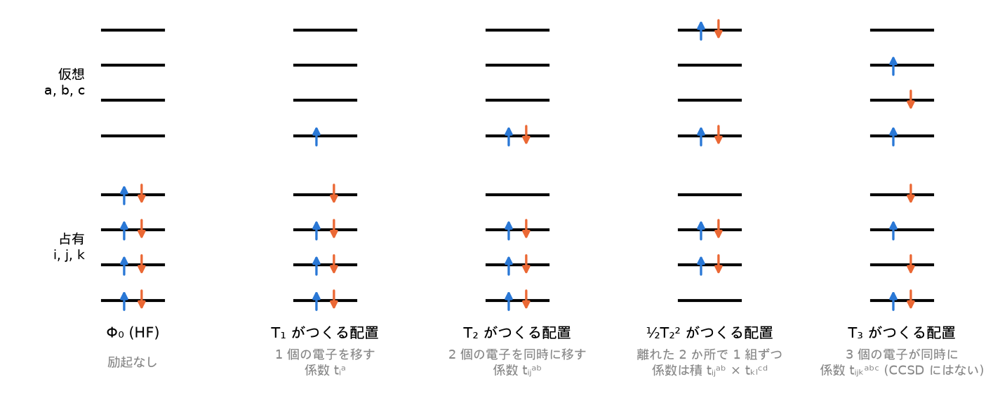
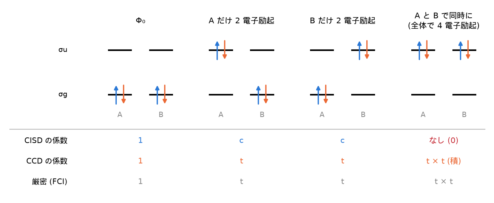
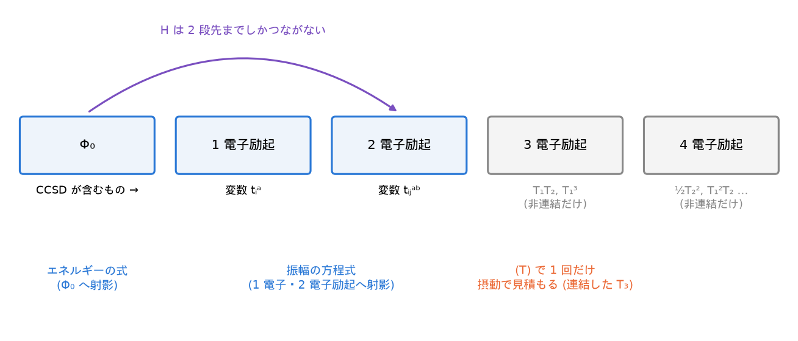
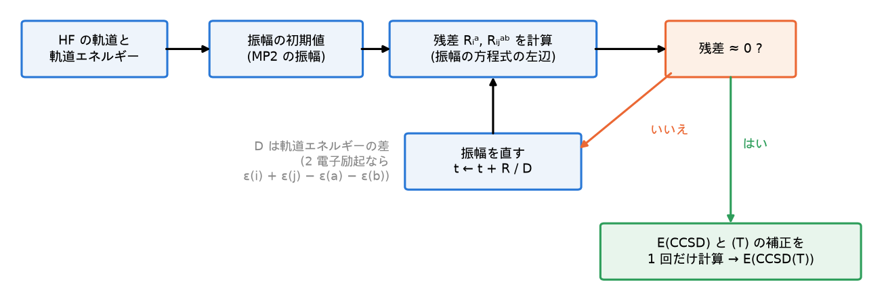
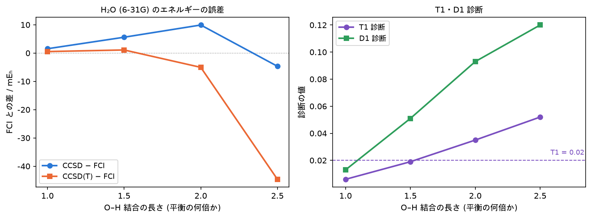
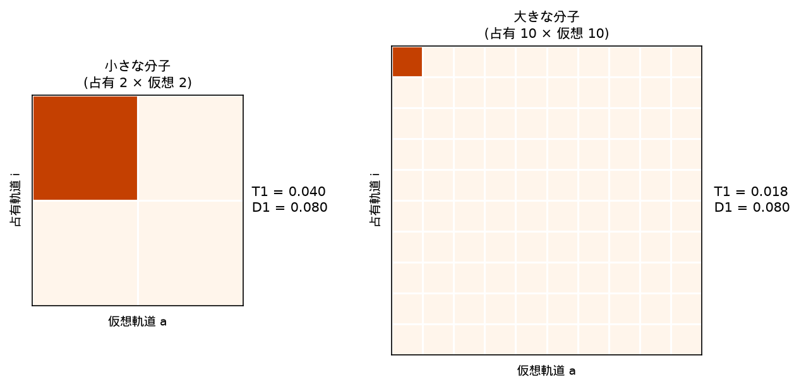

# 第 10 回　結合クラスター法：CCSD(T)

!!! abstract "この回の道筋"
    結合クラスター法（CC 法）は、励起演算子の指数関数で波動関数を表す方法です。指数関数の形のおかげで、CISD の弱点だったサイズ無矛盾性が自然に満たされます。この回では、CC 法の考え方から CCSD と CCSD(T) までを順に見ます。最小基底の H₂ を 2 個並べた例で行列を書き出し、なぜ指数関数がうまくいくのかを確かめます。そのあと、CCSD(T) が「ゴールドスタンダード」と呼ばれる理由と、それが破綻する場面を計算で確かめ、破綻を事前に見分ける T1・D1 診断を紹介します。

    | 節 | 内容 |
    |---|---|
    | 1 | 指数型の波動演算子 |
    | 2 | サイズ無矛盾性 |
    | 3 | CC の方程式と CCSD |
    | 4 | (T)：3 電子励起の摂動補正 |
    | 5 | 計算コスト |
    | 6 | 「ゴールドスタンダード」と、その限界 |
    | 7 | T1・D1 診断 |

    **前に読んでおく回**：[量子化学の理論 第 8 回](08-configuration-interaction.md)、[第 9 回](09-mp2.md)、[第 4 回](04-second-quantization.md)

!!! tip "物理的なイメージ"
    結合クラスター法が求めているのは、電子対の避け合い（2 電子励起）を、分子のあちこちで同時に、独立に起こせる形で表した波動関数です。励起演算子の指数関数 $e^{\hat T}$ を展開すると、2 電子励起を 2 か所で同時に起こした 4 電子励起なども、積の形で自動的に入ります。離れた 2 つの分子では、それぞれの中の励起の積がそのまま現れるので、エネルギーが足し算になります（サイズ無矛盾）。(T) は、3 個の電子が同時に避け合う効果を、摂動で安く見積もった補正です。

エネルギーは原子単位（ハートリー，$E_\mathrm{h}$）で書き、1 m$E_\mathrm{h}$ = 0.001 $E_\mathrm{h}$ ≈ 0.63 kcal/mol です。記号は第 8 回と同じで、$i, j, k, l$ は占有スピン軌道、$a, b, c, d$ は仮想スピン軌道、$\Phi_0$ は HF の決定子です。2 電子積分は、物理学者の表記で反対称化した $\langle pq \| rs \rangle = \langle pq | rs \rangle - \langle pq | sr \rangle$ を使います。2 節の H₂ の例だけは、空間軌道の化学者の表記 $(pq|rs)$ を使います。両者は $\langle pq | rs \rangle = (pr|qs)$ の関係にあります。

## 1. 指数型の波動演算子

### 1.1 励起演算子

CC 法では、励起配置を**励起演算子**でつくります。第二量子化（[第 4 回](04-second-quantization.md)）の生成演算子 $\hat a_a^\dagger$ はスピン軌道 $a$ に電子を 1 個入れ、消滅演算子 $\hat a_i$ はスピン軌道 $i$ から電子を 1 個取り去ります。そのため、$\hat a_a^\dagger \hat a_i$ を $\Phi_0$ に作用させると、$i$ の電子が $a$ に移った 1 電子励起配置 $\Phi_i^a$ ができます。2 電子励起配置も同じように定義します。

$$
\Phi_i^a = \hat a_a^\dagger \hat a_i\, \Phi_0, \qquad
\Phi_{ij}^{ab} = \hat a_a^\dagger \hat a_b^\dagger \hat a_j \hat a_i\, \Phi_0
$$

これらに係数をかけて足したものが、1 電子励起と 2 電子励起の演算子です。

$$
\hat T_1 = \sum_{ia} t_i^a\, \hat a_a^\dagger \hat a_i, \qquad
\hat T_2 = \frac14 \sum_{ijab} t_{ij}^{ab}\, \hat a_a^\dagger \hat a_b^\dagger \hat a_j \hat a_i
$$

係数 $t$ を**振幅**（amplitude）と呼びます。$\hat T_1 \Phi_0$ は 1 電子励起配置の和、$\hat T_2 \Phi_0$ は 2 電子励起配置の和です。3 電子励起の $\hat T_3$ なども同じように定義します（$\frac14$ のかわりに $\frac1{36}$ がつきます）。図 1 に、それぞれがつくる配置を示します。

$\hat T_2$ の $\frac14$ は、同じ配置を 4 回数えないための係数です。生成演算子どうし、消滅演算子どうしは入れ替えると符号が変わるので、$\Phi_{ji}^{ab} = -\Phi_{ij}^{ab}$、$\Phi_{ij}^{ba} = -\Phi_{ij}^{ab}$ です。振幅も同じ性質（$t_{ji}^{ab} = -t_{ij}^{ab}$ など）をもつように決めます。すると、和の中の 4 つの項 $(i,j,a,b)$、$(j,i,a,b)$、$(i,j,b,a)$、$(j,i,b,a)$ はすべて同じ値 $t_{ij}^{ab}\Phi_{ij}^{ab}$ になります。$\frac14$ をかけると、

$$
\hat T_2 \Phi_0 = \sum_{i<j} \sum_{a<b} t_{ij}^{ab}\, \Phi_{ij}^{ab}
$$

となり、異なる 2 電子励起配置が 1 回ずつ現れます。



**図 1**　横線がスピン軌道の組（空間軌道）のエネルギー、青の上向きの矢印が α 電子、橙の下向きの矢印が β 電子です。左端が HF の決定子 $\Phi_0$。$\hat T_1$ は電子 1 個を、$\hat T_2$ は電子 2 個を同時に、占有軌道から仮想軌道へ移します。4 番目は、$\hat T_2$ を 2 回かけてできる 4 電子励起で、上の組と下の組が独立に励起しています。この配置の係数は新しい変数ではなく、2 つの振幅の積です。右端の $\hat T_3$ は、3 個の電子が一体となって動く励起で、CCSD には含まれません（4 節）。

### 1.2 線形結合から指数関数へ

CI 法では、波動関数を $(1 + \hat C_1 + \hat C_2 + \cdots)\Phi_0$ の形の**線形結合**で表しました。$\hat C_n$ は $\hat T_n$ と同じ形で、係数が CI の係数のものです。CC 法では、これを**指数関数**に置き換えます [Čížek 1966]。

$$
\Psi_\mathrm{CC} = e^{\hat T} \Phi_0, \qquad \hat T = \hat T_1 + \hat T_2 + \cdots
$$

$e^{\hat T}$ を**波動演算子**と呼びます。CC 法の全体像は、総説 [Bartlett 2007] にまとまっています。

指数関数は、$e^{\hat T} = 1 + \hat T + \frac{1}{2!}\hat T^2 + \frac{1}{3!}\hat T^3 + \cdots$ の級数です。$\hat T_1$、$\hat T_2$ などは互いに交換するので（理由は付録 B）、ふつうの数の多項式と同じように展開できます。展開した項を、何個の電子を励起するかで分けると、次のようになります。

$$
\begin{aligned}
e^{\hat T}\Phi_0 = \Big[\, 1
&+ \underbrace{\hat T_1}_{\text{1 電子励起}}
+ \underbrace{\hat T_2 + \tfrac12 \hat T_1^2}_{\text{2 電子励起}}
+ \underbrace{\hat T_3 + \hat T_1 \hat T_2 + \tfrac16 \hat T_1^3}_{\text{3 電子励起}} \\
&+ \underbrace{\hat T_4 + \hat T_1 \hat T_3 + \tfrac12 \hat T_2^2 + \tfrac12 \hat T_1^2 \hat T_2 + \tfrac1{24} \hat T_1^4}_{\text{4 電子励起}} + \cdots \Big] \Phi_0
\end{aligned}
$$

たとえば 4 電子励起の $\frac12 \hat T_1^2 \hat T_2$ は、$\frac1{3!}(\hat T_1 + \hat T_2)^3$ を展開した中の $3\hat T_1^2\hat T_2$ に、$\frac16$ をかけたものです。

CI と比べると、CI の 2 電子励起の係数 $\hat C_2$ に当たるのが $\hat T_2 + \frac12\hat T_1^2$、4 電子励起の係数 $\hat C_4$ に当たるのが $\hat T_4 + \hat T_1\hat T_3 + \frac12\hat T_2^2 + \cdots$ です。$\hat T$ のすべての励起を入れれば、CC 法は CI の係数を別の名前で書き直しただけなので、FCI と同じ答えになります。違いが出るのは、$\hat T$ を途中で打ち切ったときです。

たとえば $\hat T = \hat T_2$ で打ち切ったとします。上の展開で $\hat T_1$、$\hat T_3$、$\hat T_4$ を 0 にすると、

$$
e^{\hat T_2} \Phi_0 = \Big(1 + \hat T_2 + \tfrac12 \hat T_2^2 + \tfrac16 \hat T_2^3 + \cdots\Big) \Phi_0
$$

が残ります。$\tfrac12 \hat T_2^2 \Phi_0$ は 4 電子励起配置です（図 1 の 4 番目）。ただし、その係数は独立な変数ではなく、2 電子励起の振幅の積 $t_{ij}^{ab} t_{kl}^{cd}$ で決まります。つまり CC 法は、「2 組の電子対が独立に、同時に励起する」寄与を、新しい変数を増やさずに取り込みます。このように振幅の積で表される高次の励起を、**非連結**（disconnected）な励起と呼びます。これに対し、$\hat T_3$ のように、3 個以上の電子が一体となって動く励起を**連結した**（connected）励起と呼びます。

**ここまでで分かったこと**：CC 法は、励起演算子 $\hat T$ の指数関数で波動関数を表します。$\hat T$ を打ち切っても、振幅の積の形で高次の励起（非連結な励起）が入ります。

## 2. サイズ無矛盾性

第 8 回で見たように、CISD は、離れた二つの分子 A と B の「同時の 2 電子励起」（全体で 4 電子励起）を含まないので、サイズ無矛盾ではありませんでした。最小基底の H₂ を例に、このことを行列で確かめ、CC 法ではこの問題が起きないことを見ます。

### 2.1 H₂ 1 個：2 行 2 列の行列

最小基底（STO-3G）の H₂ には、結合性の $\sigma_g$ と反結合性の $\sigma_u$ の 2 個の空間軌道しかありません。基底状態に効く配置は、HF の $\Phi_0 = |\sigma_g^2|$ と、2 個の電子を $\sigma_u$ に移した $D = |\sigma_u^2|$ の 2 個だけです（1 電子励起は、対称性が違うので混ざりません）。この 2 個の配置で、$\hat H - E_\mathrm{HF}$ の行列は次のようになります。

$$
\mathbf H - E_\mathrm{HF} =
\begin{pmatrix}
0 & K \\
K & \Delta
\end{pmatrix}
\begin{matrix} \leftarrow \Phi_0 \\ \leftarrow D \end{matrix}
$$

$K = (\sigma_g\sigma_u|\sigma_g\sigma_u)$ は、Slater–Condon の規則（第 8 回）から出る、2 電子励起の行列要素です。$\Delta = \langle D|\hat H|D\rangle - E_\mathrm{HF}$ は、$D$ の配置のエネルギーが HF よりどれだけ高いかを表します。R = 0.74 Å では $K = 0.18121\ E_\mathrm{h}$、$\Delta = 1.57938\ E_\mathrm{h}$ でした。

2 行 2 列の行列の小さいほうの固有値が、相関エネルギーです。

$$
e = \frac{\Delta - \sqrt{\Delta^2 + 4K^2}}{2} = -0.020525\ E_\mathrm{h}
$$

固有ベクトルを、$\Phi_0$ の係数が 1 になるように書くと $(1,\ t)$ で、$t = -0.11326$ です。配置が 2 個しかないので、この H₂ では CISD も FCI も同じ答えです。

### 2.2 H₂ 2 個：CISD では足りない

この H₂ を 2 個（A と B）、互いに十分に離して置きます。配置は、$\Phi_0$、A だけを励起した $D_\mathrm A$、B だけを励起した $D_\mathrm B$、両方を同時に励起した $D_\mathrm{AB}$（全体で 4 電子励起）の 4 個です。$\Phi_0$ と $D_\mathrm{AB}$ は 4 個のスピン軌道で違うので、行列要素は 0 です。$D_\mathrm A$ と $D_\mathrm B$ も同じ理由で 0 です。残りの要素は、H₂ 1 個のときと同じ $K$ と $\Delta$ です。

$$
\mathbf H - E_\mathrm{HF} =
\begin{pmatrix}
0 & K & K & 0 \\
K & \Delta & 0 & K \\
K & 0 & \Delta & K \\
0 & K & K & 2\Delta
\end{pmatrix}
\begin{matrix} \leftarrow \Phi_0 \\ \leftarrow D_\mathrm A \\ \leftarrow D_\mathrm B \\ \leftarrow D_\mathrm{AB} \end{matrix}
$$

ここで $E_\mathrm{HF}$ は、2 個の H₂ を合わせた系の HF のエネルギーです。右下の $2\Delta$ は、A と B の両方を励起すると、励起のエネルギーが 2 倍になることを表します。

この 4 行 4 列の行列（FCI）の最も低い固有値は $2e$、固有ベクトルは $(1,\ t,\ t,\ t^2)$ です。たとえば 1 行目は $0\cdot 1 + K t + K t + 0 \cdot t^2 = 2Kt$ で、H₂ 1 個の固有値の関係 $e = Kt$（2 行 2 列の 1 行目）を使うと $2e \cdot 1$ に等しくなります。残りの行も同じように確かめられます。$D_\mathrm{AB}$ の係数 $t^2$ は、A の励起の係数と B の励起の係数の積です。独立な 2 つの系では、「両方が同時に励起している確率の振幅」は、それぞれの振幅の積になる、という当たり前のことを表しています。

CISD は、4 電子励起の $D_\mathrm{AB}$ を含まないので、上の行列の左上の 3 行 3 列だけを使います。$S = (D_\mathrm A + D_\mathrm B)/\sqrt2$ という組み合わせを使うと、$\langle \Phi_0|\hat H|S\rangle = (K + K)/\sqrt2 = \sqrt2 K$、$\langle S|\hat H - E_\mathrm{HF}|S\rangle = \Delta$ なので、問題は次の 2 行 2 列に縮みます（差の組み合わせ $(D_\mathrm A - D_\mathrm B)/\sqrt2$ は $\Phi_0$ と結合しないので、基底状態には効きません）。

$$
\begin{pmatrix}
0 & \sqrt2 K \\
\sqrt2 K & \Delta
\end{pmatrix}
\quad\Longrightarrow\quad
e_\mathrm{CISD} = \frac{\Delta - \sqrt{\Delta^2 + 8K^2}}{2} = -0.040542\ E_\mathrm{h}
$$

正しい値 $2e = -0.041049\ E_\mathrm{h}$ より 0.5 m$E_\mathrm{h}$ 高くなりました。H₂ 1 個の行列と比べると、非対角の要素は $K$ から $\sqrt2 K$ に増えましたが、対角の $\Delta$ は変わりません。そのため、固有値はちょうど 2 倍の $2e$ にはなりません。分子の数が増えるほど、このずれは大きくなります。

### 2.3 CC では積が自動的に入る

CC 法で同じ系を考えます。A の中の 2 電子励起の演算子を $\hat\tau_\mathrm A$（$\hat\tau_\mathrm A \Phi_0 = D_\mathrm A$）、B のものを $\hat\tau_\mathrm B$ とすると、$\hat T = t_\mathrm A \hat\tau_\mathrm A + t_\mathrm B \hat\tau_\mathrm B$ です。最小基底の H₂ では、2 電子励起を 2 回続けることはできないので（$\sigma_g$ にもう電子がない）、$\hat\tau_\mathrm A^2 = 0$ です。そのため、指数関数は 1 次で終わります。

$$
e^{t_\mathrm A \hat\tau_\mathrm A} = 1 + t_\mathrm A \hat\tau_\mathrm A
$$

$\hat\tau_\mathrm A$ と $\hat\tau_\mathrm B$ は別々の軌道に作用するので交換し、$e^{\hat T} = e^{t_\mathrm A\hat\tau_\mathrm A} e^{t_\mathrm B\hat\tau_\mathrm B}$ と積に分かれます。これを $\Phi_0$ に作用させると、

$$
e^{\hat T}\Phi_0 = (1 + t_\mathrm A \hat\tau_\mathrm A)(1 + t_\mathrm B \hat\tau_\mathrm B)\Phi_0
= \Phi_0 + t_\mathrm A D_\mathrm A + t_\mathrm B D_\mathrm B + t_\mathrm A t_\mathrm B D_\mathrm{AB}
$$

となります。$D_\mathrm{AB}$ の係数が、FCI と同じ積の形 $t_\mathrm A t_\mathrm B$ で、自動的に入りました。変数は $t_\mathrm A$ と $t_\mathrm B$ の 2 個だけで、CISD と同じです。3.4 節で、振幅の方程式を解くと $t_\mathrm A = t_\mathrm B = t$ になり、エネルギーがちょうど $2e$ になることを確かめます。



**図 2**　離れた 2 個の H₂（A と B）の 4 つの配置。表の 1 行目は CISD の係数で、右端の「A と B で同時に励起」した配置を含みません（赤）。2 行目は 2 電子励起だけの CC（CCD）で、右端の係数が $t \times t$ の積として自動的に入ります。3 行目の厳密な解（FCI）も同じ形です。

一般の場合も同じです。A と B が十分に離れているとき、$\hat T$ は A の中の励起 $\hat T_\mathrm A$ と B の中の励起 $\hat T_\mathrm B$ の和になります。二つは別々の軌道に作用するので交換し、指数関数は積に分かれます。

$$
e^{\hat T_\mathrm A + \hat T_\mathrm B} \Phi_0 = e^{\hat T_\mathrm A} e^{\hat T_\mathrm B} \Phi_0
$$

これは、A と B の CC の波動関数の積です。$\hat T$ を CCSD のように打ち切っても、この積の形は崩れません。

### 2.4 計算で確かめる

第 8 回と同じ計算（H₂ を 50 Å 離して $n$ 個並べる）を、CCSD（3 節）で行います。基底関数は cc-pVDZ です。

```python
from pyscf import gto, scf, cc

print("n   E_c(CCSD)/n")
for n in [1, 2, 4, 8]:
    atoms = "; ".join(f"H {50*k} 0 0; H {50*k} 0 0.74" for k in range(n))
    mol = gto.M(atom=atoms, basis="cc-pvdz", verbose=0)
    mf = scf.RHF(mol).run()
    mycc = cc.CCSD(mf).run()
    print(f"{n}  {mycc.e_corr / n:12.5f}")
```

```
n   E_c(CCSD)/n
1      -0.03467
2      -0.03467
4      -0.03467
8      -0.03467
```

CISD では、1 分子あたりの相関エネルギーが $n = 8$ で $-0.03138$ まで減りました。CCSD では、$n$ によらず正しい値 $-0.03467$（H₂ 1 個の FCI の値）のままです。

**ここまでで分かったこと**：独立な 2 つの系の厳密な波動関数では、同時の励起の係数がそれぞれの係数の積になります。指数関数は和を積に変えるので、CC 法は打ち切っても（CCSD でも）この積を自動的に含み、サイズ無矛盾になります。

## 3. CC の方程式と CCSD

### 3.1 振幅の決め方：変分ではなく射影

CI 法では、変分法で係数を決めました。CC 法で同じことをすると、エネルギーは

$$
E = \frac{\langle e^{\hat T}\Phi_0 | \hat H | e^{\hat T}\Phi_0 \rangle}{\langle e^{\hat T}\Phi_0 | e^{\hat T}\Phi_0 \rangle}
$$

になります。左側の $e^{\hat T}$ の展開は、$\hat T$ を打ち切っても、電子の数までのすべての励起を含みます（1.2 節の $\hat T_2^2$、$\hat T_2^3$、…）。そのため、この式は項が電子の数とともに増え続け、実用になりません。そこで CC 法では、次の手順の**射影**で振幅を決めます。

Schrödinger 方程式に $\Psi = e^{\hat T}\Phi_0$ を入れると、

$$
\hat H e^{\hat T} \Phi_0 = E\, e^{\hat T} \Phi_0
$$

です。両辺に、左から $e^{-\hat T}$ をかけます。右辺は $e^{-\hat T} e^{\hat T} = 1$ なので $E\,\Phi_0$ になります。

$$
\bar H \Phi_0 = E\, \Phi_0, \qquad \bar H = e^{-\hat T} \hat H e^{\hat T}
$$

$\bar H$ を**相似変換したハミルトニアン**と呼びます。この式は、「$\bar H$ を $\Phi_0$ に作用させると、$\Phi_0$ の $E$ 倍だけが残り、励起配置の成分は 0 になる」と言っています。そこで、両辺と $\Phi_0$、1 電子励起配置 $\Phi_i^a$、2 電子励起配置 $\Phi_{ij}^{ab}$ との内積をとります。右辺は、$\langle \Phi_0 | \Phi_0 \rangle = 1$ と、$\langle \Phi_i^a | \Phi_0 \rangle = \langle \Phi_{ij}^{ab} | \Phi_0 \rangle = 0$ から、

$$
E = \langle \Phi_0 | \bar H | \Phi_0 \rangle, \qquad
0 = \langle \Phi_i^a | \bar H | \Phi_0 \rangle, \qquad
0 = \langle \Phi_{ij}^{ab} | \bar H | \Phi_0 \rangle
$$

となります。後の二つが、振幅 $t_i^a$ と $t_{ij}^{ab}$ を決める連立方程式（**振幅方程式**）です。変数（$t_i^a$ と $t_{ij}^{ab}$）と方程式の数は同じです。振幅について非線形なので、反復して解きます（3.5 節）。

CC 法のエネルギーは、変分法で求めたものではありません。$E = \langle \Phi_0 | e^{-\hat T}\hat H e^{\hat T}| \Phi_0 \rangle$ は、左側が $e^{-\hat T}$ で、右側の $e^{\hat T}$ のエルミート共役 $e^{\hat T^\dagger}$ ではないので、ある波動関数の期待値になっていないからです。そのため、CI 法と違って、FCI より低いエネルギーが出ることもあります（6 節で実例を見ます）。

### 3.2 相似変換したハミルトニアンは有限の項で終わる

$\bar H$ は、交換子 $[\hat A, \hat B] = \hat A\hat B - \hat B\hat A$ の級数（Baker–Campbell–Hausdorff 展開）で書けます。導き方は付録 B に回しますが、結果は次のとおりです。

$$
\bar H = \hat H + [\hat H, \hat T] + \frac{1}{2!}[[\hat H, \hat T], \hat T] + \frac{1}{3!}[[[\hat H, \hat T], \hat T], \hat T] + \frac{1}{4!}[[[[\hat H, \hat T], \hat T], \hat T], \hat T]
$$

この級数は、4 重の交換子で**ちょうど終わります**。理由は次のとおりです（付録 B で、1 電子演算子の例ですべての段階を確かめます）。

- $\hat T$ の中の演算子どうしは交換するので、$\hat T$ と $\hat T$ の交換子は 0 です。交換子 $[\cdot, \hat T]$ が 0 にならないのは、$\hat T$ が $\hat H$ の中の生成・消滅演算子と「かみ合う」（添字が一致して $\delta$ が出る）ときだけです。
- 交換子を 1 回とるごとに、$\hat H$ の演算子が少なくとも 1 個、$\hat T$ とかみ合って使われます。
- $\hat H$ の 2 電子の部分は、生成・消滅演算子を 4 個しか含みません（[第 4 回](04-second-quantization.md)）。そのため、$\hat T$ とかみ合えるのは 4 回までで、5 重の交換子は 0 になります。

このため、振幅方程式は有限の項で書けます。具体的な項の一覧は [Crawford 2000] にあります。

### 3.3 エネルギーの式

エネルギーの式は特に簡単です。導出のすべての段階は付録 A に回しますが、要点は次の 2 つです。

1. $\langle \Phi_0 | e^{-\hat T} = \langle \Phi_0 |$ です。$\hat T^\dagger$ は電子を仮想軌道から占有軌道に戻す演算子で、$\Phi_0$ の仮想軌道には電子がないので $\hat T^\dagger\Phi_0 = 0$、つまり $\langle \Phi_0 | \hat T = 0$ だからです。よって $E = \langle \Phi_0 | \hat H e^{\hat T} | \Phi_0 \rangle$ です。
2. $\hat H$ は 2 電子演算子なので、$\Phi_0$ と 3 電子以上違う配置との行列要素は 0 です（Slater–Condon の規則）。そのため、$e^{\hat T}\Phi_0$ のうち、1 電子励起と 2 電子励起の部分だけが効きます。

HF の軌道を使うと $\langle \Phi_0 | \hat H | \Phi_i^a \rangle = f_{ia} = 0$（Brillouin の定理、第 8 回）なので、

$$
E_\mathrm{CC} = E_\mathrm{HF} + \sum_{i<j} \sum_{a<b} \langle ij \| ab \rangle \big( t_{ij}^{ab} + t_i^a t_j^b - t_i^b t_j^a \big)
$$

となります。第 8 回で、厳密な相関エネルギーは 2 電子励起の係数で決まることを見ました。CC 法では、その係数が 1.2 節の「2 電子励起」の組 $\hat T_2 + \frac12 \hat T_1^2$ の係数、$t_{ij}^{ab} + t_i^a t_j^b - t_i^b t_j^a$ に置き換わっています。

### 3.4 小さな例：振幅方程式を解いてみる

2 節の最小基底の H₂ で、振幅方程式を書き下します。

**H₂ 1 個**：$\hat T = t\hat\tau$（$\hat\tau\Phi_0 = D$、$\hat\tau^2 = 0$）です。$e^{\pm t\hat\tau} = 1 \pm t\hat\tau$ なので、$\bar H = (1 - t\hat\tau)\hat H(1 + t\hat\tau)$ です。$D$ への射影を、1 段ずつ計算します。

- $\langle D | (1 - t\hat\tau) = \langle D | - t \langle \Phi_0 |$ です。$\hat\tau^\dagger D = \Phi_0$ なので $\langle D | \hat\tau = \langle \Phi_0 |$ だからです。
- $\hat H(1 + t\hat\tau)\Phi_0 = \hat H\Phi_0 + t\hat H D$ です。
- 2.1 節の行列から、$\langle D|\hat H|\Phi_0\rangle = K$、$\langle D|\hat H|D\rangle = E_\mathrm{HF} + \Delta$、$\langle \Phi_0|\hat H|\Phi_0\rangle = E_\mathrm{HF}$、$\langle \Phi_0|\hat H|D\rangle = K$ です。

これらを合わせると、

$$
\langle D | \bar H | \Phi_0 \rangle
= \big[K + t(E_\mathrm{HF} + \Delta)\big] - t\big[E_\mathrm{HF} + tK\big]
= K + \Delta\, t - K t^2
$$

です。振幅方程式は $K + \Delta t - K t^2 = 0$ という 2 次方程式で、絶対値の小さいほうの解が $t = -0.11326$ です。エネルギーは $E = E_\mathrm{HF} + Kt$ なので、相関エネルギーは $Kt = -0.020525\ E_\mathrm{h}$ になり、2.1 節の FCI と一致します。

**H₂ 2 個**：$\hat T = t_\mathrm A\hat\tau_\mathrm A + t_\mathrm B\hat\tau_\mathrm B$ です。$D_\mathrm A$ への射影を同じ手順で計算します。

- $\langle D_\mathrm A | e^{-\hat T} = \langle D_\mathrm A | - t_\mathrm A\langle \Phi_0 |$ です（$\langle D_\mathrm A|\hat\tau_\mathrm B = 0$ なので、B の演算子は効きません）。
- $e^{\hat T}\Phi_0 = \Phi_0 + t_\mathrm A D_\mathrm A + t_\mathrm B D_\mathrm B + t_\mathrm A t_\mathrm B D_\mathrm{AB}$ です（2.3 節）。
- 2.2 節の 4 行 4 列の行列から、$\langle D_\mathrm A|\hat H|D_\mathrm{AB}\rangle = K$、$\langle D_\mathrm A|\hat H|D_\mathrm B\rangle = 0$ です。

$$
\begin{aligned}
\langle D_\mathrm A | \bar H | \Phi_0 \rangle
&= \big[K + t_\mathrm A(E_\mathrm{HF} + \Delta) + 0 + t_\mathrm A t_\mathrm B K\big] - t_\mathrm A\big[E_\mathrm{HF} + t_\mathrm A K + t_\mathrm B K\big] \\
&= K + \Delta\, t_\mathrm A - K t_\mathrm A^2
\end{aligned}
$$

2 行目に移るとき、B の振幅を含む $t_\mathrm A t_\mathrm B K$ が、1 つ目の括弧（$D_\mathrm{AB}$ からの寄与）と 2 つ目の括弧（$e^{-\hat T}$ からの寄与）で打ち消し合いました。残った式は、H₂ 1 個の方程式とまったく同じです。そのため $t_\mathrm A = t$、同様に $t_\mathrm B = t$ で、エネルギーは $E_\mathrm{HF} + K(t_\mathrm A + t_\mathrm B) = E_\mathrm{HF} + 2e$ です。CISD では $-0.040542\ E_\mathrm{h}$ でしたが、CC では正しい $-0.041049\ E_\mathrm{h}$ が得られます。

この打ち消し合いが、CC の方程式の中で起きている「サイズ無矛盾性のしくみ」です。左からかけた $e^{-\hat T}$ が、別の分子の振幅だけを含む項を取り除いています。

### 3.5 CCSD と、方程式の解き方

$\hat T = \hat T_1 + \hat T_2$ で打ち切った CC 法を **CCSD**（CC singles and doubles）と呼びます [Purvis 1982]。CCSD は、変数の数は CISD と同じですが、指数関数の展開を通して $\hat T_2^2$（非連結な 4 電子励起）や $\hat T_1 \hat T_2$（非連結な 3 電子励起）などを含みます。

図 3 に、どの方程式がどの配置とつながっているかをまとめます。$\hat H$ は、励起の数が 2 以下しか違わない配置どうしをつなぎます。そのため、エネルギーの式（$\Phi_0$ への射影）には 2 電子励起までが、2 電子励起への射影には 4 電子励起（$\frac12\hat T_2^2$ など）までが効きます。



**図 3**　励起の数で並べた配置の段。青の枠の段（$\Phi_0$、1 電子励起、2 電子励起）が、CCSD の方程式で射影する相手です。1 電子・2 電子励起には変数の振幅があり、3 電子・4 電子励起には、振幅の積でできる非連結な寄与だけがあります（灰色）。紫の弧は、$\hat H$ が 2 段先までしかつながないことを表します。連結した 3 電子励起 $\hat T_3$ は CCSD に含まれず、(T) で見積もります（4 節）。

振幅方程式は、ふつう次の手順で反復して解きます（図 4）。

1. 初期値として、MP2 の振幅 $t_{ij}^{ab} = \langle ij\|ab\rangle / D_{ij}^{ab}$ を使います。$D_{ij}^{ab} = \varepsilon_i + \varepsilon_j - \varepsilon_a - \varepsilon_b$ は、第 9 回の軌道エネルギーの差です。
2. 今の振幅で、振幅方程式の左辺（**残差**）$R_{ij}^{ab} = \langle \Phi_{ij}^{ab}|\bar H|\Phi_0\rangle$ と $R_i^a$ を計算します。
3. 残差の中で $t_{ij}^{ab}$ に比例する最も大きな項は、軌道エネルギーの差の部分 $-D_{ij}^{ab}\,t_{ij}^{ab}$ です。そこで、振幅を $t_{ij}^{ab} \leftarrow t_{ij}^{ab} + R_{ij}^{ab}/D_{ij}^{ab}$ と直します（$t_i^a$ も同様）。
4. 残差がほぼ 0 になるまで、2 と 3 を繰り返します。



**図 4**　CCSD(T) の計算の流れ。MP2 の振幅から出発し、残差を計算して振幅を直す反復（中央の輪）を、残差がほぼ 0 になるまで繰り返します。収束した振幅で CCSD のエネルギーを計算し、最後に (T) の補正を 1 回だけ計算して足します。

**ここまでで分かったこと**：CC 法の振幅は、相似変換したハミルトニアンへの射影で決めます。方程式は有限の項で書けますが、エネルギーは変分的ではありません。小さな例では、$e^{-\hat T}$ が別の分子の振幅の項を打ち消し、サイズ無矛盾性が保たれることを確かめました。CCSD は $\hat T_1$ と $\hat T_2$ までを使う CC 法です。

## 4. (T)：3 電子励起の摂動補正

CCSD が含まない最も大きな寄与は、**連結した** 3 電子励起、つまり $\hat T_3$ です（図 1 の右端）。$\hat T_3$ まで含めた CCSDT は正確ですが、計算量が $N^8$ に比例し、小さな分子にしか使えません（5 節）。

そこで、$\hat T_3$ の寄与を摂動論で見積もり、CCSD のエネルギーに足します。これが **CCSD(T)** です [Raghavachari 1989]。括弧の (T) は、3 電子励起（triples）を反復せずに摂動で入れたことを表します。

考え方は、第 9 回の MP2 と同じ形です。MP2 では、2 電子励起の振幅を「結合 ÷ エネルギーの差」で見積もり、それを使ってエネルギーを計算しました。

$$
t_{ij}^{ab} = \frac{\langle ab\|ij\rangle}{D_{ij}^{ab}}, \qquad
E_\mathrm{MP2} = \frac14 \sum_{ijab} \frac{|\langle ij\|ab\rangle|^2}{D_{ij}^{ab}}
$$

(T) では、これを 1 段上の 3 電子励起で行います。

1. まず CCSD を解き、$t_i^a$ と $t_{ij}^{ab}$ を得ます。
2. 3 電子励起の配置 $\Phi_{ijk}^{abc}$ と、CCSD の 2 電子励起の部分 $\hat T_2\Phi_0$ の間を、$\hat H$ でつなぎます。図 3 のとおり、$\hat H$ は 2 電子励起から 3 電子励起へ 1 段上がることができます。このつながりの大きさ（連結した部分だけ）を $W_{ijk}^{abc}$ と書きます。
3. 3 電子励起の振幅を、MP2 と同じ「結合 ÷ エネルギーの差」で、**一度だけ**見積もります。

    $$
    t_{ijk}^{abc} \approx \frac{W_{ijk}^{abc}}{D_{ijk}^{abc}}, \qquad D_{ijk}^{abc} = \varepsilon_i + \varepsilon_j + \varepsilon_k - \varepsilon_a - \varepsilon_b - \varepsilon_c
    $$

4. その振幅から、エネルギーの補正を計算します。主な項は、MP2 の式と同じ形の

    $$
    E_\mathrm T^{[4]} = \frac{1}{36} \sum_{ijkabc} \frac{|W_{ijk}^{abc}|^2}{D_{ijk}^{abc}}
    $$

    です。$\frac1{36} = \left(\frac1{3!}\right)^2$ は、MP2 の $\frac14 = \left(\frac1{2!}\right)^2$ と同じく、添字の並べ替えで同じ項を重複して数えないための係数です。分母 $D$ は負なので、補正はエネルギーを下げます。

(T) にはもう一つ、1 電子励起の振幅 $t_i^a$ と 3 電子励起の振幅の結合から来る項 $E_\mathrm{ST}^{[5]}$ も加えます [Raghavachari 1989]。名前の [4] と [5] は、摂動論の何次で現れる項かを表します。$\hat T_2$ は摂動の 1 次から始まるので、それを $\hat H$ で 1 段上げた $t_{ijk}^{abc}$ は 2 次、その 2 乗のエネルギーは 4 次です。$E_\mathrm{ST}^{[5]}$ は、2 次から始まる $t_i^a$ が加わるので 5 次になります。

この形から、(T) の弱点も分かります。補正は分母 $D_{ijk}^{abc}$ が小さいと大きくなります。占有軌道と仮想軌道のエネルギーが近づく場面（結合が切れかけた分子など）では、MP2 と同じように見積もりが過大になります（6 節）。

**ここまでで分かったこと**：CCSD(T) は、CCSD の振幅を使って、連結した 3 電子励起の振幅を「結合 ÷ エネルギーの差」で一度だけ見積もり、そのエネルギーを足す方法です。式の形は MP2 と同じで、分母が小さいと過大になります。

## 5. 計算コスト

占有軌道の数を $o$、仮想軌道の数を $v$ とします。系の大きさ $N$ に対して $o, v \propto N$ です。計算量は、式の中で同時に回る添字の数で決まります。

- **CCSD**：$t_{ij}^{ab}$ の残差には、$\frac12 \sum_{cd} \langle ab\|cd\rangle\, t_{ij}^{cd}$ という項があります。$i, j$（占有 2 個）と $a, b, c, d$（仮想 4 個）を同時に回るので、$o^2 v^4$ 回の掛け算が要ります。これが CCSD で最も重い項で、反復のたびに計算します。
- **(T)**：$W_{ijk}^{abc}$ には、$t_{jk}^{ae}$ と、仮想軌道 3 個と占有軌道 1 個の添字（$e, b, c$ と $i$）をもつ積分の積を、$e$ について足す項があります。$i, j, k, a, b, c, e$ の 7 個を回るので $o^3 v^4$ です。反復はせず、1 回だけ計算します。

| 手法 | 最も重い計算 | 次数 | 反復 |
|---|---|---|---|
| MP2 | 積分の変換 | $N^5$ | なし |
| CCSD | $o^2 v^4$ | $N^6$ | あり |
| (T) | $o^3 v^4$ | $N^7$ | なし（1 回） |
| CCSDT | $o^3 v^5$ | $N^8$ | あり |

CCSD(T) の計算量は $N^7$ です。系の大きさが 2 倍になると、計算時間はおよそ $2^7 = 128$ 倍になります。また、振幅 $t_{ij}^{ab}$ だけで $o^2 v^2$ 個の数があり、必要なメモリやディスクもこれ以上の速さで増えます。このため、通常の CCSD(T) を使えるのは、比較的小さな分子に限られます。大きな分子に CCSD(T) を使うための工夫が、[第 11 回](11-dlpno-ccsd-t.md)の局所相関法です。

**ここまでで分かったこと**：CCSD は $N^6$ の反復計算、(T) は $N^7$ の一度きりの計算です。次数は、式の中で同時に回る添字の数から分かります。

## 6. 「ゴールドスタンダード」と、その限界

### 計算で比べる

第 8 回と同じ H₂O（6-31G 基底）で、CCSD と CCSD(T) を FCI と比べます。結合の長さを平衡の 1.0 倍から 2.5 倍まで変えます。最後の二つの列（T1、D1）は 7 節で使います。

```python
import numpy as np
from pyscf import gto, scf, cc, fci

def h2o(scale):
    """平衡構造（O–H 0.96 Å、HOH 104.5°）の O–H 結合を scale 倍に伸ばす。"""
    r, th = 0.96 * scale, np.deg2rad(104.5) / 2
    return f"O 0 0 0; H 0 {r*np.sin(th):.6f} {r*np.cos(th):.6f}; H 0 {-r*np.sin(th):.6f} {r*np.cos(th):.6f}"

print("scale  CCSD-FCI  CCSD(T)-FCI    T1     D1   (単位 mEh)")
for scale in [1.0, 1.5, 2.0, 2.5]:
    mol = gto.M(atom=h2o(scale), basis="6-31g", verbose=0)
    mf = scf.RHF(mol).run()
    mycc = cc.CCSD(mf).run()
    e_t = mycc.ccsd_t()
    e_fci = fci.FCI(mf).kernel()[0]
    d_ccsd = (mycc.e_tot - e_fci) * 1000
    d_t = (mycc.e_tot + e_t - e_fci) * 1000
    print(f"{scale:4.1f} {d_ccsd:9.2f} {d_t:11.2f}"
          f"  {mycc.get_t1_diagnostic():6.3f} {mycc.get_d1_diagnostic():6.3f}")
```

```
scale  CCSD-FCI  CCSD(T)-FCI    T1     D1   (単位 mEh)
 1.0      1.53        0.53   0.006  0.013
 1.5      5.60        1.10   0.019  0.051
 2.0      9.92       -5.05   0.035  0.093
 2.5     -4.67      -44.63   0.052  0.120
```

FCI の計算に時間がかかるので、全体で数分かかります（T1、D1 の列は、T1 と D1 の診断の値で、単位はありません）。



**図 5**　上の表をグラフにしたもの。左：FCI との差。平衡構造（1.0 倍）では CCSD(T)（橙）はほぼ 0 ですが、2.0 倍から FCI より下にずれ始め、2.5 倍では $-45$ m$E_\mathrm{h}$ まで落ち込みます。CCSD（青）は 2.0 倍まで上にずれ、2.5 倍で下に転じます。右：T1 診断（紫）と D1 診断（緑）。どちらも結合を伸ばすにつれて増え、T1 は 1.5 倍と 2.0 倍の間で目安の 0.02（破線）を超えます。

### 平衡構造では非常に正確

平衡構造では、CCSD(T) と FCI の差は 0.53 m$E_\mathrm{h}$（約 0.3 kcal/mol）です。第 8 回の CISD（6.8 m$E_\mathrm{h}$）や、第 9 回の MP2（8.1 m$E_\mathrm{h}$）よりはるかに小さく、CCSD（1.53 m$E_\mathrm{h}$）と比べても (T) で誤差が 3 分の 1 になっています。

このように、1 個の決定子が波動関数の大部分を占める分子（単参照性の強い分子）では、CCSD(T) は同じ基底関数の FCI に非常に近い値を与えます。しかもサイズ無矛盾で、$N^7$ の計算量で済みます。このため CCSD(T) は、ほかの手法の精度を測る基準として広く使われ、「ゴールドスタンダード」と呼ばれることがあります。

ただし、ここで比べたのは「同じ基底関数の中での FCI との差」です。実験値に近い値を得るには、基底関数も十分に大きくする（完全基底の極限に外挿する）必要があります。小さな基底関数での CCSD(T) は、手法としては正確でも、答えとしては不正確です。

### 結合を伸ばすと破綻する

結合を伸ばすと、様子が変わります（図 5 の左）。

- 1.5 倍では、CCSD(T) の誤差は 1.1 m$E_\mathrm{h}$ で、まだ良い精度です。
- 2.0 倍では、CCSD(T) のエネルギーが FCI より 5 m$E_\mathrm{h}$ **低く**なります。3.1 節で見たとおり、CC 法のエネルギーは変分的でないので、こうしたことが起こります。
- 2.5 倍では、CCSD(T) は FCI より 45 m$E_\mathrm{h}$（約 28 kcal/mol）も低くなり、まったく信頼できません。

原因は、第 7 回の静的相関です。結合を伸ばすと、結合性軌道と反結合性軌道のエネルギーが近づき、HF の決定子の重みが下がります（第 8 回の $c_0^2$ を参照）。2.1 節の H₂ の行列でいえば、$\Delta$ が小さくなり、振幅 $t$ が大きくなる状況です。CCSD はまだある程度対応できますが、(T) の補正は 4 節の式のとおり分母 $D_{ijk}^{abc}$ で割る摂動論なので、第 9 回の MP 級数と同じく、軌道エネルギーの差が小さい状況で過大になります。結合の解離、ビラジカル、多くの遷移金属錯体のように**多参照性**（複数の配置が大きな重みで混ざる性質）が強い系では、CCSD(T) を「ゴールドスタンダード」として信じてはいけません。

**ここまでで分かったこと**：単参照性の強い分子では、CCSD(T) は FCI に非常に近く、基準として使われます。多参照性が強くなると、(T) は破綻し、FCI より大きく下にずれることもあります。

## 7. T1・D1 診断

CCSD(T) が信頼できるかどうかを、FCI と比べずに見分ける目安があります。代表的なものが、CCSD の 1 電子励起の振幅 $t_i^a$ を使う二つの診断です。ここでは閉殻の分子で、$t_i^a$ を空間軌道の振幅とします。

$t_i^a$ は、行を占有軌道 $i$、列を仮想軌道 $a$ とする行列 $\mathbf t$ と見ることができます。占有 2 個 × 仮想 2 個なら、

$$
\mathbf t =
\begin{pmatrix}
t_1^1 & t_1^2 \\
t_2^1 & t_2^2
\end{pmatrix}
\begin{matrix} \leftarrow \text{占有 } 1 \\ \leftarrow \text{占有 } 2 \end{matrix}
$$

です（上つきの添字が仮想軌道の番号です）。

**T1 診断**は、$\mathbf t$ のすべての要素の 2 乗和の平方根（ベクトルとしての長さ）を、相関させた電子の数 $N$ の平方根で割ったものです [Lee 1989]（書誌は末尾の「関連リンク」にあります）。

$$
\mathcal T_1 = \sqrt{\frac{\sum_{ia} (t_i^a)^2}{N}}
$$

多参照性が強いと、HF の軌道が良い出発点でなくなり、それを補うために 1 電子励起の振幅が大きくなります。$e^{\hat T_1}$ は軌道を少し回転させる効果をもつので、$t_i^a$ の大きさは「HF の軌道をどれだけ直す必要があったか」を表すと考えられます。Lee と Taylor は、$\mathcal T_1$ が 0.02 を超えると、単参照の手法の信頼性が下がり、多参照の手法が必要になる可能性が高いとしました。

**D1 診断**は、$\mathbf t\mathbf t^\mathsf T$ の最大固有値の平方根（$\mathbf t$ の最大の特異値）です [Janssen 1998]。上の 2 × 2 の例では、

$$
\mathbf t \mathbf t^\mathsf T =
\begin{pmatrix}
(t_1^1)^2 + (t_1^2)^2 & t_1^1 t_2^1 + t_1^2 t_2^2 \\
t_2^1 t_1^1 + t_2^2 t_1^2 & (t_2^1)^2 + (t_2^2)^2
\end{pmatrix}
$$

の大きいほうの固有値の平方根です。$\mathcal T_1$ は全体の平均なので、分子の一部だけで振幅が大きいと、大きな分子では薄まってしまいます。D1 は最も大きな「方向」を見るので、この薄まりが起きにくい量です。

小さな例で確かめます。占有 2 個 × 仮想 2 個の分子で、1 個の要素だけが $t_1^1 = 0.08$、ほかが 0 だとします。$N = 4$ なので $\mathcal T_1 = 0.08/\sqrt4 = 0.040$ です。$\mathbf t\mathbf t^\mathsf T$ は対角に $0.0064$ と $0$ が並ぶ行列なので、D1 $= \sqrt{0.0064} = 0.080$ です。同じ危ない部分を、占有 10 個 × 仮想 10 個の大きな分子の一角に置くと、$N = 20$ なので $\mathcal T_1 = 0.08/\sqrt{20} = 0.018$ に下がり、0.02 の目安を下回ります。D1 は 0.080 のままです（図 6）。



**図 6**　振幅の行列 $t_i^a$（行が占有軌道、列が仮想軌道）の模式図。色の濃いマスが 0.08、薄いマスが 0 です。左の小さな分子と右の大きな分子で、危ない部分（濃いマス）は同じです。T1 は全体の平均なので大きな分子では 0.018 に薄まりますが、D1 は最大の値を見るので 0.080 のままです。

6 節の表と図 5 の右で、二つの診断の変化を見ます。$\mathcal T_1$ は平衡構造の 0.006 から、1.5 倍で 0.019、2.0 倍で 0.035 に増えます。0.02 を超えたあたりから、CCSD(T) が FCI からずれ始めていることが分かります。D1 も同じように増えています。

ただし、診断の目安の値は、系の種類によって違います。たとえば 3d 遷移金属を含む分子については、$\mathcal T_1 > 0.05$、D1 $> 0.15$ などを、多参照性が強いことの目安とする提案があります [Jiang 2012]。同じ論文では、これらの値を下回っていても多参照性が強い分子（Cr₂ など）があることも指摘されています。診断は「危ないかもしれない」という警告として使い、診断の値が小さいことを、正しさの保証とは考えないでください。

**ここまでで分かったこと**：T1・D1 診断は、CCSD の 1 電子励起の振幅から多参照性を見積もる目安です。T1 は平均なので大きな分子で薄まり、D1 は最大を見るので薄まりにくい量です。目安の値は系の種類で違い、値が小さくても安全とは限りません。

## まとめ

- CC 法は $e^{\hat T}\Phi_0$ の形で波動関数を表します。独立な系の同時の励起が振幅の積で入るので、$\hat T$ を打ち切ってもサイズ無矛盾です。
- 振幅は相似変換したハミルトニアンへの射影で決め、エネルギーは変分的ではありません。最小基底の H₂ 2 個の例では、$e^{-\hat T}$ が別の分子の振幅の項を打ち消すことを確かめました。
- CCSD(T) は、CCSD（$N^6$）に、連結した 3 電子励起を MP2 と同じ形で見積もる摂動補正（$N^7$）を足した方法です。
- 単参照性の強い分子では FCI に非常に近く「ゴールドスタンダード」と呼ばれますが、多参照性が強いと破綻します。
- T1・D1 診断は多参照性の目安で、警告として使います。

## 付録 A　CC のエネルギーの式の導出

**段階 1**：3.1 節から $E = \langle \Phi_0 | e^{-\hat T}\hat H e^{\hat T} | \Phi_0 \rangle$ です。$\hat T^\dagger$ は電子を仮想軌道から占有軌道へ戻す演算子なので、仮想軌道が空の $\Phi_0$ に作用すると 0 です。$\langle \Phi_0 | \hat T$ は $\hat T^\dagger\Phi_0$ のエルミート共役なので、これも 0 です。$e^{-\hat T} = 1 - \hat T + \cdots$ の 2 項目以降は左端に $\hat T$ があるので、$\langle \Phi_0 | e^{-\hat T} = \langle \Phi_0 |$ です。よって

$$
E = \langle \Phi_0 | \hat H e^{\hat T} | \Phi_0 \rangle
$$

です。

**段階 2**：1.2 節の展開を代入します。Slater–Condon の規則から、$\hat H$ は $\Phi_0$ と 3 電子以上違う配置とは行列要素をもたないので、2 電子励起までの部分だけが残ります。

$$
E = \langle \Phi_0 | \hat H | \Phi_0 \rangle + \langle \Phi_0 | \hat H \hat T_1 | \Phi_0 \rangle + \langle \Phi_0 | \hat H \big(\hat T_2 + \tfrac12 \hat T_1^2\big) | \Phi_0 \rangle
$$

**段階 3**：第 1 項は $E_\mathrm{HF}$ です。第 2 項は、$\hat T_1\Phi_0 = \sum_{ia} t_i^a \Phi_i^a$ と $\langle \Phi_0|\hat H|\Phi_i^a\rangle = f_{ia}$ から $\sum_{ia} f_{ia} t_i^a$ で、HF の軌道では $f_{ia} = 0$ なので 0 です。

**段階 4**：$\hat T_2\Phi_0 = \sum_{i<j}\sum_{a<b} t_{ij}^{ab}\Phi_{ij}^{ab}$ です（1.1 節）。

**段階 5**：$\hat T_1^2\Phi_0$ を計算します。

$$
\hat T_1^2 \Phi_0 = \sum_{ia}\sum_{jb} t_i^a t_j^b\, \hat a_a^\dagger \hat a_i \hat a_b^\dagger \hat a_j \Phi_0
$$

演算子の並びを $\Phi_{ij}^{ab}$ の定義の形に直します。$i \ne b$ なので $\hat a_i \hat a_b^\dagger = -\hat a_b^\dagger \hat a_i$ です。次に、消滅演算子どうしの入れ替え $\hat a_i \hat a_j = -\hat a_j \hat a_i$ を使うと、

$$
\hat a_a^\dagger \hat a_i \hat a_b^\dagger \hat a_j = -\hat a_a^\dagger \hat a_b^\dagger \hat a_i \hat a_j = \hat a_a^\dagger \hat a_b^\dagger \hat a_j \hat a_i
$$

となり、$\hat a_a^\dagger \hat a_i \hat a_b^\dagger \hat a_j\Phi_0 = \Phi_{ij}^{ab}$ です（$i = j$ や $a = b$ の項は、同じ軌道から 2 回取る・同じ軌道に 2 回入れることになるので 0 です）。

**段階 6**：和を $i<j$、$a<b$ の組にまとめます。ある組 $(i<j,\ a<b)$ に寄与するのは、$(i,a,j,b)$、$(j,b,i,a)$、$(i,b,j,a)$、$(j,a,i,b)$ の 4 つの並びです。

- $(i,a,j,b)$ と $(j,b,i,a)$：どちらも $t_i^a t_j^b$ に、$\Phi_{ij}^{ab}$ と $\Phi_{ji}^{ba} = \Phi_{ij}^{ab}$ がかかります。合わせて $2t_i^a t_j^b\Phi_{ij}^{ab}$ です。
- $(i,b,j,a)$ と $(j,a,i,b)$：どちらも $t_i^b t_j^a$ に、$\Phi_{ij}^{ba} = -\Phi_{ij}^{ab}$ がかかります。合わせて $-2t_i^b t_j^a\Phi_{ij}^{ab}$ です。

よって

$$
\tfrac12 \hat T_1^2 \Phi_0 = \sum_{i<j}\sum_{a<b} \big(t_i^a t_j^b - t_i^b t_j^a\big)\Phi_{ij}^{ab}
$$

です。

**段階 7**：Slater–Condon の規則から $\langle \Phi_0|\hat H|\Phi_{ij}^{ab}\rangle = \langle ij\|ab\rangle$ です。段階 4 と 6 を段階 2 の第 3 項に入れると、

$$
E_\mathrm{CC} = E_\mathrm{HF} + \sum_{i<j}\sum_{a<b} \langle ij\|ab\rangle \big(t_{ij}^{ab} + t_i^a t_j^b - t_i^b t_j^a\big)
$$

となり、本文の式が得られます。

## 付録 B　相似変換したハミルトニアンの展開と、それが終わる理由

**展開の式**：パラメーター $\lambda$ をつけた $f(\lambda) = e^{-\lambda\hat T}\hat H e^{\lambda\hat T}$ を考えます。$\lambda = 1$ が $\bar H$、$\lambda = 0$ が $\hat H$ です。$\lambda$ で微分すると、積の微分と $\frac{d}{d\lambda}e^{\lambda\hat T} = \hat T e^{\lambda\hat T} = e^{\lambda\hat T}\hat T$ から、

$$
f'(\lambda) = e^{-\lambda\hat T}\big(-\hat T\hat H + \hat H\hat T\big)e^{\lambda\hat T} = e^{-\lambda\hat T}[\hat H, \hat T]e^{\lambda\hat T}
$$

です。同じことを繰り返すと、$n$ 回微分は $\hat H$ を $n$ 重の交換子 $[\cdots[[\hat H,\hat T],\hat T]\cdots,\hat T]$ に置き換えたものです。$\lambda = 0$ のまわりで Taylor 展開して $\lambda = 1$ を入れると、

$$
\bar H = \hat H + [\hat H, \hat T] + \frac{1}{2!}[[\hat H, \hat T], \hat T] + \frac{1}{3!}[[[\hat H, \hat T], \hat T], \hat T] + \cdots
$$

が得られます。

**$\hat T$ の演算子どうしは交換する**：$\hat T$ に含まれるのは、仮想軌道の生成演算子 $\hat a_a^\dagger$ と、占有軌道の消滅演算子 $\hat a_i$ だけです。この 2 種類の間の反交換関係は $\{\hat a_i, \hat a_a^\dagger\} = \delta_{ia} = 0$（占有と仮想は別の軌道）なので、どの 2 つも入れ替えると符号が変わるだけです。$\hat a_a^\dagger\hat a_i$ のような 2 個の組（あるいは 4 個、6 個の組）どうしを入れ替えると、符号の変化が偶数回になるので、符号は変わりません。よって $[\hat T_m, \hat T_n] = 0$ です。

**1 電子演算子の例**：$\hat h = \hat a_p^\dagger \hat a_q$（$p, q$ は任意の軌道）と $\hat T_1$ の 1 項 $\hat a_a^\dagger\hat a_i$ の交換子を計算します。公式 $[\hat a_p^\dagger\hat a_q, \hat a_r^\dagger\hat a_s] = \delta_{qr}\hat a_p^\dagger\hat a_s - \delta_{ps}\hat a_r^\dagger\hat a_q$（第 4 回の反交換関係から出ます）を使うと、

$$
[\hat a_p^\dagger\hat a_q, \hat a_a^\dagger\hat a_i] = \delta_{qa}\,\hat a_p^\dagger\hat a_i - \delta_{pi}\,\hat a_a^\dagger\hat a_q
$$

です。$\hat h$ の添字 $q$ か $p$ のどちらかが、$\hat T_1$ の添字と一致して $\delta$ で「使われ」、残った演算子は $\hat h$ の添字を 1 個だけ含みます。もう 1 回、$\hat a_b^\dagger\hat a_j$ との交換子をとります。第 1 項について、

$$
[\hat a_p^\dagger\hat a_i, \hat a_b^\dagger\hat a_j] = \delta_{ib}\,\hat a_p^\dagger\hat a_j - \delta_{pj}\,\hat a_b^\dagger\hat a_i = -\delta_{pj}\,\hat a_b^\dagger\hat a_i
$$

です（$i$ は占有、$b$ は仮想なので $\delta_{ib} = 0$）。第 2 項も同様に、$\hat a_a^\dagger\hat a_q$ との交換子は $\delta_{qb}$ に比例する $\hat a_a^\dagger\hat a_j$ になります。どちらの結果も、$\hat h$ の添字 $p, q$ をもう含まない、純粋な励起演算子（$\hat a_b^\dagger\hat a_i$ や $\hat a_a^\dagger\hat a_j$）です。励起演算子は $\hat T$ と交換するので、3 回目の交換子は 0 になります。

$$
[[[\hat h, \hat T_1], \hat T_1], \hat T_1] = 0
$$

つまり、添字を 2 個もつ 1 電子演算子では、展開は 2 重の交換子で終わります。

**2 電子演算子**：$\hat H$ の 2 電子の部分 $\hat a_p^\dagger\hat a_q^\dagger\hat a_s\hat a_r$ は、添字を 4 個もちます。上と同じく、交換子を 1 回とるごとに $\hat H$ の添字が少なくとも 1 個使われ、すべて使われると純粋な励起演算子が残り、それ以上の交換子は 0 になります。$\hat T_2$ のように一度に 2 個の添字を使う演算子もありますが、使える添字の総数は 4 個なので、交換子は多くても 4 重までです。これが本文の「4 重の交換子でちょうど終わる」理由です。

## 参考文献

- T. Helgaker, P. Jørgensen, J. Olsen, "Molecular Electronic-Structure Theory" (Wiley, 2000). ISBN: 9780471967552
- J. Čížek, "On the Correlation Problem in Atomic and Molecular Systems. Calculation of Wavefunction Components in Ursell-Type Expansion Using Quantum-Field Theoretical Methods", J. Chem. Phys. 45, 4256 (1966). DOI: [10.1063/1.1727484](https://doi.org/10.1063/1.1727484)
- G. D. Purvis III, R. J. Bartlett, "A full coupled-cluster singles and doubles model: The inclusion of disconnected triples", J. Chem. Phys. 76, 1910 (1982). DOI: [10.1063/1.443164](https://doi.org/10.1063/1.443164)
- K. Raghavachari, G. W. Trucks, J. A. Pople, M. Head-Gordon, "A fifth-order perturbation comparison of electron correlation theories", Chem. Phys. Lett. 157, 479 (1989). DOI: [10.1016/S0009-2614(89)87395-6](https://doi.org/10.1016/S0009-2614(89)87395-6)
- T. D. Crawford, H. F. Schaefer III, "An Introduction to Coupled Cluster Theory for Computational Chemists", Rev. Comput. Chem. 14, 33 (2000). DOI: [10.1002/9780470125915.ch2](https://doi.org/10.1002/9780470125915.ch2)
- R. J. Bartlett, M. Musiał, "Coupled-cluster theory in quantum chemistry", Rev. Mod. Phys. 79, 291 (2007). DOI: [10.1103/RevModPhys.79.291](https://doi.org/10.1103/RevModPhys.79.291)
- C. L. Janssen, I. M. B. Nielsen, "New diagnostics for coupled-cluster and Møller–Plesset perturbation theory", Chem. Phys. Lett. 290, 423 (1998). DOI: [10.1016/S0009-2614(98)00504-1](https://doi.org/10.1016/S0009-2614(98)00504-1)
- W. Jiang, N. J. DeYonker, A. K. Wilson, "Multireference Character for 3d Transition-Metal-Containing Molecules", J. Chem. Theory Comput. 8, 460 (2012). DOI: [10.1021/ct2006852](https://doi.org/10.1021/ct2006852)
- Q. Sun et al., "Recent developments in the PySCF program package", J. Chem. Phys. 153, 024109 (2020). DOI: [10.1063/5.0006074](https://doi.org/10.1063/5.0006074)

## 関連リンク

- T. J. Lee, P. R. Taylor, "A diagnostic for determining the quality of single-reference electron correlation methods", Int. J. Quantum Chem. Symp. 23, 199 (1989)（NASA 技術報告サーバーの記録）：https://ntrs.nasa.gov/citations/19900002238
