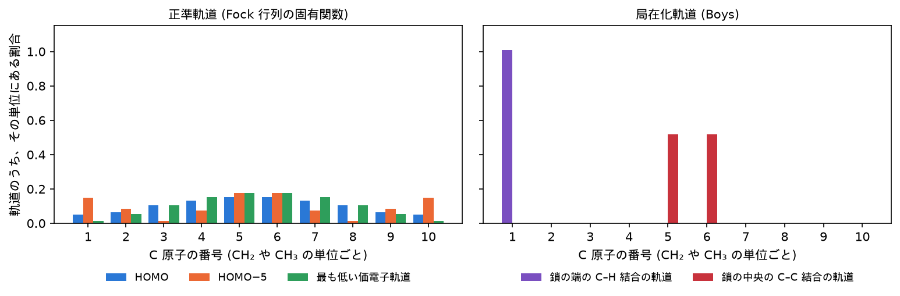
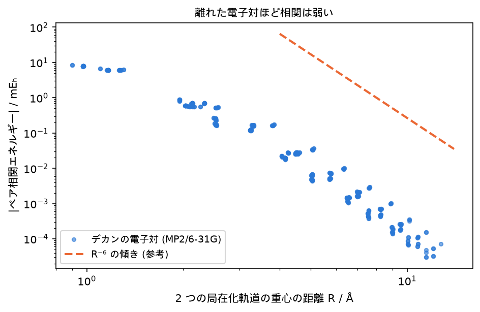
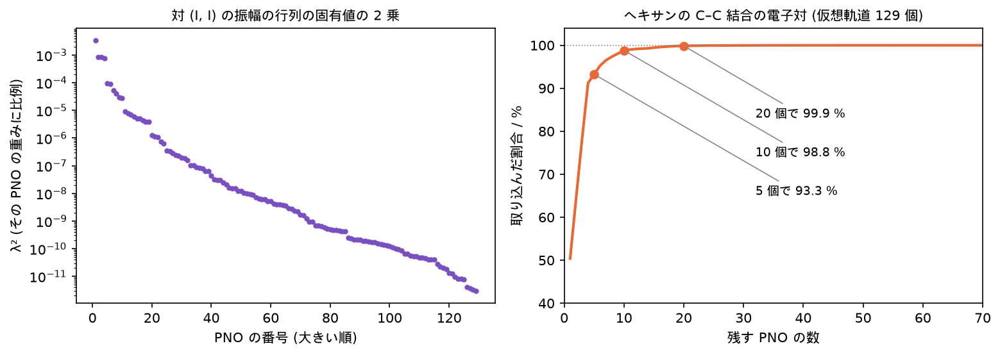
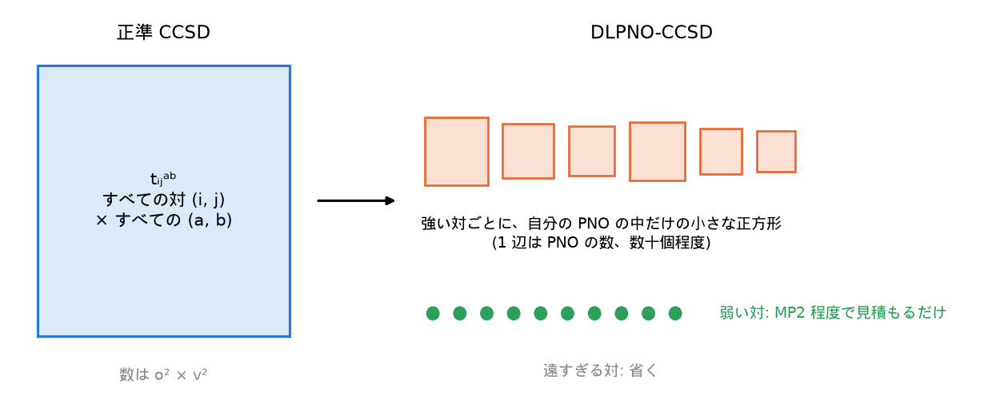
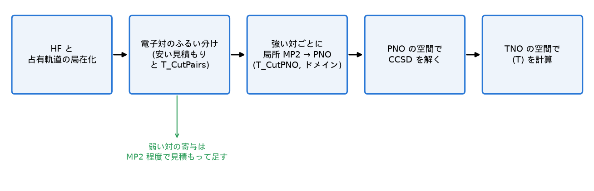
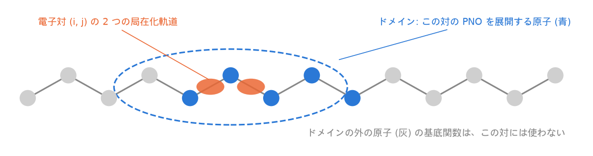
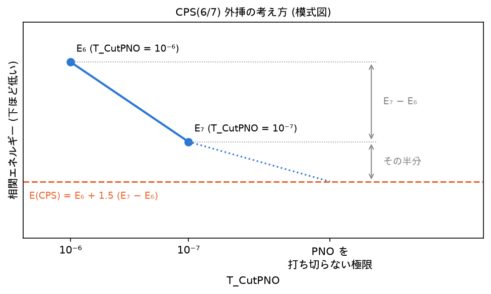

# 第 11 回　局所相関法：DLPNO-CCSD(T)

!!! abstract "この回の道筋"
    CCSD(T) は正確ですが、計算量が系の大きさの 7 乗で増えるため、大きな分子には使えません。この回では、「電子相関は短い距離でしか効かない」という性質を使って計算を大幅に減らす局所相関法を学びます。その代表である DLPNO-CCSD(T) について、局在化軌道とペア相関エネルギー、ペア自然軌道（PNO）の考え方を、ヘキサンやデカンの計算で目に見える形にして確かめます。そのうえで、精度を決める閾値（LoosePNO / NormalPNO / TightPNO）と、使うときの注意点（PNO の打ち切り誤差とその外挿）を、原論文とベンチマークの論文の数値で確かめます。

    | 節 | 内容 |
    |---|---|
    | 1 | 局所相関の考え方：相関は短距離 |
    | 2 | 電子対に分ける：ペア相関エネルギー |
    | 3 | ペア自然軌道（PNO） |
    | 4 | DLPNO-CCSD(T) の組み立て |
    | 5 | 閾値：LoosePNO / NormalPNO / TightPNO |
    | 6 | 精度と注意点 |

    **前に読んでおく回**：[量子化学の理論 第 9 回](09-mp2.md)、[第 10 回](10-coupled-cluster.md)

!!! tip "物理的なイメージ"
    局所相関法が利用しているのは、「電子が避け合う動きは、近くの電子どうしでしか大きく効かない」という性質です。局在化した軌道で見ると、離れた電子対の相関エネルギーは、距離の 6 乗に反比例して弱まります（分散力と同じ形）。そのため、ほとんどの対は安く見積もるだけで十分です。大事な対についても、その対の避け合いに必要な空軌道の組み合わせはわずかで、それを対ごとに選び直したものがペア自然軌道（PNO）です。閾値は、どこまで小さい寄与を捨てるかを決めるものさしです。

この回では、閉殻の分子を考えます。$i, j$ は占有の空間軌道、$a, b$ は仮想の空間軌道です。2 電子積分は、空間軌道の化学者の表記 $(pq|rs)$ を使います。エネルギーは原子単位（ハートリー，$E_\mathrm{h}$）で書き、1 $E_\mathrm{h}$ = 627.5 kcal/mol です。

## 1. 局所相関の考え方：相関は短距離

### 1.1 計算量の原因は軌道の広がり

第 10 回で見たように、CCSD(T) の計算量は $N^7$ に比例します（$N$ は系の大きさ）。分子が 10 倍になると、計算時間は $10^7$ 倍です。これは手法そのものの性質ではなく、HF の**正準軌道**（Fock 行列を対角化して得た軌道）を使って式を書いたことから生じています。

正準軌道は、たいてい分子全体に広がっています。図 1 の左は、直鎖のアルカンであるデカン（C₁₀H₂₂）の正準軌道が、10 個の炭素の単位（CH₂ や CH₃）にどう分かれているかを示したものです。どの軌道も、鎖の端から端まで広がっています。そのため、どの軌道の組を選んでも、2 電子積分や振幅が 0 になりません。



**図 1**　デカンの HF/6-31G の占有軌道が、10 個の炭素の単位（その炭素と、それについた H）にどれだけの割合で乗っているか（Mulliken の割合）。左：正準軌道。HOMO（青）も、ほかの軌道も、鎖の全体に薄く広がっています。右：同じ占有軌道を混ぜ合わせてつくった局在化軌道（2.1 節）。鎖の端の C–H 結合の軌道（紫）は 1 番目の単位だけに、中央の C–C 結合の軌道（赤）は 5 番目と 6 番目の単位だけに乗っています。

### 1.2 物理的には相関は短距離

ところが、物理的には電子相関は短い距離の現象です。第 7 回で見たように、動的相関は「近づいた電子どうしが互いを避ける」動きでした。

離れた二つの電子対の相関がどう減るかは、次のように考えると分かります。原子 A の近くの電子対と、遠く離れた原子 B の近くの電子対があるとします。

1. 電子が一瞬だけ片寄ると、A のまわりに瞬間的な双極子 $\mu_\mathrm A$ が生じます。B でも同じことが起こります。
2. 二つの双極子の相互作用のエネルギーは、距離 $R$ の 3 乗に反比例します（$\propto \mu_\mathrm A \mu_\mathrm B / R^3$）。
3. 二つの電子対が、この相互作用に合わせて「そろって」片寄ることで、エネルギーが下がります。これが二つの電子対の間の相関です。この下がり方は、相互作用の 2 次の摂動のエネルギーなので、相互作用の 2 乗に比例し、$R^{-6}$ に比例します。

これは、ロンドンの分散力と同じ形です。距離が 2 倍になると、寄与は $2^6 = 64$ 分の 1 になります。式の段階は付録 A にまとめます。

そこで、軌道を空間的に局在させ、遠く離れた軌道どうしの相関を省いたり、粗く扱ったりすれば、計算量を減らせるはずです。この考え方を**局所相関**（local correlation）と呼び、Pulay が 1980 年代に提案しました [Pulay 1983, Saebø 1993]。

**ここまでで分かったこと**：CCSD(T) の高い計算量は、広がった正準軌道を使うことから来ています。相関は短距離（離れた電子対の寄与は $R^{-6}$）なので、局在化した軌道を使えば、遠く離れた部分の計算を省けます。

## 2. 電子対に分ける：ペア相関エネルギー

### 2.1 局在化軌道

占有軌道は、互いに混ぜ合わせても（ユニタリー変換しても）、HF の決定子は変わりません。決定子は、行列の行を混ぜ合わせても、行列式の値が定数倍になるだけだからです。たとえば占有軌道が 2 個なら、

$$
\begin{pmatrix} \phi_1' \\ \phi_2' \end{pmatrix}
=
\begin{pmatrix} \cos\theta & -\sin\theta \\ \sin\theta & \cos\theta \end{pmatrix}
\begin{pmatrix} \phi_1 \\ \phi_2 \end{pmatrix}
$$

と回転しても、$\phi_1'$ と $\phi_2'$ でつくった決定子は、$\phi_1$ と $\phi_2$ でつくった決定子と同じです（回転の行列の行列式が 1 だからです）。この自由度を使い、軌道ができるだけ空間的にまとまるように回転を選んだものが**局在化軌道**です。図 1 の右では、軌道の「重心からの広がり」が最も小さくなるように選ぶ Boys の方法を使いました。局在化軌道は、化学で言う「C–H 結合」「C–C 結合」「O の孤立電子対」などに近い形になります。

### 2.2 ペア相関エネルギー

相関エネルギーは、占有軌道の組 $(i, j)$ ごとの和に分けられます。第 9 回の閉殻の MP2 のエネルギー

$$
E^{(2)} = \sum_{ij} \sum_{ab} t_{ij}^{ab} \big[\, 2(ia|jb) - (ib|ja) \,\big], \qquad
t_{ij}^{ab} = \frac{(ia|jb)}{\varepsilon_i + \varepsilon_j - \varepsilon_a - \varepsilon_b}
$$

で、$a, b$ についての和だけを先にとったものを $e_{ij}$ と書きます。

$$
e_{ij} = \sum_{ab} t_{ij}^{ab} \big[\, 2(ia|jb) - (ib|ja) \,\big]
$$

$(i, j)$ と $(j, i)$ は同じ電子対なので、まとめて $\varepsilon_{ij} = e_{ij} + e_{ji}$（$i < j$）、$\varepsilon_{ii} = e_{ii}$ とすると、

$$
E_\mathrm{corr} = \sum_{i \le j} \varepsilon_{ij}
$$

です。$\varepsilon_{ij}$ を**ペア相関エネルギー**と呼びます。CC 法の相関エネルギーも、同じように電子対ごとに分けられます。

この分け方は、占有軌道の選び方で変わります。正準軌道で分けると、どの $\varepsilon_{ij}$ も分子全体の寄与を含みます。局在化軌道で分けると、$\varepsilon_{ij}$ は「結合 $i$ と結合 $j$ の電子の間の相関」という意味をもちます。正準軌道で求めた振幅 $t_{ij}^{ab}$ は、占有の添字 $i, j$ のそれぞれについて、軌道と同じ変換をすれば局在化軌道の振幅になり、相関エネルギーの合計は変わりません。

### 2.3 図で見る

デカンの MP2/6-31G の振幅を局在化軌道に変換し、ペア相関エネルギーを二つの軌道の重心の距離に対して描いた例が図 2 です（C の 1s は相関させていません）。



**図 2**　デカンの局在化軌道の電子対ごとのペア相関エネルギー（絶対値）を、二つの軌道の重心の距離に対して両対数で描いたもの。点の 1 個が 1 組の電子対です。橙の破線は傾きが $-6$ の直線で、高さは目で比べるために適当にずらしています。距離が 4 Å を超えたあたりから、点は破線とほぼ同じ傾きで下がります。

1 Å 付近の、隣り合った結合どうしの電子対は 1 組あたり 6〜8 m$E_\mathrm{h}$ の寄与をもちます。5 Å 付近では $10^{-2}$ m$E_\mathrm{h}$ 程度、10 Å を超えると $10^{-4}$ m$E_\mathrm{h}$ 程度まで下がります。

電子対の数は占有軌道の数の 2 乗に比例します。しかし、遠い組の寄与を無視すれば、意味のある組の数は系の大きさに比例するだけになります。1 個の軌道のまわりにある軌道の数は、系がどれだけ大きくても、ほぼ一定だからです。

**ここまでで分かったこと**：局在化軌道を使うと、相関エネルギーを電子対ごとの寄与に分けられます。遠い電子対の寄与は $R^{-6}$ の傾きで小さくなり、意味のある電子対の数は系の大きさに比例するだけになります。

## 3. ペア自然軌道（PNO）

### 3.1 1 組の電子対の振幅は行列

電子対の数を減らすだけでは、まだ不十分です。電子対 $(i, j)$ ごとに、仮想軌道 $a, b$ のすべての組についての振幅 $t_{ij}^{ab}$ が必要だからです。1 組の電子対の振幅は、行を $a$、列を $b$ とする $v \times v$ の行列 $\mathbf T^{ij}$ と見ることができます（$v$ は仮想軌道の数）。仮想軌道が 3 個なら、

$$
\mathbf T^{ij} =
\begin{pmatrix}
t_{ij}^{11} & t_{ij}^{12} & t_{ij}^{13} \\
t_{ij}^{21} & t_{ij}^{22} & t_{ij}^{23} \\
t_{ij}^{31} & t_{ij}^{32} & t_{ij}^{33}
\end{pmatrix}
\begin{matrix} \leftarrow a = 1 \\ \leftarrow a = 2 \\ \leftarrow a = 3 \end{matrix}
$$

です（上つきの 2 つの数字が $a$ と $b$ です）。$v$ は系の大きさに比例するので、1 組あたりの振幅の数 $v^2$ も大きくなります。

### 3.2 行列を対角化すると少数の軌道にまとまる

同じ軌道の対 $(i, i)$（1 本の結合の 2 個の電子）を考えます。この場合、$t_{ii}^{ab} = t_{ii}^{ba}$ なので、$\mathbf T^{ii}$ は実対称行列です。実対称行列は、直交行列 $\mathbf U$ で対角化できます。

$$
\mathbf T^{ii} = \mathbf U
\begin{pmatrix}
\lambda_1 & 0 & 0 \\
0 & \lambda_2 & 0 \\
0 & 0 & \lambda_3
\end{pmatrix}
\mathbf U^\mathsf T
$$

$\mathbf U$ の第 $k$ 列を係数にして、仮想軌道を混ぜた新しい軌道 $\tilde\phi_k = \sum_a U_{ak}\, \phi_a$ をつくります。すると、2 電子励起の和は次のように書き直せます。

$$
\sum_{ab} t_{ii}^{ab}\, \big|\, i \to a\ (\alpha),\ i \to b\ (\beta) \,\big\rangle
= \sum_k \lambda_k\, \big|\, i \to \tilde\phi_k\ (\alpha),\ i \to \tilde\phi_k\ (\beta) \,\big\rangle
$$

左辺は、電子対の 2 個の電子が「別々の仮想軌道 $a$ と $b$ に」移る励起の和でした。右辺は、2 個の電子が「同じ新しい軌道 $\tilde\phi_k$ に、そろって」移る励起の和です。$v^2$ 個の係数が、$v$ 個の係数 $\lambda_k$ にまとまりました。この $\tilde\phi_k$ が、電子対 $(i, i)$ の**ペア自然軌道**（pair natural orbital, PNO）です。2 電子系の波動関数を自然軌道で書くと、このように「同じ軌道に 2 個ずつ」の形になることが知られています（Löwdin と Shull の結果）。

各 PNO にどれだけの電子が移っているか（PNO の**占有数**）は $\lambda_k^2$ に比例します。占有数の大きな少数の PNO が、その電子対の相関のほとんどを担います。そのため、占有数が閾値 $T_\mathrm{CutPNO}$ より大きい PNO だけを残せば、振幅の数を大きく減らせます（3.3 節の図 3）。

$i \ne j$ の電子対では、$\mathbf T^{ij}$ は対称とは限りません。そこで、$\mathbf T^{ij}$ とその転置を組み合わせて対称な行列（**ペア密度行列**、電子対 $(i, j)$ の励起先の電子の分布を表します）をつくり、それを対角化します。固有ベクトルが PNO、固有値が占有数です。行列の正確な形は [Neese 2009] にあります。

### 3.3 図で見る

ヘキサン（C₆H₁₄）の MP2/cc-pVDZ の振幅で、鎖の中央の C–C 結合の局在化軌道 $I$ の対 $(I, I)$ について、$\mathbf T^{II}$ を対角化した例を図 3 に示します。PNO $k$ の寄与は、$\mathbf T^{II}$ を $\lambda_k \mathbf u_k \mathbf u_k^\mathsf T$（$\mathbf u_k$ は第 $k$ 固有ベクトル）に置き換えたときのペア相関エネルギーです。同じ軌道の対では、2.2 節の $e_{II}$ は $\sum_{ab} T_{ab}\,(Ia|Ib)$ になるので（$\mathbf T^{II}$ が対称なので $2(Ia|Ib) - (Ib|Ia)$ の 2 つの項がまとまります）、寄与は $\lambda_k \sum_{ab} u_{ak} u_{bk} (Ia|Ib)$ です。



**図 3**　左：$\mathbf T^{II}$ の固有値の 2 乗（PNO の占有数に比例する量）を大きい順に並べたもの。縦軸は対数で、最初の数個から急に小さくなります。右：大きい順に PNO を残したとき、ペア相関エネルギーの何 % が得られるか。仮想軌道は 129 個ありますが、曲線は最初の 10〜20 個でほぼ 100 % に達します。

この図は、MP2 の振幅を切り捨てただけの見積もりです。実際の DLPNO では、残した PNO の空間で振幅を解き直します（4 節）。

PNO の考え方は古く、1960 年代に提案されました [Edmiston 1966]。その後しばらく使われませんでしたが、Neese らが、効率よく実装できることを示して復活させました [Neese 2009]。この最初の方法では、既定の閾値で正準な計算の相関エネルギーの約 99.8% が得られたと報告されています。

**ここまでで分かったこと**：1 組の電子対の振幅は $v \times v$ の行列で、それを対角化すると、2 個の電子が同じ軌道にそろって移る励起の和に書き直せます。その軌道が PNO です。少数の PNO が相関のほとんどを担うので、占有数が $T_\mathrm{CutPNO}$ より大きいものだけを残すことで、振幅の数を大きく減らせます。

## 4. DLPNO-CCSD(T) の組み立て

### 4.1 振幅の数がどれだけ減るか

PNO を使うと、強い電子対ごとに、自分の PNO の中だけの小さな振幅の行列をもてばよくなります（図 4）。たとえば図 3 のヘキサン（cc-pVDZ）では、価電子の占有軌道が $o = 19$ 個、仮想軌道が $v = 129$ 個なので、正準な振幅の数は $o^2 v^2 = 19^2 \times 129^2 \approx 6.0 \times 10^6$ です。電子対は $i \le j$ の組で 190 組あり、それぞれが 20 個の PNO をもつとすると、振幅は $190 \times 20^2 = 7.6 \times 10^4$ 個で、約 80 分の 1 になります。分子が大きくなるほど、この差は広がります。$v$ が大きくなっても、1 組あたりの PNO の数はほぼ変わらないからです。



**図 4**　振幅のもち方の模式図。左：正準な CCSD は、すべての電子対 $(i, j)$ とすべての仮想軌道の組 $(a, b)$ について振幅をもちます。右：DLPNO-CCSD では、強い電子対だけが、それぞれ自分の PNO の中だけの小さな行列（橙の正方形、大きさは対ごとに違います）をもちます。弱い電子対（緑）は MP2 程度の見積もりだけ、遠すぎる電子対は省きます。

原論文の冒頭では、PNO を使うと、大きな分子では振幅の数が、同じ系・同じ基底関数の正準 CCSD に比べて $10^5$〜$10^6$ 分の 1 に減ると述べられています [Riplinger 2013a]。

### 4.2 計算の流れ

PNO を使った CCSD を、さらに大きな分子で使えるようにしたのが、Riplinger と Neese の **DLPNO-CCSD**（domain-based local PNO CCSD）です [Riplinger 2013a]。その主な工夫を、計算の流れに沿って並べます（図 5）。



**図 5**　DLPNO-CCSD(T) の計算の流れ。HF の占有軌道を局在化し（2.1 節）、電子対をふるい分け、強い電子対ごとに PNO をつくってから、PNO の空間で CCSD を、3 電子励起の自然軌道（TNO）の空間で (T) を解きます。ふるい分けで外した弱い電子対の寄与は、MP2 程度の近似で見積もって足します。

1. **電子対のふるい分け**：局在化軌道のすべての組について、ペア相関エネルギーを安い方法で見積もります。値が閾値 $T_\mathrm{CutPairs}$ より小さい組は「弱い電子対」として、CCSD の計算から外します。外した組の寄与は、MP2 の程度の近似で見積もって足します。図 2 で見たとおり、遠い組の寄与は非常に小さいので、ほとんどの組はここで外れます。
2. **PNO とドメイン**：強い電子対ごとに、局所的な MP2 の振幅から 3 節の方法で PNO をつくります。このとき、各 PNO を、その電子対の近くにある原子の**射影原子軌道**（PAO）だけで展開します（図 6）。PAO $\tilde\chi_\mu$ は、各原子の基底関数 $\chi_\mu$ から占有軌道の成分を取り除いたものです。

    $$
    \tilde\chi_\mu = \chi_\mu - \sum_{i} \phi_i \langle \phi_i | \chi_\mu \rangle
    $$

    和はすべての占有軌道 $\phi_i$ についてとります。取り除いた残りは仮想軌道の空間に入るので、PAO は「原子 $\mu$ の近くにまとまった仮想軌道」として使えます。Pulay が局所相関のために導入しました [Pulay 1983]。この原子の範囲を**ドメイン**と呼びます。原論文では、ドメインによる相関エネルギーの損失は 0.05% 未満で、ドメインは平均 15〜20 原子（ときに 30 原子まで）でした [Riplinger 2013a]。
3. **CCSD**：残った「強い電子対」について、それぞれの PNO の空間で CCSD の方程式を解きます。CCSD の方程式の項は省きません。
4. **(T)**：3 電子励起の補正は、3 個の電子対の PNO の空間を合わせた「3 電子励起の自然軌道」（TNO）を使って計算します [Riplinger 2013b]。



**図 6**　ドメインの模式図。灰色と青の点が鎖の原子、橙の楕円が電子対 $(i, j)$ の 2 つの局在化軌道です。この電子対の PNO は、破線で囲んだ近くの原子（青）の PAO だけで展開します。遠くの原子（灰）の基底関数は、この電子対の計算には入りません。

計算量は、系の大きさにほぼ比例するところまで下がります。(T) の計算は全体の時間を 30〜50% 増やす程度で、タンパク質クランビン（644 原子、6400 以上の基底関数）全体の CCSD(T) 計算が示されました [Riplinger 2013b]。

### 4.3 (T0) と (T)

局在化した占有軌道は、Fock 行列の固有関数ではありません。そのため、局在化軌道で書いた Fock 行列の占有軌道どうしの部分は、対角になりません。占有軌道が 2 個なら、

$$
\mathbf F_\mathrm{occ} =
\begin{pmatrix}
f_{11} & f_{12} \\
f_{21} & f_{22}
\end{pmatrix}
$$

で、非対角の $f_{12}$ は一般に 0 ではありません。第 10 回の (T) の式は、正準軌道を使い、Fock 行列が対角（$f_{ij} = \delta_{ij}\varepsilon_i$）であることを前提に、3 電子励起の振幅を「結合 ÷ 軌道エネルギーの差」で一度に求めていました。

最初の DLPNO-CCSD(T) では、(T) の計算に**半正準近似**を使っていました。占有軌道どうしの Fock 行列の非対角の要素を省き、上の行列を $\mathrm{diag}(f_{11}, f_{22})$ のように扱って、正準軌道と同じ形の式で一度に計算する近似です。後に、この近似を外した反復的な (T) が開発され、元の方法は区別のため DLPNO-CCSD(T0) と呼ばれるようになりました [Guo 2018]。非対角の要素を残すと、振幅を一度の割り算で求められなくなり、反復して解く必要があります。

Guo らによると、(T0) はほとんどの場合、相対エネルギーでは十分に正確です。しかし、まれに、特に HOMO–LUMO のエネルギー差が小さい系では (T0) が破綻し、絶対エネルギーの誤差も (T) の補正が大きいほど大きくなります。反復的な (T) の計算時間は、(T0) のおよそ 2 倍です。

ORCA では、キーワード `DLPNO-CCSD(T)` が (T0) を、`DLPNO-CCSD(T1)` が反復的な (T) を意味します（ORCA 6.1 で、反復の (T) の計算が出力に現れるかどうかで確かめました）。

**ここまでで分かったこと**：DLPNO-CCSD(T) は、電子対のふるい分け、ドメイン、PNO、TNO を組み合わせて、CCSD(T) の計算量をほぼ線形に下げた方法です。(T) の扱い方には、占有軌道どうしの Fock 行列の非対角要素を省く (T0) と、省かない反復的な (T) の 2 種類があります。

## 5. 閾値：LoosePNO / NormalPNO / TightPNO

DLPNO-CCSD(T) の精度と速さは、主に次の三つの閾値で決まります。どれも、4.2 節の流れのどこかで「小さい寄与を捨てる」ためのものさしです。

- $T_\mathrm{CutPNO}$：PNO を残すかどうかを決める、占有数の閾値です（3 節、図 3 の左の縦軸の量で切ります）。小さいほど PNO が増えます。
- $T_\mathrm{CutPairs}$：電子対を CCSD で扱うかどうかを決める、ペア相関エネルギーの見積もりの閾値です（4.2 節の 1、図 2 の縦軸の量で切ります）。
- $T_\mathrm{CutDO}$：ドメインに原子を入れるかどうかを決める閾値です（4.2 節の 2、図 6）。

利用者が個々の値を選ばなくて済むように、三つの組み合わせ LoosePNO、NormalPNO、TightPNO が定義されています [Liakos 2015]。次の表は、ORCA 6.1 で H₂O の小さな計算を実行し、出力の「DLPNO SETTINGS」の欄に表示された値を写したものです。出力には、前段の粗い MP2 や (T) のために、これを 2 倍、4 倍にゆるめた $T_\mathrm{CutDO}$ も表示されるので、読み違えないようにしてください。版によって値が変わることがあるので、使う版の出力で確かめてください。

| 設定 | $T_\mathrm{CutPNO}$ | $T_\mathrm{CutPairs}$ | $T_\mathrm{CutDO}$ |
|---|---|---|---|
| LoosePNO | $1 \times 10^{-6}$ | $10^{-3}$ | 0.02 |
| NormalPNO | $3.33 \times 10^{-7}$ | $10^{-4}$ | 0.01 |
| TightPNO | $1 \times 10^{-7}$ | $10^{-5}$ | 0.005 |

Loose から Tight に進むにつれて、三つの閾値がそろって小さく（厳しく）なります。$T_\mathrm{CutPNO}$ が 10 倍厳しくなるごとに、残す PNO が増え、計算時間も増えます。

ORCA の入力は、たとえば次のようになります。手法、閾値の設定、基底関数、RI 近似の補助基底関数を 1 行目に並べます。

```
! DLPNO-CCSD(T) NormalPNO cc-pVDZ cc-pVDZ/C
* xyz 0 1
O 0.000 0.000 0.000
H 0.000 0.759 0.588
H 0.000 -0.759 0.588
*
```

`NormalPNO` を `TightPNO` に替えれば、閾値の組がまとめて替わります。

**ここまでで分かったこと**：DLPNO-CCSD(T) の精度は主に $T_\mathrm{CutPNO}$、$T_\mathrm{CutPairs}$、$T_\mathrm{CutDO}$ で決まり、LoosePNO、NormalPNO、TightPNO の三つの組が用意されています。

## 6. 精度と注意点

DLPNO-CCSD(T) の誤差は、「同じ基底関数の正準 CCSD(T) からのずれ」として測ります。基底関数の不完全さの誤差や、CCSD(T) そのものの誤差は、これとは別にあります。

### ベンチマークの結果

- Liakos らは、既定の閾値（NormalPNO）で、すべてのテストセットについて 1 kcal/mol 以内の精度が得られることを示しました。さらに閾値を厳しくすると、正準な結果からの平均絶対誤差と標準偏差が 0.25 kcal/mol 未満になりました [Liakos 2015]。
- Altun らの論文の序論によると、TightPNO（$T_\mathrm{CutPNO} = 10^{-7}$）では、正準 CCSD(T) の相関エネルギーのおよそ 99.9% が得られます。また、GMTKN55 と呼ばれる 1505 個の反応からなるベンチマークでは、TightPNO の平均絶対誤差は、55 個の部分集合のうち 39 個で 0.2 kcal/mol 未満、14 個で 0.2〜0.4 kcal/mol、2 個で 0.4 kcal/mol を超えました [Altun 2020]。
- 同じ論文によると、LoosePNO（$T_\mathrm{CutPNO} = 10^{-6}$）は予備的な計算にだけ勧められる設定です。$T_\mathrm{CutPNO} = 10^{-6}$ での平均絶対誤差は、多くの部分集合で 1.5〜3 kcal/mol で、人工的な分子からなる難しい集合では最大 6 kcal/mol に達しました [Altun 2020]。

相関エネルギーの 99.9% が得られても、相関エネルギーそのものが大きいので、残りの 0.1% は小さくありません。たとえば相関エネルギーが $-1\ E_\mathrm{h}$ の分子なら、0.1% は 1 m$E_\mathrm{h}$（約 0.6 kcal/mol）です。反応エネルギーでは、反応の前後で似た誤差が打ち消し合うことを期待しています。

### 注意 1：PNO の打ち切り誤差

DLPNO の誤差の主な原因の一つは、PNO を打ち切ったことによる誤差（**PNO 打ち切り誤差**）です。図 3 の右でいえば、曲線が 100 % に届かない分です。この誤差は、$T_\mathrm{CutPNO}$ を小さくすると、なめらかに小さくなっていきます [Riplinger 2013b, Altun 2020]。

この性質を使い、二つの $T_\mathrm{CutPNO}$ の結果から、PNO を打ち切らない極限（完全 PNO 空間の極限、CPS）を外挿する方法が提案されています [Altun 2020]。$T_\mathrm{CutPNO} = 10^{-X}$ と $10^{-Y}$（$Y = X + 1$）で求めた相関エネルギーを $E_X$、$E_Y$ とすると、

$$
E_\mathrm{CPS} = E_X + F\,(E_Y - E_X), \qquad F = 1.5
$$

です。$F$ は、基底関数の外挿の式と同じ形の式から出てくる係数で、ベンチマークに合うように 1.5 と決められました。$X = 6$、$Y = 7$ の組を CPS(6/7) と呼びます。

この式の意味は、$E_\mathrm{CPS} - E_Y = 0.5\,(E_Y - E_X)$ と書き直すと分かります。$10^{-7}$ の計算に残っている誤差が、$10^{-6}$ から $10^{-7}$ に進んだときの変化の半分だと見積もっているのです（図 7）。



**図 7**　CPS(6/7) 外挿の模式図。横軸は $T_\mathrm{CutPNO}$、縦軸は相関エネルギーで、下ほど低くなります。$10^{-6}$ から $10^{-7}$ に閾値を厳しくすると、エネルギーは $E_7 - E_6$ だけ下がります。CPS 外挿は、そこからさらに「その半分」だけ下がった値（橙の破線）を、PNO を打ち切らない極限の見積もりとします。

たとえば、非共有結合の相互作用のベンチマーク S66 では、TightPNO の平均絶対誤差 0.20 kcal/mol が、CPS(6/7) では 0.11 kcal/mol に下がりました（aug-cc-pVDZ-DK 基底） [Altun 2020]。$T_\mathrm{CutPNO} = 10^{-6}$ の計算の時間は $10^{-7}$ の 30〜40% ほどなので、外挿の手間は TightPNO の計算より少し多い程度で済みます。

ただし、外挿で直るのは PNO 打ち切り誤差だけで、そのほかの近似（電子対のふるい分けやドメインなど）の誤差は残ります。また、Riplinger らは、(T) の打ち切り誤差を外挿すると絶対エネルギーは改善するが、相対エネルギーは改善しないと報告しています [Riplinger 2013b]。外挿の効果は、量の種類によって違うことに注意してください。

### 注意 2：遷移金属錯体

遷移金属錯体では、DLPNO の誤差が大きくなりやすいことが知られています。Altun らは、第一遷移系列の金属を含む反応のベンチマークで、二つの誤差の原因を調べました [Altun 2023]。一つは、3s・3p の内殻に近い電子（セミコア電子）の相関の扱いです。もう一つは、動的相関によって軌道が変化する効果を、DLPNO の出発点である局所 MP2 の見積もりが十分に捉えられないことです。PNO は MP2 の振幅からつくるので（3 節）、MP2 が苦手な系では、選んだ PNO そのものが最適でなくなるわけです。この研究のベンチマーク（MOBH35、def2-SVP 基底、正準 CCSD(T) との差）で、反応エネルギーと障壁の平均絶対誤差は、従来の設定で $T_\mathrm{CutPNO} = 10^{-6}$ のとき 1.08 kcal/mol、$10^{-7}$ のとき 0.71 kcal/mol でした。改良した設定と補正を使うと、これが小さくなります。また、T1 診断（第 10 回）が 0.02 を超える系では、PNO 空間の大きさに対する収束が遅いことも報告されています。

### 注意 3：CCSD(T) の限界はそのまま残る

DLPNO-CCSD(T) は、正準 CCSD(T) を**近似する**方法です。第 10 回で見たように、多参照性が強い系では CCSD(T) そのものが破綻します。DLPNO にしても、この問題は直りません。T1・D1 診断などで、まず CCSD(T) を使ってよい系かどうかを確かめてください。

### 使い方のまとめ

ここまでの文献の結果をまとめると、次のような使い方が考えられます。

- LoosePNO は予備的な計算だけに使い、通常の計算には NormalPNO を使います。
- 非共有結合の相互作用など、小さなエネルギー差を議論するときは TightPNO を使うか、CPS(6/7) で外挿します。
- 遷移金属錯体では、$T_\mathrm{CutPNO}$ を変えて結果の収束を確かめます。
- どの場合も、DLPNO の誤差とは別に、基底関数の誤差と CCSD(T) そのものの誤差があることを忘れないでください。

**ここまでで分かったこと**：DLPNO-CCSD(T) は、NormalPNO で 1 kcal/mol 程度、TightPNO ではさらに高い精度で正準 CCSD(T) を再現します。主な誤差である PNO 打ち切り誤差は、二つの閾値の結果から外挿して減らせます。遷移金属錯体では誤差が大きくなりやすく、多参照性による CCSD(T) の破綻は DLPNO でも直りません。

## まとめ

- 正準軌道は分子全体に広がりますが、局在化軌道は結合ごとにまとまります。電子相関は短距離（離れた電子対の寄与は $R^{-6}$ で減る）なので、局在化軌道を使えば遠い部分の計算を省けます。
- PNO は、電子対の振幅の行列を対角化して得る、電子対ごとの仮想軌道です。少数の PNO が相関のほとんどを担うので、占有数が $T_\mathrm{CutPNO}$ より大きいものだけを残します。
- DLPNO-CCSD(T) は、電子対のふるい分け、ドメイン、PNO、TNO を組み合わせ、CCSD(T) の計算量をほぼ線形に下げます。
- 閾値の組は LoosePNO、NormalPNO、TightPNO で、主な誤差である PNO 打ち切り誤差は CPS 外挿で減らせます。
- 遷移金属錯体では誤差の確認が必要で、多参照性による CCSD(T) の破綻は DLPNO でも直りません。

## 付録 A　離れた電子対の相関が R⁻⁶ で減る理由

A の近くの電子と B の近くの電子だけを考え、A と B の距離 $R$ が、それぞれの電子の広がりより十分に大きいとします。

**段階 1**：A の電子と B の電子の間のクーロン相互作用を、$1/R$ のまわりで展開します（多極子展開）。A と B はそれぞれ中性なので、電荷どうしの $1/R$ の項と、電荷と双極子の $1/R^2$ の項は打ち消し合い、最初に残るのは双極子どうしの項です。

$$
\hat V \approx \frac{\hat{\boldsymbol\mu}_\mathrm A \cdot \hat{\boldsymbol\mu}_\mathrm B - 3(\hat{\boldsymbol\mu}_\mathrm A \cdot \mathbf n)(\hat{\boldsymbol\mu}_\mathrm B \cdot \mathbf n)}{R^3}
$$

$\hat{\boldsymbol\mu}_\mathrm A$、$\hat{\boldsymbol\mu}_\mathrm B$ は A、B の電子の双極子の演算子、$\mathbf n$ は A から B への単位ベクトルです。

**段階 2**：$\hat V$ を摂動として、A と B の基底状態 $|0_\mathrm A 0_\mathrm B\rangle$ のエネルギーの 1 次の補正を考えます。基底状態の双極子の平均 $\langle 0_\mathrm A|\hat{\boldsymbol\mu}_\mathrm A|0_\mathrm A\rangle$ を 0 とすると（中心をとり直せばよい）、1 次の補正は 0 です。

**段階 3**：2 次の補正は、A と B が同時に励起した状態 $|m_\mathrm A n_\mathrm B\rangle$ を経由します。

$$
E^{(2)} = -\sum_{m, n \ne 0} \frac{|\langle m_\mathrm A n_\mathrm B | \hat V | 0_\mathrm A 0_\mathrm B \rangle|^2}{\Delta_m^\mathrm A + \Delta_n^\mathrm B}
$$

$\Delta_m^\mathrm A$、$\Delta_n^\mathrm B$ は励起のエネルギーで、正です。

**段階 4**：分数の分子にある行列要素は $\hat V$ に比例するので $R^{-3}$ に比例し、その 2 乗は $R^{-6}$ に比例します。分母は $R$ によりません。よって $E^{(2)} \propto -R^{-6}$ です。

「A と B が同時に励起した状態を経由する」ことは、A の電子と B の電子が同時に励起する 2 電子励起、つまり A の軌道と B の軌道の電子対の相関にあたります。本文の図 2 で、離れた電子対のペア相関エネルギーが $R^{-6}$ の傾きで下がったのは、このためです。

## 参考文献

- P. Pulay, "Localizability of dynamic electron correlation", Chem. Phys. Lett. 100, 151 (1983). DOI: [10.1016/0009-2614(83)80703-9](https://doi.org/10.1016/0009-2614(83)80703-9)
- S. Saebø, P. Pulay, "Local Treatment of Electron Correlation", Annu. Rev. Phys. Chem. 44, 213 (1993). DOI: [10.1146/annurev.pc.44.100193.001241](https://doi.org/10.1146/annurev.pc.44.100193.001241)
- C. Edmiston, M. Krauss, "Pseudonatural Orbitals as a Basis for the Superposition of Configurations. I. He2+", J. Chem. Phys. 45, 1833 (1966). DOI: [10.1063/1.1727841](https://doi.org/10.1063/1.1727841)
- F. Neese, F. Wennmohs, A. Hansen, "Efficient and accurate local approximations to coupled-electron pair approaches: An attempt to revive the pair natural orbital method", J. Chem. Phys. 130, 114108 (2009). DOI: [10.1063/1.3086717](https://doi.org/10.1063/1.3086717)
- C. Riplinger, F. Neese, "An efficient and near linear scaling pair natural orbital based local coupled cluster method", J. Chem. Phys. 138, 034106 (2013). DOI: [10.1063/1.4773581](https://doi.org/10.1063/1.4773581)
- C. Riplinger, B. Sandhoefer, A. Hansen, F. Neese, "Natural triple excitations in local coupled cluster calculations with pair natural orbitals", J. Chem. Phys. 139, 134101 (2013). DOI: [10.1063/1.4821834](https://doi.org/10.1063/1.4821834)
- Y. Guo, C. Riplinger, U. Becker, D. G. Liakos, Y. Minenkov, L. Cavallo, F. Neese, "Communication: An improved linear scaling perturbative triples correction for the domain based local pair-natural orbital based singles and doubles coupled cluster method [DLPNO-CCSD(T)]", J. Chem. Phys. 148, 011101 (2018). DOI: [10.1063/1.5011798](https://doi.org/10.1063/1.5011798)
- D. G. Liakos, M. Sparta, M. K. Kesharwani, J. M. L. Martin, F. Neese, "Exploring the Accuracy Limits of Local Pair Natural Orbital Coupled-Cluster Theory", J. Chem. Theory Comput. 11, 1525 (2015). DOI: [10.1021/ct501129s](https://doi.org/10.1021/ct501129s)
- A. Altun, F. Neese, G. Bistoni, "Extrapolation to the Limit of a Complete Pair Natural Orbital Space in Local Coupled-Cluster Calculations", J. Chem. Theory Comput. 16, 6142 (2020). DOI: [10.1021/acs.jctc.0c00344](https://doi.org/10.1021/acs.jctc.0c00344)
- A. Altun, C. Riplinger, F. Neese, G. Bistoni, "Exploring the Accuracy Limits of PNO-Based Local Coupled-Cluster Calculations for Transition-Metal Complexes", J. Chem. Theory Comput. 19, 2039 (2023). DOI: [10.1021/acs.jctc.3c00087](https://doi.org/10.1021/acs.jctc.3c00087)
- Q. Sun et al., "Recent developments in the PySCF program package", J. Chem. Phys. 153, 024109 (2020). DOI: [10.1063/5.0006074](https://doi.org/10.1063/5.0006074)
