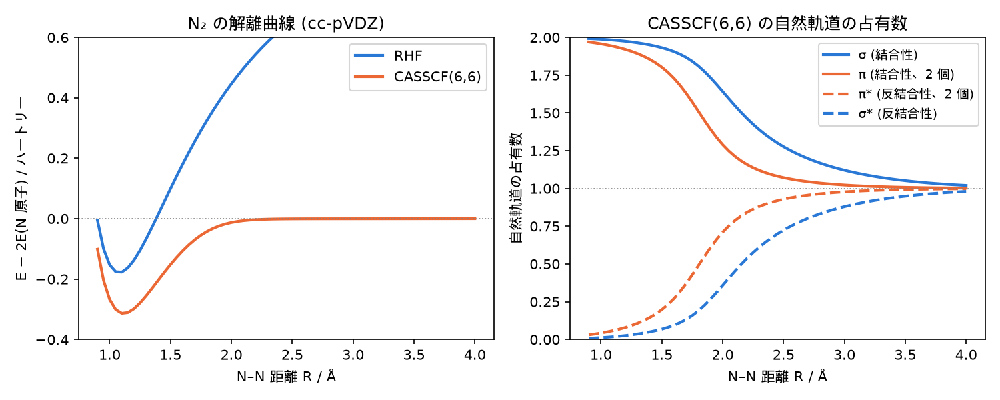

# 第 12 回　多配置 SCF：CASSCF と活性空間の選び方

!!! abstract "この回の道筋"
    結合が切れかけた分子のように、複数の配置が大きな重みで混ざる状態は、決定子 1 個から出発する方法ではうまく扱えません。この回では、複数の配置の係数と軌道を同時に最適化する多配置 SCF 法と、その代表である CASSCF 法を学びます。H₂ と N₂ の解離を計算して、RHF との違いと自然軌道の占有数の意味を確かめます。最後に、活性空間の選び方と、CASSCF だけでは足りないもの（動的相関）を見ます。

    | 節 | 内容 |
    |---|---|
    | 1 | 多配置 SCF の考え方 |
    | 2 | CAS の定義と CAS(n,m) の記法 |
    | 3 | 配置の数の増え方 |
    | 4 | 自然軌道と占有数 |
    | 5 | 計算例：H₂ の解離 |
    | 6 | 計算例：N₂ の三重結合を切る |
    | 7 | 状態平均 CASSCF |
    | 8 | 活性空間の選び方 |
    | 9 | CASSCF に足りないもの：動的相関 |

    **前に読んでおく回**：[量子化学の理論 第 7 回](07-electron-correlation.md)、[第 8 回](08-configuration-interaction.md)、[第 4 回](04-second-quantization.md)、[第 5 回](05-spin.md)

エネルギーは原子単位（ハートリー，$E_\mathrm{h}$）で書きます。換算は 1 $E_\mathrm{h}$ = 27.211 eV = 627.5 kcal/mol です。2 電子積分は、空間軌道についての化学者の表記 $(pq|rs)$ を使います。

## 1. 多配置 SCF の考え方

第 7 回では、H₂ の結合を伸ばすと、$\sigma_g^2$ と $\sigma_u^2$ の二つの配置が同じくらいの重みで混ざることを見ました。このような静的相関の強い状態を、決定子 1 個の RHF で表すことはできません。

第 8 回の CI では、HF の軌道を固定したまま、配置の係数だけを最適化しました。HF の軌道は、決定子 1 個のエネルギーが最も低くなるように決めたものです。複数の配置が大きく混ざる状態には、最適な軌道とは限りません。

そこで、波動関数を少数の配置 $\Phi_I$ の線形結合で表し、**配置の係数 $c_I$ と軌道の両方**を変分法で最適化します。

$$
\Psi = \sum_I c_I \Phi_I
$$

この方法を、**多配置 SCF 法**（multiconfiguration self-consistent field, MCSCF）と呼びます。HF 法が「決定子 1 個の中で軌道を最適化する」方法だったのに対し、MCSCF 法は「決めた配置の集まりの中で、軌道と係数を一緒に最適化する」方法です。

エネルギーを軌道と係数の関数として書くために、第 4 回の演算子 $\hat E_{pq} = \sum_\sigma \hat a_{p\sigma}^\dagger \hat a_{q\sigma}$ を使います。次の二つの量を定義します。

$$
\gamma_{pq} = \langle \Psi | \hat E_{pq} | \Psi \rangle, \qquad
\Gamma_{pqrs} = \langle \Psi | \hat E_{pq} \hat E_{rs} - \delta_{qr} \hat E_{ps} | \Psi \rangle
$$

$\gamma$ を **1 電子密度行列**、$\Gamma$ を **2 電子密度行列**と呼びます。第 4 回のハミルトニアンの式に $\Psi$ をはさむと、エネルギーは次のように書けます（軌道は実数とします）。

$$
E = \sum_{pq} h_{pq}\, \gamma_{pq} + \frac12 \sum_{pqrs} (pq|rs)\, \Gamma_{pqrs} + E_\mathrm{nuc}
$$

ここで $E_\mathrm{nuc}$ は核間の反発エネルギーです。係数 $c_I$ は密度行列 $\gamma$、$\Gamma$ を通して、軌道は積分 $h_{pq}$、$(pq|rs)$ を通して、エネルギーに入ります。

最適化の条件は二つあります。導出は付録 A に回しますが、結果は次のとおりです。

1. **係数の条件**：軌道を固定すると、係数はハミルトニアンの行列の固有値問題 $\mathbf H \mathbf c = E \mathbf c$ で決まります。第 8 回の CI と同じです。
2. **軌道の条件**：軌道 $p$ と $q$ を少し混ぜてもエネルギーが変わらないことです。式で書くと $\langle \Psi | [\hat E_{pq} - \hat E_{qp}, \hat H] | \Psi \rangle = 0$ です。これは第 8 回の Brillouin の定理を多配置に広げたもので、**一般化 Brillouin 定理**と呼びます。

実際のプログラムは、この二つの条件を同時に満たす点を、反復計算で探します。軌道と係数の結合を 2 次まで取り込むと、少ない反復で収束することが知られています [Werner 1985]。

**ここまでで分かったこと**：MCSCF 法は、複数の配置の係数と軌道を同時に最適化する方法です。係数は CI の固有値問題、軌道は一般化 Brillouin 定理で決まります。

## 2. CAS の定義と CAS(n,m) の記法

MCSCF 法では、どの配置を使うかを決めなければなりません。最もよく使われる決め方が **CAS**（complete active space、完全活性空間）です。CAS では、軌道を次の三つに分けます。

- **不活性軌道**（inactive）：いつも電子が 2 個入っている軌道です。内殻や、反応に関わらない結合の軌道です。
- **活性軌道**（active）：電子の入り方を自由に変える軌道です。
- **空軌道**（virtual、二次軌道とも呼びます）：いつも空の軌道です。

そのうえで、活性電子を活性軌道に入れる**すべての**入れ方を配置として使います。活性軌道の中だけで見ると、これは第 8 回の FCI そのものです。つまり CAS の波動関数は「活性空間の中での FCI」です。

この CAS の波動関数で、係数と軌道を最適化する MCSCF 法を **CASSCF 法**と呼びます。Roos らが 1980 年に提案しました [Roos 1980]。同じ形の波動関数は、Ruedenberg らが FORS（full optimized reaction space）という名前で研究しました [Ruedenberg 1982]。

活性空間の大きさは、**CAS($n$,$m$)** と書きます。$n$ は活性電子の数、$m$ は活性軌道の数です。たとえば H₂ の $\sigma_g$ と $\sigma_u$ に 2 個の電子を入れる活性空間は CAS(2,2) です。プログラムによっては、軌道の数を先に書くこともあるので、マニュアルで確かめてください（この回の PySCF のコードでは、`CASSCF(mf, 軌道の数, 電子の数)` の順です）。

CAS には、使いやすい性質があります。活性軌道どうしを混ぜても、活性空間の中のすべての配置を使っているので、CI の係数を変えればまったく同じ波動関数を表せます。そのため、活性軌道どうしの回転は最適化しなくてよく、最適化するのは「不活性と活性」「不活性と空」「活性と空」の間の回転だけです。不活性軌道どうし、空軌道どうしの回転も、同じ理由でエネルギーを変えません。

**ここまでで分かったこと**：CASSCF 法は、活性空間の中での FCI の波動関数を使う MCSCF 法です。活性空間は CAS($n$,$m$) と書き、$n$ が電子の数、$m$ が軌道の数です。

## 3. 配置の数の増え方

CAS は活性空間の中の FCI なので、配置の数は第 8 回の FCI と同じ式で数えられます。活性軌道が $m$ 個、α 電子と β 電子が $n_\alpha$、$n_\beta$ 個のとき、決定子の数は

$$
N_\mathrm{det} = \binom{m}{n_\alpha} \binom{m}{n_\beta}
$$

です。スピンの固有関数（CSF）で数えると、第 5 回の Weyl の公式

$$
N_\mathrm{CSF}(m, n, S) = \frac{2S+1}{m+1} \binom{m+1}{\frac n2 - S} \binom{m+1}{\frac n2 + S + 1}
$$

になります。CAS($n$,$n$) の一重項（$S = 0$）について数えると、次のとおりです。

```python
from math import comb

def n_csf(m, n, S):   # Weyl の公式（第 5 回）
    return (2*S + 1) * comb(m + 1, n//2 - S) * comb(m + 1, n//2 + S + 1) // (m + 1)

print(" CAS(n,n)   決定子の数（M_S = 0）   一重項の CSF の数")
for n in [2, 6, 10, 14, 18, 20, 24]:
    print(f"CAS({n},{n})  {comb(n, n//2)**2:>22,d}  {n_csf(n, n, 0):>20,d}")
```

```
 CAS(n,n)   決定子の数（M_S = 0）   一重項の CSF の数
CAS(2,2)                       4                     3
CAS(6,6)                     400                   175
CAS(10,10)                  63,504                19,404
CAS(14,14)              11,778,624             2,760,615
CAS(18,18)           2,363,904,400           449,141,836
CAS(20,20)          34,134,779,536         5,924,217,936
CAS(24,24)       7,312,459,672,336     1,081,724,803,600
```

活性軌道を 4 個増やすごとに、配置の数はおよそ 100 倍以上になります。指数関数的な増え方です。

このため、ふつうの CASSCF で扱える活性空間には限りがあります。超並列の計算機を使った例では、CAS(20,20) の計算が日常的にできるようになり、CAS(24,24) では CI の反復 1 回だけを行えたと報告されています [Vogiatzis 2017]。それより大きな活性空間には、[第 14 回](14-dmrg-sci.md)で扱う別の方法が必要です。

**ここまでで分かったこと**：CAS の配置の数は、活性軌道の数に対して指数関数的に増えます。ふつうの方法で扱えるのは、20 軌道程度までです。

## 4. 自然軌道と占有数

計算例に入る前に、CASSCF の結果を読むための道具を用意します。

1 節の 1 電子密度行列 $\gamma$ は、実対称行列です。これを対角化すると、固有値 $n_p$ と固有ベクトルが得られます。

$$
\gamma\, \mathbf u_p = n_p\, \mathbf u_p
$$

固有ベクトルで表される軌道を**自然軌道**（natural orbital）、固有値 $n_p$ を**自然軌道の占有数**と呼びます。$n_p$ は 0 から 2 の間の値をとり、すべて足すと電子の数になります。

占有数は、次のように読みます。

- 決定子 1 個（たとえば RHF）では、占有数は 2 か 0 だけです。
- 占有数が 2 や 0 から大きくずれた軌道があれば、波動関数は 1 個の決定子から大きく離れています。つまり、静的相関が強いことを示します。

CASSCF では、不活性軌道の占有数は 2、空軌道の占有数は 0 に固定されています。2 と 0 の間の値をとれるのは活性軌道だけです。そこで、活性軌道の自然軌道の占有数を見ると、その活性空間で何が起きているかが分かります。

**ここまでで分かったこと**：1 電子密度行列を対角化すると、自然軌道とその占有数が得られます。占有数が 2 や 0 から大きくずれるほど、静的相関が強い状態です。

## 5. 計算例：H₂ の解離

第 7 回と同じ H₂ の解離を、CASSCF(2,2) で計算します。活性軌道は $\sigma_g$ と $\sigma_u$、活性電子は 2 個です。基底関数は cc-pVDZ で、RHF と FCI も並べます。PySCF [Sun 2020] を使います。

```python
import numpy as np
from pyscf import gto, scf, mcscf, fci

print(" R/Å    E(RHF)     E(CAS)     E(FCI)   n(σg)  n(σu)")
for r in [0.74, 1.0, 1.5, 2.0, 3.0, 5.0]:
    mol = gto.M(atom=f"H 0 0 0; H 0 0 {r}", basis="cc-pvdz", verbose=0)
    rhf = scf.RHF(mol).run()
    mc = mcscf.CASSCF(rhf, 2, 2).run()          # 活性軌道 2 個、活性電子 2 個
    dm1 = mc.fcisolver.make_rdm1(mc.ci, 2, 2)   # 活性軌道の 1 電子密度行列
    occ = np.linalg.eigvalsh(dm1)[::-1]         # 自然軌道の占有数（大きい順）
    e_fci = fci.FCI(rhf).kernel()[0]
    print(f"{r:4.2f} {rhf.e_tot:10.5f} {mc.e_tot:10.5f} {e_fci:10.5f}"
          f"  {occ[0]:5.3f}  {occ[1]:5.3f}")
```

```
 R/Å    E(RHF)     E(CAS)     E(FCI)   n(σg)  n(σu)
0.74   -1.12870   -1.14687   -1.16337  1.976  0.024
1.00   -1.10015   -1.12720   -1.14007  1.948  0.052
1.50   -1.00219   -1.05613   -1.06153  1.810  0.190
2.00   -0.92191   -1.01630   -1.01759  1.549  0.451
3.00   -0.82645   -0.99951   -0.99955  1.147  0.853
5.00   -0.76204   -0.99856   -0.99856  1.000  1.000
```

（エネルギーの単位は $E_\mathrm{h}$。`n(σg)`、`n(σu)` は活性軌道の自然軌道の占有数です。）

表から、次の三つが読み取れます。

1. **解離の極限**：$R = 5$ Å の CASSCF のエネルギーは $-0.99856\ E_\mathrm{h}$ で、第 7 回で求めた H 原子 2 個のエネルギーと一致します。RHF のような破綻はありません。UHF と違って、波動関数はスピン一重項のままです。
2. **占有数の変化**：平衡距離では $\sigma_g$ の占有数は 1.976 で、ほぼ 2 です。距離を伸ばすと 1 に近づき、$\sigma_u$ も 1 に近づきます。極限の値 1.000 と 1.000 は、2 個の電子が 2 個の原子に 1 個ずつ分かれた状態に対応します。
3. **平衡距離での差**：$R = 0.74$ Å では、CASSCF と FCI の差が $0.0165\ E_\mathrm{h}$（約 10 kcal/mol）残っています。これは 9 節で扱います。

**ここまでで分かったこと**：CASSCF(2,2) は、H₂ を正しく解離させ、スピン対称性も保ちます。自然軌道の占有数は、結合が切れるにつれて 2 と 0 から 1 と 1 に近づきます。

## 6. 計算例：N₂ の三重結合を切る

N₂ の三重結合は、1 本の σ 結合と 2 本の π 結合でできています。結合を切るには、結合性軌道（σ、π が 2 個）と反結合性軌道（σ\*、π\* が 2 個）の 6 個の軌道に、6 個の電子を入れる必要があります。そこで CAS(6,6) を使います。残りの 1s と 2s 由来の軌道（電子 8 個）は、不活性軌道にします。

距離を変えながら計算するときは、前の距離で得た軌道を次の距離の出発点にします。軌道をたどらないと、活性空間に入る軌道が距離によって入れ替わることがあるからです。

```python
import numpy as np
from pyscf import gto, scf, mcscf

e_atoms = 2 * scf.ROHF(gto.M(atom="N 0 0 0", basis="cc-pvdz", spin=3, verbose=0)).run().e_tot

mo_prev = mol_prev = None
print(" R/Å   E(RHF)-2E(N)  E(CAS)-2E(N)   自然軌道の占有数（活性軌道 6 個）")
for r in np.round(np.arange(1.1, 4.01, 0.1), 1):   # 0.1 Å 刻みで軌道をたどる
    mol = gto.M(atom=f"N 0 0 0; N 0 0 {r}", basis="cc-pvdz", verbose=0)
    rhf = scf.RHF(mol).run()
    mc = mcscf.CASSCF(rhf, 6, 6)          # 活性軌道 6 個、活性電子 6 個
    if mo_prev is None:
        mo = rhf.mo_coeff                 # 最初は RHF の軌道から
    else:
        mo = mcscf.project_init_guess(mc, mo_prev, mol_prev)   # 前の距離の軌道から
    mc.kernel(mo)
    n = np.linalg.eigvalsh(mc.fcisolver.make_rdm1(mc.ci, 6, 6))[::-1]
    if r in (1.1, 1.5, 1.9, 2.3, 3.0, 4.0):
        print(f"{r:4.1f} {rhf.e_tot - e_atoms:11.4f} {mc.e_tot - e_atoms:12.4f}    "
              + " ".join(f"{x:5.3f}" for x in n))
    mo_prev, mol_prev = mc.mo_coeff, mol
print(f"2E(N) = {e_atoms:.5f}")
```

```
 R/Å   E(RHF)-2E(N)  E(CAS)-2E(N)   自然軌道の占有数（活性軌道 6 個）
 1.1     -0.1770      -0.3134    1.982 1.941 1.941 0.059 0.059 0.018
 1.5      0.0993      -0.1519    1.932 1.802 1.802 0.197 0.197 0.069
 1.9      0.3890      -0.0240    1.733 1.392 1.392 0.608 0.608 0.267
 2.3      0.5858      -0.0018    1.389 1.120 1.120 0.880 0.880 0.611
 3.0      0.7827      -0.0004    1.121 1.023 1.023 0.977 0.977 0.879
 4.0      0.9083      -0.0001    1.020 1.002 1.002 0.998 0.998 0.980
2E(N) = -108.77683
```

エネルギーは、N 原子 2 個のエネルギー $2E(\mathrm N)$ を基準にしています。N 原子の基底状態は四重項（3 個の 2p 電子のスピンがそろった状態）なので、ROHF（制限開殻 HF）で計算しました。この状態は 1 個の決定子で正しく表せます。同じ計算を 0.05 Å 刻みで行って描いたのが、次の図です。



表と図から、次のことが分かります。

- **RHF**：結合を伸ばすと、エネルギーが $2E(\mathrm N)$ をはるかに超えて上がり続けます。$R = 4$ Å では $0.91\ E_\mathrm{h}$（約 25 eV）も高すぎます。H₂ と同じく、イオン型の配置が混ざったままだからです。三重結合では 3 組の電子対が影響を受けるので、破綻は H₂ よりずっと大きくなります。
- **CASSCF**：エネルギーは $2E(\mathrm N)$ に正しく近づきます。
- **占有数**：平衡距離では 2 と 0 に近く、静的相関は小さめです。距離を伸ばすと、π と π\* の占有数が先に 1 に近づき、σ と σ\* が後を追います。π 結合のほうが σ 結合より早く切れることを表しています。

!!! warning "距離を飛ばすと別の解に落ちることがある"
    同じ計算を、1.1、1.5、1.9、2.3、3.0、4.0 Å と大きく飛ばして行うと、3.0 Å で占有数がすべて 1.000、エネルギーが $2E(\mathrm N)$ より $0.0015\ E_\mathrm{h}$ 高い解に収束しました。0.1 Å 刻みでたどった上の表の解（$-0.0004\ E_\mathrm{h}$）より高いので、最もエネルギーの低い解ではありません。CASSCF のエネルギーは、軌道について多くの極小点をもちます。出発点の軌道によって、違う解に落ちることがあります。結果の占有数とエネルギーが、隣の距離から滑らかにつながっているかを必ず確かめてください。

**ここまでで分かったこと**：CAS(6,6) を使うと、N₂ の三重結合を切る過程を正しく記述できます。自然軌道の占有数から、π 結合が σ 結合より先に切れていく様子が読み取れます。

## 7. 状態平均 CASSCF

ここまでは、基底状態 1 個のエネルギーを最小にしました。励起状態を CASSCF で計算するときには、別の問題が起こります。

状態ごとに別々に軌道を最適化すると、状態ごとに軌道が違います。すると、二つの状態の波動関数は互いに直交しなくなり、遷移の強さなどを計算しにくくなります。また、励起状態のエネルギーを最小にしようとすると、反復の途中で下の状態と入れ替わり、収束しないことがあります（root flipping と呼ばれます）。

そこで、いくつかの状態のエネルギーの重み付き平均

$$
E_\mathrm{SA} = \sum_{I} w_I\, \langle \Psi_I | \hat H | \Psi_I \rangle, \qquad \sum_I w_I = 1
$$

を最小にする軌道を求めます。軌道はすべての状態で共通で、CI の係数は状態ごとに別です。各状態 $\Psi_I$ は、共通の軌道でつくった CI の行列の固有ベクトルなので、互いに直交します。この方法を**状態平均 CASSCF**（state-averaged CASSCF、SA-CASSCF）と呼びます。重みは、等しくとることが多いです。

PySCF では、`state_average_` で重みを指定します。N₂ の平衡距離（1.1 Å）で、一重項の 2 個の状態を等しい重みで平均してみます。

```python
from pyscf import gto, scf, mcscf

mol = gto.M(atom="N 0 0 0; N 0 0 1.1", basis="cc-pvdz", verbose=0)
rhf = scf.RHF(mol).run()
mc = mcscf.CASSCF(rhf, 6, 6).state_average_([0.5, 0.5])   # 2 状態を等しい重みで
mc.kernel()
print(mc.e_states)   # 各状態のエネルギー
```

```
[-109.08225306 -108.78673409]
```

基底状態のエネルギーは、基底状態だけで最適化した 6 節の値（$-109.09023\ E_\mathrm{h}$）より $0.008\ E_\mathrm{h}$ 高くなっています。軌道が、励起状態との平均について最適化されているためです。

軌道は平均について最適なので、それぞれの状態にとっては少しずつ最適からずれます。そのかわり、すべての状態を同じ軌道で扱えるので、状態どうしを比べやすくなります。円錐交差（[第 22 回](22-conical-intersections.md)）の近くのように、複数の状態が近づく場面では、状態平均がほぼ必須です。

**ここまでで分かったこと**：状態平均 CASSCF は、複数の状態のエネルギーの平均を最小にする共通の軌道を求めます。状態どうしが直交し、励起状態の計算が安定します。

## 8. 活性空間の選び方

CASSCF の結果は、活性空間の選び方で大きく変わります。必要な軌道が抜けていれば、結果は定性的にも間違います。かといって、3 節で見たとおり、むやみに大きくはできません。ここでは代表的な選び方を三つ紹介します。

### 8.1 化学的な直感

最も基本的な方法は、化学の知識で選ぶことです。

- 切れる結合、できる結合の結合性軌道と反結合性軌道を入れます（H₂ では $\sigma_g$ と $\sigma_u$、N₂ では 6 節の 6 個）。
- 共役した π 電子系では、π 軌道と π\* 軌道をすべて入れます。
- 遷移金属錯体では、金属の d 軌道と、それと強く混ざる配位子の軌道を入れます。

Roos らのグループは、こうした経験に基づく指針と、うまくいく選び方の例をまとめています [Veryazov 2011]。ただし、分子が大きく複雑になると、どの軌道が必要かを直感だけで決めるのは難しくなります。

### 8.2 自然軌道の占有数を使う

4 節の自然軌道の占有数は、軌道を選ぶ手がかりにもなります。占有数が 2 や 0 から大きくずれた軌道は、静的相関に関わっているので、活性空間に入れるべき軌道です。

問題は、占有数を知るには、相関を入れた波動関数が先に必要なことです。安く求める方法として、Pulay と Hamilton は、UHF の波動関数の自然軌道を使うことを提案しました [Pulay 1988]。UHF は、第 7 回で見たように、静的相関が強いところでスピン対称性を破り、α と β の軌道が分かれます。この分かれ方が、自然軌道の占有数に 2 と 0 からのずれとして現れます。占有数がたとえば 0.02 と 1.98 の間にある UHF の自然軌道を活性空間にする、という基準を **UNO 基準**（unrestricted natural orbital criterion）と呼びます [Keller 2015]。Keller らは、この基準で選んだ活性空間を、[第 14 回](14-dmrg-sci.md)で扱う DMRG の結果と比べ、多くの分子でうまく働くことを確かめました [Keller 2015]。

### 8.3 自動選択：AVAS など

活性空間を自動で選ぶ方法も、いくつか提案されています。その一つが **AVAS**（atomic valence active space）です [Sayfutyarova 2017]。使い手は、「どの原子のどの原子軌道が大事か」（たとえば錯体の金属の 3d 軌道）だけを指定します。AVAS は、HF の占有軌道と仮想軌道を、指定した原子軌道に射影して、その原子軌道の性格を強くもつ分子軌道を取り出します。射影の大きさ（重み）がしきい値を超えたものが、活性軌道になります。

N₂ で、N の 2p 軌道を指定してみます。

```python
from pyscf import gto, scf
from pyscf.mcscf import avas

mol = gto.M(atom="N 0 0 0; N 0 0 1.1", basis="cc-pvdz", verbose=0)
rhf = scf.RHF(mol).run()
for th in [0.2, 0.5]:
    a = avas.AVAS(rhf, ["N 2p"], threshold=th, verbose=0)
    ncas, nelecas, mo = a.kernel()[:3]
    print(f"しきい値 {th}: 活性軌道 {ncas} 個、活性電子 {nelecas} 個")
print("占有軌道の重み:", " ".join(f"{w:.3f}" for w in sorted(a.occ_weights, reverse=True)[:4]))
print("仮想軌道の重み:", " ".join(f"{w:.3f}" for w in sorted(a.vir_weights, reverse=True)[:4]))
```

```
しきい値 0.2: 活性軌道 7 個、活性電子 8 個
しきい値 0.5: 活性軌道 6 個、活性電子 8 個
占有軌道の重み: 0.992 0.992 0.960 0.778
仮想軌道の重み: 1.000 1.000 0.222 0.040
```

PySCF の標準のしきい値 0.2 では、CAS(8,7) が選ばれました。6 節で直感から選んだ CAS(6,6) とは違います。理由は重みから読み取れます。

- 占有軌道では、2 個の π 軌道（0.992）と σ 結合の軌道（0.960）のほかに、重み 0.778 の軌道が選ばれています。N₂ では 2s と 2p が混ざるので、主に 2s からなる σ 型の軌道（窒素の非共有電子対に近い軌道）にも 2p の性格が入っているためです。
- 仮想軌道では、2 個の π\* 軌道（1.000）と、重み 0.222 の σ\* 軌道が選ばれています。しきい値を 0.5 に上げると、σ\* が外れて 6 軌道になります。

このように、自動選択の結果も、指定する原子軌道としきい値によって変わります。AVAS の論文でも、すべての場合に使える解決策ではないことが述べられています [Sayfutyarova 2017]。結果の活性軌道を目で確かめ、占有数を見て、必要なら活性空間を変えて結果が変わらないかを確かめるのが確実です。

このほかに、[第 14 回](14-dmrg-sci.md)で扱う DMRG で大きな活性空間をおおまかに計算し、軌道どうしの「もつれ」の大きさから活性軌道を選ぶ方法（autoCAS）もあります [Stein 2016]。

**ここまでで分かったこと**：活性空間は、化学的な直感、UHF の自然軌道の占有数、AVAS などの自動選択で選べます。どの方法でも、選んだ結果を確かめることが大切です。

## 9. CASSCF に足りないもの：動的相関

5 節の H₂ の表に戻ります。$R = 0.74$ Å で、各方法の相関エネルギー（RHF との差）は次のとおりです。

| | エネルギー / $E_\mathrm{h}$ | RHF との差 / $E_\mathrm{h}$ |
|---|---|---|
| RHF | $-1.12870$ | 0 |
| CASSCF(2,2) | $-1.14687$ | $-0.01817$ |
| FCI | $-1.16337$ | $-0.03467$ |

CASSCF(2,2) が取り込んだのは、相関エネルギーの約半分です。残りの $0.0165\ E_\mathrm{h}$（約 10 kcal/mol）は、第 7 回の言葉でいう**動的相関**です。動的相関は、活性空間の外の多くの軌道への、小さな励起がたくさん集まってできます。活性空間を $\sigma_g$ と $\sigma_u$ に限った CASSCF には、それが入りません。

一方、$R = 5$ Å では、CASSCF と FCI は一致しました。H 原子 1 個には電子が 1 個しかないので、離れた H₂ には動的相関がないためです。つまり、CASSCF で取りこぼす動的相関の大きさは、距離によって変わります。このため、CASSCF の解離エネルギーや反応エネルギーには、大きな誤差が残ることがあります。

動的相関まで CAS に入れようとして活性空間を広げると、3 節の指数関数的な増え方にすぐぶつかります。そこで、静的相関は CASSCF で扱い、その上に動的相関を別の方法で足す、という二段構えの方法が使われます。代表的なものが、[第 13 回](13-caspt2-nevpt2.md)で扱う多参照摂動論（CASPT2、NEVPT2）です。

**ここまでで分かったこと**：CASSCF は静的相関を正しく扱いますが、活性空間の外の動的相関を取り込みません。その不足は、多参照摂動論などで補います。

## まとめ

- MCSCF 法は、複数の配置の係数と軌道を同時に最適化します。係数は CI の固有値問題、軌道は一般化 Brillouin 定理で決まります。
- CASSCF 法は、活性空間の中での FCI を使う MCSCF 法です。CAS($n$,$m$) の配置の数は、活性軌道の数に対して指数関数的に増えます。
- 自然軌道の占有数が 2 や 0 から大きくずれるほど、静的相関が強い状態です。H₂ と N₂ の解離では、結合が切れるにつれて占有数が 1 に近づきます。
- 励起状態には、共通の軌道を使う状態平均 CASSCF を使います。
- 活性空間は、化学的な直感、UHF の自然軌道、AVAS などで選びます。CASSCF に足りない動的相関は、多参照摂動論などで補います。

## 付録 A　MCSCF の停留条件

軌道の変化を、反エルミートな演算子

$$
\hat\kappa = \sum_{p>q} \kappa_{pq} \big(\hat E_{pq} - \hat E_{qp}\big)
$$

を使って $|\Psi(\boldsymbol\kappa)\rangle = e^{-\hat\kappa} |\Psi\rangle$ と表します。$\kappa_{pq}$ は実数で、軌道 $p$ と $q$ を混ぜる回転の角度にあたります。$e^{-\hat\kappa}$ はユニタリーなので、軌道の正規直交性は自動的に保たれます。

エネルギーは $E(\boldsymbol\kappa) = \langle \Psi | e^{\hat\kappa} \hat H e^{-\hat\kappa} | \Psi \rangle$ です。$\boldsymbol\kappa = 0$ のまわりで 1 次まで展開すると、$e^{\hat\kappa} \hat H e^{-\hat\kappa} = \hat H + [\hat\kappa, \hat H] + \cdots$ なので、

$$
\left. \frac{\partial E}{\partial \kappa_{pq}} \right|_{\boldsymbol\kappa = 0} = \langle \Psi | [\hat E_{pq} - \hat E_{qp}, \hat H] | \Psi \rangle
$$

です。軌道が最適であるための条件は、これがすべての $p > q$ について 0 になることです。これが本文の一般化 Brillouin 定理です。

$\Psi$ が決定子 1 個で、$p$ が仮想軌道、$q$ が占有軌道のとき、この条件は Fock 行列の要素 $f_{qp} = 0$ になり、第 8 回の Brillouin の定理に戻ります。

係数についての条件は、規格化 $\sum_I c_I^2 = 1$ の下でエネルギー $\sum_{IJ} c_I c_J H_{IJ}$ を最小にすることです。Lagrange の未定乗数法を使うと、$\sum_J H_{IJ} c_J = E c_I$、つまり CI の固有値問題が得られます。

CAS で活性軌道どうしの回転が要らない理由も、この形で分かります。$p$ と $q$ がどちらも活性軌道のとき、$\hat E_{pq}$ は CAS の配置を CAS の配置に移します。そのため $e^{-\hat\kappa}|\Psi\rangle$ も CAS の波動関数のままで、CI の係数を変えれば同じものを表せます。係数がすでに最適なら、この方向の勾配は自動的に 0 です。

## 参考文献

- A. Szabo, N. S. Ostlund, "Modern Quantum Chemistry" (Dover, 1996). ISBN: 9780486691862
- T. Helgaker, P. Jørgensen, J. Olsen, "Molecular Electronic-Structure Theory" (Wiley, 2000). ISBN: 9780471967552
- B. O. Roos, P. R. Taylor, P. E. M. Siegbahn, "A complete active space SCF method (CASSCF) using a density matrix formulated super-CI approach", Chem. Phys. 48, 157 (1980). DOI: [10.1016/0301-0104(80)80045-0](https://doi.org/10.1016/0301-0104(80)80045-0)
- K. Ruedenberg, M. W. Schmidt, M. M. Gilbert, S. T. Elbert, "Are atoms intrinsic to molecular electronic wavefunctions? I. The FORS model", Chem. Phys. 71, 41 (1982). DOI: [10.1016/0301-0104(82)87004-3](https://doi.org/10.1016/0301-0104(82)87004-3)
- H.-J. Werner, P. J. Knowles, "A second order multiconfiguration SCF procedure with optimum convergence", J. Chem. Phys. 82, 5053 (1985). DOI: [10.1063/1.448627](https://doi.org/10.1063/1.448627)
- K. D. Vogiatzis, D. Ma, J. Olsen, L. Gagliardi, W. A. de Jong, "Pushing configuration-interaction to the limit: Towards massively parallel MCSCF calculations", J. Chem. Phys. 147, 184111 (2017). DOI: [10.1063/1.4989858](https://doi.org/10.1063/1.4989858)
- V. Veryazov, P. Å. Malmqvist, B. O. Roos, "How to select active space for multiconfigurational quantum chemistry?", Int. J. Quantum Chem. 111, 3329 (2011). DOI: [10.1002/qua.23068](https://doi.org/10.1002/qua.23068)
- P. Pulay, T. P. Hamilton, "UHF natural orbitals for defining and starting MC-SCF calculations", J. Chem. Phys. 88, 4926 (1988). DOI: [10.1063/1.454704](https://doi.org/10.1063/1.454704)
- S. Keller, K. Boguslawski, T. Janowski, M. Reiher, P. Pulay, "Selection of active spaces for multiconfigurational wavefunctions", J. Chem. Phys. 142, 244104 (2015). DOI: [10.1063/1.4922352](https://doi.org/10.1063/1.4922352)
- E. R. Sayfutyarova, Q. Sun, G. K.-L. Chan, G. Knizia, "Automated Construction of Molecular Active Spaces from Atomic Valence Orbitals", J. Chem. Theory Comput. 13, 4063 (2017). DOI: [10.1021/acs.jctc.7b00128](https://doi.org/10.1021/acs.jctc.7b00128)
- C. J. Stein, M. Reiher, "Automated Selection of Active Orbital Spaces", J. Chem. Theory Comput. 12, 1760 (2016). DOI: [10.1021/acs.jctc.6b00156](https://doi.org/10.1021/acs.jctc.6b00156)
- Q. Sun et al., "Recent developments in the PySCF program package", J. Chem. Phys. 153, 024109 (2020). DOI: [10.1063/5.0006074](https://doi.org/10.1063/5.0006074)
