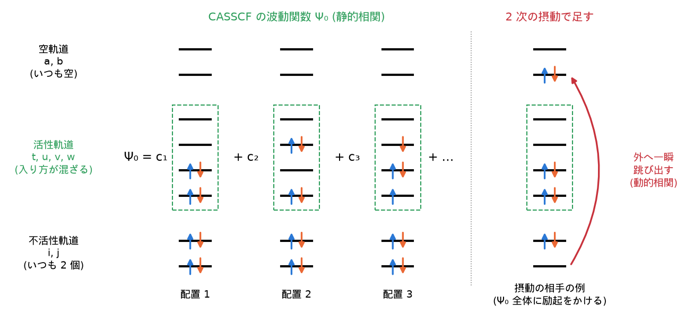
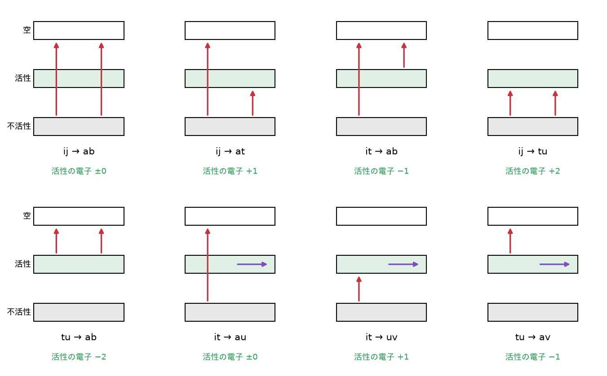
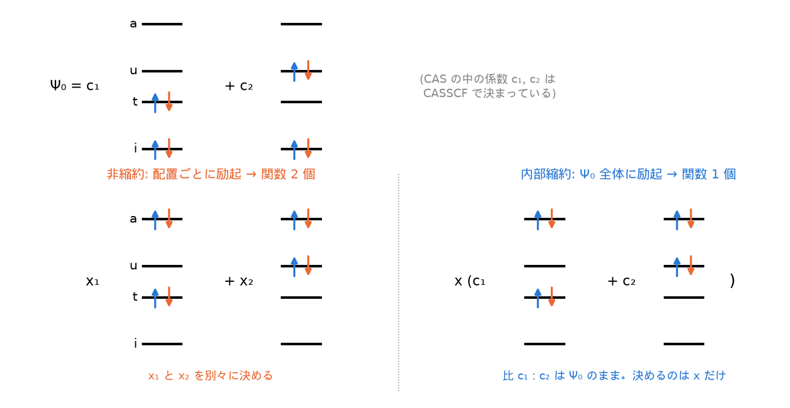
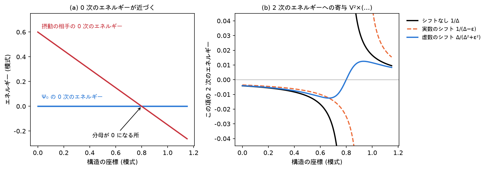
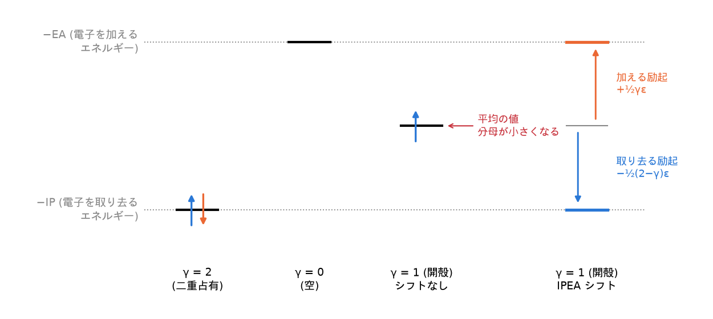
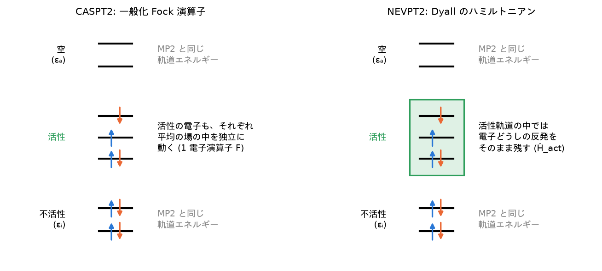
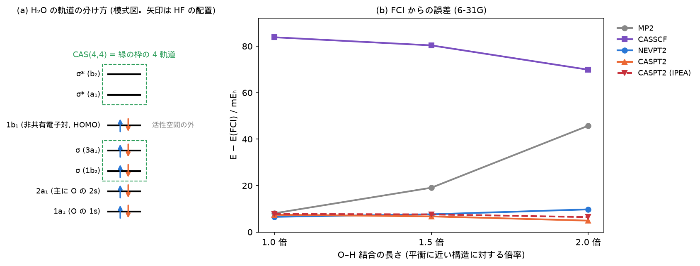
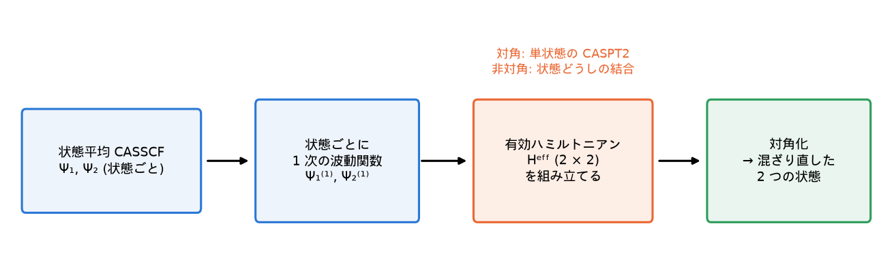

# 第 13 回　多参照摂動論：CASPT2 と NEVPT2

!!! abstract "この回の道筋"
    CASSCF は静的相関を正しく扱いますが、動的相関が足りません。この回では、CASSCF の波動関数を出発点にして、動的相関を 2 次の摂動で足す方法を学びます。代表的な二つの方法、CASPT2 と NEVPT2 は、0 次のハミルトニアンの選び方が違います。その違いから、侵入者状態の問題、レベルシフト、IPEA シフトをめぐる議論が生まれます。最後に、結合を伸ばした H₂O で、MP2、CASSCF、CASPT2、NEVPT2 を FCI と比べます。

    | 節 | 内容 |
    |---|---|
    | 1 | CASSCF の上に摂動を足す考え方 |
    | 2 | 1 次の波動関数の空間：内部縮約 |
    | 3 | CASPT2：一般化 Fock 演算子を使う 0 次ハミルトニアン |
    | 4 | 侵入者状態とレベルシフト |
    | 5 | IPEA シフトとその議論 |
    | 6 | NEVPT2：Dyall のハミルトニアン |
    | 7 | 計算例：H₂O の二つの O–H 結合を伸ばす |
    | 8 | 多状態版：MS-CASPT2、XMS-CASPT2、QD-NEVPT2 |

    **前に読んでおく回**：[量子化学の理論 第 9 回](09-mp2.md)、[第 12 回](12-casscf.md)

!!! tip "物理的なイメージ"
    CASPT2 と NEVPT2 が求めているのは、CASSCF の波動関数を出発点にして、活性空間の外へ電子が一瞬跳び出す過程（動的相関）を、2 次の摂動で足した補正です。第 9 回の MP2 の考え方を、多配置の出発点に広げたものです。補正の各項は「（跳び出しを起こす結合の強さ）² ÷（跳び出しに必要なエネルギー）」の形をしていて、分母のエネルギーの見積もり方（0 次のハミルトニアン）が二つの方法の違いです。見積もりが偶然 0 に近くなると補正が発散し（侵入者状態）、これを防ぐための工夫がレベルシフトです。

エネルギーは原子単位（ハートリー，$E_\mathrm{h}$）で書きます。1 $E_\mathrm{h}$ = 27.211 eV = 627.5 kcal/mol、1 m$E_\mathrm{h}$ = $10^{-3}\ E_\mathrm{h}$ です。2 電子積分は、空間軌道についての化学者の表記 $(pq|rs)$ を使い、軌道はすべて実数とします。軌道の添字は、不活性軌道を $i, j$、活性軌道を $t, u, v, w$、空軌道を $a, b$、どれでもよい軌道を $p, q, r, s$ で表します。$\hat E_{pq} = \sum_{\sigma} \hat a^\dagger_{p\sigma} \hat a_{q\sigma}$ は第 4 回の、スピンを変えずに電子を $q$ から $p$ へ移す演算子です。

## 1. CASSCF の上に摂動を足す考え方

### 1.1 MP2 の復習

第 9 回の摂動論を思い出します。本物のハミルトニアン $\hat H$ を、解ける部分 $\hat H_0$ と残り $\hat V$ に分けます。

$$
\hat H = \hat H_0 + \hat V
$$

$\hat H_0$ の固有関数と固有値を $\Phi_n$、$E_n^{(0)}$ とし、出発点を $\Phi_0$ とします。2 次のエネルギーは次の式でした（すべての段階を付録 A で導きます）。

$$
E^{(2)} = \sum_{n \ne 0} \frac{|\langle \Phi_n | \hat V | \Phi_0 \rangle|^2}{E_0^{(0)} - E_n^{(0)}}
$$

分子の $\langle \Phi_n | \hat V | \Phi_0 \rangle$ は、出発点から配置 $\Phi_n$ へ「跳び出す」結合の強さです。分母の $E_0^{(0)} - E_n^{(0)}$ は、跳び出しに必要なエネルギーの見積もりにマイナスをつけたものです。基底状態ではふつう分母は負なので、各項はエネルギーを下げます。

MP2 では、$\Phi_0$ が HF の決定子、$\hat H_0$ が Fock 演算子の和でした。$\Phi_n$ は 2 電子励起の決定子で、分母は軌道エネルギーの差 $\varepsilon_i + \varepsilon_j - \varepsilon_a - \varepsilon_b$ です。

### 1.2 出発点を CASSCF に替える

第 9 回の 6 節で見たように、静的相関が強いと、分母 $E_0^{(0)} - E_n^{(0)}$ が小さくなり、MP2 は信頼できなくなります。HF の決定子が、そもそも良い出発点ではないからです。

そこで、出発点を CASSCF の波動関数 $\Psi_0$ に替えます。静的相関は $\Psi_0$ の中に入っているので、残りの動的相関だけを摂動で足せばよいはずです。この考え方の方法を、まとめて**多参照摂動論**（multireference perturbation theory）と呼びます。エネルギーは

$$
E = E_\mathrm{CASSCF} + E^{(2)}
$$

の形になります。



**図 1**　軌道の分け方の模式図。不活性軌道（下）にはいつも電子が 2 個ずつ入り、空軌道（上）はいつも空です。緑の破線で囲んだ活性軌道の中では、電子の入り方が何通りも混ざります（左の 3 つの配置の重ね合わせが CASSCF の波動関数 $\Psi_0$）。右は摂動で足す相手の例で、不活性軌道の電子 2 個が空軌道へ跳び出しています（赤の矢印）。これが動的相関の「一瞬の跳び出し」です。

### 1.3 何が難しいのか

ただし、MP2 をそのまま広げることはできません。1.1 節の式を使うには、$\Psi_0$ を固有関数にもつ $\hat H_0$ が必要です。HF の決定子は Fock 演算子の和の固有関数でした。しかし、CASSCF の波動関数は多くの配置の重ね合わせなので、簡単な 1 電子演算子の固有関数にはなりません。$\hat H_0$ をどう選ぶかが、多参照摂動論の中心の問題です。この選び方の違いが、3 節の CASPT2 と 6 節の NEVPT2 の違いです。

**ここまでで分かったこと**：多参照摂動論は、CASSCF の波動関数を出発点にして、動的相関を 2 次の摂動で足す方法です。その鍵は、CASSCF の波動関数を固有関数にもつ 0 次のハミルトニアンの選び方です。

## 2. 1 次の波動関数の空間：内部縮約

$\hat H_0$ の話の前に、摂動で足す配置（摂動の相手）をどう選ぶかを決めます。

### 2.1 8 種類の跳び出し方

2 次のエネルギーの分子 $\langle \Phi_n | \hat V | \Phi_0 \rangle$ が 0 でない相手だけを考えれば十分です。$\hat H$ には 2 電子演算子までしか含まれないので、$\hat H |\Psi_0\rangle$ に現れるのは、$\Psi_0$ から電子を最大 2 個動かした配置だけです。

動かし方は、どの種類の軌道からどの種類の軌道へ動かすかで分類できます。活性軌道の中だけでの動かし方は、すでに CAS の中に含まれているので除きます。すると、図 2 の 8 種類が残ります。



**図 2**　摂動の相手の 8 種類。各図の 3 つの箱は、下から不活性軌道、活性軌道、空軌道です。赤の矢印が電子 1 個の移動、紫の横向きの矢印は活性軌道の中での並べ替えです。下の緑の文字は、その励起で活性軌道の電子の数がいくつ変わるかを表します。たとえば左上の ij → ab は MP2 と同じ型の励起で、活性軌道の電子は変わりません。

1 電子だけを動かす励起（たとえば $i \to a$）は、図 2 の下の段の右 3 種類の特別な場合として含まれます。たとえば $\sum_t \hat E_{tt}$ は活性軌道の電子の数を数える演算子なので、$\sum_t \hat E_{ai} \hat E_{tt} |\Psi_0\rangle = n_\mathrm{act}\, \hat E_{ai} |\Psi_0\rangle$ です（$n_\mathrm{act}$ は活性電子の数）。

### 2.2 内部縮約

CAS の配置 1 個ずつに、こうした励起をかけた配置をすべて使うと、配置の数は、CAS の配置の数と外側の励起の数の積になります。これは非常に大きな数です。

そこで、CASPT2 でも NEVPT2 の多くの実装でも、**励起の演算子を $\Psi_0$ 全体にかけた関数**

$$
\hat E_{pq} \hat E_{rs} |\Psi_0\rangle
$$

を摂動の相手に使います。$\Psi_0$ の中の CAS の係数の比は、固定したままです。これを**内部縮約**（internal contraction）と呼びます [Andersson 1990; Andersson 1992]。図 3 で、二つの方法を比べます。



**図 3**　$\Psi_0 = c_1 \Phi_1 + c_2 \Phi_2$（活性軌道 $t$ と $u$ のどちらかに電子対が入った 2 つの配置）に、不活性軌道 $i$ の電子対を空軌道 $a$ へ移す励起をかけた例。左（非縮約）：配置ごとに励起をかけるので、関数が 2 個でき、係数 $x_1$、$x_2$ を別々に決めます。右（内部縮約）：$\Psi_0$ 全体に励起をかけるので、関数は 1 個で、中の比 $c_1 : c_2$ は $\Psi_0$ のままです。決める係数は $x$ の 1 個だけです。

内部縮約では、摂動の相手の数は CAS の配置の数によらず、軌道の添字の組の数で決まります。

### 2.3 内部縮約の代償：重なりと密度行列

内部縮約の関数は、互いに直交するとは限りません。具体例で確かめます。活性軌道 $t$ と $u$ から、空軌道 $a$ へ電子を 1 個移す 2 つの関数

$$
\chi_t = \hat E_{at} |\Psi_0\rangle, \qquad \chi_u = \hat E_{au} |\Psi_0\rangle
$$

の重なり $\langle \chi_t | \chi_u \rangle$ を計算します。$\hat E_{at}$ のエルミート共役は $\hat E_{ta}$ なので、

$$
\langle \chi_t | \chi_u \rangle = \langle \Psi_0 | \hat E_{ta} \hat E_{au} | \Psi_0 \rangle
$$

です。演算子の順番を入れ替えます。交換関係 $[\hat E_{pq}, \hat E_{rs}] = \delta_{qr} \hat E_{ps} - \delta_{ps} \hat E_{rq}$（第 4 回の生成・消滅演算子の反交換関係から出ます）で $p = t$、$q = a$、$r = a$、$s = u$ とおくと、

$$
\hat E_{ta} \hat E_{au} = \hat E_{au} \hat E_{ta} + \hat E_{tu} - \delta_{tu} \hat E_{aa}
$$

です。右辺を $\Psi_0$ ではさみます。空軌道 $a$ には電子がないので、$\hat E_{ta} |\Psi_0\rangle = 0$、$\hat E_{aa} |\Psi_0\rangle = 0$ です。残るのは真ん中の項だけで、

$$
\langle \chi_t | \chi_u \rangle = \langle \Psi_0 | \hat E_{tu} | \Psi_0 \rangle = \gamma_{tu}
$$

となります。$\gamma_{tu}$ は第 12 回の 1 電子密度行列です。活性軌道が $t$、$u$ の 2 個なら、重なりの行列は

$$
\mathbf S =
\begin{pmatrix}
\langle \chi_t | \chi_t \rangle & \langle \chi_t | \chi_u \rangle \\
\langle \chi_u | \chi_t \rangle & \langle \chi_u | \chi_u \rangle
\end{pmatrix}
=
\begin{pmatrix}
\gamma_{tt} & \gamma_{tu} \\
\gamma_{ut} & \gamma_{uu}
\end{pmatrix}
$$

です。活性軌道に自然軌道（第 12 回の 4 節）を使えば、$\gamma$ は対角になり、$\mathbf S = \mathrm{diag}(n_t, n_u)$ です。$n_t$ は軌道 $t$ の占有数です。

この結果は、絵で考えると自然です。$t$ から電子を取り出す関数の大きさ（ノルムの 2 乗）は、$t$ にいる電子の数 $n_t$ です。$t$ がほとんど空なら、$\chi_t$ はほとんど 0 の関数になります。占有数が 0 に近い軌道があると、関数どうしがほぼ線形従属になるので、実際の計算では $\mathbf S$ の固有値が小さすぎる方向を取り除きます。

この例では 1 電子密度行列ですみました。活性軌道の添字が多い種類（図 2 の下の段の右 3 種類など）では、重なりに 2 電子・3 電子の密度行列が現れ、$\hat H_0$ の行列要素には 4 電子の密度行列までが現れます。これが内部縮約の代償で、大きな活性空間では大きな壁になります（[第 14 回](14-dmrg-sci.md)で扱います）。

### 2.4 1 次の波動関数を連立 1 次方程式で求める

内部縮約の関数は $\hat H_0$ の固有関数ではないので、1.1 節の「和の式」はそのままでは使えません。そのかわりに、1 次の波動関数 $\Psi^{(1)} = \sum_\mu x_\mu \chi_\mu$ の係数 $x_\mu$ を、連立 1 次方程式

$$
\sum_\mu \big( \langle \chi_\nu | \hat H_0 | \chi_\mu \rangle - E_0^{(0)} \langle \chi_\nu | \chi_\mu \rangle \big)\, x_\mu = - \langle \chi_\nu | \hat H | \Psi_0 \rangle
$$

で求めます。導出は付録 A に回します。2 次のエネルギーは $E^{(2)} = \sum_\mu x_\mu \langle \Psi_0 | \hat H | \chi_\mu \rangle$ です。上の 2 個の関数 $\chi_t$、$\chi_u$ だけの場合に書き出すと、

$$
\begin{pmatrix}
F_{tt} - E_0^{(0)} S_{tt} & F_{tu} - E_0^{(0)} S_{tu} \\
F_{ut} - E_0^{(0)} S_{ut} & F_{uu} - E_0^{(0)} S_{uu}
\end{pmatrix}
\begin{pmatrix} x_t \\ x_u \end{pmatrix}
= -
\begin{pmatrix} \langle \chi_t | \hat H | \Psi_0 \rangle \\ \langle \chi_u | \hat H | \Psi_0 \rangle \end{pmatrix}
$$

です。$F_{tu} = \langle \chi_t | \hat H_0 | \chi_u \rangle$ と書きました。関数が直交していて $\hat H_0$ が対角なら、各行が独立になり、$x_t = -\langle \chi_t | \hat H | \Psi_0 \rangle / (F_{tt} - E_0^{(0)})$ となって、1.1 節の和の式に戻ります。

**ここまでで分かったこと**：摂動の相手は 8 種類の跳び出し方に分かれます。多参照摂動論では、励起の演算子を CASSCF の波動関数全体にかけた関数を使います（内部縮約）。配置の数は抑えられますが、関数は直交せず、重なりや行列要素に高次の密度行列が必要になります。1 次の波動関数は連立 1 次方程式で求めます。

## 3. CASPT2：一般化 Fock 演算子を使う 0 次ハミルトニアン

Andersson、Malmqvist、Roos らは、CASSCF の波動関数を出発点とする 2 次の摂動論 **CASPT2** を 1990 年と 1992 年に発表しました [Andersson 1990; Andersson 1992]。CASPT2 の $\hat H_0$ は、MP2 の Fock 演算子を多配置に広げたものです。

### 3.1 一般化 Fock 演算子

CASSCF の 1 電子密度行列 $\gamma_{rs} = \langle \Psi_0 | \hat E_{rs} | \Psi_0 \rangle$（第 12 回）を使って、**一般化 Fock 演算子**を定義します。

$$
\hat F = \sum_{pq} f_{pq}\, \hat E_{pq}, \qquad
f_{pq} = h_{pq} + \sum_{rs} \gamma_{rs} \Big[ (pq|rs) - \frac12 (pr|qs) \Big]
$$

$h_{pq}$ は運動エネルギーと核の引力の 1 電子積分です。$f_{pq}$ は、密度 $\gamma$ の電子がつくる平均の場の中で、電子 1 個が感じるエネルギーです。

この式が HF の Fock 行列の自然な拡張であることを確かめます。$\Psi_0$ が閉殻の決定子 1 個なら、$\gamma_{rs}$ は占有軌道 $k$ で $\gamma_{kk} = 2$、それ以外で 0 です。これを代入すると、$r = s = k$ の項だけが残り、

$$
f_{pq} = h_{pq} + \sum_{k}^{\text{占有}} 2 \Big[ (pq|kk) - \frac12 (pk|qk) \Big]
$$

です。括弧を開くと

$$
f_{pq} = h_{pq} + \sum_{k}^{\text{占有}} \big[ 2(pq|kk) - (pk|qk) \big]
$$

となり、これは第 3 回の閉殻の Fock 行列（クーロンの項 $2(pq|kk)$ と交換の項 $(pk|kq) = (pk|qk)$）そのものです。

### 3.2 空間を区切って Ψ₀ を固有関数にする

ところが、$\hat F$ そのものは $\Psi_0$ を固有関数にもちません。$\hat F \Psi_0$ には、$\Psi_0$ 以外の配置も混ざるからです。そこで、配置の空間を 4 つに分け、それぞれの中だけで $\hat F$ を働かせます。

$$
\hat H_0 = \hat P_0 \hat F \hat P_0 + \hat P_K \hat F \hat P_K + \hat P_{SD} \hat F \hat P_{SD} + \hat P_X \hat F \hat P_X
$$

4 つの射影演算子が切り取る空間は次のとおりです。

- $\hat P_0$：$\Psi_0$ そのもの。
- $\hat P_K$：CAS の中で $\Psi_0$ に直交する部分（CASSCF の励起状態など）。
- $\hat P_{SD}$：2 節の摂動の相手がつくる空間。
- $\hat P_X$：残り全部。

この順に基底を並べると、$\hat H_0$ の行列はブロック対角になります。

$$
\mathbf H_0 =
\begin{pmatrix}
E_0^{(0)} & 0 & 0 & 0 \\
0 & \mathbf F_{KK} & 0 & 0 \\
0 & 0 & \mathbf F_{SD,SD} & 0 \\
0 & 0 & 0 & \mathbf F_{XX}
\end{pmatrix}
\begin{matrix} \leftarrow \Psi_0 \\ \leftarrow K \\ \leftarrow SD \\ \leftarrow X \end{matrix}
$$

$\mathbf F_{KK}$ などは、それぞれの空間の中での $\hat F$ の行列です。左上の要素は 1 個の数で、

$$
E_0^{(0)} = \langle \Psi_0 | \hat F | \Psi_0 \rangle = \sum_{pq} f_{pq}\, \langle \Psi_0 | \hat E_{pq} | \Psi_0 \rangle = \sum_{pq} f_{pq}\, \gamma_{pq}
$$

です。ほかのブロックとの間の要素がすべて 0 なので、$\Psi_0$ は $\hat H_0$ の固有関数になります。一方、本物の $\hat H$ では、$\Psi_0$ と SD の空間の間の要素が 0 ではありません。この要素が $\hat V = \hat H - \hat H_0$ に入り、2 次のエネルギーの分子になります。

### 3.3 単一の閉殻配置では MP2 に一致する

活性軌道がなく、$\Psi_0$ が閉殻の決定子 1 個の場合を考えます。3.1 節で見たように $f_{pq}$ は Fock 行列になり、正準軌道では $f_{pq} = \delta_{pq} \varepsilon_p$ です。このとき

- $E_0^{(0)} = \sum_p \varepsilon_p \gamma_{pp} = 2 \sum_k^{\text{占有}} \varepsilon_k$（MP2 の $E_0^{(0)}$ と同じ）、
- SD の空間の 2 電子励起の決定子は $\hat F$ の固有関数で、固有値は $E_0^{(0)} + \varepsilon_a + \varepsilon_b - \varepsilon_i - \varepsilon_j$、
- 1 電子励起は Brillouin の定理（第 8 回）で $\Psi_0$ と結合しない

ので、CASPT2 の 2 次のエネルギーは MP2 に一致します。CASPT2 は、第 9 回の MP2 をそのまま多配置に広げたものと考えられます。

### 3.4 弱点

一方、弱点もあります。$\hat F$ は 1 電子演算子です。そのため、活性軌道の中の電子どうしの反発を、平均の形でしか含みません。摂動の相手の 0 次のエネルギーは、軌道エネルギー $f_{pp}$ の足し引きに近い形で決まります。この弱点が、4 節と 5 節で扱う問題（侵入者状態と、開殻の系での系統的な誤差）につながります。

**ここまでで分かったこと**：CASPT2 は、CASSCF の密度行列でつくった一般化 Fock 演算子を、空間ごとに区切って 0 次のハミルトニアンにします。単一の閉殻配置では MP2 に一致します。活性電子どうしの反発は平均でしか入りません。

## 4. 侵入者状態とレベルシフト

### 4.1 侵入者状態

2 次のエネルギーの分母 $E_0^{(0)} - E_n^{(0)}$ は、摂動の相手の 0 次のエネルギーが $E_0^{(0)}$ に近いと、0 に近づきます。分母が 0 に近い項は非常に大きくなり、エネルギーが発散したり、ポテンシャルエネルギー曲線にとげが現れたりします。このような摂動の相手を、**侵入者状態**（intruder state）と呼びます。

CASPT2 では、侵入者状態が起こりえます。3.4 節で見たように、摂動の相手の 0 次のエネルギーには、活性軌道の電子の反発がきちんと入りません。そのため、本当はエネルギーの高い配置が、0 次では $\Psi_0$ と同じくらいのエネルギーに見えることがあるからです。

図 4 は、これを 1 個の項の模型で描いたものです。



**図 4**　1 個の摂動の相手だけを考えた模式図。(a) 構造を変えると、摂動の相手の 0 次のエネルギー（赤）が下がり、座標 0.8 で $\Psi_0$ の 0 次のエネルギー（青）と交わります。(b) この項の 2 次のエネルギー $V^2 \times (\cdots)$。シフトなし（黒）は交わる所で発散します。実数のシフト（橙の破線）は発散の位置を右にずらすだけです。虚数のシフト（青）はどこでも有限ですが、交わる所の近くでは値が大きく変わります。

### 4.2 実数のレベルシフト

侵入者状態への対処として、Roos と Andersson は、$\hat H_0$ の摂動の相手の部分に定数 $\varepsilon$ を足して分母をずらす**レベルシフト**を提案しました [Roos 1995]。1 個の項で書くと、$\Delta = E_0^{(0)} - E_n^{(0)}$ として

$$
\frac{1}{\Delta} \;\longrightarrow\; \frac{1}{\Delta - \varepsilon}
$$

です（$\varepsilon > 0$）。基底状態では、分母 $\Delta$ はふつう負です。$\varepsilon$ を引くと分母の大きさが増え、0 に近づかなくなります。

シフトを入れると、侵入者状態でない項も少し変わります。たとえば $\Delta = -1.0\ E_\mathrm{h}$、$\varepsilon = 0.1\ E_\mathrm{h}$ なら、$1/\Delta = -1.000$ が $1/(\Delta - \varepsilon) = -0.909$ になり、1 割小さくなります。そこで、シフトのせいで変わった分を、$\varepsilon$ の 1 次まで補正して元に戻します [Roos 1995]。1 個の項では、補正後の値は

$$
\frac{V^2 (\Delta - 2\varepsilon)}{(\Delta - \varepsilon)^2}
$$

になります（$V$ は分子の結合の大きさ、導出は付録 B）。上の数値では $-1.2 / 1.21 = -0.992$ で、元の $-1.000$ にかなり近づきます。一方、分母が 0 に近い項（$\Delta \approx 0$）では、補正後も値は $-2\varepsilon V^2 / \varepsilon^2 = -2V^2/\varepsilon$ と有限です。Roos らは、この方法で侵入者状態が取り除け、残りの相関エネルギーへの影響は小さいことを示しました [Roos 1995]。

### 4.3 虚数のレベルシフト

実数のシフトにも限界があります。励起状態では、分母が正にも負にもなりうるので、小さなシフトは特異点の位置を動かすだけです（図 4(b) の橙の破線）。大きなシフトは、別の場所に新しい発散を生むことがあります。Forsberg と Malmqvist はこの点を指摘し、**虚数のレベルシフト**を提案しました [Forsberg 1997]。分母に虚数 $i\varepsilon$ を足して、エネルギーの実部だけをとります。分母を実数にするため、分子と分母に $\Delta - i\varepsilon$ をかけると、

$$
\frac{1}{\Delta + i\varepsilon} = \frac{\Delta - i\varepsilon}{(\Delta + i\varepsilon)(\Delta - i\varepsilon)} = \frac{\Delta - i\varepsilon}{\Delta^2 + \varepsilon^2}
$$

です。実部をとると

$$
\mathrm{Re}\, \frac{1}{\Delta + i\varepsilon} = \frac{\Delta}{\Delta^2 + \varepsilon^2}
$$

となります。右辺の分母 $\Delta^2 + \varepsilon^2$ は、$\Delta$ が正でも負でも 0 でも $\varepsilon^2$ 以上なので、値は有限です。$|\Delta|$ が $\varepsilon$ より十分に大きい項では $\Delta^2 + \varepsilon^2 \approx \Delta^2$ なので、元の $1/\Delta$ とほとんど変わりません。Forsberg らは、N₂ と Cr₂ への応用で、この操作によるポテンシャルの歪みが小さいことを示しました [Forsberg 1997]。

どちらのシフトを使う場合も、使った値を必ず報告し、結果がその値にどれだけ依存するかを確かめてください。

**ここまでで分かったこと**：分母が 0 に近い摂動の相手（侵入者状態）は、エネルギーを発散させます。CASPT2 では、実数または虚数のレベルシフトでこれを抑え、シフトによる変化は補正で小さくします。

## 5. IPEA シフトとその議論

### 5.1 開殻の軌道での系統的な誤差

CASPT2 には、侵入者状態とは別に、系統的な誤差も知られています。Ghigo、Roos、Malmqvist は、元の CASPT2 が開殻の系の相関エネルギーを大きく見積もりすぎ、その結果、解離エネルギーや励起エネルギーが小さくなりすぎることを指摘しました [Ghigo 2004]。

原因は、活性軌道の対角の Fock 要素 $f_{tt}$ にあります。$f_{tt}$ は、3 節の分母に現れる「その軌道の電子のエネルギー」です。次の二つの場合を考えます。

- **二重占有（$\gamma_{tt} = 2$）**：HF の占有軌道と同じで、Koopmans の定理（第 3 回）のとおり、$f_{tt}$ はイオン化エネルギー（IP）にマイナスをつけた値 $-\mathrm{IP}_t$ に近くなります。
- **空（$\gamma_{tt} = 0$）**：HF の仮想軌道と同じで、$f_{tt}$ は電子親和力（EA）にマイナスをつけた値 $-\mathrm{EA}_t$ に近くなります。

3.1 節の式で、$f_{pq}$ は $\gamma$ について 1 次式です。そのため、占有数が途中の値のときは、両者を占有数で重みづけた平均になります [Ghigo 2004]。

$$
f_{tt} \approx -\frac12 \Big[ \gamma_{tt}\, \mathrm{IP}_t + (2 - \gamma_{tt})\, \mathrm{EA}_t \Big]
$$

$\gamma_{tt} = 2$ を入れると $-\mathrm{IP}_t$、$\gamma_{tt} = 0$ を入れると $-\mathrm{EA}_t$ に戻ることを確かめてください。

占有数が 1 の開殻の軌道では、$f_{tt} = -\frac12 (\mathrm{IP}_t + \mathrm{EA}_t)$ で、ちょうど真ん中の値になります。ところが、本当に必要な値は励起の向きで違います。

- その軌道から電子を**取り去る**励起の分母には、$-\mathrm{IP}_t$ が使われるべきです。
- その軌道へ電子を**加える**励起の分母には、$-\mathrm{EA}_t$ が使われるべきです。

CASPT2 は、どちらの向きにも同じ平均の値を使います。取り去る励起では、軌道のエネルギーが本当より高く見え、跳び出しに必要なエネルギーが小さく見積もられます。加える励起でも同じです。その結果、分母が小さくなり、相関エネルギーが大きくなりすぎます。

### 5.2 IPEA シフト

Ghigo らは、活性軌道から電子を取り去る励起と、活性軌道へ電子を加える励起とで、分母を別々にずらす修正を提案しました [Ghigo 2004]。必要なずらし幅は、上の式から計算できます。取り去るときに $-\mathrm{IP}_t$ にするには、

$$
-\mathrm{IP}_t - f_{tt} = -\mathrm{IP}_t + \frac12 \Big[ \gamma_{tt}\, \mathrm{IP}_t + (2 - \gamma_{tt})\, \mathrm{EA}_t \Big] = -\frac12 (2 - \gamma_{tt}) (\mathrm{IP}_t - \mathrm{EA}_t)
$$

だけずらせばよく、加えるときに $-\mathrm{EA}_t$ にするには、同じ計算で

$$
-\mathrm{EA}_t - f_{tt} = +\frac12 \gamma_{tt} (\mathrm{IP}_t - \mathrm{EA}_t)
$$

だけずらせばよいことが分かります。どちらも、軌道ごとの差 $\mathrm{IP}_t - \mathrm{EA}_t$ だけで決まります。Ghigo らは、この差を、すべての軌道に共通の一つのパラメータ $\varepsilon$ で置き換えました。これを **IPEA シフト**と呼び、標準の値は $\varepsilon = 0.25\ E_\mathrm{h}$ です [Ghigo 2004; Zobel 2017]。



**図 5**　活性軌道 $t$ の対角の Fock 要素 $f_{tt}$（横線）の位置。左の二つ：二重占有なら $-\mathrm{IP}$、空なら $-\mathrm{EA}$ の高さにあります。3 番目：占有数が 1 の開殻の軌道では、真ん中の平均の値になります。右端：IPEA シフトでは、電子を取り去る励起には下へ $\frac12(2 - \gamma)\varepsilon$ ずらした値（青）、加える励起には上へ $\frac12 \gamma \varepsilon$ ずらした値（橙）を使います。$\varepsilon = \mathrm{IP} - \mathrm{EA}$ なら、ちょうど点線の高さになります。

49 個の二原子分子の解離エネルギーで、誤差の根平均二乗が 0.22 eV（シフトなし）から 0.09 eV（$\varepsilon = 0.25\ E_\mathrm{h}$）に下がったと報告されています [Ghigo 2004; Zobel 2017 のまとめによる]。

### 5.3 励起エネルギーについての議論

一方、励起エネルギーについては議論があります。

- Zobel、Nogueira、González は、有機分子の励起エネルギーについて、IPEA シフトを使う根拠がないと結論しました [Zobel 2017]。文献に報告された、シフトなしの CASPT2 の励起エネルギー 356 個を参照値と比べると、平均の過小評価は 0.02 eV にすぎませんでした。13 個の二原子・三原子分子の 137 個の状態で FCI と比べても、過小評価は 0.05 eV でした。さらに、IPEA シフトによる変化は、系の大きさ（動的相関の大きさ）や基底関数に強く依存し、普遍的な補正にはなっていないことを示しました。
- Sarkar、Loos、Boggio-Pasqua、Jacquemin は、35 個の有機分子の 284 個の励起状態について、誤差 ±0.03 eV 程度の高精度な参照値と比べました [Sarkar 2022]。その結果、IPEA シフトを使った CASPT2 と、部分縮約版の NEVPT2（6 節）が、平均絶対誤差 0.11 eV と 0.13 eV で、どちらもかなり信頼できる値を与えました。

このように、IPEA シフトの是非は、性質（解離エネルギーか励起エネルギーか）、系の種類、参照値の選び方によって評価が分かれています。CASPT2 を使うときは、IPEA シフトの有無と値を明記し、比べたい文献と条件をそろえてください。

**ここまでで分かったこと**：IPEA シフトは、開殻の活性軌道で分母が小さく見積もられる CASPT2 の系統的な誤差を補正する経験的な修正です。解離エネルギーは改善しますが、励起エネルギーへの使用には賛否があります。

## 6. NEVPT2：Dyall のハミルトニアン

### 6.1 活性軌道の中では本物の相互作用を残す

CASPT2 の問題の多くは、$\hat H_0$ が 1 電子演算子で、活性電子どうしの反発を平均でしか扱わないことから来ていました。そこで、**活性軌道の中では本物の 2 電子相互作用を残す**という選び方があります（図 6）。

Dyall は、次の 0 次のハミルトニアンを提案しました [Dyall 1995]。

$$
\hat H_\mathrm{D} = \sum_i \varepsilon_i \hat E_{ii} + \sum_a \varepsilon_a \hat E_{aa} + C + \hat H_\mathrm{act}
$$

$$
\hat H_\mathrm{act} = \sum_{tu} h_{tu}^\mathrm{eff}\, \hat E_{tu} + \frac12 \sum_{tuvw} (tu|vw) \big( \hat E_{tu} \hat E_{vw} - \delta_{uv} \hat E_{tw} \big)
$$

各項の意味は次のとおりです。

- 第 1 項と第 2 項：不活性軌道と空軌道には、MP2 と同じく軌道エネルギー $\varepsilon_i$、$\varepsilon_a$（一般化 Fock 行列の対角要素）を使います。$\hat E_{ii}$ は軌道 $i$ の電子の数を数える演算子です。
- $\hat H_\mathrm{act}$：本物のハミルトニアン（第 4 回）を、活性軌道だけに制限したものです。$h_{tu}^\mathrm{eff} = h_{tu} + \sum_i \big[ 2(tu|ii) - (ti|iu) \big]$ は、不活性軌道の電子がつくる平均の場（クーロンと交換）を含めた 1 電子積分です。
- $C$ は、$\Psi_0$ の固有値を CASSCF のエネルギーに合わせるための定数です。



**図 6**　二つの 0 次のハミルトニアンの模式図。不活性軌道と空軌道（上下）は、どちらも MP2 と同じ軌道エネルギーで扱います。違いは活性軌道（真ん中）です。左の CASPT2 では、活性電子も 1 電子ずつ平均の場の中を独立に動きます。右の NEVPT2 では、緑の箱の中で電子どうしの反発をそのまま残します。

### 6.2 Ψ₀ が固有関数であることを確かめる

$\hat H_\mathrm{D}$ を $\Psi_0$ にかけて、項ごとに見ます。$\Psi_0$ は「不活性軌道に電子が 2 個ずつ、空軌道に 0 個、活性軌道に CAS の波動関数」という形をしています。

1. 不活性軌道の項：$\hat E_{ii}$ は軌道 $i$ の電子の数（2 個）を数えるので、$\sum_i \varepsilon_i \hat E_{ii} \Psi_0 = 2 \sum_i \varepsilon_i\, \Psi_0$ です。
2. 空軌道の項：電子がないので、$\sum_a \varepsilon_a \hat E_{aa} \Psi_0 = 0$ です。
3. 活性軌道の項：CASSCF の CI の部分は、活性軌道の中での FCI です。そのハミルトニアンは、不活性軌道の平均の場を含めた $\hat H_\mathrm{act}$ そのものです。したがって $\hat H_\mathrm{act} \Psi_0 = E_\mathrm{act} \Psi_0$ です（$E_\mathrm{act}$ はその固有値）。

まとめると

$$
\hat H_\mathrm{D} \Psi_0 = \Big( 2 \sum_i \varepsilon_i + C + E_\mathrm{act} \Big) \Psi_0
$$

となり、$\Psi_0$ は $\hat H_\mathrm{D}$ の固有関数です。CASPT2 のように射影演算子で空間を区切る必要がありません。$C$ は、この固有値が $E_\mathrm{CASSCF}$ になるように選びます。

### 6.3 NEVPT2 と分母の形

Angeli、Cimiraglia、Malrieu らは、この Dyall のハミルトニアンを使った 2 次の摂動論 **NEVPT2**（$n$-electron valence state perturbation theory）を 2001 年に発表しました [Angeli 2001]。名前の「$n$ 電子の原子価状態」は、活性電子の状態を、2 電子相互作用を含めたまま扱うことを指しています。

分母がどうなるかを、二つの種類の励起で見ます。

- **$ij \to ab$（図 2 の左上）**：関数 $\hat E_{ai} \hat E_{bj} \Psi_0$ では、活性軌道の部分は $\Psi_0$ のままです。6.2 節と同じ計算で、不活性軌道の項は $\varepsilon_i + \varepsilon_j$ だけ減り、空軌道の項は $\varepsilon_a + \varepsilon_b$ だけ増えます。したがって、この関数も $\hat H_\mathrm{D}$ の固有関数で、分母は $E_0^{(0)} - E^{(0)} = \varepsilon_i + \varepsilon_j - \varepsilon_a - \varepsilon_b$ です。MP2 と同じ形です。
- **$tu \to ab$（活性電子が 2 個減る）**：空軌道の項は $\varepsilon_a + \varepsilon_b$ 増えます。活性軌道の部分は、電子が 2 個少ない状態に変わり、そのエネルギーは $\hat H_\mathrm{act}$ で、電子どうしの反発を含めて計算されます。分母には「活性空間から電子を 2 個取り去るのに要る本物のエネルギー」が入ります。

二つ目の場合が CASPT2 との違いです。CASPT2 では、この部分が軌道エネルギーの足し引きで見積もられていました。

**強縮約**（strongly contracted, SC）版の NEVPT2 では、同じ種類で同じ外側の添字をもつ摂動の相手をまとめて、1 個の関数 $\Psi_l = \hat P_l \hat H \Psi_0$ にします [Angeli 2001; Angeli 2002]。$\hat P_l$ はその種類の空間への射影です。その 0 次のエネルギーを $E_l = \langle \Psi_l | \hat H_\mathrm{D} | \Psi_l \rangle / \langle \Psi_l | \Psi_l \rangle$ とすると、2 次のエネルギーは

$$
E^{(2)} = \sum_l \frac{N_l}{E_0^{(0)} - E_l}, \qquad N_l = \langle \Psi_l | \Psi_l \rangle
$$

です。1.1 節の式に、規格化した関数 $\Psi_l / \sqrt{N_l}$ を入れると、この形になります。分子は $|\langle \Psi_l | \hat V | \Psi_0 \rangle|^2 / N_l$ ですが、$\hat H_\mathrm D \Psi_0$ は $\Psi_0$ に比例するので $\hat P_l \hat H_\mathrm D \Psi_0 = 0$ であり、$\langle \Psi_l | \hat V | \Psi_0 \rangle = \langle \Psi_l | \hat H | \Psi_0 \rangle = \langle \Psi_0 | \hat H \hat P_l \hat H | \Psi_0 \rangle = N_l$ となるからです。物理的なイメージのとおり、各項は「その種類の跳び出しの強さ $N_l$」÷「跳び出しに必要なエネルギー」です。

**部分縮約**（partially contracted, PC）版は、2 節の内部縮約に近い形で、より柔軟です [Angeli 2001; Angeli 2002]。

### 6.4 NEVPT2 の性質

NEVPT2 には、次の性質があります [Angeli 2001]。

1. **侵入者状態がありません。** 6.3 節で見たように、摂動の相手の 0 次のエネルギーには、活性電子どうしの反発がきちんと入ります。そのため、分母が 0 に近づくことが起こらず、レベルシフトが要りません。
2. **サイズ無矛盾です。** 十分に離れた二つの分子の NEVPT2 のエネルギーは、それぞれのエネルギーの和になります（第 8 回のサイズ無矛盾性）。

NEVPT2 の計算には、活性軌道の 4 電子の密度行列が必要です [Angeli 2002]。CASPT2 でも、4 電子の密度行列を一般化 Fock 行列と縮約した量が必要です（2.3 節）。活性空間が大きくなると、この部分が計算の重さを決めます。

**ここまでで分かったこと**：NEVPT2 は、活性軌道の中で本物の 2 電子相互作用を残す Dyall のハミルトニアンを 0 次にとります。$\Psi_0$ はそのまま固有関数になり、分母には活性電子の出し入れの本物のエネルギーが入ります。そのため侵入者状態がなく、レベルシフトが要りません。サイズ無矛盾性も満たします。

## 7. 計算例：H₂O の二つの O–H 結合を伸ばす

第 8 回と第 9 回で使った H₂O（6-31G 基底）を、もう一度計算します。平衡に近い構造と、二つの O–H 結合を 1.5 倍、2 倍に伸ばした構造です。第 9 回で見たとおり、2 倍に伸ばすと MP2 は大きく外れました。この系では FCI が計算できるので、各方法の誤差を正確に比べられます。

活性空間は、二つの O–H 結合の σ 軌道 2 個と σ\* 軌道 2 個に、電子 4 個を入れた CAS(4,4) にします（図 7(a)）。O の 1s、主に 2s の軌道、分子面に垂直な非共有電子対（1b₁）の 3 個は不活性軌道です。

PySCF [Sun 2020] の `mrpt.NEVPT` は SC-NEVPT2、`mrpt.caspt2.CASPT2` は内部縮約の CASPT2 です。CASPT2 は、IPEA シフトなしと、$\varepsilon = 0.25\ E_\mathrm{h}$ の両方で計算します。どの方法でも、すべての電子を相関させています。

```python
import numpy as np
from pyscf import gto, scf, mp, mcscf, mrpt, fci

def h2o(scale):
    """平衡構造（O–H 0.96 Å、HOH 104.5°）の O–H 結合を scale 倍に伸ばす。"""
    r, th = 0.96 * scale, np.deg2rad(104.5) / 2
    return f"O 0 0 0; H 0 {r*np.sin(th):.6f} {r*np.cos(th):.6f}; H 0 {-r*np.sin(th):.6f} {r*np.cos(th):.6f}"

print("scale    HF      MP2   CASSCF   NEVPT2  CASPT2  CASPT2(IPEA)  （E - E_FCI、単位 mEh）")
for scale in [1.0, 1.5, 2.0]:
    mol = gto.M(atom=h2o(scale), basis="6-31g", verbose=0)
    mf = scf.RHF(mol).run()
    e_mp2 = mp.MP2(mf).run().e_tot
    mc = mcscf.CASSCF(mf, 4, 4).run()          # 活性空間：O–H の σ 2 個と σ* 2 個
    e_nev = mc.e_tot + mrpt.NEVPT(mc).kernel()  # SC-NEVPT2 の相関エネルギーを足す
    e_pt2 = mrpt.caspt2.CASPT2(mc).kernel()[0]
    e_ipea = mrpt.caspt2.CASPT2(mc, ipea_shift=0.25).kernel()[0]
    e_fci = fci.FCI(mf).kernel()[0]
    errs = [mf.e_tot, e_mp2, mc.e_tot, e_nev, e_pt2, e_ipea]
    print(f"{scale:4.1f} " + " ".join(f"{1000*(e - e_fci):7.2f}" for e in errs))
```

```
scale    HF      MP2   CASSCF   NEVPT2  CASPT2  CASPT2(IPEA)  （E - E_FCI、単位 mEh）
 1.0  137.12    8.07   83.85    6.54    7.44    7.80
 1.5  197.02   19.07   80.36    7.63    6.73    7.59
 2.0  293.05   45.74   69.89    9.75    4.91    6.43
```

全体で 2 分ほどかかり、そのほとんどは FCI の計算です。表の値は、各方法のエネルギーと FCI のエネルギーの差です。



**図 7**　(a) H₂O の軌道の分け方（空間ごとに並べた模式図で、縦の位置は軌道エネルギーの順とは限りません）。緑の破線の中が活性空間です。(b) 上の表を、HF を除いてグラフにしたもの。MP2（灰）は結合を伸ばすと誤差が急に増え、CASSCF（紫）はどこでも誤差が大きいままです。NEVPT2 と CASPT2 は、どの構造でも 5〜10 m$E_\mathrm{h}$ に収まっています。

表から、次のことが読み取れます。

- **MP2**：誤差が 8 m$E_\mathrm{h}$ から 46 m$E_\mathrm{h}$ へ、6 倍近くに増えます。第 9 回で見たとおり、結合を伸ばすと HF の決定子 1 個では表せなくなるからです。
- **CASSCF**：誤差は 70〜84 m$E_\mathrm{h}$ と、どの構造でも大きいままです。これは第 12 回で見た、動的相関の不足です。結合を伸ばすと誤差が少し減るのは、伸ばした結合の分の動的相関が減るからです。
- **NEVPT2 と CASPT2**：誤差はどの構造でも 5〜10 m$E_\mathrm{h}$ に収まり、構造による変化も 3 m$E_\mathrm{h}$（約 2 kcal/mol）程度です。CASSCF で静的相関を、摂動で動的相関を扱う二段構えが、うまく働いています。

化学で大事なのは、全エネルギーそのものより、構造の間のエネルギー差です。構造によって誤差がほぼ一定であれば、エネルギー差の誤差は小さくなります。MP2 では平衡構造と 2 倍の構造の間で誤差が 38 m$E_\mathrm{h}$（約 24 kcal/mol）変わるのに対し、NEVPT2 と CASPT2 では 3 m$E_\mathrm{h}$ 程度です。

ただし、これは小さな基底関数の 1 個の例にすぎません。IPEA シフトの有無や NEVPT2 と CASPT2 のどちらが良いかを、この表から一般的に結論することはできません（5 節のとおり、系と性質によって評価が分かれます）。

**ここまでで分かったこと**：結合を伸ばした H₂O で、CASPT2 と NEVPT2 の誤差は構造によらずほぼ一定でした。MP2 のように静的相関で破綻することも、CASSCF のように動的相関が大きく足りないこともありません。

## 8. 多状態版：MS-CASPT2、XMS-CASPT2、QD-NEVPT2

### 8.1 単状態の方法で困る場合

ここまでの方法は、CASSCF の状態 1 個ずつに摂動を足します。これを**単状態**（single-state）の摂動論と呼びます。二つの状態のエネルギーが近いと、単状態の方法では困ることがあります。

たとえば、イオン性の状態と共有結合性の状態が交わる回避交差（第 22 回）の近くでは、CASSCF の段階での二つの状態の混ざり方が、動的相関を入れると変わります。イオン性の状態は動的相関で大きく下がることが多いので、混ざり具合の最適な割合がずれるのです。CASSCF の状態を固定したまま別々に摂動を足すと、この混ざり方の変化を取り込めず、ポテンシャルエネルギー曲線がおかしくなります。

### 8.2 有効ハミルトニアンを対角化する

**MS-CASPT2**（multi-state CASPT2）は、この問題に対処します [Finley 1998]。考えたい状態 $\Psi_I$（第 12 回の状態平均 CASSCF で得たもの）について、それぞれの 1 次の波動関数 $\Psi_I^{(1)}$ を求めます。そのうえで、状態の間の行列

$$
H^\mathrm{eff}_{IJ} = \delta_{IJ} E_I^\mathrm{CAS} + \frac12 \Big( \langle \Psi_I | \hat H | \Psi_J^{(1)} \rangle + \langle \Psi_J | \hat H | \Psi_I^{(1)} \rangle \Big)
$$

を有効ハミルトニアンとして対角化します。$E_I^\mathrm{CAS}$ は状態 $I$ の CASSCF のエネルギーです。二つの状態の場合に書き出すと、

$$
\mathbf H^\mathrm{eff} =
\begin{pmatrix}
E_1^\mathrm{CAS} + \langle \Psi_1 | \hat H | \Psi_1^{(1)} \rangle & \frac12 \big( \langle \Psi_1 | \hat H | \Psi_2^{(1)} \rangle + \langle \Psi_2 | \hat H | \Psi_1^{(1)} \rangle \big) \\
\frac12 \big( \langle \Psi_2 | \hat H | \Psi_1^{(1)} \rangle + \langle \Psi_1 | \hat H | \Psi_2^{(1)} \rangle \big) & E_2^\mathrm{CAS} + \langle \Psi_2 | \hat H | \Psi_2^{(1)} \rangle
\end{pmatrix}
$$

です。対角の要素 $E_I^\mathrm{CAS} + \langle \Psi_I | \hat H | \Psi_I^{(1)} \rangle$ は、単状態の CASPT2 のエネルギーそのものです（$\langle \Psi_I | \hat H | \Psi_I^{(1)} \rangle$ が 2 次のエネルギー、付録 A）。

非対角の要素が新しい部分です。CASSCF の二つの状態は、CAS の中ではすでに対角化されているので、CAS の中のハミルトニアンの要素は 0 です。非対角の要素は、二つの状態が**動的相関を通して**結びつく大きさです。

対角の要素を $H_{11}$、$H_{22}$、非対角の要素を $H_{12}$ と書くと、固有値は

$$
E_\pm = \frac{H_{11} + H_{22}}{2} \pm \sqrt{\Big( \frac{H_{11} - H_{22}}{2} \Big)^2 + H_{12}^2}
$$

です。$H_{11}$ と $H_{22}$ が大きく離れていれば、$E_\pm$ は対角の要素とほとんど変わらず、単状態の結果と同じです。二つが近いと、$H_{12}$ の影響が大きくなり、状態どうしが混ざり直します（第 22 回の 2 状態の模型と同じしくみです）。



**図 8**　MS-CASPT2 の計算の流れ（2 状態の場合）。状態平均 CASSCF の各状態に、それぞれ 1 次の波動関数を求めます。それらから 2 × 2 の有効ハミルトニアンを組み立てて対角化すると、動的相関を入れた後の混ざり方をもつ 2 つの状態が得られます。

### 8.3 XMS-CASPT2 と QD-NEVPT2

MS-CASPT2 にも問題がありました。各状態の $\hat H_0$ が別々に定義されているため、結果が、出発点の CASSCF の状態をどう組み合わせて選ぶかに依存しうるのです。Granovsky は、すべての状態に共通の 0 次のハミルトニアンを使い、この依存性をなくした XMCQDPT2 を提案しました [Granovsky 2011]。同じ考えを CASPT2 に取り入れたのが **XMS-CASPT2** で、回避交差や円錐交差の近くでより良いポテンシャルを与えることが示されています [Shiozaki 2011]。

NEVPT2 にも、同じ目的の多状態版 **QD-NEVPT2**（quasi-degenerate NEVPT2）があります [Angeli 2004]。LiF のイオン性と共有結合性の状態の回避交差や、エチレンの原子価状態とリュードベリ状態の混ざり合いで、その有用性が示されました。

**ここまでで分かったこと**：エネルギーの近い状態がある場合は、有効ハミルトニアンを対角化して状態を混ぜ直す多状態版を使います。対角の要素は単状態の結果、非対角の要素は動的相関を通した状態の結びつきです。CASPT2 では MS 版と XMS 版、NEVPT2 では QD 版があります。

## まとめ

- 多参照摂動論は、CASSCF の波動関数を出発点にし、活性空間の外への跳び出し（動的相関）を 2 次の摂動で足します。摂動の相手には、励起の演算子を波動関数全体にかけた内部縮約の関数を使い、その重なりや行列要素に高次の密度行列が現れます。
- CASPT2 は、一般化 Fock 演算子から 0 次のハミルトニアンをつくります。単一の閉殻配置では MP2 に一致しますが、侵入者状態が起こりうるので、実数や虚数のレベルシフトを使います。
- IPEA シフトは開殻の軌道での系統的な誤差を補正する経験的な修正で、解離エネルギーを改善しますが、励起エネルギーへの使用には賛否があります。
- NEVPT2 は、活性軌道に本物の 2 電子相互作用を残す Dyall のハミルトニアンを使い、侵入者状態がなく、サイズ無矛盾です。
- 状態どうしが近い場合は、MS/XMS-CASPT2 や QD-NEVPT2 などの多状態版を使います。

## 付録 A　2 次の摂動論の式と、連立 1 次方程式

**展開の準備**：$\hat H = \hat H_0 + \lambda \hat V$ とし、最後に $\lambda = 1$ とおきます。$\hat H_0 \Psi_0 = E_0^{(0)} \Psi_0$ で、$\Psi_0$ は規格化されているとします。求めたい固有関数とエネルギーを $\lambda$ のべきで展開します。

$$
\Psi = \Psi_0 + \lambda \Psi^{(1)} + \cdots, \qquad E = E_0^{(0)} + \lambda E^{(1)} + \lambda^2 E^{(2)} + \cdots
$$

$\Psi^{(1)}$ は $\Psi_0$ に直交するように選びます（中間規格化、$\langle \Psi_0 | \Psi \rangle = 1$）。

**次数ごとに比べる**：$(\hat H_0 + \lambda \hat V) \Psi = E \Psi$ に展開を代入し、$\lambda$ の 1 乗の項を集めると

$$
\hat H_0 \Psi^{(1)} + \hat V \Psi_0 = E_0^{(0)} \Psi^{(1)} + E^{(1)} \Psi_0
$$

です。移項すると、1 次の波動関数の方程式

$$
(\hat H_0 - E_0^{(0)})\, \Psi^{(1)} = -(\hat V - E^{(1)})\, \Psi_0
$$

が得られます。

**エネルギーを取り出す**：この式に左から $\langle \Psi_0 |$ をかけます。左辺は、$\hat H_0$ がエルミートで $\langle \Psi_0 | \hat H_0 = E_0^{(0)} \langle \Psi_0 |$ なので 0 です。右辺は $-\langle \Psi_0 | \hat V | \Psi_0 \rangle + E^{(1)}$ なので、$E^{(1)} = \langle \Psi_0 | \hat V | \Psi_0 \rangle$ です。

次に、$\lambda$ の 2 乗の項を集めます（$\Psi^{(2)}$ は 2 次の波動関数）。

$$
\hat H_0 \Psi^{(2)} + \hat V \Psi^{(1)} = E_0^{(0)} \Psi^{(2)} + E^{(1)} \Psi^{(1)} + E^{(2)} \Psi_0
$$

左から $\langle \Psi_0 |$ をかけます。$\langle \Psi_0 | \hat H_0 | \Psi^{(2)} \rangle = E_0^{(0)} \langle \Psi_0 | \Psi^{(2)} \rangle$ は右辺の第 1 項と打ち消し合い、$\langle \Psi_0 | \Psi^{(1)} \rangle = 0$ なので右辺の第 2 項も消えます。残るのは

$$
E^{(2)} = \langle \Psi_0 | \hat V | \Psi^{(1)} \rangle
$$

です。

**固有関数で展開できる場合（MP2）**：$\hat H_0$ の固有関数 $\Phi_n$（$n \ne 0$）で $\Psi^{(1)} = \sum_n x_n \Phi_n$ と展開します。1 次の方程式に左から $\langle \Phi_m |$ をかけると、左辺は $(E_m^{(0)} - E_0^{(0)}) x_m$、右辺は $-\langle \Phi_m | \hat V | \Psi_0 \rangle$ です（$\langle \Phi_m | \Psi_0 \rangle = 0$）。したがって

$$
x_m = \frac{\langle \Phi_m | \hat V | \Psi_0 \rangle}{E_0^{(0)} - E_m^{(0)}}
$$

で、これを $E^{(2)}$ の式に入れると、本文 1.1 節の和の式になります。

**内部縮約の関数で展開する場合（CASPT2）**：関数 $\chi_\mu$ は互いに直交せず、$\hat H_0$ の固有関数でもありません。$\Psi^{(1)} = \sum_\mu x_\mu \chi_\mu$ を 1 次の方程式に入れ、左から $\langle \chi_\nu |$ をかけます。$\chi_\nu$ は $\Psi_0$ に直交するので $E^{(1)}$ の項は消え、

$$
\sum_\mu \big( \langle \chi_\nu | \hat H_0 | \chi_\mu \rangle - E_0^{(0)} \langle \chi_\nu | \chi_\mu \rangle \big)\, x_\mu = -\langle \chi_\nu | \hat V | \Psi_0 \rangle
$$

です。最後に右辺の $\hat V$ を $\hat H$ に替えます。$\hat V = \hat H - \hat H_0$ で、$\hat H_0 \Psi_0 = E_0^{(0)} \Psi_0$ は $\chi_\nu$ に直交するので、$\langle \chi_\nu | \hat H_0 | \Psi_0 \rangle = 0$ だからです。これが本文 2.4 節の連立 1 次方程式です。同じ理由で、$E^{(2)} = \langle \Psi_0 | \hat H | \Psi^{(1)} \rangle$ とも書けます。

## 付録 B　レベルシフトの補正

1 個の摂動の相手 $\Phi$ だけを考えます。$\langle \Phi | \hat V | \Psi_0 \rangle = V$、$\Delta = E_0^{(0)} - E^{(0)}$ とします。

**シフトした 1 次の波動関数**：$\hat H_0$ の $\Phi$ の部分に $\varepsilon$ を足すと、付録 A の式で $E^{(0)}$ が $E^{(0)} + \varepsilon$ に替わるので、係数は

$$
x(\varepsilon) = \frac{V}{\Delta - \varepsilon}
$$

です。そのまま 2 次のエネルギーを計算すると $V x(\varepsilon) = V^2/(\Delta - \varepsilon)$ で、本来の $V^2/\Delta$ からずれます。

**Hylleraas の式で評価し直す**：2 次のエネルギーは、試しの 1 次の波動関数 $\tilde\Psi = x \Phi$ について

$$
J[x] = 2 x V + x^2 \langle \Phi | \hat H_0 - E_0^{(0)} | \Phi \rangle = 2 x V - x^2 \Delta
$$

を停留にする値としても求まります（Hylleraas の汎関数）。実際、$dJ/dx = 2V - 2x\Delta = 0$ から $x = V/\Delta$ となり、$J = V^2/\Delta$ です。$J$ は正しい $x$ で停留するので、$x$ が少しずれても、$J$ のずれはずれの 2 乗の大きさにとどまります。

そこで、シフトした $x(\varepsilon)$ を、シフトしない $\hat H_0$ の $J$ に入れます。

$$
J[x(\varepsilon)] = \frac{2V^2}{\Delta - \varepsilon} - \frac{V^2 \Delta}{(\Delta - \varepsilon)^2}
$$

通分すると

$$
J[x(\varepsilon)] = \frac{V^2 \big[ 2(\Delta - \varepsilon) - \Delta \big]}{(\Delta - \varepsilon)^2} = \frac{V^2 (\Delta - 2\varepsilon)}{(\Delta - \varepsilon)^2}
$$

で、本文 4.2 節の式になります。これは $V x(\varepsilon) - \varepsilon\, x(\varepsilon)^2$、つまり「シフトした 2 次のエネルギー」から「$\varepsilon$ ×（1 次の波動関数のノルムの 2 乗）」を引いたものに等しくなっています。$\varepsilon$ について展開すると、$V^2/\Delta$ との差は $\varepsilon^2$ の項から始まります。OpenMolcas の説明でも、シフトを使ったときの 2 次のエネルギーは Hylleraas の式で補正すると書かれています（関連リンク）。

## 参考文献

- T. Helgaker, P. Jørgensen, J. Olsen, "Molecular Electronic-Structure Theory" (Wiley, 2000). ISBN: 9780471967552
- K. Andersson, P.-Å. Malmqvist, B. O. Roos, A. J. Sadlej, K. Wolinski, "Second-order perturbation theory with a CASSCF reference function", J. Phys. Chem. 94, 5483 (1990). DOI: [10.1021/j100377a012](https://doi.org/10.1021/j100377a012)
- K. Andersson, P.-Å. Malmqvist, B. O. Roos, "Second-order perturbation theory with a complete active space self-consistent field reference function", J. Chem. Phys. 96, 1218 (1992). DOI: [10.1063/1.462209](https://doi.org/10.1063/1.462209)
- B. O. Roos, K. Andersson, "Multiconfigurational perturbation theory with level shift — the Cr2 potential revisited", Chem. Phys. Lett. 245, 215 (1995). DOI: [10.1016/0009-2614(95)01010-7](https://doi.org/10.1016/0009-2614(95)01010-7)
- N. Forsberg, P.-Å. Malmqvist, "Multiconfiguration perturbation theory with imaginary level shift", Chem. Phys. Lett. 274, 196 (1997). DOI: [10.1016/S0009-2614(97)00669-6](https://doi.org/10.1016/S0009-2614(97)00669-6)
- G. Ghigo, B. O. Roos, P.-Å. Malmqvist, "A modified definition of the zeroth-order Hamiltonian in multiconfigurational perturbation theory (CASPT2)", Chem. Phys. Lett. 396, 142 (2004). DOI: [10.1016/j.cplett.2004.08.032](https://doi.org/10.1016/j.cplett.2004.08.032)
- J. P. Zobel, J. J. Nogueira, L. González, "The IPEA dilemma in CASPT2", Chem. Sci. 8, 1482 (2017). DOI: [10.1039/c6sc03759c](https://doi.org/10.1039/c6sc03759c)
- R. Sarkar, P.-F. Loos, M. Boggio-Pasqua, D. Jacquemin, "Assessing the Performances of CASPT2 and NEVPT2 for Vertical Excitation Energies", J. Chem. Theory Comput. 18, 2418 (2022). DOI: [10.1021/acs.jctc.1c01197](https://doi.org/10.1021/acs.jctc.1c01197)
- K. G. Dyall, "The choice of a zeroth-order Hamiltonian for second-order perturbation theory with a complete active space self-consistent-field reference function", J. Chem. Phys. 102, 4909 (1995). DOI: [10.1063/1.469539](https://doi.org/10.1063/1.469539)
- C. Angeli, R. Cimiraglia, S. Evangelisti, T. Leininger, J.-P. Malrieu, "Introduction of n-electron valence states for multireference perturbation theory", J. Chem. Phys. 114, 10252 (2001). DOI: [10.1063/1.1361246](https://doi.org/10.1063/1.1361246)
- C. Angeli, R. Cimiraglia, J.-P. Malrieu, "n-electron valence state perturbation theory: A spinless formulation and an efficient implementation of the strongly contracted and of the partially contracted variants", J. Chem. Phys. 117, 9138 (2002). DOI: [10.1063/1.1515317](https://doi.org/10.1063/1.1515317)
- J. Finley, P.-Å. Malmqvist, B. O. Roos, L. Serrano-Andrés, "The multi-state CASPT2 method", Chem. Phys. Lett. 288, 299 (1998). DOI: [10.1016/S0009-2614(98)00252-8](https://doi.org/10.1016/S0009-2614(98)00252-8)
- A. A. Granovsky, "Extended multi-configuration quasi-degenerate perturbation theory: The new approach to multi-state multi-reference perturbation theory", J. Chem. Phys. 134, 214113 (2011). DOI: [10.1063/1.3596699](https://doi.org/10.1063/1.3596699)
- T. Shiozaki, W. Győrffy, P. Celani, H.-J. Werner, "Communication: Extended multi-state complete active space second-order perturbation theory: Energy and nuclear gradients", J. Chem. Phys. 135, 081106 (2011). DOI: [10.1063/1.3633329](https://doi.org/10.1063/1.3633329)
- C. Angeli, S. Borini, M. Cestari, R. Cimiraglia, "A quasidegenerate formulation of the second order n-electron valence state perturbation theory approach", J. Chem. Phys. 121, 4043 (2004). DOI: [10.1063/1.1778711](https://doi.org/10.1063/1.1778711)
- Q. Sun et al., "Recent developments in the PySCF program package", J. Chem. Phys. 153, 024109 (2020). DOI: [10.1063/5.0006074](https://doi.org/10.1063/5.0006074)

## 関連リンク

- PySCF の多参照摂動論のモジュール（`pyscf.mrpt`）：https://pyscf.org/user/mrpt.html
- OpenMolcas の CASPT2 の説明（レベルシフト、虚数のシフト、IPEA シフトのキーワード）：https://molcas.gitlab.io/OpenMolcas/sphinx/users.guide/programs/caspt2.html
