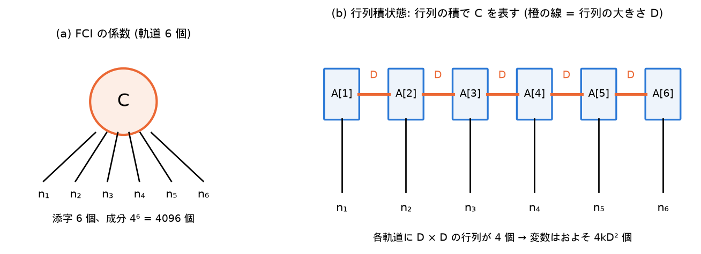
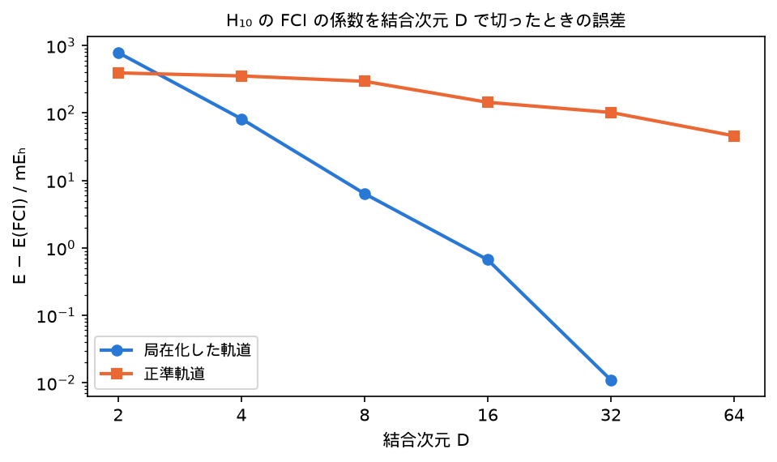
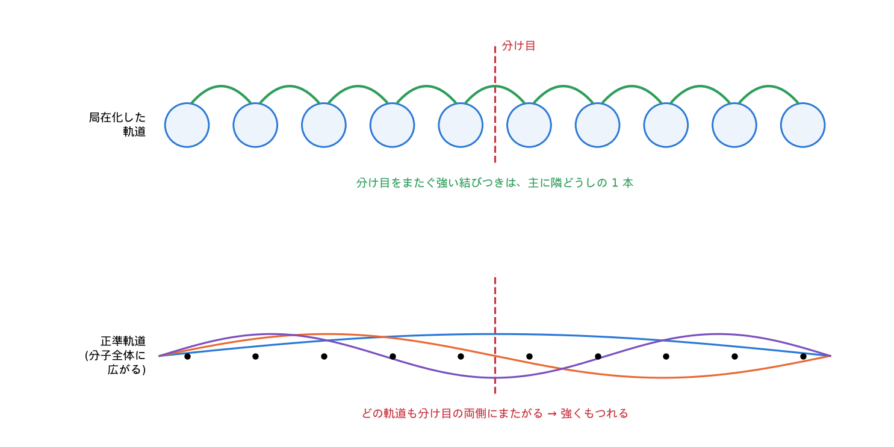
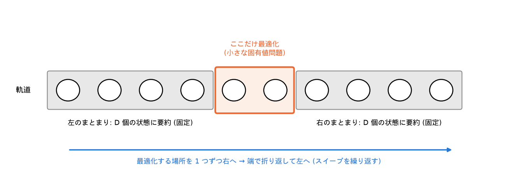
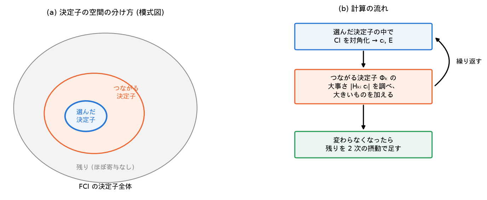
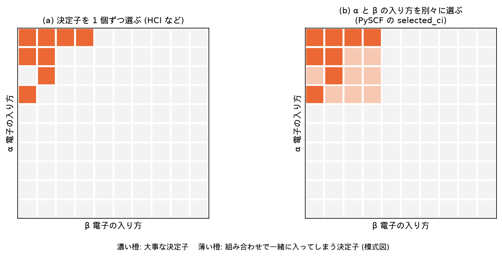
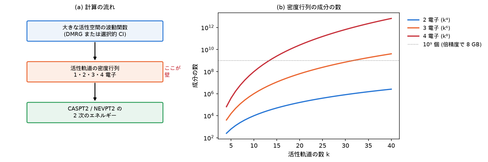

# 第 14 回　大きな活性空間：DMRG と選択的 CI

!!! abstract "この回の道筋"
    CASSCF で扱える活性空間は、20 軌道程度が限界です。遷移金属を何個も含む錯体などでは、それでは足りません。この回では、大きな活性空間の波動関数を近似的に、しかし系統的に精度を上げられる形で求める二つの方法、密度行列繰り込み群（DMRG）と選択的 CI を学びます。どちらも、小さな計算例でしくみを確かめます。最後に、その上で動的相関を足す方法と、2023 年以降の研究から見えてきた「何ができて、何がまだ難しいか」をまとめます。

    | 節 | 内容 |
    |---|---|
    | 1 | 活性空間が大きいと CAS が破綻する |
    | 2 | 行列積状態と結合次元 |
    | 3 | DMRG：行列積状態を最適化する |
    | 4 | 選択的 CI：大事な決定子だけを選ぶ |
    | 5 | 大きな活性空間の上での動的相関 |
    | 6 | 何ができて、何がまだ難しいか |

    **前に読んでおく回**：[量子化学の理論 第 12 回](12-casscf.md)、[第 13 回](13-caspt2-nevpt2.md)、[第 8 回](08-configuration-interaction.md)

!!! tip "物理的なイメージ"
    DMRG と選択的 CI が利用しているのは、「大きな活性空間でも、本当に大事な電子の入り方はごく一部だ」という性質です。選択的 CI は、エネルギーへの寄与が大きい決定子だけを選んで集めます。DMRG は、軌道を一列に並べ、列のどこで二つに切っても、左右の部分の間の結びつき（もつれ）のうち大きな成分だけを残します。どちらも、残す量（決定子の数、結合次元）を増やせば、系統的に FCI に近づきます。

エネルギーは原子単位（ハートリー，$E_\mathrm{h}$）で書きます。1 m$E_\mathrm{h}$ = $10^{-3}\ E_\mathrm{h}$ で、約 0.63 kcal/mol です。

## 1. 活性空間が大きいと CAS が破綻する

活性軌道が $k$ 個、活性電子が $k$ 個（α と β が $k/2$ 個ずつ）の CAS($k$,$k$) を考えます。α 電子の入り方は $k$ 個の軌道から $k/2$ 個を選ぶ組み合わせ $\binom{k}{k/2}$ 通りで、β 電子も同じです。決定子の数は、その積

$$
N_\mathrm{det} = \binom{k}{k/2}^2
$$

です。第 12 回の 3 節で見たように、この数は活性軌道が 4 個増えるごとに 100 倍以上に増えます。

| 活性空間 | 決定子の数 | CI の係数のベクトル 1 本の大きさ（倍精度） |
|---|---|---|
| CAS(12,12) | 約 $8.5 \times 10^5$ | 7 MB |
| CAS(16,16) | 約 $1.7 \times 10^8$ | 1.3 GB |
| CAS(20,20) | 約 $3.4 \times 10^{10}$ | 270 GB |
| CAS(24,24) | 約 $7.3 \times 10^{12}$ | 58 TB |

CI の係数のベクトルを 1 本保存するだけで、CAS(20,20) では 270 GB が要ります。超並列の計算機でも、CAS(24,24) では CI の反復 1 回がやっとでした [Vogiatzis 2017]。

ところが、化学の問題には、もっと大きな活性空間を必要とするものがあります。たとえば、Cr₂ のような遷移金属の二量体では、3d と 4s の軌道（12 軌道）だけの活性空間では不十分で、3d 軌道をもう一組加えた 28 軌道の活性空間で、ようやく解離エネルギーの過大評価の原因が説明できたと報告されています [Kurashige 2011]。複数の金属を含む錯体や、長い共役系も同じです。

そこで、活性空間の中の FCI を厳密に解くのをあきらめ、**少ない変数で FCI の波動関数を近似し、変数を増やせば FCI に近づく**方法を使います。代表的なものが、2 節と 3 節の DMRG と、4 節の選択的 CI です。どちらも、CASSCF の「活性空間の中の FCI」を置き換える部品として使えます。

**ここまでで分かったこと**：活性空間が 20 軌道を大きく超えると、CAS の FCI は係数を保存することすらできません。そこで、系統的に精度を上げられる近似で、活性空間の FCI を置き換えます。

## 2. 行列積状態と結合次元

### 2.1 波動関数をテンソルとして見る

活性軌道が $k$ 個あるとき、決定子は「各軌道に電子がどう入っているか」で決まります。1 個の空間軌道の状態は、空、α 電子 1 個、β 電子 1 個、α と β の 2 個、の 4 通りです。これを $n_p \in \{0, \alpha, \beta, 2\}$ と書くと、FCI の波動関数は

$$
\Psi = \sum_{n_1, n_2, \dots, n_k} C_{n_1 n_2 \cdots n_k} \, |n_1 n_2 \cdots n_k\rangle
$$

と書けます。$|n_1 n_2 \cdots n_k\rangle$ は、軌道 1 の占有が $n_1$、軌道 2 の占有が $n_2$、… の決定子です。係数 $C$ は、添字を $k$ 個もつ配列（**テンソル**）で、成分は全部で $4^k$ 個あります（電子の数が合わない成分は 0）。この数が指数関数的に増えることが、1 節の問題そのものです。

### 2.2 軌道 2 個の例：係数は 4 × 4 の行列

いちばん小さな例として、軌道 2 個に電子 2 個（α と β が 1 個ずつ）を入れた場合を考えます。H₂ の最小基底が典型です。添字は $n_1$ と $n_2$ の 2 個なので、$C$ は行が $n_1$、列が $n_2$ の 4 × 4 の行列です。電子が α 1 個と β 1 個のとき 0 でない成分は 4 個だけで、

$$
\mathbf C =
\begin{pmatrix}
C_{00} & C_{0\alpha} & C_{0\beta} & C_{02} \\
C_{\alpha 0} & C_{\alpha\alpha} & C_{\alpha\beta} & C_{\alpha 2} \\
C_{\beta 0} & C_{\beta\alpha} & C_{\beta\beta} & C_{\beta 2} \\
C_{20} & C_{2\alpha} & C_{2\beta} & C_{22}
\end{pmatrix}
=
\begin{pmatrix}
0 & 0 & 0 & c_2 \\
0 & 0 & c_3 & 0 \\
0 & c_4 & 0 & 0 \\
c_1 & 0 & 0 & 0
\end{pmatrix}
\begin{matrix} \leftarrow n_1 = 0 \\ \leftarrow n_1 = \alpha \\ \leftarrow n_1 = \beta \\ \leftarrow n_1 = 2 \end{matrix}
$$

です。$c_1$ は「2 個とも軌道 1」、$c_2$ は「2 個とも軌道 2」、$c_3$ と $c_4$ は「1 個ずつ」の配置の係数です（符号は決定子の中の軌道の並べ方の約束で変わりますが、以下の議論には影響しません）。

この行列の**階数**（独立な行の数）が、軌道 1 と軌道 2 の結びつきの強さを表します。三つの場合を見ます。

**(1) 結びつきがない場合**：平衡距離の H₂ を、軌道 1 = σg、軌道 2 = σu で表すと、波動関数はほぼ $\sigma_g^2$ だけです。$c_1 = 1$、ほかは 0 で、行列の階数は 1 です。階数 1 の行列は、列ベクトルと行ベクトルの積 $C_{n_1 n_2} = a_{n_1} b_{n_2}$ で書けます（ここでは $a = (0, 0, 0, 1)^\mathrm T$、$b = (1, 0, 0, 0)$）。軌道 1 の状態と軌道 2 の状態を別々に決めればよい、ということです。

**(2) 解離した H₂ を局在化した軌道で表す場合**：軌道 1 を原子 A の 1s、軌道 2 を原子 B の 1s とすると、解離の極限の一重項は「A に α・B に β」と「A に β・B に α」の等しい重ね合わせです。$c_3 = 1/\sqrt2$、$c_4 = -1/\sqrt2$、ほかは 0 で、階数は 2 です。一方の原子の電子の向きが決まると、もう一方の向きも決まる、という結びつきがあるからです。

**(3) 平衡距離の H₂ を局在化した軌道で表す場合**：$\sigma_g = (\phi_A + \phi_B)/\sqrt2$（重なりを無視）を 2 回かけて展開すると、$\phi_A^2$、$\phi_B^2$、1 個ずつの 2 つの配置が同じ大きさで現れます。4 個の係数がすべて 0 でなく、しかも行も列もばらばらなので、階数は 4 です。

(1) と (3) は同じ波動関数です。軌道の選び方を変えただけで、必要な階数が 1 から 4 に変わりました。**結びつきの強さ（もつれ）は、軌道の選び方に依存します。**

### 2.3 行列の積で書く：行列積状態

(2) の場合を、行列の積で書いてみます。$\mathbf C$ の 0 でない成分 $C_{\alpha\beta} = 1/\sqrt2$ と $C_{\beta\alpha} = -1/\sqrt2$ を、次の行ベクトルと列ベクトルの積で表します。

$$
\mathbf A^{[1]\alpha} = \begin{pmatrix} 1 & 0 \end{pmatrix}, \quad
\mathbf A^{[1]\beta} = \begin{pmatrix} 0 & 1 \end{pmatrix}, \qquad
\mathbf A^{[2]\alpha} = \begin{pmatrix} 0 \\ -1/\sqrt2 \end{pmatrix}, \quad
\mathbf A^{[2]\beta} = \begin{pmatrix} 1/\sqrt2 \\ 0 \end{pmatrix}
$$

$\mathbf A^{[1]0}$、$\mathbf A^{[1]2}$、$\mathbf A^{[2]0}$、$\mathbf A^{[2]2}$ はすべて 0 とします。確かめると、

- $\mathbf A^{[1]\alpha} \mathbf A^{[2]\beta} = 1 \cdot \frac{1}{\sqrt2} + 0 \cdot 0 = \frac{1}{\sqrt2} = C_{\alpha\beta}$
- $\mathbf A^{[1]\beta} \mathbf A^{[2]\alpha} = 0 \cdot 0 + 1 \cdot \big(-\frac{1}{\sqrt2}\big) = -\frac{1}{\sqrt2} = C_{\beta\alpha}$
- $\mathbf A^{[1]\alpha} \mathbf A^{[2]\alpha} = 0$、$\mathbf A^{[1]\beta} \mathbf A^{[2]\beta} = 0$

となり、すべての成分が再現されます。真ん中でつながる添字の数（ここでは 2）が、2.2 節の階数と一致しています。

これを $k$ 個の軌道に広げます。係数を、軌道ごとの行列の積で表します。

$$
C_{n_1 n_2 \cdots n_k} = \mathbf A^{[1] n_1} \mathbf A^{[2] n_2} \cdots \mathbf A^{[k] n_k}
$$

ここで $\mathbf A^{[p] n_p}$ は、軌道 $p$ の占有 $n_p$ ごとに決まる行列です（各軌道に 4 個の行列）。最初の $\mathbf A^{[1] n_1}$ は行ベクトル、最後の $\mathbf A^{[k] n_k}$ は列ベクトルなので、積は 1 個の数になります。この形の波動関数を**行列積状態**（matrix product state, MPS）と呼びます。

行列の大きさ（の最大値）$D$ を**結合次元**（bond dimension）と呼びます。変数の数は、軌道 1 個あたり $D \times D$ の行列が 4 個なので、およそ $4 k D^2$ 個です。$D$ を固定すれば、軌道の数 $k$ に比例して増えるだけで、指数関数的には増えません。



**図 1**　(a) FCI の係数 $C$ は、軌道ごとの占有 $n_1, \dots, n_6$ を添字にもつ 1 個の大きな配列です（足の 1 本が添字 1 個）。(b) 行列積状態では、それを軌道ごとの行列 $\mathbf A^{[p]}$ の積に分けます。縦の足が占有 $n_p$、横の橙の線が隣の行列とつながる添字で、その大きさが結合次元 $D$ です。

### 2.4 必要な D は「分け目でのもつれ」で決まる

$D$ を十分に大きくとれば、どんな $C$ も厳密に表せます。必要な $D$ は、2.2 節の考えを一般化すると分かります。

軌道を「1 番目から $p$ 番目まで（左）」と「残り（右）」の二つに分けます。係数 $C$ を、行の添字が左の占有の組 $(n_1 \dots n_p)$、列の添字が右の占有の組 $(n_{p+1} \dots n_k)$ の行列 $\mathbf M$ とみなします。大きさは $4^p \times 4^{k-p}$ です。この行列を**特異値分解**（singular value decomposition, SVD）します。

$$
\mathbf M = \mathbf U \boldsymbol\Sigma \mathbf V^\mathrm T, \qquad
M_{LR} = \sum_m U_{Lm}\, s_m\, V_{Rm}
$$

$L$、$R$ は左と右の占有の組です。$\mathbf U$ と $\mathbf V$ の列はそれぞれ規格直交で、$s_1 \ge s_2 \ge \cdots \ge 0$ を**特異値**と呼びます。波動関数で書き直すと、

$$
\Psi = \sum_m s_m\, |\mathrm L_m\rangle\, |\mathrm R_m\rangle, \qquad
|\mathrm L_m\rangle = \sum_L U_{Lm} |L\rangle, \quad |\mathrm R_m\rangle = \sum_R V_{Rm} |R\rangle
$$

です。$|\mathrm L_m\rangle$ は左の軌道だけの規格直交な状態、$|\mathrm R_m\rangle$ は右の軌道だけの規格直交な状態です。$\Psi$ が規格化されていれば $\sum_m s_m^2 = 1$ で、$s_m^2$ は「左が $\mathrm L_m$、右が $\mathrm R_m$ である確率」と読めます。

- $s_1 = 1$ で残りが 0 なら、$\Psi$ は左の状態と右の状態の単なる積です（2.2 節の (1)）。左右は独立で、もつれはありません。
- 0 でない特異値がたくさんあり、どれも同じくらいの大きさなら、左右は強く結びついています（もつれが大きい）。

もつれの大きさは、エンタングルメント・エントロピー $S = -\sum_m s_m^2 \ln s_m^2$ でも測れます。積の状態では $S = 0$、$M$ 個の特異値が等しければ $S = \ln M$ です。

その分け目で必要な $D$ は、0 でない特異値の数です。近似するときは、**大きな特異値から $D$ 個を残し、残りを捨てます**。捨てた分の重み $\sum_{m > D} s_m^2$ が、近似した波動関数と元の波動関数の距離の 2 乗になり、これが「階数が $D$ 以下の行列の中で最良の近似」であることが証明できます（すべての段階を付録 A で示します）。

この切り方を、左から順に $k - 1$ か所すべての分け目で行うと、行列積状態の行列 $\mathbf A^{[p]}$ が得られます（手順は付録 B）。次の計算例の関数 `truncate` は、これをそのまま実装したものです。

### 2.5 計算例：H₁₀ の FCI の波動関数を行列積状態で近似する

しくみを確かめるために、H 原子 10 個を 1.5 Å 間隔で直線に並べた H₁₀（STO-3G 基底、軌道 10 個、電子 10 個）を使います。原子の間隔が広いので、静的相関の強い系です。まず FCI の係数 $C$ を求め、左の軌道から順に特異値分解して、結合次元を $D$ までに切ります。切った $C$ でエネルギーの期待値を計算し、FCI と比べます。

軌道は 2 通り試します。RHF の正準軌道（分子全体に広がった軌道）と、各 H 原子の 1s 軌道を直交化した局在化した軌道（Löwdin の直交化）です。局在化した軌道は、鎖に沿った順に並べます。FCI のエネルギーは軌道の選び方によりませんが、2.2 節で見たように、もつれの大きさは変わります。

```python
import numpy as np
from pyscf import gto, scf, ao2mo, fci, lo
from pyscf.fci import cistring, direct_spin1

n = 10
mol = gto.M(atom="; ".join(f"H 0 0 {1.5*k}" for k in range(n)), basis="sto-3g", verbose=0)
mf = scf.RHF(mol).run()
na = nb = n // 2
stra = cistring.make_strings(range(n), na)   # α 電子の入り方（ビット列）
strb = cistring.make_strings(range(n), nb)

def occ_and_sign(sa, sb):
    """軌道ごとの占有（0:空, 1:α, 2:β, 3:αβ）と、並べ替えの符号。"""
    occ = tuple(((sa >> p) & 1) + 2 * ((sb >> p) & 1) for p in range(n))
    # 「α 全部 → β 全部」の順から「1α 1β 2α 2β …」の順へ並べ替えるときの符号
    par = sum(((sb >> q) & 1) * bin(sa >> (q + 1)).count("1") for q in range(n))
    return occ, (-1) ** par

def to_tensor(ci):
    T = np.zeros((4,) * n)
    for ia, sa in enumerate(stra):
        for ib, sb in enumerate(strb):
            occ, sgn = occ_and_sign(sa, sb)
            T[occ] = sgn * ci[ia, ib]
    return T

def from_tensor(T):
    ci = np.zeros((len(stra), len(strb)))
    for ia, sa in enumerate(stra):
        for ib, sb in enumerate(strb):
            occ, sgn = occ_and_sign(sa, sb)
            ci[ia, ib] = sgn * T[occ]
    return ci

def truncate(T, D):
    """左から順に特異値分解し、結合次元を D 以下に切ってから、テンソルに戻す。"""
    cores, rest, left = [], T.reshape(1, -1), 1
    for p in range(n - 1):
        U, s, Vt = np.linalg.svd(rest.reshape(left * 4, -1), full_matrices=False)
        k = min(D, len(s))
        cores.append(U[:, :k].reshape(left, 4, k))   # 軌道 p の行列 A^[p]
        rest, left = s[:k, None] * Vt[:k], k
    cores.append(rest.reshape(left, 4, 1))
    out = cores[0]
    for c in cores[1:]:
        out = np.tensordot(out, c, axes=([-1], [0]))  # 行列の積をとる
    return out.reshape((4,) * n)

for label, C in [("RHF の正準軌道", mf.mo_coeff), ("局在化した軌道（Löwdin）", lo.orth_ao(mol, "lowdin"))]:
    h1 = C.T @ mf.get_hcore() @ C
    eri = ao2mo.full(mol, C)
    e_fci, ci = fci.direct_spin1.FCI().kernel(h1, eri, n, (na, nb), ecore=mol.energy_nuc())
    h2 = direct_spin1.absorb_h1e(h1, eri, n, (na, nb), 0.5)
    T = to_tensor(ci)
    print(label, f"E_FCI = {e_fci:.6f}")
    for D in [2, 4, 8, 16, 32, 64, 1024]:
        c = from_tensor(truncate(T, D)).ravel()
        e = c @ direct_spin1.contract_2e(h2, c, n, (na, nb)).ravel() / (c @ c) + mol.energy_nuc()
        print(f"  D = {D:4d}:  E - E_FCI = {1000*(e - e_fci):9.3f} mEh")
```

```
RHF の正準軌道 E_FCI = -4.995447
  D =    2:  E - E_FCI =   392.110 mEh
  D =    4:  E - E_FCI =   353.824 mEh
  D =    8:  E - E_FCI =   294.314 mEh
  D =   16:  E - E_FCI =   143.738 mEh
  D =   32:  E - E_FCI =   101.728 mEh
  D =   64:  E - E_FCI =    45.748 mEh
  D = 1024:  E - E_FCI =     0.000 mEh
局在化した軌道（Löwdin） E_FCI = -4.995447
  D =    2:  E - E_FCI =   783.814 mEh
  D =    4:  E - E_FCI =    81.880 mEh
  D =    8:  E - E_FCI =     6.352 mEh
  D =   16:  E - E_FCI =     0.666 mEh
  D =   32:  E - E_FCI =     0.011 mEh
  D =   64:  E - E_FCI =     0.000 mEh
  D = 1024:  E - E_FCI =     0.000 mEh
```

10 個の軌道を 5 個ずつに分ける真ん中の分け目では、それぞれの側の状態は $4^5 = 1024$ 通りです。そのため $D = 1024$ では、どちらの軌道でも厳密に一致します。違いが出るのは、$D$ が小さいときです。

- **局在化した軌道**では、$D = 16$ で誤差が 0.7 m$E_\mathrm{h}$、$D = 32$ で 0.01 m$E_\mathrm{h}$ まで下がります。真ん中の分け目では、厳密に必要な 1024 の 3% の大きさで、ほぼ厳密な値が得られます。
- **正準軌道**では、$D = 64$ でも誤差が 46 m$E_\mathrm{h}$ 残ります。



**図 2**　上の出力のエネルギーの誤差を、結合次元 $D$ に対して描いたもの（両軸とも対数目盛り。誤差が 0.000 と表示された点は除きました）。局在化した軌道（青）では $D$ を 2 倍にするごとに誤差が 1 桁ほど下がりますが、正準軌道（橙）ではゆっくりとしか下がりません。

2.4 節の言葉で言えば、局在化した軌道では真ん中の分け目の特異値が急に小さくなり、少数の特異値だけで波動関数のほとんどが表せます。正準軌道では、小さな特異値がたくさん残るので、どこで切っても捨てる重みが大きくなります。図 3 で、その理由を絵で見ます。



**図 3**　軌道の選び方と分け目の模式図。上：局在化した軌道を鎖に沿って並べると、強く結びつく（緑の弧）のは主に隣どうしです。真ん中の分け目（赤の破線）をまたぐ強い結びつきは、ほぼ 1 本だけです。下：正準軌道は分子全体に広がっているので、どの軌道も分け目の両側にまたがり、左右が強くもつれます。

鎖の上で局在化した軌道を順に並べると、離れた軌道どうしのもつれは小さくなります。一方、分子全体に広がった正準軌道では、どこで分けても強くもつれています。行列積状態の効率は、**軌道の選び方と並べ方**に強く依存するのです。このため、実際の DMRG の計算では、局在化した軌道を使い、もつれの大きい軌道どうしが近くに来るように並べ方を工夫します。

（$D = 2$ では、局在化した軌道の誤差のほうが正準軌道より大きくなっています。ここでは特異値分解で順に切っただけで、エネルギーを最適化していないため、$D$ が非常に小さいところでは、このような逆転が起こります。次節の DMRG は、与えられた $D$ の中でエネルギーを最小にします。）

**ここまでで分かったこと**：行列積状態は、FCI の係数を行列の積で表し、結合次元 $D$ で精度を調節します。必要な $D$ は、軌道の列を二つに分けたときの特異値の広がり（もつれ）で決まります。局在化した軌道を適切に並べると、小さな $D$ で FCI に近づけます。

## 3. DMRG：行列積状態を最適化する

### 3.1 1 か所ずつ最適化する

2 節の計算例では、先に FCI の係数を求めてから近似しました。実際の大きな系では、FCI の係数は求められません。そこで、行列積状態の行列 $\mathbf A^{[p]}$ を変数として、エネルギーを直接最小にします。

行列全部を一度に最適化するのは難しいので、隣り合う 2 個の軌道 $p$、$p+1$ の行列だけを動かし、残りを固定します。固定した左の部分（軌道 $1 \dots p-1$）からは、2.4 節の $|\mathrm L_m\rangle$ のような左の状態が $D$ 個できます。右の部分（軌道 $p+2 \dots k$）からも、右の状態 $|\mathrm R_r\rangle$ が $D$ 個できます。動かす部分を含めると、波動関数は

$$
\Psi = \sum_{l=1}^{D} \sum_{n_p} \sum_{n_{p+1}} \sum_{r=1}^{D} \psi_{l\, n_p n_{p+1} r}\, |\mathrm L_l\rangle |n_p\rangle |n_{p+1}\rangle |\mathrm R_r\rangle
$$

と書けます。係数 $\psi$ の数は $D \times 4 \times 4 \times D = 16 D^2$ 個です。左右の状態が規格直交になるように行列を選んでおくと（付録 B）、16$D^2$ 個の基底 $|\mathrm L_l\rangle |n_p\rangle |n_{p+1}\rangle |\mathrm R_r\rangle$ も規格直交です。すると、エネルギーを $\psi$ について最小にする問題は、この基底でのハミルトニアンの行列

$$
(\mathbf H^\mathrm{eff})_{(l n_p n_{p+1} r),\,(l' n_p' n_{p+1}' r')} = \langle \mathrm L_l\, n_p\, n_{p+1}\, \mathrm R_r | \hat H | \mathrm L_{l'}\, n_p'\, n_{p+1}'\, \mathrm R_{r'} \rangle
$$

の最小の固有値を求める問題になります。大きさは $16D^2 \times 16D^2$ で、たとえば $D = 1000$ でも $1.6 \times 10^7$ 次元です。Davidson 法（大きな行列の最も低い固有値だけを、行列とベクトルの積を繰り返して求める方法）のような反復法なら、FCI（$10^{10}$ 次元以上）に比べてずっと楽に解けます。

### 3.2 切って、次へ進む

固有ベクトル $\psi$ が求まったら、行の添字を $(l, n_p)$、列の添字を $(n_{p+1}, r)$ とする $4D \times 4D$ の行列に並べ、2.4 節と同じく特異値分解して、大きい特異値から $D$ 個を残します。$\mathbf U$ の部分が新しい $\mathbf A^{[p]}$ になり、残りは右へ渡されます。最適化する場所を 1 つ右にずらし、同じことを繰り返します。右端まで来たら折り返して左へ進みます。この往復を**スイープ**と呼び、エネルギーが変わらなくなるまで繰り返します（図 4）。



**図 4**　DMRG の 1 回の最適化の模式図。橙の箱の 2 個の軌道だけを動かし、左右の灰色の部分は、それぞれ $D$ 個の状態に要約したまま固定します。最適化が終わったら、特異値分解で $D$ 個に切って、場所を 1 つ右へずらします（青の矢印）。端まで来たら折り返し、往復を繰り返します。

切るときの基準は、2.4 節の特異値の 2 乗 $s_m^2$ です。これは、左の部分だけに注目したときの**縮約密度行列** $\boldsymbol\rho_\mathrm L = \mathbf M \mathbf M^\mathrm T$ の固有値でもあります（$\mathbf M \mathbf M^\mathrm T = \mathbf U \boldsymbol\Sigma^2 \mathbf U^\mathrm T$ だからです）。「密度行列の固有値が大きい状態を残して、まとまりを少しずつ大きくしていく」という見方が、名前の「密度行列繰り込み群」の由来です。

### 3.3 歴史と性質

この方法は、White が 1992 年に、もともとは物理の 1 次元の模型（ハイゼンベルク鎖など）のために、**密度行列繰り込み群**（density matrix renormalization group, DMRG）として提案しました [White 1992]。DMRG で得られる波動関数は、2 節の行列積状態の形をしています [Chan 2011]。White と Martin は、1999 年に DMRG を分子の量子化学計算（ガウス型基底の H₂O）に使いました [White 1999]。化学への応用の入門的な総説もあります [Chan 2011]。

DMRG の性質をまとめます。

- **変分法です。** 与えられた $D$ の中でエネルギーを最小にするので、エネルギーは FCI より下になりません。$D$ を大きくすると FCI に近づくので、いくつかの $D$ で計算して、$D \to \infty$ に外挿することもできます。
- **1 次元的なもつれに強いです。** 2 節で見たとおり、軌道を 1 列に並べたときに、離れた軌道どうしのもつれが小さい系に向いています。
- **活性空間を大きくできます。** Stein と Reiher は、DMRG で約 100 個の軌道までを活性空間に含められることを、活性軌道の自動選択に利用しました [Stein 2016]（第 12 回の 8 節）。
- **CASSCF の部品になります。** 活性空間の FCI を DMRG で置き換え、軌道も最適化する方法を DMRG-SCF と呼びます [Kurashige 2011]。

DMRG のプログラムとしては、たとえば block2 がオープンソースで公開されています。基底状態だけでなく、時間発展、応答、有限温度の計算や、5 節で扱う動的相関の理論も実装されています [Zhai 2023]。

**ここまでで分かったこと**：DMRG は、行列積状態の行列を、隣り合う軌道 2 個ずつ順に最適化する変分法です。1 か所の最適化は $16D^2$ 次元の固有値問題になり、その後に特異値分解で $D$ 個に切ります。結合次元を上げると FCI に近づき、約 100 軌道の活性空間を扱えます。

## 4. 選択的 CI：大事な決定子だけを選ぶ

### 4.1 考え方

もう一つの方法は、FCI の決定子のうち、係数の大きな決定子だけを選んで CI をする方法です。第 7 回の H₂ でも、FCI の波動関数は少数の決定子でほぼ表せました。大きな系でも、ほとんどの決定子の係数は非常に小さく、エネルギーに効く決定子はごく一部です。問題は、どの決定子が大事かを、FCI を解く前に見分けることです。

**選択的 CI**（selected CI）は、これを反復で行います（図 5）。

1. 少数の決定子（最初は HF の決定子だけなど）の空間で CI の行列を対角化します。
2. いまの波動関数 $\Psi = \sum_i c_i \Phi_i$ と、ハミルトニアンの行列要素でつながる外側の決定子 $\Phi_k$ のうち、「大事さ」の指標が大きいものを空間に加えます。
3. 1 に戻り、エネルギーが変わらなくなるまで繰り返します。

最後に、選ばれなかった決定子の寄与を、第 9 回や第 13 回と同じ 2 次の摂動論の形で足します。



**図 5**　(a) 選択的 CI での決定子の空間の分け方の模式図。青が選んだ決定子（ここで CI を対角化）、橙がそれらと $\hat H$ でつながる決定子（大事さを調べる候補で、最後に 2 次の摂動で足す）、灰色が残りです。(b) 計算の流れ。選んで、対角化して、また選ぶことを繰り返します。

### 4.2 大事さの指標を導く

選んだ決定子の集まりを V とし、外側の決定子 $\Phi_k$ の係数を見積もります。本物の固有値方程式 $\hat H \Psi = E \Psi$ の、$\Phi_k$ の成分の式は

$$
\sum_{j} H_{kj} c_j = E\, c_k
$$

です（$H_{kj} = \langle \Phi_k | \hat H | \Phi_j \rangle$、和はすべての決定子について）。左辺から $j = k$ の項を取り出すと

$$
H_{kk} c_k + \sum_{i \in \mathrm V} H_{ki} c_i + \sum_{j \notin \mathrm V,\, j \ne k} H_{kj} c_j = E\, c_k
$$

です。外側の決定子の係数は小さいので、第 3 項（外側どうしのつながり）を無視します。$E$ をいまのエネルギー $E_0$ で置き換え、$c_k$ について解くと、

$$
c_k^{(1)} = \frac{\sum_{i \in \mathrm V} H_{ki} c_i}{E_0 - H_{kk}}
$$

が得られます。これは 1 次の摂動論での係数の見積もりで、分子が「選んだ決定子からのつながりの強さ」、分母が「$\Phi_k$ のエネルギーの高さ」です。同じ近似で、外側の決定子をすべて足したときのエネルギーの下がり方は

$$
E^{(2)} = \sum_{k \notin \mathrm V} \frac{\big| \sum_{i \in \mathrm V} H_{ki} c_i \big|^2}{E_0 - H_{kk}}
$$

になります（導出は付録 C）。第 13 回の「（結合の強さ）² ÷（エネルギー差）」と同じ形です。

### 4.3 CIPSI と heat-bath CI

この考え方は、Huron、Malrieu、Rancurel が 1973 年に **CIPSI** として提案しました [Huron 1973]。CIPSI は、外側の決定子の大事さを、4.2 節の係数の見積もり $c_k^{(1)}$ の大きさで測ります。

Holmes、Tubman、Umrigar は、指標をもっと簡単な

$$
\max_i \, |H_{ki} c_i| > \varepsilon_1
$$

に替えた **heat-bath CI**（HCI）を提案しました [Holmes 2016]。CIPSI の指標の分母は、決定子によってあまり変わらないので、分子の大きさでほぼ順位が決まります。さらに HCI の指標では、和 $\sum_i$ ではなく 1 個の項の最大値を見るので、大きな行列要素 $H_{ki}$ をもつ決定子だけを最初から作れます。外側のすべての決定子を調べる必要がありません。Holmes らは、C₂（cc-pVTZ 基底）と Cr₂（全電子を相関させた計算）の FCI のエネルギーを、1 個の CPU で数分のうちに 1 m$E_\mathrm{h}$ より良い精度で再現しました [Holmes 2016]。2 次の摂動の補正を確率的に計算して、メモリの壁を取り除いた版（SHCI）もあります [Sharma 2017]。同じころ、外側の決定子を探す範囲を絞って CIPSI を速くした ASCI も提案されています [Tubman 2016]。

選択的 CI では、しきい値 $\varepsilon_1$ を小さくすると、決定子が増えて FCI に近づきます。いくつかの $\varepsilon_1$ で計算して、$\varepsilon_1 \to 0$ に外挿することもよく行われます [Holmes 2016]。

### 4.4 3 個の決定子の例で確かめる

決定子が 3 個しかない模型で、1 回の選択を手で追ってみます。ハミルトニアンの行列（単位 $E_\mathrm h$）を次のように決めます。数値は説明のための仮のものです。

$$
\mathbf H =
\begin{pmatrix}
H_{00} & H_{01} & H_{02} \\
H_{10} & H_{11} & H_{12} \\
H_{20} & H_{21} & H_{22}
\end{pmatrix}
=
\begin{pmatrix}
-1.00 & 0.10 & 0.02 \\
0.10 & 0.50 & 0.05 \\
0.02 & 0.05 & 0.30
\end{pmatrix}
$$

厳密な最低の固有値は $-1.006850$ です。

1. 最初は $\Phi_0$ だけを選びます。$c_0 = 1$、$E_0 = H_{00} = -1.00$ です。
2. 候補の大事さを調べます。HCI の指標は $|H_{10} c_0| = 0.10$、$|H_{20} c_0| = 0.02$ です。CIPSI の見積もりは $c_1^{(1)} = 0.10 / (-1.00 - 0.50) = -0.067$、$c_2^{(1)} = 0.02 / (-1.00 - 0.30) = -0.015$ です。どちらの指標でも $\Phi_1$ が大事だと分かります。しきい値を $\varepsilon_1 = 0.05$ とすると、$\Phi_1$ だけを加えます。
3. $\{\Phi_0, \Phi_1\}$ の 2 × 2 の行列を対角化すると、$E = -1.006637$、$(c_0, c_1) = (0.9978, -0.0662)$ です（全体の符号は任意）。
4. 残った $\Phi_2$ を 2 次の摂動で足します。分子は $|H_{20} c_0 + H_{21} c_1|^2 = |0.02 \times 0.9978 + 0.05 \times (-0.0662)|^2$、分母は $E - H_{22} = -1.006637 - 0.30$ で、$E^{(2)} = -0.000212$ です。合計は $-1.006849$ で、厳密な値と $10^{-6}\ E_\mathrm h$ 以下の差です。

決定子を 1 個捨てても、摂動の補正でほぼ厳密な値が得られました。大きな系では、これが何億個という単位で起こります。

### 4.5 計算例：伸ばした H₂O の選択的 CI

第 13 回で使った、O–H 結合を 2 倍に伸ばした H₂O（6-31G 基底）で、選択的 CI を試します。PySCF の `fci.selected_ci` は、HCI に近い基準（係数の大きさと 2 電子積分の大きさの積がしきい値を超えるもの）で、α 電子と β 電子の入り方を別々に選ぶ簡単な実装です。PySCF のソースコードの説明にも、効率のよい実装ではないと書かれています。ここでは、2 次の摂動の補正を足さない、変分のエネルギーだけを見ます。

```python
import numpy as np
from pyscf import gto, scf, ao2mo, fci
from pyscf.fci import selected_ci

r, th = 0.96 * 2.0, np.deg2rad(104.5) / 2      # O–H を 2 倍に伸ばした H2O
mol = gto.M(atom=f"O 0 0 0; H 0 {r*np.sin(th):.6f} {r*np.cos(th):.6f}; H 0 {-r*np.sin(th):.6f} {r*np.cos(th):.6f}",
            basis="6-31g", verbose=0)
mf = scf.RHF(mol).run()
C = mf.mo_coeff
norb, nelec = C.shape[1], (5, 5)
h1 = C.T @ mf.get_hcore() @ C
eri = ao2mo.full(mol, C)

e_fci = fci.FCI(mf).kernel()[0]
n_fci = fci.cistring.num_strings(norb, 5) ** 2
print(f"FCI: 決定子 {n_fci:,d} 個, E = {e_fci:.6f}")
print("しきい値   決定子の数   FCI に対する割合   E - E_FCI / mEh")
for cut in [3e-2, 1e-2, 3e-3, 1e-3, 3e-4]:
    sci = selected_ci.SCI(mol)
    sci.select_cutoff = sci.ci_coeff_cutoff = cut
    e, civec = sci.kernel(h1, eri, norb, nelec, ecore=mol.energy_nuc())
    ndet = len(civec._strs[0]) * len(civec._strs[1])
    print(f"{cut:7.0e}  {ndet:10,d}       {100*ndet/n_fci:6.2f} %       {1000*(e - e_fci):8.3f}")
```

```
FCI: 決定子 1,656,369 個, E = -75.879753
しきい値   決定子の数   FCI に対する割合   E - E_FCI / mEh
  3e-02         625         0.04 %         40.290
  1e-02       5,776         0.35 %         12.744
  3e-03      32,041         1.93 %          2.558
  1e-03      96,100         5.80 %          0.400
  3e-04     336,400        20.31 %          0.022
```

FCI の計算に 2 分ほどかかり、選択的 CI はすべて合わせて 30 秒ほどです。しきい値 $10^{-3}$ では、FCI の決定子の 6% 弱で、誤差が 0.4 m$E_\mathrm{h}$ まで下がります。

この実装は α 電子と β 電子の入り方を別々に選び、その組み合わせをすべて使うので、本当に必要な数より多くの決定子を含みます。決定子の数の列がすべて平方数（625 = 25²、5,776 = 76²、…）になっているのは、選んだ α の入り方の数と β の入り方の数が等しく（この閉殻の系では α と β が対称なため）、その積をとっているからです。図 6 で、この違いを見ます。



**図 6**　CI の係数を、行が α 電子の入り方、列が β 電子の入り方の行列として並べた模式図。濃い橙が大事な決定子です。(a) HCI などは、大事な決定子を 1 個ずつ選びます。(b) α の入り方と β の入り方を別々に選ぶと、それらの組み合わせ（行と列の交わり）がすべて入るので、薄い橙の決定子も一緒に含まれます。

決定子を 1 個ずつ選ぶ HCI などの実装では、必要な数はもっと少なくなります。また、この H₂O は FCI が解ける小さな例です。Holmes らの Cr₂ の計算では、FCI の決定子の数は約 $2 \times 10^{22}$ 個と見積もられており、選ばれた決定子は、そのごくわずかな割合にすぎません [Holmes 2016]。

**ここまでで分かったこと**：選択的 CI は、ハミルトニアンの行列要素と係数から大事な決定子を選び、残りを摂動で足す方法です。大事さの指標は、1 次の摂動論での係数の見積もりから導けます。しきい値を下げると、FCI の決定子のごく一部で FCI のエネルギーに近づきます。

## 5. 大きな活性空間の上での動的相関

DMRG や選択的 CI で活性空間を大きくしても、第 12 回の 9 節で見た動的相関の不足は残ります。そこで、その上に第 13 回の多参照摂動論を足します。

- **DMRG-CASPT2**：Kurashige と Yanai は、DMRG-SCF の波動関数を出発点とする CASPT2 を開発し、Cr₂ のポテンシャルエネルギー曲線を、28 軌道の活性空間で計算しました [Kurashige 2011]。12 軌道の活性空間の CASPT2 が解離エネルギーを大きく見積もりすぎ、0 次のハミルトニアンの選び方にも敏感すぎる理由を、活性空間の大きさから説明しています。
- **DMRG-NEVPT2**：Guo らは、DMRG の波動関数から高次の密度行列を効率よく計算する方法を開発し、SC-NEVPT2 と組み合わせました [Guo 2016]。
- **選択的 CI と多参照摂動論**：2025 年には、選択的 CI に近い方法で得た近似的な CASSCF の波動関数の上で、CASPT2 や NEVPT2 を計算した報告が続いています。活性空間は、最大で CAS(34,34) です [Min 2025; Guo 2025]。

これらに共通する壁は、第 13 回の 2 節と 6 節で見た、**3 電子・4 電子の密度行列**です（図 7(a)）。$n$ 電子の密度行列は、活性軌道の添字を $2n$ 個もちます。活性軌道の数を $k$ とすると、成分の数は 2 電子で $k^4$、3 電子で $k^6$、4 電子で $k^8$ に比例します（対称性で減らせる分は無視しています）。

| 活性軌道の数 $k$ | 2 電子（$k^4$） | 3 電子（$k^6$） | 4 電子（$k^8$） |
|---|---|---|---|
| 10 | $10^4$ | $10^6$ | $10^8$ |
| 20 | $1.6 \times 10^5$ | $6.4 \times 10^7$ | $2.6 \times 10^{10}$ |
| 30 | $8.1 \times 10^5$ | $7.3 \times 10^8$ | $6.6 \times 10^{11}$ |

$k = 30$ の 4 電子の密度行列は $6.6 \times 10^{11}$ 個で、倍精度で約 5 TB になり、そのまま保存するのは現実的ではありません。



**図 7**　(a) 大きな活性空間の上で動的相関を足す計算の流れ。波動関数そのものは DMRG や選択的 CI で扱えても、その後に必要な高次の密度行列が壁になります。(b) 密度行列の成分の数（対数目盛り）。灰色の点線は $10^9$ 個（倍精度で 8 GB）の目安です。4 電子の密度行列（赤）は、活性軌道が 14 個ほどでこの線を超えます。

2025 年の総説は、高次の密度行列を避けながら大きな活性空間の外側の動的相関を扱う方法を、7 つの種類に分けて整理しています [Song 2025]。上の CAS(34,34) の報告も、高次の密度行列をそのまま保存せずに、必要な中間量を直接つくる工夫をしています [Min 2025; Guo 2025]。

**ここまでで分かったこと**：DMRG や選択的 CI の上に CASPT2 や NEVPT2 を足すことで、大きな活性空間と動的相関を両立できます。その主な壁は、活性軌道の数の 8 乗で増える 4 電子の密度行列の大きさです。

## 6. 何ができて、何がまだ難しいか

最後に、確かめられた文献の範囲で、現状を整理します。分かっていることと、まだ分かっていないことを分けて書きます。

### 6.1 分かっていること・できるようになったこと

- **数十軌道の活性空間の近似的な FCI**：選択的 CI を使った近似的な CASSCF で、50 電子・50 軌道を超える活性空間が、相対エネルギーで 1 kcal/mol 以内の精度で扱えると報告されています [Levine 2020]。DMRG では約 100 軌道までが扱えます [Stein 2016]。
- **難しい遷移金属二量体の決着**：Cr₂ は、長いあいだ理論と実験が合わない問題でした。2022 年の大規模な計算は、ポテンシャルエネルギー曲線と振動スペクトルを大きく改善し、実験の振動の帰属を一つずらすことで、すべての結合距離で理論と実験が定量的に一致することを示しました [Larsson 2022]。
- **ソフトウェアの整備**：DMRG の多くの手法を実装したオープンソースのプログラムが公開され、使える人が増えています [Zhai 2023]。

### 6.2 まだ難しいこと

- **「ほぼ厳密」どうしの食い違い**：ベンゼン（cc-pVDZ 基底、内殻を凍結）の FCI のエネルギーを、多くのグループがさまざまな「ほぼ厳密」な方法で、互いの結果を知らずに求める試みが行われました [Eriksen 2020]。相関エネルギーはおおむね $-863$ m$E_\mathrm{h}$ 付近で一致したものの、方法の間のばらつき（二乗平均平方根）は 1.3 m$E_\mathrm{h}$ ありました。小さな分子で実績のある方法でも、分子が大きくなると、1 m$E_\mathrm{h}$ の精度を保証するのは難しいことを示しています。
- **2 次元・3 次元的なもつれ**：2 節で見たとおり、行列積状態は軌道を 1 列に並べたときのもつれに強く、そうでない系では必要な $D$ が大きくなります。2 次元的な系では、どう並べても、分け目をまたぐ結びつきが分け目の長さに比例して増えるからです。2025 年にも、ふつうの DMRG にはサイズ無矛盾性がなく、2 次元・3 次元的な系では精度を保ちにくいことを課題として、埋め込み法と組み合わせる提案が出ています [Weatherly 2025]。
- **選択的 CI の軌道最適化**：選択的 CI を使った近似的な CASSCF では、活性軌道どうしの回転に対してエネルギーが不変でなくなります（第 12 回の 2 節で見た、CAS の便利な性質が失われます）。そのため、軌道の最適化で多くの極小点に落ちやすいことが指摘されています [Levine 2020]。
- **動的相関**：5 節で見たとおり、大きな活性空間の上で動的相関を足す方法は、高次の密度行列の扱いを中心に、まだ発展の途中です [Song 2025]。
- **量子コンピュータとの関係**：量子コンピュータが基底状態のエネルギーの計算で古典計算に対して指数関数的に有利だという主張について、2023 年の研究は、古典計算機での近似的な解法の性能も含めて証拠を調べ、化学の問題全般でそのような有利さを示す証拠はまだ見つかっていない、と結論しました [Lee 2023]。

**ここまでで分かったこと**：DMRG と選択的 CI により、数十〜100 軌道程度の活性空間が扱えるようになり、Cr₂ のような難問にも決着がつきました。一方、大きな分子での m$E_\mathrm{h}$ の精度、2・3 次元的なもつれ、軌道の最適化、動的相関の追加は、まだ研究が続いています。

## まとめ

- 活性空間が 20 軌道を大きく超えると、CAS の FCI は解けないので、系統的に改善できる近似で置き換えます。
- 行列積状態は、FCI の係数を行列の積で表し、結合次元 $D$ で精度を調節します。必要な $D$ は、軌道の列を二つに分けたときの特異値の広がり（もつれ）で決まり、軌道の選び方と並べ方が効きます。
- DMRG は、行列積状態を隣り合う軌道 2 個ずつ順に最適化する変分法で、約 100 軌道の活性空間を扱えます。
- 選択的 CI（CIPSI、HCI など）は、1 次の摂動論から導いた指標で大事な決定子だけを選んで対角化し、残りを摂動で足します。
- これらの上に CASPT2 や NEVPT2 を足せますが、高次の密度行列が壁です。大きな分子での高精度、2・3 次元的な系、軌道の最適化などは、まだ研究の途中です。

## 付録 A　大きな特異値を残すのが最良の近似であること

行列 $\mathbf M$ の特異値分解を $\mathbf M = \sum_m s_m \mathbf u_m \mathbf v_m^\mathrm T$ とします（$\mathbf u_m$、$\mathbf v_m$ はそれぞれ規格直交、$s_1 \ge s_2 \ge \cdots \ge 0$）。行列の大きさを、成分の 2 乗の和 $\|\mathbf X\|^2 = \sum_{ij} X_{ij}^2 = \mathrm{tr}(\mathbf X \mathbf X^\mathrm T)$ で測ります。$\mathbf M$ が波動関数の係数なら、決定子が規格直交なので、$\|\mathbf M - \mathbf B\|^2$ は二つの波動関数の距離の 2 乗です。

**主張**：階数が $D$ 以下のどんな行列 $\mathbf B$ についても $\|\mathbf M - \mathbf B\|^2 \ge \sum_{m > D} s_m^2$ で、等号は $\mathbf B_D = \sum_{m \le D} s_m \mathbf u_m \mathbf v_m^\mathrm T$ のときに成り立つ。

**段階 1（$\mathbf B_D$ の誤差）**：$\mathbf M - \mathbf B_D = \sum_{m > D} s_m \mathbf u_m \mathbf v_m^\mathrm T$ です。$\mathbf u_m$ どうし、$\mathbf v_m$ どうしが直交するので、2 乗の和は $\sum_{m > D} s_m^2$ です。

**段階 2（列の空間への射影）**：$\mathbf B$ の列が張る空間（$D$ 次元以下）を含む $D$ 次元の空間をとり、そこへの射影の行列を $\mathbf P$ とします（$\mathbf P^2 = \mathbf P$、$\mathbf P^\mathrm T = \mathbf P$、$\mathrm{tr}\,\mathbf P = D$）。$\mathbf B$ の列はこの空間にあるので $\mathbf B = \mathbf P \mathbf B$ です。$\mathbf M - \mathbf B$ を二つに分けます。

$$
\mathbf M - \mathbf B = (\mathbf 1 - \mathbf P)\mathbf M + \mathbf P(\mathbf M - \mathbf B)
$$

第 1 項の列は空間に直交し、第 2 項の列は空間の中にあるので、二つは直交します（$\mathrm{tr}[\mathbf M^\mathrm T (\mathbf 1 - \mathbf P) \mathbf P (\mathbf M - \mathbf B)] = 0$）。三平方の定理から

$$
\|\mathbf M - \mathbf B\|^2 = \|(\mathbf 1 - \mathbf P)\mathbf M\|^2 + \|\mathbf P(\mathbf M - \mathbf B)\|^2 \ge \|(\mathbf 1 - \mathbf P)\mathbf M\|^2
$$

です。

**段階 3（射影で残る量の上限）**：同じく三平方の定理で $\|(\mathbf 1 - \mathbf P)\mathbf M\|^2 = \|\mathbf M\|^2 - \|\mathbf P \mathbf M\|^2$ です。後ろの項を計算します。$\mathbf P^2 = \mathbf P$ と、トレースの中の積を順に回してよいことから

$$
\|\mathbf P \mathbf M\|^2 = \mathrm{tr}(\mathbf P \mathbf M \mathbf M^\mathrm T \mathbf P) = \mathrm{tr}(\mathbf P \mathbf M \mathbf M^\mathrm T)
$$

です。$\mathbf M \mathbf M^\mathrm T = \sum_m s_m^2 \mathbf u_m \mathbf u_m^\mathrm T$ を入れると

$$
\|\mathbf P \mathbf M\|^2 = \sum_m s_m^2\, w_m, \qquad w_m = \mathbf u_m^\mathrm T \mathbf P \mathbf u_m
$$

となります。重み $w_m$ には二つの性質があります。

- $w_m = \|\mathbf P \mathbf u_m\|^2$ で、射影は長さを増やさないので $0 \le w_m \le 1$。
- $\mathbf u_m$ を規格直交基底に広げると、全体の和は $\mathrm{tr}\,\mathbf P = D$ になります。足した分は 0 以上なので $\sum_m w_m \le D$。

この二つの条件の下で $\sum_m s_m^2 w_m$ を最大にするには、大きい $s_m^2$ から順に $w_m = 1$ を $D$ 個割り当てればよく、最大値は $\sum_{m \le D} s_m^2$ です。したがって

$$
\|(\mathbf 1 - \mathbf P)\mathbf M\|^2 \ge \|\mathbf M\|^2 - \sum_{m \le D} s_m^2 = \sum_{m > D} s_m^2
$$

で、段階 2 と合わせて主張が得られます（$\|\mathbf M\|^2 = \sum_m s_m^2$ は段階 1 と同じ計算で分かります）。

## 付録 B　特異値分解を順に行って行列積状態をつくる

軌道 3 個の場合で、本文の関数 `truncate` の手順を書きます。$D$ で切らなければ、$C$ が厳密に再現されます。

**1 回目**：$C_{n_1 n_2 n_3}$ を、行が $n_1$（4 通り）、列が $(n_2, n_3)$（16 通り）の 4 × 16 の行列とみなして特異値分解します。

$$
C_{n_1 (n_2 n_3)} = \sum_{a} U^{(1)}_{n_1 a}\, s^{(1)}_a\, V^{(1)}_{(n_2 n_3) a}
$$

$\mathbf A^{[1] n_1}$ を、$\mathbf U^{(1)}$ の $n_1$ 行目（行ベクトル、成分は $a$ で番号づけ）とします。残りを $R_{a (n_2 n_3)} = s^{(1)}_a V^{(1)}_{(n_2 n_3) a}$ とまとめます。

**2 回目**：$R$ を、行が $(a, n_2)$、列が $n_3$ の行列とみなして特異値分解します。

$$
R_{(a n_2) n_3} = \sum_b U^{(2)}_{(a n_2) b}\, s^{(2)}_b\, V^{(2)}_{n_3 b}
$$

$\mathbf A^{[2] n_2}$ を、成分が $(\mathbf A^{[2] n_2})_{ab} = U^{(2)}_{(a n_2) b}$ の行列とし、$\mathbf A^{[3] n_3}$ を、成分が $(\mathbf A^{[3] n_3})_b = s^{(2)}_b V^{(2)}_{n_3 b}$ の列ベクトルとします。

**確かめ**：二つの式を代入すると

$$
C_{n_1 n_2 n_3} = \sum_{a, b} (\mathbf A^{[1] n_1})_a\, (\mathbf A^{[2] n_2})_{ab}\, (\mathbf A^{[3] n_3})_b = \mathbf A^{[1] n_1} \mathbf A^{[2] n_2} \mathbf A^{[3] n_3}
$$

で、行列積状態の形になります。各段階で特異値の大きいほうから $D$ 個だけを残すのが、本文の切り方です。

**左の状態が規格直交になること**：$\mathbf U^{(1)}$、$\mathbf U^{(2)}$ の列は規格直交です。たとえば軌道 1 と 2 からつくる左の状態 $|\mathrm L_b\rangle = \sum_{n_1 n_2} (\mathbf A^{[1] n_1} \mathbf A^{[2] n_2})_b\, |n_1 n_2\rangle$ の重なりは、$\sum_{n_1 n_2} \sum_{a a'} U^{(1)}_{n_1 a} U^{(1)}_{n_1 a'} U^{(2)}_{(a n_2) b} U^{(2)}_{(a' n_2) b'}$ です。$n_1$ の和で $\delta_{aa'}$ が出て、残りの和が $\delta_{bb'}$ になります。本文 3.1 節で使った「左右の状態が規格直交」という性質は、このように選んだ行列から来ています。

## 付録 C　選択的 CI の 2 次のエネルギー

本物の固有値方程式の、選んだ決定子 $\Phi_i$（$i \in \mathrm V$）の成分の式は

$$
\sum_{j \in \mathrm V} H_{ij} c_j + \sum_{k \notin \mathrm V} H_{ik} c_k = E\, c_i
$$

です。両辺に $c_i$ をかけて $i \in \mathrm V$ で足します。$\sum_{i \in \mathrm V} c_i^2 \approx 1$（外側の係数は小さい）とし、左辺の第 1 項が選んだ空間での変分のエネルギー $E_0$ であることを使うと、

$$
E \approx E_0 + \sum_{k \notin \mathrm V} \Big( \sum_{i \in \mathrm V} c_i H_{ik} \Big) c_k
$$

です。ここに本文 4.2 節の $c_k^{(1)}$ を入れ、$H_{ik} = H_{ki}$（実数の行列）を使うと、

$$
E \approx E_0 + \sum_{k \notin \mathrm V} \frac{\big( \sum_{i \in \mathrm V} H_{ki} c_i \big)^2}{E_0 - H_{kk}}
$$

となり、本文の $E^{(2)}$ が得られます。分母に $H_{kk}$（決定子 $\Phi_k$ の対角要素そのもの）を使うこの形は、Epstein–Nesbet 型の 2 次の摂動論と呼ばれます。

## 参考文献

- K. D. Vogiatzis, D. Ma, J. Olsen, L. Gagliardi, W. A. de Jong, "Pushing configuration-interaction to the limit: Towards massively parallel MCSCF calculations", J. Chem. Phys. 147, 184111 (2017). DOI: [10.1063/1.4989858](https://doi.org/10.1063/1.4989858)
- Y. Kurashige, T. Yanai, "Second-order perturbation theory with a density matrix renormalization group self-consistent field reference function: Theory and application to the study of chromium dimer", J. Chem. Phys. 135, 094104 (2011). DOI: [10.1063/1.3629454](https://doi.org/10.1063/1.3629454)
- S. R. White, "Density matrix formulation for quantum renormalization groups", Phys. Rev. Lett. 69, 2863 (1992). DOI: [10.1103/PhysRevLett.69.2863](https://doi.org/10.1103/PhysRevLett.69.2863)
- S. R. White, R. L. Martin, "Ab initio quantum chemistry using the density matrix renormalization group", J. Chem. Phys. 110, 4127 (1999). DOI: [10.1063/1.478295](https://doi.org/10.1063/1.478295)
- G. K.-L. Chan, S. Sharma, "The Density Matrix Renormalization Group in Quantum Chemistry", Annu. Rev. Phys. Chem. 62, 465 (2011). DOI: [10.1146/annurev-physchem-032210-103338](https://doi.org/10.1146/annurev-physchem-032210-103338)
- C. J. Stein, M. Reiher, "Automated Selection of Active Orbital Spaces", J. Chem. Theory Comput. 12, 1760 (2016). DOI: [10.1021/acs.jctc.6b00156](https://doi.org/10.1021/acs.jctc.6b00156)
- H. Zhai et al., "Block2: A comprehensive open source framework to develop and apply state-of-the-art DMRG algorithms in electronic structure and beyond", J. Chem. Phys. 159, 234801 (2023). DOI: [10.1063/5.0180424](https://doi.org/10.1063/5.0180424)
- B. Huron, J. P. Malrieu, P. Rancurel, "Iterative perturbation calculations of ground and excited state energies from multiconfigurational zeroth-order wavefunctions", J. Chem. Phys. 58, 5745 (1973). DOI: [10.1063/1.1679199](https://doi.org/10.1063/1.1679199)
- A. A. Holmes, N. M. Tubman, C. J. Umrigar, "Heat-Bath Configuration Interaction: An Efficient Selected Configuration Interaction Algorithm Inspired by Heat-Bath Sampling", J. Chem. Theory Comput. 12, 3674 (2016). DOI: [10.1021/acs.jctc.6b00407](https://doi.org/10.1021/acs.jctc.6b00407)
- S. Sharma, A. A. Holmes, G. Jeanmairet, A. Alavi, C. J. Umrigar, "Semistochastic Heat-Bath Configuration Interaction Method: Selected Configuration Interaction with Semistochastic Perturbation Theory", J. Chem. Theory Comput. 13, 1595 (2017). DOI: [10.1021/acs.jctc.6b01028](https://doi.org/10.1021/acs.jctc.6b01028)
- N. M. Tubman, J. Lee, T. Y. Takeshita, M. Head-Gordon, K. B. Whaley, "A deterministic alternative to the full configuration interaction quantum Monte Carlo method", J. Chem. Phys. 145, 044112 (2016). DOI: [10.1063/1.4955109](https://doi.org/10.1063/1.4955109)
- S. Guo, M. A. Watson, W. Hu, Q. Sun, G. K.-L. Chan, "N-Electron Valence State Perturbation Theory Based on a Density Matrix Renormalization Group Reference Function, with Applications to the Chromium Dimer and a Trimer Model of Poly(p-Phenylenevinylene)", J. Chem. Theory Comput. 12, 1583 (2016). DOI: [10.1021/acs.jctc.5b01225](https://doi.org/10.1021/acs.jctc.5b01225)
- K. S. Min, J. W. Park, "Second-Order Complete Active Space Perturbation Theory (CASPT2) and N-Electron Valence State Perturbation Theory (NEVPT2) Based on Adaptive Sampling Configuration Interaction Self-Consistent Field (ASCI-SCF)", J. Chem. Theory Comput. 21, 5425 (2025). DOI: [10.1021/acs.jctc.5c00190](https://doi.org/10.1021/acs.jctc.5c00190)
- Y. Guo, K. Sivalingam, V. G. Chilkuri, F. Neese, "Approximations of density matrices in N-electron valence state second-order perturbation theory (NEVPT2). III. Large active space calculations with selected configuration interaction reference", J. Chem. Phys. 162, 144110 (2025). DOI: [10.1063/5.0262473](https://doi.org/10.1063/5.0262473)
- Y. Song, Y. Cheng, H. Ma, "Describing dynamic electron correlation beyond a large active space", Phys. Chem. Chem. Phys. 27, 12622 (2025). DOI: [10.1039/d5cp00998g](https://doi.org/10.1039/d5cp00998g)
- D. S. Levine, D. Hait, N. M. Tubman, S. Lehtola, K. B. Whaley, M. Head-Gordon, "CASSCF with Extremely Large Active Spaces Using the Adaptive Sampling Configuration Interaction Method", J. Chem. Theory Comput. 16, 2340 (2020). DOI: [10.1021/acs.jctc.9b01255](https://doi.org/10.1021/acs.jctc.9b01255)
- H. R. Larsson, H. Zhai, C. J. Umrigar, G. K.-L. Chan, "The Chromium Dimer: Closing a Chapter of Quantum Chemistry", J. Am. Chem. Soc. 144, 15932 (2022). DOI: [10.1021/jacs.2c06357](https://doi.org/10.1021/jacs.2c06357)
- J. J. Eriksen et al., "The Ground State Electronic Energy of Benzene", J. Phys. Chem. Lett. 11, 8922 (2020). DOI: [10.1021/acs.jpclett.0c02621](https://doi.org/10.1021/acs.jpclett.0c02621)
- S. Weatherly, T. Van Voorhis, "The Embedded Density Matrix Renormalization Group: Size-Extensive and Quasi-Exact for Nonlinear Quantum Chemistry", J. Chem. Theory Comput. 21, 7818 (2025). DOI: [10.1021/acs.jctc.5c00725](https://doi.org/10.1021/acs.jctc.5c00725)
- S. Lee et al., "Evaluating the evidence for exponential quantum advantage in ground-state quantum chemistry", Nat. Commun. 14, 1952 (2023). DOI: [10.1038/s41467-023-37587-6](https://doi.org/10.1038/s41467-023-37587-6)
- Q. Sun et al., "Recent developments in the PySCF program package", J. Chem. Phys. 153, 024109 (2020). DOI: [10.1063/5.0006074](https://doi.org/10.1063/5.0006074)

## 関連リンク

- block2（DMRG のプログラム）：https://github.com/block-hczhai/block2-preview
