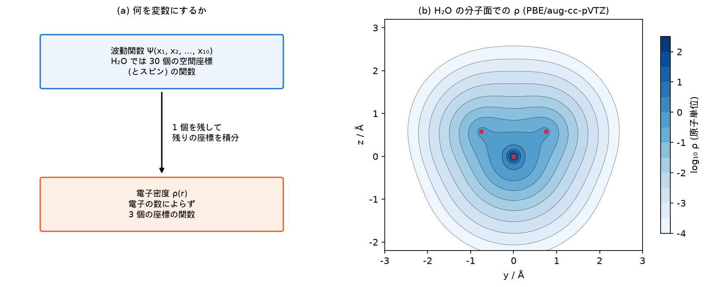
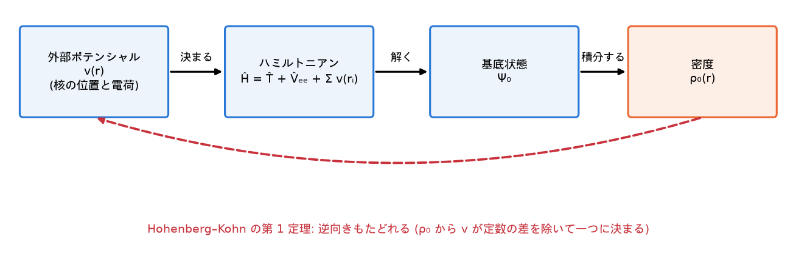
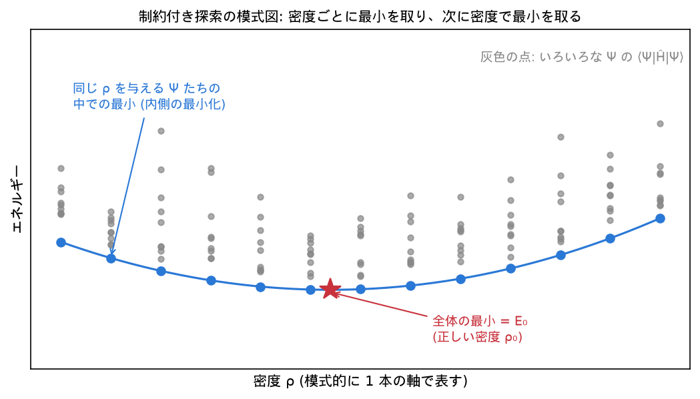
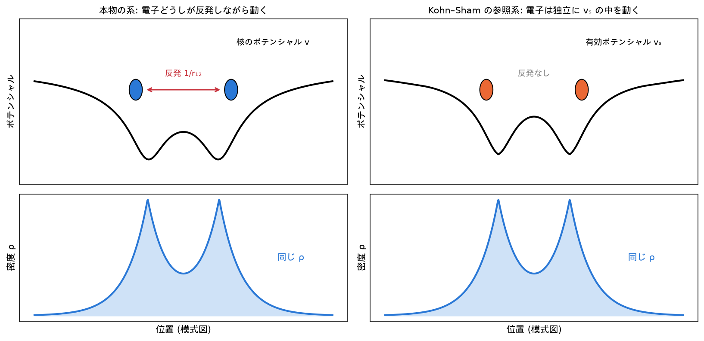
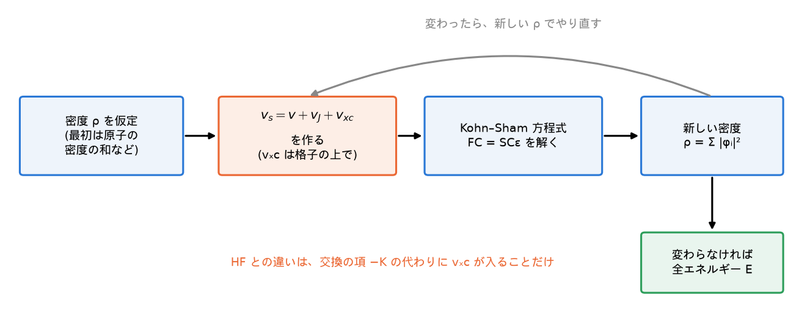
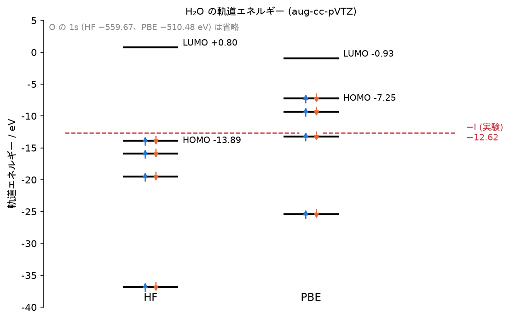
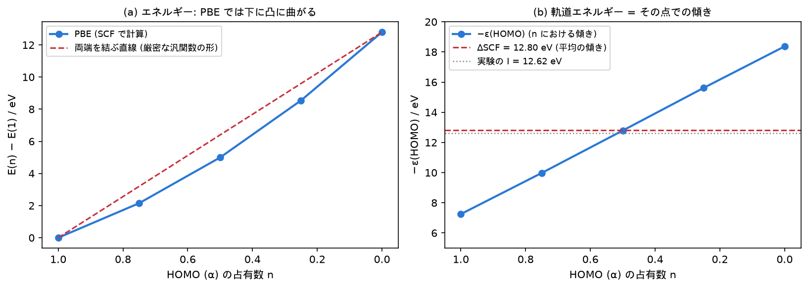

# 第 15 回　Hohenberg–Kohn の定理と Kohn–Sham 法

!!! abstract "この回の道筋"
    密度汎関数理論（density functional theory、DFT）は、波動関数の代わりに電子密度を主役にする理論です。この回では、それが許される理由（Hohenberg–Kohn の定理と Levy の制約付き探索）を確かめ、実際の計算で使う Kohn–Sham 法を導きます。最後に、Kohn–Sham 軌道のエネルギーが何を意味するかを、H₂O の計算で確かめます。

    | 節 | 内容 |
    |---|---|
    | 1 | 電子密度：3 次元の関数 |
    | 2 | Hohenberg–Kohn の 2 つの定理 |
    | 3 | Levy の制約付き探索 |
    | 4 | Kohn–Sham の考え方：相互作用しない参照系 |
    | 5 | Kohn–Sham 方程式 |
    | 6 | 交換相関エネルギーに入っているもの |
    | 7 | Kohn–Sham 軌道のエネルギーの意味 |
    | 8 | 計算例：H₂O を HF、LDA、PBE で解く |

    **前に読んでおく回**：量子化学の理論 [第 5 回](05-hartree-fock.md)、[第 7 回](07-electron-correlation.md)

!!! tip "物理的なイメージ"
    Kohn–Sham 法が求めているのは、本物の電子と同じ密度をもつ、相互作用のない架空の電子の系です。Hohenberg–Kohn の定理によれば、基底状態の密度が分かればエネルギーが決まります。そこで、運動エネルギーの大部分は架空の電子の軌道で正確に計算し、電子どうしの古典的なクーロン反発も正確に計算します。残りの量子力学的な部分（交換相関エネルギー）だけを近似します。見た目は HF 法と同じ SCF の計算ですが、平均の場の中に交換相関ポテンシャルが入ります。

この回では原子単位を使います。エネルギーの換算は 1 $E_\mathrm h$ = 27.211 eV = 627.5 kcal/mol です。2 電子積分は化学者の表記 $(\mu\nu|\lambda\sigma)$ を使います。

## 1. 電子密度：3 次元の関数

### 1.1 密度の定義

$N$ 電子の波動関数 $\Psi(\mathbf x_1, \dots, \mathbf x_N)$ は、$3N$ 個の空間座標（とスピン）の関数です。$\mathbf x = (\mathbf r, s)$ は空間座標とスピンの組で、$\int d\mathbf x$ はスピンの和も含みます。H₂O（電子 10 個）なら 30 個の空間座標の関数です。電子の数が増えると、この関数を直接扱うのはすぐに難しくなります。そこで、もっと簡単な量で系を記述できないかを考えます。

その候補が電子密度（electron density）です。

$$
\rho(\mathbf r) = N\sum_{s}\int |\Psi(\mathbf r s, \mathbf x_2, \dots, \mathbf x_N)|^2\, d\mathbf x_2\cdots d\mathbf x_N
$$

右辺は、電子 1 の位置を $\mathbf r$ に固定し、電子 1 のスピンと、ほかの電子すべての座標について $|\Psi|^2$ を積分したものです。これは「電子 1 が $\mathbf r$ に見つかる確率密度」です。電子は区別できないので、どの電子でも同じ値になります。$N$ 倍すると、「点 $\mathbf r$ に見つかる電子の数の密度」になります。$\rho(\mathbf r)\,d\mathbf r$ は、点 $\mathbf r$ の近くの体積 $d\mathbf r$ に見いだされる電子の数の期待値で、全空間で積分すると $\int\rho\,d\mathbf r = N$ です。電子の数によらず、$\rho$ は 3 次元の関数です（図 1）。

例を二つ挙げます。

- **水素原子の基底状態**：$\Psi = \phi_\mathrm{1s}(\mathbf r) = e^{-r}/\sqrt\pi$ なので、$\rho(\mathbf r) = e^{-2r}/\pi$ です。
- **決定子 1 個**：軌道 $\phi_i$ に電子が入った決定子では、$\rho(\mathbf r) = \sum_i |\phi_i(\mathbf r)|^2$（和はスピン軌道について、空間部分だけを書いた）です。閉殻なら $\rho = 2\sum_i^{N/2} |\phi_i|^2$ で、第 5 回の 4.4 節の式と同じです。



**図 1**　(a) 波動関数は電子の数の 3 倍の座標の関数ですが、密度は 3 個の座標の関数です。(b) H₂O の分子面の上の密度 $\rho$（PBE/aug-cc-pVTZ、8 節と同じ構造）を、対数の等高線で描いたもの。赤い点が原子核の位置です。密度は O の核で最も高く、外側へ指数関数的に減ります。H の位置では、密度がふくらんでいます。

### 1.2 分子ごとに違うのは外部ポテンシャルだけ

電子のハミルトニアン（第 2 回）を、次のように分けて書きます。

$$
\hat H = \hat T + \hat V_\mathrm{ee} + \sum_{i=1}^{N} v(\mathbf r_i),
\qquad v(\mathbf r) = -\sum_A \frac{Z_A}{|\mathbf r - \mathbf R_A|}
$$

$\hat T$ は電子の運動エネルギー、$\hat V_\mathrm{ee}$ は電子どうしの反発です。この 2 つは、電子の数 $N$ が同じなら、どの分子でも同じ形です。分子ごとに違うのは、核がつくるポテンシャル $v(\mathbf r)$ だけです。$v$ を外部ポテンシャル（external potential）と呼びます。

外部ポテンシャルのエネルギーは、密度だけで書けます。

$$
\Big\langle\Psi\Big|\sum_i v(\mathbf r_i)\Big|\Psi\Big\rangle = \int v(\mathbf r)\,\rho(\mathbf r)\,d\mathbf r
$$

段階を追って確かめます。左辺は $N$ 個の項 $\int v(\mathbf r_i)|\Psi|^2 d\mathbf x_1 \cdots d\mathbf x_N$ の和です。$|\Psi|^2$ は電子を入れ替えても変わらないので、$N$ 個の項はすべて $i = 1$ の項に等しく、

$$
\text{左辺} = N\int v(\mathbf r_1)\,|\Psi|^2\, d\mathbf x_1 \cdots d\mathbf x_N
$$

です。$v(\mathbf r_1)$ は $\mathbf r_1$ だけの関数なので、先に $\mathbf x_2, \dots, \mathbf x_N$ と電子 1 のスピンで積分できます。その積分に $N$ をかけたものが、ちょうど $\rho(\mathbf r_1)$ の定義です。したがって右辺の $\int v\rho\, d\mathbf r$ になります。

**ここまでで分かったこと**：分子の違いは外部ポテンシャル $v$ だけにあります。$v$ のエネルギーは、3 次元の関数 $\rho$ で書けます。

## 2. Hohenberg–Kohn の 2 つの定理

1964 年に Hohenberg と Kohn は、基底状態の密度が系のすべてを決めることを示しました [Hohenberg 1964]。主張は 2 つあります。

### 2.1 第 1 定理：密度は外部ポテンシャルを決める

**第 1 定理**：縮退していない基底状態の密度 $\rho_0(\mathbf r)$ は、外部ポテンシャル $v(\mathbf r)$ を、定数の差を除いて一つに決める。

ふつうの順番では、$v$ が決まればハミルトニアンが決まり、シュレーディンガー方程式を解けば基底状態の波動関数 $\Psi_0$ が決まり、それを積分すれば $\rho_0$ が決まります。第 1 定理は、この矢印を**逆向きにもたどれる**ことを述べています（図 2）。$\rho_0$ から $v$ が決まれば、そこから $\Psi_0$ もほかのすべての性質も決まります。したがって、基底状態のあらゆる性質は、$\rho_0$ の関数として書けます。関数を変数にとる関数なので、これを汎関数（functional）と呼び、$E[\rho]$ のように角括弧で書きます。



**図 2**　ふつうは、外部ポテンシャル $v$ からハミルトニアン、基底状態、密度の順に決まります（黒の矢印）。Hohenberg–Kohn の第 1 定理は、密度から外部ポテンシャルへ戻る道（赤の破線）も一通りしかないことを述べています。

証明は付録 A に回します。背理法による短い証明です。

### 2.2 第 2 定理：正しい密度でエネルギーが最小になる

**第 2 定理**：汎関数

$$
E_v[\rho] = F_\mathrm{HK}[\rho] + \int v(\mathbf r)\rho(\mathbf r)\,d\mathbf r,
\qquad F_\mathrm{HK}[\rho] = \langle\Psi[\rho]|\hat T + \hat V_\mathrm{ee}|\Psi[\rho]\rangle
$$

は、正しい基底状態の密度 $\rho_0$ で最小になり、その最小値は基底状態のエネルギー $E_0$ に等しい。

ここで $\Psi[\rho]$ は、密度 $\rho$ を基底状態の密度にもつ外部ポテンシャルの、基底状態の波動関数です。第 1 定理により、これは $\rho$ から一つに決まります。

第 2 定理は、$\Psi[\rho]$ に変分原理（第 1 回）を当てはめると出てきます。別の密度 $\tilde\rho$ をとり、$\tilde\Psi = \Psi[\tilde\rho]$ とします。$\tilde\Psi$ の密度は $\tilde\rho$ なので、1.2 節の式から $\int v\tilde\rho\,d\mathbf r = \langle\tilde\Psi|\sum_i v(\mathbf r_i)|\tilde\Psi\rangle$ です。これを使うと

$$
E_v[\tilde\rho] = \langle\tilde\Psi|\hat T + \hat V_\mathrm{ee}|\tilde\Psi\rangle + \langle\tilde\Psi|\textstyle\sum_i v(\mathbf r_i)|\tilde\Psi\rangle = \langle\tilde\Psi|\hat H|\tilde\Psi\rangle \ge E_0
$$

です。最後の不等号が変分原理で、等号は $\tilde\Psi$ が $\hat H$ の基底状態、つまり $\tilde\rho = \rho_0$ のときに成り立ちます。

$F_\mathrm{HK}$ は $v$ を含まないので、どの分子にも共通です。このため、$F_\mathrm{HK}$ を普遍汎関数（universal functional）と呼びます。ただし、定理は $F_\mathrm{HK}$ が存在することを示しただけで、その形は教えてくれません。DFT の実際の仕事は、この形をどう近似するかにあります。DFT の理論の全体は、Parr と Yang の教科書にまとめられています [Parr 1989]。

### 2.3 残る 2 つの問題

この定式化には、細かい問題が 2 つ残ります。

1. 証明は、基底状態が縮退していないことを仮定しています。
2. $F_\mathrm{HK}[\rho]$ は、ある外部ポテンシャルの基底状態の密度になる $\rho$ にしか定義されていません。このような密度を $v$ 表現可能（$v$-representable）と呼びます。ところが、見た目は普通の密度でも、どの $v$ の基底状態の密度にもならない例があることが分かっています [Levy 1982]。変分で $\rho$ を動かすとき、$v$ 表現可能な密度の中だけを動く方法は知られていません。

**ここまでで分かったこと**：基底状態の密度は外部ポテンシャルを決め、したがって系のすべてを決めます。エネルギーは $\rho$ の汎関数で、正しい $\rho_0$ で最小になります。

## 3. Levy の制約付き探索

前の節の 2 つの問題は、Levy の制約付き探索（constrained search）で解決されます [Levy 1979]。普遍汎関数を、次のように定義し直します。

$$
F[\rho] = \min_{\Psi\to\rho}\,\langle\Psi|\hat T + \hat V_\mathrm{ee}|\Psi\rangle
$$

$\Psi\to\rho$ は、「密度 $\rho$ を与える、反対称で規格化された波動関数すべて」の中で探すことを表します。この定義は、$\Psi$ が何かのポテンシャルの基底状態であることを要求しません。したがって、$v$ 表現可能でない密度にも $F$ が定義されます。また、縮退した基底状態があっても、最小値は一つに決まります。

この $F$ を使うと、基底状態のエネルギーは 2 段階の最小化で求められます。

$$
E_0 = \min_\rho\Big\{F[\rho] + \int v\rho\,d\mathbf r\Big\}
= \min_\rho\,\min_{\Psi\to\rho}\,\langle\Psi|\hat T + \hat V_\mathrm{ee} + \hat V|\Psi\rangle
$$

$\hat V = \sum_i v(\mathbf r_i)$ です。右の等号が成り立つのは、外部ポテンシャルのエネルギー $\int v\rho\,d\mathbf r$ が $\rho$ だけで決まり、内側の最小化（$\rho$ を固定して $\Psi$ を動かす）の中では一定なので、$\min$ の中に入れてよいからです。

図 3 は、この 2 段階を模式的に描いたものです。



**図 3**　制約付き探索の模式図。横軸は密度（本当は関数ですが、1 本の軸で表しています）、灰色の点は、その密度を与えるいろいろな波動関数 $\Psi$ のエネルギー $\langle\Psi|\hat H|\Psi\rangle$ です。まず密度ごとに最も低い点（青）を選びます（内側の最小化。これが $F[\rho] + \int v\rho$）。次に、青の点の中で最も低い点（赤の星）を選ぶと、それが基底状態のエネルギー $E_0$ で、そのときの密度が $\rho_0$ です。

内側で同じ $\rho$ を与える $\Psi$ をすべて調べ、外側で $\rho$ を動かすので、結局はすべての $\Psi$ を調べたことになります。それは通常の変分原理そのものなので、最小値は $E_0$ です。波動関数で考える変分原理を、「まず密度ごとに最小化し、次に密度で最小化する」と並べ替えただけです。この見方では、DFT は波動関数の理論と矛盾しない、正確な再定式化だと分かります。

**ここまでで分かったこと**：普遍汎関数は「密度 $\rho$ を与える波動関数の中での最小値」と定義できます。この定義では、$v$ 表現可能性を気にせずに、密度で変分ができます。

## 4. Kohn–Sham の考え方：相互作用しない参照系

### 4.1 運動エネルギーが難しい

$F[\rho]$ を近似するとき、いちばん難しいのは運動エネルギーです。密度だけで運動エネルギーを近似した初期の理論（Thomas–Fermi 理論）では、分子が原子に分かれた方がエネルギーが低くなり、化学結合を表せないことが示されています [Teller 1962]。運動エネルギーは、波動関数の曲がり具合（2 階微分）で決まる量で、密度の値だけからは見積もりにくいのです。

### 4.2 同じ密度をもつ、相互作用しない系

Kohn と Sham は、運動エネルギーの大部分を軌道で正確に計算する方法を考えました [Kohn 1965]。考え方は次のとおりです（図 4）。

1. 電子どうしが相互作用しない仮想の系を考えます。ハミルトニアンは 1 電子の演算子の和 $\sum_i [-\frac12\nabla_i^2 + v_s(\mathbf r_i)]$ です。電子が互いに独立なので、この系の基底状態は、1 電子の方程式の解（軌道）を下から詰めた 1 個の Slater 決定子で厳密に書けます（第 2 回）。
2. この仮想の系に、本物の系と**同じ密度** $\rho$ を持たせます。そのように、仮想の系の外部ポテンシャル $v_s$ を選びます。
3. 運動エネルギーの主な部分を、この決定子の運動エネルギーで表します。



**図 4**　Kohn–Sham の考え方の模式図（1 次元で描いたもの）。左：本物の系では、電子は核のポテンシャル $v$ の中を、互いに反発しながら動きます。右：Kohn–Sham の参照系では、電子は互いに反発せず、有効ポテンシャル $v_s$ の中を独立に動きます。$v_s$ は、下の段の密度が左右で同じになるように選びます。

仮想の系を、Kohn–Sham の参照系と呼びます。参照系の運動エネルギーは、Levy と同じ制約付き探索で、決定子 $\Phi$ に限って定義します。

$$
T_s[\rho] = \min_{\Phi\to\rho}\,\langle\Phi|\hat T|\Phi\rangle = \sum_{i}^{N}\Big\langle\phi_i\Big|-\tfrac12\nabla^2\Big|\phi_i\Big\rangle
$$

$\phi_i$ は決定子の軌道（Kohn–Sham 軌道）で、$\rho = \sum_i^N|\phi_i|^2$ です（和はスピン軌道について）。$T_s$ の添字 $s$ は「single determinant（1 個の決定子）」の意味です。

### 4.3 エネルギーを 4 つに分ける

これを使って、普遍汎関数を 3 つに分けます。

$$
F[\rho] = T_s[\rho] + J[\rho] + E_\mathrm{xc}[\rho],
\qquad
J[\rho] = \frac12\iint\frac{\rho(\mathbf r_1)\rho(\mathbf r_2)}{r_{12}}\,d\mathbf r_1 d\mathbf r_2
$$

$J[\rho]$ は、電子の雲を古典的な電荷の分布と見たときの静電エネルギー（Hartree エネルギー）です。$\frac12$ は、同じ組を 2 回数えないためです。残りの $E_\mathrm{xc}[\rho]$ を、交換相関エネルギー（exchange-correlation energy）と呼びます。この式は $E_\mathrm{xc}$ の定義です。近似はまだ入っていません。

全エネルギーは、核の引力 $\int v\rho$ と核どうしの反発 $V_\mathrm{NN}$ を足して

$$
E = T_s[\rho] + \int v\rho\,d\mathbf r + J[\rho] + E_\mathrm{xc}[\rho] + V_\mathrm{NN}
$$

です。$T_s$ と $J$ は正確に計算でき、全エネルギーの大部分を占めます。近似が必要なのは、比較的小さな $E_\mathrm{xc}$ だけです。これが Kohn–Sham 法の要点です。

ただし、化学で問題になるのは m$E_\mathrm h$ 単位のエネルギー差です。そのため、全体の中では小さなこの部分の近似の質が、結果の質を決めます。

**ここまでで分かったこと**：Kohn–Sham 法は、本物と同じ密度を持つ「相互作用しない電子の系」を参照にします。運動エネルギーの大部分と古典的な静電エネルギーは正確に計算し、残り $E_\mathrm{xc}$ だけを近似します。

## 5. Kohn–Sham 方程式

### 5.1 方程式の形

全エネルギーを軌道で書くと、次のようになります（$V_\mathrm{NN}$ は軌道によらないので省きます）。

$$
E[\rho] = \sum_{i}^{N}\Big\langle\phi_i\Big|-\tfrac12\nabla^2\Big|\phi_i\Big\rangle + \int v\rho\,d\mathbf r + J[\rho] + E_\mathrm{xc}[\rho]
$$

これを、軌道が規格直交であるという条件のもとで最小にします。手順は Hartree–Fock 方程式の導出（第 5 回の付録 B）と同じです。導出は付録 B に回しますが、結果は次の方程式です。

$$
\Big[-\tfrac12\nabla^2 + v_s(\mathbf r)\Big]\phi_i(\mathbf r) = \varepsilon_i\,\phi_i(\mathbf r),
\qquad
v_s(\mathbf r) = v(\mathbf r) + v_J(\mathbf r) + v_\mathrm{xc}(\mathbf r)
$$

これを Kohn–Sham 方程式と呼びます。$v_s$ が、4 節の参照系の外部ポテンシャルに当たります。$v_J$ と $v_\mathrm{xc}$ は、それぞれ $J$ と $E_\mathrm{xc}$ を $\rho$ で微分したもの（汎関数微分）です。

### 5.2 汎関数微分とは

汎関数微分 $\delta E/\delta\rho(\mathbf r)$ は、密度を少し $\delta\rho$ だけ変えたときのエネルギーの変化を

$$
\delta E = \int \frac{\delta E}{\delta\rho(\mathbf r)}\,\delta\rho(\mathbf r)\,d\mathbf r
$$

の形に書いたときの、$\delta\rho(\mathbf r)$ にかかる係数です。「点 $\mathbf r$ に電子を少し足したときのエネルギーの増え方」と考えられます。二つの例で計算します。

**$J$ の微分**：$\rho$ を $\rho + \delta\rho$ に替えて、$\delta\rho$ の 1 次の項を取り出すと、

$$
\delta J = \frac12\iint\frac{\delta\rho(\mathbf r_1)\rho(\mathbf r_2) + \rho(\mathbf r_1)\delta\rho(\mathbf r_2)}{r_{12}}\,d\mathbf r_1 d\mathbf r_2
$$

です。2 つの項は、積分の変数の名前を入れ替えれば同じなので、$\frac12$ と打ち消して

$$
\delta J = \int \delta\rho(\mathbf r_1)\Big[\int\frac{\rho(\mathbf r_2)}{r_{12}}\,d\mathbf r_2\Big]d\mathbf r_1
$$

となります。括弧の中が $v_J(\mathbf r_1)$ で、電子の雲がつくる静電ポテンシャル（Hartree ポテンシャル）です。

**LDA の交換の微分**：6 節で出てくる LDA の交換エネルギー $E_\mathrm x^\mathrm{LDA} = -\frac34\big(\frac3\pi\big)^{1/3}\int\rho^{4/3}d\mathbf r$ では、被積分関数が各点の $\rho$ だけの関数なので、ふつうの微分 $\frac{d}{d\rho}\rho^{4/3} = \frac43\rho^{1/3}$ がそのまま使え、

$$
v_\mathrm x^\mathrm{LDA}(\mathbf r) = -\frac34\Big(\frac3\pi\Big)^{1/3}\cdot\frac43\,\rho(\mathbf r)^{1/3} = -\Big(\frac3\pi\Big)^{1/3}\rho(\mathbf r)^{1/3}
$$

です。密度の高い所ほど深くなる、各点で値をもつポテンシャルです。

### 5.3 Hartree–Fock 方程式との違い

Hartree–Fock 方程式と比べると、違いは 1 か所だけです。Fock 演算子の交換演算子 $-\hat K$ の代わりに、$v_\mathrm{xc}(\mathbf r)$ が入っています。$\hat K$ は、軌道にかけると別の点の値を積分で集めてくる非局所的な演算子でした（第 5 回）。一方、$v_\mathrm{xc}$ は各点で値を持つ普通のポテンシャルです。$v_s$ も $\rho$ に依存するので、Kohn–Sham 方程式も SCF の繰り返しで解きます（図 5）。



**図 5**　Kohn–Sham の SCF の流れ。密度を仮定して $v_s$ を作り、Kohn–Sham 方程式を解いて新しい密度を求めます。密度が変わらなくなるまで繰り返します。HF の SCF（第 5 回の 5 節）との違いは、橙の箱で交換の項の代わりに $v_\mathrm{xc}$ を作ることだけです。

### 5.4 行列で書く：H₂ の 2 × 2 の例

基底関数で展開すると、Roothaan–Hall 方程式と同じ形 $\mathbf F\mathbf C = \mathbf S\mathbf C\boldsymbol\varepsilon$ になります。閉殻の場合、二つの方法の行列は次のとおりです（$\mathbf D$ は第 5 回の 4.4 節の密度行列）。

$$
F^\mathrm{HF}_{\mu\nu} = h_{\mu\nu} + \underbrace{\sum_{\lambda\sigma} D_{\lambda\sigma}(\mu\nu|\lambda\sigma)}_{J_{\mu\nu}} \; \underbrace{- \frac12\sum_{\lambda\sigma} D_{\lambda\sigma}(\mu\lambda|\nu\sigma)}_{-\frac12 K_{\mu\nu}},
\qquad
F^\mathrm{KS}_{\mu\nu} = h_{\mu\nu} + J_{\mu\nu} + V^\mathrm{xc}_{\mu\nu}
$$

$V^\mathrm{xc}_{\mu\nu} = \int g_\mu(\mathbf r)\,v_\mathrm{xc}(\mathbf r)\,g_\nu(\mathbf r)\,d\mathbf r$ は、基底関数 $g_\mu$ で $v_\mathrm{xc}$ をはさんだ積分です。$v_\mathrm{xc}$ は一般に複雑な関数なので、この積分は空間に点を並べた格子（グリッド）の上で数値的に計算します。

第 5 回の 4.3 節と同じ H₂（STO-3G、H–H 0.74 Å、基底関数は各 H の 1s の $g_A$、$g_B$）で書き出します。対称性から $F_{AA} = F_{BB}$ なので、

$$
\mathbf F^\mathrm{HF} =
\begin{pmatrix}
h_{AA} + J_{AA} - \frac12 K_{AA} & h_{AB} + J_{AB} - \frac12 K_{AB} \\
h_{AB} + J_{AB} - \frac12 K_{AB} & h_{AA} + J_{AA} - \frac12 K_{AA}
\end{pmatrix},
\qquad
\mathbf F^\mathrm{KS} =
\begin{pmatrix}
h_{AA} + J_{AA} + V^\mathrm{xc}_{AA} & h_{AB} + J_{AB} + V^\mathrm{xc}_{AB} \\
h_{AB} + J_{AB} + V^\mathrm{xc}_{AB} & h_{AA} + J_{AA} + V^\mathrm{xc}_{AA}
\end{pmatrix}
$$

です。二つの行列を要素ごとに比べると、$h_{\mu\nu}$ と $J_{\mu\nu}$ の形は同じで、違うのは $-\frac12 K_{\mu\nu}$ と $V^\mathrm{xc}_{\mu\nu}$ の 1 か所だけです。$-\frac12 K$ は、同じスピンの電子が避け合うことによる反発の減り方を、軌道を使って正確に計算した項でした（第 5 回）。$V^\mathrm{xc}$ は、交換と相関をまとめて、各点の密度（とその勾配）から近似した項です。

この行列の固有値の求め方も、第 5 回と同じです。対称性から $\sigma_g \propto g_A + g_B$ なので、

$$
\varepsilon_{\sigma_g} = \frac{F_{AA} + F_{AB}}{1 + S}, \qquad \varepsilon_{\sigma_u} = \frac{F_{AA} - F_{AB}}{1 - S}
$$

です（$S$ は $g_A$ と $g_B$ の重なり）。最小基底の H₂ では、軌道の形が対称性だけで決まるので、密度行列 $\mathbf D$ も HF と KS で同じになり、$\mathbf J$ も同じ値です。したがってこの例では、HF と KS の軌道エネルギーの違いは、$F_{AA}$ と $F_{AB}$ の中の $-\frac12 K$ と $V^\mathrm{xc}$ の違いだけから来ます。

$E_\mathrm{xc}$ が厳密なら、Kohn–Sham 方程式の解の密度は本物の密度に一致し、エネルギーも厳密です。実際には $E_\mathrm{xc}$ を近似するので、その近似のよさが DFT の結果のよさを決めます。

**ここまでで分かったこと**：Kohn–Sham 方程式は、Hartree–Fock 方程式の交換演算子を、局所的な交換相関ポテンシャル $v_\mathrm{xc}$（$E_\mathrm{xc}$ の汎関数微分）に置き換えた形です。行列で書くと、Fock 行列の $-\frac12\mathbf K$ が $\mathbf V^\mathrm{xc}$ に替わるだけで、SCF で解く手順も同じです。

## 6. 交換相関エネルギーに入っているもの

### 6.1 4 つの中身

$E_\mathrm{xc}$ の定義を、本物の系のエネルギーと比べて書き直します。本物の系の $F[\rho] = T + V_\mathrm{ee}$（$T$、$V_\mathrm{ee}$ は制約付き探索で最小を与える波動関数での期待値）と、4.3 節の分け方 $F = T_s + J + E_\mathrm{xc}$ を等しいとおいて、$E_\mathrm{xc}$ について解くと、

$$
E_\mathrm{xc}[\rho] = \big(T - T_s\big) + \big(V_\mathrm{ee} - J\big)
$$

です。2 つの括弧には、次のものが入っています。

1. **$V_\mathrm{ee} - J$**：電子の反発の、古典的な静電エネルギーからのずれです。ここには次の 3 つが入ります。
    - **自己相互作用の打ち消し**：$J[\rho]$ は、電子が自分自身の雲と反発する分も含みます。この分を打ち消す必要があります。
    - **交換**：同じスピンの電子が避け合う効果（第 2 回の Fermi 孔）です。
    - **相関**：逆向きのスピンも含め、電子がクーロン反発で避け合う効果（第 7 回）です。
2. **$T - T_s$**：本物の系の運動エネルギーと、参照系の運動エネルギーの差です。電子が避け合うように動くと、波動関数の形が複雑になり、運動エネルギーが少し増えます。この分も $E_\mathrm{xc}$ に入ります。

$E_\mathrm{xc}$ を交換の部分 $E_\mathrm x$ と相関の部分 $E_\mathrm c$ に分けることもあります。$E_\mathrm x$ は、Kohn–Sham 軌道で作った決定子について、Hartree–Fock と同じ式で計算した交換エネルギーとして定義されます。

### 6.2 電子 1 個の系：Eₓc = −J

電子が 1 個しかない系（H 原子など）では、厳密な $E_\mathrm{xc}$ が簡単に分かります。

- 電子どうしの反発がないので、$V_\mathrm{ee} = 0$ です。
- 電子 1 個の波動関数は軌道 1 個そのもので、それは決定子 1 個です。したがって参照系と本物の系は同じで、$T = T_s$ です。

これらを 6.1 節の式に入れると

$$
E_\mathrm{xc} = (T - T_s) + (V_\mathrm{ee} - J) = 0 + (0 - J) = -J
$$

です。厳密な $E_\mathrm{xc}$ は、$J$ に含まれる「自分自身との反発」をちょうど打ち消します。

### 6.3 局所密度近似（LDA）

いちばん簡単な近似は、局所密度近似（local density approximation、LDA）です。各点の $E_\mathrm{xc}$ の密度を、その点の $\rho$ と同じ密度を持つ一様な電子ガスの値で置き換えます。Kohn と Sham は、元の論文でこの近似を提案しています [Kohn 1965]。交換の部分は、閉殻の場合に次の形になります。

$$
E_\mathrm x^\mathrm{LDA}[\rho] = -\frac34\Big(\frac3\pi\Big)^{1/3}\int\rho(\mathbf r)^{4/3}\,d\mathbf r
$$

相関の部分には、一様な電子ガスの精密な計算に合わせた式（たとえば VWN [Vosko 1980]）を使います。LDA を含む近似の種類は、[第 16 回](16-functionals.md)で扱います。

近似の汎関数は、6.2 節の条件 $E_\mathrm{xc} = -J$ を一般には満たしません。たとえば LDA の交換は、各点の密度だけから一様な電子ガスの値を当てはめるので、「この点の電子はほかの点の自分自身と反発している」という情報を持っていません。そのため、電子 1 個の系でも $E_\mathrm{xc} + J$ が 0 にならず、自分自身との反発が少し残ります。この残りを**自己相互作用誤差**と呼びます。自己相互作用誤差が引き起こす問題は、[第 18 回](18-dft-errors.md)で扱います。

**ここまでで分かったこと**：$E_\mathrm{xc}$ には、自己相互作用の打ち消し、交換、相関、そして運動エネルギーの差 $T - T_s$ が入っています。電子 1 個の系では厳密に $E_\mathrm{xc} = -J$ ですが、近似の汎関数は一般にこれを満たさず、自己相互作用誤差が残ります。

## 7. Kohn–Sham 軌道のエネルギーの意味

Kohn–Sham 軌道は、本物の系の密度を再現するための補助的な軌道です。そのエネルギー $\varepsilon_i$ にどんな意味があるかを、2 つの定理で確かめます。

### 7.1 Janak の定理

軌道 $i$ の占有数 $n_i$ を、0 から 1 の間の実数に広げます。密度を $\rho = \sum_i n_i|\phi_i|^2$ とし、各 $n_i$ ごとに SCF で解いたエネルギーを $E(n_i)$ とします。Janak は次のことを示しました [Janak 1978]。

$$
\frac{\partial E}{\partial n_i} = \varepsilon_i
$$

すべての段階を付録 C で導きます。考え方は次のとおりです。占有数を少し変えると、エネルギーは二つの経路で変わります。一つは、軌道を固定したまま、その軌道の電子の量が変わる分で、これがちょうど $\varepsilon_i = \langle\phi_i|-\frac12\nabla^2 + v_s|\phi_i\rangle$ になります。もう一つは、軌道の形が変わる分ですが、エネルギーは軌道について停留しているので、1 次では 0 です。この議論は、$E_\mathrm{xc}$ の近似の形によらず成り立ちます。

Janak の定理は、軌道エネルギーがエネルギーの**傾き**であることを述べています。軌道エネルギーがイオン化エネルギーそのものだとは述べていません。

イオン化エネルギーと結び付けるには、HOMO（最高被占軌道）の占有数を 1 から 0 まで積分します。微分を積分すると元に戻るので、

$$
E(n = 0) - E(n = 1) = \int_1^0 \frac{\partial E}{\partial n}\,dn = \int_1^0 \varepsilon_\mathrm{HOMO}(n)\,dn
$$

です。積分の上下を入れ替えて符号を変えると、

$$
E(N-1) - E(N) = -\int_0^1 \varepsilon_\mathrm{HOMO}(n)\,dn
$$

となります。左辺はイオン化エネルギーです。$\varepsilon_\mathrm{HOMO}(n)$ は占有数 $n$ によって変わるので、$n = 1$ での値だけでは、この差は決まりません。右辺は「傾きの平均」です。

### 7.2 厳密な汎関数では HOMO がイオン化エネルギーを与える

厳密な $E_\mathrm{xc}$ を使えば、次の関係が成り立ちます [Perdew 1982; Levy 1984]。

$$
-\varepsilon_\mathrm{HOMO} = I
$$

$I = E(N-1) - E(N)$ はイオン化エネルギーです。直感的な理由は、密度の遠くでの振る舞いにあります。段階を追って見ます。

1. **本物の密度**：原子や分子から遠く離れると、本物の密度は $\rho \sim e^{-2\sqrt{2I}\,r}$ の速さで指数関数的に減ります [Levy 1984]。遠くの電子 1 個を引き離すのに必要なエネルギーが $I$ だからです。
2. **Kohn–Sham の密度**：遠くでは $v_s$ は 0 に近づくので、Kohn–Sham 方程式は $-\frac12\nabla^2\phi_i \approx \varepsilon_i\phi_i$ になります。$\varepsilon_i < 0$ の解は $\phi_i \sim e^{-\sqrt{-2\varepsilon_i}\,r}$ です（両辺を微分して確かめられます。べき乗の前因子は無視しています）。$|\varepsilon_i|$ が最も小さい HOMO が最もゆっくり減るので、遠くでは HOMO だけが残り、$\rho \sim e^{-2\sqrt{-2\varepsilon_\mathrm{HOMO}}\,r}$ です。
3. **比べる**：Kohn–Sham の密度は本物の密度と同じものなので、減り方の指数も一致します。$2\sqrt{2I} = 2\sqrt{-2\varepsilon_\mathrm{HOMO}}$ から、$-\varepsilon_\mathrm{HOMO} = I$ です。

この関係は、厳密な汎関数についてだけ成り立ちます。また、LUMO（最低空軌道）のエネルギーは、厳密な汎関数でも電子親和力とは一致しません [Perdew 1982]。この点は[第 18 回](18-dft-errors.md)で、エネルギーを電子の数の関数として見るときに扱います。

近似の汎関数では、$-\varepsilon_\mathrm{HOMO}$ はイオン化エネルギーと大きくずれることがあります。次の節で、これを確かめます。

**ここまでで分かったこと**：Janak の定理により、軌道エネルギーはエネルギーの占有数についての傾きです。厳密な汎関数なら、密度の遠くでの減り方から $-\varepsilon_\mathrm{HOMO}$ はイオン化エネルギーに等しくなります。

## 8. 計算例：H₂O を HF、LDA、PBE で解く

### 8.1 軌道エネルギーと ΔSCF

第 5 回と同じ構造の H₂O を、PySCF [Sun 2020] で 3 つの方法で解きます。

- **HF**：Hartree–Fock 法。
- **SVWN**：LDA。交換は 6.3 節の式、相関は VWN [Vosko 1980] です。
- **PBE**：密度の勾配も使う近似（GGA）の代表です [Perdew 1996]。[第 16 回](16-functionals.md)で扱います。

基底関数には、遠くまで広がった関数を加えた aug-cc-pVTZ [Dunning 1989; Kendall 1992] を使います。陽イオン H₂O⁺ も同じ方法で解き、エネルギー差（ΔSCF）からイオン化エネルギーを求めます。陽イオンは開殻なので、非制限の方法（UHF と、その DFT 版の UKS）を使います。

```python
import numpy as np
from pyscf import gto, scf, dft

r, th = 0.958, np.deg2rad(104.5)   # O–H 距離（Å）と H–O–H 角
geom = [["O", (0, 0, 0)],
        ["H", (0,  r*np.sin(th/2), r*np.cos(th/2))],
        ["H", (0, -r*np.sin(th/2), r*np.cos(th/2))]]
au2ev = 27.211386

def run(charge, spin, method):
    mol = gto.M(atom=geom, basis="aug-cc-pvtz", charge=charge, spin=spin, verbose=0)
    if method == "HF":
        mf = scf.RHF(mol) if spin == 0 else scf.UHF(mol)
    else:
        mf = dft.RKS(mol) if spin == 0 else dft.UKS(mol)
        mf.xc = method
    return mf.run()

print("方法    E(H2O)/Eh     -ε(HOMO)/eV  ΔSCF/eV")
for method in ["HF", "SVWN", "PBE"]:
    neu = run(0, 0, method)
    cat = run(1, 1, method)
    homo = neu.mo_energy[neu.mo_occ > 0][-1]
    print(f"{method:5s} {neu.e_tot:13.6f} {-homo*au2ev:10.2f} {(cat.e_tot-neu.e_tot)*au2ev:9.2f}")
```

```text
方法    E(H2O)/Eh     -ε(HOMO)/eV  ΔSCF/eV
HF       -76.060559      13.89     10.99
SVWN     -75.905360       7.40     13.18
PBE      -76.380089       7.25     12.80
```

PySCF で `xc="SVWN"` と書くと、Slater の交換と VWN の相関を組み合わせた LDA になります。`xc="LDA"` と書くと交換だけになるので、注意してください。DFT の計算は、HF の計算の Fock 行列の作り方を変えるだけです。実際、上のコードの違いは `scf.RHF` と `dft.RKS` の 1 か所だけです。

実験のイオン化エネルギーは 12.621 eV です（第 5 回と同じ NIST の評価値。関連リンク）。HF と PBE の軌道エネルギーを、準位図で比べます（上と同じ中性の H₂O の計算の `mo_energy` を描いたもの）。



**図 6**　H₂O の軌道エネルギー（aug-cc-pVTZ）。横線が軌道、青と橙の矢印が α と β の電子です（O の 1s は省略）。赤の破線は、実験のイオン化エネルギーにマイナスをつけた値 $-I = -12.62$ eV です。HF の HOMO（$-13.89$ eV）は破線のすぐ下にありますが、PBE の占有軌道は全体に 6〜11 eV 高く、HOMO（$-7.25$ eV）は破線から大きく離れています。

表と図 6 から、次のことが分かります。

1. HF の $-\varepsilon_\mathrm{HOMO}$（13.89 eV）は、第 5 回の Koopmans の定理のとおり、実験値に近い値です。
2. LDA と PBE の $-\varepsilon_\mathrm{HOMO}$ は 7〜7.5 eV で、実験値の 6 割ほどしかありません。HOMO のエネルギーが高すぎます。
3. 一方、LDA と PBE の ΔSCF は 13.18 eV と 12.80 eV で、実験値に近い値です。HF の ΔSCF（10.99 eV）よりも近くなっています。

つまり、近似の汎関数でも全エネルギーの差はよいのに、軌道エネルギーは悪いのです。

### 8.2 占有数を変えて Janak の定理を確かめる

両者を結ぶのが Janak の定理です。PBE で、α スピンの HOMO の占有数 $n$ を 1 から 0 まで変えて、SCF を解いてみます。

```python
mol = gto.M(atom=geom, basis="aug-cc-pvtz", verbose=0)
nocc = mol.nelectron // 2           # α、β それぞれ 5 個

def uks_frac(n_homo, xc="PBE"):
    """α スピンの HOMO の占有数を n_homo に固定して UKS を解く。"""
    mf = dft.UKS(mol)
    mf.xc = xc
    def get_occ(mo_energy=None, mo_coeff=None):
        occ = np.zeros((2, mol.nao))
        occ[:, :nocc] = 1.0
        occ[0, nocc-1] = n_homo
        return occ
    mf.get_occ = get_occ
    mf.kernel()
    return mf

for n in [1.0, 0.75, 0.5, 0.25, 0.0]:
    mf = uks_frac(n)
    print(f"n = {n:4.2f}  E = {mf.e_tot:.6f}  -ε(HOMO α) = {-mf.mo_energy[0][nocc-1]*au2ev:6.2f} eV")
```

```text
n = 1.00  E = -76.380089  -ε(HOMO α) =   7.25 eV
n = 0.75  E = -76.301052  -ε(HOMO α) =   9.98 eV
n = 0.50  E = -76.196515  -ε(HOMO α) =  12.79 eV
n = 0.25  E = -76.065981  -ε(HOMO α) =  15.62 eV
n = 0.00  E = -75.909735  -ε(HOMO α) =  18.37 eV
```

$n = 1$ と $n = 0$ のエネルギー差は 0.47035 $E_\mathrm h$ = 12.80 eV で、上の ΔSCF と一致します。$-\varepsilon_\mathrm{HOMO}$ は、$n$ を減らすにつれて 7.25 eV から 18.37 eV まで大きく変わります。7.1 節の積分は、この変化を平均したものです。実際、ちょうど中点 $n = 1/2$ での値 12.79 eV が、ΔSCF の 12.80 eV とほぼ一致します。傾きの式も確かめられます。$n = 0.75$ と $0.25$ のエネルギー差から求めた傾きは $-0.4701\,E_\mathrm h$ = $-12.79$ eV で、$n = 1/2$ での $\varepsilon_\mathrm{HOMO}$ と一致します。

上の出力の 5 点を、図 7 に描きます。



**図 7**　(a) 上の出力の、HOMO の占有数 $n$ を 1 から 0 へ減らしたときのエネルギー（青）。両端を結ぶ直線（赤の破線）より下にあり、下に凸に曲がっています。(b) 同じ点での $-\varepsilon_\mathrm{HOMO}$（青）。(a) の曲線の各点での傾きで、$n$ にほぼ比例して変わります。赤の破線は両端の傾きの平均（ΔSCF）、灰色の点線は実験のイオン化エネルギーです。$n = 1$（中性の H₂O）での値 7.25 eV は、平均の傾きから大きく外れています。

厳密な汎関数なら、$E(n)$ は直線になり、$\varepsilon_\mathrm{HOMO}$ は $n$ によらず一定になるはずです [Perdew 1982]。そうなれば、$n = 1$ での傾き（$-\varepsilon_\mathrm{HOMO}$）と平均の傾き（ΔSCF）は等しく、7.2 節の $-\varepsilon_\mathrm{HOMO} = I$ とも整合します。PBE では $E(n)$ が曲がっているために、$n = 1$ での傾きと、端と端を結んだ平均の傾きがずれます。この曲がりの原因と意味は、[第 18 回](18-dft-errors.md)で扱います。

**ここまでで分かったこと**：近似の汎関数では、$-\varepsilon_\mathrm{HOMO}$ はイオン化エネルギーをかなり小さく見積もります。一方、エネルギーの差（ΔSCF）はよい値を与えます。両者の違いは、エネルギーが占有数に対して曲がっていることから来ます。

## まとめ

- Hohenberg–Kohn の定理により、縮退していない基底状態の密度は外部ポテンシャルを決め、エネルギーは密度の汎関数として、正しい密度で最小になります。
- Levy の制約付き探索は、普遍汎関数を「その密度を与える波動関数の中での最小値」と定義し、$v$ 表現可能性の問題を避けます。
- Kohn–Sham 法は、同じ密度を持つ相互作用しない参照系を使い、運動エネルギーの大部分を軌道で正確に計算します。近似するのは交換相関エネルギー $E_\mathrm{xc}$ だけで、行列では HF の $-\frac12\mathbf K$ が $\mathbf V^\mathrm{xc}$ に替わります。
- $E_\mathrm{xc}$ には、自己相互作用の打ち消し、交換、相関、運動エネルギーの差 $T - T_s$ が入っています。電子 1 個では $E_\mathrm{xc} = -J$ ですが、近似の汎関数は一般にこれを満たしません。
- 軌道エネルギーはエネルギーの占有数についての傾きです（Janak の定理）。厳密な汎関数なら $-\varepsilon_\mathrm{HOMO} = I$ ですが、LDA や PBE ではイオン化エネルギーを大きく下回ります。

## 付録 A　Hohenberg–Kohn の第 1 定理の証明

縮退していない基底状態を考えます。2 つの外部ポテンシャル $v$ と $v'$ が、定数以上に違うのに、同じ基底状態の密度 $\rho$ を与えたと仮定します。それぞれのハミルトニアンを $\hat H$、$\hat H'$、基底状態を $\Psi$、$\Psi'$、エネルギーを $E_0$、$E_0'$ とします。

**$\Psi$ と $\Psi'$ は違う関数であること**：仮に $\Psi = \Psi'$ だとします。2 つのシュレーディンガー方程式 $\hat H\Psi = E_0\Psi$ と $\hat H'\Psi = E_0'\Psi$ の差をとると、$\hat T$ と $\hat V_\mathrm{ee}$ は共通なので消え、

$$
\sum_i \big[v(\mathbf r_i) - v'(\mathbf r_i)\big]\Psi = (E_0 - E_0')\Psi
$$

が残ります。$\Psi$ が 0 でない所で両辺を $\Psi$ で割ると、$\sum_i [v(\mathbf r_i) - v'(\mathbf r_i)]$ が定数になります。これがすべての電子の位置で成り立つには、$v - v'$ が定数でなければなりません。仮定に反するので、$\Psi \ne \Psi'$ です。

**変分原理を使う**：$\Psi'$ を $\hat H$ の試行関数に使います。基底状態が縮退していないので、$\Psi$ と違う関数のエネルギーは $E_0$ より真に大きく、変分原理は等号なしで成り立ちます。

$$
E_0 < \langle\Psi'|\hat H|\Psi'\rangle
$$

$\hat H = \hat H' + (\hat H - \hat H')$ と分けると、

$$
\langle\Psi'|\hat H|\Psi'\rangle = \langle\Psi'|\hat H'|\Psi'\rangle + \langle\Psi'|\hat H - \hat H'|\Psi'\rangle = E_0' + \int\big[v - v'\big]\rho\,d\mathbf r
$$

です。第 2 項では、$\hat H - \hat H' = \sum_i[v(\mathbf r_i) - v'(\mathbf r_i)]$ に 1.2 節の式を使い、$\Psi'$ の密度も $\rho$ であることを使いました。まとめると

$$
E_0 < E_0' + \int\big[v - v'\big]\rho\,d\mathbf r
$$

です。$v$ と $v'$ の役割を入れ替えると、同じように

$$
E_0' < E_0 + \int\big[v' - v\big]\rho\,d\mathbf r
$$

です。2 つの式を足すと、積分の項は打ち消し合い、$E_0 + E_0' < E_0 + E_0'$ となって矛盾します。したがって、同じ密度を与える外部ポテンシャルは、定数の差を除いて一つだけです。

## 付録 B　Kohn–Sham 方程式の導出

規格直交の条件をラグランジュの未定乗数 $\lambda_{ji}$ で入れて、

$$
\mathcal L = E[\rho] - \sum_{ij}\lambda_{ji}\big(\langle\phi_i|\phi_j\rangle - \delta_{ij}\big)
$$

を考えます（和はスピン軌道について）。軌道を $\phi_i \to \phi_i + \delta\phi_i$ と変えたときの $\mathcal L$ の 1 次の変化を、項ごとに計算します。

**密度の変化**：$\rho = \sum_i\phi_i^*\phi_i$ なので、

$$
\delta\rho = \sum_i\big(\delta\phi_i^*\,\phi_i + \phi_i^*\,\delta\phi_i\big)
$$

です。

**運動エネルギー**：$\langle\phi_i|-\frac12\nabla^2|\phi_i\rangle$ の変化は、$\langle\delta\phi_i|-\frac12\nabla^2|\phi_i\rangle$ とその複素共役の和です（$-\frac12\nabla^2$ はエルミートなので、右側の変化も同じ形にまとめられます）。

**密度で書けている項**：$\int v\rho$、$J$、$E_\mathrm{xc}$ の変化は、5.2 節の汎関数微分を使って

$$
\int\big[v + v_J + v_\mathrm{xc}\big]\delta\rho\,d\mathbf r = \int v_s\,\delta\rho\,d\mathbf r
$$

です。ここに $\delta\rho$ の式を入れると、$\sum_i\big(\langle\delta\phi_i|v_s|\phi_i\rangle + \text{複素共役}\big)$ になります。

**規格直交の条件の項**：$-\sum_{ij}\lambda_{ji}\big(\langle\delta\phi_i|\phi_j\rangle + \langle\phi_i|\delta\phi_j\rangle\big)$ です。$\boldsymbol\lambda$ がエルミートであることを使うと、$-\sum_i\big(\langle\delta\phi_i|\sum_j\lambda_{ji}\phi_j\rangle + \text{複素共役}\big)$ とまとめられます。

**合計**：すべてを足すと

$$
\delta\mathcal L = \sum_i\Big\langle\delta\phi_i\Big|\Big[-\tfrac12\nabla^2 + v_s\Big]\phi_i - \sum_j\lambda_{ji}\phi_j\Big\rangle + \text{(複素共役)}
$$

です。任意の $\delta\phi_i$ で $\delta\mathcal L = 0$ となるには、括弧の中の関数が 0 でなければならず、$[-\frac12\nabla^2 + v_s]\phi_i = \sum_j\lambda_{ji}\phi_j$ が得られます。第 5 回の付録 B と同じく、軌道をユニタリー変換して $\boldsymbol\lambda$ を対角にしても密度は変わらないので、対角になる軌道を選ぶと、本文の Kohn–Sham 方程式になります（$\varepsilon_i = \lambda_{ii}$）。

## 付録 C　Janak の定理の導出

占有数 $n_j$ を使って、エネルギーを

$$
E = \sum_j n_j\Big\langle\phi_j\Big|-\tfrac12\nabla^2\Big|\phi_j\Big\rangle + \int v\rho\,d\mathbf r + J[\rho] + E_\mathrm{xc}[\rho],
\qquad \rho = \sum_j n_j|\phi_j|^2
$$

と書きます。各 $n_j$ で SCF を解いた軌道は、規格化されていて、Kohn–Sham 方程式 $[-\frac12\nabla^2 + v_s]\phi_j = \varepsilon_j\phi_j$ を満たします。$n_i$ を変えると、$E$ は $n_i$ を通して直接変わる分と、軌道 $\phi_j$ の形が変わる分の二つで変わります。

**直接の分**：軌道を固定して $n_i$ で微分します。第 1 項からは $\langle\phi_i|-\frac12\nabla^2|\phi_i\rangle$ が出ます。残りの項は $\rho$ を通して $n_i$ に依存し、$\partial\rho/\partial n_i = |\phi_i|^2$ なので、汎関数微分の定義から $\int v_s|\phi_i|^2 d\mathbf r$ が出ます。合わせると

$$
\Big\langle\phi_i\Big|-\tfrac12\nabla^2 + v_s\Big|\phi_i\Big\rangle = \varepsilon_i
$$

です（最後に Kohn–Sham 方程式と規格化を使いました）。

**軌道の形の分**：付録 B と同じ計算で、軌道を $\delta\phi_j$ だけ変えたときの $E$ の変化は

$$
\delta E = \sum_j n_j\Big(\Big\langle\delta\phi_j\Big|-\tfrac12\nabla^2 + v_s\Big|\phi_j\Big\rangle + \text{複素共役}\Big) = \sum_j n_j\varepsilon_j\big(\langle\delta\phi_j|\phi_j\rangle + \langle\phi_j|\delta\phi_j\rangle\big)
$$

です。括弧の中は規格化 $\langle\phi_j|\phi_j\rangle$ の変化で、軌道はいつも規格化されているので 0 です。したがって、この分は 0 になります。

二つを合わせて、$\partial E/\partial n_i = \varepsilon_i$ が得られます。途中で $E_\mathrm{xc}$ の具体的な形は使っていないので、どの近似の汎関数でも成り立ちます。

## 参考文献

- P. Hohenberg, W. Kohn, "Inhomogeneous Electron Gas", Phys. Rev. 136, B864 (1964). DOI: [10.1103/PhysRev.136.B864](https://doi.org/10.1103/PhysRev.136.B864)
- W. Kohn, L. J. Sham, "Self-Consistent Equations Including Exchange and Correlation Effects", Phys. Rev. 140, A1133 (1965). DOI: [10.1103/PhysRev.140.A1133](https://doi.org/10.1103/PhysRev.140.A1133)
- M. Levy, "Universal variational functionals of electron densities, first-order density matrices, and natural spin-orbitals and solution of the v-representability problem", Proc. Natl. Acad. Sci. USA 76, 6062 (1979). DOI: [10.1073/pnas.76.12.6062](https://doi.org/10.1073/pnas.76.12.6062)
- M. Levy, "Electron densities in search of Hamiltonians", Phys. Rev. A 26, 1200 (1982). DOI: [10.1103/PhysRevA.26.1200](https://doi.org/10.1103/PhysRevA.26.1200)
- E. Teller, "On the Stability of Molecules in the Thomas-Fermi Theory", Rev. Mod. Phys. 34, 627 (1962). DOI: [10.1103/RevModPhys.34.627](https://doi.org/10.1103/RevModPhys.34.627)
- J. F. Janak, "Proof that ∂E/∂n_i = ε in density-functional theory", Phys. Rev. B 18, 7165 (1978). DOI: [10.1103/PhysRevB.18.7165](https://doi.org/10.1103/PhysRevB.18.7165)
- J. P. Perdew, R. G. Parr, M. Levy, J. L. Balduz Jr., "Density-Functional Theory for Fractional Particle Number: Derivative Discontinuities of the Energy", Phys. Rev. Lett. 49, 1691 (1982). DOI: [10.1103/PhysRevLett.49.1691](https://doi.org/10.1103/PhysRevLett.49.1691)
- M. Levy, J. P. Perdew, V. Sahni, "Exact differential equation for the density and ionization energy of a many-particle system", Phys. Rev. A 30, 2745 (1984). DOI: [10.1103/PhysRevA.30.2745](https://doi.org/10.1103/PhysRevA.30.2745)
- S. H. Vosko, L. Wilk, M. Nusair, "Accurate spin-dependent electron liquid correlation energies for local spin density calculations: a critical analysis", Can. J. Phys. 58, 1200 (1980). DOI: [10.1139/p80-159](https://doi.org/10.1139/p80-159)
- J. P. Perdew, K. Burke, M. Ernzerhof, "Generalized Gradient Approximation Made Simple", Phys. Rev. Lett. 77, 3865 (1996). DOI: [10.1103/PhysRevLett.77.3865](https://doi.org/10.1103/PhysRevLett.77.3865)
- T. H. Dunning Jr., "Gaussian basis sets for use in correlated molecular calculations. I. The atoms boron through neon and hydrogen", J. Chem. Phys. 90, 1007 (1989). DOI: [10.1063/1.456153](https://doi.org/10.1063/1.456153)
- R. A. Kendall, T. H. Dunning Jr., R. J. Harrison, "Electron affinities of the first-row atoms revisited. Systematic basis sets and wave functions", J. Chem. Phys. 96, 6796 (1992). DOI: [10.1063/1.462569](https://doi.org/10.1063/1.462569)
- Q. Sun et al., "Recent developments in the PySCF program package", J. Chem. Phys. 153, 024109 (2020). DOI: [10.1063/5.0006074](https://doi.org/10.1063/5.0006074)
- R. G. Parr, W. Yang, "Density-Functional Theory of Atoms and Molecules" (Oxford University Press, 1989). ISBN: 9780195092769

## 関連リンク

- NIST Chemistry WebBook, Water（イオン化エネルギーの評価値）：<https://webbook.nist.gov/cgi/cbook.cgi?ID=C7732185&Mask=20>
- PySCF の DFT モジュールの説明：<https://pyscf.org/user/dft.html>
