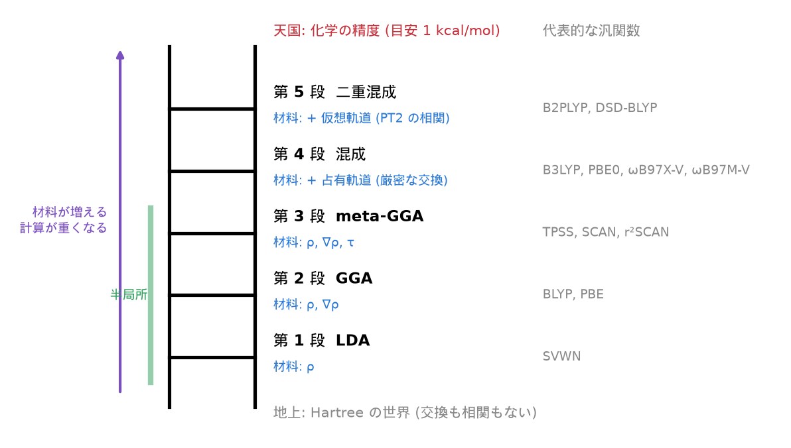
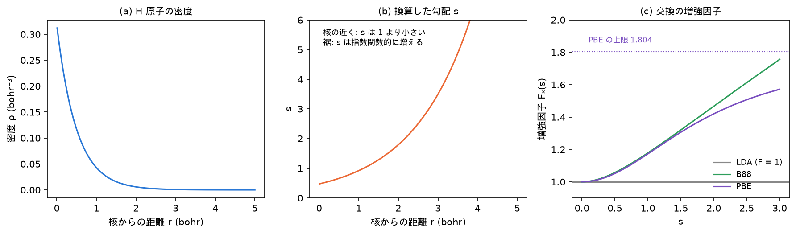
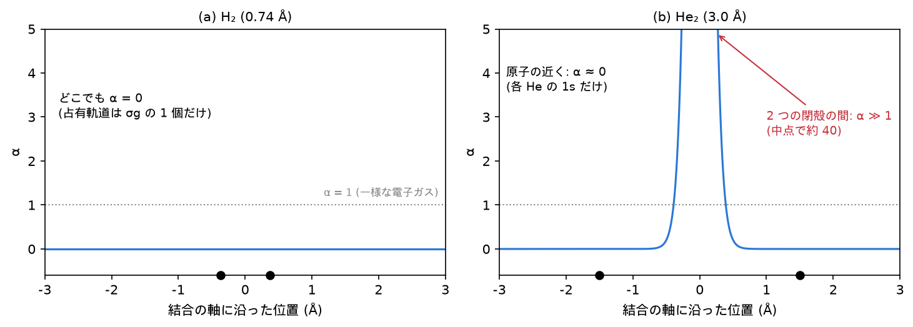
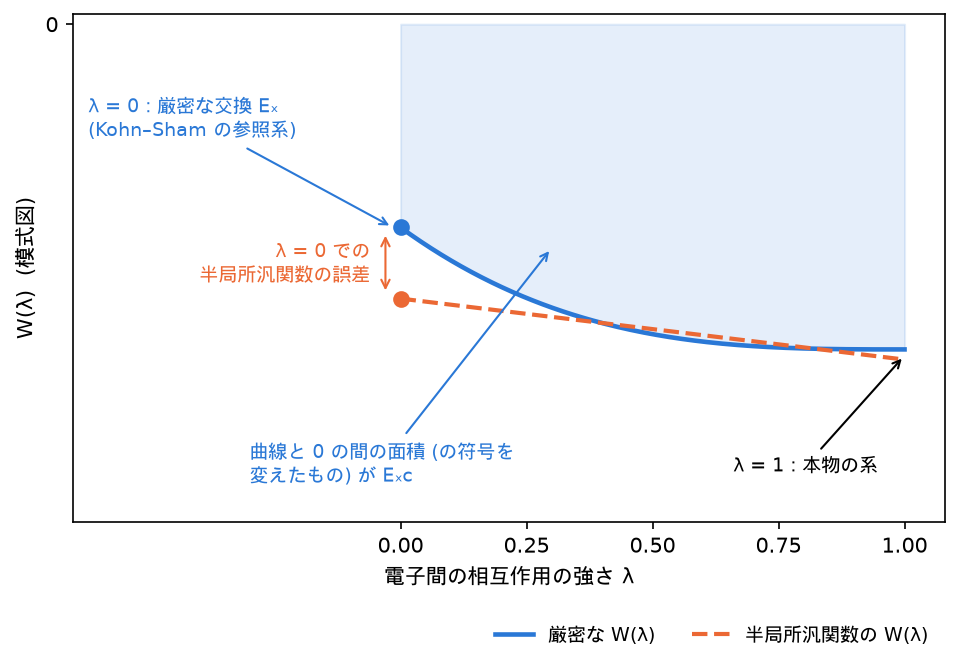
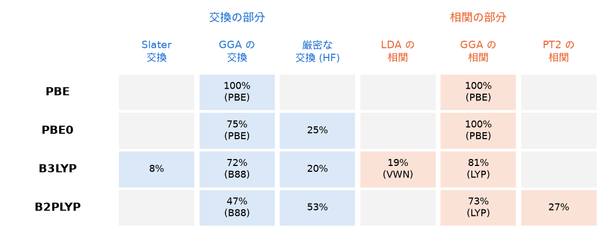
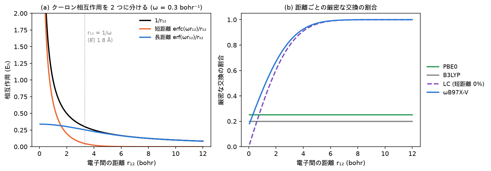
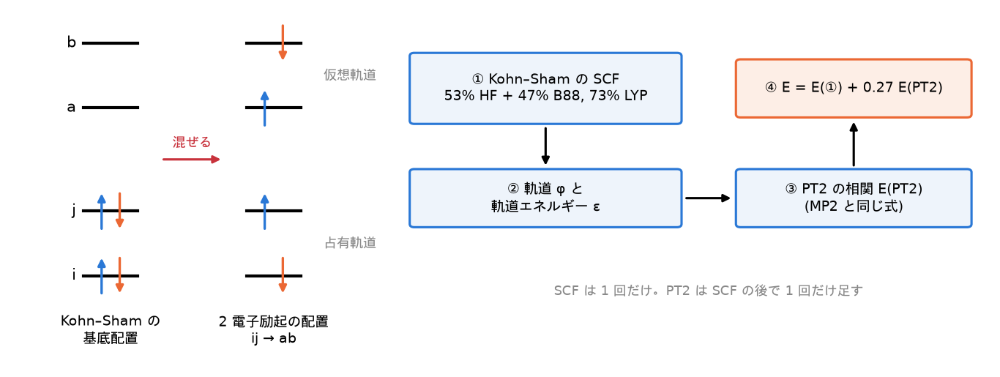

# 第 16 回　汎関数の階段：LDA、GGA、meta-GGA、混成、範囲分離

!!! abstract "この回の道筋"
    Kohn–Sham 法で近似するのは、交換相関エネルギー $E_\mathrm{xc}$ だけです（[第 15 回](15-kohn-sham.md)）。この回では、$E_\mathrm{xc}$ の近似（汎関数）を、使う材料の多さで 5 段に並べた「ヤコブの梯子」に沿って紹介します。各段の代表的な汎関数が、理論の条件だけから作られたのか、実験値などに合わせて作られたのかも区別します。最後に、H₂O の原子化エネルギーの計算と、大きなベンチマークで分かっている傾向を比べます。

    | 節 | 内容 |
    |---|---|
    | 1 | ヤコブの梯子 |
    | 2 | 第 1 段：LDA |
    | 3 | 第 2 段：GGA |
    | 4 | 第 3 段：meta-GGA |
    | 5 | 第 4 段：混成汎関数と B3LYP |
    | 6 | 範囲分離混成汎関数 |
    | 7 | 第 5 段：二重混成汎関数 |
    | 8 | 計算例：H₂O の原子化エネルギー |
    | 9 | ベンチマークで分かっている傾向 |

    **前に読んでおく回**：量子化学の理論 [第 15 回](15-kohn-sham.md)

!!! tip "物理的なイメージ"
    汎関数が近似しているのは、交換相関エネルギー、つまり電子が互いを避けることでエネルギーがどれだけ下がるかです。ヤコブの梯子は、その見積もりに使う材料の多さの順です。各点の密度だけを見る LDA、まわりの密度の傾きも見る GGA、運動エネルギー密度も見る meta-GGA は、その点の近くの情報だけで決めます。混成汎関数は、軌道を通して離れた点の情報（厳密な交換）を混ぜ、二重混成汎関数は空軌道も使います。上の段ほど材料が多く、計算は重くなります。

この回では原子単位を使います。エネルギーの換算は 1 $E_\mathrm h$ = 27.211 eV = 627.5 kcal/mol です。2 電子積分は、化学者の表記 $(pq|rs)$ で書きます。

## 1. ヤコブの梯子

[第 15 回](15-kohn-sham.md)で見たように、Kohn–Sham 法の全エネルギーのうち、近似が必要なのは交換相関エネルギー $E_\mathrm{xc}[\rho]$ だけです。
厳密な $E_\mathrm{xc}[\rho]$ の形は分かりません。
そこで、$E_\mathrm{xc}$ を、空間の各点での簡単な量の関数として近似します。

$$
E_\mathrm{xc} \approx \int e_\mathrm{xc}\big(\rho(\mathbf r), \nabla\rho(\mathbf r), \dots\big)\,d\mathbf r
$$

$e_\mathrm{xc}$ は交換相関エネルギーの密度、つまり点 $\mathbf r$ のまわりの単位体積あたりの交換相関エネルギーです。
この形の近似では、点 $\mathbf r$ の $e_\mathrm{xc}$ は、その点で計算した量（括弧の中の変数）だけで決まります。
括弧の中の変数を、ここでは「材料」と呼びます。
材料を増やすほど、近似の自由度が増え、計算は重くなります。

Perdew と Schmidt は、材料の多さで近似を段に分け、聖書の物語になぞらえて「ヤコブの梯子」と呼びました [Perdew 2001]。
梯子の上には、化学で必要な精度（目安として 1 kcal/mol）の「天国」があります。
段と材料は次のとおりです（図 1）。

| 段 | 名前 | 加わる材料 |
|---|---|---|
| 1 | LDA（局所密度近似） | 密度 $\rho$ |
| 2 | GGA（一般化勾配近似） | 密度の勾配 $\nabla\rho$ |
| 3 | meta-GGA | 運動エネルギー密度 $\tau$ |
| 4 | 混成（hybrid） | 占有軌道（厳密な交換） |
| 5 | 二重混成（double hybrid）など | 仮想軌道 |



**図 1**　ヤコブの梯子。下から順に、各段で加わる材料（青）と、代表的な汎関数（灰色）を並べました。左の緑の帯が半局所汎関数（第 1〜3 段）です。地上は交換相関を含まない Hartree の近似、天国は化学の精度です。上の段ほど材料が多く、計算は重くなります。

第 1〜3 段の材料は、どれもその点の値と、その点のごく近くでの変化（微分）だけで決まります。
そのため、これらは半局所（semilocal）汎関数と呼ばれます。
第 4 段からは、軌道を通して空間の離れた点の情報が入ります（5.1 節で具体的に見ます）。

梯子を上る方法は、大きく 2 通りあります。

- **非経験的（nonempirical）**：厳密な $E_\mathrm{xc}$ が満たすと分かっている条件（拘束条件、exact constraint）を満たすように式を決めます。
- **経験的（empirical）**：式の中にパラメータを置き、分子の実験値や精密な計算値に合うように決めます。

以下では、各汎関数がどちらで作られたかも書きます。

**ここまでで分かったこと**：汎関数は、使う材料（$\rho$、$\nabla\rho$、$\tau$、占有軌道、仮想軌道）で 5 段に分けられます。作り方には、理論の条件で決める方法と、データに合わせる方法があります。

## 2. 第 1 段：LDA

### 2.1 一様な電子ガスで置き換える

局所密度近似（LDA）は、各点の $e_\mathrm{xc}$ を、同じ密度の一様な電子ガスの値で置き換えます（[第 15 回](15-kohn-sham.md)）。
一様な電子ガスは、正の電荷が一様に広がった中を電子が動く模型です。
密度はどこでも同じ値 $\rho$ で、その値だけで系が決まります。

交換の部分は、一様な電子ガスで厳密に計算でき、[第 15 回](15-kohn-sham.md)の式になります。

$$
E_\mathrm x^\mathrm{LDA}[\rho] = -\frac34\Big(\frac3\pi\Big)^{1/3}\int\rho^{4/3}\,d\mathbf r
$$

この式は、一様な電子ガスの電子 1 個あたりの交換エネルギー

$$
\varepsilon_\mathrm x(\rho) = -\frac34\Big(\frac3\pi\Big)^{1/3}\rho^{1/3}
$$

に、その点の電子の数の密度 $\rho$ をかけて、全空間で積分したものです。
$\varepsilon_\mathrm x$ を、平面波の軌道から出発して求める計算は、すべての段階を付録 A に書きます。

$\rho^{1/3}$ の形は、次のように理解できます。
交換の効果で、同じスピンの電子は互いを避け、各電子のまわりに、ほかの電子の少ない領域（交換の穴）ができます。
密度 $\rho$ の電子ガスでは、電子 1 個が占める体積は $1/\rho$ なので、穴の大きさ（半径）は $\rho^{-1/3}$ 程度です。
交換エネルギーは、電子と、穴を作るために押しのけた電子の雲との、静電的な引力のエネルギーに当たります。
その大きさは $1/(\text{距離})$ に比例するので、$1/\rho^{-1/3} = \rho^{1/3}$ になります。
密度が高いほど電子は込み合い、穴が小さく深くなって、交換エネルギーの絶対値が大きくなるということです。

この式を交換の近似として使う考え方は Slater にさかのぼるので、Slater の交換とも呼ばれます [Slater 1951]。

### 2.2 相関の部分と、LDA の性格

相関の部分は、一様な電子ガスでも式では解けません。
Ceperley と Alder は、量子モンテカルロ法でその相関エネルギーを精密に計算しました [Ceperley 1980]。
Vosko、Wilk、Nusair（VWN）は、その結果に合う式を作りました [Vosko 1980]。
Slater の交換と VWN の相関を組み合わせた LDA を、SVWN と呼びます。

LDA は、一様な電子ガスという極限では正しい近似です。
その意味で、非経験的な汎関数です。
一方、分子の密度は一様からほど遠く、LDA は結合エネルギーを大きく見積もりすぎます。
第 8 節の計算でも、H₂O の原子化エネルギーを 30 kcal/mol 以上大きく見積もります。

**ここまでで分かったこと**：LDA は一様な電子ガスの交換と相関を使います。交換は $\rho^{4/3}$ の積分で、交換の穴の大きさ $\rho^{-1/3}$ から理解できます。相関は量子モンテカルロの結果に合わせた式（VWN など）です。分子の結合エネルギーは大きく見積もりすぎます。

## 3. 第 2 段：GGA

### 3.1 換算した勾配 s

分子の密度は、核の近くで高く、外側へ向かって指数関数的に減ります。
この密度の変化の速さを入れるため、勾配 $\nabla\rho$ を材料に加えます。
勾配は、そのまま使わずに、次の無次元の量にまとめて使います。

$$
s(\mathbf r) = \frac{|\nabla\rho|}{2(3\pi^2)^{1/3}\rho^{4/3}}
$$

分母の意味は、一様な電子ガスのフェルミ波数 $k_\mathrm F = (3\pi^2\rho)^{1/3}$ を使うと分かります（付録 A で出てきます）。
$(3\pi^2)^{1/3}\rho^{4/3} = k_\mathrm F\,\rho$ なので、

$$
s = \frac{|\nabla\rho|}{2k_\mathrm F\,\rho}
$$

です。
$1/k_\mathrm F$ は、その密度の電子ガスで電子どうしが離れている典型的な距離です。
したがって $s$ は、「電子どうしの距離ほど進んだときに、密度が自分の何倍変わるか」を表します。
一様な電子ガスでは $s = 0$ です。
$s$ が 1 より十分小さければ、その点のまわりは一様な電子ガスに近く、LDA がよい近似になると期待できます。

**例：H 原子**。H 原子の 1s の密度は $\rho = e^{-2r}/\pi$ です。

1. $r$ で微分すると、$d\rho/dr = -2e^{-2r}/\pi = -2\rho$ なので、$|\nabla\rho| = 2\rho$ です。
2. これを $s$ の式に入れると、$s = 2\rho/(2k_\mathrm F\rho) = 1/k_\mathrm F = (3\pi^2\rho)^{-1/3}$ です。

核の上（$r = 0$）では $\rho = 1/\pi$ なので $s \approx 0.47$ です。
外へ向かうと $\rho$ が指数関数的に減るので、$s$ は $e^{2r/3}$ のように指数関数的に増えます（図 2 (b)）。
分子の外側の裾は、一様な電子ガスとはまったく違う領域です。

### 3.2 増強因子

交換の GGA は、LDA の交換に、$s$ の関数 $F_\mathrm x(s)$ をかけた形に書けます。

$$
E_\mathrm x^\mathrm{GGA} = \int e_\mathrm x^\mathrm{LDA}(\rho)\,F_\mathrm x(s)\,d\mathbf r,
\qquad F_\mathrm x(0) = 1
$$

$e_\mathrm x^\mathrm{LDA}(\rho) = \rho\,\varepsilon_\mathrm x(\rho)$ は、2.1 節の LDA の交換エネルギーの密度です。
$F_\mathrm x$ を増強因子（enhancement factor）と呼びます。
$F_\mathrm x(0) = 1$ なので、一様な電子ガスでは LDA に戻ります。
$F_\mathrm x > 1$ の所では、交換エネルギーの絶対値が LDA より大きくなります。

たとえば PBE の交換の増強因子は、次の形です [Perdew 1996]。

$$
F_\mathrm x^\mathrm{PBE}(s) = 1 + \kappa - \frac{\kappa}{1 + \mu s^2/\kappa},
\qquad \kappa = 0.804,\ \mu \approx 0.21951
$$

$s$ が小さいときは $1 + \mu s^2$ のように増え、$s \to \infty$ では $1 + \kappa = 1.804$ に近づきます。
上限を設けたのは、交換エネルギーの大きさが厳密に満たす上限（Lieb–Oxford の限界）を破らないためです [Perdew 1996]。



**図 2**　(a) H 原子の 1s の密度。(b) 同じ H 原子の $s$。核の近くでは 1 より小さく、裾では指数関数的に大きくなります。(c) 交換の増強因子 $F_\mathrm x(s)$（Libxc で計算）。LDA は $F_\mathrm x = 1$ の水平線です。B88 と PBE は $s$ の小さい所ではほぼ同じで、$s$ が大きくなると差が開きます。PBE は 1.804（点線）を超えません。

GGA の違いは、主に $F_\mathrm x$ と相関の式の選び方にあります。
代表的な GGA は次のとおりです。

- **B88（交換）**：Becke の交換汎関数です [Becke 1988]。遠くでの交換エネルギー密度の正しい振る舞いを満たすように式を作り、残る 1 個のパラメータを、原子の厳密な交換エネルギーに合わせて決めました。
- **LYP（相関）**：Lee、Yang、Parr の相関汎関数です [Lee 1988]。He 原子の相関エネルギーに合わせて作られた Colle–Salvetti の式を、密度の汎関数に書き直したものです。
- **BLYP**：B88 と LYP の組み合わせです。部分的に経験的な GGA です。
- **PBE**：Perdew、Burke、Ernzerhof の GGA です [Perdew 1996]。LDA の部分を除き、すべてのパラメータが基礎的な定数で、厳密な条件から決められています。非経験的な GGA の代表です。

**ここまでで分かったこと**：GGA は、「電子どうしの距離ほど進んだときの密度の相対的な変化」$s$ を使って、LDA の交換に増強因子 $F_\mathrm x(s)$ をかけます。B88 と LYP は原子のデータを一部使い、PBE は条件だけで作られています。

## 4. 第 3 段：meta-GGA

### 4.1 運動エネルギー密度

meta-GGA は、Kohn–Sham 軌道から作る運動エネルギー密度

$$
\tau(\mathbf r) = \frac12\sum_{i}^{\mathrm{occ}}|\nabla\phi_i(\mathbf r)|^2
$$

を材料に加えます（和は占有されたスピン軌道について）。
$\tau$ を全空間で積分すると、Kohn–Sham の参照系の運動エネルギー $T_s$ になります（部分積分で $-\frac12\nabla^2$ の期待値と同じになります）。
$\tau$ は軌道を使いますが、各点の値だけで決まるので、計算の手間は GGA と大きく変わりません。

### 4.2 1 個の軌道の領域を見分ける

$\tau$ を加える利点の一つは、「その点の電子が、1 個の軌道だけで表される領域か」を見分けられることです。
閉殻で、1 個の空間軌道 $\phi$（実数）だけが占有されているとします。
1 段ずつ計算します。

1. α と β の電子が 1 個ずつ $\phi$ に入るので、密度は $\rho = 2\phi^2$ です。
2. 両辺の勾配をとると、$\nabla\rho = 4\phi\nabla\phi$ です。
3. 2 乗すると、$|\nabla\rho|^2 = 16\phi^2|\nabla\phi|^2$ です。
4. 両辺を $8\rho = 16\phi^2$ で割ると、$|\nabla\rho|^2/(8\rho) = |\nabla\phi|^2$ です。
5. 一方、$\tau$ の定義の和は α と β の 2 項なので、$\tau = \frac12\cdot 2|\nabla\phi|^2 = |\nabla\phi|^2$ です。

4 と 5 から、

$$
\tau = \frac{|\nabla\rho|^2}{8\rho} \equiv \tau_\mathrm W
$$

が得られます。
$\tau_\mathrm W$ は von Weizsäcker の運動エネルギー密度と呼ばれ、$\rho$ と $\nabla\rho$ だけで書けます。
一般に $\tau \ge \tau_\mathrm W$ が成り立ち、1 軌道の領域ではちょうど等号になります。占有軌道が 2 個以上重なっている所では、ふつう $\tau$ のほうが大きくなります。

そこで、$\tau$ と $\tau_\mathrm W$ の差を、一様な電子ガスの運動エネルギー密度 $\tau_\mathrm{unif} = \frac{3}{10}(3\pi^2)^{2/3}\rho^{5/3}$ で割った指標

$$
\alpha = \frac{\tau - \tau_\mathrm W}{\tau_\mathrm{unif}}
$$

を考えます。
SCAN は、この $\alpha$ を使って領域の種類を見分けます [Sun 2015]。

- $\alpha = 0$：1 個の軌道だけの領域（H 原子、H₂ の結合など）。
- $\alpha \approx 1$：一様な電子ガスに近い領域。
- $\alpha \gg 1$：閉殻と閉殻の間の、密度の薄い領域（弱い結合の領域）。



**図 3**　結合の軸に沿った $\alpha$（HF/aug-cc-pVTZ の軌道から計算。軸から 0.05 Å だけずらした線の上）。黒い点が原子核の位置です。(a) H₂ では、占有軌道が σg の 1 個だけなので、どこでも $\alpha = 0$ です。(b) 3.0 Å 離した He₂ では、各 He の近くは 1s だけなので $\alpha \approx 0$ ですが、2 つの閉殻の間では $\alpha$ が大きくなり、中点では約 40 になります。

1 軌道の領域では、電子は 1 個（α か β の 1 個ずつ）しかいないので、同じスピンの電子どうしの相関はありません。
このような領域を見分けられると、「1 電子の領域では、自己相互作用（[第 15 回](15-kohn-sham.md)）を打ち消す」といった条件を、汎関数に課すことができます。

代表的な meta-GGA は、どれも非経験的です。

- **TPSS**：Tao、Perdew、Staroverov、Scuseria の meta-GGA です [Tao 2003]。経験的なパラメータを使わずに、厳密な条件を満たすように作られています。
- **SCAN**：meta-GGA が満たしうる既知の 17 個の厳密な条件を、すべて満たすように作られました [Sun 2015]。さらに、希ガス原子など、「適切な基準系（appropriate norms）」で厳密かほぼ厳密になるようにしてあります。
- **r²SCAN**：SCAN は、数値的に扱いにくい（数値積分の精度を上げないと結果が安定しにくい）汎関数でした。r²SCAN は、数値的に扱いやすくした rSCAN を、厳密な条件を満たすように直したものです [Furness 2020]。

**ここまでで分かったこと**：meta-GGA は、運動エネルギー密度 $\tau$ を加えます。$\tau$ と $\tau_\mathrm W$ を比べた指標 $\alpha$ で、1 個の軌道の領域、一様に近い領域、閉殻の間の領域を見分けられます。TPSS、SCAN、r²SCAN は非経験的に作られています。

## 5. 第 4 段：混成汎関数と B3LYP

### 5.1 厳密な交換を混ぜる理由

第 4 段では、Kohn–Sham 軌道で計算した Hartree–Fock の交換エネルギー $E_\mathrm x^\mathrm{HF}$ を混ぜます。
$E_\mathrm x^\mathrm{HF}$ を、ここでは厳密な交換と呼びます（[第 15 回](15-kohn-sham.md)で定義した交換エネルギー $E_\mathrm x$ そのものです）。

混ぜる理由は、電子どうしの相互作用の強さを $\lambda$ 倍した系を考えると分かります。
$\lambda$ を 0 から 1 まで変えるとき、外部ポテンシャルを調節して、密度は本物の $\rho$ のまま保つとします。

- $\lambda = 0$ は、電子が相互作用しない Kohn–Sham の参照系です。
- $\lambda = 1$ は、本物の系です。

各 $\lambda$ で、電子間の反発エネルギーの期待値から古典的な静電エネルギー $J[\rho]$ を引いたものを $W(\lambda)$ と書きます。
付録 B で導くように、$E_\mathrm{xc}$ は $W(\lambda)$ を $\lambda$ について積分したものになります（断熱接続、adiabatic connection）。

$$
E_\mathrm{xc} = \int_0^1 W(\lambda)\,d\lambda
$$

両端の値は次のとおりです。

- $\lambda = 0$ では、波動関数は Kohn–Sham の決定子 1 個です。決定子の電子間反発の期待値は $J + E_\mathrm x$（Hartree–Fock のエネルギーの式と同じ形）なので、$W(0) = E_\mathrm x$、つまり厳密な交換です。
- $\lambda = 1$ では、相関も含めた本物の値です。



**図 4**　断熱接続の模式図。横軸が相互作用の強さ $\lambda$、縦軸が $W(\lambda)$ です。$E_\mathrm{xc}$ は、青の曲線と 0 の間の面積（に負の符号をつけたもの）です。左端の $\lambda = 0$ の値は厳密な交換で、正確に計算できます。半局所汎関数（橙の破線）は、この左端で誤差が大きくなりがちです。

半局所汎関数は、$\lambda = 1$ に近い側では比較的よい値を与える一方、決定子 1 個で表される $\lambda = 0$ の端では、誤差が大きくなりがちです [Perdew 1996b]。
左端の値 $W(0)$ は厳密な交換で正確に計算できるので、その端を厳密な交換で置き換えると改善が見込めます。

Perdew、Ernzerhof、Burke は、この考え方から、混ぜる割合をおよそ $1/4$ とする根拠を示しました [Perdew 1996b]。
彼らは、厳密な $W(\lambda)$ と半局所汎関数の $W^\mathrm{DFA}(\lambda)$ の差が、$\lambda = 0$ の差から始まって、$\lambda$ とともに次のように消えていく模型を考えました。

$$
W(\lambda) = W^\mathrm{DFA}(\lambda) + \big(E_\mathrm x^\mathrm{HF} - E_\mathrm x^\mathrm{DFA}\big)(1 - \lambda)^{n-1}
$$

$\lambda = 0$ で右辺第 2 項は $E_\mathrm x^\mathrm{HF} - E_\mathrm x^\mathrm{DFA}$ になり、左端の誤差をちょうど打ち消します。
この式を $\lambda$ について 0 から 1 まで積分します。

1. 左辺の積分は $E_\mathrm{xc}$、右辺第 1 項の積分は $E_\mathrm{xc}^\mathrm{DFA}$ です。
2. 第 2 項は $\int_0^1(1-\lambda)^{n-1}d\lambda = \big[-(1-\lambda)^n/n\big]_0^1 = 1/n$ を使って、$\frac1n(E_\mathrm x^\mathrm{HF} - E_\mathrm x^\mathrm{DFA})$ になります。

$n$ は、差がどれだけ速く消えるかを決める整数です。
彼らは、摂動論の考察から、分子では $n = 4$ がよいと論じました [Perdew 1996b]。
$n = 4$ を入れると、次の形になります。

$$
E_\mathrm{xc}^\mathrm{hyb} = E_\mathrm{xc}^\mathrm{GGA} + \frac14\big(E_\mathrm x^\mathrm{HF} - E_\mathrm x^\mathrm{GGA}\big)
$$

GGA に PBE を使ったものが **PBE0** です [Adamo 1999]。
混ぜる割合も理論から決めたので、PBE0 は経験的なパラメータを持たない混成汎関数です。

### 5.2 厳密な交換は非局所的

混成汎関数の計算では、$E_\mathrm x^\mathrm{HF}$ の微分から、Hartree–Fock と同じ交換演算子 $\hat K$ が出ます。
Kohn–Sham 方程式の $v_\mathrm{xc}$ の一部が、$\hat K$ に置き換わります。
2 つの演算子が軌道 $\phi$ に働く形を比べると、違いがはっきりします。

$$
\big(v_\mathrm x\phi\big)(\mathbf r) = v_\mathrm x(\mathbf r)\,\phi(\mathbf r),
\qquad
\big(\hat K\phi\big)(\mathbf r) = \sum_j^\mathrm{occ}\phi_j(\mathbf r)\int\frac{\phi_j(\mathbf r')\,\phi(\mathbf r')}{|\mathbf r - \mathbf r'|}\,d\mathbf r'
$$

半局所汎関数の $v_\mathrm x$ は、点 $\mathbf r$ での値をかけるだけです（局所的）。
$\hat K$ は、離れた点 $\mathbf r'$ での $\phi$ の値を積分で集めてきます（非局所的）。

行列で見てみます。
最小基底の H₂ で、2 つの H の 1s 関数 $\chi_A$、$\chi_B$ を基底にとります。
占有軌道は $\sigma_g = (\chi_A + \chi_B)/\sqrt{2(1+S)}$（$S$ は重なり積分）で、電子が 2 個入ります。
密度行列 $P_{\mu\nu} = 2c_\mu c_\nu$ は、すべての要素が $p = 1/(1+S)$ です。
閉殻の混成汎関数の Kohn–Sham 行列は、厳密な交換の割合を $a_0$ として

$$
F_{\mu\nu} = h_{\mu\nu} + J_{\mu\nu} - \frac{a_0}{2}K_{\mu\nu} + (1 - a_0)\,(v_\mathrm x)_{\mu\nu} + (v_\mathrm c)_{\mu\nu}
$$

です。
$h$ は 1 電子の部分、$J_{\mu\nu} = \sum_{\lambda\sigma}P_{\lambda\sigma}(\mu\nu|\lambda\sigma)$ はクーロンの部分、$K_{\mu\nu} = \sum_{\lambda\sigma}P_{\lambda\sigma}(\mu\lambda|\nu\sigma)$ は交換の部分、$(v_\mathrm x)_{\mu\nu} = \int\chi_\mu v_\mathrm x\chi_\nu\,d\mathbf r$ は半局所の交換ポテンシャルの行列要素です。
交換の部分の 2 行 2 列の行列を、和を書き出して求めます。

$$
\mathbf K = p
\begin{pmatrix}
k_{AA} & k_{AB} \\
k_{AB} & k_{BB}
\end{pmatrix}
$$

$$
\begin{aligned}
k_{AA} &= (AA|AA) + 2(AA|AB) + (AB|AB), \\
k_{AB} &= (AA|AB) + (AA|BB) + (AB|AB) + (AB|BB), \\
k_{BB} &= (BB|BB) + 2(BB|AB) + (AB|AB)
\end{aligned}
$$

たとえば $k_{AB}$ は、$\lambda\sigma$ を $AA$、$AB$、$BA$、$BB$ と動かした 4 項 $(AA|BA) + (AA|BB) + (AB|BA) + (AB|BB)$ で、実数の関数なので $(AA|BA) = (AA|AB)$ などと書き直しました。

非対角の要素 $K_{AB}$ には、$(AA|BB)$ が入っています。
これは、A のまわりの電荷 $\chi_A^2$ と、B のまわりの電荷 $\chi_B^2$ の間の反発で、2 つの関数が重ならないほど離れても、$1/R$ のようにゆっくりとしか減りません。
一方、$(v_\mathrm x)_{AB} = \int\chi_A v_\mathrm x\chi_B\,d\mathbf r$ は、$\chi_A$ と $\chi_B$ が重なる所でしか値を持ちません。
厳密な交換は、行列の上でも、離れた場所どうしをつなぐことが分かります。

### 5.3 B3PW91 と B3LYP

Becke は 1993 年に、3 個のパラメータを持つ混成汎関数を提案しました [Becke 1993]。

$$
E_\mathrm{xc} = E_\mathrm{xc}^\mathrm{LDA} + a_0\big(E_\mathrm x^\mathrm{HF} - E_\mathrm x^\mathrm{LDA}\big) + a_\mathrm x\,\Delta E_\mathrm x^\mathrm{B88} + a_\mathrm c\,\Delta E_\mathrm c^\mathrm{PW91}
$$

$\Delta E^\mathrm{B88}_\mathrm x = E^\mathrm{B88}_\mathrm x - E^\mathrm{LDA}_\mathrm x$ と $\Delta E^\mathrm{PW91}_\mathrm c = E^\mathrm{PW91}_\mathrm c - E^\mathrm{LDA}_\mathrm c$ は、GGA の交換と相関の、LDA への補正の部分です。
3 個のパラメータは、56 個の原子化エネルギーなどの実験値に合わせて決められ、$a_0 = 0.20$、$a_\mathrm x = 0.72$、$a_\mathrm c = 0.81$ になりました。
この汎関数は B3PW91 と呼ばれます。

この式が、各成分を何割ずつ含むかを確かめます。
まず交換の部分です。$E_\mathrm{xc}^\mathrm{LDA}$ の中の交換 $E_\mathrm x^\mathrm{LDA}$ と、第 2 項、第 3 項を集めます。

$$
\begin{aligned}
&E_\mathrm x^\mathrm{LDA} + a_0\big(E_\mathrm x^\mathrm{HF} - E_\mathrm x^\mathrm{LDA}\big) + a_\mathrm x\big(E_\mathrm x^\mathrm{B88} - E_\mathrm x^\mathrm{LDA}\big) \\
&\quad= (1 - a_0 - a_\mathrm x)\,E_\mathrm x^\mathrm{LDA} + a_0E_\mathrm x^\mathrm{HF} + a_\mathrm xE_\mathrm x^\mathrm{B88}
\end{aligned}
$$

数値を入れると、$1 - 0.20 - 0.72 = 0.08$ なので、交換は LDA（Slater）8%、厳密な交換 20%、B88 72% です。
次に相関の部分です。$E_\mathrm{xc}^\mathrm{LDA}$ の中の相関 $E_\mathrm c^\mathrm{LDA}$ と第 4 項を集めます。

$$
E_\mathrm c^\mathrm{LDA} + a_\mathrm c\big(E_\mathrm c^\mathrm{GGA} - E_\mathrm c^\mathrm{LDA}\big) = (1 - a_\mathrm c)\,E_\mathrm c^\mathrm{LDA} + a_\mathrm cE_\mathrm c^\mathrm{GGA}
$$

数値を入れると、相関は LDA 19%、GGA 81% です。

B3LYP は、この式の相関の GGA の部分を LYP に置き換えたものです [Stephens 1994]。
パラメータは決め直さずに、そのまま使われました [Casida 2026]。
LYP は、LDA の部分と勾配の補正の部分に分かれていません。
そこで B3LYP は、上の「集めた形」に LYP をそのまま入れ、相関の LDA の部分 19% を VWN で補った、次の形になっています。

$$
E_\mathrm{xc}^\mathrm{B3LYP} = 0.08\,E_\mathrm x^\mathrm{Slater} + 0.20\,E_\mathrm x^\mathrm{HF} + 0.72\,E_\mathrm x^\mathrm{B88} + 0.19\,E_\mathrm c^\mathrm{VWN} + 0.81\,E_\mathrm c^\mathrm{LYP}
$$



**図 5**　代表的な汎関数の中身。各行が 1 つの汎関数で、左の 3 列が交換、右の 3 列が相関の部分です。灰色の欄は含まない成分です。PBE0 は PBE の交換の 1/4 を厳密な交換に置き換えたもの、B3LYP は上の式、B2PLYP は第 7 節で扱う二重混成汎関数です。

### 5.4 B3LYP の中の VWN の版

ここに、よく知られた混乱があります。
VWN の論文には、相関エネルギーの式が何通りか載っています [Vosko 1980]。
主に使われるのは、乱雑位相近似（RPA）の計算結果に合わせた式と、Ceperley–Alder の量子モンテカルロの結果に合わせた式（VWN5 と呼ばれます）です。
LDA として正しいのは後者です。
ところが Gaussian の B3LYP の VWN は前者で、Stephens らの論文はどちらを使ったかを明記していませんでした [Casida 2026]。
このため、プログラムによって B3LYP の中身が違うことになりました [Hertwig 1997]。

PySCF [Sun 2020] では、`B3LYP` は Gaussian と同じ RPA の版で、VWN5 を使う版は `B3LYP5` という名前です。
H₂O（構造は[第 15 回](15-kohn-sham.md)と同じ、aug-cc-pVTZ）で確かめます。
`geom` は[第 15 回](15-kohn-sham.md)のコードと同じです。
2 行目と 4 行目は、上の B3LYP の式の割合を、成分ごとに書いて指定したものです。

```python
from pyscf import gto, dft
mol = gto.M(atom=geom, basis="aug-cc-pvtz", verbose=0)
for xc in ["B3LYP",                                     # PySCF の既定
           ".2*HF + .08*SLATER + .72*B88, .81*LYP + .19*VWN_RPA",
           "B3LYP5",
           ".2*HF + .08*SLATER + .72*B88, .81*LYP + .19*VWN5"]:
    e = dft.RKS(mol, xc=xc).run().e_tot
    print(f"{e:.6f}  {xc}")
```

```text
-76.466157  B3LYP
-76.466157  .2*HF + .08*SLATER + .72*B88, .81*LYP + .19*VWN_RPA
-76.429101  B3LYP5
-76.429101  .2*HF + .08*SLATER + .72*B88, .81*LYP + .19*VWN5
```

成分ごとに書いた指定は、名前で指定したものと全エネルギーが一致しています。
2 つの版の全エネルギーは 0.037 $E_\mathrm h$（約 23 kcal/mol）も違います。
エネルギーの差（反応エネルギーなど）では、この違いの大部分が打ち消し合います。
第 8 節の原子化エネルギーでは、差は 0.6 kcal/mol でした。
それでも、別のプログラムの結果と比べるときは、どちらの版かを必ず確かめてください。

**ここまでで分かったこと**：混成汎関数は、断熱接続の左端（$\lambda = 0$）が厳密な交換であることを使い、厳密な交換を混ぜます。PBE0 は割合 1/4 を理論から決め、B3LYP は 3 個のパラメータを実験値に合わせた B3PW91 から作られました。厳密な交換は非局所的で、離れた場所どうしをつなぎます。B3LYP の VWN には 2 つの版があり、プログラムによって違います。

## 6. 範囲分離混成汎関数

### 6.1 クーロン相互作用を距離で分ける

混成汎関数では、厳密な交換の割合は、電子間の距離によらず一定でした。
範囲分離（range separation）では、電子間のクーロン相互作用を、距離 $r_{12}$ で 2 つに分けます。

$$
\frac{1}{r_{12}} = \underbrace{\frac{\operatorname{erfc}(\omega r_{12})}{r_{12}}}_{\text{短距離}} + \underbrace{\frac{\operatorname{erf}(\omega r_{12})}{r_{12}}}_{\text{長距離}}
$$

$\operatorname{erf}$ は誤差関数、$\operatorname{erfc} = 1 - \operatorname{erf}$ です。
2 つの項を足すと $(\operatorname{erfc} + \operatorname{erf})/r_{12} = 1/r_{12}$ なので、この分け方は厳密です。
$\operatorname{erf}(x)$ は、$x = 0$ で 0、$x$ が大きいと 1 に近づく、なめらかな切り替えの関数です（$\operatorname{erf}(1) \approx 0.84$、$\operatorname{erf}(2) \approx 0.995$）。
したがって、$r_{12}$ が $1/\omega$ より十分短い所では短距離の項が、十分長い所では長距離の項が主になります。
$\omega$（単位は bohr$^{-1}$）は、境目の距離の逆数の目安です。
たとえば $\omega = 0.3$ bohr$^{-1}$ なら、境目は $1/\omega \approx 3.3$ bohr $\approx 1.8$ Å です（図 6 (a)）。

そのうえで、交換の短距離の部分と長距離の部分で、厳密な交換の割合を変えます。
短距離の割合を $c_\mathrm x$、長距離を 100% とすると、交換エネルギーは

$$
E_\mathrm x = c_\mathrm x\,E_\mathrm x^\mathrm{HF,SR} + (1 - c_\mathrm x)\,E_\mathrm x^\mathrm{DFA,SR} + E_\mathrm x^\mathrm{HF,LR}
$$

です。
SR は短距離、LR は長距離の相互作用で計算した部分、DFA は半局所汎関数の交換です。
距離 $r_{12}$ ごとの厳密な交換の割合は $c_\mathrm x + (1 - c_\mathrm x)\operatorname{erf}(\omega r_{12})$ で、近い距離の $c_\mathrm x$ から、遠い距離の 1 へ変わります（図 6 (b)）。



**図 6**　(a) $1/r_{12}$（黒）を、短距離の部分（橙）と長距離の部分（青）に分けたもの（$\omega = 0.3$ bohr$^{-1}$）。点線の $r_{12} = 1/\omega$ より近くでは短距離の部分が、遠くでは長距離の部分が主になります。(b) 電子間の距離ごとの厳密な交換の割合。PBE0 と B3LYP は距離によらず一定です。長距離補正（LC）汎関数は近くで 0、遠くで 1、ωB97X-V は近くで 0.167、遠くで 1 です（Libxc の値）。

### 6.2 長距離で厳密な交換が必要な理由

電子を分子から遠く引き離したときに、その電子が感じる交換相関ポテンシャルは、厳密には $-1/r$ のようにゆっくり減ります。
電子が抜けた後の穴（正の電荷 1 個分）を、遠くからは点電荷として見るからです。
ところが、半局所汎関数のポテンシャルは、密度とその微分から作るので、密度と同じように指数関数的に速く 0 になります。
長距離の交換を 100% 厳密な交換にすると、この $-1/r$ の振る舞いが戻ります。
この欠点は、離れた分子の間の電荷移動励起（[第 19 回](19-tddft.md) 6.1 節）など、電子が遠くまで動く現象で問題になります。

長距離の部分を 100% 厳密な交換にするものを、長距離補正（long-range corrected、LC）汎関数と呼びます。
Iikura、Tsuneda、Yanai、Hirao は、GGA の交換にこの補正を加える方法を示しました [Iikura 2001]。
半局所汎関数の交換には長距離の相互作用が欠けており、それが共役ポリエンの分極率の過大評価などの原因になることが、この論文で確かめられています。

代表的な範囲分離混成汎関数は、どれも経験的に作られています。

- **ωB97X**：Chai と Head-Gordon の汎関数です [Chai 2008]。B97 型の柔軟な式のパラメータを、熱化学などのデータに合わせました。短距離にも厳密な交換を少し混ぜます（短距離に厳密な交換を混ぜない版は ωB97 と呼ばれます）。対称なラジカル陽イオンの解離や、離れた分子間の電荷移動励起での、従来の混成汎関数の失敗を大きく減らします。
- **ωB97X-V**：パラメータは 10 個で、非局所相関（VV10、[第 17 回](17-dispersion.md)で扱います）を含みます [Mardirossian 2014]。式の項の組み合わせ 16,383 通りを訓練データに合わせ、試験データで最もよいものを選びました。Libxc に収められた値では、$\omega = 0.3$ bohr$^{-1}$、短距離の厳密な交換は 16.7% です。
- **ωB97M-V**：meta-GGA を土台にした範囲分離混成汎関数で、VV10 を含みます [Mardirossian 2016]。約 $10\times10^9$ 通りの候補から、870 個の訓練データで 12 個のパラメータの式を選びました。

**ここまでで分かったこと**：範囲分離混成汎関数は、クーロン相互作用を誤差関数で距離ごとに分け、短距離と長距離で厳密な交換の割合を変えます。長距離を厳密な交換にすると、遠くの電子が感じる $-1/r$ のポテンシャルが戻ります。ωB97 系は、多数のデータに合わせた経験的な汎関数です。

## 7. 第 5 段：二重混成汎関数

### 7.1 B2PLYP の形

第 5 段では、仮想軌道も使います。
代表は、二重混成（double hybrid）汎関数です。
Grimme の B2PLYP は、混成汎関数の相関の一部を、MP2（[第 9 回](09-mp2.md)）と同じ形の 2 次摂動の相関に置き換えます [Grimme 2006]。

$$
E_\mathrm{xc}^\mathrm{B2PLYP} = (1 - a_\mathrm x)E_\mathrm x^\mathrm{B88} + a_\mathrm x E_\mathrm x^\mathrm{HF} + (1 - c)E_\mathrm c^\mathrm{LYP} + c\,E_\mathrm c^\mathrm{PT2}
$$

$E_\mathrm c^\mathrm{PT2}$ は、Kohn–Sham の軌道と軌道エネルギーで計算した MP2 の相関エネルギーです。
閉殻なら、第 9 回の式と同じく

$$
E_\mathrm c^\mathrm{PT2} = \sum_{ij}^{\text{占有}}\sum_{ab}^{\text{仮想}}\frac{(ia|jb)\big[2(ia|jb) - (ib|ja)\big]}{\varepsilon_i + \varepsilon_j - \varepsilon_a - \varepsilon_b}
$$

です。
各項は、占有軌道 $i$、$j$ の電子 2 個を、仮想軌道 $a$、$b$ に同時に移した 2 電子励起の配置（図 7 の左）を、基底配置に少し混ぜたことによるエネルギーの低下です。
分母は、軌道エネルギーで見積もった励起のエネルギー（の符号を変えたもの）です。

**例：最小基底の H₂**。占有軌道が $\sigma_g$ の 1 個、仮想軌道が $\sigma_u$ の 1 個なので、和は $i = j = g$、$a = b = u$ の 1 項だけです。

1. 分子は $(gu|gu)\big[2(gu|gu) - (gu|gu)\big] = (gu|gu)^2$ です。
2. 分母は $2\varepsilon_g - 2\varepsilon_u = -2(\varepsilon_u - \varepsilon_g)$ です。
3. したがって $E_\mathrm c^\mathrm{PT2} = -(gu|gu)^2/\big[2(\varepsilon_u - \varepsilon_g)\big]$ です。

$\sigma_g^2$ に $\sigma_u^2$ を混ぜることによる相関で、HOMO と LUMO の差 $\varepsilon_u - \varepsilon_g$ が小さいほど大きくなります。
この差が 0 に近づく結合の解離では、PT2 の項は発散に向かいます（第 9 回）。

2 個のパラメータは生成熱のデータ（G2/97）に合わせて決められ、$a_\mathrm x = 0.53$、$c = 0.27$ になりました。
厳密な交換の割合が 53% と大きいことが特徴です。

### 7.2 計算の流れ

計算は 2 段階です（図 7 の右）。
まず、$E_\mathrm c^\mathrm{PT2}$ を除いた部分（厳密な交換 53%、B88 47%、LYP 73%）で Kohn–Sham 方程式を解きます。
次に、得られた軌道と軌道エネルギーで $E_\mathrm c^\mathrm{PT2}$ を計算し、27% を足します。
PT2 の項は SCF の中では使わないので、軌道には影響しません。
計算の手間は MP2 と同じ程度に増えます。



**図 7**　左：PT2 の相関で混ぜる配置。Kohn–Sham の基底配置から、占有軌道 $i$、$j$ の電子を、仮想軌道 $a$、$b$ へ同時に移した 2 電子励起の配置です（青の上向きが α、橙の下向きが β の電子）。右：B2PLYP の計算の流れ。①の SCF で軌道を決め、③で PT2 の相関を 1 回だけ計算して、④で足します。

**ここまでで分かったこと**：二重混成汎関数は、仮想軌道への 2 電子励起から計算する 2 次摂動の相関を混ぜます。B2PLYP は、厳密な交換 53% と PT2 の相関 27% を、データに合わせて決めています。PT2 の項は、SCF の後で 1 回だけ計算して足します。

## 8. 計算例：H₂O の原子化エネルギー

梯子の各段の汎関数で、H₂O の原子化エネルギー

$$
D_\mathrm e = E(\mathrm O) + 2E(\mathrm H) - E(\mathrm{H_2O})
$$

を計算します。
分子をばらばらの原子にするのに必要なエネルギーで、正の値が大きいほど結合が強いことを表します。
O 原子は三重項、H 原子は二重項として、非制限の方法（UKS）で解きます。

基準には、CCSD(T)（[第 10 回](10-coupled-cluster.md)で扱う高精度の方法）の値を使います。
CCSD(T) は基底関数への依存が大きいので、aug-cc-pVTZ（$X = 3$）と aug-cc-pVQZ（$X = 4$）の相関エネルギー $E_3$、$E_4$ から、基底関数が無限に大きい極限 $E_\infty$ へ外挿しました（O の 1s は相関させない）。
外挿には、相関エネルギーが $E_X = E_\infty + A X^{-3}$ のように収束するという $X^{-3}$ 則を使います [Helgaker 1997]。
未知数 $E_\infty$ と $A$ を、2 本の式から求めます。

1. $X = 3$ と $X = 4$ を入れると、$E_3 = E_\infty + A/27$、$E_4 = E_\infty + A/64$ です。
2. 1 本目に 27、2 本目に 64 をかけると、$27E_3 = 27E_\infty + A$、$64E_4 = 64E_\infty + A$ です。
3. 2 本目から 1 本目を引くと $A$ が消え、$64E_4 - 27E_3 = 37E_\infty$ です。
4. したがって $E_\infty = (64E_4 - 27E_3)/37$ です。

得られた基準値は $D_\mathrm e$ = 233.1 kcal/mol です。
DFT は基底関数への依存が小さいので、aug-cc-pVQZ だけで計算します。

```python
import numpy as np
from pyscf import gto, dft, mp

basis = "aug-cc-pvqz"
h2o = gto.M(atom=geom, basis=basis, verbose=0)     # geom は[第 15 回](15-kohn-sham.md)と同じ
o   = gto.M(atom="O 0 0 0", basis=basis, spin=2, verbose=0)
h   = gto.M(atom="H 0 0 0", basis=basis, spin=1, verbose=0)
kcal = 627.5095

def energy(mol, xc):
    """xc の汎関数で全エネルギーを返す。B2PLYP は PT2 の項を足す。"""
    mf = dft.RKS(mol) if mol.spin == 0 else dft.UKS(mol)
    mf.grids.level = 4
    if xc == "B2PLYP":
        mf.xc = "0.53*HF + 0.47*B88, 0.73*LYP"
        mf.run()
        pt = mp.MP2(mf).run() if mol.spin == 0 else mp.UMP2(mf).run()
        return mf.e_tot + 0.27 * pt.e_corr
    mf.xc = xc
    if xc.upper().endswith("-V"):
        mf.nlcgrids.level = 1      # VV10 の積分の格子
    return mf.run().e_tot

def atomization(xc):
    return (energy(o, xc) + 2*energy(h, xc) - energy(h2o, xc)) * kcal

ref = 233.1   # CCSD(T)/CBS（本文を参照）
for xc in ["HF", "SVWN", "BLYP", "PBE", "TPSS", "SCAN", "R2SCAN",
           "B3LYP", "PBE0", "WB97X-V", "WB97M-V", "B2PLYP"]:
    d = atomization(xc)
    print(f"{xc:8s} {d:7.1f} {d-ref:+6.1f}")
```

`energy` の B2PLYP の部分は、7.2 節の流れ（SCF の後で PT2 の 27% を足す）をそのまま書いたものです。

```text
HF         155.9  -77.2
SVWN       266.5  +33.4
BLYP       232.9   -0.2
PBE        234.4   +1.3
TPSS       228.6   -4.5
SCAN       228.9   -4.2
R2SCAN     230.0   -3.1
B3LYP      231.2   -1.9
PBE0       227.2   -5.9
WB97X-V    230.3   -2.8
WB97M-V    232.1   -1.0
B2PLYP     231.5   -1.6
```

右の列が基準からの誤差（kcal/mol）です。
CCSD(T) の基準値は、この例のための参考値です。相関させていない O の 1s などの寄与が、まだ 1 kcal/mol ほどの不確かさとして残ります。

表から、次のことが読み取れます。

1. HF は、相関がないので結合を大きく弱く見積もります（第 7 回）。
2. LDA（SVWN）は、逆に 33 kcal/mol も強く見積もります。
3. GGA より上の段では、誤差はどれも 6 kcal/mol 以内に収まります。

ただし、段を上るほど誤差が小さくなる、という単純な順序にはなっていません。
この分子 1 個では、BLYP の誤差がいちばん小さくなりました。
分子 1 個、性質 1 種類の比較では、誤差の打ち消し合いの偶然が結果を左右します。
汎関数の良し悪しは、次の節のような大きなベンチマークで判断します。

**ここまでで分かったこと**：H₂O の原子化エネルギーでは、LDA は大きく強く結合を見積もり、GGA より上の段ではどれも数 kcal/mol の誤差です。1 個の分子だけでは、汎関数の順位は決められません。

## 9. ベンチマークで分かっている傾向

GMTKN55 は、主要族元素の熱化学、反応速度（障壁）、非共有結合相互作用を集めたベンチマークです [Goerigk 2017]。
55 個のデータセットに、1505 個の相対エネルギーが含まれます。
Goerigk らは、分散補正（[第 17 回](17-dispersion.md)）の有無を含む 217 通りの汎関数を評価し、83 個を詳しく調べました。
その論文の要旨は、次の傾向を述べています。

1. 熱化学や非共有結合相互作用を扱うときは、Minnesota 系の汎関数も含め、分散補正が必要です。
2. 最も信頼できるのは二重混成汎関数で、使えるなら使うべきです。特に DSD-BLYP-D3(BJ)、DSD-PBEP86-D3(BJ)、B2GPPLYP-D3(BJ) が挙げられています。
3. 混成汎関数では、ωB97X-V、M052X-D3(0)、ωB97X-D3 が最もよく、範囲分離しない混成汎関数では PW6B95-D3(BJ) が推奨されています。
4. meta-GGA では SCAN-D3(BJ) が推奨されます。それ以外の meta-GGA は、GGA の revPBE-D3(BJ)、B97-D3(BJ)、OLYP-D3(BJ) に負けています。
5. B3LYP のように広く使われている汎関数の多くは、推奨に入っていません。

つまり、平均としては梯子を上るほどよくなります。
ただし、同じ段の中でも汎関数によって差が大きく、段だけでは決まりません。
また、どの段でも分散補正を加えることが前提です。
「よく使われているから」という理由で汎関数を選ばず、扱う問題に近いベンチマークの結果を見て選ぶことが大切です。

**ここまでで分かったこと**：GMTKN55 では、平均として二重混成、混成、半局所の順によい結果が得られます。分散補正はほぼ必須で、B3LYP は推奨に入っていません。

## まとめ

- 汎関数は、使う材料で 5 段に分けられます（ヤコブの梯子）：LDA（$\rho$）、GGA（$\nabla\rho$）、meta-GGA（$\tau$）、混成（占有軌道）、二重混成（仮想軌道）。
- 非経験的な汎関数（PBE、TPSS、SCAN、r²SCAN、PBE0）は厳密な条件から、経験的な汎関数（B3LYP、ωB97X-V、ωB97M-V、B2PLYP）はデータに合わせて作られています。
- 混成汎関数は、断熱接続の $\lambda = 0$ の端が厳密な交換であることを根拠に、非局所的な厳密な交換を混ぜます。B3LYP の VWN には RPA の版と VWN5 の版があり、プログラムによって違うので、全エネルギーを比べるときは注意が必要です。
- 範囲分離混成汎関数は、長距離の交換を厳密な交換にして、半局所汎関数の長距離の欠点（遠くのポテンシャルが $-1/r$ にならない）を補います。
- GMTKN55 では、二重混成と一部の範囲分離混成が最もよく、分散補正はほぼ必須です。

## 付録 A　一様な電子ガスの交換エネルギー

2.1 節の $\varepsilon_\mathrm x = -\frac34(3/\pi)^{1/3}\rho^{1/3}$ を導きます。
体積 $V$ の箱の中の一様な電子ガスで、スピンは偏っていない（α と β が同数）とします。

**手順 1：軌道と密度**。一様な系の軌道は平面波 $\phi_\mathbf k(\mathbf r) = e^{i\mathbf k\cdot\mathbf r}/\sqrt V$ です。
基底状態では、波数の大きさが $k_\mathrm F$（フェルミ波数）より小さい軌道に、α と β の電子が 1 個ずつ入ります。
箱が大きいとき、波数の空間の体積 $d\mathbf k$ の中にある軌道の数は $V\,d\mathbf k/(2\pi)^3$ です。
半径 $k_\mathrm F$ の球の中の軌道の数は $V\cdot\frac{4\pi}{3}k_\mathrm F^3/(2\pi)^3$ で、各軌道に電子が 2 個入るので、密度は

$$
\rho = \frac{2}{V}\cdot\frac{V}{(2\pi)^3}\cdot\frac{4\pi}{3}k_\mathrm F^3 = \frac{k_\mathrm F^3}{3\pi^2},
\qquad k_\mathrm F = (3\pi^2\rho)^{1/3}
$$

です。

**手順 2：交換エネルギーを密度行列で書く**。1 つのスピンの 1 電子密度行列を

$$
\gamma(\mathbf r_1, \mathbf r_2) = \sum_{|\mathbf k| < k_\mathrm F}\phi_\mathbf k(\mathbf r_1)\,\phi_\mathbf k^*(\mathbf r_2)
$$

とします。
決定子 1 個の交換エネルギーは、同じスピンの軌道の対についての交換積分の和に $-\frac12$ をかけたものです。
軌道の和を $\gamma$ にまとめると、スピンごとに $-\frac12\iint|\gamma|^2/r_{12}$ となり、α と β の 2 つ分で

$$
E_\mathrm x = -\iint\frac{|\gamma(\mathbf r_1, \mathbf r_2)|^2}{r_{12}}\,d\mathbf r_1d\mathbf r_2
$$

です。

**手順 3：$\gamma$ を計算する**。平面波を代入すると、$\gamma$ は $\mathbf u = \mathbf r_1 - \mathbf r_2$ だけの関数になります。
軌道の和を波数の積分に置き換えると、

$$
\gamma(\mathbf u) = \frac{1}{V}\sum_{|\mathbf k| < k_\mathrm F}e^{i\mathbf k\cdot\mathbf u} = \frac{1}{(2\pi)^3}\int_{|\mathbf k| < k_\mathrm F}e^{i\mathbf k\cdot\mathbf u}\,d\mathbf k
$$

です。
$\mathbf u$ の向きを極軸にとった球座標 $(k, \theta, \varphi)$ で書くと、$\mathbf k\cdot\mathbf u = ku\cos\theta$ です。
$\varphi$ の積分は $2\pi$、$\theta$ の積分は $\int_0^\pi e^{iku\cos\theta}\sin\theta\,d\theta = 2\sin(ku)/(ku)$ なので、

$$
\gamma(u) = \frac{1}{(2\pi)^3}\cdot 2\pi\cdot\int_0^{k_\mathrm F}k^2\cdot\frac{2\sin(ku)}{ku}\,dk = \frac{1}{2\pi^2u}\int_0^{k_\mathrm F}k\sin(ku)\,dk
$$

です。
部分積分で $\int_0^{k_\mathrm F}k\sin(ku)\,dk = \big[\sin(ku)/u^2 - k\cos(ku)/u\big]_0^{k_\mathrm F}$ なので、$x = k_\mathrm Fu$ とおくと

$$
\gamma(u) = \frac{\sin x - x\cos x}{2\pi^2u^3} = \frac{k_\mathrm F^3}{2\pi^2}\cdot\frac{\sin x - x\cos x}{x^3}
$$

です。
確かめとして、$x \to 0$ では $(\sin x - x\cos x)/x^3 \to 1/3$ なので、$\gamma(0) = k_\mathrm F^3/(6\pi^2) = \rho/2$ となり、1 つのスピンの密度に一致します。

**手順 4：積分する**。$\gamma$ は $u$ だけの関数なので、手順 2 の $\mathbf r_1$ の積分は体積 $V$ を与え、$\mathbf u$ の積分は球座標で書けます。

$$
\frac{E_\mathrm x}{V} = -\int\frac{\gamma(u)^2}{u}\,d\mathbf u = -4\pi\int_0^\infty\gamma(u)^2\,u\,du
$$

変数を $x = k_\mathrm Fu$ に変えます（$u\,du = x\,dx/k_\mathrm F^2$）。手順 3 の $\gamma$ を代入すると、

$$
\frac{E_\mathrm x}{V} = -4\pi\cdot\frac{k_\mathrm F^6}{4\pi^4}\cdot\frac{1}{k_\mathrm F^2}\int_0^\infty\frac{(\sin x - x\cos x)^2}{x^5}\,dx = -\frac{k_\mathrm F^4}{\pi^3}\,I
$$

です。
積分 $I$ は解析的に $I = 1/4$ と求まります（数値積分でも 0.25000 になることを確かめました）。
したがって $E_\mathrm x/V = -k_\mathrm F^4/(4\pi^3)$ です。

**手順 5：電子 1 個あたりにする**。$E_\mathrm x/V$ を密度 $\rho = k_\mathrm F^3/(3\pi^2)$ で割ると、

$$
\varepsilon_\mathrm x = -\frac{k_\mathrm F^4}{4\pi^3}\cdot\frac{3\pi^2}{k_\mathrm F^3} = -\frac{3k_\mathrm F}{4\pi}
$$

です。
$k_\mathrm F = (3\pi^2\rho)^{1/3}$ を入れ、$(3\pi^2)^{1/3}/\pi = (3\pi^2/\pi^3)^{1/3} = (3/\pi)^{1/3}$ を使うと、

$$
\varepsilon_\mathrm x = -\frac34\Big(\frac3\pi\Big)^{1/3}\rho^{1/3}
$$

となり、2.1 節の式が得られます。

**スピンが偏っている場合**。手順 2 で見たように、交換は同じスピンの電子どうしにしか働きません。
スピン $\sigma$ の密度 $\rho_\sigma$ の部分は、「密度 $2\rho_\sigma$ の偏っていない電子ガスの交換」の半分に等しくなります。
そのため、

$$
E_\mathrm x[\rho_\alpha, \rho_\beta] = \frac12E_\mathrm x[2\rho_\alpha] + \frac12E_\mathrm x[2\rho_\beta]
$$

です。
たとえば α 電子だけの系（$\rho_\beta = 0$）では、$\frac12\cdot 2^{4/3} = 2^{1/3}$ 倍の $E_\mathrm x^\mathrm{LDA} = -2^{1/3}\cdot\frac34(3/\pi)^{1/3}\int\rho^{4/3}d\mathbf r$ になります。
[第 18 回](18-dft-errors.md)で H 原子を扱うときに使います。

## 付録 B　断熱接続の式

5.1 節の $E_\mathrm{xc} = \int_0^1W(\lambda)\,d\lambda$ を導きます。
[第 15 回](15-kohn-sham.md)の Levy の制約付き探索にならい、相互作用の強さを $\lambda$ 倍した汎関数を

$$
F_\lambda[\rho] = \min_{\Psi\to\rho}\big\langle\Psi\big|\hat T + \lambda\hat V_\mathrm{ee}\big|\Psi\big\rangle
$$

と定義します。
$\Psi\to\rho$ は、密度が $\rho$ になる波動関数の中で探すことを表し、最小を与える波動関数を $\Psi_\lambda$ とします。

**手順 1：両端**。$\lambda = 0$ では相互作用がないので、$F_0[\rho] = T_s[\rho]$ で、$\Psi_0$ は Kohn–Sham の決定子です。
$\lambda = 1$ では $F_1[\rho] = F[\rho]$ で、[第 15 回](15-kohn-sham.md)の分け方 $F = T_s + J + E_\mathrm{xc}$ から

$$
E_\mathrm{xc} = F_1 - F_0 - J
$$

です。

**手順 2：差を積分で書く**。微積分の基本定理から、$F_1 - F_0 = \int_0^1(dF_\lambda/d\lambda)\,d\lambda$ です。

**手順 3：微分を求める**。$F_\lambda = \langle\Psi_\lambda|\hat T + \lambda\hat V_\mathrm{ee}|\Psi_\lambda\rangle$ を $\lambda$ で微分すると、2 種類の項が出ます。
演算子の中の $\lambda$ を微分した項は $\langle\Psi_\lambda|\hat V_\mathrm{ee}|\Psi_\lambda\rangle$ です。
$\Psi_\lambda$ の変化からくる項は、0 になります。
$\Psi_\lambda$ は、密度を $\rho$ に保つ波動関数の中での最小なので、密度を保ったまま $\Psi$ を少し変えても、エネルギーは 1 次では変わらないからです（Hellmann–Feynman の定理と同じ理由）。
したがって

$$
\frac{dF_\lambda}{d\lambda} = \langle\Psi_\lambda|\hat V_\mathrm{ee}|\Psi_\lambda\rangle
$$

です。

**手順 4：まとめる**。手順 1〜3 から、$J$ が $\lambda$ によらないことを使って積分の中に入れると、

$$
E_\mathrm{xc} = \int_0^1\Big(\langle\Psi_\lambda|\hat V_\mathrm{ee}|\Psi_\lambda\rangle - J[\rho]\Big)d\lambda = \int_0^1W(\lambda)\,d\lambda
$$

が得られます。

**手順 5：$\lambda = 0$ の値**。$\Psi_0$ は決定子 1 個なので、$\langle\Psi_0|\hat V_\mathrm{ee}|\Psi_0\rangle$ は Hartree–Fock のエネルギーの式の 2 電子の部分と同じ形で、クーロンの部分 $J[\rho]$ と交換の部分 $E_\mathrm x$ の和です。
したがって $W(0) = E_\mathrm x$ で、厳密な交換そのものです。

## 参考文献

- J. P. Perdew, K. Schmidt, "Jacob's ladder of density functional approximations for the exchange-correlation energy", AIP Conf. Proc. 577, 1 (2001). DOI: [10.1063/1.1390175](https://doi.org/10.1063/1.1390175)
- J. C. Slater, "A Simplification of the Hartree-Fock Method", Phys. Rev. 81, 385 (1951). DOI: [10.1103/PhysRev.81.385](https://doi.org/10.1103/PhysRev.81.385)
- D. M. Ceperley, B. J. Alder, "Ground State of the Electron Gas by a Stochastic Method", Phys. Rev. Lett. 45, 566 (1980). DOI: [10.1103/PhysRevLett.45.566](https://doi.org/10.1103/PhysRevLett.45.566)
- S. H. Vosko, L. Wilk, M. Nusair, "Accurate spin-dependent electron liquid correlation energies for local spin density calculations: a critical analysis", Can. J. Phys. 58, 1200 (1980). DOI: [10.1139/p80-159](https://doi.org/10.1139/p80-159)
- A. D. Becke, "Density-functional exchange-energy approximation with correct asymptotic behavior", Phys. Rev. A 38, 3098 (1988). DOI: [10.1103/PhysRevA.38.3098](https://doi.org/10.1103/PhysRevA.38.3098)
- C. Lee, W. Yang, R. G. Parr, "Development of the Colle-Salvetti correlation-energy formula into a functional of the electron density", Phys. Rev. B 37, 785 (1988). DOI: [10.1103/PhysRevB.37.785](https://doi.org/10.1103/PhysRevB.37.785)
- J. P. Perdew, K. Burke, M. Ernzerhof, "Generalized Gradient Approximation Made Simple", Phys. Rev. Lett. 77, 3865 (1996). DOI: [10.1103/PhysRevLett.77.3865](https://doi.org/10.1103/PhysRevLett.77.3865)
- J. Tao, J. P. Perdew, V. N. Staroverov, G. E. Scuseria, "Climbing the Density Functional Ladder: Nonempirical Meta–Generalized Gradient Approximation Designed for Molecules and Solids", Phys. Rev. Lett. 91, 146401 (2003). DOI: [10.1103/PhysRevLett.91.146401](https://doi.org/10.1103/PhysRevLett.91.146401)
- J. Sun, A. Ruzsinszky, J. P. Perdew, "Strongly Constrained and Appropriately Normed Semilocal Density Functional", Phys. Rev. Lett. 115, 036402 (2015). DOI: [10.1103/PhysRevLett.115.036402](https://doi.org/10.1103/PhysRevLett.115.036402)
- J. W. Furness, A. D. Kaplan, J. Ning, J. P. Perdew, J. Sun, "Accurate and Numerically Efficient r2SCAN Meta-Generalized Gradient Approximation", J. Phys. Chem. Lett. 11, 8208 (2020). DOI: [10.1021/acs.jpclett.0c02405](https://doi.org/10.1021/acs.jpclett.0c02405)
- J. P. Perdew, M. Ernzerhof, K. Burke, "Rationale for mixing exact exchange with density functional approximations", J. Chem. Phys. 105, 9982 (1996). DOI: [10.1063/1.472933](https://doi.org/10.1063/1.472933)
- C. Adamo, V. Barone, "Toward reliable density functional methods without adjustable parameters: The PBE0 model", J. Chem. Phys. 110, 6158 (1999). DOI: [10.1063/1.478522](https://doi.org/10.1063/1.478522)
- A. D. Becke, "Density-functional thermochemistry. III. The role of exact exchange", J. Chem. Phys. 98, 5648 (1993). DOI: [10.1063/1.464913](https://doi.org/10.1063/1.464913)
- P. J. Stephens, F. J. Devlin, C. F. Chabalowski, M. J. Frisch, "Ab Initio Calculation of Vibrational Absorption and Circular Dichroism Spectra Using Density Functional Force Fields", J. Phys. Chem. 98, 11623 (1994). DOI: [10.1021/j100096a001](https://doi.org/10.1021/j100096a001)
- R. H. Hertwig, W. Koch, "On the parameterization of the local correlation functional. What is Becke-3-LYP?", Chem. Phys. Lett. 268, 345 (1997). DOI: [10.1016/S0009-2614(97)00207-8](https://doi.org/10.1016/S0009-2614(97)00207-8)
- M. E. Casida, "Axel Dieter Becke: Not just the “B” in “B3LYP”", arXiv:2607.21465 (2026).
- H. Iikura, T. Tsuneda, T. Yanai, K. Hirao, "A long-range correction scheme for generalized-gradient-approximation exchange functionals", J. Chem. Phys. 115, 3540 (2001). DOI: [10.1063/1.1383587](https://doi.org/10.1063/1.1383587)
- J.-D. Chai, M. Head-Gordon, "Systematic optimization of long-range corrected hybrid density functionals", J. Chem. Phys. 128, 084106 (2008). DOI: [10.1063/1.2834918](https://doi.org/10.1063/1.2834918)
- N. Mardirossian, M. Head-Gordon, "ωB97X-V: A 10-parameter, range-separated hybrid, generalized gradient approximation density functional with nonlocal correlation, designed by a survival-of-the-fittest strategy", Phys. Chem. Chem. Phys. 16, 9904 (2014). DOI: [10.1039/C3CP54374A](https://doi.org/10.1039/C3CP54374A)
- N. Mardirossian, M. Head-Gordon, "ωB97M-V: A combinatorially optimized, range-separated hybrid, meta-GGA density functional with VV10 nonlocal correlation", J. Chem. Phys. 144, 214110 (2016). DOI: [10.1063/1.4952647](https://doi.org/10.1063/1.4952647)
- S. Grimme, "Semiempirical hybrid density functional with perturbative second-order correlation", J. Chem. Phys. 124, 034108 (2006). DOI: [10.1063/1.2148954](https://doi.org/10.1063/1.2148954)
- T. Helgaker, W. Klopper, H. Koch, J. Noga, "Basis-set convergence of correlated calculations on water", J. Chem. Phys. 106, 9639 (1997). DOI: [10.1063/1.473863](https://doi.org/10.1063/1.473863)
- L. Goerigk, A. Hansen, C. Bauer, S. Ehrlich, A. Najibi, S. Grimme, "A look at the density functional theory zoo with the advanced GMTKN55 database for general main group thermochemistry, kinetics and noncovalent interactions", Phys. Chem. Chem. Phys. 19, 32184 (2017). DOI: [10.1039/C7CP04913G](https://doi.org/10.1039/C7CP04913G)
- Q. Sun et al., "Recent developments in the PySCF program package", J. Chem. Phys. 153, 024109 (2020). DOI: [10.1063/5.0006074](https://doi.org/10.1063/5.0006074)

## 関連リンク

- Libxc（汎関数のライブラリ）の汎関数の一覧：<https://libxc.gitlab.io/functionals/>
- PySCF の DFT モジュールの説明：<https://pyscf.org/user/dft.html>
