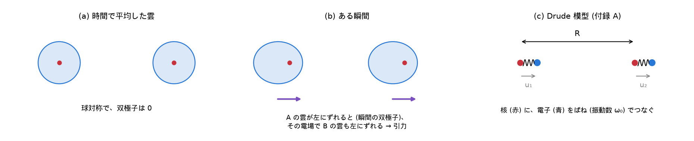
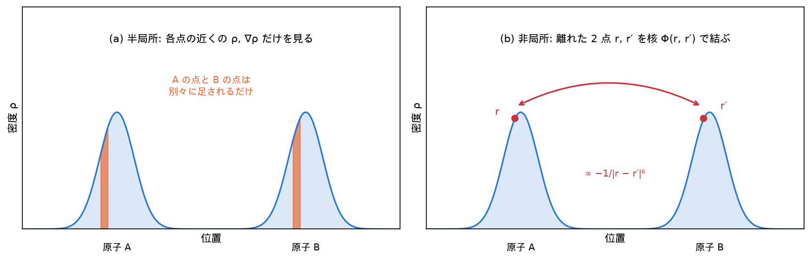
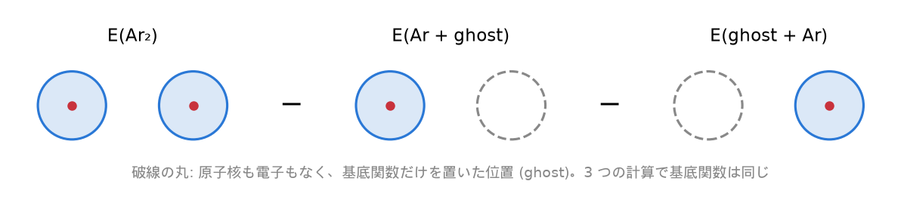
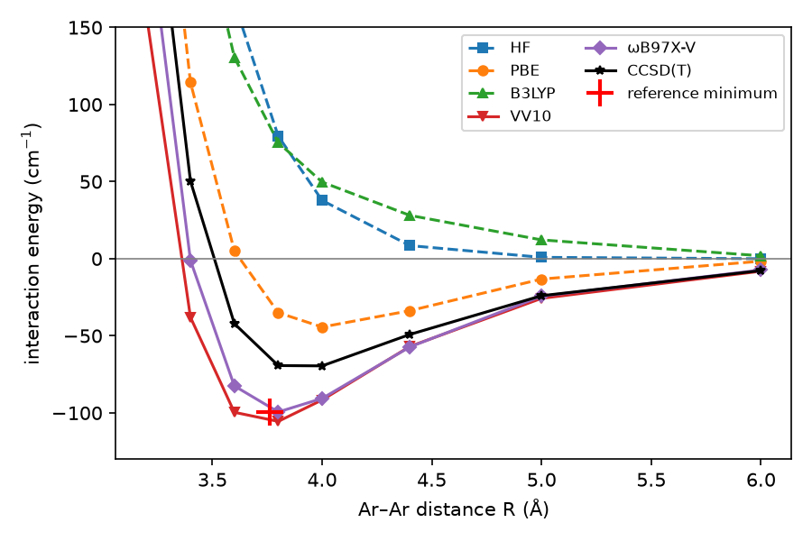
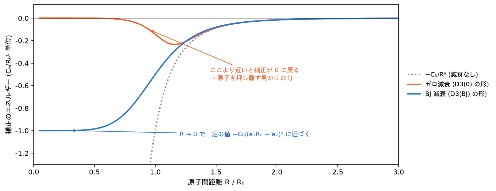
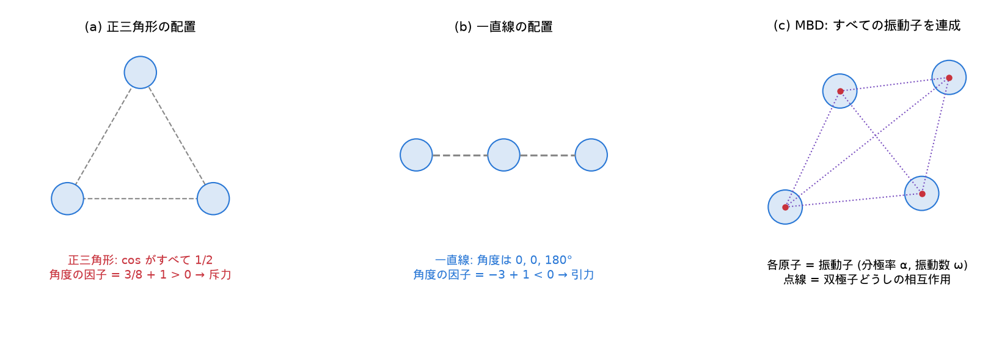

# 第 17 回　分散力の補正

!!! abstract "この回の道筋"
    分散力（London 分散力）は、すべての原子と分子の間に働く弱い引力です。Hartree–Fock 法と半局所汎関数は、この力を原理的に表せません。この回では、その理由を確かめたうえで、実際に使われている補正（DFT-D2/D3/D4、非局所汎関数 VV10、多体の分散）の考え方と式を紹介します。計算例では、Ar₂ の相互作用エネルギーを比べます。

    | 節 | 内容 |
    |---|---|
    | 1 | 分散力とは |
    | 2 | 半局所汎関数が分散力を表せない理由 |
    | 3 | 計算例：Ar₂ の相互作用エネルギー |
    | 4 | 原子対の補正：DFT-D2、D3、D4 |
    | 5 | 非局所汎関数：VV10 |
    | 6 | 多体の分散：ATM 項と MBD |

    **前に読んでおく回**：量子化学の理論 [第 15 回](15-kohn-sham.md)、[第 16 回](16-functionals.md)

!!! tip "物理的なイメージ"
    分散力が表しているのは、離れた原子どうしの電子の「瞬間的なゆらぎ」が、互いにそろうことで生まれる引力です。一方の原子の電子が一瞬かたよると瞬間的な双極子ができ、その電場で相手の原子の電子もかたよって、引き合います。時間で平均すると双極子は 0 ですが、二つのゆらぎの相関は 0 になりません。各点の近くの密度しか見ない半局所汎関数や、平均の場で考える HF 法は、この離れた電子の相関を原理的に表せないので、外から補正を足します。

この回では原子単位を使います。エネルギーの換算は 1 $E_\mathrm h$ = 27.211 eV = 627.5 kcal/mol = 219474.6 cm$^{-1}$ です。

## 1. 分散力とは

### 1.1 ゆらぐ双極子の相関

Ar 原子は電荷を持たず、永久双極子もありません。
それでも、Ar 原子どうしは弱く引き合い、低温では液体や固体になります。
この引力が分散力（dispersion force）です。
London が量子力学で説明したので、London 分散力とも呼ばれます [London 1937]。

分散力は、次のように理解できます（図 1）。

1. 原子の電子の雲は、時間で平均すれば球対称で、双極子はありません（図 1 (a)）。
2. しかし各瞬間には、電子の雲は少しかたよっており、瞬間的な双極子があります。
3. 原子 A の瞬間の双極子が作る電場で、原子 B の電子の雲もかたより、B に双極子が誘起されます（図 1 (b)）。
4. 2 つの双極子が互いに引き合う向きにそろうと、エネルギーが下がります。

A の雲がかたよる向きは、瞬間ごとにばらばらに変わります。
しかし B の雲は、いつも A に合わせて「引き合う向き」にかたよります。
そのため、各原子の双極子の平均は 0 でも、2 つの双極子の積の平均は 0 になりません。
これは、離れた 2 つの原子の電子の運動の相関です（第 7 回の言葉では、電子相関の一部です）。



**図 1**　(a) 時間で平均した電子の雲（青）は、原子核（赤）のまわりに球対称に広がっています。(b) ある瞬間に A の雲が左にかたよると、右向きの瞬間の双極子（紫の矢印）ができます。その電場で B の雲も左にかたより、2 つの双極子は引き合う向きにそろいます。(c) 付録 A の Drude 模型。電子を、原子核にばねでつながれた 1 個の粒子で表します。

### 1.2 R⁻⁶ の法則と C₆

原子が十分に離れているとき、分散のエネルギーは原子間距離 $R$ の 6 乗に反比例します。

$$
E_\mathrm{disp} \approx -\frac{C_6}{R^6}
$$

$C_6$ を分散係数と呼びます。
6 乗になる理由は、次のように数えると分かります。

1. A の双極子 $\mu_\mathrm A$ が B の位置に作る電場は、$\mu_\mathrm A/R^3$ に比例します。
2. B に誘起される双極子は、分極率 $\alpha_\mathrm B$ をかけて $\alpha_\mathrm B\mu_\mathrm A/R^3$ に比例します。
3. 2 つの双極子の相互作用のエネルギーは、$\mu_\mathrm A\times(\alpha_\mathrm B\mu_\mathrm A/R^3)/R^3 = \alpha_\mathrm B\mu_\mathrm A^2/R^6$ に比例します。

$\mu_\mathrm A^2$ の平均は、瞬間の双極子のゆらぎの大きさで、0 ではありません。
したがって、エネルギーは $1/R^6$ に比例します。

電子を 1 個ずつばねにつないだ簡単な模型（Drude 模型、図 1 (c)）を使うと、$C_6$ の値まで導けます。
導出は付録 A に回しますが、ばねの振動数が $\omega_\mathrm A$、$\omega_\mathrm B$、分極率が $\alpha_\mathrm A$、$\alpha_\mathrm B$ の 2 個の原子では、次の結果になります。

$$
C_6^{AB} = \frac32\,\frac{\omega_\mathrm A\,\omega_\mathrm B}{\omega_\mathrm A + \omega_\mathrm B}\,\alpha_\mathrm A\,\alpha_\mathrm B
$$

$\alpha$ は原子の分極率（電場をかけたときの電子の雲のゆがみやすさ）、$\omega$ はばねの振動数（原子単位では $\hbar = 1$ なので、エネルギーと同じ単位）です。
同じ 2 個の原子（$\omega_\mathrm A = \omega_\mathrm B = \omega_0$、$\alpha_\mathrm A = \alpha_\mathrm B = \alpha$）では、

$$
C_6 = \frac32\cdot\frac{\omega_0^2}{2\omega_0}\,\alpha^2 = \frac34\,\omega_0\,\alpha^2
$$

です。
分極率の大きい、つまり電子の雲がゆがみやすい原子ほど、分散力は強くなります。
次の項として $C_8/R^8$、$C_{10}/R^{10}$ などもあります（双極子と四極子の相互作用などから生じます）。

分散のエネルギーは、1 対ごとには小さくても、大きな分子では多数の原子の対について足し合わさります。
そのため、分子結晶の安定性、大きな分子の立体配座、タンパク質と薬の結合などで、大きな寄与になります。

**ここまでで分かったこと**：分散力は、離れた原子の電子のゆらぎの相関から生じる引力で、遠くでは $-C_6/R^6$ の形です。分極率の大きい原子ほど強く働きます。

## 2. 半局所汎関数が分散力を表せない理由

Hartree–Fock 法には、電子相関がありません。
各電子は、ほかの電子の平均の電荷分布だけを感じるので、図 1 (b) のような「相手のゆらぎに合わせる」動きは入りません。
したがって、分散力はまったく入りません。

半局所汎関数（LDA、GGA、meta-GGA）は相関を含みますが、やはり分散力を表せません。
理由は、交換相関エネルギーの形にあります（[第 16 回](16-functionals.md)）。

$$
E_\mathrm{xc}^\mathrm{SL}[\rho] = \int e_\mathrm{xc}\big(\rho(\mathbf r), \nabla\rho(\mathbf r), \tau(\mathbf r)\big)\,d\mathbf r
$$

各点 $\mathbf r$ のエネルギー密度 $e_\mathrm{xc}$ は、その点の密度とその微分だけで決まります。
密度が 0 の点では、$e_\mathrm{xc} = 0$ です。

いま、2 つの原子 A と B が十分に離れていて、電子の雲が重ならないとします。
A の密度 $\rho_\mathrm A$ が 0 でない領域を $\Omega_\mathrm A$、B の密度 $\rho_\mathrm B$ が 0 でない領域を $\Omega_\mathrm B$ とします。
次のように 1 段ずつ考えます。

1. $\Omega_\mathrm A$ の中の点では $\rho_\mathrm B = 0$ なので、全体の密度とその微分は A のものと同じです。$e_\mathrm{xc}$ は A だけの値になります。
2. 同じように、$\Omega_\mathrm B$ の中の点では、$e_\mathrm{xc}$ は B だけの値です。
3. それ以外の点では密度が 0 なので、$e_\mathrm{xc} = 0$ です。
4. したがって、積分は $\Omega_\mathrm A$ と $\Omega_\mathrm B$ の 2 つの部分に分かれます。

$$
E_\mathrm{xc}^\mathrm{SL}[\rho_\mathrm A + \rho_\mathrm B] = \int_{\Omega_\mathrm A}e_\mathrm{xc}(\rho_\mathrm A, \dots)\,d\mathbf r + \int_{\Omega_\mathrm B}e_\mathrm{xc}(\rho_\mathrm B, \dots)\,d\mathbf r = E_\mathrm{xc}^\mathrm{SL}[\rho_\mathrm A] + E_\mathrm{xc}^\mathrm{SL}[\rho_\mathrm B]
$$

交換相関エネルギーから、A と B の相互作用はまったく出てきません。
離れた電子の相関を表すには、点 $\mathbf r$ と、遠く離れた点 $\mathbf r'$ の情報を同時に使う必要があるためです（図 2）。
混成汎関数で混ぜる厳密な交換は、離れた点を結びますが（[第 16 回](16-functionals.md) 5.2 節）、相関ではないので、分散力を与えません。



**図 2**　離れた 2 つの原子 A、B の密度（模式図）。(a) 半局所汎関数は、各点（橙の細い帯）の近くの密度だけからエネルギーを決め、それを足し合わせます。A の点と B の点は互いを知らないので、A と B の相互作用は出てきません。(b) 非局所相関汎関数（第 5 節）は、A の点 $\mathbf r$ と B の点 $\mathbf r'$ を直接結ぶ項を持ち、遠くでは $-1/|\mathbf r - \mathbf r'|^6$ の引力を与えます。

平衡距離の付近では、2 つの原子の電子の雲が少し重なります。
この重なりの領域で、半局所汎関数は何らかの引力や斥力を与えます。
しかしそれは分散力を正しく表したものではなく、汎関数によって大きく違います。
平均場の方法と半局所汎関数が遠距離の電子相関（分散力）を含まないことは、総説でも強調されています [Grimme 2016]。

**ここまでで分かったこと**：半局所汎関数のエネルギーは各点の近くの密度だけで決まるので、重ならない 2 つの原子の間の相関（分散力）を表せません。HF にも分散力はありません。

## 3. 計算例：Ar₂ の相互作用エネルギー

Ar₂ の相互作用エネルギー

$$
\Delta E(R) = E(\mathrm{Ar_2}) - 2E(\mathrm{Ar})
$$

を、PySCF [Sun 2020] で計算します。
負の値なら、2 個の原子がばらばらでいるより、近づいたほうがエネルギーが低い、つまり引き合うことを表します。
比べる方法は次のとおりです。

- HF
- PBE（GGA）、B3LYP（混成）：分散補正なし
- VV10：非局所相関を含む汎関数（第 5 節で扱います）[Vydrov 2010]
- ωB97X-V：VV10 を含む範囲分離混成汎関数（[第 16 回](16-functionals.md)）[Mardirossian 2014]
- CCSD(T)：分散力を含む高精度の方法（[第 10 回](10-coupled-cluster.md)）

基底関数は aug-cc-pVTZ です。
有限の基底関数では、二量体の中の各原子が相手の基底関数を借りてエネルギーを下げ、相互作用が見かけ上強くなります（基底関数重ね合わせ誤差、BSSE）。
これを除くため、原子のエネルギーも、相手の位置に基底関数だけを置いて計算します（counterpoise 補正、図 3）。
相手の位置に置く、原子核も電子もない基底関数を、ghost と呼びます。
こうすると、3 つの計算で使う基底関数がそろい、借りることによる見かけの安定化が打ち消されます。
Ar₂ では 2 つの原子が同じなので、$E(\mathrm{Ar + ghost})$ と $E(\mathrm{ghost + Ar})$ は等しく、下のコードでは 2 倍しています。



**図 3**　counterpoise 補正の 3 つの計算。左が二量体、中と右が、相手の位置に基底関数だけ（破線の丸）を置いた単量体です。相互作用エネルギーは、左から中と右を引いたものです。

```python
from pyscf import gto, scf, dft, cc

basis = "aug-cc-pvtz"
cm = 219474.63          # 1 Eh を cm^-1 に

def energy(atom, method):
    mol = gto.M(atom=atom, basis=basis, verbose=0)
    if method == "CCSD(T)":
        mf = scf.RHF(mol).run()
        nfz = 5 * sum(1 for a in mol._atom if a[0] == "Ar")   # Ar の 1s2s2p を凍結
        c = cc.CCSD(mf, frozen=nfz).run()
        return c.e_tot + c.ccsd_t()
    if method == "HF":
        return scf.RHF(mol).run().e_tot
    mf = dft.RKS(mol)
    mf.xc = method
    mf.grids.level = 4
    return mf.run().e_tot

def interaction(R, method):
    """counterpoise 補正した相互作用エネルギー（cm^-1）"""
    dimer = f"Ar 0 0 0; Ar 0 0 {R}"
    mono  = f"Ar 0 0 0; ghost-Ar 0 0 {R}"     # 相手の位置に基底関数だけを置く
    return (energy(dimer, method) - 2 * energy(mono, method)) * cm

Rs = [3.2, 3.4, 3.6, 3.8, 4.0, 4.4, 5.0, 6.0]
methods = ["HF", "PBE", "B3LYP", "VV10", "WB97X-V", "CCSD(T)"]
print("R/Å  " + "".join(f"{m:>9s}" for m in methods))
for R in Rs:
    print(f"{R:4.1f} " + "".join(f"{interaction(R, m):9.1f}" for m in methods))
```

出力は次のとおりです（単位は cm$^{-1}$。負の値が引力）。

```text
R/Å         HF      PBE    B3LYP     VV10  WB97X-V  CCSD(T)
 3.2     705.6    370.2    526.6    157.6    225.5    288.7
 3.4     343.7    114.3    254.1    -38.0     -1.1     50.3
 3.6     165.9      5.1    130.6    -99.6    -82.5    -42.1
 3.8      79.5    -35.0     75.3   -105.5    -99.4    -69.3
 4.0      37.8    -44.3     49.7    -91.6    -90.6    -69.5
 4.4       8.5    -33.7     28.1    -56.9    -57.2    -49.1
 5.0       0.9    -13.2     12.2    -25.7    -24.3    -24.0
 6.0       0.0     -1.6      1.9     -8.1     -7.3     -7.7
```



**図 4**　上の表をグラフにしたもの（counterpoise 補正、aug-cc-pVTZ）。赤の十字は、精密な計算による極小（3.762 Å、−99.35 cm⁻¹）です。HF と B3LYP の曲線は 0 より上にあり、引力の井戸がありません。PBE の井戸は浅く、遠くで急に 0 に近づきます。VV10 と ωB97X-V の井戸は、赤の十字の近くにあります。

比べるための基準として、CCSD(T) を大きな基底関数の極限まで外挿し、さらに高い励起の効果も加えた精密な計算があります [Patkowski 2010]。
それによると、Ar₂ のポテンシャルの極小は 3.762 Å にあり、深さは 99.35 cm$^{-1}$（0.284 kcal/mol）です（図 4 の赤の十字）。
上の CCSD(T) の極小（約 70 cm$^{-1}$）がこれより浅いのは、aug-cc-pVTZ では相関エネルギーを取りきれないためです。

表と図から、次のことが分かります。

1. **HF と B3LYP**：どの距離でも正（斥力）で、Ar₂ は結合しません。
2. **PBE**：4.0 Å 付近に 44 cm$^{-1}$ の極小があります。しかし、遠くでは急に 0 に近づきます。$1/R^6$ の法則なら、5.0 Å から 6.0 Å で $(6/5)^6 \approx 3.0$ 分の 1 になるはずです。CCSD(T) は 24.0 から 7.7 cm$^{-1}$ へ約 3.1 分の 1 になり、この予想とほぼ一致します。PBE は 13.2 から 1.6 cm$^{-1}$ へ 8 分の 1 になり、$1/R^6$ よりずっと速く消えます。PBE の引力は、第 2 節で述べた密度の重なりから来るもので、分散力ではありません。重なりは密度と同じく指数関数的に減るので、引力も速く消えます。
3. **VV10 と ωB97X-V**：極小は 3.8 Å 付近で、深さは 100 cm$^{-1}$ 前後です。精密な値に近く、遠くでも CCSD(T) と同じように減ります。VV10 の論文でも、Ar₂ の結合をわずかに強く見積もることが報告されています [Vydrov 2010]。

分散補正のない汎関数どうしでも、PBE は弱く結合させ、B3LYP は斥力を与えます。
分散力を含まない汎関数の平衡付近の結果は、汎関数の選び方で大きく変わり、物理的な意味がありません。
分散力を正しく入れるには、汎関数とは別の補正か、非局所の項が必要です。

**ここまでで分かったこと**：Ar₂ では、HF と B3LYP は結合せず、PBE の弱い引力も $1/R^6$ の形ではありません。非局所相関 VV10 を含む汎関数は、精密な計算に近い結合を与えます。

## 4. 原子対の補正：DFT-D2、D3、D4

### 4.1 考え方

いちばん簡単な補正は、汎関数のエネルギーに、原子の対ごとの $-C_6/R^6$ を足すことです。

$$
E_\mathrm{DFT\text{-}D} = E_\mathrm{KS\text{-}DFT} + E_\mathrm{disp}
$$

このとき、2 つの問題があります。

1. 原子が近づくと $1/R^6$ は発散します（図 5 の点線）。
2. 原子が近い距離では、汎関数自身が電子相関の一部をすでに含んでいます。そのまま足すと、相関を 2 回数えることになります。

そこで、近い距離で補正を弱める減衰関数（damping function）をかけます。
減衰関数がどの距離から効くかを決めるパラメータを、汎関数ごとに合わせます。
汎関数によって、近い距離の相関をどれだけ含んでいるかが違うからです。
この方法を DFT-D と呼び、Grimme らが系統的に発展させてきました [Grimme 2004]。

### 4.2 DFT-D2

DFT-D2 は、次の形の補正です [Grimme 2006]。

$$
E_\mathrm{disp}^\mathrm{D2} = -s_6\sum_{A<B}\frac{C_6^{AB}}{R_{AB}^6}\,f_\mathrm{dmp}(R_{AB}),
\qquad
f_\mathrm{dmp}(R) = \frac{1}{1 + e^{-d(R/R_\mathrm r - 1)}}
$$

和は、異なる原子の対すべてについてとります。
$C_6^{AB}$ は、元素ごとに決めた $C_6$ の幾何平均 $\sqrt{C_6^AC_6^B}$ です。
$R_\mathrm r$ は 2 つの原子の van der Waals 半径の和、$d = 20$ です。
$f_\mathrm{dmp}$ は、$R \gg R_\mathrm r$ では 1、$R \ll R_\mathrm r$ では 0 に近づく、なめらかな切り替えの関数です。
$s_6$ は汎関数ごとに 1 個だけ決める倍率で、BLYP、PBE、TPSS、B3LYP の値が報告されています。
元素の $C_6$ は、分子の環境によらず一定とされています。

### 4.3 DFT-D3

DFT-D3 は、D2 の考え方を大きく改良したものです [Grimme 2010]。
主な違いは次の 3 点です。

**(1) $C_6$ を第一原理計算から求める**。
さまざまな化学的環境にある原子について、時間依存 DFT（[第 19 回](19-tddft.md)）で、虚数の振動数 $i\omega$ での分極率 $\alpha(i\omega)$ を計算します [Caldeweyher 2017]。
そこから、次の Casimir–Polder の式で $C_6^{AB}$ を求めます [Grimme 2010]。

$$
C_6^{AB} = \frac3\pi\int_0^\infty\alpha^A(i\omega)\,\alpha^B(i\omega)\,d\omega
$$

この式が 1.2 節の Drude 模型の結果と一致することを、同じ 2 個の原子で確かめます。

1. Drude 模型の分極率は、虚数の振動数では $\alpha(i\omega) = \alpha\,\omega_0^2/(\omega_0^2 + \omega^2)$ です（$\omega = 0$ で静的な分極率 $\alpha$）。
2. これを代入すると、$C_6 = \frac3\pi\alpha^2\omega_0^4\int_0^\infty d\omega/(\omega_0^2 + \omega^2)^2$ です。
3. 積分は $\int_0^\infty d\omega/(\omega_0^2 + \omega^2)^2 = \pi/(4\omega_0^3)$ です。
4. したがって $C_6 = \frac3\pi\alpha^2\omega_0^4\cdot\frac{\pi}{4\omega_0^3} = \frac34\omega_0\alpha^2$ で、1.2 節の結果と一致します。

**(2) 環境への依存**。
同じ炭素でも、sp³ の炭素と sp² の炭素では $C_6$ が違います。
D3 は、分子の構造から各原子の「配位数」（coordination number、CN）を計算します。

$$
\mathrm{CN}^A = \sum_{B\neq A}\frac{1}{1 + e^{-16\,(R_{AB}^\mathrm{cov}/R_{AB} - 1)}}
$$

$R_{AB}^\mathrm{cov}$ は、2 つの原子の共有結合半径の和（D3 で決めた値）です。
各項は、$R_{AB}$ が $R_{AB}^\mathrm{cov}$ よりはっきり短ければほぼ 1、はっきり長ければほぼ 0 です。
つまり CN は「結合している相手の数」を、小数も取るなめらかな数にしたものです。
たとえば、エタンの炭素は CN ≈ 4、エチレンの炭素は CN ≈ 3 に近い値になります。

D3 は、元素の対ごとに、いくつかの基準の分子（基準の配位数 $\mathrm{CN}_i^A$、$\mathrm{CN}_j^B$）で計算した $C_6^{AB}(i, j)$ の表を持ちます。
実際の分子の $C_6^{AB}$ は、配位数が近い基準ほど大きな重みをつけて平均します [Grimme 2010]。

$$
C_6^{AB} = \frac{\sum_{ij}C_6^{AB}(i, j)\,L_{ij}}{\sum_{ij}L_{ij}},
\qquad
L_{ij} = \exp\Big\{-4\Big[\big(\mathrm{CN}^A - \mathrm{CN}_i^A\big)^2 + \big(\mathrm{CN}^B - \mathrm{CN}_j^B\big)^2\Big]\Big\}
$$

**(3) $C_8$ 項**。
$C_8^{AB}$ を、$C_6^{AB}$ から既知の関係式で求めて加えます。

2 体の項は次の形です（和は異なる原子の対について。$\frac12$ は同じ対を 2 回数えないため）。

$$
E^{(2)} = -\frac12\sum_{A\neq B}\sum_{n=6,8}s_n\frac{C_n^{AB}}{R_{AB}^n}\,f_{\mathrm d,n}(R_{AB})
$$

元の D3 では、減衰関数として、近い距離で 0 になる形を使います（ゼロ減衰）。

$$
f_{\mathrm d,n}(R) = \frac{1}{1 + 6\,\big(R/(s_{r,n}R_0^{AB})\big)^{-\alpha_n}}
$$

$R_0^{AB}$ は原子の対ごとの半径、$\alpha_6 = 14$、$\alpha_8 = 16$ です。
$R = s_{r,n}R_0^{AB}$ では $f = 1/7$ で、これより近いと急に 0 に、遠いと 1 に近づきます。
汎関数ごとに合わせるパラメータは、$s_8$ と $s_{r,6}$ の 2 個だけです。$s_{r,8} = 1$ に固定し、$s_6$ も 1 に固定します（二重混成汎関数では $s_6 < 1$）。

### 4.4 Becke–Johnson 減衰：D3(BJ)

ゼロ減衰には欠点があります。
近い距離で補正のエネルギーが 0 に戻るので、その範囲ではエネルギーが「近づくほど高くなる」形になります（図 5 の橙の曲線の左側）。
これは、原子を押し離す見かけの力（斥力）になります。
そこで、Becke と Johnson の分散のモデル [Becke 2005] で使われた形の減衰が D3 に取り入れられました [Grimme 2011]。

$$
E^{(2)} = -\frac12\sum_{A\neq B}\sum_{n=6,8}s_n\frac{C_n^{AB}}{R_{AB}^n + \big(a_1R_0^{AB} + a_2\big)^n},
\qquad R_0^{AB} = \sqrt{C_8^{AB}/C_6^{AB}}
$$

$R_{AB} \to 0$ でも分母は $(a_1R_0^{AB} + a_2)^n$ に近づいて 0 にならず、補正は一定の値に近づきます（図 5 の青の曲線）。
$R_{AB}$ が大きいときは、分母の $R_{AB}^n$ が主になり、$-C_n/R_{AB}^n$ に戻ります。
汎関数ごとのパラメータは $s_8$、$a_1$、$a_2$ の 3 個です。
Grimme らは、ゼロ減衰と BJ 減衰を 12 個の汎関数で比べ、結果の差は小さいが、BJ 減衰には近距離での見かけの斥力がないことを示しました [Grimme 2011]。
また、HF に補正を加える場合は、BJ 減衰だけが推奨されています。



**図 5**　原子 1 対の分散補正のエネルギー（模式図。$C_6$ 項だけで、距離は $R_0$ を単位とし、ゼロ減衰は $s_{r,6}R_0 = R_0$、BJ 減衰は $a_1R_0 + a_2 = R_0$ としました）。減衰なし（点線）は近づくと発散します。ゼロ減衰（橙）は $R \approx 1.2R_0$ で最も低くなり、それより近いと 0 に戻ります。BJ 減衰（青）は、近づくと一定の値に落ち着きます。遠い所では、3 本とも同じ $-C_6/R^6$ に重なります。

### 4.5 DFT-D4

DFT-D4 は D3 の後継です [Caldeweyher 2017; Caldeweyher 2019]。
D3 との主な違いは、原子の部分電荷を使うことです。
同じ元素でも、電子を失った陽イオン的な原子は電子の雲が縮んで分極しにくく、電子を受け取った原子は分極しやすくなります。
D4 は、各原子の分極率を、配位数に加えて部分電荷に応じて変え、そこから Casimir–Polder の式で $C_6$ をその場で計算します。
分子どうしの $C_6$ の再現では、D3 の平均相対誤差 4.7% に対して 3.8% に改善しています。
特に金属を含む系で、電荷への依存を入れた効果が大きいと報告されています。
60 個以上の汎関数について BJ 型の減衰のパラメータが決められています [Caldeweyher 2019]。

主要族の分子のベンチマーク GMTKN55 でも、熱化学や非共有結合相互作用を扱うには分散補正が必要だと結論されています [Goerigk 2017]。
総説によれば、現在の主な補正は、遠距離の分散エネルギーを典型的に 5% 程度の相対誤差で与えます [Grimme 2016]。

**ここまでで分かったこと**：DFT-D は、原子対ごとの $-C_n/R^n$ に減衰関数をかけて足す補正です。D3 は配位数に応じた $C_6$ と $C_8$ を使い、BJ 減衰は近距離で一定の値に近づきます。D4 は部分電荷も使います。

## 5. 非局所汎関数：VV10

### 5.1 式の形

もう一つの方法は、交換相関汎関数そのものに、離れた 2 点の密度を結ぶ項を加えることです（図 2 (b)）。
このような汎関数を、非局所相関汎関数と呼びます。
代表的な例に、vdW-DF [Dion 2004] と VV10 [Vydrov 2010] があります。
ここでは、ωB97X-V や ωB97M-V（[第 16 回](16-functionals.md)）にも使われている VV10 を説明します。

VV10 は、非局所相関エネルギーを次の形に書きます。

$$
E_\mathrm c^\mathrm{nl} = \int\rho(\mathbf r)\Big[\beta + \frac12\int\Phi(\mathbf r, \mathbf r')\,\rho(\mathbf r')\,d\mathbf r'\Big]d\mathbf r
$$

$\Phi$ は、2 点の密度と密度の勾配から決まる関数（核、kernel）で、$\frac12$ は同じ 2 点の組を 2 回数えないためです。
$\beta$ は、一様な電子ガスで $E_\mathrm c^\mathrm{nl}$ が 0 になるように決めた定数です（一様な電子ガスの相関は、半局所の部分がすでに正しく含んでいるからです）。
核は次の形です。

$$
\Phi(\mathbf r, \mathbf r') = -\frac{3}{2\,g\,g'\,(g + g')},
\qquad g = \omega_0(\mathbf r)\,R^2 + \kappa(\mathbf r),\quad g' = \omega_0(\mathbf r')\,R^2 + \kappa(\mathbf r')
$$

$R = |\mathbf r - \mathbf r'|$ です。
各点の量は次のとおりです。

- $\omega_0(\mathbf r) = \sqrt{\omega_g^2 + \omega_p^2/3}$ は、その点の電子の、局所的な振動数（励起のエネルギーの目安）です。
    - $\omega_p^2 = 4\pi\rho$ は、密度 $\rho$ の一様な電子ガスの集団振動（プラズマ振動）の振動数の 2 乗です。$\omega_p/\sqrt3$ は、一様な電子ガスでできた小さな球の、双極子の固有振動数にあたります。
    - $\omega_g^2 = C\,|\nabla\rho/\rho|^4$ は、密度が急に変わる所（分子の裾など）で振動数を上げ、分極しにくくする補正です。
- $\kappa(\mathbf r) = b\cdot\frac{3\pi}{2}\big(\rho/(9\pi)\big)^{1/6}$ は、近い距離で $\Phi$ が発散しないようにする項です。

### 5.2 遠くでの形と、Drude 模型とのつながり

2 点が遠く離れると、$g \approx \omega_0R^2$ となって $\kappa$ が効かなくなり、$\Phi$ は次の形になります。

$$
\Phi \to -\frac{3}{2\,\omega_0(\mathbf r)\,\omega_0(\mathbf r')\,\big[\omega_0(\mathbf r) + \omega_0(\mathbf r')\big]\,|\mathbf r - \mathbf r'|^6}
$$

この形は、1.2 節の $C_6^{AB}$ の式を、空間の小さな体積ごとに当てはめたものです。
次のように確かめられます。

1. 点 $\mathbf r$ のまわりの小さな体積 $d\mathbf r$ には、$\rho\,d\mathbf r$ 個の電子があります。これを、振動数 $\omega_0(\mathbf r)$ のばねにつながれた電子の集まりと考えます。
2. Drude 模型では、電子 1 個（電荷 1、質量 1）の分極率は $1/\omega_0^2$ です（付録 A）。したがって、この体積の分極率は $\alpha = \rho\,d\mathbf r/\omega_0^2$ です。
3. 点 $\mathbf r'$ の体積 $d\mathbf r'$ についても同じく $\alpha' = \rho'\,d\mathbf r'/\omega_0'^2$ です（$\rho' = \rho(\mathbf r')$、$\omega_0' = \omega_0(\mathbf r')$）。
4. 1.2 節の式に入れると、この 2 つの体積の間の分散のエネルギーは次のとおりです。

    $$
    -\frac32\,\frac{\omega_0\omega_0'}{\omega_0 + \omega_0'}\cdot\frac{\rho\,d\mathbf r}{\omega_0^2}\cdot\frac{\rho'\,d\mathbf r'}{\omega_0'^2}\cdot\frac{1}{R^6}
    = -\frac{3\,\rho\rho'}{2\,\omega_0\omega_0'(\omega_0 + \omega_0')R^6}\,d\mathbf r\,d\mathbf r'
    $$

5. すべての体積の対について足し、同じ対を 2 回数えないように $\frac12$ をかけると、$\frac12\iint\rho\,\Phi\,\rho'$ の遠くでの形と一致します。

この形のおかげで、離れた分子の間に $-C_6/R^6$ の引力が自然に出てきます。

### 5.3 パラメータ

VV10 には、調節するパラメータが 2 個あります。

- $C$：$\omega_g$ の中のパラメータで、$C_6$ が正確になるように決めます。元の論文では $C = 0.0093$ です。
- $b$：$\kappa$ の大きさ、つまり近い距離で $1/R^6$ を減衰させる強さを決めます。半局所の部分（rPW86 の交換と PBE の相関）と組み合わせ、22 個の分子間相互作用（S22）の結合エネルギーに合わせて $b = 5.9$ と決められました。

$b$ は、組み合わせる半局所の部分ごとに決め直します。
たとえば Libxc に収められた ωB97X-V では、$b = 6.0$、$C = 0.01$ です。

VV10 は原子の種類や配位数の表を使わず、密度だけから分散を計算します。
そのかわり、$\mathbf r$ と $\mathbf r'$ の 2 重の積分が必要なので、DFT-D より計算が重くなります。

**ここまでで分かったこと**：VV10 は、離れた 2 点の密度を結ぶ非局所相関の項です。各点の電子を振動数 $\omega_0(\mathbf r)$ の Drude 振動子とみなした $C_6$ の式を、空間の各点の対について足したものになっており、遠くでは $-C_6/R^6$ を与えます。パラメータは $C_6$ と結合エネルギーに合わせた 2 個です。

## 6. 多体の分散：ATM 項と MBD

ここまでの補正は、原子の対ごとの和でした。
しかし、分散のエネルギーは、厳密には対の和では書けません。
3 個以上の原子が同時に関わる寄与（多体の寄与）があるためです。
原子 A のゆらぎが B を分極させ、B の誘起双極子がさらに C を分極させる、といった連鎖があるからです。

### 6.1 ATM 項

3 個の原子の間の最初の多体の項は、Axilrod と Teller が導いた 3 体の項です [Axilrod 1943]。
Axilrod–Teller–Muto（ATM）項とも呼ばれます。

$$
E^{(3)} = \sum_{A<B<C} C_9^{ABC}\,\frac{3\cos\theta_A\cos\theta_B\cos\theta_C + 1}{\big(R_{AB}R_{BC}R_{CA}\big)^3}
$$

$\theta_A$ などは、3 個の原子が作る三角形の内角です。
$C_9^{ABC} > 0$ なので、符号は分子の角度の因子 $3\cos\theta_A\cos\theta_B\cos\theta_C + 1$ で決まります（図 6）。

- **正三角形**：内角はすべて 60° で、$\cos 60° = 1/2$ です。角度の因子は $3\cdot\frac18 + 1 = \frac{11}{8} > 0$ なので、この項は斥力です。
- **一直線**：内角は 0°、0°、180° で、余弦は 1、1、$-1$ です。角度の因子は $3\cdot(-1) + 1 = -2 < 0$ なので、この項は引力です。

DFT-D3 では、$C_9^{ABC} \approx \sqrt{C_6^{AB}C_6^{BC}C_6^{CA}}$ と近似して、この項を加えることができます [Grimme 2010]。
グラフェンの層の間の結合では、3 体の項を入れると結合が約 10% 弱くなりました [Grimme 2010]。
D4 も ATM 項を含みます [Caldeweyher 2019]。



**図 6**　(a) 正三角形の配置では、ATM 項の角度の因子が正で、3 体の寄与は斥力です。(b) 一直線の配置では負で、引力です。(c) MBD の考え方。各原子を分極する振動子とみなし、すべての対を双極子の相互作用（紫の点線）でつないで、まとめて解きます。

### 6.2 MBD

多体の効果をすべての次数で入れる方法の一つが、多体分散（many-body dispersion、MBD）です [Tkatchenko 2012]。
各原子を、分極率を持つ振動子（付録 A の Drude 模型の振動子）で表し、それらを双極子の相互作用でつないだ系のシュレーディンガー方程式を解きます。
連成した振動子の零点エネルギーの変化が、分散のエネルギーになります。

付録 A は 2 個の振動子の場合で、1 つの方向（たとえば $z$ 方向）について、次の 2 行 2 列の行列の固有値 $\Omega^2$ から振動数 $\Omega$ を求めました。

$$
\begin{pmatrix}
\omega_1^2 & t_{12} \\
t_{12} & \omega_2^2
\end{pmatrix},
\qquad t_{12} = \omega_1\omega_2\sqrt{\alpha_1\alpha_2}\cdot\frac{\gamma}{R^3}
$$

$\gamma$ は方向で決まる数で、2 つの原子を結ぶ方向では $-2$、それに垂直な 2 方向では $1$ です。
MBD は、これを $N$ 個の原子の 3 方向に広げ、$3N$ 行 $3N$ 列の行列を対角化します。
3 個の原子なら、3 行 3 列のブロックを並べて

$$
\mathbf C =
\begin{pmatrix}
\omega_1^2\,\mathbf 1 & \mathbf t_{12} & \mathbf t_{13} \\
\mathbf t_{12} & \omega_2^2\,\mathbf 1 & \mathbf t_{23} \\
\mathbf t_{13} & \mathbf t_{23} & \omega_3^2\,\mathbf 1
\end{pmatrix},
\qquad
\mathbf t_{ij} = \omega_i\omega_j\sqrt{\alpha_i\alpha_j}\;\frac{\mathbf 1 - 3\,\hat{\mathbf R}_{ij}\hat{\mathbf R}_{ij}^\mathsf T}{R_{ij}^3}
$$

です。
$\mathbf 1$ は 3 行 3 列の単位行列、$\hat{\mathbf R}_{ij}$ は原子 $i$ から $j$ への単位ベクトル（縦ベクトル）です。
$\hat{\mathbf R}_{ij}$ を $z$ 方向にとると、$\mathbf 1 - 3\hat{\mathbf R}\hat{\mathbf R}^\mathsf T$ は対角要素が $1, 1, -2$ の行列になり、上の 2 原子の $\gamma$ に戻ります。
対角のブロックは各原子の振動子そのもの、非対角のブロックは双極子の相互作用による結合です。
固有値を $\Omega_p^2$（$p = 1, \dots, 3N$）とすると、分散のエネルギーは、連成した振動子と、ばらばらの振動子の零点エネルギーの差

$$
E_\mathrm{MBD} = \frac12\sum_{p=1}^{3N}\Omega_p - \frac32\sum_{i=1}^{N}\omega_i
$$

です（ばらばらの振動子は、各原子が 3 方向に $\frac12\omega_i$ ずつ持ちます）。
この差を $\mathbf t_{ij}$ について展開すると、2 次の項が原子対の $-C_6/R^6$、3 次の項が 3 体の寄与を与えます。
行列をまとめて対角化することで、すべての次数を一度に含められます。

MBD では、ある原子の分極率が、周りの原子の分極によって打ち消されたり強められたりする効果（遮蔽）も入ります。
各原子の分極率と $C_6$ は、分子の電子密度を原子に分け、自由な原子の精密な値を基準にして求めます [Tkatchenko 2009]。
この遮蔽と多体の分散のエネルギーは、小さな分子でも無視できず、生体分子の立体配座のエネルギーや分子結晶の結合では欠かせないことが示されています [Tkatchenko 2012]。

**ここまでで分かったこと**：分散のエネルギーには、原子の対の和では書けない多体の寄与があります。3 体の ATM 項は配置によって斥力にも引力にもなります。MBD は、すべての原子の振動子を連成させた行列を対角化して、多体の効果をすべて含めます。

## まとめ

- 分散力は、離れた電子のゆらぎの相関から生じる引力で、遠くでは $-C_6/R^6$ の形です。Drude 模型では $C_6^{AB} = \frac32\frac{\omega_\mathrm A\omega_\mathrm B}{\omega_\mathrm A + \omega_\mathrm B}\alpha_\mathrm A\alpha_\mathrm B$ です。
- HF と半局所汎関数は、重ならない密度の間の相関を表せないので、分散力を原理的に含みません。Ar₂ では、HF と B3LYP は結合せず、PBE の弱い引力も遠くで消えます。
- DFT-D は原子対の $-C_n/R^n$ に減衰関数をかけて足します。D3 は配位数に応じた $C_6$ と $C_8$、BJ 減衰は近距離で有限、D4 は部分電荷も使います。
- VV10 は密度だけから分散を計算する非局所相関汎関数で、各点の電子を Drude 振動子とみなした形をしています。ωB97X-V や ωB97M-V に含まれています。
- 多体の分散は、ATM 項（3 体）や MBD（すべての次数）で入れます。

## 付録 A　Drude 模型による C₆ の導出

原子 A を、電荷 $q$、質量 $m_\mathrm A$ の粒子が、振動数 $\omega_\mathrm A$ の等方的なばねで核につながれたものと考えます（Drude 模型）。
原子 B も同じく、質量 $m_\mathrm B$、振動数 $\omega_\mathrm B$ とします。

**手順 1：分極率**。電場 $E$ の中では、粒子は力 $qE$ とばねの力 $-m\omega^2u$ がつり合う位置 $u = qE/(m\omega^2)$ まで動きます。
双極子は $qu = q^2E/(m\omega^2)$ なので、分極率は

$$
\alpha_\mathrm A = \frac{q^2}{m_\mathrm A\omega_\mathrm A^2},\qquad \alpha_\mathrm B = \frac{q^2}{m_\mathrm B\omega_\mathrm B^2}
$$

です。

**手順 2：相互作用**。2 つの原子を $z$ 軸の上に距離 $R$ だけ離して置き、粒子の変位を $\mathbf u_1 = (x_1, y_1, z_1)$、$\mathbf u_2 = (x_2, y_2, z_2)$ とします。
$R$ が変位より十分大きいとき、2 つの双極子 $q\mathbf u_1$、$q\mathbf u_2$ の相互作用は

$$
V = \frac{q^2}{R^3}\big(x_1x_2 + y_1y_2 - 2z_1z_2\big)
$$

です。
ハミルトニアンは $x$、$y$、$z$ の方向ごとに分かれ、各方向は結合した 2 個の調和振動子になります。
1 つの方向の変位を $u_1$、$u_2$ と書き、結合を $V = \gamma\,(q^2/R^3)\,u_1u_2$ と書くと、$z$ 方向では $\gamma = -2$、$x$ と $y$ 方向では $\gamma = 1$ です。

**手順 3：質量で重みをつけた座標**。$y_1 = \sqrt{m_\mathrm A}\,u_1$、$y_2 = \sqrt{m_\mathrm B}\,u_2$ とおくと、運動エネルギーは $\frac12(\dot y_1^2 + \dot y_2^2)$ になり、ポテンシャルエネルギーは

$$
U = \frac12\begin{pmatrix} y_1 & y_2 \end{pmatrix}
\begin{pmatrix}
\omega_\mathrm A^2 & t \\
t & \omega_\mathrm B^2
\end{pmatrix}
\begin{pmatrix} y_1 \\ y_2 \end{pmatrix},
\qquad t = \frac{\gamma q^2}{R^3\sqrt{m_\mathrm Am_\mathrm B}}
$$

になります。
対角の要素は、$\frac12m\omega^2u^2 = \frac12\omega^2y^2$ から来ます。
非対角の要素は、$V = \gamma(q^2/R^3)u_1u_2 = \gamma(q^2/R^3)\,y_1y_2/\sqrt{m_\mathrm Am_\mathrm B}$ を、2 つの非対角の位置に半分ずつ置いたものです。

**手順 4：$t$ を分極率で書く**。手順 1 から $q^2/m_\mathrm A = \alpha_\mathrm A\omega_\mathrm A^2$、$q^2/m_\mathrm B = \alpha_\mathrm B\omega_\mathrm B^2$ です。
2 つをかけて平方根をとると $q^2/\sqrt{m_\mathrm Am_\mathrm B} = \omega_\mathrm A\omega_\mathrm B\sqrt{\alpha_\mathrm A\alpha_\mathrm B}$ なので、

$$
t = \omega_\mathrm A\omega_\mathrm B\sqrt{\alpha_\mathrm A\alpha_\mathrm B}\cdot\frac{\gamma}{R^3}
$$

です（6.2 節の $t_{12}$ です）。

**手順 5：基準振動の振動数**。行列の固有値を $\Omega_+^2$、$\Omega_-^2$ とすると、系は振動数 $\Omega_\pm$ の 2 個の独立な振動子になります。
固有値の和は行列の対角和、積は行列式に等しいので、

$$
\Omega_+^2 + \Omega_-^2 = \omega_\mathrm A^2 + \omega_\mathrm B^2,\qquad \Omega_+\Omega_- = \sqrt{\omega_\mathrm A^2\omega_\mathrm B^2 - t^2}
$$

です。

**手順 6：零点エネルギーの和**。基底状態のエネルギーは零点エネルギーの和 $\frac12(\Omega_+ + \Omega_-)$ です（$\hbar = 1$）。
和の 2 乗を手順 5 の 2 式で書くと、

$$
(\Omega_+ + \Omega_-)^2 = \Omega_+^2 + \Omega_-^2 + 2\Omega_+\Omega_- = \omega_\mathrm A^2 + \omega_\mathrm B^2 + 2\sqrt{\omega_\mathrm A^2\omega_\mathrm B^2 - t^2}
$$

です。

**手順 7：$t$ が小さいとして展開する**。$\sqrt{a^2 - t^2} \approx a - t^2/(2a)$ を $a = \omega_\mathrm A\omega_\mathrm B$ で使うと、

$$
(\Omega_+ + \Omega_-)^2 \approx (\omega_\mathrm A + \omega_\mathrm B)^2 - \frac{t^2}{\omega_\mathrm A\omega_\mathrm B}
$$

です。
さらに $\sqrt{s^2 - \varepsilon} \approx s - \varepsilon/(2s)$ を $s = \omega_\mathrm A + \omega_\mathrm B$ で使うと、

$$
\Omega_+ + \Omega_- \approx \omega_\mathrm A + \omega_\mathrm B - \frac{t^2}{2\,\omega_\mathrm A\omega_\mathrm B(\omega_\mathrm A + \omega_\mathrm B)}
$$

です。

**手順 8：1 方向のエネルギーの変化**。相互作用がないときの零点エネルギーは $\frac12(\omega_\mathrm A + \omega_\mathrm B)$ なので、変化は手順 7 の第 3 項の $\frac12$ 倍です。
手順 4 の $t^2 = \omega_\mathrm A^2\omega_\mathrm B^2\alpha_\mathrm A\alpha_\mathrm B\gamma^2/R^6$ を入れると、

$$
\Delta E_\gamma = -\frac{t^2}{4\,\omega_\mathrm A\omega_\mathrm B(\omega_\mathrm A + \omega_\mathrm B)} = -\frac{\gamma^2}{4}\cdot\frac{\omega_\mathrm A\omega_\mathrm B}{\omega_\mathrm A + \omega_\mathrm B}\cdot\frac{\alpha_\mathrm A\alpha_\mathrm B}{R^6}
$$

です。

**手順 9：3 方向を足す**。$\gamma^2$ は $z$ 方向で 4、$x$、$y$ 方向で 1 ずつなので、和は $4 + 1 + 1 = 6$ です。

$$
\Delta E = -\frac{6}{4}\cdot\frac{\omega_\mathrm A\omega_\mathrm B}{\omega_\mathrm A + \omega_\mathrm B}\cdot\frac{\alpha_\mathrm A\alpha_\mathrm B}{R^6} = -\frac32\,\frac{\omega_\mathrm A\omega_\mathrm B}{\omega_\mathrm A + \omega_\mathrm B}\,\frac{\alpha_\mathrm A\alpha_\mathrm B}{R^6}
$$

これが本文の $C_6^{AB}$ です。
同じ原子では、1.2 節のとおり $C_6 = \frac34\omega_0\alpha^2$ になります。

古典的には、ばねの粒子は静止していて双極子はありません。
引力は、零点振動（量子的なゆらぎ）が相関することから生じています。
手順 5 で、結合 $t$ は 2 つの振動数を押し離しますが、零点エネルギーの和は、押し下げられた $\Omega_-$ の減少のほうがわずかに大きく効いて、全体として下がります。

## 参考文献

- F. London, "The general theory of molecular forces", Trans. Faraday Soc. 33, 8 (1937). DOI: [10.1039/TF937330008B](https://doi.org/10.1039/TF937330008B)
- S. Grimme, J. Antony, S. Ehrlich, H. Krieg, "A consistent and accurate ab initio parametrization of density functional dispersion correction (DFT-D) for the 94 elements H-Pu", J. Chem. Phys. 132, 154104 (2010). DOI: [10.1063/1.3382344](https://doi.org/10.1063/1.3382344)
- S. Grimme, A. Hansen, J. G. Brandenburg, C. Bannwarth, "Dispersion-Corrected Mean-Field Electronic Structure Methods", Chem. Rev. 116, 5105 (2016). DOI: [10.1021/acs.chemrev.5b00533](https://doi.org/10.1021/acs.chemrev.5b00533)
- K. Patkowski, K. Szalewicz, "Argon pair potential at basis set and excitation limits", J. Chem. Phys. 133, 094304 (2010). DOI: [10.1063/1.3478513](https://doi.org/10.1063/1.3478513)
- S. Grimme, "Accurate description of van der Waals complexes by density functional theory including empirical corrections", J. Comput. Chem. 25, 1463 (2004). DOI: [10.1002/jcc.20078](https://doi.org/10.1002/jcc.20078)
- S. Grimme, "Semiempirical GGA-type density functional constructed with a long-range dispersion correction", J. Comput. Chem. 27, 1787 (2006). DOI: [10.1002/jcc.20495](https://doi.org/10.1002/jcc.20495)
- A. D. Becke, E. R. Johnson, "A density-functional model of the dispersion interaction", J. Chem. Phys. 123, 154101 (2005). DOI: [10.1063/1.2065267](https://doi.org/10.1063/1.2065267)
- S. Grimme, S. Ehrlich, L. Goerigk, "Effect of the damping function in dispersion corrected density functional theory", J. Comput. Chem. 32, 1456 (2011). DOI: [10.1002/jcc.21759](https://doi.org/10.1002/jcc.21759)
- E. Caldeweyher, C. Bannwarth, S. Grimme, "Extension of the D3 dispersion coefficient model", J. Chem. Phys. 147, 034112 (2017). DOI: [10.1063/1.4993215](https://doi.org/10.1063/1.4993215)
- E. Caldeweyher, S. Ehlert, A. Hansen, H. Neugebauer, S. Spicher, C. Bannwarth, S. Grimme, "A generally applicable atomic-charge dependent London dispersion correction", J. Chem. Phys. 150, 154122 (2019). DOI: [10.1063/1.5090222](https://doi.org/10.1063/1.5090222)
- M. Dion, H. Rydberg, E. Schröder, D. C. Langreth, B. I. Lundqvist, "Van der Waals Density Functional for General Geometries", Phys. Rev. Lett. 92, 246401 (2004). DOI: [10.1103/PhysRevLett.92.246401](https://doi.org/10.1103/PhysRevLett.92.246401)
- O. A. Vydrov, T. Van Voorhis, "Nonlocal van der Waals density functional: The simpler the better", J. Chem. Phys. 133, 244103 (2010). DOI: [10.1063/1.3521275](https://doi.org/10.1063/1.3521275)
- N. Mardirossian, M. Head-Gordon, "ωB97X-V: A 10-parameter, range-separated hybrid, generalized gradient approximation density functional with nonlocal correlation, designed by a survival-of-the-fittest strategy", Phys. Chem. Chem. Phys. 16, 9904 (2014). DOI: [10.1039/C3CP54374A](https://doi.org/10.1039/C3CP54374A)
- B. M. Axilrod, E. Teller, "Interaction of the van der Waals Type Between Three Atoms", J. Chem. Phys. 11, 299 (1943). DOI: [10.1063/1.1723844](https://doi.org/10.1063/1.1723844)
- A. Tkatchenko, M. Scheffler, "Accurate Molecular Van Der Waals Interactions from Ground-State Electron Density and Free-Atom Reference Data", Phys. Rev. Lett. 102, 073005 (2009). DOI: [10.1103/PhysRevLett.102.073005](https://doi.org/10.1103/PhysRevLett.102.073005)
- A. Tkatchenko, R. A. DiStasio Jr., R. Car, M. Scheffler, "Accurate and Efficient Method for Many-Body van der Waals Interactions", Phys. Rev. Lett. 108, 236402 (2012). DOI: [10.1103/PhysRevLett.108.236402](https://doi.org/10.1103/PhysRevLett.108.236402)
- L. Goerigk, A. Hansen, C. Bauer, S. Ehrlich, A. Najibi, S. Grimme, "A look at the density functional theory zoo with the advanced GMTKN55 database for general main group thermochemistry, kinetics and noncovalent interactions", Phys. Chem. Chem. Phys. 19, 32184 (2017). DOI: [10.1039/C7CP04913G](https://doi.org/10.1039/C7CP04913G)
- Q. Sun et al., "Recent developments in the PySCF program package", J. Chem. Phys. 153, 024109 (2020). DOI: [10.1063/5.0006074](https://doi.org/10.1063/5.0006074)

## 関連リンク

- DFT-D3 プログラムの説明書（Grimme のグループ。D3 の 2 体・3 体の項の式）：<https://www.chemie.uni-bonn.de/grimme/de/software/dft-d3>
- simple-dftd3（D3 の再実装）の説明書：<https://dftd3.readthedocs.io/>
- dftd4 の説明書：<https://dftd4.readthedocs.io/>
- Libxc（汎関数のライブラリ。VV10 のパラメータを含む）：<https://libxc.gitlab.io/functionals/>
