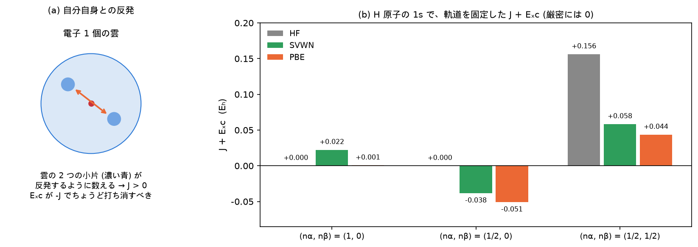
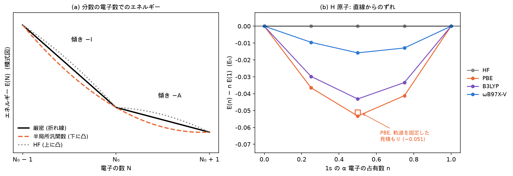
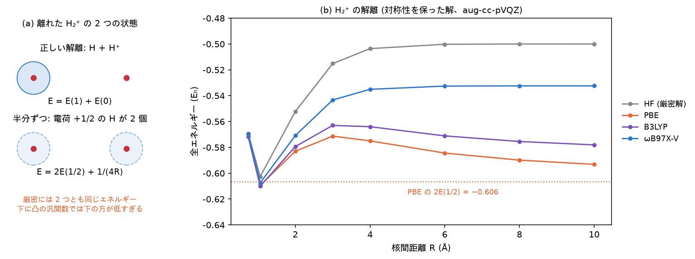
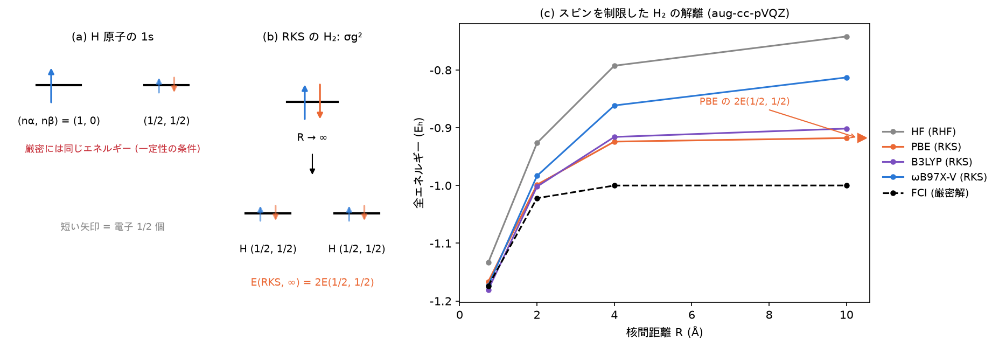
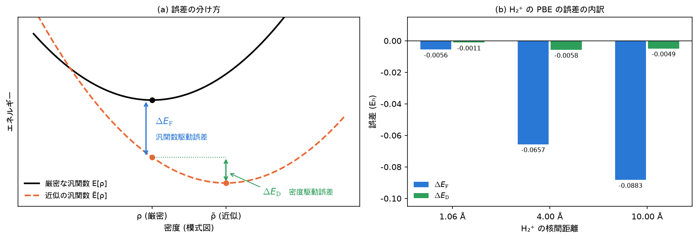

# 第 18 回　DFT の誤差：自己相互作用誤差と静的相関

!!! abstract "この回の道筋"
    近似の汎関数の誤差の多くは、2 つの「厳密な条件」を破ることから説明できます。電子の数が分数のときにエネルギーが直線になる条件と、スピンが分数のときにエネルギーが一定になる条件です。この回では、1 電子の自己相互作用誤差から始めて、この 2 つの条件と、それを破ったときに起こる失敗（H₂⁺ と H₂ の解離）を、計算で確かめます。最後に、誤差を「汎関数のせい」と「密度のせい」に分ける考え方（DC-DFT）を紹介します。

    | 節 | 内容 |
    |---|---|
    | 1 | 1 電子の自己相互作用誤差 |
    | 2 | 分数電荷とエネルギーの直線性 |
    | 3 | 多電子の自己相互作用誤差と非局在化誤差 |
    | 4 | 計算例：H₂⁺ の解離 |
    | 5 | 分数スピンと静的相関誤差 |
    | 6 | 計算例：H₂ の解離 |
    | 7 | 密度駆動誤差と汎関数駆動誤差 |

    **前に読んでおく回**：量子化学の理論 [第 7 回](07-electron-correlation.md)、[第 15 回](15-kohn-sham.md)、[第 16 回](16-functionals.md)

!!! tip "物理的なイメージ"
    この回で調べるのは、近似の汎関数がもつ「電子が自分自身と反発してしまう」誤り（自己相互作用誤差）とその仲間です。電子 1 個の系でも、近似の汎関数では、クーロン反発と交換のエネルギーが正しく打ち消し合わず、電子が自分自身の分布と反発します。その結果、エネルギーは電子の数について下に凸に曲がり、電子をいくつかの場所に広げた状態を好みすぎます（H₂⁺ の解離の失敗）。また、スピンが分数の状態を正しく扱えないと、H₂ の解離のように静的相関の強い状態で、エネルギーが高くなりすぎます。

この回では原子単位を使います。エネルギーの換算は 1 $E_\mathrm h$ = 27.211 eV = 627.5 kcal/mol です。
計算はすべて PySCF [Sun 2020] で、基底関数は aug-cc-pVQZ です。
2 電子積分は、化学者の表記 $(pq|rs)$ で書きます。

## 1. 1 電子の自己相互作用誤差

### 1.1 自分自身との反発を打ち消す条件

[第 15 回](15-kohn-sham.md)で見たように、Kohn–Sham 法のエネルギーには、古典的な静電エネルギー

$$
J[\rho] = \frac12\iint\frac{\rho(\mathbf r_1)\rho(\mathbf r_2)}{r_{12}}\,d\mathbf r_1d\mathbf r_2
$$

が入っています。
$J$ は、電荷の雲を小片に分け、すべての小片の対の反発を足したものです。
電子が 1 個しかなくても、その電子の雲の小片どうしの反発を数えてしまいます（図 1 (a)）。
つまり $J$ は、電子が自分自身の雲と反発する分も含みます。

電子が 1 個の系（H 原子や H₂⁺）では、電子どうしの反発は本当は 0 です。
したがって、厳密な汎関数は、どんな 1 電子の密度についても

$$
E_\mathrm{xc}[\rho] = -J[\rho]
$$

を満たします。
自分自身との反発を、交換相関エネルギーがちょうど打ち消すということです。
Hartree–Fock 法では、第 5 回で見たとおり、交換の項がこれを自動的に打ち消します。
軌道 $\phi$ に電子が 1 個あるとき、交換積分 $(\phi\phi|\phi\phi)$ はクーロン積分と同じもので、$J = \frac12(\phi\phi|\phi\phi)$、$E_\mathrm x^\mathrm{HF} = -\frac12(\phi\phi|\phi\phi)$ となって、ちょうど消えるからです。

ところが、LDA や GGA の $E_\mathrm{xc}$ は、一般にこの条件を満たしません。
残った $J + E_\mathrm{xc}$ を、1 電子の自己相互作用誤差（self-interaction error、SIE）と呼びます。
Perdew と Zunger は、この誤差を軌道ごとに差し引く補正（自己相互作用補正、SIC）を提案しました [Perdew 1981]。

### 1.2 H 原子で確かめる

H 原子の 1s の密度で、$J$ と $E_\mathrm{xc}$ を別々に計算します。
1 電子の H 原子では、UHF の密度がこの基底関数の中でのほぼ厳密な密度です。
その 1s の軌道を固定したまま、α と β の電子をそれぞれ $n_\alpha$、$n_\beta$ 個分入れた密度について、各項を評価します。
分数の個数を入れる意味は、2 節と 5 節で説明します。ここではまず $(n_\alpha, n_\beta) = (1, 0)$、つまりふつうの H 原子の行を見ます。

```python
import numpy as np
from pyscf import gto, scf, dft

basis = "aug-cc-pvqz"
h = gto.M(atom="H 0 0 0", basis=basis, spin=1, verbose=0)
hf = scf.UHF(h).run()
d1 = hf.make_rdm1()[0]       # 1s に α 電子 1 個の密度行列（この基底でほぼ厳密）

def parts(na, nb, xcs=("SVWN", "PBE")):
    """同じ 1s の軌道に α を na 個、β を nb 個入れたときの J と E_xc（軌道は固定）"""
    da, db = na * d1, nb * d1
    J = 0.5 * np.einsum("ij,ji", hf.get_j(h, da + db), da + db)
    ex_hf = -0.5 * sum(np.einsum("ij,ji", hf.get_k(h, d), d) for d in (da, db))
    out = [J, ex_hf]
    for xc in xcs:
        ks = dft.UKS(h); ks.xc = xc; ks.grids.level = 5; ks.grids.build()
        out.append(ks._numint.nr_uks(h, ks.grids, xc, np.array([da, db]))[1])
    return out

print("(nα, nβ)      J     Exc(HF) Exc(SVWN) Exc(PBE)")
for na, nb, lab in [(1, 0, "(1, 0)    "), (0.5, 0, "(1/2, 0)  "), (0.5, 0.5, "(1/2, 1/2)")]:
    print(lab + "".join(f"{v:9.5f}" for v in parts(na, nb)))
```

```text
(nα, nβ)      J     Exc(HF) Exc(SVWN) Exc(PBE)
(1, 0)      0.31244 -0.31244 -0.29013 -0.31186
(1/2, 0)    0.07811 -0.07811 -0.11633 -0.12888
(1/2, 1/2)  0.31244 -0.15622 -0.25411 -0.26885
```

1 行目から、$J = 0.31244\,E_\mathrm h$ です（厳密な 1s の値は $5/16 = 0.3125$）。
自己相互作用誤差 $J + E_\mathrm{xc}$ は、次のとおりです。

- **HF**：$0.31244 - 0.31244 = 0$ で、ちょうど打ち消します。
- **LDA（SVWN）**：$0.31244 - 0.29013 = +0.022\,E_\mathrm h$（0.6 eV）が残ります。
- **PBE**：$0.31244 - 0.31186 = +0.0006\,E_\mathrm h$ で、ほとんど打ち消します。

PBE の打ち消しがよいのは、交換が少し足りない分を、相関（1 電子の系では本当は 0）が埋め合わせた結果です。
このように、電子がちょうど 1 個の H 原子だけを見ると、誤差は目立たないことがあります。
誤差がはっきり現れるのは、2 行目と 3 行目のように、電子が分数個あるように見える状況です（図 1 (b)）。



**図 1**　(a) 電子 1 個の雲。$J$ は、雲の小片どうし（濃い青）の反発をすべて足すので、自分自身との反発を含みます。厳密な $E_\mathrm{xc}$ は、これを打ち消します。(b) 上の計算の $J + E_\mathrm{xc}$。厳密にはどの行も 0 です。HF は $(1, 0)$ と $(1/2, 0)$ で 0 ですが、$(1/2, 1/2)$ で大きく正になります。PBE は $(1, 0)$ ではほぼ 0 ですが、$(1/2, 0)$ で負、$(1/2, 1/2)$ で正になります。

**ここまでで分かったこと**：厳密な汎関数では、1 電子の系で $E_\mathrm{xc} = -J$ となり、自分自身との反発が打ち消されます。近似の汎関数ではこれが破れ、自己相互作用誤差が残ります。PBE は整数の H 原子ではほぼ打ち消しますが、分数の電子では打ち消しません。

## 2. 分数電荷とエネルギーの直線性

### 2.1 直線性の条件

電子の数 $N$ を分数に広げます。
分数の電子数は、たとえば、遠く離れた 2 つの原子の間で電子 1 個を分け合っているとき、それぞれの原子について現れます。

厳密なエネルギーが分数の電子数でどうなるべきかは、遠く離れた H₂⁺ を考えると分かります（4 節の図 3 (a)）。

1. 核の間の距離 $R$ が非常に大きい H₂⁺ の基底状態のエネルギーは、H 原子と H⁺ のエネルギーの和、$E(1) + E(0)$ です。ここで $E(n)$ は、電子を $n$ 個持つ H 原子のエネルギーで、$E(0) = 0$ です。
2. 電子が左の核にいる状態と右の核にいる状態は、同じエネルギーです。その対称な重ね合わせ（σg 軌道に電子が入った状態）も、$R \to \infty$ では同じエネルギーになります。
3. 対称な状態の密度は、各核のまわりに電子 1/2 個分ずつです。
4. 厳密な汎関数が、遠く離れた 2 つの断片のエネルギーの和を与えるとします（断片の間の相互作用は $R \to \infty$ で消えます）。すると、このエネルギーは $2E(1/2)$ です。
5. 2 と 4 から $2E(1/2) = E(1) + E(0)$、つまり $E(1/2) = \frac12E(0) + \frac12E(1)$ です。

電子 1/2 個の H 原子のエネルギーは、両端の平均、つまり両端を結ぶ直線の上にあります。
Perdew、Parr、Levy、Balduz は、電子の数が $N_0$ と $N_0 + 1$ の状態を $1-\omega$ と $\omega$ の割合で混ぜた統計的な混合（アンサンブル）を考え、一般に同じ結論を得ました [Perdew 1982]。
厳密なエネルギーは、整数の電子数の間で直線になります。

$$
E(N_0 + \omega) = (1 - \omega)\,E(N_0) + \omega\,E(N_0 + 1),\qquad 0 \le \omega \le 1
$$

直線の傾きは、$N_0 - 1 < N < N_0$ では $E(N_0) - E(N_0 - 1) = -I$（$I$ はイオン化エネルギー）、$N_0 < N < N_0 + 1$ では $E(N_0 + 1) - E(N_0) = -A$（$A$ は電子親和力）です。
ふつう $I > A$ なので、傾きは整数の $N_0$ で不連続に変わり、$E(N)$ は折れ線になります（図 2 (a)）。

[第 15 回](15-kohn-sham.md)の Janak の定理によれば、$\partial E/\partial n_\mathrm{HOMO} = \varepsilon_\mathrm{HOMO}$ でした。
エネルギーが直線なら、傾きは一定なので、$\varepsilon_\mathrm{HOMO}$ は占有数によらず $-I$ に等しくなります。
[第 15 回](15-kohn-sham.md)の $-\varepsilon_\mathrm{HOMO} = I$ は、この直線性から理解できます。

### 2.2 H 原子の E(N) を計算する

H 原子で、1s の α 電子の占有数 $n$ を 0 から 1 まで変えて、エネルギーを計算します。
1.2 節と違い、ここでは各 $n$ で軌道も最適化します。
[第 15 回](15-kohn-sham.md)と同じように、占有数を固定して SCF を解きます。
PySCF は電子 1 個の系を特別な近道で解くので、ここでは通常の SCF の手順（`scf.hf.kernel`）を呼びます。

```python
import numpy as np
from pyscf import gto, scf, dft

basis = "aug-cc-pvqz"
methods = ["HF", "PBE", "B3LYP", "WB97X-V"]
h = gto.M(atom="H 0 0 0", basis=basis, spin=1, verbose=0)

def e_occ(method, na, nb=0.0):
    """1s の α、β の占有数を na、nb に固定してエネルギーを求める。"""
    mf = scf.UHF(h) if method == "HF" else dft.UKS(h)
    if method != "HF":
        mf.xc = method
    def get_occ(mo_energy=None, mo_coeff=None):
        occ = np.zeros((2, h.nao))
        occ[0, 0], occ[1, 0] = na, nb
        return occ
    mf.get_occ = get_occ
    return scf.hf.kernel(mf)[1]       # 1 電子系の近道を使わず、SCF で解く

print("n     " + "".join(f"{m:>10s}" for m in methods))
for n in [0.25, 0.5, 0.75, 1.0]:
    print(f"{n:4.2f} " + "".join(f"{e_occ(m, n):10.5f}" for m in methods))
```

```text
n             HF       PBE     B3LYP   WB97X-V
0.25   -0.12499  -0.16142  -0.15535  -0.13473
0.50   -0.24997  -0.30319  -0.29432  -0.26618
0.75   -0.37496  -0.41611  -0.41018  -0.38847
1.00   -0.49995  -0.49993  -0.50239  -0.50074
```

$n = 0$ ではエネルギーは 0 です。
電子が 1 個以下の H 原子の厳密なエネルギーは、$E(n) = -0.5\,n$ の直線です。
図 2 (b) は、各方法の $E(n)$ から、両端を結ぶ直線 $n\,E(1)$ を引いたものです。

- **HF**：1 電子の系では自己相互作用がないので、直線になります。
- **PBE、B3LYP**：直線より下に曲がっています（下に凸、convex）。$n = 1/2$ では、両端を結んだ直線より、PBE で $0.053\,E_\mathrm h$（1.45 eV）、B3LYP で $0.043\,E_\mathrm h$ 低くなります。
- **ωB97X-V**：長距離の交換を厳密な交換にしているので、曲がりは $0.016\,E_\mathrm h$ まで小さくなりますが、消えてはいません。



**図 2**　(a) 模式図。厳密なエネルギー（黒）は整数の電子数の間で直線で、$N_0$ で傾きが $-I$ から $-A$ に変わる折れ線です。半局所汎関数（橙の破線）は直線より下に、HF（灰色の点線）は上に曲がります。(b) H 原子で計算した、直線からのずれ $E(n) - nE(1)$。HF は 0 のままで、PBE、B3LYP、ωB97X-V の順に下へのずれが大きくなります。四角は、1.2 節の表から求めた、軌道を固定したときの PBE の見積もりです。

### 2.3 なぜ下に曲がるのか

PBE は、$n = 1$ の H 原子ではほぼ正しいのに、分数の電子では大きく誤ります。
その理由は、1.2 節の表の 2 行目で分かります。
軌道を固定すると、エネルギーは

$$
E(n) = n\,E_\mathrm{1e} + \big[J + E_\mathrm{xc}\big](n)
$$

と書けます。
$E_\mathrm{1e}$ は、電子 1 個のときの運動エネルギーと核の引力の和で、この部分は $n$ に比例するので直線です。
直線からのずれは、後ろの $J + E_\mathrm{xc}$ からだけ生じます。
$n = 1/2$ で、両端を結ぶ直線からのずれを計算します。

1. 直線の上の値は、$E(0) = 0$ と $E(1)$ の平均 $\frac12E(1)$ です。
2. したがって、ずれは $E(1/2) - \frac12E(1) = [J + E_\mathrm{xc}](1/2) - \frac12[J + E_\mathrm{xc}](1)$ です（$E_\mathrm{1e}$ の部分は消えます）。
3. PBE では、表の値から $(0.07811 - 0.12888) - \frac12(0.31244 - 0.31186) = -0.0511\,E_\mathrm h$ です。

軌道を最適化した 2.2 節の値 $-0.053\,E_\mathrm h$ とほぼ一致します（図 2 (b) の四角）。
曲がりの大部分は、軌道の変化ではなく、$J + E_\mathrm{xc}$ の $n$ への依存から来ていることが分かります。

$n$ への依存の形を見ます。
電子の雲を $n$ 倍すると、$J$ は密度の 2 乗の積分なので $n^2$ 倍になります（表で $0.07811 = 0.31244/4$）。
厳密な交換も、HF の列のとおり $-n^2$ 倍で、$J$ と同じ割合で減ってちょうど打ち消します。
一方、LDA の交換は $\rho^{4/3}$ の積分なので、$n^{4/3}$ 倍にしかなりません（[第 16 回](16-functionals.md)）。
$n = 1/2$ では、$J$ は $1/4 = 0.25$ 倍に減るのに、LDA の交換は $2^{-4/3} \approx 0.40$ 倍にしか減りません。
分数の電子では、交換が自分自身との反発 $J$ を打ち消しすぎ、エネルギーが低くなりすぎるのです。
LDA の交換だけを入れて同じ計算をしてみます。1.2 節のコードで `xcs=("SLATER,",)` とすると、$(1, 0)$ の交換は $E_\mathrm x^\mathrm{LDA}(1) = -0.26799$ です。$J(1) = 0.31244$ と合わせて、ずれは

$$
0.31244\Big(\frac14 - \frac12\Big) - 0.26799\Big(2^{-4/3} - \frac12\Big) = -0.0781 + 0.0276 = -0.0505\,E_\mathrm h
$$

となり、PBE の値に近い大きさが出ます。
[第 15 回](15-kohn-sham.md)の H₂O の計算で、PBE の $E(n)$ が曲がっていたのも同じ理由です。

**ここまでで分かったこと**：厳密なエネルギーは、整数の電子数の間で直線です。PBE や B3LYP のエネルギーは下に凸に曲がり、分数の電子をもつ状態を低く見積もりすぎます。原因は、$J$ が $n^2$ で減るのに、半局所の交換が $n^{4/3}$ でしか減らないことです。

## 3. 多電子の自己相互作用誤差と非局在化誤差

前の節の H 原子は 1 電子の系でした。
電子が多い系でも、同じ曲がりが問題になります。
Mori-Sánchez、Cohen、Yang は、1 電子の自己相互作用誤差を除いた汎関数でも、多電子の系では分数電荷のエネルギーが直線にならないことを示し、これを多電子の自己相互作用誤差と呼びました [Mori-Sánchez 2006]。
直線性からのずれが、自己相互作用誤差を多電子に広げた定義になります。

エネルギーが下に凸だと、電子を 1 か所に置くより、いくつかの場所に分数ずつ広げた方がエネルギーが低くなります。
2 つの場所に電子 1 個を置く例で確かめます。
片方に置けば $E(1) + E(0)$、半分ずつなら $2E(1/2)$ です。
直線なら 2 つは等しく、下に凸なら $E(1/2)$ が平均より低いので、半分ずつの方が低くなります。
そのため、近似の汎関数は、電子を広げすぎる傾向を持ちます。
これを非局在化誤差（delocalization error）と呼びます [Mori-Sánchez 2008]。
反対に、HF は上に凸（concave）で、電子を 1 か所に集めすぎる局在化誤差を持ちます [Mori-Sánchez 2008]。

非局在化誤差は、次のような失敗の原因になります。

- **分数の電荷への解離**：半局所汎関数では、中性の分子 XY を引き離すと、X$^{+q}$ と Y$^{-q}$ のように分数の電荷を帯びた断片に分かれることがあります。たとえば NaCl は Na$^{+0.4}$ と Cl$^{-0.4}$ に解離し得ます [Ruzsinszky 2006]。
- **バンドギャップの過小評価**：固体のバンドギャップの問題も、分数電荷のエネルギーの曲がりから説明されます [Mori-Sánchez 2008]。

Cohen、Mori-Sánchez、Yang は、この非局在化誤差と、第 5 節で扱う静的相関誤差が、DFT の多くの目立った失敗の原因であり、分数電荷と分数スピンの見方で理解できると述べています [Cohen 2008a]。

**ここまでで分かったこと**：分数電荷のエネルギーが下に凸だと、電子を広げすぎる非局在化誤差が生じます。半局所汎関数と多くの混成汎関数はこの誤差を持ち、HF は逆の局在化誤差を持ちます。

## 4. 計算例：H₂⁺ の解離

非局在化誤差がいちばん単純に現れるのが、H₂⁺ の解離です。
H₂⁺ は電子が 1 個なので、HF はこの基底関数の中での厳密解です。
原子核の間の距離 $R$ を大きくすると、正しい答えは H 原子 + H⁺ で、エネルギーは $-0.5\,E_\mathrm h$ に近づきます。

ここでは、分子の対称性を保った解（電子が両方の核に半分ずつある解）を求めます。
離れた距離では、DFT の SCF が電子を片方に寄せた解に落ちることがあるので、`symmetry=True` で対称性を課します。

```python
from pyscf import gto, scf, dft

def make_mf(mol, method):
    if method == "HF":
        return scf.UHF(mol)
    mf = dft.UKS(mol); mf.xc = method
    return mf

print("R/Å  " + "".join(f"{m:>10s}" for m in methods))
for R in [0.74, 1.06, 2.0, 3.0, 4.0, 6.0, 8.0, 10.0]:
    mol = gto.M(atom=f"H 0 0 0; H 0 0 {R}", basis=basis, charge=1, spin=1,
                symmetry=True, verbose=0)
    print(f"{R:4.2f} " + "".join(f"{make_mf(mol, m).run().e_tot:10.5f}" for m in methods))
```

```text
R/Å          HF       PBE     B3LYP   WB97X-V
0.74   -0.56961  -0.56960  -0.57184  -0.56940
1.06   -0.60253  -0.60927  -0.61008  -0.60741
2.00   -0.55220  -0.58297  -0.57937  -0.57084
3.00   -0.51516  -0.57127  -0.56296  -0.54331
4.00   -0.50355  -0.57497  -0.56398  -0.53505
6.00   -0.50019  -0.58439  -0.57109  -0.53255
8.00   -0.49999  -0.58985  -0.57543  -0.53240
10.00   -0.49997  -0.59315  -0.57806  -0.53237
```



**図 3**　(a) 離れた H₂⁺ の 2 つの状態。上は電子が片方の核にある状態（H + H⁺）、下は両方の核に半分ずつある状態です。厳密には 2 つは同じエネルギーですが、下に凸の汎関数では下の状態が低くなりすぎます。(b) 上の表をグラフにしたもの。HF（厳密解）は $-0.5\,E_\mathrm h$ に近づきますが、PBE と B3LYP は離れるほどかえって下がります。点線は、次に説明する PBE の解離の極限 $2E_\mathrm{PBE}(1/2) = -0.606\,E_\mathrm h$ です。

HF（厳密解）は、$R$ とともに $-0.5\,E_\mathrm h$ に近づきます。
一方、PBE と B3LYP は、離れるほどかえってエネルギーが下がり、10 Å では厳密解より $0.09\,E_\mathrm h$（PBE、2.5 eV）や $0.08\,E_\mathrm h$（B3LYP）も低くなります。
平衡距離 1.06 Å でも、PBE は $0.007\,E_\mathrm h$（4.2 kcal/mol）低すぎます。

離れた H₂⁺ は、電子を半分ずつ持つ 2 個の H 原子です。
PBE は半局所汎関数なので、[第 17 回](17-dispersion.md) 2 節で見たように、重ならない 2 つの密度の $E_\mathrm{xc}$ は、それぞれの和になります。
したがって、エネルギーは前の節の $E(1/2)$ の 2 倍に、2 つの原子の間の古典的な静電的な相互作用を足したものになるはずです。
各原子の電荷は、核の $+1$ と電子の雲の $-1/2$ です。
静電的な相互作用を、組ごとに足します。

1. 核どうしの反発：$(+1)(+1)/R = 1/R$。
2. 各原子の電子の雲と、相手の核の引力：$(-\frac12)(+1)/R$ が 2 組で、$-1/R$。
3. 2 つの電子の雲どうしの反発：$(-\frac12)(-\frac12)/R = 1/(4R)$。
4. 合計：$1/R - 1/R + 1/(4R) = +1/(4R)$。

PBE で $R = 10$ Å（18.90 bohr）を計算すると、

$$
2E_\mathrm{PBE}(1/2) + \frac{1}{4R} = 2\times(-0.30319) + 0.01323 = -0.59315\,E_\mathrm h
$$

となり、表の値と一致します。
H₂⁺ の解離の誤差は、H 原子の $E(n)$ の曲がりそのものです。
曲がりの小さい ωB97X-V では、誤差も小さくなっています。
厳密な交換を含む B3LYP と ωB97X-V では、厳密な交換が 2 つの核にまたがる軌道を通して離れた点を結ぶので、この関係は PBE ほど正確には成り立ちません。

なお、PBE では、電子を片方の核に寄せた解（正しい H + H⁺）より、両方に半分ずつ広げた解の方がエネルギーが低くなります。
対称性を課さなかった最初の試みでは、6 Å 以上で SCF が寄せた解に落ち、$-0.4993\,E_\mathrm h$ 付近の値を与えました。
これは、PBE のエネルギーの最小ではなく、たまたま SCF が止まった別の解です。
汎関数の最小が誤った（広がりすぎた）密度を選ぶことが、非局在化誤差の本質です。

**ここまでで分かったこと**：H₂⁺ の解離では、PBE や B3LYP は電子を両方の核に半分ずつ広げた状態を低く見積もりすぎ、エネルギーが下がりすぎます。その大きさは、分数電荷のエネルギーの曲がりで定量的に説明できます。

## 5. 分数スピンと静的相関誤差

### 5.1 一定性の条件

次に、電子の数は整数のまま、スピンが分数になる状況を考えます。
H 原子で、α 電子 1/2 個と β 電子 1/2 個が 1s に入った状態です（図 4 (a)）。
これは、α スピンの H 原子と β スピンの H 原子を半分ずつ混ぜたアンサンブルで、どちらも同じエネルギーの基底状態です。
Cohen、Mori-Sánchez、Yang は、このような分数スピンの状態について、厳密な汎関数のエネルギーは、混ぜたもとの状態のエネルギーと同じで一定であることを証明しました [Cohen 2008b]。
H 原子なら、$-0.5\,E_\mathrm h$ のままです。
これを一定性の条件（constancy condition）と呼びます。

### 5.2 H₂ の解離で分数スピンが現れる

分数スピンの状態は、静的相関（第 7 回）の強い系で自然に現れます。
H₂ を解離させると、正しい状態は 2 個の H 原子で、それぞれのスピンは α とも β とも決まりません。
スピンを制限した（RKS の）計算で、各原子のスピン密度がどうなるかを 1 段ずつ見ます。

1. RKS では、α と β の電子が 1 個ずつ、同じ軌道 $\sigma_g$ に入ります（図 4 (b)）。
2. 離れた距離では、2 つの H の 1s 関数 $a$、$b$ を使って $\sigma_g = (a + b)/\sqrt2$ と書けます（重なりは 0 とします）。
3. α 電子の密度は $\rho_\alpha = \sigma_g^2 = \frac12a^2 + \frac12b^2 + ab$ です。
4. 離れた距離では $a$ と $b$ は重ならないので $ab = 0$ で、$\rho_\alpha = \frac12a^2 + \frac12b^2$ です。β も同じです。
5. したがって、原子 A のまわりには α 電子 1/2 個と β 電子 1/2 個があり、原子 B も同じです。

つまり、解離の極限の RKS の密度は、分数スピンの H 原子 2 個です。
半局所汎関数では、離れた 2 つの断片のエネルギーは和になるので、解離の極限の RKS のエネルギーは、分数スピンの H 原子のエネルギーの 2 倍です。

一定性の条件は、ここからも理解できます。
厳密な H₂ の一重項の基底状態も、解離の極限では各原子に α と β が 1/2 個ずつの密度を持ちます（スピンの向きが決まっていないからです）。
そのエネルギーは H 原子 2 個の $-1.0\,E_\mathrm h$ です。
厳密な汎関数が断片のエネルギーの和を与えるなら、$2E(1/2, 1/2) = -1.0$、つまり $E(1/2, 1/2) = -0.5\,E_\mathrm h = E(1, 0)$ でなければなりません。

### 5.3 波動関数で見ると

第 7 回で見たように、最小基底の H₂ の厳密な基底状態は、$\sigma_g^2$ と $\sigma_u^2$ の 2 つの配置の混合です。
2 つの配置の中でのハミルトニアンの行列は

$$
\mathbf H =
\begin{pmatrix}
2h_{gg} + (gg|gg) & (gu|gu) \\
(gu|gu) & 2h_{uu} + (uu|uu)
\end{pmatrix}
\begin{matrix} \leftarrow \sigma_g^2 \\ \leftarrow \sigma_u^2 \end{matrix}
$$

です。
$h_{pp}$ は軌道 $p$ の 1 電子のエネルギー（運動エネルギーと核の引力）、$(gu|gu)$ は 2 つの配置を結ぶ交換積分です。
解離の極限で、各要素を $a$、$b$ の量で書きます（$a$ と $b$ は重ならず、$1/R \to 0$ とします）。

1. $\sigma_g = (a+b)/\sqrt2$、$\sigma_u = (a-b)/\sqrt2$ なので、$h_{gg} = h_{uu} = h_{aa}$ です。$h_{aa}$ は H 原子の 1 電子のエネルギーで、厳密な 1s なら $-0.5$ です。
2. $\sigma_g^2 = \frac12(a^2 + b^2)$ なので、$(gg|gg) = \frac14\big[(aa|aa) + (bb|bb)\big] = \frac12U$ です。ここで $U = (aa|aa)$ は、同じ原子の 1s に電子が 2 個入ったときの反発です。
3. 同じく $(uu|uu) = \frac12U$、そして $\sigma_g\sigma_u = \frac12(a^2 - b^2)$ から $(gu|gu) = \frac12U$ です。

したがって、解離の極限の行列は

$$
\mathbf H \to
\begin{pmatrix}
2h_{aa} + \frac12U & \frac12U \\
\frac12U & 2h_{aa} + \frac12U
\end{pmatrix}
$$

です。
固有値は $2h_{aa} + U$ と $2h_{aa}$ で、低い方の $2h_{aa} = 2E(\mathrm H)$ が正しい解離の極限です。
その固有ベクトルは $(\sigma_g^2 - \sigma_u^2)/\sqrt2$ で、2 つの配置が同じ重みで混ざっています。
一方、RHF は $\sigma_g^2$ の 1 個の配置だけなので、エネルギーは左上の要素 $2h_{aa} + \frac12U$ で、$\frac12U$ だけ高すぎます。
厳密な 1s では $U = 5/8$ なので、誤差は $5/16 = 0.3125\,E_\mathrm h$ です。

この誤差は、1.2 節の表の 3 行目とつながっています。
HF で分数スピンの H 原子 $(1/2, 1/2)$ を計算すると、$J + E_\mathrm x^\mathrm{HF} = 0.31244 - 0.15622 = +0.156\,E_\mathrm h$ でした。
α の半分の雲と β の半分の雲は、互いに反発しますが、スピンが違うので交換で打ち消されないからです（交換は $-J[\rho_\alpha] - J[\rho_\beta] = -\frac14J - \frac14J = -\frac12J$ で、$J$ の半分しか打ち消しません）。
H 原子 2 個分で $2\times0.156 = 0.312\,E_\mathrm h$ となり、上の $\frac12U$ と一致します。
RHF の解離の誤差は、分数スピンの H 原子の誤差そのものです。



**図 4**　(a) H 原子の 1s に α 電子 1 個が入った状態と、α と β が 1/2 個ずつ入った状態（短い矢印が電子 1/2 個）。厳密には同じエネルギーです。(b) RKS の H₂ は α と β が σg に入った閉殻で、解離の極限では各 H 原子が α と β を 1/2 個ずつ持ちます。(c) 6 節の計算の結果。スピンを制限した計算（実線）は、どれも FCI（黒の破線）の $-1.0\,E_\mathrm h$ まで下がりません。PBE の 10 Å の値は、右端の三角で示した $2E_\mathrm{PBE}(1/2, 1/2)$ に一致します。

### 5.4 近似の汎関数の静的相関誤差

近似の汎関数は、一定性の条件を大きく破ります [Cohen 2008b]。
その誤差を静的相関誤差（static correlation error）と呼びます。
結合の解離や、Mott 絶縁体のバンド構造などの強相関の系で、大きな誤差の原因になります。

1.2 節の表の 3 行目で、軌道を固定した PBE の値を見ます。
$J + E_\mathrm{xc} = 0.31244 - 0.26885 = +0.0436\,E_\mathrm h$ で、1 行目の $(1, 0)$ の $+0.0006$ より $0.043\,E_\mathrm h$ 高くなります。
半局所汎関数の交換は α と β の密度を別々に見るので、HF と同じく、α と β の雲どうしの反発を打ち消しきれません。
ただし、半局所の相関（1 行目の $-0.006$ から 3 行目の $-0.015$ へ大きくなります）がその一部を埋め合わせるので、誤差は HF よりかなり小さくなります。

**ここまでで分かったこと**：厳密な汎関数では、分数スピンの状態のエネルギーは一定です。スピンを制限した H₂ は、解離の極限で分数スピンの H 原子 2 個になります。近似の汎関数はこの条件を破り、結合の解離などで静的相関誤差を生みます。

## 6. 計算例：H₂ の解離

分数スピンの H 原子のエネルギーと、スピンを制限した H₂ の解離曲線を、軌道を最適化して計算します。
`e_occ` は第 2.2 節の関数です。
離れた距離では、σg 軌道と σu 軌道のエネルギーがほぼ等しくなり、SCF が収束しにくくなります。
そこで対称性を使い、2 個の電子を σg 軌道に入れることを指定します（`irrep_nelec`）。

```python
from pyscf import fci

print("H 原子     " + "".join(f"{m:>10s}" for m in methods))
print("(1, 0)     " + "".join(f"{e_occ(m, 1.0, 0.0):10.5f}" for m in methods))
print("(1/2, 1/2) " + "".join(f"{e_occ(m, 0.5, 0.5):10.5f}" for m in methods))

def rks(mol, method):
    mf = scf.RHF(mol) if method == "HF" else dft.RKS(mol)
    if method != "HF":
        mf.xc = method
    mf.irrep_nelec = {"A1g": 2}       # 2 個の電子を σg 軌道に入れる
    return mf.run()

print("H2 (R/Å)  " + "".join(f"{m:>10s}" for m in methods) + "       FCI")
for R in [0.74, 2.0, 4.0, 10.0]:
    mol = gto.M(atom=f"H 0 0 0; H 0 0 {R}", basis=basis, symmetry=True, verbose=0)
    es = [rks(mol, m).e_tot for m in methods]
    mol_c1 = gto.M(atom=f"H 0 0 0; H 0 0 {R}", basis=basis, verbose=0)   # FCI は対称性なしで
    e_fci = fci.FCI(scf.RHF(mol_c1).run()).kernel()[0]
    print(f"{R:5.2f}     " + "".join(f"{e:10.5f}" for e in es) + f"{e_fci:10.5f}")
```

```text
H 原子             HF       PBE     B3LYP   WB97X-V
(1, 0)       -0.49995  -0.49993  -0.50239  -0.50074
(1/2, 1/2)   -0.35764  -0.45888  -0.44805  -0.39315
H2 (R/Å)          HF       PBE     B3LYP   WB97X-V       FCI
 0.74       -1.13348  -1.16653  -1.18054  -1.17308  -1.17386
 2.00       -0.92633  -0.99858  -1.00189  -0.98326  -1.02193
 4.00       -0.79245  -0.92390  -0.91582  -0.86133  -0.99999
10.00       -0.74177  -0.91775  -0.90138  -0.81277  -0.99990
```

まず H 原子です。
α と β が 1/2 ずつの状態のエネルギーは、厳密には $-0.5\,E_\mathrm h$ のはずです。
ところが、どの方法でもエネルギーが高くなり、PBE で $0.041\,E_\mathrm h$（1.1 eV）、B3LYP で $0.052\,E_\mathrm h$、ωB97X-V で $0.107\,E_\mathrm h$、HF で $0.142\,E_\mathrm h$ も高すぎます。
軌道を固定した 1.2 節の見積もり（PBE で 0.043、HF で 0.156）と、ほぼ同じ大きさです。
この表では、厳密な交換を多く含む方法ほど、誤差が大きくなっています。
5.3 節で見たとおり、厳密な交換は α と β の半分の雲どうしの反発を打ち消さないからです。

次に H₂ です（図 4 (c)）。
FCI は、この基底関数の中での厳密解で、10 Å では H 原子 2 個のエネルギー $-1.0\,E_\mathrm h$ に近づきます。
スピンを制限した計算は、どれもそこまで下がりません。
PBE の 10 Å の値 $-0.91775\,E_\mathrm h$ は、分数スピンの H 原子のエネルギーの 2 倍 $2\times(-0.45888) = -0.91776\,E_\mathrm h$ と一致します。
解離の極限での誤差は、分数スピンの H 原子の誤差そのものです。
B3LYP と ωB97X-V も、ほぼ同じ関係になっています。
ただし、厳密な交換は 2 つの原子にまたがる軌道を通して離れた点を結ぶので、一致は PBE ほど正確ではありません。

HF の誤差は、5.3 節で見たとおり、イオン型の配置が半分混ざることによるものです（第 7 回）。
DFT の誤差はそれより小さいものの、PBE でも $0.082\,E_\mathrm h$（2.2 eV）残ります。
平衡距離の付近（0.74 Å）では、DFT は FCI に近い値を与えています。
静的相関誤差は、結合が切れて静的相関が強くなるほど大きくなります。

第 7 回で見たように、スピンの対称性を破った解（UKS）を使えば、解離の極限のエネルギーは正しくなります。
しかし、それは各原子に α か β の電子を整数個ずつ置くことで、分数スピンの状態を避けているだけです。
そのかわり、スピン汚染が生じます。
スピンを保ったまま正しいエネルギーを与えるには、一定性の条件を満たす汎関数が必要です。Cohen らは、この条件に近づけることを汎関数の開発の大きな目標にすべきだと述べています [Cohen 2008b]。

**ここまでで分かったこと**：スピンを制限した H₂ の解離の極限のエネルギーは、分数スピンの H 原子のエネルギーの 2 倍です。近似の汎関数は分数スピンのエネルギーを高く見積もるので、解離の極限で大きな誤差（静的相関誤差）が出ます。

## 7. 密度駆動誤差と汎関数駆動誤差

### 7.1 誤差を 2 つに分ける

近似の汎関数 $\tilde E$ で SCF を解くと、エネルギーだけでなく密度 $\tilde\rho$ も近似になります。
$\rho$ を厳密な密度、$E[\rho]$ を厳密なエネルギーとします。
エネルギーの誤差 $\Delta E = \tilde E[\tilde\rho] - E[\rho]$ に、$\tilde E[\rho]$（近似の汎関数を厳密な密度で評価した値）を足して引くと、

$$
\Delta E = \tilde E[\tilde\rho] - E[\rho]
= \underbrace{\tilde E[\rho] - E[\rho]}_{\Delta E_\mathrm F}
+ \underbrace{\tilde E[\tilde\rho] - \tilde E[\rho]}_{\Delta E_\mathrm D}
$$

と 2 つに分けられます。
Kim、Sim、Burke は、この分け方で誤差の原因を区別しました [Kim 2013]（図 5 (a)）。

- **汎関数駆動誤差** $\Delta E_\mathrm F$：正しい密度を使っても残る、汎関数そのものの誤差です。
- **密度駆動誤差** $\Delta E_\mathrm D$：密度が正しくないことから来る誤差です。$\tilde\rho$ は $\tilde E$ を最小にする密度なので、ほかのどの密度（$\rho$ も含む）より $\tilde E$ が低く、$\tilde E[\tilde\rho] \le \tilde E[\rho]$、つまり $\Delta E_\mathrm D \le 0$ です。



**図 5**　(a) 模式図。横軸は密度（を 1 本の軸で表したもの）です。厳密な汎関数（黒）は厳密な密度 $\rho$ で最小になります。近似の汎関数（橙の破線）は別の密度 $\tilde\rho$ で最小になります。$\rho$ の位置での 2 本の曲線の差が汎関数駆動誤差、橙の曲線の上で $\rho$ から $\tilde\rho$ へ下りる分が密度駆動誤差です。(b) 7.3 節の H₂⁺ の PBE の誤差の内訳。どの距離でも、汎関数駆動誤差（青）が大部分です。

ふつうの計算では、汎関数駆動誤差が大部分を占めます。
しかし、密度駆動誤差が大きくなる「異常な」場合があります。
Kim らは、その例として、H⁻ などの陰イオンの電子親和力、引き離した NaCl（PBE では Na$^{0.4+}$ と Cl$^{0.4-}$ に分かれます）、溶液中のラジカルの構造を挙げています。
また、HOMO と LUMO の差（軌道のギャップ）が小さいことが、密度駆動誤差が大きいことの目安になるとしています。

### 7.2 DC-DFT

密度駆動誤差が大きい場合は、より正確な密度で汎関数を評価すれば誤差が減ります。
これを密度補正 DFT（density-corrected DFT、DC-DFT）と呼びます。
Kim らは、HF の密度で DFT のエネルギーを評価する方法（HF-DFT）を提案しました [Kim 2013]。
自己相互作用誤差で密度が広がりすぎる場合、HF の密度は、近似の汎関数の密度より正確なことが多いためです（3 節で見たように、HF は逆に電子を集めすぎる側の誤差を持ちます）。
Sim、Song、Burke は、厳密な密度が分からなくても、密度駆動誤差がどれくらい重要かを見積もる方法を示しました [Sim 2018]。
また、密度の誤差が大きい場合に混成汎関数の厳密な交換の割合を調節することがありますが、DC-DFT を使えばその必要はないと述べています。

### 7.3 H₂⁺ の誤差を分ける

H₂⁺ は電子が 1 個なので、HF の密度がこの基底関数の中での厳密な密度です。
そこで、PBE の誤差を 2 つに分けてみます。
`ks.energy_tot(dm=...)` で、PBE のエネルギーを HF の密度行列で評価できます。

```python
print(" R/Å   E(PBE)    ΔE      ΔE_F     ΔE_D   （単位 Eh）")
for R in [1.06, 4.0, 10.0]:
    mol = gto.M(atom=f"H 0 0 0; H 0 0 {R}", basis=basis, charge=1, spin=1,
                symmetry=True, verbose=0)
    hf = scf.UHF(mol).run()              # 1 電子系なので、HF の密度がこの基底での厳密な密度
    ks = dft.UKS(mol); ks.xc = "PBE"; ks.run()
    e_exact = hf.e_tot
    e_pbe_on_hf = ks.energy_tot(dm=hf.make_rdm1())   # PBE の汎関数を HF の密度で評価
    dE   = ks.e_tot - e_exact
    dE_F = e_pbe_on_hf - e_exact
    dE_D = ks.e_tot - e_pbe_on_hf
    print(f"{R:5.2f} {ks.e_tot:9.5f} {dE:8.5f} {dE_F:8.5f} {dE_D:8.5f}")
```

```text
 R/Å   E(PBE)    ΔE      ΔE_F     ΔE_D   （単位 Eh）
 1.06  -0.60927 -0.00673 -0.00559 -0.00114
 4.00  -0.57497 -0.07141 -0.06566 -0.00576
10.00  -0.59315 -0.09318 -0.08829 -0.00489
```

どの距離でも、誤差の 9 割前後は汎関数駆動誤差 $\Delta E_\mathrm F$ です（図 5 (b)）。
たとえば 10 Å では、$\Delta E_\mathrm F/\Delta E = 0.08829/0.09318 \approx 0.95$ です。
$\Delta E_\mathrm D$ は、7.1 節のとおり、どの距離でも負になっています。
対称性を保った H₂⁺ では、正しい密度も両方の核に半分ずつあるので、PBE の密度の形はそれほど間違っていません。
誤差の原因は、半分ずつの電子の雲に対する $E_\mathrm{xc}$ の値そのもの、つまり第 2 節の $E(n)$ の曲がりです。
このような場合は、HF の密度を使っても誤差はほとんど減りません。
密度駆動誤差が大きいのは、第 7.1 節の NaCl のように、近似の汎関数が密度そのものを誤った形にしてしまう場合です。

**ここまでで分かったこと**：エネルギーの誤差は、汎関数駆動誤差と密度駆動誤差に分けられます。ふつうは前者が大きく、後者が大きい異常な場合には、HF の密度などを使う DC-DFT で誤差を減らせます。

## まとめ

- 厳密な汎関数は、1 電子の系で $E_\mathrm{xc} = -J$ を満たします。近似の汎関数ではこれが破れ、自己相互作用誤差が残ります。
- 厳密なエネルギーは、分数電荷について直線になります。半局所汎関数や B3LYP のエネルギーは、$J$（$n^2$ で減る）と半局所の交換（$n^{4/3}$ で減る）の食い違いのために下に凸に曲がり、電子を広げすぎる非局在化誤差を生みます。H₂⁺ の解離での大きな誤差は、この曲がりで定量的に説明できます。
- 厳密なエネルギーは、分数スピンについて一定です。近似の汎関数はこれを破り、H₂ の解離のような静的相関の強い系で誤差（静的相関誤差）を生みます。RHF の解離の誤差も、分数スピンの H 原子の誤差として理解できます。
- エネルギーの誤差は、汎関数駆動誤差と密度駆動誤差に分けられます。密度駆動誤差が大きいときは、HF の密度などで評価する DC-DFT が有効です。

## 参考文献

- J. P. Perdew, A. Zunger, "Self-interaction correction to density-functional approximations for many-electron systems", Phys. Rev. B 23, 5048 (1981). DOI: [10.1103/PhysRevB.23.5048](https://doi.org/10.1103/PhysRevB.23.5048)
- J. P. Perdew, R. G. Parr, M. Levy, J. L. Balduz Jr., "Density-Functional Theory for Fractional Particle Number: Derivative Discontinuities of the Energy", Phys. Rev. Lett. 49, 1691 (1982). DOI: [10.1103/PhysRevLett.49.1691](https://doi.org/10.1103/PhysRevLett.49.1691)
- P. Mori-Sánchez, A. J. Cohen, W. Yang, "Many-electron self-interaction error in approximate density functionals", J. Chem. Phys. 125, 201102 (2006). DOI: [10.1063/1.2403848](https://doi.org/10.1063/1.2403848)
- P. Mori-Sánchez, A. J. Cohen, W. Yang, "Localization and Delocalization Errors in Density Functional Theory and Implications for Band-Gap Prediction", Phys. Rev. Lett. 100, 146401 (2008). DOI: [10.1103/PhysRevLett.100.146401](https://doi.org/10.1103/PhysRevLett.100.146401)
- A. Ruzsinszky, J. P. Perdew, G. I. Csonka, O. A. Vydrov, G. E. Scuseria, "Spurious fractional charge on dissociated atoms: Pervasive and resilient self-interaction error of common density functionals", J. Chem. Phys. 125, 194112 (2006). DOI: [10.1063/1.2387954](https://doi.org/10.1063/1.2387954)
- A. J. Cohen, P. Mori-Sánchez, W. Yang, "Insights into Current Limitations of Density Functional Theory", Science 321, 792 (2008). DOI: [10.1126/science.1158722](https://doi.org/10.1126/science.1158722)
- A. J. Cohen, P. Mori-Sánchez, W. Yang, "Fractional spins and static correlation error in density functional theory", J. Chem. Phys. 129, 121104 (2008). DOI: [10.1063/1.2987202](https://doi.org/10.1063/1.2987202)
- M.-C. Kim, E. Sim, K. Burke, "Understanding and Reducing Errors in Density Functional Calculations", Phys. Rev. Lett. 111, 073003 (2013). DOI: [10.1103/PhysRevLett.111.073003](https://doi.org/10.1103/PhysRevLett.111.073003)
- E. Sim, S. Song, K. Burke, "Quantifying Density Errors in DFT", J. Phys. Chem. Lett. 9, 6385 (2018). DOI: [10.1021/acs.jpclett.8b02855](https://doi.org/10.1021/acs.jpclett.8b02855)
- Q. Sun et al., "Recent developments in the PySCF program package", J. Chem. Phys. 153, 024109 (2020). DOI: [10.1063/5.0006074](https://doi.org/10.1063/5.0006074)
