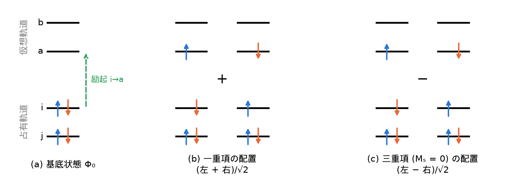
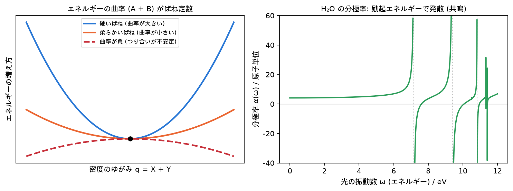
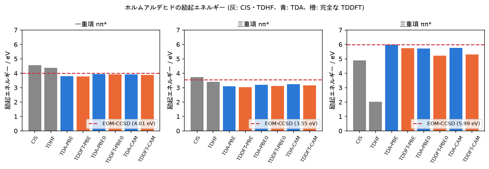
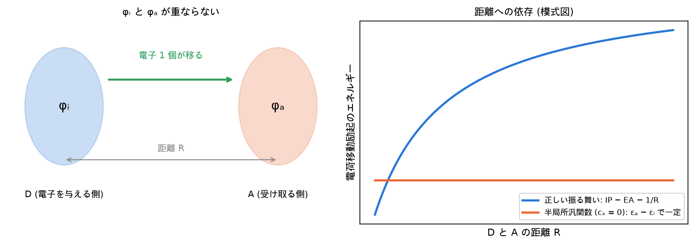

# 第 19 回　線形応答と TDDFT

!!! abstract "この回の道筋"
    励起状態のエネルギーを、基底状態の計算の延長として求める方法を学びます。まず、決定子 1 個から出発する最も簡単な方法 CIS を導き、次に時間に依存する Hartree–Fock 法（TDHF）と、密度汎関数理論を時間に依存する形に広げた TDDFT を、同じ形の行列の固有値問題として見ます。ホルムアルデヒドの励起エネルギーを計算して手法を比べ、最後に TDDFT が苦手な場面（電荷移動励起、二電子励起、三重項不安定性）を整理します。

    | 節 | 内容 |
    |---|---|
    | 1 | 励起状態を基底状態から求める |
    | 2 | CIS：1 電子励起の配置だけで対角化する |
    | 3 | TDHF：時間変化への応答として求める |
    | 4 | TDDFT：Runge–Gross の定理と断熱近似 |
    | 5 | 計算例：ホルムアルデヒドの励起エネルギー |
    | 6 | TDDFT が苦手な場面 |

    **前に読んでおく回**：[量子化学の理論 第 5 回](05-hartree-fock.md)、[第 4 回](04-spin.md)、[第 8 回](08-configuration-interaction.md)、[第 15 回](15-kohn-sham.md)、[第 16 回](16-functionals.md)

!!! tip "物理的なイメージ"
    TDHF と TDDFT が求めているのは、電子の密度の**固有振動の振動数**です。基底状態の密度は、エネルギーが最も低い「つり合いの位置」にあります。密度を少しゆがめるとエネルギーが上がり、元に戻そうとする力が働きます。このときのエネルギーの曲がり具合（密度についての 2 階微分）が、**ばね定数**にあたります。ばねにつながったおもりが決まった振動数で揺れるように、密度にも固有の振動数があり、その振動数の光（振動する電場）が当たると**共鳴**して大きく揺れます。この共鳴の振動数 $\omega$ が、励起エネルギーです。分子の振動数を、原子核の位置についてのエネルギーの 2 階微分（ヘッセ行列）と質量から求めるのと、同じ考え方です。

エネルギーは原子単位（ハートリー，$E_\mathrm{h}$）で書きます。1 $E_\mathrm{h}$ = 27.211 eV です。2 電子積分は、空間軌道についての化学者の表記 $(pq|rs)$ を使います。軌道はすべて実数とします。添字は、占有軌道を $i, j$、仮想軌道（空軌道）を $a, b$ で表します。

## 1. 励起状態を基底状態から求める

光の吸収や発光、光化学反応を調べるには、励起状態のエネルギーが必要です。基底状態のエネルギーとの差を**励起エネルギー**と呼び、光の吸収のスペクトルの位置に対応します。

励起状態を求める方法は、大きく二つに分けられます。

- **状態ごとに解く方法**：励起状態ごとに、別々に波動関数を求めます。第 12 回の状態平均 CASSCF と、第 13 回の CASPT2・NEVPT2 は、この考え方です。
- **基底状態から求める方法**：基底状態の波動関数を一度求め、そこからの「励起」として、多くの励起状態をまとめて求めます。この回で扱う CIS、TDHF、TDDFT は、こちらです。

後者の方法は、基底状態が決定子 1 個でよく表せることを前提にします。そのかわり、計算が比較的安く、大きな分子の多くの励起状態を一度に求められます。

**ここまでで分かったこと**：この回の方法は、決定子 1 個で表せる基底状態から出発し、多くの励起状態をまとめて求めます。

## 2. CIS：1 電子励起の配置だけで対角化する

### 2.1 行列の形

第 8 回の CI を思い出してください。CI の波動関数は、HF の決定子 $\Phi_0$ と、そこから電子を励起した配置の線形結合でした。

HF の決定子と 1 電子励起の配置の間のハミルトニアンの行列要素は、0 になります（Brillouin の定理、第 8 回）。そこで、1 電子励起の配置だけを使って励起状態を表し、その中でハミルトニアンを対角化します。これを **CIS**（configuration interaction singles）と呼びます [Foresman 1992]。

$$
\Psi_n = \sum_{ia} X_{ia}^{n}\, \Phi_i^a
$$

$\Phi_i^a$ は、占有軌道 $i$ の電子 1 個を仮想軌道 $a$ に移した配置、$X_{ia}^n$ はその係数です。

閉殻の分子では、配置をスピンについてそろえると、一重項と三重項の問題に分かれます（第 4 回）。図 1 のように、$i$ の α 電子を $a$ に移した決定子と、β 電子を移した決定子を、足すと一重項、引くと三重項（$M_S = 0$ の成分）の配置になります。



**図 1**　(a) 閉殻の基底状態。横線が軌道のエネルギー、青の上向きの矢印が α 電子、橙の下向きの矢印が β 電子です。(b) 占有軌道 $i$ から仮想軌道 $a$ へ電子を 1 個移した 2 つの決定子の和が、一重項の配置です。(c) 差が三重項の $M_S = 0$ の成分です。

行列の要素は次のとおりです。すべての段階を付録 A で導きます。

$$
A_{ia,jb}^{\mathrm S} = \delta_{ij}\delta_{ab}(\varepsilon_a - \varepsilon_i) + 2(ia|jb) - (ij|ab)
$$

$$
A_{ia,jb}^{\mathrm T} = \delta_{ij}\delta_{ab}(\varepsilon_a - \varepsilon_i) - (ij|ab)
$$

$\varepsilon_p$ は HF の軌道エネルギーです。励起エネルギー $\omega_n$ は、固有値問題

$$
\mathbf A \mathbf X^n = \omega_n \mathbf X^n
$$

の固有値として求まります。行列の行と列は、励起 $i \to a$ の組で番号づけられています。

具体的な形を見るため、占有軌道が HOMO の $h$ だけ、仮想軌道が LUMO の $l$ とその次の $m$ の 2 個だけの場合を書き出します。励起は $h \to l$ と $h \to m$ の 2 つなので、一重項の行列は 2 行 2 列です。

$$
\mathbf A^{\mathrm S} =
\begin{pmatrix}
\varepsilon_l - \varepsilon_h + 2(hl|hl) - (hh|ll) & 2(hl|hm) - (hh|lm) \\
2(hm|hl) - (hh|ml) & \varepsilon_m - \varepsilon_h + 2(hm|hm) - (hh|mm)
\end{pmatrix}
\begin{matrix} \leftarrow h \to l \\ \leftarrow h \to m \end{matrix}
$$

対角の要素は、それぞれの励起だけを考えたときのエネルギーです。非対角の要素は、2 つの励起を混ぜる結合です。結合が 0 なら、励起エネルギーは対角の要素そのものになります。結合があると、2 つの励起が混ざり、固有値は対角の要素から押し離されます（第 22 回の 2 状態の模型と同じしくみです）。

### 2.2 各項の意味

各項の意味は、次のとおりです。

- **$\varepsilon_a - \varepsilon_i$**：軌道エネルギーの差です。これだけなら、励起エネルギーは「空軌道と占有軌道のエネルギーの差」になります。
- **$-(ij|ab)$**：励起した電子（軌道 $a$）と、電子が抜けた穴（軌道 $i$）の間のクーロン引力です。軌道エネルギーの差は、電子が抜けた後の引力を含まないので、ここで補います。
- **$2(ia|jb)$**：一重項にだけ現れる交換型の項です。三重項にはないので、同じ軌道の組の励起では、ふつう三重項のほうが一重項より低くなります。

CIS は、変分法で求めた波動関数をもち、サイズ無矛盾です [Foresman 1992]。しかし、励起状態の電子相関を取り込まないので、励起エネルギーを大きく見積もる傾向があります（5 節の計算例でも、より精度の高い方法より 0.5 eV 高くなります）。

**ここまでで分かったこと**：CIS は、1 電子励起の配置の中でハミルトニアンを対角化します。行列は、軌道エネルギーの差と、電子と穴の相互作用の項からなります。

## 3. TDHF：時間変化への応答として求める

### 3.1 応答から励起エネルギーを求める考え方

分子に、ある振動数 $\omega$ で振動する弱い電場を当てると、電子の分布が同じ振動数で揺れます。この揺れの大きさ（分極率など）は、$\omega$ が励起エネルギーに一致したところで発散します。そこで、時間に依存する摂動に対する波動関数の応答（**線形応答**）を計算し、応答が発散する $\omega$ を探せば、励起エネルギーが求まります。

HF の波動関数の時間変化をこの考え方で扱うのが、**時間に依存する HF 法**（TDHF）です。乱雑位相近似（random phase approximation, RPA）とも呼ばれます。

### 3.2 行列の形

TDHF の励起エネルギーは、次の固有値問題で求まります [Dreuw 2005]。この式は、HF の密度行列の時間変化を表す運動方程式に小さな振動を入れて導けます。すべての段階を付録 B に書きます。

$$
\begin{pmatrix} \mathbf A & \mathbf B \\ \mathbf B & \mathbf A \end{pmatrix}
\begin{pmatrix} \mathbf X \\ \mathbf Y \end{pmatrix}
= \omega
\begin{pmatrix} \mathbf 1 & \mathbf 0 \\ \mathbf 0 & -\mathbf 1 \end{pmatrix}
\begin{pmatrix} \mathbf X \\ \mathbf Y \end{pmatrix}
$$

$\mathbf A$ は CIS と同じ行列です。新しく現れる $\mathbf B$ は、一重項と三重項で次のとおりです。

$$
B_{ia,jb}^{\mathrm S} = 2(ia|jb) - (ib|ja), \qquad
B_{ia,jb}^{\mathrm T} = -(ib|ja)
$$

$\mathbf X$ は占有から仮想への励起の振幅、$\mathbf Y$ は仮想から占有への「脱励起」の振幅です。$\mathbf Y$ は、基底状態が HF の決定子からずれている分（基底状態の相関の一部）を表すと考えられます。$\mathbf B = \mathbf 0$ とおけば $\mathbf Y = \mathbf 0$ となり、CIS に戻ります。

この式が何をしているかを、励起が 1 つ（$h \to l$ だけ）の場合で確かめます。$\mathbf A$、$\mathbf B$ はただの数 $A$、$B$ になり、問題は 2 行 2 列です。

$$
\begin{pmatrix} A & B \\ B & A \end{pmatrix}
\begin{pmatrix} X \\ Y \end{pmatrix}
= \omega \begin{pmatrix} X \\ -Y \end{pmatrix}
$$

1 行目と 2 行目を書き出すと、

$$
A X + B Y = \omega X, \qquad B X + A Y = -\omega Y
$$

です。2 本の式を足すと $(A + B)(X + Y) = \omega (X - Y)$、引くと $(A - B)(X - Y) = \omega (X + Y)$ になります。2 本目の式の両辺に $(A + B)$ をかけ、1 本目の式を使って $(A + B)(X + Y)$ を $\omega(X - Y)$ に置き換えると、

$$
(A + B)(A - B)(X - Y) = \omega (A + B)(X + Y) = \omega^2 (X - Y)
$$

なので、

$$
\omega^2 = (A + B)(A - B) = A^2 - B^2, \qquad \omega = \sqrt{A^2 - B^2}
$$

です。CIS の励起エネルギーは $A$ でした。$B \neq 0$ なら $\omega < A$ なので、この模型では、TDHF の励起エネルギーは CIS より低くなります。また、$A + B$ が 0 に近づくと $\omega$ も 0 に近づき、$A + B < 0$ では $\omega^2 < 0$ です。この 2 つの点が、3.3 節と 3.4 節の話の要になります。

軌道が実数のとき、この問題は次の形に書き直せます。

$$
(\mathbf A - \mathbf B)^{1/2} (\mathbf A + \mathbf B) (\mathbf A - \mathbf B)^{1/2}\, \mathbf Z = \omega^2 \mathbf Z
$$

求まるのは $\omega$ ではなく $\omega^2$ です。$\mathbf A + \mathbf B$ が負の固有値をもつと、$\omega^2 < 0$、つまり励起エネルギーが虚数になります。

### 3.3 三重項不安定性とのつながり

三重項の $\mathbf A^{\mathrm T} + \mathbf B^{\mathrm T}$ は、RHF の解が、スピン対称性を破った UHF の解へ崩れるかどうかを調べる行列と同じものです。第 7 回で使った安定性解析（`stability`）は、この行列の固有値が負かどうかを調べています。RHF の解が UHF に崩れる寸前（**三重項不安定性**に近い状態）では、この行列の固有値が 0 に近づき、TDHF の三重項の励起エネルギーが 0 に向かって下がります。5 節の計算例で、実際にこれを見ます。

### 3.4 物理的なイメージ：密度のばねと共鳴

3.2 節の式は、ばねでつながったおもりの振動を求める式と、同じ形をしています。3.2 節の固有値問題を 2 本の式に分けて書くと、

$$
\mathbf A \mathbf X + \mathbf B \mathbf Y = \omega \mathbf X, \qquad \mathbf B \mathbf X + \mathbf A \mathbf Y = -\omega \mathbf Y
$$

です。2 本を足したものと引いたものをつくり、$\mathbf q = \mathbf X + \mathbf Y$、$\mathbf p = \mathbf X - \mathbf Y$ とおくと、

$$
(\mathbf A + \mathbf B)\, \mathbf q = \omega\, \mathbf p, \qquad (\mathbf A - \mathbf B)\, \mathbf p = \omega\, \mathbf q
$$

となります。2 つ目の式に 1 つ目の式を代入すると、次の式が得られます。

$$
(\mathbf A - \mathbf B)(\mathbf A + \mathbf B)\, \mathbf q = \omega^2\, \mathbf q
$$

一方、質量 $m$ のおもりがばね定数 $k$ のばねにつながっていると、振動数は $\omega^2 = k/m$ で決まります。座標がたくさんある場合は、ばね定数の行列 $\mathbf K$ と質量の行列 $\mathbf M$ を使って、$\mathbf M^{-1} \mathbf K\, \mathbf q = \omega^2 \mathbf q$ です。分子の振動数の計算（基準振動の解析）は、まさにこの式を解いています。二つを比べると、次の対応が分かります。

| ばねとおもり | TDHF・TDDFT |
|---|---|
| おもりの位置 $\mathbf q$ | 密度（軌道）のゆがみ $\mathbf X + \mathbf Y$ |
| ばね定数 $\mathbf K$ | $\mathbf A + \mathbf B$：密度をゆがめたときのエネルギーの曲がり具合 |
| 質量の逆数 $\mathbf M^{-1}$ | $\mathbf A - \mathbf B$：ゆがみの変わる速さ（電子の流れ）にかかわる量 |
| 基準振動の振動数 | 励起エネルギー $\omega$ |

$\mathbf A + \mathbf B$ は、軌道を実数の範囲で少し回したとき（密度をゆがめたとき）のエネルギーの 2 階微分です。3.3 節の安定性の行列と同じもので、まさに「ばね定数」です。

このたとえで、いくつかのことが理解できます。

- **共鳴**：振動する電場を当てたときの分子の分極率は、次の形に書けます（原子単位、向きについて平均したもの）。

    $$
    \alpha(\omega) = \sum_n \frac{f_n}{\omega_n^2 - \omega^2}
    $$

    $\omega_n$ は励起エネルギー、$f_n$ は振動子強度（その振動がどれだけ強く光と結びつくか）です。外から揺すったばねの振れ幅が $1/(\omega_0^2 - \omega^2)$ に比例し、固有振動数で発散するのと同じ形です。3.1 節の「応答が発散する振動数を探す」とは、この共鳴を探すことです。
- **三重項不安定性**：3.3 節の状況は、ばねが柔らかくなり、ばね定数が 0 に近づいた状態です。振動数も 0 に近づきます。ばね定数が負になると振動数は虚数になり、つり合いの位置が実は不安定だったことを意味します。分子の振動解析で、遷移状態に虚数の振動数が現れるのと同じです。
- **CIS（TDA）**：$\mathbf B = 0$ とおくと、ばね定数と質量の逆数がどちらも $\mathbf A$ になり、$\omega$ は $\mathbf A$ の固有値そのものになります。振動として扱わずに、励起した配置のエネルギーを直接求めることにあたります。



**図 2**　左：密度のゆがみ $q$ に対するエネルギーの増え方。曲率（ばね定数 $\mathbf A + \mathbf B$）が大きいほど振動数が高く、曲率が小さいほど低くなります。曲率が負（赤の破線）だと、つり合いの位置は不安定です。右：H₂O の分極率 $\alpha(\omega)$ を、TD-PBE0/aug-cc-pVDZ で求めた最も低い 20 個の励起状態の和で計算したもの（上の式）。点線の位置（振動子強度が 0.01 を超える励起エネルギー）で発散し、符号が変わります。振動子強度がほぼ 0 の状態（暗い状態）では、発散は見えません。

このたとえには限界もあります。ここで扱ったのは、小さな揺れ（線形応答）だけです。調和振動子の基本振動数だけを求め、倍音を求めないのに似ていて、6.2 節で見る二電子励起は、このままでは現れません。

**ここまでで分かったこと**：TDHF の式は、ばね定数 $\mathbf A + \mathbf B$ と質量の逆数 $\mathbf A - \mathbf B$ をもつ振動子の式と同じ形です。励起エネルギーは、密度の固有振動の振動数で、光の電場がこの振動数に一致すると共鳴します。

**ここまでで分かったこと**：TDHF は、時間に依存する摂動への応答から励起エネルギーを求めます。CIS の行列に $\mathbf B$ が加わった形で、$\mathbf B = 0$ とおくと CIS に戻ります。三重項不安定性に近いと、三重項の励起エネルギーが下がりすぎます。

## 4. TDDFT：Runge–Gross の定理と断熱近似

### 4.1 Runge–Gross の定理

第 15 回では、基底状態の電子密度が外部ポテンシャルを決める、という Hohenberg–Kohn の定理を学びました。Runge と Gross は、これを時間に依存する系に広げました [Runge 1984]。時間に依存する電子密度 $\rho(\mathbf r, t)$ は、（決まった初期状態から出発したとき）時間に依存する外部ポテンシャルを、時間だけの関数の差を除いて一つに決めます。

これにより、時間に依存する問題も、Kohn–Sham 法と同じように、相互作用のない電子の系で扱えます。この理論を、**時間に依存する密度汎関数理論**（time-dependent DFT, TDDFT）と呼びます。

### 4.2 断熱近似

厳密な理論では、ある時刻の交換相関ポテンシャルは、それより前のすべての時刻の密度に依存します（記憶をもつ）。実際の計算では、これを無視し、各時刻の密度だけで決まるとします。つまり、基底状態の汎関数（第 16 回）を、各時刻の密度にそのまま使います。これを**断熱近似**と呼びます。

### 4.3 Casida の方程式

断熱近似のもとで、TDDFT の線形応答を TDHF と同じ形の行列の問題に書いたのが、Casida です [Casida 1995]。行列は TDHF と同じ形で、要素が次のように変わります。厳密な交換を割合 $c_\mathrm x$ だけ混ぜた混成汎関数で書きます（第 16 回）。

$$
A_{ia,jb}^{\mathrm S} = \delta_{ij}\delta_{ab}(\varepsilon_a - \varepsilon_i) + 2(ia|jb) - c_\mathrm x (ij|ab) + (ia|f_\mathrm{xc}^{\mathrm S}|jb)
$$

$$
B_{ia,jb}^{\mathrm S} = 2(ia|jb) - c_\mathrm x (ib|ja) + (ia|f_\mathrm{xc}^{\mathrm S}|jb)
$$

ここで、$\varepsilon_p$ は Kohn–Sham の軌道エネルギーです。$f_\mathrm{xc}$ は**交換相関カーネル**と呼ばれ、交換相関ポテンシャルを密度でもう一度微分したものです。

$$
(ia|f_\mathrm{xc}|jb) = \iint \phi_i(\mathbf r)\phi_a(\mathbf r)\, \frac{\delta^2 E_\mathrm{xc}}{\delta\rho(\mathbf r)\,\delta\rho(\mathbf r')}\, \phi_j(\mathbf r')\phi_b(\mathbf r')\, d\mathbf r\, d\mathbf r'
$$

ただし、この式の $E_\mathrm{xc}$ は、汎関数のうち半局所の部分だけです。一重項の $f_\mathrm{xc}^{\mathrm S}$ は、α スピンと β スピンの密度による微分を、同じスピンどうしと違うスピンどうしで足したものです。三重項では、$2(ia|jb)$ の項が消え、カーネルは同じスピンどうしの微分から違うスピンどうしの微分を引いたものになります。

3.4 節のたとえで言えば、ばね定数 $\mathbf A + \mathbf B$ は、密度をゆがめたときのエネルギーの曲がり具合です。上の $\mathbf A$ と $\mathbf B$ の式の各項は、その内訳に対応します。$\varepsilon_a - \varepsilon_i$ は電子をより高い軌道に移すことによる分、$(ia|jb)$ の項はゆがんだ電荷の分布どうしの古典的なクーロン反発による分、$c_\mathrm x$ のついた項は厳密な交換による分です。そして、交換相関カーネル $f_\mathrm{xc}$ は、交換相関エネルギーを密度で 2 回微分したもの、つまり**ばね定数のうち交換相関エネルギーが受け持つ部分**です。汎関数の選び方で励起エネルギーが変わるのは、このばね定数の一部が変わるからです。

$c_\mathrm x = 1$ で $f_\mathrm{xc}$ を 0 にすると TDHF に、$c_\mathrm x = 0$ にすると純粋な半局所汎関数の TDDFT になります。$\mathbf B = 0$ とおいた近似は、TDDFT の **Tamm–Dancoff 近似**（TDA）と呼ばれます [Hirata 1999]。TDA の TDHF は、CIS そのものです。

**ここまでで分かったこと**：TDDFT は、断熱近似のもとで、TDHF と同じ形の固有値問題になります。HF の交換の項の一部が、交換相関カーネルに置き換わります。

## 5. 計算例：ホルムアルデヒドの励起エネルギー

ホルムアルデヒド（H₂CO）の低い励起状態を、CIS、TDHF、TDDFT（TDA と完全な形）で計算し、比べます。基準には、同じ基底関数の EOM-CCSD（結合クラスター法を励起状態に広げた方法、第 10 回の CCSD が出発点）の値を使います。これは、この回の手法より高い精度をもつと考えられる方法です。基底関数は aug-cc-pVDZ です。

ホルムアルデヒドの低い励起状態には、次の 2 種類があります。

- **nπ\* 状態**：酸素の非共有電子対の軌道（n）から、C=O の反結合性の π\* 軌道への励起です。
- **ππ\* 状態**：C=O の結合性の π 軌道から π\* 軌道への励起です。

手法によって状態の並び順が入れ替わることがあるので、エネルギーの低い順ではなく、励起の種類をそろえて比べます。励起の種類は、各状態で最も大きな振幅をもつ「占有軌道 → 仮想軌道」の組の対称性で判定します。分子を yz 面に置くと、n 軌道は b₂、π と π\* 軌道は b₁ の対称性をもちます。

```python
import numpy as np
from pyscf import gto, scf, dft, tdscf, cc, symm
from pyscf.cc import eom_rccsd

# ホルムアルデヒド（C=O 1.21 Å、C-H 1.11 Å、H-C-H 116°、分子は yz 面）
ang = np.radians(116 / 2)
mol = gto.M(atom=f"""C 0 0 0; O 0 0 1.21
                     H 0 {1.11*np.sin(ang):.4f} {-1.11*np.cos(ang):.4f}
                     H 0 {-1.11*np.sin(ang):.4f} {-1.11*np.cos(ang):.4f}""",
            basis="aug-cc-pvdz", symmetry=True, verbose=0)
ev = 27.2114
# この向きでは、O の非共有電子対 n は b2、π と π* は b1 の対称性をもつ
KIND = {("B2", "B1"): "nπ*", ("B1", "B1"): "ππ*"}

def kind(mf, x):
    """励起の振幅 x（占有 × 仮想）で最大の成分から、励起の種類を判定する"""
    irr = symm.label_orb_symm(mol, mol.irrep_name, mol.symm_orb, mf.mo_coeff)
    nocc = (mf.mo_occ > 0).sum()
    i, a = np.unravel_index(np.abs(x).argmax(), x.shape)
    return KIND.get((irr[i], irr[nocc + a]), "その他")

def states(mf, cls, singlet):
    td = cls(mf); td.singlet = singlet; td.nstates = 6; td.kernel()
    out = {}
    for e, (x, _) in zip(td.e, td.xy):
        out.setdefault(kind(mf, x), e * ev)     # 種類ごとに最も低いもの
    return out

rows = []
rhf = scf.RHF(mol).run()
for name, cls in [("CIS", tdscf.TDA), ("TDHF", tdscf.TDHF)]:
    rows.append((name, states(rhf, cls, True), states(rhf, cls, False)))
for xc in ["pbe", "pbe0", "camb3lyp"]:
    ks = dft.RKS(mol, xc=xc).run()
    for label, cls in [("TDA", tdscf.TDA), ("TDDFT", tdscf.TDDFT)]:
        rows.append((f"{label}-{xc.upper()}", states(ks, cls, True), states(ks, cls, False)))
mycc = cc.CCSD(rhf).run()
eom = {}
for singlet, E in [(True, eom_rccsd.EOMEESinglet), (False, eom_rccsd.EOMEETriplet)]:
    solver = E(mycc)
    es, vs = solver.kernel(nroots=6)
    out = {}
    for e, v in zip(es, vs):
        r1 = solver.vector_to_amplitudes(v)[0]
        out.setdefault(kind(rhf, r1), e * ev)
    eom[singlet] = out
rows.append(("EOM-CCSD", eom[True], eom[False]))

print("手法             1(nπ*)  3(nπ*)  3(ππ*)   （単位 eV）")
for name, s, t in rows:
    print(f"{name:15s} {s.get('nπ*', np.nan):6.2f}  {t.get('nπ*', np.nan):6.2f}  {t.get('ππ*', np.nan):6.2f}", flush=True)
```

1 コアで 4 分ほどかかりました。出力は次のとおりです。

```text
手法             1(nπ*)  3(nπ*)  3(ππ*)   （単位 eV）
CIS               4.55    3.73    4.89
TDHF              4.37    3.40    2.02
TDA-PBE           3.79    3.09    5.98
TDDFT-PBE         3.77    3.04    5.74
TDA-PBE0          3.94    3.20    5.71
TDDFT-PBE0        3.91    3.12    5.21
TDA-CAMB3LYP      3.91    3.23    5.76
TDDFT-CAMB3LYP    3.88    3.15    5.30
EOM-CCSD          4.01    3.55    5.99
```

この表から、次のことが分かります。

1. **一重項の nπ\***：CIS は 4.55 eV で、EOM-CCSD（4.01 eV）より 0.5 eV 高くなりました。2 節で述べた、CIS が励起エネルギーを大きく見積もる傾向のとおりです。TDDFT は 3.8〜3.9 eV で、EOM-CCSD より少し低い値でした。
2. **TDA と完全な形の差**：nπ\* 状態では、TDA と完全な TDDFT の差は 0.03〜0.08 eV で、ほぼ同じです。
3. **三重項の ππ\***：TDHF は 2.02 eV で、EOM-CCSD（5.99 eV）より 4 eV も低くなりました。このため TDHF では、三重項の中で ππ\* が nπ\* より下に来て、状態の順番が入れ替わっています。同じ RHF の解で、PySCF の安定性解析（RHF から UHF への安定性）を行うと、最も小さな固有値は正でしたが 0.017 と、0 にかなり近い値でした。3.3 節で見た、三重項不安定性に近いために三重項の励起エネルギーが下がりすぎる状況です。
4. **TDDFT の三重項 ππ\***：厳密な交換を含む PBE0 と CAM-B3LYP では、完全な TDDFT の値（5.21、5.30 eV）が TDA の値（5.71、5.76 eV）より 0.5 eV ほど低く、TDA のほうが EOM-CCSD に近くなりました。



**図 3**　上の表をグラフにしたもの。赤の破線が基準の EOM-CCSD です。右の三重項 ππ\* で、TDHF（灰）が大きく下がり、厳密な交換を含む汎関数（PBE0、CAM-B3LYP）では完全な TDDFT（橙）が TDA（青）より低くなっています。

3 と 4 は、文献で報告されている傾向と一致します。Peach らは、厳密な交換を含む TDDFT の三重項の励起エネルギーが大きく下がりすぎることがあり、それが基底状態の三重項不安定性で理解できることを示しました。さらに、TDA を使うと、問題のある三重項の励起エネルギーが大きく改善することを報告しています [Peach 2011]。

ただし、この比較は 1 個の分子の、少数の状態についてのものです。汎関数の良し悪しを、この表から一般的に結論することはできません。

**ここまでで分かったこと**：CIS は励起エネルギーを大きく見積もります。TDHF の三重項は、三重項不安定性に近いと大きく下がりすぎ、TDDFT でも厳密な交換を含むと同じ傾向が出ます。TDA はこの問題を和らげます。

## 6. TDDFT が苦手な場面

### 6.1 電荷移動励起

分子の一部（電子を与える側 D）から、離れた別の部分（電子を受け取る側 A）へ電子が移る励起を、**電荷移動励起**（charge-transfer excitation）と呼びます。D と A が十分に離れていると、正しい励起エネルギーは次のようになります。

$$
\omega_\mathrm{CT} \approx \mathrm{IP}_\mathrm D - \mathrm{EA}_\mathrm A - \frac1R
$$

$\mathrm{IP}_\mathrm D$ は D のイオン化エネルギー、$\mathrm{EA}_\mathrm A$ は A の電子親和力、$R$ は D と A の距離です。最後の項は、離れた正と負の電荷の間のクーロン引力です。電子を D から取り去るのに $\mathrm{IP}_\mathrm D$ が要り、A に付けると $\mathrm{EA}_\mathrm A$ だけ戻り、できた D⁺ と A⁻ が引き合う分 $1/R$ だけ下がる、と考えれば分かります。



**図 4**　左：電荷移動励起では、D の軌道 $\phi_i$ から、離れた A の軌道 $\phi_a$ へ電子が移ります。2 つの軌道はほとんど重なりません。右：励起エネルギーの距離への依存の模式図。正しくは $-1/R$ のために距離とともに増えますが（青）、半局所汎関数の TDDFT では一定になります（橙）。

4.3 節の行列で、この励起を考えます。占有軌道 $i$ が D に、仮想軌道 $a$ が A にあるとします。二つの軌道はほとんど重ならないので、積 $\phi_i\phi_a$ を含む $(ia|jb)$ とカーネルの項はほぼ 0 です。残るのは、

$$
\omega_\mathrm{CT} \approx \varepsilon_a - \varepsilon_i - c_\mathrm x\, (ii|aa), \qquad (ii|aa) \approx \frac1R
$$

です。$(ii|aa)$ は、D にある電子の分布と A にある電子の分布の間のクーロン反発なので、離れると $1/R$ に近づきます。

半局所汎関数（$c_\mathrm x = 0$）では、$-1/R$ の項がまったく現れません。さらに、半局所汎関数の軌道エネルギーの差 $\varepsilon_a - \varepsilon_i$ は、$\mathrm{IP}_\mathrm D - \mathrm{EA}_\mathrm A$ よりかなり小さいことが多いので（第 18 回の自己相互作用誤差）、電荷移動励起のエネルギーは大きく低く見積もられます。Dreuw らは、離れた電荷の間の引力が HF の非局所的な交換に由来し、局所的な汎関数の TDDFT ではこれが取り込めないことを示しました [Dreuw 2003]。

この問題への代表的な対処が、遠くで厳密な交換の割合を大きくする**範囲分離混成汎関数**です（第 16 回）。たとえば CAM-B3LYP は、厳密な交換の割合を、近距離の 19% から遠距離の 65% まで、電子間距離に応じて変えます [Yanai 2004]。

### 6.2 二電子励起

断熱近似の TDDFT で求まる励起状態は、1 電子励起の配置に対応するものだけです [Maitra 2004]。行列の大きさが 1 電子励起の数で決まるからです。二つの電子が同時に励起した性格の強い状態（**二電子励起**の状態）は、そもそも解として現れないか、正しく表せません。Maitra らは、二電子励起の状態の近くでは、厳密な交換相関カーネルが振動数に強く依存することを示しました [Maitra 2004]。断熱近似は、この振動数への依存を無視しています。

二電子励起の性格は、ポリエンの暗い励起状態や、結合が切れかけた分子の励起状態などで重要になります。

### 6.3 基底状態が多参照的な場合

この回の方法は、基底状態が決定子 1 個でよく表せることを前提にしていました。ジラジカルや、結合が切れかけた分子のように、基底状態そのものが多参照的なとき（第 7 回の静的相関）、出発点が悪いので、励起状態もうまく求まりません。

光化学で重要な、基底状態と励起状態が交わる点（円錐交差、[第 22 回](22-conical-intersections.md)）の近くでは、基底状態が強く多参照的になります。この問題に、決定子 1 個の出発点の安さを保ったまま対処しようとする方法が、次回の**スピン反転 TDDFT**です（[第 20 回](20-spin-flip-tddft.md)）。

**ここまでで分かったこと**：TDDFT は、半局所汎関数では電荷移動励起を大きく低く見積もり、断熱近似のために二電子励起を表せず、基底状態が多参照的な場合にも弱点があります。

## まとめ

- CIS は、1 電子励起の配置の中でハミルトニアンを対角化します。励起状態の相関を含まないので、励起エネルギーを大きく見積もりがちです。
- TDHF と TDDFT は、時間に依存する摂動への線形応答から励起エネルギーを求め、同じ形の行列の固有値問題になります。物理的には、密度をゆがめたときのエネルギーの曲がり具合（ばね定数 $\mathbf A + \mathbf B$）から、密度の固有振動の振動数を求めています。$\mathbf B = 0$ とおくのが Tamm–Dancoff 近似で、TDHF の TDA は CIS です。
- TDDFT は、Runge–Gross の定理を基礎にし、実際の計算では断熱近似を使います。HF の交換の項の一部が、交換相関カーネルに置き換わります。
- 三重項不安定性に近い系では、TDHF と厳密な交換を含む TDDFT の三重項が下がりすぎます。TDA はこれを和らげます。
- 半局所汎関数の TDDFT は電荷移動励起に弱く、断熱近似の TDDFT は二電子励起を表せません。

## 付録 A　CIS の行列要素の導出

閉殻の HF の決定子 $\Phi_0$ から、空間軌道 $i$ の α 電子を空間軌道 $a$ の α スピン軌道に移した決定子を $\Phi_{i\alpha}^{a\alpha}$、β 電子について同じものを $\Phi_{i\beta}^{a\beta}$ と書きます。1 電子励起の決定子どうしの行列要素は、Slater–Condon の規則（第 8 回）から、スピン軌道で書くと

$$
\langle \Phi_{i}^{a} | \hat H - E_0 | \Phi_{j}^{b} \rangle = \delta_{ij}\delta_{ab}(\varepsilon_a - \varepsilon_i) + \langle aj | ib \rangle - \langle aj | bi \rangle
$$

です。$E_0$ は HF のエネルギー、$\langle pq | rs \rangle$ は物理学者の表記の 2 電子積分で、化学者の表記とは $\langle pq | rs \rangle = (pr|qs)$ の関係があります。右辺の第 2 項 $\langle aj | ib \rangle = (ai|jb)$ は、電子 1 の座標で $a$ と $i$ を、電子 2 の座標で $j$ と $b$ を積分するので、$a$ と $i$ のスピンが同じで、かつ $j$ と $b$ のスピンが同じときだけ 0 になりません。第 3 項 $\langle aj | bi \rangle = (ab|ji)$ は、$a$ と $b$、$j$ と $i$ のスピンが同じときだけ 0 になりません。

空間軌道で書き直します。同じスピンどうし（α から α へ移した決定子どうし）では、両方の項が残り、

$$
\langle \Phi_{i\alpha}^{a\alpha} | \hat H - E_0 | \Phi_{j\alpha}^{b\alpha} \rangle = \delta_{ij}\delta_{ab}(\varepsilon_a - \varepsilon_i) + (ia|jb) - (ij|ab)
$$

です（軌道は実数なので $(ai|jb) = (ia|jb)$、$(ab|ji) = (ij|ab)$）。違うスピンどうし（α から α へ移した決定子と、β から β へ移した決定子）では、$i = j$、$a = b$ のときでも、2 つの決定子は 2 つのスピン軌道で違います。そのため、軌道エネルギーの差の項は現れません。さらに、$a$ が α、$b$ が β なので第 3 項も 0 になり、

$$
\langle \Phi_{i\alpha}^{a\alpha} | \hat H | \Phi_{j\beta}^{b\beta} \rangle = (ia|jb)
$$

になります。一重項の配置は $(\Phi_{i\alpha}^{a\alpha} + \Phi_{i\beta}^{a\beta})/\sqrt2$、三重項（$M_S = 0$ の成分）の配置は $(\Phi_{i\alpha}^{a\alpha} - \Phi_{i\beta}^{a\beta})/\sqrt2$ です（第 4 回）。これらで行列要素をとると、同じスピンどうしの要素 2 個と違うスピンどうしの要素 2 個が、係数 $\frac12$ で足し合わされます（三重項では、違うスピンどうしの要素に $-1$ がかかります）。整理すると、

$$
A^{\mathrm S} = \big[\delta_{ij}\delta_{ab}(\varepsilon_a - \varepsilon_i) + (ia|jb) - (ij|ab)\big] + (ia|jb)
$$

$$
A^{\mathrm T} = \big[\delta_{ij}\delta_{ab}(\varepsilon_a - \varepsilon_i) + (ia|jb) - (ij|ab)\big] - (ia|jb)
$$

となり、本文の式が得られます。

## 付録 B　TDHF の式の導出

**出発点**：HF 法では、各スピン軌道 $\phi_k$ が Fock 演算子 $\hat F$ の中を動きます。時間に依存する場合は $i\, \partial_t \phi_k = \hat F \phi_k$ です。1 電子の密度行列 $\hat P = \sum_{k \in \text{占有}} |\phi_k\rangle\langle\phi_k|$ を時間で微分し、この式とその共役 $-i\, \partial_t \langle\phi_k| = \langle\phi_k| \hat F$ を使うと、

$$
i\, \partial_t \hat P = \sum_k \big( \hat F |\phi_k\rangle\langle\phi_k| - |\phi_k\rangle\langle\phi_k| \hat F \big) = \hat F \hat P - \hat P \hat F = [\hat F, \hat P]
$$

が得られます。以下、基底状態の HF の軌道（スピン軌道）で行列として書きます。基底状態では $P^{(0)}$ は占有軌道で 1、仮想軌道で 0 の対角行列、$F^{(0)}$ は軌道エネルギー $\varepsilon_p$ の対角行列です。

**小さなずれを入れる**：$P = P^{(0)} + \delta P$ とします。$P$ は射影なので $P^2 = P$ を満たします。$\delta P$ について 1 次の項を比べると $P^{(0)} \delta P + \delta P P^{(0)} = \delta P$ です。成分で書くと、占有–占有の成分では $2\,\delta P_{ij} = \delta P_{ij}$ なので $\delta P_{ij} = 0$、仮想–仮想の成分では $0 = \delta P_{ab}$ です。つまり、ずれは占有–仮想の成分 $\delta P_{ia}$ と仮想–占有の成分 $\delta P_{ai}$ だけです。

Fock 行列は密度行列に依存し、$F_{pq} = h_{pq} + \sum_{rs} \langle pr \| qs \rangle P_{sr}$ です（$\langle pr \| qs \rangle = \langle pr | qs \rangle - \langle pr | sq \rangle$）。したがって、Fock 行列のずれは

$$
\delta F_{pq} = \sum_{jb} \big( \langle pj \| qb \rangle\, \delta P_{bj} + \langle pb \| qj \rangle\, \delta P_{jb} \big)
$$

です。

**運動方程式を 1 次まで展開する**：$[F, P]$ の 1 次の部分は $[F^{(0)}, \delta P] + [\delta F, P^{(0)}]$ です。仮想–占有の成分 $(a, i)$ をとると、$[F^{(0)}, \delta P]_{ai} = (\varepsilon_a - \varepsilon_i)\, \delta P_{ai}$、$[\delta F, P^{(0)}]_{ai} = \delta F_{ai} \cdot 1 - 0 \cdot \delta F_{ai} = \delta F_{ai}$ なので、

$$
i\, \partial_t \delta P_{ai} = (\varepsilon_a - \varepsilon_i)\, \delta P_{ai} + \delta F_{ai}
$$

です。占有–仮想の成分 $(i, a)$ では、同じように計算して

$$
i\, \partial_t \delta P_{ia} = -(\varepsilon_a - \varepsilon_i)\, \delta P_{ia} - \delta F_{ia}
$$

です。

**固有振動を探す**：外から何も加えずに、密度が振動数 $\omega$ で振動し続ける解を探します。$\delta P$ はエルミートなので、$\delta P_{ai} = X_{ai} e^{-i\omega t} + Y_{ai}^* e^{i\omega t}$、$\delta P_{ia} = \delta P_{ai}^* = Y_{ai} e^{-i\omega t} + X_{ai}^* e^{i\omega t}$ とおけます。これを 2 本の式に入れ、$e^{-i\omega t}$ の係数どうしを比べます。左辺の $i\, \partial_t$ は $e^{-i\omega t}$ に $\omega$ をかけるので、

$$
\omega X_{ai} = (\varepsilon_a - \varepsilon_i) X_{ai} + \sum_{bj} \big( \langle aj \| ib \rangle X_{bj} + \langle ab \| ij \rangle Y_{bj} \big)
$$

$$
\omega Y_{ai} = -(\varepsilon_a - \varepsilon_i) Y_{ai} - \sum_{bj} \big( \langle ij \| ab \rangle X_{bj} + \langle ib \| aj \rangle Y_{bj} \big)
$$

となります。軌道が実数なら、$\langle ij \| ab \rangle = \langle ab \| ij \rangle$、$\langle ib \| aj \rangle = \langle aj \| ib \rangle$ です。そこで

$$
A_{ai,bj} = \delta_{ij}\delta_{ab}(\varepsilon_a - \varepsilon_i) + \langle aj \| ib \rangle, \qquad
B_{ai,bj} = \langle ab \| ij \rangle
$$

とおくと、2 本の式は $\mathbf A \mathbf X + \mathbf B \mathbf Y = \omega \mathbf X$ と $\mathbf B \mathbf X + \mathbf A \mathbf Y = -\omega \mathbf Y$、つまり本文 3.2 節の式になります。

**スピンについてそろえる**：閉殻の分子で、付録 A と同じように α と β の成分を足し引きすると、$\mathbf A$ は付録 A の $A^{\mathrm S}$、$A^{\mathrm T}$ になります。$\mathbf B$ については、同じスピンどうしで $\langle ab \| ij \rangle = (ia|jb) - (ib|ja)$、違うスピンどうしで $(ia|jb)$ なので、一重項は和の $2(ia|jb) - (ib|ja)$、三重項は差の $-(ib|ja)$ になり、本文の $B^{\mathrm S}$、$B^{\mathrm T}$ が得られます。

## 参考文献

- A. Szabo, N. S. Ostlund, "Modern Quantum Chemistry" (Dover, 1996). ISBN: 9780486691862
- J. B. Foresman, M. Head-Gordon, J. A. Pople, M. J. Frisch, "Toward a systematic molecular orbital theory for excited states", J. Phys. Chem. 96, 135 (1992). DOI: [10.1021/j100180a030](https://doi.org/10.1021/j100180a030)
- E. Runge, E. K. U. Gross, "Density-Functional Theory for Time-Dependent Systems", Phys. Rev. Lett. 52, 997 (1984). DOI: [10.1103/PhysRevLett.52.997](https://doi.org/10.1103/PhysRevLett.52.997)
- M. E. Casida, "Time-Dependent Density Functional Response Theory for Molecules", in Recent Advances in Density Functional Methods, Part I (World Scientific, 1995), p. 155. DOI: [10.1142/9789812830586_0005](https://doi.org/10.1142/9789812830586_0005)
- S. Hirata, M. Head-Gordon, "Time-dependent density functional theory within the Tamm–Dancoff approximation", Chem. Phys. Lett. 314, 291 (1999). DOI: [10.1016/S0009-2614(99)01149-5](https://doi.org/10.1016/S0009-2614(99)01149-5)
- A. Dreuw, J. L. Weisman, M. Head-Gordon, "Long-range charge-transfer excited states in time-dependent density functional theory require non-local exchange", J. Chem. Phys. 119, 2943 (2003). DOI: [10.1063/1.1590951](https://doi.org/10.1063/1.1590951)
- A. Dreuw, M. Head-Gordon, "Single-Reference ab Initio Methods for the Calculation of Excited States of Large Molecules", Chem. Rev. 105, 4009 (2005). DOI: [10.1021/cr0505627](https://doi.org/10.1021/cr0505627)
- N. T. Maitra, F. Zhang, R. J. Cave, K. Burke, "Double excitations within time-dependent density functional theory linear response", J. Chem. Phys. 120, 5932 (2004). DOI: [10.1063/1.1651060](https://doi.org/10.1063/1.1651060)
- T. Yanai, D. P. Tew, N. C. Handy, "A new hybrid exchange–correlation functional using the Coulomb-attenuating method (CAM-B3LYP)", Chem. Phys. Lett. 393, 51 (2004). DOI: [10.1016/j.cplett.2004.06.011](https://doi.org/10.1016/j.cplett.2004.06.011)
- M. J. G. Peach, M. J. Williamson, D. J. Tozer, "Influence of Triplet Instabilities in TDDFT", J. Chem. Theory Comput. 7, 3578 (2011). DOI: [10.1021/ct200651r](https://doi.org/10.1021/ct200651r)
- Q. Sun et al., "Recent developments in the PySCF program package", J. Chem. Phys. 153, 024109 (2020). DOI: [10.1063/5.0006074](https://doi.org/10.1063/5.0006074)
