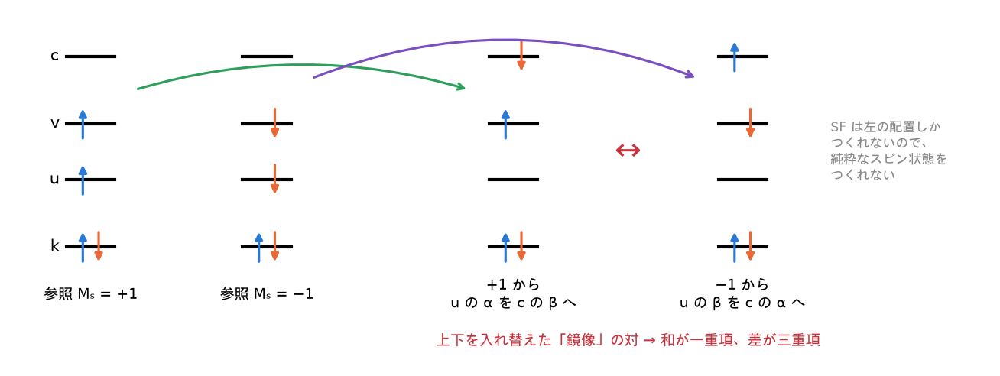
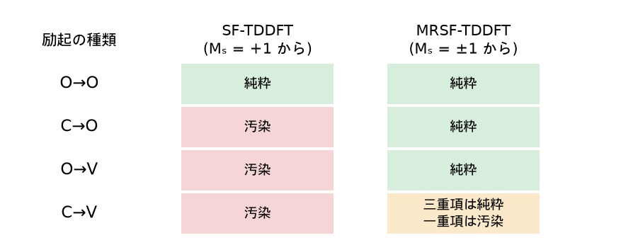
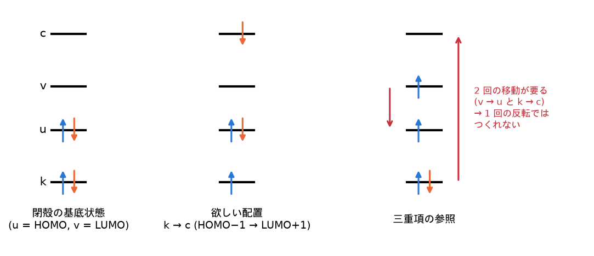

# 第 21 回　MRSF-TDDFT

!!! abstract "この回の道筋"
    第 20 回のスピン反転 TDDFT（SF-TDDFT）は、多参照的な基底状態を扱えますが、配置の空間がスピンについて不完全なため、励起状態に一重項と三重項が混ざります。この回では、三重項の $M_S = +1$ と $M_S = -1$ の 2 つの成分を混ぜた参照から出発する **MRSF-TDDFT**（mixed-reference spin-flip TDDFT）の考え方を学びます。小さな模型で、どの種類の配置のスピン汚染が取り除かれ、どれが残るかを数えて確かめます。最後に、原論文とその後の研究で報告されている長所と限界を整理します。

    | 節 | 内容 |
    |---|---|
    | 1 | SF-TDDFT のスピン汚染を励起の種類で分ける |
    | 2 | 混合参照の考え方 |
    | 3 | 計算例：配置を数えて確かめる |
    | 4 | 報告されている長所 |
    | 5 | 報告されている限界 |
    | 6 | 使うときの注意 |

    **前に読んでおく回**：[量子化学の理論 第 4 回](04-spin.md)、[第 19 回](19-tddft.md)、[第 20 回](20-spin-flip-tddft.md)

!!! tip "物理的なイメージ"
    MRSF-TDDFT が求めているのは、スピン反転法と同じく、三重項を足場にした一重項と三重項の状態です。違いは足場の取り方です。三重項には、2 個の開殻の電子のスピンが上向きにそろった成分と、下向きにそろった成分があります。上向きの足場から 1 個を下に返すだけでは、上下を入れ替えた「鏡像」の配置の一部がつくれず、一重項と三重項をきれいに分けられません。両方の足場から返すと、鏡像の配置が対になって現れ、その和と差として一重項と三重項を分けられます。ただし、鏡像の対がそろっても、一部の配置（閉殻から仮想への励起）では、純粋な一重項をつくるにはまだ配置が足りません。

この回では、MRSF-TDDFT の考え方と、文献で報告されていることを扱います。実際の計算の入力と出力の読み方は、[計算パッケージの使い方 第 10 回](../packages/10-gamess-mrsf.md)で GAMESS を使って説明しています。

## 1. SF-TDDFT のスピン汚染を励起の種類で分ける

第 20 回と同じように、軌道を 3 種類に分けます。参照の三重項で電子が 2 個入った**閉殻**（closed）の軌道を C、電子が 1 個入った**開殻**（open）の軌道を O、空の**仮想**（virtual）の軌道を V で表します。開殻の軌道は 2 個で、$u$ と $v$ と書きます。

スピン反転の励起は、電子をどの種類の軌道からどの種類の軌道へ移すかで、4 種類に分けられます。

| 種類 | 移し方 | SF-TDDFT（$M_S = +1$ から α → β） |
|---|---|---|
| O→O | 開殻から開殻へ | スピンは純粋（第 20 回 2.2 節の 4 つの配置） |
| C→O | 閉殻から開殻へ | 汚染される |
| O→V | 開殻から仮想へ | 汚染される |
| C→V | 閉殻から仮想へ | 汚染される |

第 20 回の 6.2 節で見たように、汚染の原因は、スピンの純粋な状態をつくるのに必要な「相手」の配置が、$M_S = +1$ の参照から 1 回のスピン反転では届かないことでした。

例として、O→V の励起を考えます。$M_S = +1$ の参照から、開殻の $u$ の α 電子を仮想の軌道 $c$ の β に移すと、$v$ に α、$c$ に β が入った配置ができます。スピンの純粋な状態（一重項と三重項）をつくるには、これと、$v$ に β、$c$ に α が入った配置を足し引きする必要があります（第 4 回の開殻の一重項と同じ形です）。ところが後者は、$M_S = +1$ の参照から α 電子を 1 個反転するだけではつくれません。

**ここまでで分かったこと**：SF-TDDFT のスピン汚染は、C→O、O→V、C→V の励起で、相手の配置が欠けていることから生じます。

## 2. 混合参照の考え方

### 2.1 2 つの成分から反転させる

1 節で欠けていた相手の配置は、三重項のもう一つの成分 $M_S = -1$ から出発すると、つくれます。$M_S = -1$ の成分では、開殻の $u$ と $v$ に β 電子が 1 個ずつ入っています。ここから、$u$ の β 電子を $c$ の α に移すと、$v$ に β、$c$ に α が入った配置になります。これがちょうど、1 節で欠けていた相手です（図 1）。



**図 1**　左の 2 つが、三重項の $M_S = +1$ と $M_S = -1$ の成分。$M_S = +1$ から $u$ の α 電子を $c$ の β に移した配置（緑の矢印の先）と、$M_S = -1$ から $u$ の β 電子を $c$ の α に移した配置（紫の矢印の先）は、上向きと下向きを入れ替えた「鏡像」の関係にあります。SF-TDDFT は $M_S = +1$ からの反転しか考えないので、左の配置しかつくれません。

この 2 つの配置で、$\hat S^2$ の行列を書いてみます。$M_S = +1$ からの配置を $d_1$（$v$ に α、$c$ に β）、$M_S = -1$ からの配置を $d_2$（$v$ に β、$c$ に α）とします。閉殻の $k$ の 2 個の電子は、全スピンに寄与しません。開殻の電子 2 個の部分は、第 4 回の 2 電子の開殻の配置と同じなので、行列の要素は次のようになります（非対角の要素の符号は決定子の並べ方の約束で決まり、ここでは PySCF の約束で計算した値です）。

$$
\begin{pmatrix}
\langle d_1 | \hat S^2 | d_1 \rangle & \langle d_1 | \hat S^2 | d_2 \rangle \\
\langle d_2 | \hat S^2 | d_1 \rangle & \langle d_2 | \hat S^2 | d_2 \rangle
\end{pmatrix}
=
\begin{pmatrix} 1 & -1 \\ -1 & 1 \end{pmatrix}
$$

- **SF の場合**：配置は $d_1$ だけなので、$\hat S^2$ の行列は 1 行 1 列の $(1)$ です。期待値は 1 で、一重項（0）でも三重項（2）でもありません。実際、$\hat S^2 d_1 = d_1 - d_2$ なので、$\hat S^2$ をかけると、空間に入っていない $d_2$ の成分が出てきてしまいます。$d_1$ は $\hat S^2$ の固有関数ではありません。
- **MR の場合**：$d_1$ と $d_2$ の両方があるので、上の 2 行 2 列の行列を対角化できます。固有値は 0 と 2 で、固有ベクトルは和 $(d_1 + d_2)/\sqrt2$（固有値 0、一重項）と差 $(d_1 - d_2)/\sqrt2$（固有値 2、三重項）です。$\hat S^2$ をかけても空間の外に出ないので、純粋なスピン状態になります。

つまり、ある配置にスピン演算子をかけて出てくる相手が、すべて配置の空間に入っていれば、純粋なスピン状態をつくれます。

Lee、Filatov、Lee、Choi は、この考えにもとづいて、三重項の $M_S = +1$ と $M_S = -1$ の成分を混ぜた参照から出発する方法を提案しました [Lee 2018]。$M_S = +1$ の成分からは α → β の反転で、$M_S = -1$ の成分からは β → α の反転で、$M_S = 0$ の配置をつくります。これが **MRSF-TDDFT** です。

イメージで言えば、$M_S = -1$ の成分からの反転でできる配置は、$M_S = +1$ の成分からの反転でできる配置の、上下（α と β）を入れ替えた「鏡像」です。鏡像の対がそろえば、その和と差から一重項と三重項をつくれます（第 4 回の開殻の一重項と三重項の形）。3 節の計算例のスクリプトで、α と β を入れ替える操作を使うのは、この和と差を選ぶためです。

混ぜるのは、一重項と三重項ではなく、**同じ三重項の 2 つの成分**です。原論文は、2 つの成分の密度行列を組み合わせた「混合参照の縮約密度行列」を参照として、時間に依存する Kohn–Sham の式を線形応答で解く形に定式化しています [Lee 2018]。この回では、その式には立ち入らず、どの配置が得られるかに注目します。

### 2.2 一重項と三重項を別々に解く

2 つの向きの反転でできた配置を足し引きすると、C→O と O→V の励起でも、一重項と三重項の純粋な組み合わせがつくれます。Lee らは、一重項と三重項の応答の空間を別々に扱う形に式をまとめ、計算量が SF-TDDFT とほぼ同じになることを示しました [Lee 2019]。GAMESS の MRSF-TDDFT で、求める状態のスピン（一重項か三重項か）を指定するのは、このためです（[計算パッケージの使い方 第 10 回](../packages/10-gamess-mrsf.md)）。

**ここまでで分かったこと**：MRSF-TDDFT は、三重項の $M_S = \pm 1$ の 2 つの成分から両方の向きにスピンを反転させ、SF-TDDFT で欠けていた相手の配置を補います。一重項と三重項は別々に求めます。

## 3. 計算例：配置を数えて確かめる

### 3.1 どの種類の汚染が取り除かれるか

2 節の考え方を、小さな模型で確かめます。閉殻の軌道 $k$、開殻の軌道 $u$ と $v$、仮想の軌道 $c$ の 4 個の空間軌道に、電子 4 個が入った系を考えます。次の 2 つの配置の集まりをつくり、それぞれが張る空間の中で $\hat S^2$ の行列を対角化します。

- **SF**：$M_S = +1$ の参照（$k^2 u^\alpha v^\alpha$）から α → β の反転を 1 回したもの。
- **MR**：これに、$M_S = -1$ の参照（$k^2 u^\beta v^\beta$）から β → α の反転を 1 回したものを加えたもの。

$\hat S^2$ は、空間軌道の電子の数を変えないので、励起の種類ごとに別々に対角化できます。得られた状態が $\hat S^2$ の固有関数（純粋なスピン状態）かどうかも調べます。この計算は、配置の組み合わせだけで決まり、軌道の形やエネルギーにはよりません。実際の MRSF-TDDFT の行列の要素（エネルギー）は扱っていないことに注意してください。

```python
import numpy as np
from pyscf.fci import cistring, spin_op

# 模型：閉殻の軌道 k、開殻の軌道 u と v、仮想の軌道 c の 4 個の空間軌道に、電子 4 個
k, u, v, c = 0, 1, 2, 3
norb, nelec = 4, (2, 2)                       # M_S = 0 の空間
stra = cistring.make_strings(range(norb), 2)  # α 電子の入り方（ビット列）
strb = cistring.make_strings(range(norb), 2)

def bits(*orbs):
    return sum(1 << p for p in orbs)

def flips(alpha, beta, frm, to):
    """参照（α と β の軌道の集合）から、スピン frm の電子 1 個を、スピン to の空いた軌道へ移した決定子の集まり"""
    occ = {"a": set(alpha), "b": set(beta)}
    out = []
    for i in occ[frm]:
        for a in range(norb):
            if a in occ[to]:
                continue
            new = {s: set(o) for s, o in occ.items()}
            new[frm].discard(i); new[to].add(a)
            out.append((bits(*new["a"]), bits(*new["b"])))
    return out

sf = flips([k, u, v], [k], "a", "b")          # M_S = +1 の参照から α → β
mr = sorted(set(sf + flips([k], [k, u, v], "b", "a")))   # M_S = -1 の参照からの β → α も加える

def block(det):
    """空間軌道の電子の数のパターンで、励起の種類を判定する（参照 k² u¹ v¹ との比較）"""
    n = [((det[0] >> p) & 1) + ((det[1] >> p) & 1) for p in range(norb)]
    if n[k] == 2 and n[c] == 0: return "O→O"
    if n[k] == 1 and n[c] == 0: return "C→O"
    if n[k] == 2 and n[c] == 1: return "O→V"
    return "C→V"

def analyse(dets):
    """決定子の張る空間の中で S² を対角化し、固有値と、純粋なスピン状態かどうかを返す"""
    na, nb = len(stra), len(strb)
    vecs = []
    for da, db in dets:
        x = np.zeros((na, nb))
        x[list(stra).index(da), list(strb).index(db)] = 1.0
        vecs.append(x.ravel())
    V = np.array(vecs).T                                         # 列が各決定子
    S2V = np.array([spin_op.contract_ss(V[:, j].reshape(na, nb), norb, nelec).ravel()
                    for j in range(V.shape[1])]).T
    # α と β を入れ替える操作 F は S² と交換するので、縮退した固有値の中で、
    # F について対称な組み合わせ（和）と反対称な組み合わせ（差）を選ぶために、わずかに加える
    FV = np.array([V[:, j].reshape(na, nb).T.ravel() for j in range(V.shape[1])]).T
    w, U = np.linalg.eigh(V.T @ S2V + 1e-3 * V.T @ FV)
    out = []
    for uvec in U.T:
        psi = V @ uvec
        e = uvec @ V.T @ S2V @ uvec                               # <S^2>
        resid = np.linalg.norm(S2V @ uvec - e * psi)             # S² の固有関数なら 0
        out.append(f"{e:.2f}{'' if resid < 1e-10 else '×'}")
    return out

print("励起の種類  配置の数(SF, MR)   空間の中の <S^2>（× は純粋なスピン状態でない）")
for b in ["O→O", "C→O", "O→V", "C→V"]:
    s = [d for d in sf if block(d) == b]
    m = [d for d in mr if block(d) == b]
    print(f"{b}        {len(s):2d}, {len(m):2d}      SF: {' '.join(analyse(s)):24s} MR: {' '.join(analyse(m))}")

# 閉殻の基底状態 k² u² から見た 1 電子励起が、MR の配置に含まれるか（u が HOMO、v が LUMO）
def pattern(det):
    return tuple(((det[0] >> p) & 1) + ((det[1] >> p) & 1) for p in range(norb))
have = {pattern(d) for d in mr}
for name, n in [("u → v（HOMO → LUMO）", (2, 1, 1, 0)), ("k → v（HOMO-1 → LUMO）", (1, 2, 1, 0)),
                ("u → c（HOMO → LUMO+1）", (2, 1, 0, 1)), ("k → c（HOMO-1 → LUMO+1）", (1, 2, 0, 1))]:
    print(f"{name:24s} {'含まれる' if n in have else '含まれない'}")
```

```text
励起の種類  配置の数(SF, MR)   空間の中の <S^2>（× は純粋なスピン状態でない）
O→O         4,  4      SF: 0.00 0.00 0.00 2.00      MR: 0.00 0.00 0.00 2.00
C→O         2,  4      SF: 1.00× 1.00×              MR: 0.00 0.00 2.00 2.00
O→V         2,  4      SF: 1.00× 1.00×              MR: 0.00 0.00 2.00 2.00
C→V         1,  2      SF: 2.00×                    MR: 2.00 2.00×
u → v（HOMO → LUMO）       含まれる
k → v（HOMO-1 → LUMO）     含まれる
u → c（HOMO → LUMO+1）     含まれる
k → c（HOMO-1 → LUMO+1）   含まれない
```

前半の表から、次のことが分かります。

1. **O→O**：SF でも MR でも、4 つの配置から、一重項（0）3 個と三重項（2）1 個の純粋な状態ができます。2 つの閉殻の配置 $u^2$、$v^2$ と、開殻の一重項と三重項です。
2. **C→O と O→V**：SF では配置が 2 個ずつしかなく、どちらも $\langle \hat S^2 \rangle = 1$ の、一重項と三重項が半分ずつ混ざった状態でした。MR では配置が 4 個ずつに増え、一重項（0）と三重項（2）の純粋な状態に分かれました。
3. **C→V**：MR でも配置は 2 個しかありません。2 つの配置の差は純粋な三重項（2）になりましたが、和は $\hat S^2$ の固有関数になりません（× の印）。和の状態は、一重項（$S = 0$、$\hat S^2$ の値 0）と五重項（$S = 2$、値 6）が混ざったもので、$\langle \hat S^2 \rangle = 2$ は五重項が 1/3 混ざっていることを意味します。閉殻、開殻 2 個、仮想の、合わせて 4 個の軌道に電子が 1 個ずつ入った配置で純粋な一重項をつくるには、さらに多くの配置が必要だからです。

つまり、混合参照は、C→O と O→V の励起のスピン汚染を取り除きます。C→V の励起では、三重項は純粋になりますが、一重項の側に汚染が残ります。

C→V で何が起きているかを、2 節の $\hat S^2$ の行列の見方で確かめます。$M_S = +1$ から $k$ の α を $c$ の β に移した配置を $e_1$（$u$、$v$ に α、$k$、$c$ に β）、$M_S = -1$ から $k$ の β を $c$ の α に移した配置を $e_2$（$k$、$c$ に α、$u$、$v$ に β）とします。2 つは 2 組のスピンが入れ替わっているので、$\hat S^2$ の非対角の要素は 0 で、

$$
\begin{pmatrix}
\langle e_1 | \hat S^2 | e_1 \rangle & \langle e_1 | \hat S^2 | e_2 \rangle \\
\langle e_2 | \hat S^2 | e_1 \rangle & \langle e_2 | \hat S^2 | e_2 \rangle
\end{pmatrix}
=
\begin{pmatrix} 2 & 0 \\ 0 & 2 \end{pmatrix}
$$

です。この 2 行 2 列の行列だけを見ると、和も差も期待値は 2 です。ところが、和 $(e_1 + e_2)/\sqrt2$ に $\hat S^2$ をかけると、$e_1$、$e_2$ 以外の 4 個の決定子（4 個の開殻の軌道に、α と β を別の並べ方で入れたもの）の成分が出てきます。これらは配置の空間に入っていないので、和は $\hat S^2$ の固有関数になれません。一方、差 $(e_1 - e_2)/\sqrt2$ にかけた場合は、外に出る成分が打ち消し合って 0 になり、純粋な三重項になります。和が一重項の側の組み合わせなので、汚染は一重項の側に残ります。



**図 2**　上の計算の結果のまとめ。緑が純粋なスピン状態、赤が汚染された状態です。MRSF-TDDFT では C→O と O→V も純粋になりますが、C→V の一重項の側に汚染が残ります。

スクリプトでは、α と β を入れ替える操作を小さな重みで加えています。$\hat S^2$ の値が同じ（縮退した）状態の組み合わせ方は一つに決まらないので、この操作で、配置の和と差の組み合わせを選ぶためです。この操作は $\hat S^2$ と交換するので、$\hat S^2$ の値は変わりません。

### 3.2 閉殻から見た 1 電子励起

後半の出力は、別の見方です。閉殻の基底状態 $k^2 u^2$ から見ると、$u$ が HOMO（最高被占軌道）、$v$ が LUMO（最低空軌道）にあたります。第 19 回のふつうの TDDFT が扱う 1 電子励起のうち、HOMO−1 → LUMO+1 にあたる $k \to c$ の配置（$u^2$ を保ったまま、$k$ から $c$ へ 1 電子を移した配置）だけが、MR の配置に含まれませんでした。三重項の参照（$k^2 u^1 v^1$）からこの配置をつくるには、$v$ の電子を $u$ に、$k$ の電子を $c$ に移す、2 回の励起が必要だからです（図 3）。



**図 3**　左：閉殻の基底状態。中央：そこから $k$（HOMO−1）の電子を $c$（LUMO+1）へ移した、欲しい配置。右：三重項の参照。参照から中央の配置にするには、$v$ の電子を $u$ に移し、さらに $k$ の電子を $c$ に移す必要があります（赤の矢印）。スピン反転法は参照から 1 回の移動しか考えないので、この配置はつくれません。

一方、MR の配置には、閉殻の基底状態から見ると二電子励起にあたる配置 $v^2$（HOMO から LUMO へ 2 電子を移した配置）が含まれています。スピン反転法は、一部の二電子励起の配置を含むかわりに、一部の 1 電子励起の配置を含まないのです。この点は 5 節で、実際の分子での報告と合わせて見ます。

**ここまでで分かったこと**：二つの参照からの反転を合わせると、C→O と O→V の励起は純粋なスピン状態になります。C→V の励起では、三重項は純粋になりますが、一重項に汚染が残ります。また、閉殻から見た HOMO−1 → LUMO+1 型の 1 電子励起は含まれません。

## 4. 報告されている長所

原論文と、その後の研究で報告されている主な長所は、次のとおりです。

- **スピン汚染の除去**：原論文の要旨は、SF-TDDFT の応答状態のスピン汚染がほぼ取り除かれ、状態の見分けがずっと簡単になると述べています。これは、構造最適化、反応経路の追跡、分子動力学のような自動の計算で特に役立つとしています [Lee 2018]。
- **円錐交差の探索**：一重項と三重項がはっきり分かれるので、一重項どうしのエネルギー最小の円錐交差を探すのが大きく簡単になったと報告されています [Lee 2019]。円錐交差は次回（[第 22 回](22-conical-intersections.md)）で扱います。
- **ジラジカル**：一連のジラジカルとジラジカロイド（ジラジカルの性格をもつ分子）で、断熱的な一重項–三重項のエネルギー差の平均絶対誤差が 0.14 eV だったと報告されています [Horbatenko 2021]。
- **総説**：開発者らの総説は、ふつうの TDDFT が苦手とする円錐交差、二電子励起の状態、内殻の励起の多くを、MRSF-TDDFT で扱えると述べています [Park 2023]。

**ここまでで分かったこと**：MRSF-TDDFT は、SF-TDDFT のスピン汚染の大部分を取り除き、状態の見分けや円錐交差の探索を簡単にします。ジラジカルでも高い精度が報告されています。

## 5. 報告されている限界

2026 年には、MRSF-TDDFT の限界を調べた研究がいくつか発表されました。以下の 3 件は、いずれも査読前のプレプリントです。

### 5.1 欠ける 1 電子励起の配置

Janoš らは、3.2 節で見た「HOMO を満たしたまま、LUMO を空にしたままの 1 電子励起」が MRSF-TDDFT で欠けることを、実際の分子で示しました [Janoš 2026]。ナフタレンでは、EOM-CCSD で 6.93 eV、振動子強度 0.33 の明るい励起状態（HOMO−1 → LUMO+1 の性格）を、ふつうの TDDFT は再現しましたが、MRSF-TDDFT では得られませんでした。著者らは、この状態は大きな振動子強度をもつので、実験で励起されうると指摘しています。

### 5.2 参照の三重項の性格の変化

Janoš らは、もう一つの限界として、参照の三重項の性格が急に変わる構造を挙げています [Janoš 2026]。最も低い三重項 T₁ と次の三重項 T₂ のエネルギーが近づいて性格が入れ替わると、参照が別の状態に切り替わります。o-ニトロフェノールの例では、この点ですべてのポテンシャル曲線に急な不連続が現れました。著者らは、一重項の状態だけを追う動力学でも、この問題が起きうることを注意しています。

### 5.3 C→V の励起に残るスピン汚染

3.1 節で見たように、C→V の励起の空間は、MRSF-TDDFT でもスピンについて不完全です。Dier らは、これまでの評価に使われてきた $\langle \hat S^2 \rangle$ の式に、一重項の C→V の励起の寄与が抜けていたことを指摘し、正しい式を導きました [Dier 2026]。三重項の状態は常に純粋なままだとしています。そのうえで、開殻の軌道が分子の一部に局在する場合、対称性で分かれる場合、フェルミ準位の近くに軌道が密に並ぶ場合には、大きなスピン汚染をもつ低い励起状態が避けられないことを示しました。一方で、調べた範囲では、励起エネルギーや分光学的な性質の精度には影響しないようだ、とも述べています。

### 5.4 ほかの変種との比較

スピン汚染に対処する別の方法として、どの多重度にも使えるスピン適合型の SF-TDDFT（SA-SF-TDDFT）があります。Ojha と Herbert は、共線形の SF-TDDFT、MRSF-TDDFT、SA-SF-TDDFT を比べ、閉殻分子と二重項のラジカルの励起エネルギー、一重項–三重項のエネルギー差で、SA-SF-TDDFT が最も正確だったと報告しています [Ojha 2026]。

**ここまでで分かったこと**：MRSF-TDDFT には、一部の 1 電子励起の配置が欠けること、参照の三重項の性格が変わる構造で曲線が乱れること、C→V の励起にスピン汚染が残ることが、査読前の研究で報告されています。

## 6. 使うときの注意

4 節と 5 節を踏まえると、MRSF-TDDFT を使うときには、次の点を確かめるとよいでしょう。

1. **参照の三重項**：参照の三重項が、意図した電子配置になっているかを確かめます。Janoš らは、動力学の途中でも三重項の状態を計算し、T₁ と T₂ のエネルギー差を監視することを勧めています（目安として 0.1〜0.2 eV）[Janoš 2026]。
2. **欠けている状態**：同じ構造で、ふつうの TDDFT の結果と比べます。ふつうの TDDFT にあって MRSF-TDDFT にない明るい状態があれば、5.1 節の配置が欠けている可能性があります。
3. **状態の性格**：開殻の軌道が局在する系や、多くの発色団を含む大きな系では、5.3 節のスピン汚染に注意します。
4. **汎関数**：SF-TDDFT と同じく共線形の扱いなので、厳密な交換を多く混ぜた汎関数（BHHLYP など）がよく使われます（第 20 回 3.2 節）。

どの方法にも、得意な場面と苦手な場面があります。重要な結果は、多参照の波動関数理論（第 13 回の CASPT2・NEVPT2 など）の結果と比べて確かめてください。

**ここまでで分かったこと**：MRSF-TDDFT を使うときは、参照の三重項、欠けている状態、状態の性格を確かめ、重要な結果は別の方法と比べます。

## まとめ

- SF-TDDFT のスピン汚染は、C→O、O→V、C→V の励起で、純粋なスピン状態をつくる相手の配置が欠けていることから生じます。
- MRSF-TDDFT は、三重項の $M_S = +1$ と $M_S = -1$ の成分を混ぜた参照から両方の向きにスピンを反転させ、C→O と O→V の相手の配置を補います。一重項と三重項を別々に求めます。
- 配置を数えると、C→V の励起の一重項にはスピン汚染が残り、閉殻から見た HOMO−1 → LUMO+1 型の 1 電子励起は含まれないことが分かります。
- 状態の見分け、円錐交差の探索、ジラジカルの精度で長所が報告される一方、欠ける状態、参照の三重項の性格の変化、残るスピン汚染といった限界も報告されています。

## 参考文献

- S. Lee, M. Filatov, S. Lee, C. H. Choi, "Eliminating spin-contamination of spin-flip time dependent density functional theory within linear response formalism by the use of zeroth-order mixed-reference (MR) reduced density matrix", J. Chem. Phys. 149, 104101 (2018). DOI: [10.1063/1.5044202](https://doi.org/10.1063/1.5044202)
- S. Lee, E. E. Kim, H. Nakata, S. Lee, C. H. Choi, "Efficient implementations of analytic energy gradient for mixed-reference spin-flip time-dependent density functional theory (MRSF-TDDFT)", J. Chem. Phys. 150, 184111 (2019). DOI: [10.1063/1.5086895](https://doi.org/10.1063/1.5086895)
- Y. Horbatenko, S. Sadiq, S. Lee, M. Filatov, C. H. Choi, "Mixed-Reference Spin-Flip Time-Dependent Density Functional Theory (MRSF-TDDFT) as a Simple yet Accurate Method for Diradicals and Diradicaloids", J. Chem. Theory Comput. 17, 848 (2021). DOI: [10.1021/acs.jctc.0c01074](https://doi.org/10.1021/acs.jctc.0c01074)
- W. Park, K. Komarov, S. Lee, C. H. Choi, "Mixed-Reference Spin-Flip Time-Dependent Density Functional Theory: Multireference Advantages with the Practicality of Linear Response Theory", J. Phys. Chem. Lett. 14, 8896 (2023). DOI: [10.1021/acs.jpclett.3c02296](https://doi.org/10.1021/acs.jpclett.3c02296)
- J. Janoš, A. J. Orr-Ewing, B. F. E. Curchod, P. Slavíček, "Limitations of MRSF-TDDFT for Applications in Photochemistry", arXiv:2604.09230 (2026).
- S. Dier, L. B. Dittmer, A. Rikus, A. Dreuw, J. Neugebauer, "Revisiting Spin Contamination in Mixed-Reference Spin-Flip Time-Dependent Density-Functional Theory", ChemRxiv (2026). DOI: [10.26434/chemrxiv.15010307/v1](https://doi.org/10.26434/chemrxiv.15010307/v1)
- A. K. Ojha, J. M. Herbert, "Benchmark assessment of collinear, mixed-reference, and spin-adapted variants of spin-flip time-dependent density functional theory, for closed-and open-shell molecules", ChemRxiv (2026). DOI: [10.26434/chemrxiv.15000030/v2](https://doi.org/10.26434/chemrxiv.15000030/v2)
- Q. Sun et al., "Recent developments in the PySCF program package", J. Chem. Phys. 153, 024109 (2020). DOI: [10.1063/5.0006074](https://doi.org/10.1063/5.0006074)
