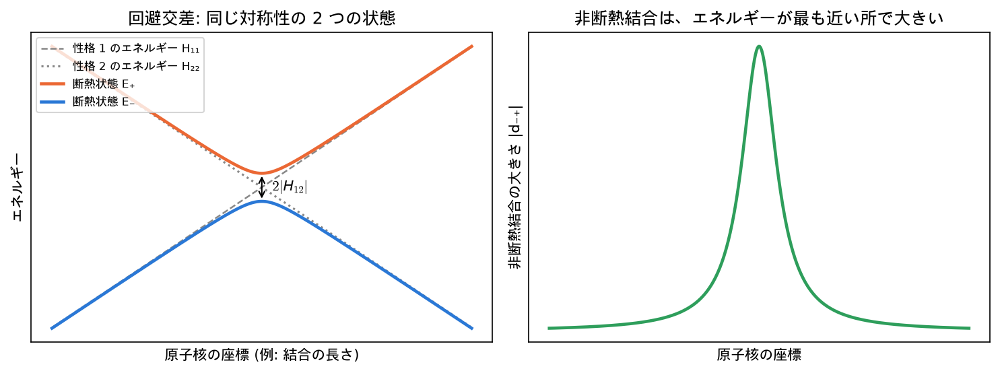
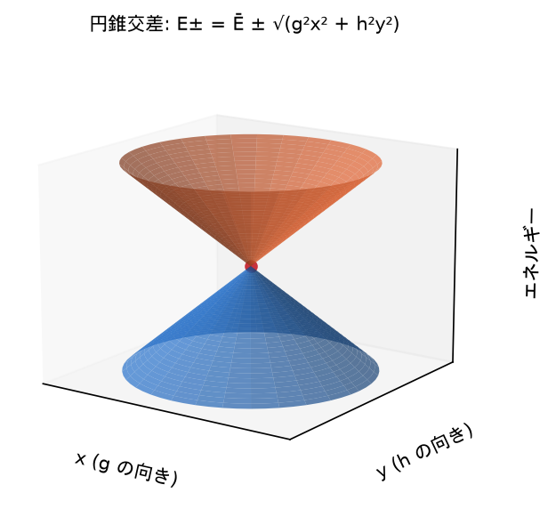
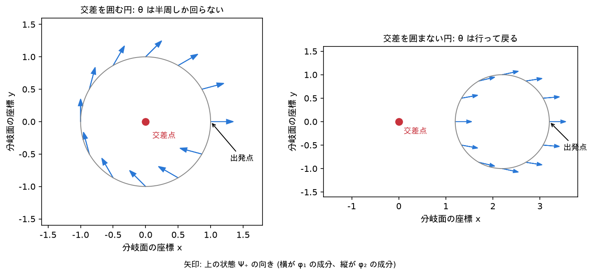
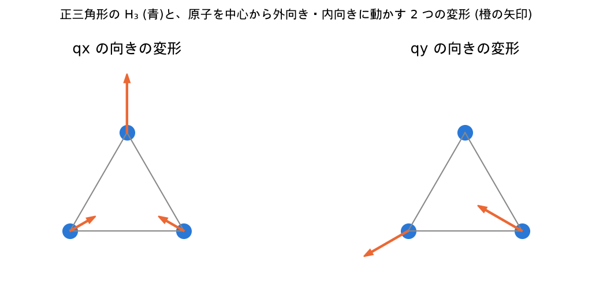
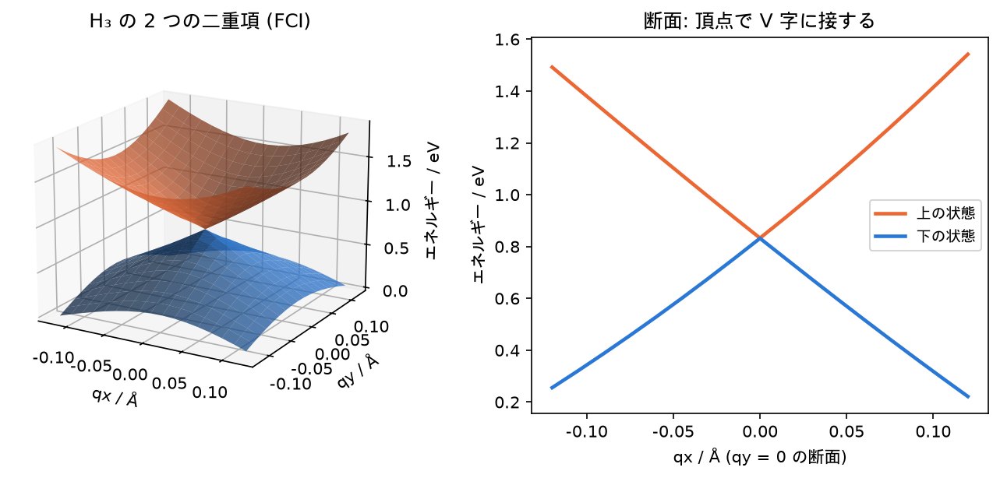
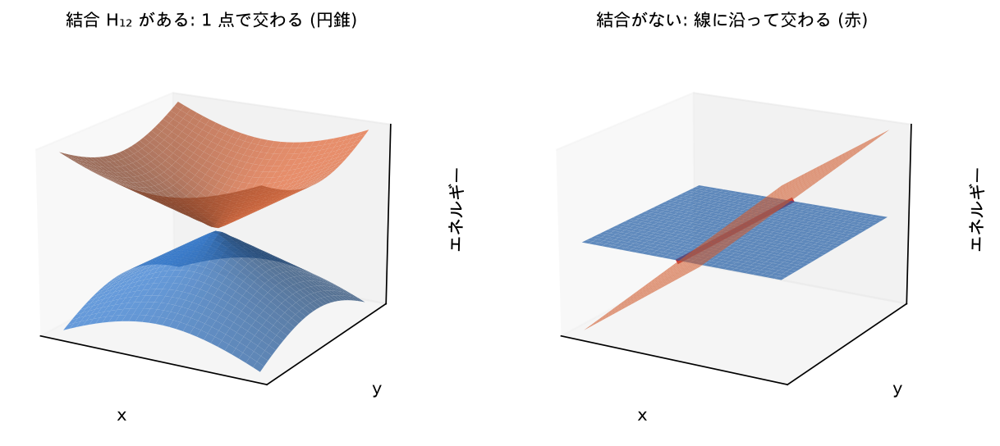
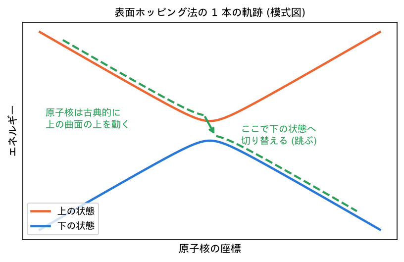

# 第 22 回　円錐交差と非断熱過程

!!! abstract "この回の道筋"
    Born–Oppenheimer 近似（第 1 回）では、原子核は一つの電子状態のポテンシャルエネルギー曲面の上を動きます。2 つの電子状態のエネルギーが近づくと、この近似が破れ、原子核の運動とともに電子状態が移り変わります（非断熱過程）。この回では、まず状態の移り変わりを決める非断熱結合が、分子全体のシュレーディンガー方程式のどこから出てくるかを導きます。次に、2 つの状態が交わる条件を 2 行 2 列の行列で調べ、多原子分子では 2 つの曲面が円錐の形で交わる**円錐交差**が現れることを示します。H₃ の FCI の計算で、実際の円錐と、交差を一周すると波動関数の符号が変わることを確かめます。最後に、光化学での円錐交差の役割と、それを扱える電子状態の方法、非断熱の分子動力学を整理します。

    | 節 | 内容 |
    |---|---|
    | 1 | Born–Oppenheimer 近似が破れるとき |
    | 2 | 2 つの状態が交わる条件 |
    | 3 | 計算例：H₃ の円錐交差 |
    | 4 | 光化学での円錐交差 |
    | 5 | 円錐交差を扱える電子状態の方法 |
    | 6 | 非断熱の分子動力学 |

    **前に読んでおく回**：[量子化学の理論 第 1 回](01-born-oppenheimer.md)、[第 12 回](12-casscf.md)、[第 19 回](19-tddft.md)〜[第 21 回](21-mrsf-tddft.md)

!!! tip "物理的なイメージ"
    非断熱過程で問題になるのは、原子核が動くあいだに、電子状態の「中身」がどれだけ速く入れ替わるかです。2 つの電子状態のエネルギーが近いところでは、各構造の電子状態は、2 つの性格（たとえば共有結合性とイオン性）の**混ざり方**として表せます。エネルギーの差が小さいほど、原子核のわずかな動きで混ざり方が大きく回転します。回転が速すぎると、電子は原子核の動きに合わせて一つの状態にとどまれず、別の状態へ乗り移ります。円錐交差は、2 つの曲面が一点で接する漏斗です。そのまわりを一周すると、混ざり方の角度は半周（180°）しか回らないので、波動関数の符号が反転します。

この回では原子単位（$\hbar = 1$、エネルギーはハートリー $E_\mathrm{h}$）を使います。1 $E_\mathrm{h}$ = 27.211 eV です。

## 1. Born–Oppenheimer 近似が破れるとき

### 1.1 断熱状態

第 1 回では、原子核を止めた各構造で、電子のシュレーディンガー方程式を解きました。式を簡単にするため、この節では原子核の座標を 1 個の変数 $R$ で表します（たとえば二原子分子の結合の長さ）。

$$
\hat H_\mathrm{el}(R)\, \Psi_I(\mathbf r; R) = E_I(R)\, \Psi_I(\mathbf r; R)
$$

$\mathbf r$ は電子の座標をまとめたもの、$\hat H_\mathrm{el}$ は電子のハミルトニアン（電子の運動エネルギー、電子と原子核の引力、電子どうしの反発、原子核どうしの反発）です。$R$ ごとに解いて得た電子状態 $\Psi_I$ を**断熱状態**（adiabatic state）と呼び、$E_I(R)$ を状態 $I$ のポテンシャルエネルギー曲線と呼びます。$\Psi_I$ は、どの $R$ でも互いに直交し、規格化されているとします（$\langle \Psi_I | \Psi_J \rangle = \delta_{IJ}$、積分は電子の座標について）。

### 1.2 分子全体の方程式から何が出てくるか

分子全体のハミルトニアンは、原子核の運動エネルギー $\hat T_\mathrm N$ と $\hat H_\mathrm{el}$ の和です。原子核の質量を $M$ とすると、$\hat T_\mathrm N = -\frac{1}{2M}\frac{\partial^2}{\partial R^2}$ です。分子全体のシュレーディンガー方程式は

$$
\big(\hat T_\mathrm N + \hat H_\mathrm{el}\big)\, \Phi(\mathbf r, R) = E\, \Phi(\mathbf r, R)
$$

です。$R$ を決めるごとに断熱状態の組 $\{\Psi_J\}$ は完全系をなすので、分子全体の波動関数をそれで展開できます。

$$
\Phi(\mathbf r, R) = \sum_J \chi_J(R)\, \Psi_J(\mathbf r; R)
$$

係数 $\chi_J(R)$ は、「状態 $J$ の曲線の上にいる原子核の波動関数」と考えられます。これを方程式に代入します。まず、$\hat H_\mathrm{el}$ は $R$ についての微分を含まないので、

$$
\hat H_\mathrm{el}\, \chi_J \Psi_J = \chi_J\, \hat H_\mathrm{el} \Psi_J = \chi_J E_J \Psi_J
$$

です。次に、$\hat T_\mathrm N$ は $\chi_J$ と $\Psi_J$ の両方に働きます。積の 2 階微分の公式 $(fg)'' = f''g + 2f'g' + fg''$ を使うと（$'$ は $R$ についての微分）、

$$
\frac{\partial^2}{\partial R^2}\big(\chi_J \Psi_J\big) = \chi_J'' \Psi_J + 2\chi_J' \Psi_J' + \chi_J \Psi_J''
$$

です。以上を代入した方程式の両辺に、左から $\Psi_I^*$ をかけて電子の座標で積分します。$\langle \Psi_I | \Psi_J \rangle = \delta_{IJ}$ を使うと、

$$
-\frac{1}{2M}\chi_I'' + E_I\, \chi_I
- \frac{1}{2M}\sum_J \Big( 2\, d_{IJ}\, \chi_J' + D_{IJ}\, \chi_J \Big) = E\, \chi_I
$$

が得られます。ここで、

$$
d_{IJ}(R) = \Big\langle \Psi_I \Big| \frac{\partial \Psi_J}{\partial R} \Big\rangle, \qquad
D_{IJ}(R) = \Big\langle \Psi_I \Big| \frac{\partial^2 \Psi_J}{\partial R^2} \Big\rangle
$$

です。

左辺の最初の 2 項だけなら、これは「曲線 $E_I(R)$ の上を動く原子核のシュレーディンガー方程式」です。**Born–Oppenheimer 近似は、最後の和を無視する近似**です。最後の和は、原子核の運動を通じて、状態 $I$ の原子核の波動関数 $\chi_I$ と、ほかの状態 $J$ の $\chi_J$ をつなぎます。$d_{IJ}$（$I \neq J$）を**非断熱結合**と呼びます。原子核が何個もあるときは、各座標についての微分を並べたベクトル $\mathbf d_{IJ} = \langle \Psi_I | \nabla_{\mathbf R} \Psi_J \rangle$ になり、**非断熱結合ベクトル**と呼びます。

$d_{IJ}$ は、「原子核が少し動いたとき、電子状態 $\Psi_J$ が、別の状態 $\Psi_I$ の成分をどれだけ含むように変わるか」を表します。電子状態の中身が原子核の動きとともに急に変わる所で、大きくなります。

### 1.3 エネルギーが近いと結合が大きくなる

非断熱結合は、次のように書き直せます。導出は付録 A にすべて書きます。

$$
\mathbf d_{IJ} = \frac{\langle \Psi_I | (\nabla_{\mathbf R} \hat H_\mathrm{el}) | \Psi_J \rangle}{E_J - E_I} \qquad (I \neq J)
$$

分母に、2 つの状態のエネルギーの差があります。エネルギーが離れていれば結合は小さく、1.2 節の和を無視しても大丈夫です。エネルギーが近づくと結合は大きくなり、2 つの状態が交わる点では発散します。このような構造の近くでは、原子核が動くあいだに、電子状態が別の状態へ移ります。これを**非断熱遷移**と呼びます。図 1 の右は、2 節の模型で計算した非断熱結合の大きさで、2 つの状態のエネルギーが最も近い所で鋭い山になっています。

**ここまでで分かったこと**：分子全体の方程式を断熱状態で展開すると、異なる状態をつなぐ非断熱結合の項が現れます。Born–Oppenheimer 近似はそれを無視する近似で、非断熱結合はエネルギーの差に反比例するので、状態が近い所で近似が破れます。

## 2. 2 つの状態が交わる条件

### 2.1 2 状態の模型

2 つの状態が交わる条件を、2 状態の模型で調べます。ある構造で、2 つの電子状態の「性格」を表す実数の関数 $\phi_1$、$\phi_2$（たとえば共有結合性の配置とイオン性の配置）をとり、ハミルトニアンを 2 行 2 列の行列で表します。

$$
\mathbf H = \begin{pmatrix} H_{11} & H_{12} \\ H_{12} & H_{22} \end{pmatrix}, \qquad
H_{ij} = \langle \phi_i | \hat H_\mathrm{el} | \phi_j \rangle
$$

$H_{11}$ と $H_{22}$ はそれぞれの性格のエネルギー、$H_{12}$ は 2 つの性格を混ぜる結合です。固有値 $E$ は、$\det(\mathbf H - E\,\mathbf 1) = 0$ から求まります。行列式を書き下すと、

$$
\det \begin{pmatrix} H_{11} - E & H_{12} \\ H_{12} & H_{22} - E \end{pmatrix}
= (H_{11} - E)(H_{22} - E) - H_{12}^2 = 0
$$

です。展開して $E$ について整理すると、

$$
E^2 - (H_{11} + H_{22})\, E + \big(H_{11}H_{22} - H_{12}^2\big) = 0
$$

という 2 次方程式になります。解の公式を使い、根号の中を $\frac14 (H_{11} + H_{22})^2 - H_{11}H_{22} + H_{12}^2 = \frac14 (H_{11} - H_{22})^2 + H_{12}^2$ と整理すると、

$$
E_\pm = \frac{H_{11} + H_{22}}{2} \pm \sqrt{\Big(\frac{H_{11} - H_{22}}{2}\Big)^2 + H_{12}^2}
$$

が得られます。2 つの固有値の差は $E_+ - E_- = 2\sqrt{\big(\frac{H_{11} - H_{22}}{2}\big)^2 + H_{12}^2}$ です。これが 0 になる（2 つの状態が交わる）には、根号の中の 2 つの 2 乗がどちらも 0、つまり

$$
H_{11} = H_{22} \quad\text{かつ}\quad H_{12} = 0
$$

の **2 つの条件**が同時に成り立つ必要があります。

### 2.2 二原子分子：交差しない規則

二原子分子では、構造を決める座標は結合の長さ $R$ の 1 個だけです。$H_{11}(R) = H_{22}(R)$ となる $R$ は見つかっても、その同じ $R$ で $H_{12}(R) = 0$ にもなることは、ふつうはありません。1 個の変数で 2 つの条件を同時に満たすことはできないからです。そのため、同じ対称性の 2 つの状態の曲線は、近づいても交わらずに離れていきます。これを**回避交差**と呼び、この性質を**交差しない規則**と呼びます。



**図 1**　2 状態の模型（$H_{11}$ と $H_{22}$ が座標に比例して変わり、$H_{12}$ は一定）。左：灰色の破線と点線が 2 つの性格のエネルギー、色の線が断熱状態のエネルギーです。性格のエネルギーが交わる所でも、断熱状態は $2|H_{12}|$ だけ離れたまま、交わらずに避け合います。左右の端では、上の断熱状態の性格が、左では性格 1、右では性格 2 に入れ替わっています。右：非断熱結合の大きさ。性格が入れ替わる所、つまりエネルギーが最も近い所で鋭い山になります。

ただし、2 つの状態の対称性が違うと、$H_{12}$ は対称性によって常に 0 になります（違う対称性の関数どうしの行列要素は 0）。残る条件は $H_{11} = H_{22}$ の 1 個だけなので、曲線は交わることができます。

### 2.3 多原子分子：円錐交差

内部座標が $N$ 個（$N \ge 2$）ある多原子分子では、事情が違います。2 つの条件を満たすには、座標を 2 個使えば足ります。残りの $N - 2$ 個の座標は自由に動かせるので、2 つの条件を満たす構造は、ふつう $N - 2$ 次元の広がり（**交差の継ぎ目**、seam）をつくります [Yarkony 1996]。対称性がなくても、偶然に交わることがあります [Yarkony 1996]。

継ぎ目の上の一点のまわりで、条件を破る 2 つの向きにだけ構造を動かすことを考えます。2 つの向きの座標を $x$、$y$ とし、交差点を原点にとります。原点で $H_{11} - H_{22} = 0$、$H_{12} = 0$ で、原点の近くではそれぞれ座標にほぼ比例して変わるとして、

$$
H_{11} - H_{22} \approx 2 g x, \qquad H_{12} \approx h y
$$

と書きます。$g$、$h$ は定数です（座標の向きは、こう書けるように選びます）。2.1 節の式の根号の中に代入すると、

$$
\Big(\frac{H_{11} - H_{22}}{2}\Big)^2 + H_{12}^2 = g^2 x^2 + h^2 y^2
$$

なので、

$$
E_\pm \approx \bar E \pm \sqrt{g^2 x^2 + h^2 y^2}
$$

となります。$\bar E = (H_{11} + H_{22})/2$ は 2 つの状態の平均のエネルギーです。$g = h$ なら、原点からの距離 $r = \sqrt{x^2 + y^2}$ を使って $E_\pm = \bar E \pm g r$ となり、エネルギーが距離に比例して開きます。上の状態は上向きの円錐、下の状態は下向きの円錐になり、二つの円錐が頂点で接します（図 2）。これが**円錐交差**（conical intersection）です。



**図 2**　円錐交差の模式図。横の 2 つの軸が分岐面の座標 $x$、$y$、縦の軸がエネルギーです。上の状態（橙）と下の状態（青）が、赤い点（交差点）で接しています。交差点から離れる向きによらず、エネルギーの差は距離に比例して開きます。

$x$ と $y$ がつくる平面を、**分岐面**（branching plane）と呼びます。$x$ の向きは 2 つの状態のエネルギーの差が最も速く変わる向きで、**g ベクトル**と呼ばれます。$y$ の向きは 2 つの状態を混ぜる結合が最も速く変わる向きで、**h ベクトル**と呼ばれます（非断熱結合ベクトルの向きに対応します）。分岐面に垂直な残りの $N-2$ 個の向きに動いても、2 つの状態は縮退したままで、それが継ぎ目です。

### 2.4 物理的なイメージ：混ざり方の角度

円錐交差のまわりで何が起きているかを、固有ベクトルで見ます。2.1 節の行列を、平均の部分と残りに分けます。$\Delta = (H_{11} - H_{22})/2$、$\bar E = (H_{11} + H_{22})/2$ とおくと、

$$
\mathbf H = \bar E \begin{pmatrix} 1 & 0 \\ 0 & 1 \end{pmatrix}
+ \begin{pmatrix} \Delta & H_{12} \\ H_{12} & -\Delta \end{pmatrix}
$$

です。さらに $\rho = \sqrt{\Delta^2 + H_{12}^2}$ とし、角度 $\theta$ を

$$
\cos 2\theta = \frac{\Delta}{\rho}, \qquad \sin 2\theta = \frac{H_{12}}{\rho}
$$

で決めます（$\tan 2\theta = 2H_{12}/(H_{11} - H_{22})$ と同じです）。すると、

$$
\mathbf H = \bar E\, \mathbf 1 + \rho \begin{pmatrix} \cos 2\theta & \sin 2\theta \\ \sin 2\theta & -\cos 2\theta \end{pmatrix}
$$

と書けます。右の行列に、ベクトル $(\cos\theta, \sin\theta)$ をかけると、

$$
\begin{pmatrix} \cos 2\theta & \sin 2\theta \\ \sin 2\theta & -\cos 2\theta \end{pmatrix}
\begin{pmatrix} \cos\theta \\ \sin\theta \end{pmatrix}
= \begin{pmatrix} \cos 2\theta \cos\theta + \sin 2\theta \sin\theta \\ \sin 2\theta \cos\theta - \cos 2\theta \sin\theta \end{pmatrix}
= \begin{pmatrix} \cos\theta \\ \sin\theta \end{pmatrix}
$$

となります（2 行目の等号は、加法定理 $\cos(2\theta - \theta) = \cos\theta$、$\sin(2\theta - \theta) = \sin\theta$ によります）。同じように、$(-\sin\theta, \cos\theta)$ をかけると $-(-\sin\theta, \cos\theta)$ になります。したがって、2 つの断熱状態は

$$
\Psi_+ = \cos\theta\, \phi_1 + \sin\theta\, \phi_2, \qquad
\Psi_- = -\sin\theta\, \phi_1 + \cos\theta\, \phi_2
$$

で、エネルギーは $\bar E \pm \rho$ です。$\theta$ は、2 つの性格 $\phi_1$、$\phi_2$ の**混ざり方の角度**です。$\theta = 0$ なら上の状態は純粋な $\phi_1$、$\theta = 45°$ なら半々、$\theta = 90°$ なら純粋な $\phi_2$ です。

**非断熱結合は、混ざり方の角度の変わる速さです。** $\phi_1$、$\phi_2$ が構造によらないとすると、$\Psi_+$ を微分して

$$
\nabla \Psi_+ = (-\sin\theta\, \phi_1 + \cos\theta\, \phi_2)\, \nabla\theta = \Psi_-\, \nabla\theta
$$

なので、$\mathbf d_{-+} = \langle \Psi_- | \nabla \Psi_+ \rangle = \nabla \theta$ です。図 1 の右の山は、性格が入れ替わる所で $\theta$ が急に 0 から 90° へ変わることを表しています。

**円錐交差のまわりでは、角度は半分しか回りません。** 2.3 節の式を使うと $\tan 2\theta = h y / (g x)$ です。簡単のため $g = h$ とすると、$2\theta$ は、分岐面の中で交差点から見た方向の角度 $\varphi$（$x = r\cos\varphi$、$y = r\sin\varphi$）に等しくなります。したがって $\theta = \varphi / 2$ です。このことから、次の 2 つが分かります。

1. $|\nabla\theta| = |\nabla\varphi|/2 = 1/(2r)$ です。交差点に近いほど、混ざり方は急に変わり、非断熱結合は距離に反比例して大きくなります。エネルギーの差（$2gr$）が小さいほど結合が大きいという 1.3 節の結果と、同じことを表しています。
2. 交差点のまわりを一周すると、$\varphi$ は 360° 回りますが、$\theta$ は 180° しか回りません。$\theta$ が 180° 増えると、$\cos\theta$ と $\sin\theta$ の符号がどちらも変わるので、$\Psi_+$ は $-\Psi_+$ に、$\Psi_-$ は $-\Psi_-$ になります。**交差を囲んで一周すると、波動関数の符号が反転します。**

図 3 は、これを矢印で描いたものです。



**図 3**　分岐面の円の上の各点で、上の状態 $\Psi_+$ の向き $(\cos\theta, \sin\theta)$ を矢印で描いたもの（横の成分が $\phi_1$、縦の成分が $\phi_2$ の割合）。左：交差点（赤）を囲む円。出発点（右端）で右を向いていた矢印は、円を左回りに進むにつれて少しずつ回り、一周して戻ると左を向いています（符号が反転）。右：交差点を囲まない円。矢印は少し揺れるだけで、一周すると元の向きに戻ります。

**ここまでで分かったこと**：2 つの状態が交わるには 2 つの条件が必要です。二原子分子では同じ対称性の状態は交わりませんが、多原子分子では $N-2$ 次元の継ぎ目で交わり、そのまわりで曲面は円錐の形になります。非断熱結合は混ざり方の角度の変わる速さで、交差点を一周すると角度は半周しか回らず、波動関数の符号が変わります。

## 3. 計算例：H₃ の円錐交差

### 3.1 系と計算の方法

3 個の H 原子が正三角形に並んだ H₃ を考えます。この構造では、対称性のために、最も低い二重項の状態が 2 つ縮退しています。正三角形からずらすと縮退がとけるので、正三角形は円錐交差の点です。対称性で縮退した状態が、構造をひずませて安定化する現象（Jahn–Teller 効果）の典型例です。

正三角形からのずらし方として、各原子を中心から外向き・内向きに動かす 2 つのパターン（図 4）を使い、その大きさを $q_x$、$q_y$ とします。これが分岐面の座標になります。電子が 3 個しかないので、FCI（第 8 回）で厳密に解けます。基底関数は cc-pVDZ です。



**図 4**　正三角形の H₃（青い点）と、分岐面の 2 つの変形の向き（橙の矢印）。左の $q_x$ では上の原子が外へ、下の 2 個が内へ動き、二等辺三角形になります。右の $q_y$ では、下の 2 個が逆向きに動きます。

次の 2 つを確かめます。

1. 正三角形からの距離 $\rho$ を変えて、2 つの状態のエネルギーの差が $\rho$ に比例するか（円錐の形か）。
2. 分岐面の中で円に沿って一周したとき、基底状態の波動関数がどうなるか。

2 つ目のために、波動関数を、構造とともに滑らかに変わる基底（直交化した原子軌道）で表します。円の上の隣り合う点で、CI ベクトルの向き（全体の符号）を、内積が正になるようにそろえながら一周します。一周して出発点に戻ったときの CI ベクトルを、出発点のものと比べます。

```python
import numpy as np
from pyscf import gto, ao2mo, lo, fci

# 正三角形の H3（中心から各原子まで R）。e' の対称性をもつ 2 つの変形の向き
R = 0.60                                            # Å（辺の長さは R√3 ≈ 1.04 Å）
ang = np.radians([90, 210, 330])
unit = np.stack([np.cos(ang), np.sin(ang), np.zeros(3)], axis=1)
ex = np.array([2, -1, -1]) / np.sqrt(6)             # 原子ごとの、中心から外向きの動き
ey = np.array([0, 1, -1]) / np.sqrt(2)

def geometry(qx, qy):
    """e' の 2 つの変形の座標 (qx, qy) / Å での原子の位置"""
    r = R + qx * ex + qy * ey
    return [("H", tuple(ri * u)) for ri, u in zip(r, unit)]

def two_states(qx, qy):
    """FCI で最も低い二重項 2 個のエネルギーと、直交化した原子軌道の基底での CI ベクトル"""
    mol = gto.M(atom=geometry(qx, qy), basis="cc-pvdz", spin=1, verbose=0)
    C = lo.orth_ao(mol, "lowdin")                   # 構造とともに滑らかに変わる直交基底
    h1 = C.T @ (mol.intor("int1e_kin") + mol.intor("int1e_nuc")) @ C
    eri = ao2mo.kernel(mol, C)
    solver = fci.direct_spin1.FCI()
    solver = fci.addons.fix_spin_(solver, ss=0.75)  # 二重項（S = 1/2）を求める
    e, v = solver.kernel(h1, eri, C.shape[1], (2, 1), nroots=2, ecore=mol.energy_nuc())
    return np.array(e), [x.ravel() for x in v]

if __name__ == "__main__":
    ev = 27.2114
    print("1) 正三角形からの変形の大きさ ρ と、2 つの状態のエネルギー差")
    for rho in (0.01, 0.02, 0.04, 0.08):
        e, _ = two_states(rho, 0.0)
        print(f"   ρ = {rho:.2f} Å   ΔE = {(e[1] - e[0]) * ev:.3f} eV   ΔE/ρ = {(e[1] - e[0]) * ev / rho:.2f} eV/Å")
    e, _ = two_states(0.0, 0.04)
    print(f"   向きを 90° 変えた変形（qy = 0.04 Å）：ΔE = {(e[1] - e[0]) * ev:.3f} eV")

    def loop_sign(cx, cy, radius, n=72):
        """中心 (cx, cy)、半径 radius の円に沿って、基底状態の CI ベクトルの符号を連続につなぎ、
        一周して戻ったときに、出発点のベクトルと比べた符号を返す"""
        _, v = two_states(cx + radius, cy)
        start = prev = v[0]
        for k in range(1, n + 1):
            phi = 2 * np.pi * k / n
            _, v = two_states(cx + radius * np.cos(phi), cy + radius * np.sin(phi))
            cur = v[0] if np.dot(v[0], prev) > 0 else -v[0]   # 隣の点と向きをそろえる
            prev = cur
        return np.dot(start, prev)

    print("2) 円に沿って一周したときの、基底状態の波動関数の符号")
    print(f"   正三角形（交差）を囲む円           ：{loop_sign(0.0, 0.0, 0.05):+.3f}")
    print(f"   交差を囲まない円（中心を 0.20 Å ずらす）：{loop_sign(0.20, 0.0, 0.05):+.3f}")
```

1 コアで 1 分ほどかかりました。出力は次のとおりです。

```text
1) 正三角形からの変形の大きさ ρ と、2 つの状態のエネルギー差
   ρ = 0.01 Å   ΔE = 0.107 eV   ΔE/ρ = 10.71 eV/Å
   ρ = 0.02 Å   ΔE = 0.215 eV   ΔE/ρ = 10.73 eV/Å
   ρ = 0.04 Å   ΔE = 0.432 eV   ΔE/ρ = 10.79 eV/Å
   ρ = 0.08 Å   ΔE = 0.872 eV   ΔE/ρ = 10.90 eV/Å
   向きを 90° 変えた変形（qy = 0.04 Å）：ΔE = 0.427 eV
2) 円に沿って一周したときの、基底状態の波動関数の符号
   正三角形（交差）を囲む円           ：-1.000
   交差を囲まない円（中心を 0.20 Å ずらす）：+1.000
```

### 3.2 円錐の形

1 番目の結果では、$\Delta E / \rho$ が、$\rho$ を 8 倍にしても 10.7〜10.9 eV/Å とほぼ一定でした。エネルギーの差が正三角形からの距離に比例しているので、2.3 節の円錐の形です。$\rho$ が大きいところでわずかに増えるのは、距離の 2 乗以上の項の寄与です。ずらす向きを 90° 変えても、エネルギーの差はほぼ同じでした（0.427 eV と 0.432 eV）。H₃ では対称性のために、円錐がほぼ軸対称になっています。

同じ関数 `two_states` で、$q_x$、$q_y$ をそれぞれ −0.12〜0.12 Å の範囲で 17 点ずつ動かして計算したのが図 5 です。



**図 5**　H₃ の 2 つの二重項のエネルギー（FCI/cc-pVDZ、最も低い点を 0 とした）。左：分岐面の上のエネルギー曲面。上の状態（橙）と下の状態（青）が、正三角形（原点）で接する二重円錐になっています。右：$q_y = 0$ の断面。頂点で V 字に接し、頂点から離れると直線的に開きます。

### 3.3 一周すると符号が変わる

2 番目の結果は、交差を囲む円に沿って一周すると、出発点に戻ったときに基底状態の波動関数の符号が反転し（−1）、交差を囲まない円では元に戻った（+1）ことを示しています。同じ構造に戻ったのに、波動関数が $-1$ 倍になったのです。2.4 節の模型で予想したとおりの結果です（図 3）。

この符号の反転は、Herzberg と Longuet-Higgins が指摘した性質で [Herzberg 1963]、円錐交差を囲む閉じた経路で断熱状態を運んだときに現れる**幾何学的位相**（Berry 位相）の一例です [Yarkony 1996]。実数の断熱状態が一周で符号を変えるので、原子核の運動を正しく扱うには、原子核の波動関数の側でこの符号を打ち消す必要があります。Mead と Truhlar は、原子核のシュレーディンガー方程式に新しいベクトルポテンシャルを入れることで、これを扱う方法を示しました [Mead 1979]。

逆に言えば、閉じた経路で符号が変わるかどうかを調べれば、その経路が円錐交差を囲んでいるかどうかが分かります。

**ここまでで分かったこと**：H₃ の正三角形は円錐交差で、まわりではエネルギーの差が距離に比例して開きます。交差を囲んで一周すると、基底状態の波動関数の符号が反転します。

## 4. 光化学での円錐交差

光を吸収して励起状態に上がった分子は、多くの場合、とても速く基底状態に戻ります。その通り道になるのが、励起状態と基底状態の円錐交差です。1.3 節で見たように、交差の近くでは非断熱結合が大きく、原子核が交差の近くを通ると、効率よく下の状態へ移るからです [Yarkony 1996]。図 2 の上の円錐を転がり落ちてきた原子核は、頂点を通って下の円錐へ抜けていきます。円錐交差は、光で始まる反応や、光のエネルギーを熱に変える過程の「漏斗」として働きます。こうした役割が知られるにつれて、円錐交差は、難解な理論上の概念から、非断熱過程の化学を考えるときの主要な考え方になりました [Domcke 2012]。

交差の継ぎ目は $N - 2$ 次元の広がりをもつので、交差点は一つではありません。反応の道筋を考えるときには、継ぎ目の上でエネルギーが最も低い点（**エネルギー最小の円錐交差**、minimum energy conical intersection, MECI）がよい目印になります。MECI は、2 つの状態のエネルギーの差を 0 に保ちながら、エネルギーを最小にする構造として探します [Bearpark 1994]。

**ここまでで分かったこと**：円錐交差は、励起状態から基底状態へ速く戻る通り道になります。継ぎ目の上でエネルギーが最も低い点（MECI）が、反応の道筋の目印です。

## 5. 円錐交差を扱える電子状態の方法

円錐交差を計算するには、交わる 2 つの状態を、同じ質の方法でつり合いよく表す必要があります。2.1 節の模型で言えば、$H_{11}$、$H_{22}$、$H_{12}$ のすべてを正しく表せる方法です。

- **状態平均 CASSCF と多状態の摂動論**：複数の状態を同じ軌道で扱う状態平均 CASSCF（第 12 回）は、円錐交差の計算の標準的な方法です。動的相関を加えるときは、状態どうしを混ぜ直せる XMS-CASPT2 や QD-NEVPT2 などの多状態版を使います（第 13 回）。
- **ふつうの TDDFT**：第 19 回の TDDFT では、基底状態 S₀ は参照で、励起状態だけが応答の解として求まります。そのため、S₀ と最低励起状態 S₁ の間の結合（2.1 節の $H_{12}$ にあたるもの）が、計算の中に現れません。2.1 節の行列で $H_{12} = 0$ と決めてしまうと、固有値は $H_{11}$ と $H_{22}$ そのものになり、交わる条件は $H_{11} = H_{22}$ の 1 個だけになります。分岐面の 2 つの座標のうち 1 つの条件しか課されないので、交わる点は 1 点ではなく線になり、2 つの曲面は円錐ではなく、斜めに切り合う形で交わります（図 6）。Levine らは、TDDFT が MECI の構造とエネルギーをかなりよく予測できる一方で、光化学に日常的に使う前に解決すべき質的な欠点があると述べています [Levine 2006]。一方、励起状態どうし（S₁ と S₂ など）の交差は、どちらも応答の解なので、この問題はありません。
- **スピン反転法**：第 20 回のスピン反転法と第 21 回の MRSF-TDDFT では、S₀ も S₁ も、参照の三重項からの応答の解として、同じ扱いで求まります。そのため、S₀ と S₁ の結合が計算に入ります。MRSF-TDDFT では一重項と三重項がはっきり分かれるので、一重項どうしの MECI の探索が簡単になったと報告されています [Lee 2019]。ただし、第 21 回の 5 節で見た限界（参照の三重項の性格が変わる構造など）には注意が必要です。



**図 6**　左：2 つの状態の結合 $H_{12}$ が計算に入っている場合。2 つの曲面は 1 点で接する円錐になります。右：結合が 0 に固定されている場合（ふつうの TDDFT の S₀ と S₁ にあたる）。2 つの曲面は赤い線に沿って交わり、円錐になりません。

**ここまでで分かったこと**：円錐交差の計算には、交わる状態をつり合いよく扱える方法が必要です。ふつうの TDDFT は S₀ と S₁ の結合を含まないので、その交差を正しい形で表せませんが、状態平均 CASSCF や、スピン反転法はこれを表せます。

## 6. 非断熱の分子動力学

円錐交差を通る過程を時間を追って調べるには、原子核の運動と電子状態の移り変わりを同時に扱う必要があります。代表的な方法が、Tully が提案した**表面ホッピング法**です [Tully 1990]。

表面ホッピング法では、次の 3 つを、短い時間の刻みごとに繰り返します（図 7）。

1. **原子核を動かす**：原子核を古典的な粒子として、いま乗っている状態 $K$ の曲面の力 $-\nabla E_K$ で動かします。
2. **電子の係数を追う**：電子の波動関数を、その時刻の構造での断熱状態で $\Psi(t) = \sum_J c_J(t)\, \Psi_J(\mathbf r; \mathbf R(t))$ と展開し、係数 $c_J$ の変化を追います。この式を時間に依存するシュレーディンガー方程式 $i\, \partial_t \Psi = \hat H_\mathrm{el} \Psi$ に代入します。左辺の時間微分は、係数の変化と、構造が動くことによる断熱状態の変化 $\partial_t \Psi_J = \dot{\mathbf R} \cdot \nabla \Psi_J$（$\dot{\mathbf R}$ は原子核の速度）の両方を含みます。

    $$
    i \sum_J \big( \dot c_J\, \Psi_J + c_J\, \dot{\mathbf R} \cdot \nabla \Psi_J \big) = \sum_J c_J E_J \Psi_J
    $$

    左から $\Psi_I^*$ をかけて電子の座標で積分すると、

    $$
    i\, \dot c_I = E_I\, c_I - i \sum_J \big( \dot{\mathbf R} \cdot \mathbf d_{IJ} \big)\, c_J
    $$

    となります。右辺の第 2 項が、非断熱結合と原子核の速度を通じて、ほかの状態の係数を移し替える項です。
3. **状態を切り替えるかを決める**：いま乗っている状態の重み $|c_K|^2$ が減って、ほかの状態 $J$ の重み $|c_J|^2$ が増えたら、その増え方に応じた確率で、状態 $J$ の曲面に乗り換えます（「跳ぶ」）。Tully の方法は、切り替えの回数が最小になるように確率を決めるので、**最小切り替え**（fewest switches）法と呼ばれます。切り替えたときは、エネルギーが保存されるように、非断熱結合ベクトルの向きの速度の成分を調整します [Tully 1990]。



**図 7**　表面ホッピング法の 1 本の軌跡の模式図。原子核は上の曲面の上を古典的に動き（緑の破線）、非断熱結合が大きい所で、確率的に下の曲面へ切り替わります。切り替える場所と回数は軌跡ごとに違います。

多くの軌跡を走らせて平均をとると、励起状態の寿命や、どの生成物ができるかの割合を見積もれます。このとき、各時刻で電子状態のエネルギー、力、非断熱結合が必要です。5 節の方法の選び方が、動力学の結果を左右します。

**ここまでで分かったこと**：表面ホッピング法は、原子核を古典的に動かしながら、非断熱結合で移り変わる電子の係数を追い、量子力学的な確率で乗る曲面を切り替えて、非断熱過程を追います。

## まとめ

- 分子全体の方程式を断熱状態で展開すると、異なる状態をつなぐ非断熱結合が現れます。非断熱結合はエネルギーの差に反比例し、状態が近づくと Born–Oppenheimer 近似が破れます。
- 2 つの状態が交わるには 2 つの条件（$H_{11} = H_{22}$、$H_{12} = 0$）が必要です。二原子分子では同じ対称性の状態は交わらず、多原子分子では $N-2$ 次元の継ぎ目で交わり、そのまわりで曲面は二重円錐になります。
- 非断熱結合は混ざり方の角度 $\theta$ の変わる速さで、交差点を一周すると $\theta$ は 180° しか回らず、波動関数の符号が反転します。H₃ の FCI で、円錐の形と符号の反転を確かめました。
- 円錐交差は光化学で励起状態から基底状態へ戻る通り道です。計算には、交わる状態をつり合いよく扱える方法が必要で、ふつうの TDDFT は S₀ と S₁ の交差を正しい形で表せません。

## 付録 A　非断熱結合ベクトルの式

断熱状態のシュレーディンガー方程式

$$
\hat H_\mathrm{el}\, \Psi_J = E_J\, \Psi_J
$$

の両辺を、原子核の座標で微分します。左辺は積の微分で $(\nabla \hat H_\mathrm{el}) \Psi_J + \hat H_\mathrm{el}\, \nabla \Psi_J$、右辺も積の微分で $(\nabla E_J) \Psi_J + E_J\, \nabla \Psi_J$ になるので、

$$
(\nabla \hat H_\mathrm{el}) \Psi_J + \hat H_\mathrm{el}\, \nabla \Psi_J = (\nabla E_J) \Psi_J + E_J\, \nabla \Psi_J
$$

です。両辺に左から $\Psi_I^*$（$I \neq J$）をかけて、電子の座標で積分します。各項は次のようになります。

- $\langle \Psi_I | (\nabla \hat H_\mathrm{el}) | \Psi_J \rangle$ はそのまま残ります。
- $\langle \Psi_I | \hat H_\mathrm{el} | \nabla \Psi_J \rangle$ は、$\hat H_\mathrm{el}$ がエルミートなので $\langle \hat H_\mathrm{el} \Psi_I | \nabla \Psi_J \rangle = E_I \langle \Psi_I | \nabla \Psi_J \rangle = E_I\, \mathbf d_{IJ}$ です。
- $\langle \Psi_I | (\nabla E_J) \Psi_J \rangle = (\nabla E_J) \langle \Psi_I | \Psi_J \rangle = 0$ です（$I \neq J$ なので直交）。
- $\langle \Psi_I | E_J\, \nabla \Psi_J \rangle = E_J\, \mathbf d_{IJ}$ です。

したがって、

$$
\langle \Psi_I | (\nabla \hat H_\mathrm{el}) | \Psi_J \rangle + E_I\, \mathbf d_{IJ} = E_J\, \mathbf d_{IJ}
$$

となり、$\mathbf d_{IJ}$ について解くと、本文の式

$$
\mathbf d_{IJ} = \frac{\langle \Psi_I | (\nabla \hat H_\mathrm{el}) | \Psi_J \rangle}{E_J - E_I}
$$

が得られます。

## 参考文献

- D. R. Yarkony, "Diabolical conical intersections", Rev. Mod. Phys. 68, 985 (1996). DOI: [10.1103/RevModPhys.68.985](https://doi.org/10.1103/RevModPhys.68.985)
- W. Domcke, D. R. Yarkony, "Role of Conical Intersections in Molecular Spectroscopy and Photoinduced Chemical Dynamics", Annu. Rev. Phys. Chem. 63, 325 (2012). DOI: [10.1146/annurev-physchem-032210-103522](https://doi.org/10.1146/annurev-physchem-032210-103522)
- G. Herzberg, H. C. Longuet-Higgins, "Intersection of potential energy surfaces in polyatomic molecules", Discuss. Faraday Soc. 35, 77 (1963). DOI: [10.1039/DF9633500077](https://doi.org/10.1039/DF9633500077)
- C. A. Mead, D. G. Truhlar, "On the determination of Born–Oppenheimer nuclear motion wave functions including complications due to conical intersections and identical nuclei", J. Chem. Phys. 70, 2284 (1979). DOI: [10.1063/1.437734](https://doi.org/10.1063/1.437734)
- M. J. Bearpark, M. A. Robb, H. B. Schlegel, "A direct method for the location of the lowest energy point on a potential surface crossing", Chem. Phys. Lett. 223, 269 (1994). DOI: [10.1016/0009-2614(94)00433-1](https://doi.org/10.1016/0009-2614(94)00433-1)
- B. G. Levine, C. Ko, J. Quenneville, T. J. Martínez, "Conical intersections and double excitations in time-dependent density functional theory", Mol. Phys. 104, 1039 (2006). DOI: [10.1080/00268970500417762](https://doi.org/10.1080/00268970500417762)
- S. Lee, E. E. Kim, H. Nakata, S. Lee, C. H. Choi, "Efficient implementations of analytic energy gradient for mixed-reference spin-flip time-dependent density functional theory (MRSF-TDDFT)", J. Chem. Phys. 150, 184111 (2019). DOI: [10.1063/1.5086895](https://doi.org/10.1063/1.5086895)
- J. C. Tully, "Molecular dynamics with electronic transitions", J. Chem. Phys. 93, 1061 (1990). DOI: [10.1063/1.459170](https://doi.org/10.1063/1.459170)
- Q. Sun et al., "Recent developments in the PySCF program package", J. Chem. Phys. 153, 024109 (2020). DOI: [10.1063/5.0006074](https://doi.org/10.1063/5.0006074)
