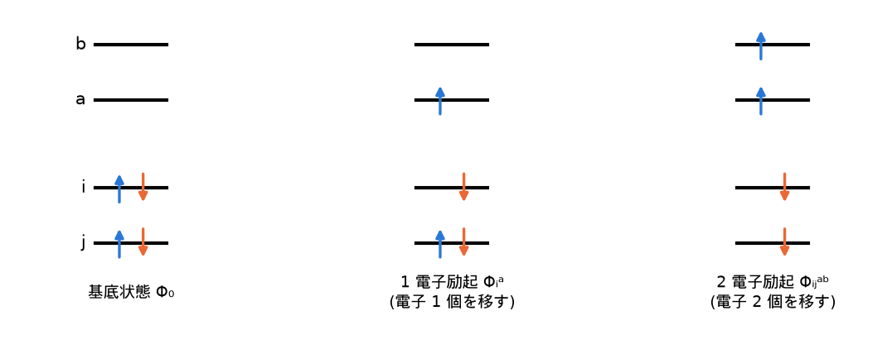
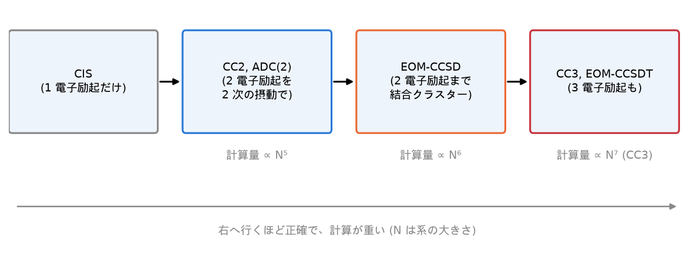
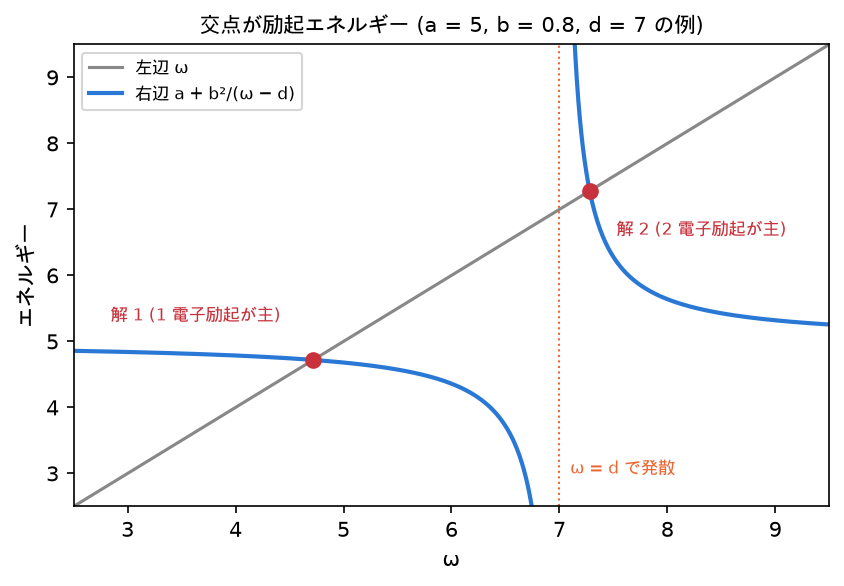
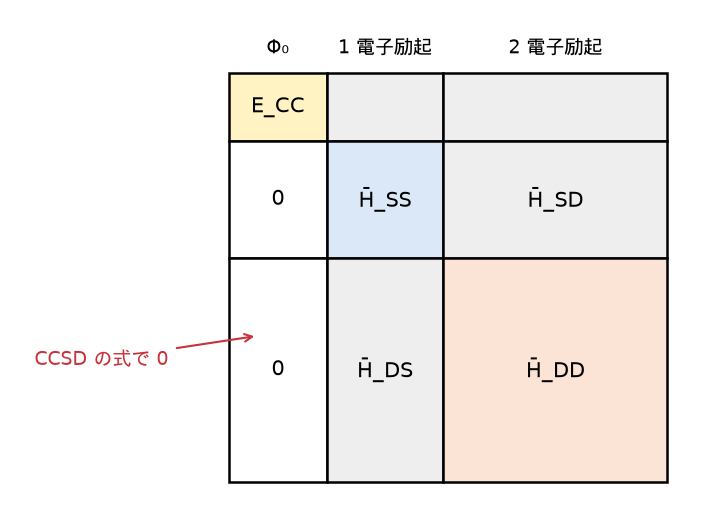
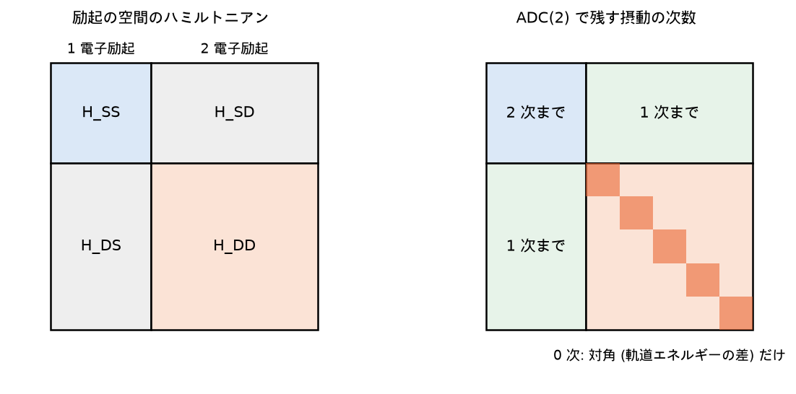
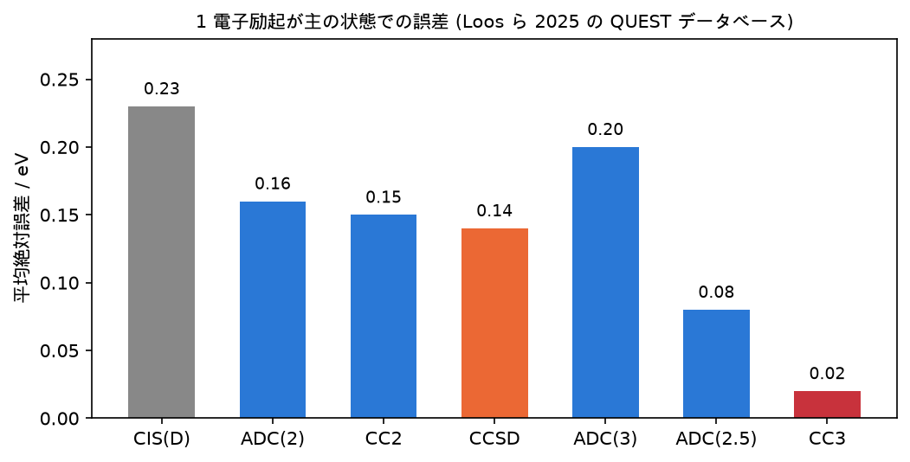

# 第 23 回　励起状態の波動関数法：EOM-CCSD、CC2、ADC(2)

!!! abstract "この回の道筋"
    第 19 回の CIS と TDDFT は、1 電子励起の配置だけで励起状態を表しました。この回では、2 電子励起の配置も取り込んで励起状態の精度を上げる波動関数法を学びます。まず、1 電子励起と 2 電子励起からなる空間のハミルトニアンの行列を書き、2 電子励起を「たたみ込む」と、1 電子励起だけの式が振動数に依存する形になることを導きます。この見方で、結合クラスター法を励起状態に広げた EOM-CCSD と、それを安くした CC2・ADC(2) が、何を残して何を近似しているのかを整理します。最後に、大規模なベンチマークの結果から、各方法の精度と使い分けを見ます。

    | 節 | 内容 |
    |---|---|
    | 1 | なぜ 2 電子励起が要るのか |
    | 2 | 励起の空間のハミルトニアン |
    | 3 | 2 電子励起をたたみ込む |
    | 4 | EOM-CCSD |
    | 5 | CC2 と ADC(2) |
    | 6 | ベンチマークで分かっていること |
    | 7 | 使い分け |

    **前に読んでおく回**：[量子化学の理論 第 8 回](08-configuration-interaction.md)、[第 9 回](09-mp2.md)、[第 10 回](10-coupled-cluster.md)、[第 19 回](19-tddft.md)

!!! tip "物理的なイメージ"
    励起状態の波動関数法が求めているのは、「励起した電子が、まわりの電子とどう相関し合うか」まで含めた励起エネルギーです。CIS では、電子を 1 個別の軌道に移すだけで、残りの電子はその変化に反応しません。実際には、1 個の電子が移ると、まわりの電子も避け方を変えます（緩和）。この反応を表すのが、1 電子励起に 2 電子励起の配置を混ぜることです。2 電子励起の配置は、1 電子励起の配置を「着せかえる」衣のような役割を果たし、その衣の着せ方（何次まで正確に扱うか）の違いが、CC2、ADC(2)、EOM-CCSD の違いです。

この回では原子単位（エネルギーはハートリー $E_\mathrm{h}$）を使います。1 $E_\mathrm{h}$ = 27.211 eV です。添字は、占有軌道を $i, j$、仮想軌道を $a, b$ で表します。

## 1. なぜ 2 電子励起が要るのか

第 19 回の CIS は、HF の決定子 $\Phi_0$ から電子を 1 個移した配置（1 電子励起の配置）だけで励起状態を表しました。図 1 の中央の配置です。

**図 1**　左：HF の基底状態の配置。中央：電子を 1 個移した 1 電子励起の配置。右：電子を 2 個移した 2 電子励起の配置。青の上向きの矢印が α 電子、橙の下向きの矢印が β 電子です。

CIS には、次の 2 つの足りない点があります。

1. **励起状態の相関が入らない**：CIS の励起状態は、1 電子励起の配置の重ね合わせです。移った電子とまわりの電子が避け合う動き（第 7 回の電子相関）は、2 電子励起の配置を混ぜないと表せません。その結果、CIS の励起エネルギーは系統的に大きくなります（第 19 回）。
2. **基底状態と励起状態のつり合いが悪い**：基底状態を相関のある方法（たとえば CCSD）で求めても、励起状態を CIS で求めると、相関の入り方が違うので、差（励起エネルギー）がずれます。

どちらも、2 電子励起の配置を取り込むことで改善できます。問題は、2 電子励起の配置が非常に多いことです。占有軌道が $o$ 個、仮想軌道が $v$ 個なら、1 電子励起の配置は $ov$ 個程度ですが、2 電子励起は $o^2v^2$ 個程度あります。この回の方法は、すべて「2 電子励起をどれだけ、どう近似して取り込むか」の違いとして理解できます（図 2）。

**図 2**　励起状態の波動関数法の階層。右へ行くほど 2 電子励起（さらに 3 電子励起）を正確に扱い、精度が上がる一方、計算量は系の大きさ $N$ のより高いべきで増えます。

**ここまでで分かったこと**：CIS は 1 電子励起の配置だけを使うので、励起状態の相関を含みません。2 電子励起の配置を、どこまでどう近似して取り込むかで、方法の階層ができます。

## 2. 励起の空間のハミルトニアン

励起状態を、1 電子励起の配置 $\Phi_S$（S は singles）と 2 電子励起の配置 $\Phi_D$（D は doubles）の重ね合わせで表します。

$$
\Psi = \sum_S c_S\, \Phi_S + \sum_D c_D\, \Phi_D
$$

ハミルトニアンをこの配置の組で行列にすると、1 電子励起どうし、1 電子励起と 2 電子励起の間、2 電子励起どうしの、4 つのブロックに分かれます。

$$
\mathbf H =
\begin{pmatrix}
\mathbf H_{SS} & \mathbf H_{SD} \\
\mathbf H_{DS} & \mathbf H_{DD}
\end{pmatrix},
\qquad
(\mathbf H_{SS})_{S S'} = \langle \Phi_S | \hat H - E_0 | \Phi_{S'} \rangle \ \text{など}
$$

ここでは、HF のエネルギー $E_0$ を引いた行列を使います。図 3 の左は、このブロックを絵にしたものです。行列の大きさは、1 電子励起の部分が $ov$ 程度、2 電子励起の部分が $o^2v^2$ 程度で、2 電子励起のブロックが圧倒的に大きくなります。

各ブロックの意味は次のとおりです。

- $\mathbf H_{SS}$：CIS の行列そのものです（第 19 回の $\mathbf A$）。
- $\mathbf H_{SD}$、$\mathbf H_{DS}$：1 電子励起と 2 電子励起を混ぜる結合です。Slater–Condon の規則（第 8 回）から、2 つの配置が 2 個以下のスピン軌道でしか違わないときにだけ 0 になりません。1 電子励起の配置と、そこからさらに 1 個電子を移した 2 電子励起の配置が結合します。
- $\mathbf H_{DD}$：2 電子励起どうしの行列です。対角の要素は、ほぼ「移した 2 個の電子の軌道エネルギーの差の和」$\varepsilon_a + \varepsilon_b - \varepsilon_i - \varepsilon_j$ です。

この固有値問題

$$
\begin{pmatrix}
\mathbf H_{SS} & \mathbf H_{SD} \\
\mathbf H_{DS} & \mathbf H_{DD}
\end{pmatrix}
\begin{pmatrix} \mathbf c_S \\ \mathbf c_D \end{pmatrix}
= \omega
\begin{pmatrix} \mathbf c_S \\ \mathbf c_D \end{pmatrix}
$$

をそのまま解くのが、基底状態を HF に固定した CISD の励起状態です。ただし、第 8 回で見たように CISD には大きさの問題があり、また $\mathbf H_{DD}$ が大きすぎるので、この形のままでは使いません。

**ここまでで分かったこと**：1 電子励起と 2 電子励起の空間で、ハミルトニアンは 4 つのブロックに分かれます。1 電子励起どうしのブロックが CIS の行列で、2 電子励起どうしのブロックが圧倒的に大きくなります。

## 3. 2 電子励起をたたみ込む

### 3.1 一番小さな例

2 電子励起のブロックを消去して、1 電子励起だけの式に書き直す方法を見ます。まず、1 電子励起の配置 1 個と 2 電子励起の配置 1 個だけの、2 行 2 列の例で考えます。

$$
\begin{pmatrix} a & b \\ b & d \end{pmatrix}
\begin{pmatrix} c_S \\ c_D \end{pmatrix}
= \omega
\begin{pmatrix} c_S \\ c_D \end{pmatrix}
$$

$a$ は 1 電子励起の配置のエネルギー（CIS の励起エネルギー）、$d$ は 2 電子励起の配置のエネルギー、$b$ は 2 つを混ぜる結合です。行ごとに書くと、

$$
a\, c_S + b\, c_D = \omega\, c_S \qquad\text{(1 行目)}
$$

$$
b\, c_S + d\, c_D = \omega\, c_D \qquad\text{(2 行目)}
$$

です。2 行目を $c_D$ について解きます。$d\, c_D$ を右辺に移すと $b\, c_S = (\omega - d)\, c_D$ なので、

$$
c_D = \frac{b}{\omega - d}\, c_S
$$

です。これを 1 行目に代入すると、

$$
\Big( a + \frac{b^2}{\omega - d} \Big)\, c_S = \omega\, c_S
$$

となります。$c_S \neq 0$ なら、両辺を $c_S$ で割って、

$$
\omega = a + \frac{b^2}{\omega - d}
$$

です。2 電子励起の配置は式から消え、1 電子励起の配置のエネルギー $a$ に、2 電子励起を通した補正 $b^2/(\omega - d)$ が付いた形になりました。この補正は、求めたい $\omega$ 自身に依存します。

この式を解くには、両辺に $\omega - d$ をかけて整理します。

$$
(\omega - a)(\omega - d) = b^2
$$

これは $\omega$ の 2 次方程式なので、解は 2 つあります。

$$
\omega_\pm = \frac{a + d}{2} \pm \sqrt{\Big(\frac{a - d}{2}\Big)^2 + b^2}
$$

（第 22 回の 2 状態の模型と同じ式です。）図 4 は、$a = 5$、$b = 0.8$、$d = 7$ の例で、左辺 $\omega$ と右辺 $a + b^2/(\omega - d)$ をグラフにしたものです。2 つの交点が 2 つの解で、$\omega_- = 6 - \sqrt{1 + 0.64} \approx 4.72$、$\omega_+ = 6 + \sqrt{1.64} \approx 7.28$ です。

**図 4**　2 状態の例での、たたみ込んだ式の左辺（灰の直線）と右辺（青の曲線）。右辺は $\omega = d$ で発散します。2 つの交点（赤）が励起エネルギーで、左は 1 電子励起が主の状態、右は 2 電子励起が主の状態です。

2 つの解には、次の性格があります。

- **解 1（$\omega_- \approx 4.72$）**：CIS の値 $a = 5$ より低くなっています。2 電子励起との混ざりが、1 電子励起の状態を安定化しています。これが、励起状態の相関（緩和）にあたります。
- **解 2（$\omega_+ \approx 7.28$）**：$d = 7$ の近くにある、2 電子励起が主の状態です。たたみ込んだ式の中では、右辺が発散する点（$\omega = d$）の近くに現れます。

### 3.2 一般の場合

同じ操作を、2 節の行列で行います。2 行目のブロック $\mathbf H_{DS} \mathbf c_S + \mathbf H_{DD} \mathbf c_D = \omega \mathbf c_D$ を $\mathbf c_D$ について解くと、

$$
\mathbf c_D = (\omega \mathbf 1 - \mathbf H_{DD})^{-1} \mathbf H_{DS}\, \mathbf c_S
$$

です。これを 1 行目のブロック $\mathbf H_{SS} \mathbf c_S + \mathbf H_{SD} \mathbf c_D = \omega \mathbf c_S$ に代入すると、

$$
\Big[ \mathbf H_{SS} + \mathbf H_{SD} (\omega \mathbf 1 - \mathbf H_{DD})^{-1} \mathbf H_{DS} \Big] \mathbf c_S = \omega\, \mathbf c_S
$$

が得られます。この操作を、行列の**分割**（partitioning、Löwdin の分割）と呼びます。元の固有値問題と同じ解をもちますが、行列の大きさは 1 電子励起の数 $ov$ だけになりました。そのかわり、行列が $\omega$ に依存するので、$\omega$ を仮に決める → 行列をつくる → 固有値を求める → $\omega$ を更新する、を繰り返して解きます。

この式から、次のことが分かります。

1. 励起状態の相関は、$\mathbf H_{SD}(\omega - \mathbf H_{DD})^{-1}\mathbf H_{DS}$ という補正として 1 電子励起の行列に入ります。
2. 補正の精度は、$\mathbf H_{SD}$ と $\mathbf H_{DD}$ をどれだけ正確に扱うかで決まります。
3. 2 電子励起が主の状態は、$(\omega - \mathbf H_{DD})^{-1}$ が発散する点、つまり $\mathbf H_{DD}$ の固有値の近くに現れます。そのため、$\mathbf H_{DD}$ を粗く近似すると、2 電子励起が主の状態は正しく求まりません。

**ここまでで分かったこと**：2 電子励起のブロックを消去すると、1 電子励起だけの、振動数に依存する固有値問題になります。2 電子励起の扱いの精度が、1 電子励起が主の状態の補正と、2 電子励起が主の状態の位置の両方を決めます。

## 4. EOM-CCSD

### 4.1 結合クラスター法の思い出し

第 10 回の結合クラスター法では、基底状態を

$$
\Psi_\mathrm{CC} = e^{\hat T}\, \Phi_0, \qquad \hat T = \hat T_1 + \hat T_2
$$

と書きました。$\hat T_1$ と $\hat T_2$ は、1 電子励起と 2 電子励起をつくる演算子で、その係数（振幅）が未知数です。シュレーディンガー方程式 $\hat H e^{\hat T} \Phi_0 = E\, e^{\hat T} \Phi_0$ の両辺に、左から $e^{-\hat T}$ をかけると、

$$
e^{-\hat T} \hat H e^{\hat T}\, \Phi_0 = E\, \Phi_0
$$

となります。左辺の演算子を

$$
\bar H = e^{-\hat T} \hat H e^{\hat T}
$$

と書き、**相似変換したハミルトニアン**と呼びます。この式を、$\Phi_0$、1 電子励起の配置 $\Phi_S$、2 電子励起の配置 $\Phi_D$ に射影すると、

$$
\langle \Phi_0 | \bar H | \Phi_0 \rangle = E_\mathrm{CC}, \qquad
\langle \Phi_S | \bar H | \Phi_0 \rangle = 0, \qquad
\langle \Phi_D | \bar H | \Phi_0 \rangle = 0
$$

が得られます。1 つ目がエネルギーの式、2 つ目と 3 つ目が振幅を決める CCSD の式です（右辺の $E\,\langle \Phi_S | \Phi_0 \rangle$ は、配置が直交するので 0 です）。

### 4.2 励起状態への広げ方

EOM-CCSD（equation-of-motion CCSD）は、励起状態を、基底状態の $e^{\hat T}\Phi_0$ に「励起の演算子」$\hat R$ をかけた形で表します [Stanton 1993]。

$$
\Psi_k = \hat R_k\, e^{\hat T} \Phi_0, \qquad \hat R_k = r_0 + \hat R_1 + \hat R_2
$$

$\hat R_1$、$\hat R_2$ は、$\hat T_1$、$\hat T_2$ と同じ形の 1 電子・2 電子励起の演算子で、その係数 $r$ が励起状態ごとの未知数です。

これをシュレーディンガー方程式 $\hat H \Psi_k = E_k \Psi_k$ に入れます。励起の演算子どうしは、どれも占有軌道から電子を抜いて仮想軌道に入れるだけなので、順番を入れ替えても結果が変わりません（$\hat R_k e^{\hat T} = e^{\hat T} \hat R_k$）。これを使って $\hat H e^{\hat T} \hat R_k \Phi_0 = E_k\, e^{\hat T} \hat R_k \Phi_0$ と書き、両辺に左から $e^{-\hat T}$ をかけると、

$$
\bar H\, \hat R_k \Phi_0 = E_k\, \hat R_k \Phi_0
$$

となります。つまり、励起状態は、相似変換したハミルトニアン $\bar H$ の固有ベクトルです。これを $\Phi_0$、1 電子励起、2 電子励起の配置で行列にすると、図 5 の形になります。

**図 5**　EOM-CCSD で対角化する $\bar H$ の形。左の列の、1 電子励起と 2 電子励起の行は、CCSD の式（4.1 節）によって 0 です。

行列で書くと、

$$
\bar{\mathbf H} =
\begin{pmatrix}
E_\mathrm{CC} & \bar{\mathbf H}_{0S} & \bar{\mathbf H}_{0D} \\
\mathbf 0 & \bar{\mathbf H}_{SS} & \bar{\mathbf H}_{SD} \\
\mathbf 0 & \bar{\mathbf H}_{DS} & \bar{\mathbf H}_{DD}
\end{pmatrix}
$$

です。左の列の下の 2 つのブロックは、4.1 節の CCSD の式 $\langle \Phi_S | \bar H | \Phi_0 \rangle = 0$、$\langle \Phi_D | \bar H | \Phi_0 \rangle = 0$ そのものなので、0 です。左下が 0 のブロック三角行列の固有値は、左上の $E_\mathrm{CC}$ と、右下の部分

$$
\begin{pmatrix}
\bar{\mathbf H}_{SS} & \bar{\mathbf H}_{SD} \\
\bar{\mathbf H}_{DS} & \bar{\mathbf H}_{DD}
\end{pmatrix}
$$

の固有値です。前者が基底状態、後者が励起状態のエネルギーなので、**励起エネルギー $\omega_k = E_k - E_\mathrm{CC}$ は、右下の部分から $E_\mathrm{CC}$ を引いた行列の固有値**として求まります。これは 2 節の固有値問題と同じ形で、$\mathbf H$ が $\bar{\mathbf H}$ に置き換わっただけです。

### 4.3 EOM-CCSD の特徴

2 節の CISD の励起状態と比べると、次の違いがあります。

1. **基底状態の相関が入っている**：$\bar H$ は $e^{\hat T}$ を含むので、行列の要素には基底状態の相関（$\hat T$）がすでに取り込まれています。基底状態と励起状態が、同じ CCSD の土台の上で扱われます。
2. **行列が対称でない**：$e^{-\hat T}$ は $e^{\hat T}$ のエルミート共役ではないので、$\bar H$ はエルミートではありません。固有値は実数になるのがふつうですが、左の固有ベクトルと右の固有ベクトルが違います。振動子強度などの性質を求めるには、両方が必要です [Stanton 1993]。
3. **計算量は $N^6$**：$\bar{\mathbf H}_{DD}$ を含むので、基底状態の CCSD と同じく、系の大きさの 6 乗で増えます。

1 電子励起が主の状態では、2 電子励起の配置は 3 節の「衣」の役割をするだけなので、$\bar{\mathbf H}_{DD}$ がある程度粗くても、よい精度が得られます。一方、2 電子励起が主の状態では、2 電子励起の配置そのものが主役になります。その相関を表すには 3 電子励起・4 電子励起の配置が必要ですが、EOM-CCSD には入っていません。そのため、2 電子励起が主の状態では誤差が大きくなります（6 節）。

**ここまでで分かったこと**：EOM-CCSD は、相似変換したハミルトニアン $\bar H$ を 1 電子・2 電子励起の空間で対角化します。CCSD の式のおかげで基底状態の行と列が分かれ、励起エネルギーが直接求まります。$\bar H$ は対称ではなく、計算量は $N^6$ です。

## 5. CC2 と ADC(2)

### 5.1 摂動の次数で近似する

EOM-CCSD の $N^6$ の計算量の大部分は、2 電子励起どうしのブロックから来ます。そこで、ブロックごとに、摂動論（第 9 回）の何次までを残すかを決めて近似します。HF の軌道エネルギーの差を 0 次、電子間の相互作用を 1 次の大きさとみなします。

**ADC(2)**（algebraic diagrammatic construction の 2 次）は、Schirmer が提案した方法で、エルミートな固有値問題として励起エネルギーを求めます [Schirmer 1982]。ADC(2) では、ブロックごとに次の次数までを残します（図 6 の右）。

| ブロック | 残す次数 | 中身 |
|---|---|---|
| 1 電子励起どうし | 2 次まで | CIS の行列に、2 次の補正を足したもの |
| 1 電子励起と 2 電子励起の間 | 1 次まで | 2 電子積分の 1 次の結合 |
| 2 電子励起どうし | 0 次まで | 対角の軌道エネルギーの差 $\varepsilon_a + \varepsilon_b - \varepsilon_i - \varepsilon_j$ だけ |

**図 6**　左：励起の空間のハミルトニアンの 4 つのブロック。右：ADC(2) で各ブロックに残す摂動の次数。2 電子励起どうしのブロックは、対角の要素（軌道エネルギーの差）だけを残します。

**CC2** は、Christiansen、Koch、Jørgensen が提案した方法です [Christiansen 1995]。CCSD の 2 電子励起の振幅の式を 1 次まで近似し、1 電子励起の振幅はそのまま扱います。その結果、励起状態の行列の構造は ADC(2) とよく似ていて、2 電子励起どうしのブロックは、やはり対角の軌道エネルギーの差だけになります。ただし、CC2 は結合クラスター法から来ているので、EOM-CCSD と同じく行列が対称ではありません。

### 5.2 なぜ安くなるのか

2 電子励起どうしのブロックが対角だけになると、3.2 節の式の $(\omega \mathbf 1 - \mathbf H_{DD})^{-1}$ は、対角の要素の逆数を並べた行列になります。

$$
(\omega \mathbf 1 - \mathbf H_{DD})^{-1} \approx
\begin{pmatrix}
\dfrac{1}{\omega - \Delta_1} & 0 & \cdots \\
0 & \dfrac{1}{\omega - \Delta_2} & \cdots \\
\vdots & \vdots & \ddots
\end{pmatrix},
\qquad \Delta_D = \varepsilon_a + \varepsilon_b - \varepsilon_i - \varepsilon_j
$$

逆行列を求める必要がなく、各要素を割り算するだけで済みます。そのため、1 電子励起だけの大きさの式を、$N^5$ の計算量で繰り返し解けます。これが、CC2 と ADC(2) が EOM-CCSD より 1 桁安い理由です。

### 5.3 代わりに失うもの

2 電子励起どうしのブロックを軌道エネルギーの差で近似すると、3.2 節の 3 点目から、2 電子励起が主の状態は、軌道エネルギーの差 $\Delta_D$ の近くに、ほとんど補正なしで現れます。つまり、CC2 と ADC(2) は、2 電子励起が主の状態をうまく表せません。ADC(2) の 2 電子励起どうしのブロックを 1 次まで広げた ADC(2)-x という変種もあります。

### 5.4 CIS(D)

もっと安い方法として、CIS(D) があります [Head-Gordon 1994]。CIS で求めた励起状態に、2 電子励起による補正を、摂動論で 1 回だけ足す方法です。3.2 節の式で言えば、$\omega$ を CIS の値に固定して補正を 1 回計算するだけで、繰り返しません。

**ここまでで分かったこと**：CC2 と ADC(2) は、2 電子励起どうしのブロックを対角の軌道エネルギーの差で近似し、計算量を $N^5$ に下げます。そのかわり、2 電子励起が主の状態は表せません。CIS(D) は、補正を 1 回だけ足すさらに安い方法です。

## 6. ベンチマークで分かっていること

### 6.1 1 電子励起が主の状態

Loos らは、多くの分子の励起状態について、FCI に近い精度の参照値を集めたデータベース（QUEST）をつくり、さまざまな方法を評価しました。2025 年の報告では、1 から 16 個の重い原子を含む分子の、1,489 個の励起状態の参照値（aug-cc-pVTZ 基底）がまとめられています [Loos 2025]。そのうち、純粋な 2 電子励起と参照値の不確かな状態を除いた約 1000 個の状態で、各方法の平均絶対誤差は図 7 のようになりました [Loos 2025]。

**図 7**　1 電子励起が主の約 1000 個の励起状態での平均絶対誤差（Loos ら 2025 の表 5 の値）。

論文の分析から、次のことが分かります [Loos 2025]。

- **CIS(D)**：平均絶対誤差は 0.23 eV で、誤差のばらつきも、評価された単一参照の方法の中で最も大きくなりました。
- **ADC(2) と CC2**：平均絶対誤差は 0.15〜0.16 eV で、誤差の平均（符号付き）はほぼ 0 です。誤差の傾向もよく似ています。分子が大きいほど誤差が小さくなり、リュードベリ状態より原子価の励起（特に n→π\*）で精度が良い傾向がありました。ただし、化学的精度（約 ±0.05 eV）に入るのは 20〜25% の状態だけでした。
- **CCSD（EOM-CCSD）**：平均絶対誤差は 0.14 eV で、CC2 とほぼ同じです。ただし、励起エネルギーを系統的に高く見積もり（誤差の平均 +0.12 eV）、分子が大きくなるほどずれが大きくなる傾向がありました。そのため、大きな分子では CC2 のほうが有利な場合があります。
- **ADC(3)**：平均絶対誤差は 0.20 eV で、計算量が増えるのに ADC(2) より精度が下がりました。ADC(2) と ADC(3) の値を平均した ADC(2.5) は、平均絶対誤差 0.08 eV と大きく改善しました。ADC(3) が ADC(2) の誤差を補正しすぎる傾向は、それ以前の研究でも指摘されています [Loos 2018]。
- **CC3**：3 電子励起を近似的に含む CC3 の平均絶対誤差は 0.02 eV で、非常に高い精度でした。

### 6.2 2 電子励起が主の状態

2 電子励起が主の状態では、事情が大きく違います。Loos らは、2 電子励起の性格をもつ遷移について参照値をまとめ、CC 法の誤差が、遷移の 2 電子励起の性格の強さと密接に関係することを示しました。純粋な 2 電子励起では、CC3 でも誤差が 1 eV に達しうると報告しています [Loos 2019]。2025 年の QUEST の報告でも、純粋な 2 電子励起の状態での平均絶対誤差は、CC3 で 0.90 eV、CCSDT で 0.45 eV と大きく、いずれも高く見積もりました。著者らは、CC 法でこれらの状態を正しく扱うには 4 電子励起まで含める必要があると結論しています。一方、CASPT2（IPEA シフトあり）や NEVPT2 などの多参照の方法は、これらの状態で 0.1 eV 程度の誤差に収まりました [Loos 2025]。

この結果は、5.3 節の議論と合っています。2 電子励起が主の状態では、2 電子励起の配置そのものの相関が必要で、1 電子・2 電子励起の空間の方法では足りません。

**ここまでで分かったこと**：1 電子励起が主の状態では、CC2・ADC(2)・EOM-CCSD の誤差は 0.15 eV 前後、CC3 は 0.02 eV です。2 電子励起が主の状態では、CC3 でも 1 eV 近くずれることがあり、多参照の方法が有利です。

## 7. 使い分け

| 方法 | 計算量 | 行列 | 長所 | 注意 |
|---|---|---|---|---|
| CIS(D) | $N^5$ | — | 安い | 誤差のばらつきが大きい |
| ADC(2) | $N^5$ | 対称 | 安く、1 電子励起が主の状態でそこそこ正確 | 2 電子励起が主の状態は表せない |
| CC2 | $N^5$ | 非対称 | ADC(2) とほぼ同じ精度 | 同上 |
| EOM-CCSD | $N^6$ | 非対称 | 基底状態と同じ CCSD の土台 | 大きな分子で高く見積もる傾向 |
| CC3 | $N^7$ | 非対称 | 1 電子励起が主の状態で非常に正確 | 計算が重い。2 電子励起が主の状態では誤差が大きい |
| CASPT2、NEVPT2（第 13 回） | 活性空間による | — | 2 電子励起が主の状態にも強い | 活性空間の選び方に依存 |

実際の使い方としては、次のような流れが考えられます。

1. まず、TDDFT（第 19 回）や ADC(2)・CC2 で、多くの励起状態の性格と大まかなエネルギーを調べる。
2. 興味のある状態について、EOM-CCSD や CC3 で精度を確かめる。小さな分子なら、CC3 は参照値として使える精度です。
3. 2 電子励起の性格が強い状態（EOM-CCSD の 1 電子励起の振幅の重みが小さい状態など）が見つかったら、多参照の方法（第 13 回）を使う。

**ここまでで分かったこと**：ADC(2)・CC2 は安く手軽に、EOM-CCSD・CC3 は精度の確認に使えます。2 電子励起の性格が強い状態では、多参照の方法を選びます。

## まとめ

- CIS は 1 電子励起の配置だけを使うので、励起状態の相関を含みません。2 電子励起の配置をどう取り込むかで、励起状態の波動関数法の階層ができます。
- 1 電子・2 電子励起の空間の固有値問題は、2 電子励起のブロックをたたみ込むと、1 電子励起だけの、振動数に依存する式になります。2 電子励起どうしのブロックの扱いの精度が、方法の違いを決めます。
- EOM-CCSD は、相似変換したハミルトニアン $\bar H$ を対角化します。CCSD の式によって基底状態の行と列が分かれ、励起エネルギーが直接求まります。
- CC2 と ADC(2) は、2 電子励起どうしのブロックを軌道エネルギーの差で近似して $N^5$ に下げます。2 電子励起が主の状態は表せません。
- ベンチマークでは、1 電子励起が主の状態で CC2・ADC(2)・EOM-CCSD が 0.15 eV 前後、CC3 が 0.02 eV の平均絶対誤差でした。2 電子励起が主の状態では、多参照の方法が有利です。

## 参考文献

- J. F. Stanton, R. J. Bartlett, "The equation of motion coupled-cluster method. A systematic biorthogonal approach to molecular excitation energies, transition probabilities, and excited state properties", J. Chem. Phys. 98, 7029 (1993). DOI: [10.1063/1.464746](https://doi.org/10.1063/1.464746)
- O. Christiansen, H. Koch, P. Jørgensen, "The second-order approximate coupled cluster singles and doubles model CC2", Chem. Phys. Lett. 243, 409 (1995). DOI: [10.1016/0009-2614(95)00841-Q](https://doi.org/10.1016/0009-2614(95)00841-Q)
- J. Schirmer, "Beyond the random-phase approximation: A new approximation scheme for the polarization propagator", Phys. Rev. A 26, 2395 (1982). DOI: [10.1103/PhysRevA.26.2395](https://doi.org/10.1103/PhysRevA.26.2395)
- M. Head-Gordon, R. J. Rico, M. Oumi, T. J. Lee, "A doubles correction to electronic excited states from configuration interaction in the space of single substitutions", Chem. Phys. Lett. 219, 21 (1994). DOI: [10.1016/0009-2614(94)00070-0](https://doi.org/10.1016/0009-2614(94)00070-0)
- P.-F. Loos, A. Scemama, A. Blondel, Y. Garniron, M. Caffarel, D. Jacquemin, "A Mountaineering Strategy to Excited States: Highly Accurate Reference Energies and Benchmarks", J. Chem. Theory Comput. 14, 4360 (2018). DOI: [10.1021/acs.jctc.8b00406](https://doi.org/10.1021/acs.jctc.8b00406)
- P.-F. Loos, M. Boggio-Pasqua, A. Scemama, M. Caffarel, D. Jacquemin, "Reference Energies for Double Excitations", J. Chem. Theory Comput. 15, 1939 (2019). DOI: [10.1021/acs.jctc.8b01205](https://doi.org/10.1021/acs.jctc.8b01205)
- P.-F. Loos, M. Boggio-Pasqua, A. Blondel, F. Lipparini, D. Jacquemin, "The QUEST Database of Highly-Accurate Excitation Energies", J. Chem. Theory Comput. 21, 8010 (2025). DOI: [10.1021/acs.jctc.5c00975](https://doi.org/10.1021/acs.jctc.5c00975)
