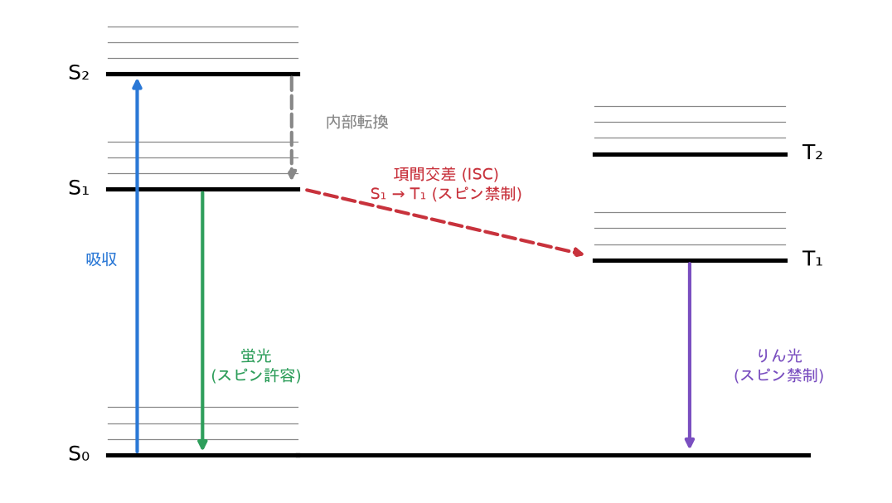
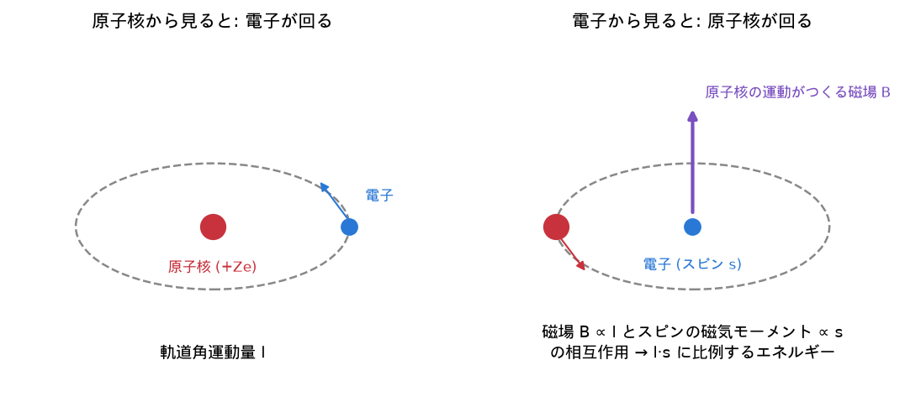
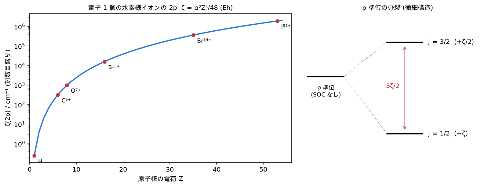
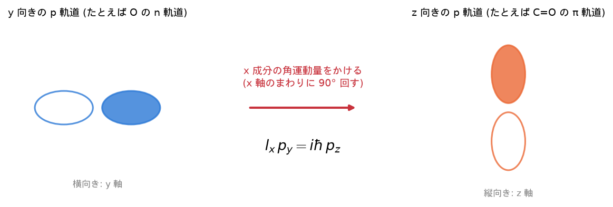
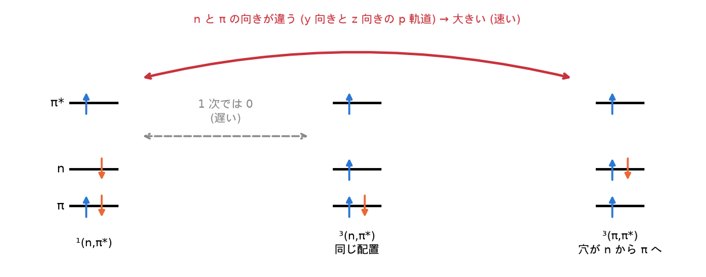
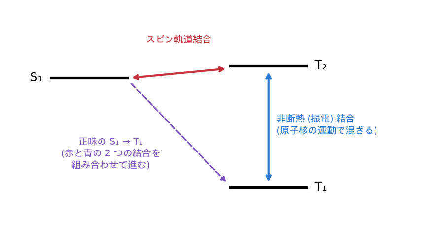

# 第 24 回　スピン軌道相互作用と項間交差

!!! abstract "この回の道筋"
    一重項と三重項の間の移り変わり（項間交差、りん光）は、電子のハミルトニアンだけでは決して起こりません。これを起こすのが、電子のスピンと軌道の運動の相互作用、スピン軌道相互作用（SOC）です。この回では、SOC がどこから来るのかを古典的な磁石の絵から導き、原子番号とともに急に大きくなること（重原子効果）を確かめます。次に、SOC の行列要素を第二量子化で書き、「同じ電子配置の一重項と三重項の間では 0 になる」ことを導きます。これが El-Sayed の規則の理由です。最後に、項間交差の速さの式（Fermi の黄金律）、振動を介したスピン振電機構、実際の計算方法をまとめます。

    | 節 | 内容 |
    |---|---|
    | 1 | スピンが変わる過程：項間交差とりん光 |
    | 2 | スピン軌道相互作用の起源 |
    | 3 | 原子での大きさ：重原子効果 |
    | 4 | 分子での行列要素と選択則 |
    | 5 | El-Sayed の規則 |
    | 6 | 項間交差の速さ |
    | 7 | 振動を介した項間交差：スピン振電機構 |
    | 8 | 実際の計算 |

    **前に読んでおく回**：量子化学の理論 [第 3 回](03-second-quantization.md)（第二量子化）、[第 4 回](04-spin.md)（スピン）、[第 19 回](19-tddft.md)（一重項と三重項の励起）、[第 22 回](22-conical-intersections.md)（非断熱結合）

!!! tip "物理的なイメージ"
    電子のスピンは小さな磁石です。電子から見ると、原子核が電子のまわりを回っていて、その運動が磁場をつくります。スピンの磁石は、この磁場の中で向きによってエネルギーが変わります。これがスピン軌道相互作用で、スピンの向きと軌道の運動（軌道角運動量）を結びつけます。

    結びつきの結果、全体の角運動量（スピン + 軌道）は保たれたまま、両者の間で角運動量をやりとりできるようになります。つまり、**スピンを裏返すには、その分だけ軌道の「回り方」を変えなければなりません**。分子の中で軌道の回り方を変えるとは、たとえば横向きの p 軌道を縦向きの p 軌道に「90° 回す」ことです。同じ軌道のまま（同じ電子配置のまま）スピンだけを裏返すことはできません。このため、項間交差は、軌道の性格が変わる組み合わせ（n→π* と π→π* の間など）で速く、変わらない組み合わせで遅くなります。

この回では原子単位（$\hbar = m_e = e = 4\pi\varepsilon_0 = 1$）を使います。光速は $c = 1/\alpha \approx 137.036$ です（$\alpha$ は微細構造定数）。エネルギーの換算は 1 $E_\mathrm h$ = 219 474.63 cm⁻¹ です。

## 1. スピンが変わる過程：項間交差とりん光

光を吸った分子のその後を、図 1 の Jablonski 図で整理します。

**図 1**　模式図。左が一重項（S₀、S₁、S₂）、右が三重項（T₁、T₂）です。太線が電子状態、細線が振動の準位です。光を吸って S₂ や S₁ に上がった分子は、内部転換（同じスピンの状態の間の、光を出さない移り変わり）で S₁ に下り、そこから蛍光を出すか、項間交差（ISC）で T₁ に移ります。T₁ から光を出して S₀ に戻るのがりん光です。項間交差とりん光は、どちらもスピンが変わる過程です。

ここで大事なのは、**電子のハミルトニアン $\hat H_\mathrm{el}$（第 2 回）だけでは、項間交差もりん光も起こらない**ことです。

理由は第 4 回で見たとおりです。
$\hat H_\mathrm{el}$ はスピンの演算子を含まないので、全スピンの 2 乗 $\hat S^2$ と交換します（$[\hat H_\mathrm{el}, \hat S^2] = 0$）。
交換する演算子の固有状態は、$S$ の違う状態どうしの間で行列要素が 0 になります。

$$
\langle {}^1\Psi|\hat H_\mathrm{el}|{}^3\Psi\rangle = 0
$$

つまり、$\hat H_\mathrm{el}$ の世界では、一重項と三重項は決して混ざらず、移り変われません。
それでも実際に項間交差やりん光が起こるのは、$\hat H_\mathrm{el}$ に入っていない小さな項があるからです。
その主役がスピン軌道相互作用です。

**ここまでで分かったこと**：一重項と三重項の間の移り変わりには、電子のハミルトニアンの外にある、スピンに作用する項が必要です。

## 2. スピン軌道相互作用の起源

### 2.1 電子から見ると、原子核が回っている

原子核のまわりを、電子が速さ $\mathbf v$ で回っているとします（図 2 左）。
電子の立場に立つと、原子核の方が電子のまわりを回って見えます（図 2 右）。
動く電荷は電流と同じなので、電子の位置に磁場 $\mathbf B$ をつくります。

**図 2**　模式図。左：原子核から見ると、電子が回っていて、軌道角運動量 $\mathbf l$ をもちます。右：電子から見ると、原子核が回っていて、電子の位置に磁場 $\mathbf B$ をつくります。$\mathbf B$ は $\mathbf l$ に比例します。電子のスピンの磁石（磁気モーメント、$\mathbf s$ に比例）がこの磁場の中に置かれるので、$\mathbf l\cdot\mathbf s$ に比例するエネルギーが生じます。

付録 A で古典電磁気学から導くと、この磁場は

$$
\mathbf B = \frac{Z}{c^2 r^3}\,\mathbf l
$$

です（$Z$ は原子核の電荷、$r$ は原子核からの距離）。
電子のスピンは磁気モーメント $\boldsymbol\mu = -g\,\mathbf s/2$（$g \approx 2$ なので $\boldsymbol\mu \approx -\mathbf s$）をもつ小さな磁石です。
磁石を磁場の中に置いたときのエネルギーは $-\boldsymbol\mu\cdot\mathbf B$ です。
これに、相対論的な補正（Thomas 歳差運動。付録 A）による係数 $\frac12$ がかかって、

$$
\hat h_\mathrm{SO} = \frac{Z}{2c^2}\,\frac{1}{r^3}\,\hat{\mathbf l}\cdot\hat{\mathbf s} = \frac{\alpha^2 Z}{2}\,\frac{1}{r^3}\,\hat{\mathbf l}\cdot\hat{\mathbf s}
$$

になります。
これが、電子 1 個と原子核 1 個のスピン軌道相互作用です。
相対論的なディラック方程式から、$1/c^2$ の項まで展開して導くと、係数 $\frac12$ も含めて同じ式が得られます（Breit–Pauli 近似 [Marian 2012]）。

### 2.2 分子の場合

分子では、電子 $i$ が各原子核 $A$ のまわりに持つ軌道角運動量 $\hat{\mathbf l}_{iA} = \mathbf r_{iA}\times\hat{\mathbf p}_i$（$\mathbf r_{iA}$ は原子核 $A$ から電子 $i$ へのベクトル）を使って、すべての電子と原子核について足します。

$$
\hat H_\mathrm{SO}^{(1)} = \frac{\alpha^2}{2}\sum_i\sum_A \frac{Z_A}{r_{iA}^3}\,\hat{\mathbf l}_{iA}\cdot\hat{\mathbf s}_i
$$

これを 1 電子のスピン軌道演算子と呼びます。
正確には、ほかの電子の運動がつくる磁場との相互作用（2 電子のスピン軌道項）もあります。
2 電子の項は、1 電子の項を部分的に打ち消す（原子核の電荷を遮蔽する）働きをします。
実際の計算では、2 電子の項を平均場で近似して 1 電子の項にまとめる方法（8 節）や、原子核の電荷 $Z_A$ を有効な値に置きかえる方法がよく使われます。

この先の議論では、$\hat H_\mathrm{SO}$ を「各電子に作用する 1 電子演算子の和」として、

$$
\hat H_\mathrm{SO} = \sum_i \hat{\mathbf h}(i)\cdot\hat{\mathbf s}_i,\qquad
\hat{\mathbf h}(i) = \frac{\alpha^2}{2}\sum_A\frac{Z_A}{r_{iA}^3}\,\hat{\mathbf l}_{iA}
$$

と書きます。
$\hat{\mathbf h}$ は空間の座標にだけ作用するベクトルの演算子（成分 $\hat h_x$、$\hat h_y$、$\hat h_z$）で、$\hat{\mathbf s}$ はスピンにだけ作用します。
2 電子の項を平均場で取り込んでも、この形は変わりません。

**ここまでで分かったこと**：スピン軌道相互作用は、電子から見て回っている原子核がつくる磁場と、スピンの磁石の相互作用です。$\hat{\mathbf l}\cdot\hat{\mathbf s}$ の形で、スピンと軌道の角運動量を結びつけます。

## 3. 原子での大きさ：重原子効果

### 3.1 原子番号の 4 乗で大きくなる

電子 1 個の水素様イオン（原子核の電荷 $Z$）で、$\hat h_\mathrm{SO} = \xi(r)\,\hat{\mathbf l}\cdot\hat{\mathbf s}$、$\xi(r) = \alpha^2 Z/(2r^3)$ の大きさを見積もります。
動径の部分の期待値を、スピン軌道結合定数

$$
\zeta_{nl} = \langle\xi(r)\rangle = \frac{\alpha^2 Z}{2}\,\Big\langle\frac{1}{r^3}\Big\rangle_{nl}
$$

と書きます。
水素様の軌道では $\langle r^{-3}\rangle_{nl} = Z^3/[n^3\,l(l+\frac12)(l+1)]$ なので（付録 C）、

$$
\zeta_{nl} = \frac{\alpha^2 Z^4}{2n^3\,l(l+\frac12)(l+1)}
$$

です。
**$Z$ の 4 乗**で大きくなることが分かります。
4 つの $Z$ のうち 1 つは、$\xi$ の前の $Z$（原子核の電荷が磁場をつくる強さ）です。
残りの $Z^3$ は、原子核の電荷が大きいほど電子が原子核の近くに引き寄せられて、$1/r^3$ が大きくなる効果です。

2p（$n = 2$、$l = 1$）では $\zeta_{2p} = \alpha^2 Z^4/48$ です。
水素（$Z = 1$）では $1.11\times10^{-6}\,E_\mathrm h = 0.243$ cm⁻¹ と、とても小さな値です（図 3 左）。

**図 3**　左：電子 1 個の水素様イオンの 2p のスピン軌道結合定数（上の式から計算、対数目盛り）。$Z$ が 1 から 53 になると、$\zeta$ は $53^4 \approx 8\times10^6$ 倍になります。右：p 準位が、スピン軌道相互作用で $j = 3/2$ と $j = 1/2$ に分裂する様子。分裂の幅は $\frac32\zeta$ です。

### 3.2 準位の分裂

$\hat{\mathbf l}\cdot\hat{\mathbf s}$ の固有値は、全角運動量 $\hat{\mathbf j} = \hat{\mathbf l} + \hat{\mathbf s}$ を使って求まります。
$\hat{\mathbf j}^2 = \hat{\mathbf l}^2 + \hat{\mathbf s}^2 + 2\,\hat{\mathbf l}\cdot\hat{\mathbf s}$ を $\hat{\mathbf l}\cdot\hat{\mathbf s}$ について解くと、

$$
\hat{\mathbf l}\cdot\hat{\mathbf s} = \frac12\Big(\hat{\mathbf j}^2 - \hat{\mathbf l}^2 - \hat{\mathbf s}^2\Big)
\ \longrightarrow\ \frac12\Big[j(j+1) - l(l+1) - \tfrac34\Big]
$$

です。
p 軌道（$l = 1$）では、$j = 3/2$ で $\frac12(\frac{15}{4} - 2 - \frac34) = +\frac12$、$j = 1/2$ で $\frac12(\frac34 - 2 - \frac34) = -1$ です。
したがって、エネルギーは $j = 3/2$ が $+\frac12\zeta$、$j = 1/2$ が $-\zeta$ ずれ、分裂の幅は $\frac32\zeta$ になります（図 3 右）。
水素の 2p では $\frac32\times0.243 = 0.365$ cm⁻¹ で、これは水素原子の 2p の微細構造の分裂の大きさです。

### 3.3 重原子効果

実際の原子の価電子は、内側の電子に遮蔽されて、原子核の電荷をそのまま感じるわけではありません。
そのため、価電子の $\zeta$ の増え方は $Z^4$ よりゆるやかです。
それでも、価電子の波動関数は原子核のごく近くにも少し入り込んでいて、そこでは遮蔽されない大きな $Z$ を感じます。
$1/r^3$ は原子核の近くで大きいので、この入り込みが効き、重い原子ほど価電子の SOC も急に大きくなります。

この結果、分子に Br、I のようなハロゲンや、Ir、Pt のような重い金属を入れると、項間交差やりん光が速くなります。
これを**重原子効果**と呼びます。
りん光を使う有機 EL の発光材料に Ir や Pt の錯体が多いのは、このためです。

**ここまでで分かったこと**：スピン軌道相互作用の大きさは、電子 1 個のイオンでは原子番号の 4 乗で大きくなります。実際の価電子でも重い原子ほど急に大きく、これが重原子効果です。

## 4. 分子での行列要素と選択則

項間交差やりん光の速さは、一重項と三重項の間の SOC の行列要素 $\langle{}^1\Psi|\hat H_\mathrm{SO}|{}^3\Psi_M\rangle$ で決まります（$M = -1, 0, +1$ は三重項の $M_S$）。
この節では、閉殻の基底状態から 1 電子を励起した配置（第 19 回）について、この行列要素を求めます。
目標は、「どんな組み合わせなら 0 でないか」という選択則です。

### 4.1 第二量子化で書く

スピンの部分を、上げ下げの演算子 $\hat s_\pm = \hat s_x \pm i\hat s_y$ を使って書き直します。

$$
\hat{\mathbf h}\cdot\hat{\mathbf s} = \hat h_z\hat s_z + \frac12\big(\hat h_-\hat s_+ + \hat h_+\hat s_-\big),\qquad \hat h_\pm = \hat h_x \pm i\hat h_y
$$

（右辺を展開すると $\hat h_z\hat s_z + \hat h_x\hat s_x + \hat h_y\hat s_y$ に戻ることを、付録 B で確かめます。）

第 4 回のスピン演算子の第二量子化表示（$\hat s_z \to \frac12(\alpha^\dagger\alpha - \beta^\dagger\beta)$、$\hat s_+ \to \alpha^\dagger\beta$、$\hat s_- \to \beta^\dagger\alpha$）を空間軌道 $p, q$ について広げると、

$$
\hat H_\mathrm{SO} = \sum_{pq}\Big[\frac12 h^z_{pq}\big(\hat a_{p\alpha}^\dagger\hat a_{q\alpha} - \hat a_{p\beta}^\dagger\hat a_{q\beta}\big)
+ \frac12 h^-_{pq}\,\hat a_{p\alpha}^\dagger\hat a_{q\beta}
+ \frac12 h^+_{pq}\,\hat a_{p\beta}^\dagger\hat a_{q\alpha}\Big]
$$

です。
ここで $h^z_{pq} = \langle\phi_p|\hat h_z|\phi_q\rangle$ などは空間軌道の積分です。
3 つの項の役割は、スピンの言葉で次のとおりです。

| 項 | スピンの変化 | $M_S$ の変化 |
|---|---|---|
| $h^z$ の項 | スピンを変えずに電子を移す（α と β で符号が逆） | 0 |
| $h^-$ の項 | β の電子を α にして移す | +1 |
| $h^+$ の項 | α の電子を β にして移す | −1 |

### 4.2 空間の積分の大事な性質

軌道角運動量の演算子 $\hat{\mathbf l} = \mathbf r\times\hat{\mathbf p} = -i\,\mathbf r\times\nabla$ は、エルミートで、しかも**純虚数の演算子**です（$-i$ がかかっています）。
分子の計算で使う軌道は実数の関数です。
実数の関数 $\phi_p$、$\phi_q$ について、

- エルミートなので $h^z_{qp} = (h^z_{pq})^*$
- 純虚数の演算子と実数の関数なので、$h^z_{pq}$ は純虚数で、$(h^z_{pq})^* = -h^z_{pq}$

です。
2 つを合わせると、$h^z_{qp} = -h^z_{pq}$（反対称）になります。
特に、$p = q$ のとき $h^z_{pp} = -h^z_{pp}$ なので、

$$
h^z_{pp} = \langle\phi_p|\hat h_z|\phi_p\rangle = 0
$$

です（$x$、$y$ の成分も同じです）。
**実数の軌道の「自分自身との」SOC の積分は 0** です。
物理的には、実数の軌道（たとえば $p_x$）は、右回り（$m_l = +1$）と左回り（$m_l = -1$）が等量に混ざった定在波なので、平均の軌道角運動量が 0 になる、ということです。

0 にならないのは、違う軌道の間の積分です。
たとえば、原子の上の p 軌道について、$\hat l_x$ は y 向きの $p_y$ を z 向きの $p_z$ に変えます（$\hat l_x\,p_y = i\,p_z$、図 4）。
x 軸のまわりに 90° 回す働きです。

**図 4**　模式図。$\hat l_x$ を y 向きの p 軌道（たとえば C=O の酸素の非共有電子対 n）にかけると、z 向きの p 軌道（C=O の π 軌道）になります（$\hbar = 1$ の単位では $\hat l_x p_y = i\,p_z$）。そのため、$\langle p_z|\hat l_x|p_y\rangle \neq 0$ ですが、$\langle p_y|\hat l_x|p_y\rangle = 0$ です。

### 4.3 基底状態と三重項の行列要素（りん光）

閉殻の基底状態 $\Phi_0$ と、占有軌道 $i$ から仮想軌道 $a$ への励起の三重項の間の行列要素を求めます。
三重項の $M = +1$ の成分は、$i$ の β 電子を取り除いて $a$ に α 電子を入れた決定子 $|{}^3\Phi_i^a(+1)\rangle = \hat a_{a\alpha}^\dagger\hat a_{i\beta}|\Phi_0\rangle$ です。
これを $\Phi_0$ に戻すには、$a$ の α 電子を $i$ の β に移す必要があり、それができるのは $h^+$ の項の $p = i$、$q = a$ だけです。
その係数を読み取ると、

$$
\langle\Phi_0|\hat H_\mathrm{SO}|{}^3\Phi_i^a(+1)\rangle = \frac12\,h^+_{ia}
$$

です。
$M = 0$ の成分 $|{}^3\Phi_i^a(0)\rangle = \frac{1}{\sqrt2}\big(\hat a_{a\alpha}^\dagger\hat a_{i\alpha} - \hat a_{a\beta}^\dagger\hat a_{i\beta}\big)|\Phi_0\rangle$ では、$h^z$ の項が効いて、

$$
\langle\Phi_0|\hat H_\mathrm{SO}|{}^3\Phi_i^a(0)\rangle = \frac{1}{\sqrt2}\Big[\frac12 h^z_{ia} - \Big(-\frac12 h^z_{ia}\Big)\Big] = \frac{1}{\sqrt2}\,h^z_{ia}
$$

です（括弧の中の 2 項は、α の部分と β の部分。β の部分は演算子と決定子の両方の符号が負で、正になります）。
どちらも、**励起で動いた軌道の組 $(i, a)$ の空間の積分**で決まります。
りん光の強さは、T₁ に S₀ がこの行列要素でわずかに混ざり、S₀ との間の遷移の強さを「借りる」ことで生じます。

### 4.4 励起した一重項と三重項の行列要素（項間交差）

一重項の励起の配置 $|{}^1\Phi_i^a\rangle$（$i \to a$）と、三重項の励起の配置 $|{}^3\Phi_j^b(0)\rangle$（$j \to b$）の間の行列要素は、付録 B で 1 段ずつ計算すると、

$$
\langle{}^1\Phi_i^a|\hat H_\mathrm{SO}|{}^3\Phi_j^b(0)\rangle = \frac12\Big(\delta_{ij}\,h^z_{ab} - \delta_{ab}\,h^z_{ji}\Big)
$$

になります。$M = \pm1$ の成分も、$h^z$ の代わりに $h^\pm$ が入り、係数は違いますが、同じく $\delta_{ij}h_{ab}$ と $\delta_{ab}h_{ji}$ の 2 つの項からなる形になります。
この式から、次の 3 つの場合が読み取れます。

| 一重項と三重項の組 | 式の中で残る項 | 値 |
|---|---|---|
| 同じ励起（$i = j$、$a = b$） | $\frac12(h^z_{aa} - h^z_{ii})$ | **0**（4.2 節の性質） |
| 電子が入る先だけ違う（$i = j$、$a \neq b$） | $\frac12 h^z_{ab}$ | 仮想軌道 $a$ と $b$ の間の積分 |
| 穴の場所だけ違う（$i \neq j$、$a = b$） | $-\frac12 h^z_{ji}$ | 占有軌道 $i$ と $j$ の間の積分 |
| 両方違う（$i \neq j$、$a \neq b$） | なし | 0（1 電子演算子は軌道 1 個の違いしかつなげない） |

**同じ電子配置の一重項と三重項の間の SOC は、ちょうど 0 になります。**
0 でなくなるには、一重項と三重項で、軌道が 1 個入れ替わっている必要があります。
そのうえで、入れ替わった 2 つの軌道の間の積分 $h_{ab}$ や $h_{ji}$ が大きいことが必要です。
4.2 節から、$h$ が大きいのは、同じ原子の上で、向きの違う p 軌道どうしのとき（図 4）です。

**ここまでで分かったこと**：SOC は 1 電子演算子なので、一重項と三重項の間で軌道が 1 個だけ違う組み合わせをつなぎます。同じ電子配置の一重項と三重項の間では、実数の軌道の性質から行列要素が 0 になります。

## 5. El-Sayed の規則

4.4 節の結果を、カルボニル化合物（ベンゾフェノンやホルムアルデヒドなど）に当てはめます。
大事な軌道は、酸素の非共有電子対 n（分子面内の、横向きの p 軌道）、C=O の π（面に垂直な p 軌道）、π* の 3 つです。
低い励起状態は ¹(n,π*)、³(n,π*)、³(π,π*) です（図 5）。

**図 5**　模式図。左から ¹(n,π*)、³(n,π*)、³(π,π*) の電子配置。¹(n,π*) と ³(n,π*) は同じ配置なので、SOC は 1 次では 0 です（灰の破線）。¹(n,π*) と ³(π,π*) は、穴の場所が n から π に変わっていて（電子が入る先はどちらも π*）、n と π は向きの違う p 軌道なので、SOC が大きくなります（赤の矢印）。

- **¹(n,π*) ↔ ³(n,π*)**：同じ励起（$i = j = $ n、$a = b = $ π*）。4.4 節の表の 1 行目で、**0** です。
- **¹(n,π*) ↔ ³(π,π*)**：電子が入る先は同じ π*（$a = b$）で、穴が n と π で違います。表の 3 行目で、値は $-\frac12 h_{\pi n}$ です。n と π は、酸素の上の向きの違う p 軌道（$p_y$ と $p_z$）なので、$h_{\pi n}$ は図 4 のように大きくなります。
- **¹(π,π*) ↔ ³(π,π*)**：同じ励起で **0** です。

まとめると、

> **El-Sayed の規則**：軌道の性格が違う状態の間（¹(n,π*) ↔ ³(π,π*)、¹(π,π*) ↔ ³(n,π*)）の項間交差は速く、同じ性格の状態の間（¹(n,π*) ↔ ³(n,π*)、¹(π,π*) ↔ ³(π,π*)）の項間交差は遅い [El-Sayed 1963]。

冒頭の物理的なイメージの言葉で言えば、スピンを裏返すときに、n（横向き）から π（縦向き）へと軌道の向きを 90° 変えることで、角運動量のつじつまを合わせているのです。
ベンゾフェノンのような芳香族ケトンで、項間交差がほぼ 100% 起こってりん光が強く出るのは、¹(n,π*) から ³(π,π*) への経路が開いているためです。

**ここまでで分かったこと**：El-Sayed の規則は、「同じ電子配置の一重項と三重項の間の SOC は 0」と「SOC の積分は向きの違う p 軌道の間で大きい」という 2 つの性質から導けます。

## 6. 項間交差の速さ

S₁ から T₁ への項間交差の速度定数は、時間に依存する摂動論（Fermi の黄金律）で、

$$
k_\mathrm{ISC} = \frac{2\pi}{\hbar}\,\sum_{M}\big|\langle\mathrm S_1|\hat H_\mathrm{SO}|\mathrm T_{1,M}\rangle\big|^2\ \times\ \mathrm{FCWD}(\Delta E_\mathrm{ST})
$$

と書けます。
2 つの因子の意味は次のとおりです。

- **電子の部分** $|\langle\mathrm S_1|\hat H_\mathrm{SO}|\mathrm T_{1,M}\rangle|^2$：4〜5 節の SOC の行列要素の 2 乗を、三重項の 3 つの成分について足したものです。
- **振動の部分** FCWD（Franck–Condon 加重状態密度）：S₁ の振動の状態と、同じエネルギーをもつ T₁ の振動の状態が、どれだけ重なり合うかを、温度による分布で重みをつけて足したものです。S₁ と T₁ のエネルギー差 $\Delta E_\mathrm{ST}$ は、T₁ の振動のエネルギーとして受け取られる必要があります。

振動の部分から、**エネルギーギャップ則**が出てきます。
2 つの状態のエネルギー差が大きいほど、その差を多数の振動の量子に分けて受け取る必要があり、振動の重なりが急に小さくなって、無輻射の遷移は遅くなります [Englman 1970]。

この式は、SOC の行列要素が 0 だと速度も 0 になる、という形をしています。
ところが、El-Sayed の規則で「遅い」はずの ¹(π,π*) ↔ ³(π,π*) の項間交差も、実際には 0 ではなく、ある程度の速さで起こります。
その理由が、次の節のスピン振電機構です。

**ここまでで分かったこと**：項間交差の速さは、SOC の行列要素の 2 乗（電子の部分）と、振動の重なり（振動の部分）の積で決まります。エネルギー差が大きいほど遅くなります（エネルギーギャップ則）。

## 7. 振動を介した項間交差：スピン振電機構

6 節の式では、SOC の行列要素を平衡構造の 1 点で計算していました。
実際の分子は振動していて、行列要素も原子核の位置とともに変わります。
また、ほかの状態を経由する道もあります。
これらをまとめて**スピン振電機構**と呼びます [Penfold 2018]。

### 7.1 SOC の行列要素が振動で変わる

振動の座標 $Q$ について、平衡構造のまわりで展開すると、

$$
\langle\mathrm S_1|\hat H_\mathrm{SO}|\mathrm T_1\rangle(Q) \approx V_0 + \frac{\partial V}{\partial Q}\,Q
$$

です。
同じ性格の状態の間では $V_0 \approx 0$ ですが、振動で分子の対称性がくずれると、n と π のような性格の違う軌道が少し混ざり、$\partial V/\partial Q$ が 0 でなくなります。
振動で揺すられると、閉じていた扉が少し開くイメージです。
この微分を解析的に求める方法の例として、TDDFT の枠組みで SOC の行列要素とその原子核の座標についての微分を計算する PyGraSO があります [Hagai 2025]。
しくみと応用は、[研究分野「励起状態と光化学」の 5.4 節](../../fields/04-excited-states.md#54-pygraso)で紹介しています。

### 7.2 別の三重項を経由する道

S₁ と T₁ の間の SOC が小さくても、S₁ と大きな SOC で結ばれた別の三重項 T₂ が近くにあることがあります。
このとき、図 6 のように、

1. S₁ と T₂ が SOC で結ばれ、
2. T₂ と T₁ が非断熱結合（振電結合、第 22 回）で結ばれる

という 2 段の道ができます。

**図 6**　模式図。S₁ と T₁ の間の直接の SOC が小さくても、S₁ と T₂ の間の SOC（赤）と、T₂ と T₁ の間の非断熱結合（青、原子核の運動で混ざる）を組み合わせると、正味で S₁ から T₁ への移り変わり（紫の破線）が起こります。

2 次の摂動論で、この道の実効的な結合は

$$
V_\mathrm{eff} = \frac{\langle\mathrm S_1|\hat H_\mathrm{SO}|\mathrm T_2\rangle\,\langle\mathrm T_2|\hat H_\mathrm{nac}|\mathrm T_1\rangle}{E(\mathrm S_1) - E(\mathrm T_2)}
$$

の形になります（$\hat H_\mathrm{nac}$ は非断熱結合を表す演算子）。
分母が小さい、つまり T₂ が S₁ に近いほど、この道は効きます。
熱活性化遅延蛍光（TADF）の分子で、T₁ から S₁ への逆項間交差が速く起こる理由の多くは、この機構で説明されています [Penfold 2018]。

**ここまでで分かったこと**：平衡構造での SOC が小さくても、振動による SOC の変化や、別の三重項を経由する 2 段の道によって、項間交差は起こります。

## 8. 実際の計算

SOC と項間交差の計算は、次の 3 段で考えると整理できます。

**(1) SOC の演算子**

- **Breit–Pauli のハミルトニアン**：2 節の 1 電子の項に、2 電子の項を加えた正確な形です。2 電子の項の計算は高くつきます。
- **平均場近似（SOMF）**：2 電子の項を、ほかの電子の平均の分布に対する 1 電子の項にまとめる方法です [Hess 1996]。精度と手間の釣り合いがよく、広く使われています。
- **有効な原子核の電荷**：1 電子の項だけを使い、原子核の電荷 $Z_A$ を、2 電子の遮蔽を見込んだ有効な値に置きかえる、簡単な方法です [Koseki 1992]。
- **有効内殻ポテンシャル（ECP）**：重い原子の内殻を擬ポテンシャルで置きかえる場合は、ECP に含まれる SOC の項を使います。

**(2) 状態と行列要素**

- **TDDFT や TDA**：一重項と三重項の励起状態を別々に求め、その間の SOC の行列要素を 4.4 節の形で計算します [Gao 2017]。安く、大きな分子に使えます。
- **状態相互作用（SI）**：CASSCF や CASPT2 などで求めたスピンの決まった状態の間で SOC の行列を作り、対角化して、スピンの混ざった状態を求めます [Malmqvist 2002]。重い原子や、状態が密集している系に向いています。
- **2 成分・4 成分の相対論的な方法**：SOC をはじめから波動関数に含める方法です（この回では扱いません）。

**(3) 速さ**

- **Fermi の黄金律と振動の相関関数**：6 節の式を、振動の量子効果を含めて計算します。7.1 節の SOC の微分を入れると、スピン振電機構も取り込めます。
- **非断熱の分子動力学**：表面ホッピング法に SOC を加え、一重項と三重項の間の移り変わりを、原子核の運動とともに追います [Mai 2018]。

どの方法でも、確かめるべき点は共通です。

- SOC の行列要素は、三重項の 3 つの成分（$M = -1, 0, +1$）の 2 乗の和で比べます。プログラムによって、個々の成分を出すものと、和の平方根を出すものがあります。
- 一重項と三重項の状態が、正しい性格（n,π* か π,π* か）で求まっているかを、軌道で確かめます。性格を取り違えると、El-Sayed の規則から行列要素が大きく変わります。
- 同じ性格の状態の間の項間交差を調べるときは、平衡構造の 1 点の SOC だけで判断せず、スピン振電機構（7 節）を考えます。

**ここまでで分かったこと**：SOC の計算は、演算子（Breit–Pauli、SOMF、有効電荷）、状態（TDDFT、状態相互作用）、速さ（黄金律、非断熱動力学）の 3 段の組み合わせで行います。

## まとめ

- 電子のハミルトニアンは $\hat S^2$ と交換するので、一重項と三重項を混ぜません。項間交差とりん光を起こすのは、スピン軌道相互作用です。
- スピン軌道相互作用は、電子から見て回っている原子核がつくる磁場とスピンの磁石の相互作用で、$\hat h_\mathrm{SO} = (\alpha^2 Z/2r^3)\,\hat{\mathbf l}\cdot\hat{\mathbf s}$ の形です。電子 1 個のイオンでは $\zeta \propto Z^4$ で、重い原子ほど急に大きくなります（重原子効果）。
- 第二量子化で書くと、SOC は軌道が 1 個違う配置どうしをつなぐ 1 電子演算子です。実数の軌道では $h_{pp} = 0$ なので、同じ電子配置の一重項と三重項の間の行列要素は 0 になります。
- このことと、SOC の積分が向きの違う p 軌道の間で大きいことから、El-Sayed の規則（¹(n,π*) ↔ ³(π,π*) は速く、¹(n,π*) ↔ ³(n,π*) は遅い）が導けます。
- 項間交差の速さは、SOC の 2 乗と振動の重なりの積で決まります。平衡構造での SOC が小さくても、振動による SOC の変化や、別の三重項を経由する道（スピン振電機構）で、項間交差は起こります。

## 付録 A　スピン軌道相互作用の古典的な導出

電子は原子核のまわりを速度 $\mathbf v$ で動いています。
原子核（電荷 $+Ze$）が電子の位置につくる電場は、原子核から電子へのベクトルを $\mathbf r$ として、SI 単位で

$$
\mathbf E = \frac{Ze}{4\pi\varepsilon_0}\,\frac{\mathbf r}{r^3}
$$

です。
電場 $\mathbf E$ の中を速度 $\mathbf v$ で動く観測者（電子）は、$v \ll c$ のとき、磁場

$$
\mathbf B = -\frac{1}{c^2}\,\mathbf v\times\mathbf E
$$

を感じます（電磁場のローレンツ変換の $v/c$ の 1 次）。
$\mathbf E$ を代入し、$-\mathbf v\times\mathbf r = \mathbf r\times\mathbf v$ を使うと、

$$
\mathbf B = \frac{Ze}{4\pi\varepsilon_0 c^2 r^3}\,\mathbf r\times\mathbf v = \frac{Ze}{4\pi\varepsilon_0 m c^2 r^3}\,\mathbf L
$$

です。
最後の等号では、軌道角運動量 $\mathbf L = \mathbf r\times m\mathbf v$ を使いました。

電子のスピンの磁気モーメントは $\boldsymbol\mu = -g\,\dfrac{e}{2m}\,\mathbf S$ で、$g \approx 2$ です。
磁場の中のエネルギー $-\boldsymbol\mu\cdot\mathbf B$ は、

$$
-\boldsymbol\mu\cdot\mathbf B = \frac{e}{m}\,\mathbf S\cdot\mathbf B = \frac{Ze^2}{4\pi\varepsilon_0\,m^2c^2\,r^3}\,\mathbf L\cdot\mathbf S
$$

です。

ここまでは、電子が静止している座標系で考えました。
しかし、電子は円に近い軌道を回っていて、その座標系は回転しています。
相対論では、加速度運動する座標系どうしをつなぐと、余分な回転（Thomas 歳差運動）が生じます。
この効果を入れると、上のエネルギーにちょうど $\frac12$ がかかります。
Thomas 歳差運動の導出は特殊相対論の詳しい計算になるので、ここでは結果だけを使います。
ディラック方程式を $1/c^2$ の次数まで展開する方法（Breit–Pauli 近似）でも、係数 $\frac12$ を含めて同じ結果が得られます。
こうして、

$$
\hat h_\mathrm{SO} = \frac{Ze^2}{8\pi\varepsilon_0\,m^2c^2}\,\frac{1}{r^3}\,\hat{\mathbf L}\cdot\hat{\mathbf S}
$$

です。
原子単位（$e = m = 4\pi\varepsilon_0 = \hbar = 1$）では、$\hat{\mathbf L} \to \hat{\mathbf l}$、$\hat{\mathbf S} \to \hat{\mathbf s}$ として、本文 2.1 節の $\hat h_\mathrm{SO} = \dfrac{Z}{2c^2r^3}\,\hat{\mathbf l}\cdot\hat{\mathbf s}$ になります。

## 付録 B　行列要素の計算

### B.1 上げ下げの演算子による書き直し

$\hat s_\pm = \hat s_x \pm i\hat s_y$、$\hat h_\pm = \hat h_x \pm i\hat h_y$ とします。
$\hat h$ と $\hat s$ は別の座標に作用するので、互いに交換します。

$$
\hat h_-\hat s_+ = (\hat h_x - i\hat h_y)(\hat s_x + i\hat s_y) = \hat h_x\hat s_x + \hat h_y\hat s_y + i(\hat h_x\hat s_y - \hat h_y\hat s_x)
$$

$$
\hat h_+\hat s_- = (\hat h_x + i\hat h_y)(\hat s_x - i\hat s_y) = \hat h_x\hat s_x + \hat h_y\hat s_y - i(\hat h_x\hat s_y - \hat h_y\hat s_x)
$$

2 つを足して 2 で割ると、虚数の部分が消えて $\hat h_x\hat s_x + \hat h_y\hat s_y$ になります。
したがって $\hat{\mathbf h}\cdot\hat{\mathbf s} = \hat h_z\hat s_z + \frac12(\hat h_-\hat s_+ + \hat h_+\hat s_-)$ です。

### B.2 一重項と三重項の励起配置の行列要素

占有軌道 $i$ のスピン $\sigma$ の電子を仮想軌道 $a$ に移した決定子を $|D_{ia}^\sigma\rangle = \hat a_{a\sigma}^\dagger\hat a_{i\sigma}|\Phi_0\rangle$ とします。
一重項と三重項（$M = 0$）の配置は、

$$
|{}^1\Phi_i^a\rangle = \frac{1}{\sqrt2}\big(|D_{ia}^\alpha\rangle + |D_{ia}^\beta\rangle\big),\qquad
|{}^3\Phi_j^b(0)\rangle = \frac{1}{\sqrt2}\big(|D_{jb}^\alpha\rangle - |D_{jb}^\beta\rangle\big)
$$

です（第 19 回）。
$M = 0$ の三重項とつながるのは $h^z$ の項 $\hat O_z = \frac12(\hat E^\alpha - \hat E^\beta)$ だけです。
ここで $\hat E^\sigma = \sum_{pq}h^z_{pq}\,\hat a_{p\sigma}^\dagger\hat a_{q\sigma}$ は、スピン $\sigma$ の電子だけに作用する 1 電子演算子です。

1 電子演算子の、1 電子励起の決定子どうしの行列要素は、第 3 回の Slater–Condon 則から

$$
\langle D_{ia}^\sigma|\hat E^\tau|D_{jb}^{\sigma'}\rangle = \delta_{\sigma\sigma'}\Big[\delta_{\sigma\tau}\big(\delta_{ij}h^z_{ab} - \delta_{ab}h^z_{ji}\big) + \delta_{ij}\delta_{ab}\sum_k h^z_{kk}\Big]
$$

です。
最後の項は基底状態の期待値で、4.2 節から $h^z_{kk} = 0$ なので消えます。
$X = \delta_{ij}h^z_{ab} - \delta_{ab}h^z_{ji}$ と書くと、スピンが同じ組だけが残り、

$$
\langle D_{ia}^\alpha|\hat O_z|D_{jb}^\alpha\rangle = \frac12 X,\qquad
\langle D_{ia}^\beta|\hat O_z|D_{jb}^\beta\rangle = -\frac12 X
$$

です（β では $\hat O_z$ の中の $\hat E^\beta$ に負の符号がついています）。
したがって、

$$
\langle{}^1\Phi_i^a|\hat O_z|{}^3\Phi_j^b(0)\rangle
= \frac12\Big[\langle D_{ia}^\alpha|\hat O_z|D_{jb}^\alpha\rangle - \langle D_{ia}^\beta|\hat O_z|D_{jb}^\beta\rangle\Big]
= \frac12\Big[\frac12X + \frac12X\Big] = \frac12X
$$

です。
1 つ目の等号の $\frac12$ は、一重項と三重項の規格化の係数 $\frac{1}{\sqrt2}\cdot\frac{1}{\sqrt2}$、負の符号は三重項の β の部分の符号です。
これで本文 4.4 節の式 $\frac12(\delta_{ij}h^z_{ab} - \delta_{ab}h^z_{ji})$ が得られました。

同じ励起（$i = j$、$a = b$）では $X = h^z_{aa} - h^z_{ii} = 0$ です。
0 になる理由は、α の部分と β の部分が打ち消し合うことではありません（上の計算で、2 つは同じ符号で足し合わさっています）。空間の積分 $X$ そのものが、実数の軌道の性質から 0 になるのです。

## 付録 C　水素様の軌道の動径の期待値

水素様の軌道（原子核の電荷 $Z$）の動径の期待値 $\langle r^{-3}\rangle_{nl}$ は、量子力学の教科書で導かれている公式

$$
\Big\langle\frac{1}{r^3}\Big\rangle_{nl} = \frac{Z^3}{n^3\,l\,(l+\frac12)\,(l+1)}\qquad(l \ge 1)
$$

で与えられます（原子単位）。
$Z^3$ の因子は、原子核の電荷が大きいほど軌道が $1/Z$ の大きさに縮むことから来ます（長さを $1/Z$ 倍にすると $r^{-3}$ は $Z^3$ 倍）。
$l = 0$ の s 軌道では、$\hat{\mathbf l}\cdot\hat{\mathbf s} = 0$ なので、スピン軌道相互作用はありません。
本文 3.1 節では、これを $\zeta_{nl} = \frac{\alpha^2Z}{2}\langle r^{-3}\rangle_{nl}$ に代入しました。
2p では $n = 2$、$l = 1$ で、$\langle r^{-3}\rangle_{2p} = Z^3/24$、したがって $\zeta_{2p} = \alpha^2Z^4/48$ です。
$Z = 1$ を入れると、$\alpha^2/48 = (1/137.036)^2/48 = 1.109\times10^{-6}\,E_\mathrm h$、cm⁻¹ に直して $0.243$ cm⁻¹ です。

## 参考文献

- M. A. El-Sayed, "Spin—Orbit Coupling and the Radiationless Processes in Nitrogen Heterocyclics", J. Chem. Phys. 38, 2834 (1963). DOI: [10.1063/1.1733610](https://doi.org/10.1063/1.1733610)
- R. Englman, J. Jortner, "The energy gap law for radiationless transitions in large molecules", Mol. Phys. 18, 145 (1970). DOI: [10.1080/00268977000100171](https://doi.org/10.1080/00268977000100171)
- C. M. Marian, "Spin–orbit coupling and intersystem crossing in molecules", WIREs Comput. Mol. Sci. 2, 187 (2012). DOI: [10.1002/wcms.83](https://doi.org/10.1002/wcms.83)
- T. J. Penfold, E. Gindensperger, C. Daniel, C. M. Marian, "Spin-Vibronic Mechanism for Intersystem Crossing", Chem. Rev. 118, 6975 (2018). DOI: [10.1021/acs.chemrev.7b00617](https://doi.org/10.1021/acs.chemrev.7b00617)
- B. A. Hess, C. M. Marian, U. Wahlgren, O. Gropen, "A mean-field spin-orbit method applicable to correlated wavefunctions", Chem. Phys. Lett. 251, 365 (1996). DOI: [10.1016/0009-2614(96)00119-4](https://doi.org/10.1016/0009-2614(96)00119-4)
- S. Koseki, M. W. Schmidt, M. S. Gordon, "MCSCF/6-31G(d,p) calculations of one-electron spin-orbit coupling constants in diatomic molecules", J. Phys. Chem. 96, 10768 (1992). DOI: [10.1021/j100205a033](https://doi.org/10.1021/j100205a033)
- X. Gao, S. Bai, D. Fazzi, T. Niehaus, M. Barbatti, W. Thiel, "Evaluation of Spin-Orbit Couplings with Linear-Response Time-Dependent Density Functional Methods", J. Chem. Theory Comput. 13, 515 (2017). DOI: [10.1021/acs.jctc.6b00915](https://doi.org/10.1021/acs.jctc.6b00915)
- P. Å. Malmqvist, B. O. Roos, B. Schimmelpfennig, "The restricted active space (RAS) state interaction approach with spin–orbit coupling", Chem. Phys. Lett. 357, 230 (2002). DOI: [10.1016/S0009-2614(02)00498-0](https://doi.org/10.1016/S0009-2614(02)00498-0)
- S. Mai, P. Marquetand, L. González, "Nonadiabatic dynamics: The SHARC approach", WIREs Comput. Mol. Sci. 8, e1370 (2018). DOI: [10.1002/wcms.1370](https://doi.org/10.1002/wcms.1370)
- M. Hagai, K. J. Fujimoto, T. Yanai, "PyGraSO: Analytical Nuclear Derivatives of Spin–Orbit Coupling for Intersystem Crossing Dynamics Simulations", J. Chem. Theory Comput. 21, 11604 (2025). DOI: [10.1021/acs.jctc.5c01442](https://doi.org/10.1021/acs.jctc.5c01442)
