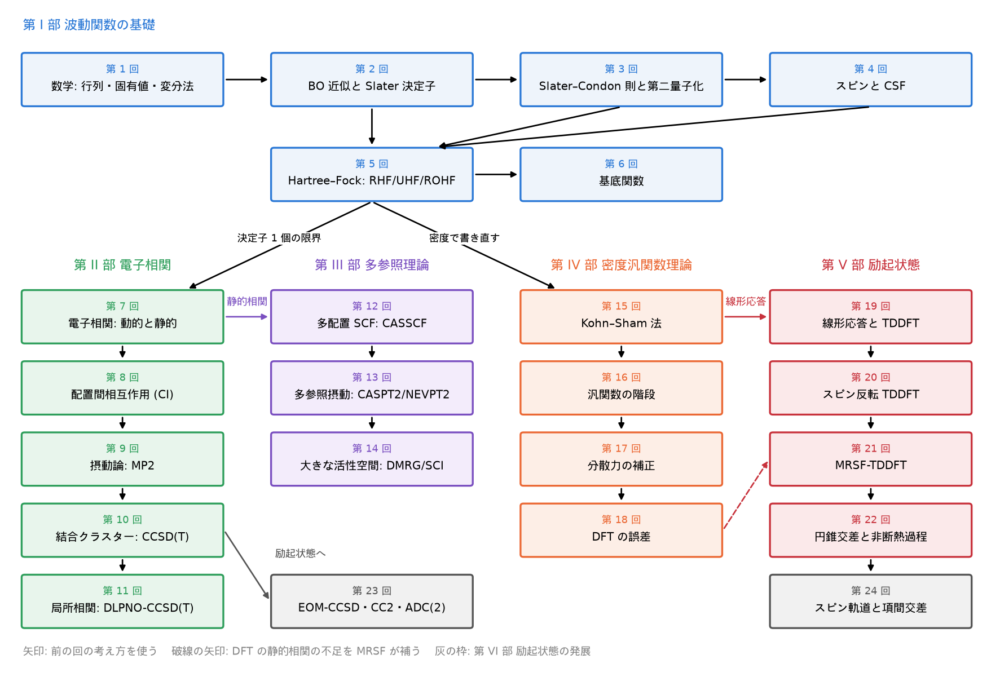

# 量子化学の理論

Hartree–Fock 法から、密度汎関数理論、励起状態、多参照理論、最近の手法までを順に学びます。
（予定の目次です。書いた回からリンクを付けていきます。）

## 理論の地図

**図**　この連載の各回の関係。上の段（第 I 部）で、数学、多電子の波動関数、第二量子化、スピンを準備して、Hartree–Fock 法に入ります。Hartree–Fock 法から、決定子 1 個の限界を超える波動関数理論（第 II 部、第 III 部）と、密度で書き直す密度汎関数理論（第 IV 部）に分かれます。励起状態（第 V 部、第 VI 部）は、密度汎関数理論の線形応答と、結合クラスター法の両方から入れます。矢印は「前の回の考え方を使う」ことを表します。順番に読まなくても、知りたい回から矢印をさかのぼれば、必要な前提が分かります。

## 第 I 部 波動関数の基礎

第 1〜6 回は、Szabo–Ostlund『Modern Quantum Chemistry』の第 1〜3 章の順序に沿っています。Hartree–Fock 法に必要な数学、多電子の波動関数、第二量子化、スピンを準備してから、第 5 回で Hartree–Fock 方程式に入ります。

| 回 | 題 | 目安 |
|---|---|---|
| 1 | [量子化学のための数学：行列、固有値問題、変分法](01-mathematics.md) | 入門 |
| 2 | [多電子の波動関数：Born–Oppenheimer 近似と Slater 決定子](02-many-electron-wavefunctions.md) | 入門 |
| 3 | [演算子と行列要素：Slater–Condon 則と第二量子化](03-second-quantization.md) | 基礎 |
| 4 | [スピン：Ŝ²、制限・非制限の決定子、CSF](04-spin.md) | 基礎 |
| 5 | [Hartree–Fock 法：RHF、UHF、ROHF](05-hartree-fock.md) | 基礎 |
| 6 | [基底関数](06-basis-sets.md) | 基礎 |

## 第 II 部 電子相関

| 回 | 題 | 目安 |
|---|---|---|
| 7 | [電子相関とは：動的相関と静的相関](07-electron-correlation.md) | 基礎 |
| 8 | [配置間相互作用（CI）](08-configuration-interaction.md) | 基礎 |
| 9 | [摂動論：MP2](09-mp2.md) | 基礎 |
| 10 | [結合クラスター法：CCSD(T)](10-coupled-cluster.md) | 発展 |
| 11 | [局所相関法：DLPNO-CCSD(T)](11-dlpno-ccsd-t.md) | 発展 |

## 第 III 部 多参照理論

| 回 | 題 | 目安 |
|---|---|---|
| 12 | [多配置 SCF：CASSCF と活性空間の選び方](12-casscf.md) | 発展 |
| 13 | [多参照摂動論：CASPT2 と NEVPT2](13-caspt2-nevpt2.md) | 発展 |
| 14 | [大きな活性空間：DMRG と選択的 CI](14-dmrg-sci.md) | 最先端 |

## 第 IV 部 密度汎関数理論

| 回 | 題 | 目安 |
|---|---|---|
| 15 | [Hohenberg–Kohn の定理と Kohn–Sham 法](15-kohn-sham.md) | 基礎 |
| 16 | [汎関数の階段：LDA、GGA、meta-GGA、混成、範囲分離](16-functionals.md) | 基礎 |
| 17 | [分散力の補正](17-dispersion.md) | 基礎 |
| 18 | [DFT の誤差：自己相互作用誤差と静的相関](18-dft-errors.md) | 発展 |

## 第 V 部 励起状態

| 回 | 題 | 目安 |
|---|---|---|
| 19 | [線形応答と TDDFT](19-tddft.md) | 発展 |
| 20 | [スピン反転 TDDFT](20-spin-flip-tddft.md) | 発展 |
| 21 | [MRSF-TDDFT](21-mrsf-tddft.md) | 発展 |
| 22 | [円錐交差と非断熱過程](22-conical-intersections.md) | 発展 |

## 第 VI 部 励起状態の発展

| 回 | 題 | 目安 |
|---|---|---|
| 23 | [励起状態の波動関数法：EOM-CCSD、CC2、ADC(2)](23-excited-wavefunction.md) | 最先端 |
| 24 | [スピン軌道相互作用と項間交差](24-spin-orbit-coupling.md) | 発展 |
