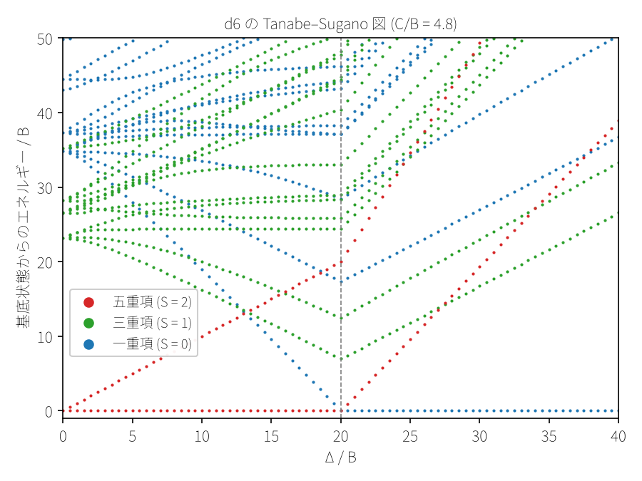

# 第 3 回　スピン状態：高スピンと低スピン

!!! abstract "この回の道筋"
    d$^4$〜d$^7$ の正八面体錯体には、不対電子の多い高スピン状態と、少ない低スピン状態の 2 つの可能性があります。この回では、どちらが基底状態になるかが、配位子場分裂と電子どうしの交換相互作用の競合で決まることを示し、Tanabe–Sugano 図を自分で計算して描きます。後半では、計算で各スピン状態を求めるときの注意（$M_S$ と $S$ の違い、スピン汚染、broken-symmetry 解）を、実際の計算で確かめます。

    | 節 | 内容 |
    |---|---|
    | 1 | スピン量子数と多重度の数え方 |
    | 2 | 高スピンと低スピン：交換と配位子場分裂の競合 |
    | 3 | Tanabe–Sugano 図 |
    | 4 | スピンクロスオーバー |
    | 5 | 計算で各スピン状態を求めるときの注意 |

    **前に読んでおく回**：[第 1 回 d 軌道と配位子場理論](01-ligand-field.md)、[第 2 回 d 電子の数え方、酸化数、18 電子則](02-electron-counting.md)

!!! tip "物理的なイメージ"
    スピン状態を決めているのは、2 つのエネルギーの綱引きです。電子を t2g に対にして詰めると、配位子場分裂 Δo の分だけ得をします。そのかわり、同じ軌道に 2 個入る反発のエネルギーを払い、スピンをそろえたときの交換による安定化を失います。Δo が大きいと低スピン、小さいと高スピンが基底状態になります。Tanabe–Sugano 図は、この綱引きを、Δo の大きさを横軸にして描いたものです。

## 1. スピン量子数と多重度の数え方

電子の全スピン角運動量の大きさは、量子数 $S$ で表します。演算子 $\hat{S}^2$ の固有値が $S(S+1)$（原子単位で $\hbar = 1$）です。$z$ 成分 $\hat{S}_z$ の固有値は $M_S$ で、$M_S = -S, -S+1, \dots, S$ の $2S+1$ 個の値をとります。この $2S+1$ を**スピン多重度**と呼びます。$2S+1 = 1, 2, 3, 4, 5, 6$ の状態を、それぞれ一重項、二重項、三重項、四重項、五重項、六重項と呼びます。

不対電子が $n$ 個あり、すべて同じ向きにそろっているとき、$S = n/2$ です。たとえば不対電子が 4 個なら $S = 2$ で、多重度は 5（五重項）です。

ここで、$S$ と $M_S$ の違いを押さえておきます。$M_S$ は「α 電子の数と β 電子の数の差の半分」で、1 つの Slater 行列式でも決まります。一方、$S$ は波動関数全体が $\hat{S}^2$ の固有関数になっているときにだけ決まる量です。この違いが、第 5 節で大事になります。

**ここまでで分かったこと**：多重度は $2S+1$ です。$M_S$ は α と β の電子の数から決まりますが、$S$ は波動関数が $\hat{S}^2$ の固有関数のときにだけ決まります。

## 2. 高スピンと低スピン：交換と配位子場分裂の競合

正八面体錯体の d 電子は、下の $t_{2g}$（3 個）と上の $e_g$（2 個）に入ります（第 1 回）。d$^1$〜d$^3$ では、電子は迷わず $t_{2g}$ に 1 個ずつ同じ向きで入ります。4 個目からは、2 つの選び方があります。

- $t_{2g}$ の軌道に、逆向きのスピンで 2 個目を入れる（**低スピン**）。
- $\Delta_\mathrm{o}$ だけ高い $e_g$ に、同じ向きのスピンで入れる（**高スピン**）。

d$^4$〜d$^7$ で、次の 2 つの状態が候補になります。

| d 電子 | 高スピン | $S$ | 低スピン | $S$ | 例 |
|---|---|---|---|---|---|
| d$^4$ | $t_{2g}^3 e_g^1$ | 2 | $t_{2g}^4$ | 1 | Cr(II)、Mn(III) |
| d$^5$ | $t_{2g}^3 e_g^2$ | 5/2 | $t_{2g}^5$ | 1/2 | Mn(II)、Fe(III) |
| d$^6$ | $t_{2g}^4 e_g^2$ | 2 | $t_{2g}^6$ | 0 | Fe(II)、Co(III) |
| d$^7$ | $t_{2g}^5 e_g^2$ | 3/2 | $t_{2g}^6 e_g^1$ | 1/2 | Co(II) |

どちらが低いかは、2 つの効果の競合で決まります。d$^6$ を例に、おおまかな模型で考えます。

**配位子場の効果**：低スピン $t_{2g}^6$ は、高スピン $t_{2g}^4 e_g^2$ より 2 個多くの電子を $t_{2g}$ に入れています。$e_g$ から $t_{2g}$ に 1 個移るごとに $\Delta_\mathrm{o}$ だけ下がるので、低スピンは $2\Delta_\mathrm{o}$ だけ有利です。

**交換の効果**：同じ向きのスピンをもつ電子の対は、交換相互作用で安定化します（交換積分 $K$ の分だけエネルギーが下がります）。これは、Pauli の原理により、同じスピンの電子どうしが互いに避け合うためです。高スピン $t_{2g}^4 e_g^2$ は α 電子 5 個と β 電子 1 個なので、同じスピンの対は $\binom{5}{2} = 10$ 組です。低スピン $t_{2g}^6$ は α 3 個と β 3 個なので、$\binom{3}{2} + \binom{3}{2} = 6$ 組です。交換積分をすべて同じ大きさ $K$ と近似すると、低スピンは $4K$ だけ不利です。

まとめると、

$$
E(\text{低スピン}) - E(\text{高スピン}) \approx -2\Delta_\mathrm{o} + 4K
$$

です。$\Delta_\mathrm{o}$ が $2K$ より大きければ低スピン、小さければ高スピンになります。第 1 回の分光化学系列の強い配位子（CN$^-$ など）では低スピン、弱い配位子（H$_2$O など）では高スピンになりやすい、ということです。

この模型は粗いものです。交換積分は軌道の組によって違い、クーロン反発の差も無視しています。正確には、d 電子の間の反発をすべて含めて、各状態のエネルギーを計算する必要があります。それが次の節の Tanabe–Sugano 図です。

この「交換が高スピンを有利にする」という見方は、計算法を考えるときにも大事です。第 5 回で、近似の交換汎関数の扱い方が、高スピンと低スピンのエネルギー差を大きく左右することを見ます。

**ここまでで分かったこと**：高スピンと低スピンのどちらが低いかは、配位子場分裂（低スピンを有利にする）と交換相互作用（高スピンを有利にする）の競合で決まります。

## 3. Tanabe–Sugano 図

### 3.1 d 電子どうしの反発を表すパラメータ

自由な金属イオンの d 電子の状態（項）のエネルギーは、d 電子どうしの反発で決まります。d 軌道の動径部分が決まっていれば、この反発は 3 つの Slater 積分 $F^0$、$F^2$、$F^4$ で表せます。項の間のエネルギー差には $F^0$ が効かないので、残りの 2 つを組み合わせた **Racah パラメータ** $B$ と $C$ がよく使われます。定義は付録 A に回しますが、たとえば d$^2$ の自由イオンでは、${}^3P$ と ${}^3F$ の項の差が $15B$ になります。

錯体の中では、d 軌道が配位子の軌道と混ざって広がるので、$B$ は自由イオンの値より小さくなります。これを電子雲拡大効果（nephelauxetic effect）と呼びます（Miessler, Fischer, Tarr 2014）。

### 3.2 配位子場と電子間反発を同時に扱う

田辺行人と菅野暁は 1954 年の一連の論文で、正八面体の配位子場の中の d$^n$ イオンについて、配位子場と d 電子どうしの反発を同時に扱って、すべての状態のエネルギーを計算しました（Tanabe, Sugano 1954a, 1954b）。横軸に $\Delta_\mathrm{o}/B$、縦軸に基底状態から測ったエネルギーを $B$ で割った値をとった図を、**Tanabe–Sugano 図**と呼びます。

量子化学の言葉で言えば、これは **5 個の d 軌道だけを使った完全配置間相互作用（full CI）** です。1 電子のハミルトニアンは配位子場（$t_{2g}$ に $-0.4\Delta_\mathrm{o}$、$e_g$ に $+0.6\Delta_\mathrm{o}$）で、2 電子のハミルトニアンは $B$ と $C$ で決まる d 電子どうしの反発です。d$^6$ なら、10 個のスピン軌道に 6 個の電子を入れる $\binom{10}{6} = 210$ 個の Slater 行列式で、ハミルトニアンを対角化します。

### 3.3 自分で計算する

PySCF の完全 CI のプログラムに、この 1 電子・2 電子の積分を渡して、d$^6$ の Tanabe–Sugano 図を計算しました。$C/B = 4.8$ としています。スクリプトは付録 B に載せます。

まず、プログラムが正しいことを 2 つの点で確かめました。d$^2$ の自由イオン（$\Delta_\mathrm{o} = 0$）で ${}^3P$ と ${}^3F$ の差が $15B$ になること、d$^6$ の自由イオンの基底状態が五重項（${}^5D$）になることです。そのうえで、高スピンの ${}^5T_{2g}$ と低スピンの ${}^1A_{1g}$ が入れ替わる点を探しました。

```text
d2 自由イオン 3P-3F = 15.0 (15B のはず)
d6 自由イオン 最低の多重度 = 5
d6, C/B = 4.8: 高スピンと低スピンが入れ替わる Δ/B = 20.02
  Δ/B = 10: E(1A1g) - E(5T2g) = 18.93 B
  Δ/B = 20: E(1A1g) - E(5T2g) = 0.03 B
  Δ/B = 30: E(1A1g) - E(5T2g) = -19.33 B
```



図の見方を説明します。縦軸は、各 $\Delta_\mathrm{o}/B$ での基底状態を 0 にしたエネルギーです。

- $\Delta_\mathrm{o}/B < 20$ では、基底状態は高スピンの五重項（赤、${}^5T_{2g}$）です。
- $\Delta_\mathrm{o}/B = 20$ で、一重項（青、${}^1A_{1g}$）が五重項より下になり、基底状態が入れ替わります。図の縦の破線がこの点です。
- 入れ替わる点で、すべての線が折れ曲がります。基底状態そのものが替わり、エネルギーの基準が替わったからです。

入れ替わりの前後で、$E({}^1A_{1g}) - E({}^5T_{2g})$ は $\Delta_\mathrm{o}/B$ が 10 増えるごとに約 $19B$ ずつ下がります。第 2 節の粗い模型では $-2\Delta_\mathrm{o}$ なので傾きは $20B$ です。両者がほぼ合うことから、交換と配位子場の競合という第 2 節の見方が、完全 CI の結果でもおおむね正しいことが分かります。

もう一つ大事なのは、三重項（緑）が一度も基底状態にならないことです。この模型（正八面体、$C/B = 4.8$）では、d$^6$ の中間スピン（$S = 1$）はどの $\Delta_\mathrm{o}$ でも基底状態になりません。

**ここまでで分かったこと**：Tanabe–Sugano 図は、d 軌道だけの完全 CI です。d$^6$（$C/B = 4.8$）では、$\Delta_\mathrm{o}/B \approx 20$ で高スピンと低スピンが入れ替わります。

## 4. スピンクロスオーバー

$\Delta_\mathrm{o}$ が入れ替わりの点に近いと、高スピンと低スピンのエネルギー差が小さくなります。このとき、温度や圧力、光によって、スピン状態が入れ替わることがあります。これを**スピンクロスオーバー**（spin crossover, SCO）と呼びます。Cambi と Szegő が 1931 年に、鉄(III) のジチオカルバマト錯体の磁化率が温度で異常に変わることを報告したのが、最初の観測とされています（Cambi, Szegő 1931）。とくに Fe(II) の錯体には、温度を下げると高スピンから低スピンに変わるものが多く知られています（Gütlich, Hauser, Spiering 1994）。

温度で変わる理由は、自由エネルギーで考えると分かります。高スピンと低スピンの自由エネルギーの差を

$$
\Delta G = G_\mathrm{HS} - G_\mathrm{LS} = \Delta H - T\Delta S
$$

と書きます。スピンクロスオーバーを起こす錯体では、低温で低スピンが安定なので $\Delta H > 0$ です。一方、高スピンのほうがエントロピーが大きいので $\Delta S > 0$ です（Paulsen, Trautwein 2004）。理由は 2 つあります。

- **スピンの縮退**：高スピン（$S = 2$、$2S+1 = 5$ 重）は、低スピン（$S = 0$、1 重）より多くの状態をもちます。
- **振動**：高スピンでは、反結合性の $e_g$ 軌道に 2 個の電子が入るので、金属–配位子の結合が長く弱くなります。結合の伸縮振動の振動数が下がり、振動のエントロピーが大きくなります。

したがって、温度を上げると $-T\Delta S$ の項が効いて、高スピンが有利になります。$\Delta G = 0$ となる温度 $T_{1/2} = \Delta H/\Delta S$ で、高スピンと低スピンが半分ずつになります。

計算化学から見ると、ここに大事な注意があります。実験の $\Delta H$ は、電子のエネルギー差だけでなく、零点振動のエネルギーの差や、結晶・溶媒の効果を含みます。計算の電子エネルギーの差を実験と比べるには、これらを補正する必要があります。第 5 回で詳しく扱います。

**ここまでで分かったこと**：高スピンと低スピンの差が小さいと、温度などでスピン状態が入れ替わります。高スピンはエントロピーが大きいので、高温で有利になります。

## 5. 計算で各スピン状態を求めるときの注意

ここからは、Hartree–Fock 法や DFT で、各スピン状態のエネルギーを計算するときの注意を見ます。

### 5.1 1 つの行列式で表せる状態と表せない状態

計算では、α 電子と β 電子の数を指定します。これは $M_S$ を指定することです。$M_S$ を指定しても、$S$ が決まるとは限りません。

**$M_S = S$ の最大の値で、不対電子がすべて同じ向きの状態**は、1 つの Slater 行列式で書けます。d$^6$ の高スピン（α 5 個、β 1 個、$M_S = 2$）や、閉殻の低スピン（α 3 個、β 3 個、$M_S = 0$）がそうです。この場合は、その行列式をそのまま計算できます。

**不対電子があるのに、全体のスピンを小さくした状態**は、1 つの行列式では書けません。たとえば、2 個の不対電子を逆向きにした一重項（開殻一重項）は、

$$
\Psi_{S=0} = \frac{1}{\sqrt{2}}\left( |\cdots a\alpha\, b\beta| - |\cdots a\beta\, b\alpha| \right)
$$

のように 2 つの行列式の組み合わせです（$a$、$b$ は不対電子の入った空間軌道）。どちらか 1 つの行列式 $|\cdots a\alpha\, b\beta|$ だけでは、一重項と三重項（の $M_S = 0$ 成分）が半分ずつ混ざった状態になります。

### 5.2 制限開殻と非制限：ROKS と UKS

開殻の行列式を作るとき、2 つのやり方があります。

- **制限開殻**（ROHF、ROKS）：α 電子と β 電子に同じ空間軌道を使います。高スピンの行列式は $\hat{S}^2$ の固有関数になります。
- **非制限**（UHF、UKS）：α 電子と β 電子に別々の空間軌道を使います。エネルギーは下がりますが、行列式は一般に $\hat{S}^2$ の固有関数ではなくなります。

非制限の行列式に、本来より高いスピンの状態が混ざることを、**スピン汚染**（spin contamination）と呼びます。その大きさは、$\langle \hat{S}^2 \rangle$ を計算して、正しい値 $S(S+1)$ と比べれば分かります。UHF の行列式では、

$$
\langle \hat{S}^2 \rangle = M_S(M_S+1) + N_\beta - \sum_{i}^{N_\alpha}\sum_{j}^{N_\beta} \left| \langle \phi_i^\alpha | \phi_j^\beta \rangle \right|^2
$$

です（Szabo, Ostlund 1996）。ここで $N_\alpha \ge N_\beta$ とし、$\phi_i^\alpha$、$\phi_j^\beta$ は α と β の占有軌道です。α と β の空間軌道が同じなら、最後の和が $N_\beta$ になり、$\langle \hat{S}^2 \rangle = M_S(M_S+1)$ と正しい値になります。

高スピンの状態では、スピン汚染はふつう小さいです。この連載の計算で確かめると、次のとおりでした。

| 系（UKS） | $S$ | 正しい $S(S+1)$ | 計算した $\langle \hat{S}^2 \rangle$ |
|---|---|---|---|
| [FeCl$_4$]$^-$（第 2 回） | 5/2 | 8.75 | 8.757 |
| [FeCl$_4$]$^{2-}$（第 2 回） | 2 | 6 | 6.004 |
| [Fe(H$_2$O)$_6$]$^{2+}$（第 5 回） | 2 | 6 | 6.003 |

DFT の場合、$\langle \hat{S}^2 \rangle$ は KS 行列式から計算した値です。KS 行列式は、相互作用しない仮想的な電子の波動関数なので、この値は実際の電子系の $\langle \hat{S}^2 \rangle$ と厳密には一致しません。目安として使います。

### 5.3 broken-symmetry 解

開殻一重項のように 1 つの行列式で書けない状態を、DFT でどう扱うかが問題になります。よく使われるのが、**broken-symmetry**（BS、対称性の破れた）解です。$M_S = 0$ で、α の不対電子と β の不対電子を別々の場所（たとえば 2 つの金属）に置いた非制限の行列式を作ります。この行列式はスピンの対称性（と、場合によっては空間の対称性）を破っていて、5.1 で見たように一重項と三重項が混ざった状態です。Noodleman は、遷移金属の二核錯体の反強磁性的な結合を、この混ざった状態と高スピン状態のエネルギーから求める方法を示しました（Noodleman 1981）。

混ざり方が分かれば、純粋な一重項のエネルギーを見積もれます。不対電子が 2 個の場合、BS の行列式を一重項と三重項の重ね合わせ $\Psi_\mathrm{BS} = c_S \Psi_S + c_T \Psi_T$ とみなします。$\langle \hat{S}^2 \rangle$ は一重項で 0、三重項で 2 なので、$\langle \hat{S}^2 \rangle_\mathrm{BS} = 2|c_T|^2$ です。エネルギーも重みで平均され、$E_\mathrm{BS} = |c_S|^2 E_S + |c_T|^2 E_T$ です。$w = |c_T|^2 = \langle \hat{S}^2 \rangle_\mathrm{BS}/2$ とおいて $E_S$ について解くと、

$$
E_S \approx \frac{E_\mathrm{BS} - w E_T}{1 - w}
$$

が得られます。$E_T$ には、別に計算した三重項のエネルギーを使います。このように混ざった成分を取り除くことを、**近似的なスピン射影**と呼びます。

Yamaguchi らは、三重項の計算にもスピン汚染があることを考えて、2 つの $\langle \hat{S}^2 \rangle$ の値を使う形でこの補正を示しました（Yamaguchi ら 1988）。

$$
E_S \approx \frac{\langle \hat{S}^2 \rangle_T E_\mathrm{BS} - \langle \hat{S}^2 \rangle_\mathrm{BS} E_T}{\langle \hat{S}^2 \rangle_T - \langle \hat{S}^2 \rangle_\mathrm{BS}}
$$

$\langle \hat{S}^2 \rangle_T = 2$ とおくと、上の式に戻ります。

この式を、いちばん簡単な例で確かめます。H$_2$ の結合を伸ばすと、2 個の電子はそれぞれの H 原子に分かれ、2 個の不対電子をもつ開殻一重項になります。UHF/cc-pVDZ で BS 解を求め、上の式で射影したエネルギーを、厳密な完全 CI と比べました（付録 C）。

```text
R = 0.74 Å: E(RHF) = -1.12870, E(BS-UHF) = -1.12870 (<S^2> = 0.000), E(射影) = -1.12870, E(FCI) = -1.16337
R = 1.50 Å: E(RHF) = -1.00219, E(BS-UHF) = -1.02138 (<S^2> = 0.583), E(射影) = -1.04619, E(FCI) = -1.06153
R = 2.50 Å: E(RHF) = -0.86533, E(BS-UHF) = -0.99936 (<S^2> = 0.978), E(射影) = -1.00260, E(FCI) = -1.00313
R = 4.00 Å: E(RHF) = -0.78220, E(BS-UHF) = -0.99857 (<S^2> = 1.000), E(射影) = -0.99860, E(FCI) = -0.99861
```

エネルギーの単位はハートリーです。次のことが分かります。

- 平衡距離（0.74 Å）では、BS 解は RHF 解と同じになり、$\langle \hat{S}^2 \rangle = 0$ です。対称性は破れていません。
- 結合を伸ばすと、BS 解は RHF よりずっと低くなり、$\langle \hat{S}^2 \rangle$ は 1 に近づきます。$\langle \hat{S}^2 \rangle = 1$ は、一重項と三重項が半分ずつ混ざっていることを意味します。
- 射影したエネルギーは、伸ばした距離では完全 CI にかなり近づきます。4.00 Å では、差は 0.01 m$E_\mathrm{h}$ です。

遷移金属の二核錯体や、金属とラジカルの配位子が逆向きのスピンで結合した錯体（第 2 回の非無垢な配位子）でも、同じ考え方を使います。ただし、DFT では射影の式の前提（BS 解が 2 つの純粋なスピン状態の重ね合わせであること）が厳密には成り立たないので、結果は近似です。

### 5.4 実際に計算するときの確認事項

最後に、各スピン状態を計算するときに確かめることをまとめます。

1. **狙った状態に収束したか**：とくに開殻の錯体では、SCF が別の電子配置に落ちることがあります。第 2 回の [FeCl$_4$]$^{n-}$ の計算でも、最初は誤った解に落ちました。軌道の占有の仕方、スピン密度、$\langle \hat{S}^2 \rangle$ を確かめ、波動関数の安定性解析をします。
2. **$\langle \hat{S}^2 \rangle$ を確かめる**：正しい $S(S+1)$ から大きくずれていれば、スピン汚染か BS 解です。BS 解なら、射影が必要かを考えます。
3. **各スピン状態の構造を別々に最適化する**：高スピンでは金属–配位子の結合が長くなる（第 4 節）ので、同じ構造でエネルギーを比べると、差を誤ります。
4. **汎関数への依存を確かめる**：高スピンと低スピンのエネルギー差は、汎関数によって大きく変わります。これが第 5 回の主題です。

**ここまでで分かったこと**：高スピンや閉殻の状態は 1 つの行列式で書けますが、開殻一重項などは書けません。非制限の計算では $\langle \hat{S}^2 \rangle$ でスピン汚染を確かめ、BS 解では近似的なスピン射影を使います。

## まとめ

- 多重度は $2S+1$ です。$M_S$ は電子の数で決まりますが、$S$ は波動関数が $\hat{S}^2$ の固有関数のときにだけ決まります。
- 高スピンと低スピンのどちらが低いかは、配位子場分裂（低スピンを有利にする）と交換相互作用（高スピンを有利にする）の競合で決まります。
- Tanabe–Sugano 図は、d 軌道だけの完全 CI です。d$^6$（$C/B = 4.8$）では $\Delta_\mathrm{o}/B \approx 20$ で入れ替わります。
- スピンクロスオーバーは、エネルギー差が小さく、高スピンのエントロピーが大きいことで起こります。
- 非制限の計算では、$\langle \hat{S}^2 \rangle$ でスピン汚染を確かめます。開殻一重項は BS 解と近似的なスピン射影で扱います。

## 付録 A　Racah パラメータの定義

d 電子どうしの反発は、Slater 積分 $F^k$（$k = 0, 2, 4$）で表せます。$F^k$ は、d 軌道の動径関数 $R(r)$ を使って

$$
F^k = \int_0^\infty\!\!\int_0^\infty R(r_1)^2 R(r_2)^2 \frac{r_<^k}{r_>^{k+1}} r_1^2 r_2^2 \, dr_1 dr_2
$$

と定義されます。$r_<$、$r_>$ は $r_1$ と $r_2$ の小さいほうと大きいほうです。$F_2 = F^2/49$、$F_4 = F^4/441$ とおくと、Racah パラメータは

$$
B = F_2 - 5F_4, \qquad C = 35F_4
$$

です。付録 B のスクリプトでは、逆に $B$ と $C$ から $F^2 = 49(B + C/7)$、$F^4 = 441\,C/35$ を求めています。

d 軌道どうしの電子反発積分は、角度部分の積分（Gaunt 係数）と $F^k$ の積の和で書けます。複素球面調和関数 $Y_{2m}$ の基底で、化学者の表記の積分は

$$
(m_1 m_2 | m_3 m_4) = \sum_{k=2,4} F^k \, c^k(m_1, m_2)\, c^k(m_4, m_3), \qquad m_1 - m_2 = m_4 - m_3
$$

です（$m_1 - m_2 \ne m_4 - m_3$ なら 0）。ここで

$$
c^k(m, m') = \sqrt{\frac{4\pi}{2k+1}} \int Y_{2m}^* \, Y_{k,m-m'} \, Y_{2m'} \, d\Omega
$$

です。$k = 0$ の項（$F^0$）は、どの状態にも同じだけ効くので、エネルギーの差には影響しません。スクリプトでは 0 としました。

## 付録 B　Tanabe–Sugano 図の計算のスクリプト

PySCF 2.15 と SciPy 1.18 で実行しました。角度部分の積分は、Gauss–Legendre の求積で数値的に行っています（球面調和関数の積は低次の多項式なので、この点数で十分正確です）。

```python
"""d^n 電子の配位子場模型（正八面体）を完全 CI で解き、Tanabe–Sugano 図を作る。"""
import numpy as np
from scipy.special import sph_harm_y, roots_legendre

# 角度の積分を数値求積で行う（球面調和関数の積は多項式なので、この点数で厳密）
_x, _w = roots_legendre(20)
_th = np.arccos(_x); _ph = np.linspace(0, 2*np.pi, 40, endpoint=False)
_TH, _PH = np.meshgrid(_th, _ph, indexing="ij")
_W = np.outer(_w, np.full(40, 2*np.pi/40))
def gaunt(l1, l2, l3, m1, m2, m3):
    f = sph_harm_y(l1, m1, _TH, _PH)*sph_harm_y(l2, m2, _TH, _PH)*sph_harm_y(l3, m3, _TH, _PH)
    v = (f*_W).sum()
    return v.real
from pyscf import fci

l = 2
ms = range(-2, 3)
def ck(k, m1, m2):   # c^k(l m1, l m2) = sqrt(4pi/(2k+1)) ∫ Y*_{l m1} Y_{k,m1-m2} Y_{l m2}
    return float(np.sqrt(4*np.pi/(2*k+1)) * (-1)**m1 * gaunt(l, k, l, -m1, m1-m2, m2))

def eri_complex(F2, F4):
    """複素球面調和関数の基底での (ij|kl)（化学者の表記）。F0 は 0 とする。"""
    Fk = {2: F2, 4: F4}
    g = np.zeros((5,)*4)
    for a, i in enumerate(ms):
        for b, j in enumerate(ms):
            for c, k_ in enumerate(ms):
                for d, l_ in enumerate(ms):
                    if i - j != l_ - k_: continue
                    # (ij|kl) = <ik|jl> = sum_k F^k c^k(i,j) c^k(l,k)
                    g[a, b, c, d] = sum(Fk[k]*ck(k, i, j)*ck(k, l_, k_) for k in (2, 4))
    return g

# 複素 -> 実の d 軌道 (順: xy, yz, z2, xz, x2-y2)
s = 1/np.sqrt(2)
U = np.zeros((5, 5), complex)   # U[m, r]
U[0, 0] = 1j*s; U[4, 0] = -1j*s          # xy
U[1, 1] = 1j*s; U[3, 1] = 1j*s           # yz
U[2, 2] = 1                              # z2
U[1, 3] = s;   U[3, 3] = -s              # xz
U[0, 4] = s;   U[4, 4] = s               # x2-y2

def eri_real(B, C):
    F2 = 49*(B + C/7); F4 = 441*C/35
    g = eri_complex(F2, F4)
    gr = np.einsum("ijkl,ia,jb,kc,ld->abcd", g, U.conj(), U, U.conj(), U)
    assert np.abs(gr.imag).max() < 1e-10
    return gr.real

def levels(n, Dq, B, C, nroots=40):
    eri = eri_real(B, C)
    h1 = np.diag([-4*Dq, -4*Dq, 6*Dq, -4*Dq, 6*Dq])   # t2g: -4Dq, eg: +6Dq
    na = (n + 1)//2; nb = n//2
    sol = fci.direct_spin1.FCI(); sol.max_cycle = 500; sol.conv_tol = 1e-12
    e, c = sol.kernel(h1, eri, 5, (na, nb), nroots=nroots)
    S = [fci.spin_op.spin_square(ci, 5, (na, nb))[1] for ci in c]   # 2S+1
    return np.array(e), np.round(S).astype(int)

if __name__ == "__main__":
    B = 1.0
    # 検算 1：d2 の自由イオン 3P - 3F = 15B
    e, m = levels(2, 0.0, B, 4.0*B)
    trip = sorted(set(np.round(e[m == 3], 6)))
    print("d2 自由イオン 3P-3F =", trip[1]-trip[0], "(15B のはず)")
    # 検算 2：d6 の Dq=0 の最低の項は 5D
    e, m = levels(6, 0.0, B, 4.8*B)
    print("d6 自由イオン 最低の多重度 =", m[np.argmin(e)])
    # d6 で高スピン(5T2g) と低スピン(1A1g) が入れ替わる Δ/B を探す
    C = 4.8*B
    def gap(D):
        e, m = levels(6, D/10, B, C)
        return e[m == 1].min() - e[m == 5].min()
    from scipy.optimize import brentq
    Dc = brentq(gap, 10, 40, xtol=1e-6)
    print(f"d6, C/B = 4.8: 高スピンと低スピンが入れ替わる Δ/B = {Dc:.2f}")
    for D in (10, 20, 30):
        print(f"  Δ/B = {D}: E(1A1g) - E(5T2g) = {gap(D):.2f} B")
```

出力は本文の 3.3 に載せたとおりです。図は、このスクリプトの関数 `levels` を、$\Delta_\mathrm{o}/B$ を 0 から 40 まで 0.5 刻みで変えて呼び（`nroots=100` で全状態を求めています）、多重度ごとに色を分けて描きました。

## 付録 C　H$_2$ の broken-symmetry 解のスクリプト

```python
"""伸ばした H2 で、broken-symmetry（BS）解と近似的なスピン射影を確かめる。"""
from pyscf import gto, scf, fci
import numpy as np
for R in (0.74, 1.5, 2.5, 4.0):
    mol = gto.M(atom=f"H 0 0 0; H 0 0 {R}", basis="cc-pvdz", verbose=0)
    rhf = scf.RHF(mol).run()
    # BS 解：α の HOMO と β の HOMO を左右に偏らせた初期値から UHF を解く
    uhf = scf.UHF(mol)
    dm = uhf.get_init_guess()
    mo = rhf.mo_coeff; h, l = mo[:, 0], mo[:, 1]
    ca = (h + l)/np.sqrt(2); cb = (h - l)/np.sqrt(2)
    dm = np.array([np.outer(ca, ca), np.outer(cb, cb)])
    uhf.kernel(dm)
    trip = scf.UHF(gto.M(atom=f"H 0 0 0; H 0 0 {R}", basis="cc-pvdz", spin=2, verbose=0)).run()
    s2 = uhf.spin_square()[0]
    w = s2/2                       # BS 解に混ざる三重項の重み
    eproj = (uhf.e_tot - w*trip.e_tot)/(1 - w)
    efci = fci.FCI(rhf).kernel()[0]
    print(f"R = {R:4.2f} Å: E(RHF) = {rhf.e_tot:.5f}, E(BS-UHF) = {uhf.e_tot:.5f} (<S^2> = {s2:.3f}), "
          f"E(射影) = {eproj:.5f}, E(FCI) = {efci:.5f}")
```

出力は本文の 5.3 に載せたとおりです。

## 参考文献

- L. Cambi, L. Szegő, "Über die magnetische Susceptibilität der komplexen Verbindungen", Ber. dtsch. Chem. Ges. 64, 2591 (1931). DOI: [10.1002/cber.19310641002](https://doi.org/10.1002/cber.19310641002)
- Y. Tanabe, S. Sugano, "On the Absorption Spectra of Complex Ions. I", J. Phys. Soc. Jpn. 9, 753 (1954). DOI: [10.1143/JPSJ.9.753](https://doi.org/10.1143/JPSJ.9.753)
- Y. Tanabe, S. Sugano, "On the Absorption Spectra of Complex Ions II", J. Phys. Soc. Jpn. 9, 766 (1954). DOI: [10.1143/JPSJ.9.766](https://doi.org/10.1143/JPSJ.9.766)
- L. Noodleman, "Valence bond description of antiferromagnetic coupling in transition metal dimers", J. Chem. Phys. 74, 5737 (1981). DOI: [10.1063/1.440939](https://doi.org/10.1063/1.440939)
- K. Yamaguchi, F. Jensen, A. Dorigo, K. N. Houk, "A spin correction procedure for unrestricted Hartree-Fock and Møller-Plesset wavefunctions for singlet diradicals and polyradicals", Chem. Phys. Lett. 149, 537 (1988). DOI: [10.1016/0009-2614(88)80378-6](https://doi.org/10.1016/0009-2614(88)80378-6)
- P. Gütlich, A. Hauser, H. Spiering, "Thermal and Optical Switching of Iron(II) Complexes", Angew. Chem. Int. Ed. Engl. 33, 2024 (1994). DOI: [10.1002/anie.199420241](https://doi.org/10.1002/anie.199420241)
- A. Szabo, N. S. Ostlund, "Modern Quantum Chemistry" (Dover, 1996). ISBN: 9780486691862
- H. Paulsen, A. X. Trautwein, "Density Functional Theory Calculations for Spin Crossover Complexes", Top. Curr. Chem. 235, 197 (2004). DOI: [10.1007/b95428](https://doi.org/10.1007/b95428)
- G. L. Miessler, P. J. Fischer, D. A. Tarr, "Inorganic Chemistry", 5th ed. (Pearson, 2014). ISBN: 9780321811059

## 関連リンク

- PySCF：https://pyscf.org/
- Paulsen, Trautwein の論文の原稿（arXiv）：https://arxiv.org/abs/1206.2247
