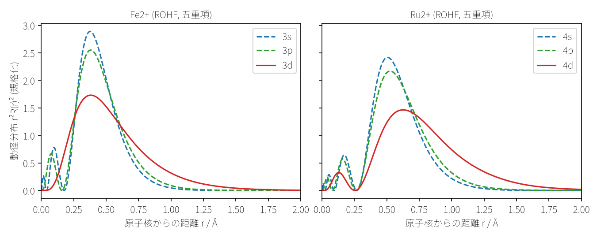

# 第 4 回　遷移金属の電子相関：静的相関と動的相関

!!! abstract "この回の道筋"
    遷移金属錯体の計算が難しい理由の多くは、電子相関の扱いにあります。この回では、3d 軌道が小さく縮んでいることから出発して、(1) 3s3p の準内殻電子の相関、(2) 二重殻効果、(3) 近縮退による静的相関、という 3 つの問題が生じることを説明します。最後に、それらがなぜ単一参照の方法と近似の DFT を難しくするのかをまとめます。

    | 節 | 内容 |
    |---|---|
    | 1 | 電子相関：静的相関と動的相関 |
    | 2 | 3d 軌道の大きさを計算で確かめる |
    | 3 | 3s3p の準内殻相関 |
    | 4 | 二重殻効果 |
    | 5 | 近縮退による静的相関 |
    | 6 | なぜ単一参照の方法と DFT が難しくなるか |

    **前に読んでおく回**：[第 1 回 d 軌道と配位子場理論](01-ligand-field.md)、[第 3 回 スピン状態：高スピンと低スピン](03-spin-states.md)

!!! tip "物理的なイメージ"
    遷移金属の 3d 軌道は、同じ殻の 3s・3p 軌道と同じくらいの領域に縮んでいて、電子が狭い所に詰め込まれています。そのため、3d 電子どうしは強く反発し、互いに避け合う動き（電子相関）が大きくなります。避けるための空間として少し広がった d 型の軌道が必要になること（二重殻効果）、内側の 3s3p 電子とも避け合うこと（準内殻の相関）、d 軌道のエネルギーが近いために電子の入り方が一つに決まらないこと（静的相関）が、計算を難しくします。

## 1. 電子相関：静的相関と動的相関

Hartree–Fock（HF）法では、各電子は、ほかの電子がつくる平均の場の中を動きます。実際の電子は、互いの瞬間的な位置に応じて避け合っています。この避け合いの効果を**電子相関**と呼び、そのエネルギーを

$$
E_\mathrm{corr} = E_\mathrm{exact} - E_\mathrm{HF}
$$

と定義します（Szabo, Ostlund 1996）。$E_\mathrm{exact}$ は（同じ基底関数での）厳密なエネルギー、$E_\mathrm{HF}$ は HF のエネルギーです。

電子相関は、性格の違う 2 つに分けて考えると便利です。

- **動的相関**（dynamic correlation）：電子どうしが近づいたときに、互いを避け合う効果です。多数の励起配置が、それぞれ少しずつ寄与して表されます。どの分子にもあります。
- **静的相関**（static correlation、非動的相関とも呼びます）：エネルギーのほぼ等しい（近縮退した）電子配置が複数あり、1 つの Slater 行列式では波動関数を表せない効果です。少数の配置が、大きな重みで混ざります。

第 3 回の H$_2$ の例を思い出してください。平衡距離では RHF でよい近似になっていましたが、結合を伸ばすと結合性軌道と反結合性軌道のエネルギーが近づき、2 つの配置が同じ重みで混ざりました。これが静的相関の典型です。

単一参照の方法（MP2 や結合クラスター法 CCSD(T) など）は、1 つの行列式を出発点にして、動的相関を取り込むように作られています。静的相関が強いと、出発点そのものが悪くなります。静的相関を扱うには、CASSCF のように複数の配置を最初から含める多参照の方法が必要です。

**ここまでで分かったこと**：電子相関には、電子が避け合う動的相関と、近縮退した配置が混ざる静的相関があります。単一参照の方法は、静的相関が強いと難しくなります。

## 2. 3d 軌道の大きさを計算で確かめる

第 1 回で、3d 軌道には動径方向の節がなく、小さく縮んでいると述べました。Kaupp は、ある方位量子数 $l$ の殻が初めて現れるとき（1s、2p、3d、4f）、その軌道には内側の同じ $l$ の軌道と直交するための節がないので、特に小さくなることを指摘しました（Kaupp 2007）。3d 軌道について、Kaupp は、結合が弱く伸びやすいこと、錯体に色がつきやすいこと、静的相関が大事になることを、この小ささの帰結として挙げています。

これを数値で確かめます。Fe$^{2+}$（3d$^6$）と、その一つ下の周期の Ru$^{2+}$（4d$^6$）について、五重項の ROHF 計算をして、軌道の大きさを比べました（PySCF、ANO 基底、相対論効果は含めていません。付録 A）。図は、各軌道の動径分布 $r^2 R(r)^2$ です。



| | 準内殻 s | 準内殻 p | 価電子 d |
|---|---|---|---|
| Fe$^{2+}$：殻 | 3s | 3p | 3d |
| 動径分布の極大 | 0.375 Å | 0.380 Å | 0.382 Å |
| $\langle r \rangle$ | 0.436 Å | 0.458 Å | 0.553 Å |
| Ru$^{2+}$：殻 | 4s | 4p | 4d |
| 動径分布の極大 | 0.505 Å | 0.526 Å | 0.625 Å |
| $\langle r \rangle$ | 0.569 Å | 0.603 Å | 0.785 Å |

違いははっきりしています。

- **Fe$^{2+}$**：価電子の 3d 軌道の極大（0.382 Å）が、内側の殻のはずの 3s・3p 軌道の極大（0.375、0.380 Å）とほぼ同じ場所にあります。3d 電子は、3s・3p 電子と空間の同じ領域を占めています。
- **Ru$^{2+}$**：4d 軌道には節が 1 つあり（図の 0.25 Å 付近）、極大（0.625 Å）は 4s・4p の極大より 0.1 Å ほど外にあります。

3d 軌道が小さいことから、次の節以降の 3 つの問題が出てきます。

**ここまでで分かったこと**：3d 軌道は 3s・3p 軌道と同じ領域に集まっています。4d 軌道は、4s・4p より外に広がっています。

## 3. 3s3p の準内殻相関

### 3.1 なぜ 3s3p の相関が効くのか

相関の計算では、計算量を減らすため、内殻の電子を相関させない（凍結内殻近似）のがふつうです。内殻の電子は価電子と空間的に離れていて、その相関は化学反応でほとんど変わらない、という考えです。

ところが、第 2 節で見たように、3d 金属の 3s・3p 電子は 3d 電子と同じ領域にあります。3d 電子の数や配置が変わると、3s・3p 電子との相関も変わります。そのため、3s3p 電子は「準内殻」（semicore、外殻の内殻）として、相関を計算に含める必要があります。

Balabanov と Peterson は、3d 金属のための相関無撞着基底関数を作ったとき、価電子（3d4s）の相関用の cc-pV$n$Z と、3s3p3d4s の相関用の cc-pwCV$n$Z を別々に用意しました。そして、3s3p 電子の相関が、原子や分子の多くの性質に強く影響することを示しました（Balabanov, Peterson 2005）。3s3p を相関させるときは、その領域を表せる関数を含んだ基底関数（cc-pwCV$n$Z など）を使う必要があります。

### 3.2 スピン状態のエネルギーへの影響

Pierloot、Phung、Domingo は、遷移金属錯体のスピン状態のエネルギー差に対する 3s3p 相関の寄与を詳しく調べました（Pierloot ら 2017）。主な結果は次のとおりです。

- 多参照の摂動論 CASPT2 は、高スピン状態を有利にしすぎる傾向が知られていました。この偏りは、価電子の相関ではなく、3s3p 相関の記述が不正確なことから来ていました。
- この問題は、配位子場の励起（$t_{2g}$ と $e_g$ の間で電子が移ること）を伴うスピンの変化で起こり、裸の金属イオンでは起こりませんでした。

Phung らはこれを受けて、価電子の相関は大きな基底関数の CASPT2 で、3s3p の相関の寄与は小さな基底関数の CCSD(T) で求めて組み合わせる方法（CASPT2/CC）を提案しました。この方法で CASPT2 の高スピンへの偏りが一部取り除かれ、CCSD(T) の結果との差は平均で 2 kcal/mol 程度と見積もられています（Phung ら 2018）。

3s3p 相関の寄与は、全体のエネルギーに比べれば小さな差です。しかし、スピン状態の差のように数 kcal/mol を争う量では、無視できません。CASPT2 の問題は第 5 回で詳しく扱います。

**ここまでで分かったこと**：3d 金属では、3s3p の電子も相関させる必要があります。その寄与はスピン状態のエネルギー差にも効き、方法によっては記述が難しい部分です。

## 4. 二重殻効果

### 4.1 d 軌道の大きさは電子の数で変わる

3d 軌道が小さいことには、もう一つの帰結があります。3d 軌道の最適な大きさが、3d 電子の数に敏感に変わることです。3d 電子が増えると、同じ小さな領域で電子どうしが強く反発するので、3d 軌道は外に広がろうとします。

ところが、1 組の 3d 軌道で計算すると、その大きさは 1 つに決まってしまいます。3d 電子の数が違う配置（たとえば、配位子から金属へ電子が移った配置）が混ざると、どれにも合わない妥協した大きさになります。

### 4.2 第二の d 殻を加える

この問題を解くには、3d 軌道より一回り外に広がった、もう 1 組の d 軌道（3d′ 軌道。4d に似た形をしています）を加えます。3d と 3d′ を混ぜることで、電子の配置に応じて d 軌道の大きさが変われるようになります。これは、d 電子の「動径方向の相関」を取り込むことにあたります。このことを、**二重殻効果**（double-shell effect、第二の d 殻の効果）と呼びます。

Lampert らの 2024 年の論文は、この効果が数十年前から知られていること、3d 金属で特に重要とされること、3d 軌道の最適な大きさが占有数に敏感なため d 電子が増えるほど深刻になることをまとめています（Lampert ら 2024）。同じ論文では、3d と 4d の金属の水素化物と酸化物を比べています。活性空間に第二の d 殻を加えたときの振動数の変化は、4d 金属のほうがおおむね小さくなりました。これは、第 2 節で見たように 4d 軌道がもともと外に広がっていることと合っています。ただし同じ論文は、前周期の 3d 金属（CrH など）でもこの効果が無視できないこと、第二の d 殻を活性空間に機械的に加えても結果が安定するとは限らないことも指摘しています。

### 4.3 計算での扱い

CASSCF や CASPT2 では、活性空間に 3d′ 軌道を入れて、二重殻効果を扱います。たとえば Radoń らは、17 個の錯体のスピン状態のエネルギーを調べたとき、5 個の 3d 軌道と、3d 軌道と重なる配位子の軌道 1〜2 個に加えて、二重殻効果のために 4d の性格をもつ空軌道を最大 5 個入れました（Radoń ら 2024）。正八面体の錯体で、10〜12 個の活性軌道になります。

一方、CCSD(T) のような単一参照の方法では、二重殻効果は、3d 軌道から外側の d 軌道への励起として自動的に含まれます。ただし、それを表せるだけの d 関数を基底関数が含んでいる必要があります。

**ここまでで分かったこと**：3d 軌道の最適な大きさは電子の数で変わるので、正しく扱うには外側の d 軌道（3d′）が必要です。この効果は 3d 金属で大きく、4d 金属では小さくなります。

## 5. 近縮退による静的相関

3d 軌道が小さいことの 3 つ目の帰結は、静的相関が強くなりやすいことです。理由は 2 つあります。

**(1) 部分的に満たされた d 殻**：d 軌道 5 個に、1〜9 個の電子が入ります。第 3 回の Tanabe–Sugano 図で見たように、同じ電子の数で、エネルギーの近い状態がたくさんあります。開殻の状態の多くは、1 つの行列式ではなく、複数の行列式の組み合わせで表されます（第 3 回の開殻一重項）。

**(2) 金属と配位子の弱い重なり**：3d 軌道は小さいので、配位子の軌道との重なりが小さくなります。重なりが小さいと、結合性軌道と反結合性軌道のエネルギー差が小さくなります。第 1 節の H$_2$ を伸ばしたときと同じで、反結合性軌道に電子が入った配置が、無視できない重みで混ざります。

静的相関がどれだけ強いかは、系によって大きく違います。Jiang、DeYonker、Wilson は、3d 金属を含む多くの分子について、静的相関の強さの指標（多参照性の診断）を調べました（Jiang ら 2012）。結合クラスター法の 1 電子励起の振幅から求める $T_1$ 診断や $D_1$ 診断、CASSCF の主配置の重み、%TAE などです。%TAE は、CCSD(T) で求めた全原子化エネルギー（total atomization energy、分子をばらばらの原子にするのに要るエネルギー）のうち、摂動の三重励起 (T) の寄与が占める割合です。(T) の寄与が大きいほど、CCSD の出発点が悪い、つまり静的相関が強いと考えます。そのうえで、3d 金属を含む分子では $T_1 > 0.05$、$D_1 > 0.15$、$|\%\mathrm{TAE}| > 10$ を、静的相関の強い目安として提案しました。ただし、Cr$_2$ や Mn$_2$ のように静的相関が強いことで知られる分子でも、$T_1$ と $D_1$ がこの目安を下回る例があり、1 つの指標だけで判断できないことも指摘しています。多参照性の診断は、[第 10 回](10-multireference-tm.md)で詳しく扱います。

**ここまでで分かったこと**：部分的に満たされた d 殻と、金属と配位子の弱い重なりのため、遷移金属錯体では静的相関が強くなりやすいです。その強さは系によって違い、診断の指標で調べます。

## 6. なぜ単一参照の方法と DFT が難しくなるか

ここまでの 3 つの問題が、計算の方法にどう効くかをまとめます。

### 6.1 単一参照の方法

CCSD(T) のような単一参照の方法は、静的相関が弱く、1 つの行列式がよい出発点になる系では非常に正確です。遷移金属錯体では、次の点が難しさになります。

- **静的相関**：第 5 節のように静的相関が強いと、1 つの行列式からの励起だけでは波動関数をうまく表せません。
- **3s3p 相関**：凍結内殻近似が使えず、相関させる電子の数が増えます。cc-pwCV$n$Z のような大きな基底関数が要り、計算量が増えます。
- **二重殻効果**：d 軌道の動径方向の相関を表すため、基底関数に十分な d 関数が要ります。

ただし、難しいことと使えないことは別です。単核の錯体のスピン状態のエネルギー差のように、静的相関がそれほど強くない問題では、CCSD(T) が実験から求めた参照値をよく再現することが示されています（Radoń ら 2024）。どこまで信頼できるかは、[第 5 回](05-spin-state-energetics.md)と[第 6 回](06-benchmark-spin-states.md)で詳しく見ます。

### 6.2 近似の DFT

近似の交換相関汎関数を使う DFT では、別の種類の難しさがあります。Cohen、Mori-Sánchez、Yang は、近似の汎関数の多くの失敗が、2 つの系統的な誤差、**非局在化誤差**と**静的相関誤差**にまとめられることを示しました（Cohen ら 2008）。

- **非局在化誤差**：近似の汎関数は、電子を実際より広い範囲に広げすぎる傾向があります。遷移金属錯体では、金属と配位子の間の電荷の偏りや、d 電子がどれだけ局在しているかの記述に影響します。
- **静的相関誤差**：近縮退した状態（第 5 節）を、1 つの KS 行列式で表そうとするところから来る誤差です。

DFT の利点は、計算量が小さく、動的相関のかなりの部分を、汎関数を通して安く取り込めることです。しかし、どの汎関数がどの性質に向くかは、遷移金属では特に系と性質に強く依存します。Cramer と Truhlar は、遷移金属化学への DFT の応用を総説し、スピン状態や反応性などの分野ごとに汎関数の性能を整理しています（Cramer, Truhlar 2009）。この依存性が最もはっきり現れるのが、高スピンと低スピンのエネルギー差です。それが第 5 回の主題です。

**ここまでで分かったこと**：単一参照の方法は、静的相関、3s3p 相関、二重殻効果のため、遷移金属では計算が重く、注意が要ります。近似の DFT は、非局在化誤差と静的相関誤差のため、結果が汎関数に強く依存します。

## まとめ

- 電子相関には、電子が避け合う動的相関と、近縮退した配置が混ざる静的相関があります。
- 3d 軌道は動径方向の節がなく小さいので、3s・3p 軌道と同じ領域に集まります。そのため、3s3p の準内殻電子も相関させる必要があり、スピン状態のエネルギー差にも効きます。
- 3d 軌道の最適な大きさは電子の数で変わるので、外側の d 軌道（3d′）による二重殻効果を扱う必要があります。4d 金属ではこの効果は小さくなります。
- 部分的に満たされた d 殻と、金属と配位子の弱い重なりのため、静的相関が強くなりやすいです。
- 単一参照の方法は計算が重くなり、近似の DFT は非局在化誤差と静的相関誤差のため、結果が汎関数に強く依存します。

## 付録 A　Fe$^{2+}$ と Ru$^{2+}$ の軌道の大きさの計算のスクリプト

PySCF 2.15 で実行しました。1 コアで約 2 分かかりました。軌道の角度の平均は、球面の上に 400 個の点をほぼ一様に置いて求めています。

```python
"""Fe2+ と Ru2+（d6、五重項）の ROHF 軌道の大きさ（動径分布）を比べる。"""
import numpy as np
from pyscf import gto, scf
r = np.linspace(1e-3, 6.0, 1500)                     # ボーア
# 球面の上にほぼ一様に点を置く（Fibonacci 格子）。角度の平均に使う
nang = 400
k = np.arange(nang) + 0.5
th = np.arccos(1 - 2*k/nang); ph = np.pi*(1 + 5**0.5)*k
u = np.c_[np.sin(th)*np.cos(ph), np.sin(th)*np.sin(ph), np.cos(th)]
coords = (r[:, None, None]*u[None]).reshape(-1, 3)
lname = "spdf"
res = {"r": r}
for sym in ("Fe", "Ru"):
    mol = gto.M(atom=f"{sym} 0 0 0", basis="ano", charge=2, spin=4, verbose=0)
    mf = scf.ROHF(mol); mf.max_cycle = 200; mf.level_shift = 0.2; mf.kernel()
    assert mf.converged
    ao = mol.eval_gto("GTOval", coords)
    lao = np.array([lname.index(lab[2][-1]) if lab[2][-1] in lname else 9 for lab in mol.ao_labels(fmt=False)])
    S = mf.get_ovlp()
    occ = np.where(mf.mo_occ > 0)[0]
    print(f"--- {sym}2+  (ROHF, 2S+1 = 5, E = {mf.e_tot:.4f} Eh)")
    count = {}
    shells = {}
    for i in occ[np.argsort(mf.mo_energy[occ])]:
        c = mf.mo_coeff[:, i]
        lw = [c[lao == l] @ (S[np.ix_(lao == l, lao == l)] @ c[lao == l]) for l in range(3)]
        l = int(np.argmax(lw))
        P = (np.mean((ao @ c).reshape(len(r), nang)**2, axis=1)*r**2)
        P /= np.trapezoid(P, r)
        shells.setdefault(l, []).append((mf.mo_energy[i], mf.mo_occ[i], P))
    for l, lst in shells.items():
        # エネルギーの近い軌道（同じ殻）をまとめる
        groups = []
        for e, n, P in lst:
            if groups and abs(e - groups[-1][0][-1]) < 0.5:
                groups[-1][0].append(e); groups[-1][1].append(n); groups[-1][2].append(P)
            else:
                groups.append(([e], [n], [P]))
        for ng, (es, ns, Ps) in enumerate(groups):
            name = f"{ng + l + 1}{lname[l]}"
            P = np.average(Ps, axis=0, weights=ns)
            print(f"  {name}: 電子 {sum(ns):4.1f} 個, 軌道エネルギー {np.mean(es):9.3f} Eh, "
                  f"<r> = {np.trapezoid(r*P, r)*0.529177:.3f} Å, 動径分布の極大 {r[np.argmax(P)]*0.529177:.3f} Å")
            res[f"{sym}_{name}"] = P
np.save("radial.npy", res, allow_pickle=True)
```

出力は次のとおりです。

```text
--- Fe2+  (ROHF, 2S+1 = 5, E = -1257.5499 Eh)
  1s: 電子  2.0 個, 軌道エネルギー  -260.077 Eh, <r> = 0.031 Å, 動径分布の極大 0.020 Å
  2s: 電子  2.0 個, 軌道エネルギー   -32.398 Eh, <r> = 0.142 Å, 動径分布の極大 0.119 Å
  3s: 電子  2.0 個, 軌道エネルギー    -4.800 Eh, <r> = 0.436 Å, 動径分布の極大 0.375 Å
  2p: 電子  6.0 個, 軌道エネルギー   -28.079 Eh, <r> = 0.125 Å, 動径分布の極大 0.096 Å
  3p: 電子  6.0 個, 軌道エネルギー    -3.410 Eh, <r> = 0.458 Å, 動径分布の極大 0.380 Å
  3d: 電子  6.0 個, 軌道エネルギー    -0.919 Eh, <r> = 0.553 Å, 動径分布の極大 0.382 Å
--- Ru2+  (ROHF, 2S+1 = 5, E = -4362.8273 Eh)
  1s: 電子  2.0 個, 軌道エネルギー  -762.904 Eh, <r> = 0.018 Å, 動径分布の極大 0.011 Å
  2s: 電子  2.0 個, 軌道エネルギー  -111.217 Eh, <r> = 0.081 Å, 動径分布の極大 0.068 Å
  3s: 電子  2.0 個, 軌道エネルギー   -21.247 Eh, <r> = 0.223 Å, 動径分布の極大 0.206 Å
  4s: 電子  2.0 個, 軌道エネルギー    -3.837 Eh, <r> = 0.569 Å, 動径分布の極大 0.505 Å
  2p: 電子  6.0 個, 軌道エネルギー  -106.904 Eh, <r> = 0.068 Å, 動径分布の極大 0.053 Å
  3p: 電子  6.0 個, 軌道エネルギー   -18.620 Eh, <r> = 0.215 Å, 動径分布の極大 0.191 Å
  4p: 電子  6.0 個, 軌道エネルギー    -2.838 Eh, <r> = 0.603 Å, 動径分布の極大 0.526 Å
  3d: 電子 10.0 個, 軌道エネルギー   -12.200 Eh, <r> = 0.202 Å, 動径分布の極大 0.159 Å
  4d: 電子  6.0 個, 軌道エネルギー    -0.890 Eh, <r> = 0.785 Å, 動径分布の極大 0.625 Å
```

ROHF の d 軌道は、二重占有と一重占有でエネルギーが違うので、電子の数で重みを付けて平均しています。Ru は相対論効果が無視できない元素ですが、ここでは軌道の大きさを定性的に比べるだけなので、非相対論の計算にしています。相対論効果は第 11 回（準備中）で扱います。

## 参考文献

- A. Szabo, N. S. Ostlund, "Modern Quantum Chemistry" (Dover, 1996). ISBN: 9780486691862
- N. B. Balabanov, K. A. Peterson, "Systematically convergent basis sets for transition metals. I. All-electron correlation consistent basis sets for the 3d elements Sc–Zn", J. Chem. Phys. 123, 064107 (2005). DOI: [10.1063/1.1998907](https://doi.org/10.1063/1.1998907)
- M. Kaupp, "The role of radial nodes of atomic orbitals for chemical bonding and the periodic table", J. Comput. Chem. 28, 320 (2007). DOI: [10.1002/jcc.20522](https://doi.org/10.1002/jcc.20522)
- A. J. Cohen, P. Mori-Sánchez, W. Yang, "Insights into Current Limitations of Density Functional Theory", Science 321, 792 (2008). DOI: [10.1126/science.1158722](https://doi.org/10.1126/science.1158722)
- C. J. Cramer, D. G. Truhlar, "Density functional theory for transition metals and transition metal chemistry", Phys. Chem. Chem. Phys. 11, 10757 (2009). DOI: [10.1039/b907148b](https://doi.org/10.1039/b907148b)
- W. Jiang, N. J. DeYonker, A. K. Wilson, "Multireference Character for 3d Transition-Metal-Containing Molecules", J. Chem. Theory Comput. 8, 460 (2012). DOI: [10.1021/ct2006852](https://doi.org/10.1021/ct2006852)
- K. Pierloot, Q. M. Phung, A. Domingo, "Spin State Energetics in First-Row Transition Metal Complexes: Contribution of (3s3p) Correlation and Its Description by Second-Order Perturbation Theory", J. Chem. Theory Comput. 13, 537 (2017). DOI: [10.1021/acs.jctc.6b01005](https://doi.org/10.1021/acs.jctc.6b01005)
- Q. M. Phung, M. Feldt, J. N. Harvey, K. Pierloot, "Toward Highly Accurate Spin State Energetics in First-Row Transition Metal Complexes: A Combined CASPT2/CC Approach", J. Chem. Theory Comput. 14, 2446 (2018). DOI: [10.1021/acs.jctc.8b00057](https://doi.org/10.1021/acs.jctc.8b00057)
- J. S. Lampert, T. J. Krogmeier, A. W. Schlimgen, K. Head-Marsden, "Orbital entanglement and the double d-shell effect in binary transition metal molecules", J. Chem. Phys. 161, 174103 (2024). DOI: [10.1063/5.0232316](https://doi.org/10.1063/5.0232316)
- M. Radoń, G. Drabik, M. Hodorowicz, J. Szklarzewicz, "Performance of quantum chemistry methods for a benchmark set of spin-state energetics derived from experimental data of 17 transition metal complexes (SSE17)", Chem. Sci. 15, 20189 (2024). DOI: [10.1039/D4SC05471G](https://doi.org/10.1039/D4SC05471G)
