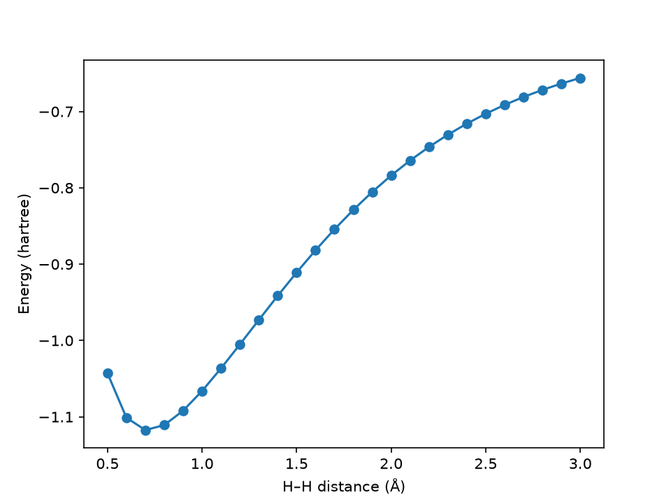
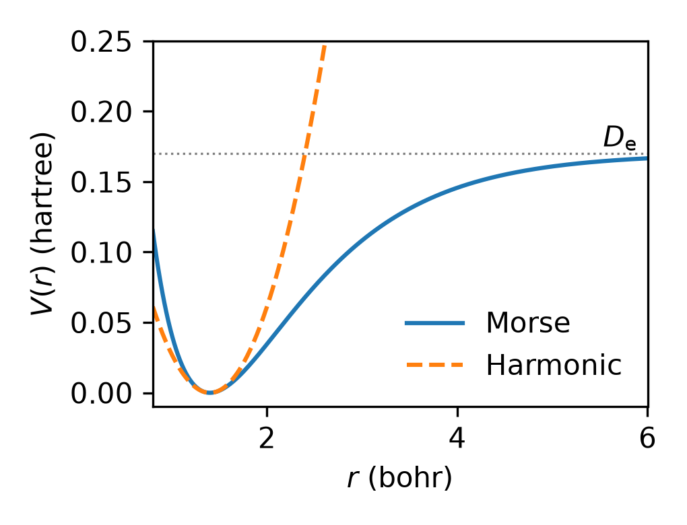
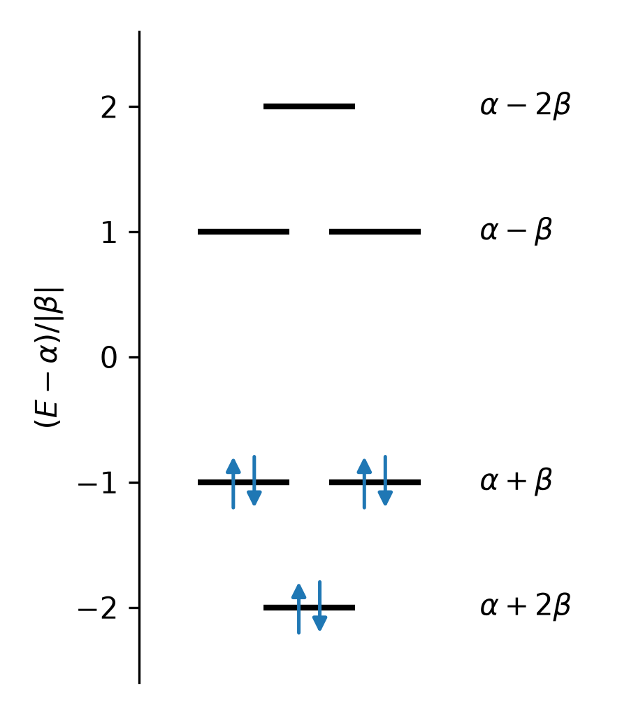

# 第 4 回　結果をグラフにする：Matplotlib

!!! abstract "この回の道筋"
    計算の結果は、数の表よりもグラフにした方が、傾向や間違いに気付きやすくなります。
    この回では、Python のグラフのライブラリ Matplotlib で、線グラフ、ポテンシャル曲線、エネルギー準位図を描きます。
    最後に、論文に載せる図で気を付けること（軸ラベルと単位、フォント、大きさと解像度）をまとめます。

    | 節 | 内容 |
    |---|---|
    | 1 | 最初の線グラフ |
    | 2 | ポテンシャル曲線：Morse と調和近似 |
    | 3 | エネルギー準位図 |
    | 4 | 論文に使える図にする |

    **前に読んでおく回**：研究の道具 第 3 回 [Python と NumPy](03-python-numpy.md)

この回の例は、Python 3.13、NumPy 2.5、Matplotlib 3.11 で動かしました。

## 1. 最初の線グラフ

**Matplotlib** は、Python でグラフを描くための、最も広く使われているライブラリです [Hunter 2007]。
まず、描く材料のデータを用意します。
ここでは、H₂ 分子の結合距離を 0.5 Å から 3.0 Å まで 0.1 Å ずつ変え、Hartree–Fock 法（基底関数 STO-3G）でエネルギーを計算しました。
計算には量子化学の Python パッケージ PySCF を使いましたが、その使い方はここでは説明しません。
結果は、1 列目が距離（Å）、2 列目がエネルギー（ハートリー）のテキストファイル `h2_rhf.dat` に書きました。

```text
# R/Angstrom  E/Hartree
0.50 -1.04299627
0.60 -1.10112824
0.70 -1.11734903
...
3.00 -0.65604825
```

このファイルを読んで、グラフを描きます。

```python
import numpy as np
import matplotlib
matplotlib.use("Agg")
import matplotlib.pyplot as plt

data = np.loadtxt("h2_rhf.dat")      # 1 列目：R（Å）、2 列目：E（Eh）
R, E = data[:, 0], data[:, 1]

fig, ax = plt.subplots()
ax.plot(R, E, marker="o")
ax.set_xlabel("H–H distance (Å)")
ax.set_ylabel("Energy (hartree)")
fig.savefig("h2_first.png", dpi=150)
```



1 行ずつ見ていきます。

- `matplotlib.use("Agg")` は、画面に表示せず、ファイルに保存するだけの描き方を選ぶ指定です。計算機クラスタのように画面のない計算機で描くときに必要です。手元のパソコンで画面に表示したいときは、この行を消し、最後に `plt.show()` を書きます。
- `np.loadtxt` は、数が空白で区切られたテキストファイルを配列として読みます。`#` で始まる行は読み飛ばします。
- `plt.subplots()` は、図の全体（`fig`）と、その中の 1 つの座標の枠（`ax`）を作ります。描く命令は、すべて `ax` に対して出します。
- `ax.plot(x, y)` は、点を線でつないだグラフを描きます。`marker="o"` で、データの点に丸を付けました。
- `ax.set_xlabel` と `ax.set_ylabel` は、軸の名前（**軸ラベル**）を付けます。
- `fig.savefig` は、図をファイルに保存します。`dpi` は解像度（1 インチあたりの点の数）です。

データの点に印を付けたのは、どこが計算した点で、どこが線でつないだだけの部分かを区別するためです。
たとえば、この図の最小値の付近は点の間隔が粗く、最小になる距離が 0.6 Å と 0.8 Å の間のどこにあるかは、この図からは決まりません。

**ここまでで分かったこと**：`plt.subplots` で枠を作り、`ax.plot` で描き、軸ラベルを付けて `fig.savefig` で保存します。

## 2. ポテンシャル曲線：Morse と調和近似

次に、式で与えた曲線を描き、2 本の曲線を比べます。
二原子分子のポテンシャル曲線の簡単なモデルに、**Morse ポテンシャル**があります [Morse 1929]。

$$
V(r) = D_\mathrm{e}\left[1 - e^{-a(r - r_\mathrm{e})}\right]^2
$$

$r$ は核間距離、$r_\mathrm{e}$ は平衡距離、$D_\mathrm{e}$ は井戸の深さ（平衡距離から原子に分かれるまでに要るエネルギー）、$a$ は井戸の幅を決める定数です。
$r = r_\mathrm{e}$ で $V = 0$ となり、$r \to \infty$ で $V \to D_\mathrm{e}$ に近づきます。

平衡距離の近くでは、ポテンシャルを放物線（**調和近似**）$V \approx \frac{1}{2}k(r - r_\mathrm{e})^2$ で近似できます。
力の定数 $k$ は $r_\mathrm{e}$ での 2 階微分で、Morse ポテンシャルを 2 回微分すると $k = 2D_\mathrm{e}a^2$ となります。

$D_\mathrm{e}$、$a$、$r_\mathrm{e}$ は、説明のために選んだ値で、特定の分子のものではありません（原子単位）。

```python
import numpy as np
import matplotlib
matplotlib.use("Agg")
import matplotlib.pyplot as plt

# Morse ポテンシャルの例（値は説明のために選んだもの。原子単位）
De, a, re = 0.17, 1.0, 1.4          # 井戸の深さ（Eh）、幅のパラメータ（1/bohr）、平衡距離（bohr）
k = 2.0 * De * a**2                 # r = re での 2 階微分（調和近似の力の定数）

r = np.linspace(0.8, 6.0, 300)
V_morse = De * (1.0 - np.exp(-a * (r - re)))**2
V_harm = 0.5 * k * (r - re)**2

fig, ax = plt.subplots(figsize=(3.4, 2.6))
ax.plot(r, V_morse, label="Morse", color="C0")
ax.plot(r, V_harm, label="Harmonic", color="C1", linestyle="--")
ax.axhline(De, color="gray", linewidth=0.8, linestyle=":")
ax.text(5.9, De, r"$D_\mathrm{e}$", ha="right", va="bottom")
ax.set_xlim(0.8, 6.0)
ax.set_ylim(-0.01, 0.25)
ax.set_xlabel(r"$r$ (bohr)")
ax.set_ylabel(r"$V(r)$ (hartree)")
ax.legend(frameon=False)
fig.tight_layout()
fig.savefig("morse.png", dpi=300)
fig.savefig("morse.pdf")
```



新しく使った命令は次のとおりです。

- `np.linspace(0.8, 6.0, 300)` は、0.8 から 6.0 までを等間隔に分けた 300 個の点を作ります。式の曲線は、点を細かくとると滑らかに描けます。
- 同じ `ax` に `ax.plot` を 2 回書くと、2 本の線が重なって描かれます。`label` で付けた名前は、`ax.legend()` で**凡例**（どの線が何かの説明）として表示されます。
- 2 本目は破線（`linestyle="--"`）にしました。色の見分けにくい人や、白黒で印刷した人にも区別できるようにするためです。`"C0"`、`"C1"` は、Matplotlib の標準の色の 1 番目と 2 番目です。
- `ax.axhline` は横の線、`ax.text` は文字を描きます。
- `ax.set_xlim` と `ax.set_ylim` で、表示する範囲を決めました。調和近似の放物線はどこまでも高くなるので、範囲を決めないと Morse の曲線がつぶれて見えます。
- 文字列の中の `$...$` は、数式として描かれます（Matplotlib の mathtext という機能です）。文字列の前の `r` は、`\` をそのまま文字として扱うための印です。
- `figsize=(3.4, 2.6)` は図の大きさ（インチ、幅と高さ）、`fig.tight_layout()` は軸ラベルが枠からはみ出さないように余白を整える命令です。

図から、平衡距離のごく近くでは 2 本の曲線が重なり、離れるほどずれることが分かります。
調和近似は結合が伸びて切れる様子を表せず、Morse ポテンシャルは $D_\mathrm{e}$ に近づいて結合が切れる様子を表します。
また、短い距離の側でも、2 本の曲線はずれています。

**ここまでで分かったこと**：同じ枠に何本も描き、凡例・線の種類・表示範囲を整えると、曲線どうしを比べる図になります。

## 3. エネルギー準位図

量子化学でよく使う図に、軌道のエネルギーを横線で並べた**エネルギー準位図**があります。
第 3 回で求めたベンゼンの Hückel 軌道（$\alpha + 2\beta$、$\alpha + \beta$ が 2 つ、$\alpha - \beta$ が 2 つ、$\alpha - 2\beta$）を描きます。
縦軸は $(E - \alpha)/|\beta|$ にとり、$\beta < 0$ なので $\alpha + 2\beta$ が $-2$ の位置にきます。

```python
import matplotlib
matplotlib.use("Agg")
import matplotlib.pyplot as plt

# 第 3 回で求めたベンゼンの Hückel 軌道：(E - α)/|β| の値と、その準位の数（縮退度）
levels = [(-2, 1), (-1, 2), (1, 2), (2, 1)]
names = {-2: r"$\alpha+2\beta$", -1: r"$\alpha+\beta$", 1: r"$\alpha-\beta$", 2: r"$\alpha-2\beta$"}

fig, ax = plt.subplots(figsize=(3.0, 3.4))
n_left = 6                                   # まだ入れていない π 電子の数
for e, g in levels:
    for m in range(g):
        x0 = m - (g - 1) / 2                 # 縮退した準位は横に並べる
        ax.hlines(e, x0 - 0.35, x0 + 0.35, color="black", linewidth=2)
        n = min(2, n_left)                   # この軌道に入れる電子の数
        n_left -= n
        if n >= 1:                           # 上向きスピンの矢印
            ax.annotate("", xy=(x0 - 0.08, e + 0.25), xytext=(x0 - 0.08, e - 0.25),
                        arrowprops=dict(arrowstyle="-|>", color="C0", lw=1.2))
        if n == 2:                           # 下向きスピンの矢印
            ax.annotate("", xy=(x0 + 0.08, e - 0.25), xytext=(x0 + 0.08, e + 0.25),
                        arrowprops=dict(arrowstyle="-|>", color="C0", lw=1.2))
    ax.text(1.3, e, names[e], va="center")

ax.set_xlim(-1.3, 2.2)
ax.set_ylim(-2.6, 2.6)
ax.set_xticks([])
ax.set_ylabel(r"$(E - \alpha)/|\beta|$")
for side in ["top", "right", "bottom"]:
    ax.spines[side].set_visible(False)
fig.tight_layout()
fig.savefig("benzene_huckel.png", dpi=300)
```



準位図は、`ax.plot` の線グラフではなく、部品を 1 つずつ置いて描きます。

- `ax.hlines(y, x1, x2)` は、高さ `y` に `x1` から `x2` までの横線を引きます。縮退した 2 つの準位は、横に少しずらして並べました。
- 電子は、`ax.annotate` で描いた矢印で表しました。`xytext` から `xy` に向かう矢印になります。下の軌道から 2 個ずつ、6 個の π 電子を入れています。
- 横軸には意味がないので、`ax.set_xticks([])` で目盛りを消し、`ax.spines`（枠の線）の上・右・下を消しました。

**ここまでで分かったこと**：準位図は、横線・矢印・文字を座標を指定して置いて描きます。

## 4. 論文に使える図にする

ここまでの図は、自分で結果を確かめるには十分です。
論文に載せる図では、読み手が図だけを見て内容を正しく読み取れるように、さらにいくつかのことに気を付けます。
図を作るときの心得は [Rougier 2014] にまとめられていて、「読み手を知る」「標準の設定を信用しない」「読み手を誤らせない」などが挙げられています。
ここでは、そのうち特に手を動かす部分を扱います。

**軸ラベルと単位**。
すべての軸に、量の名前と単位を書きます。
書き方は「量 (単位)」か「量 / 単位」のどちらかにそろえます。
エネルギーの単位（ハートリー、eV、kcal/mol）は、図によって違うと読み手が取り違えるので、論文の中でそろえます。
ある基準からの差（相対エネルギー）を描くときは、何を基準にしたかを軸ラベルか図の説明に書きます。

**図の大きさとフォント**。
Matplotlib の標準の図の大きさは 6.4 × 4.8 インチ（約 16 × 12 cm）です。
これは、論文の 1 段の幅よりかなり大きい値です（1 段の幅は雑誌によって違い、たとえば Elsevier の雑誌では 90 mm です）。
大きく描いた図を縮めて載せると、文字が小さくなって読めなくなります。
そこで、2 節と 3 節の例のように、`figsize` で載せるときの大きさに近い図を作り、その大きさで文字が読めることを確かめます。
文字の大きさと種類は、まとめて次のように決められます。

```python
plt.rcParams["font.size"] = 9
plt.rcParams["font.family"] = "sans-serif"
plt.rcParams["pdf.fonttype"] = 42
```

`pdf.fonttype = 42` は、PDF にフォントを TrueType の形で埋め込む指定です。
Matplotlib の標準（Type 3）の形の PDF は、雑誌の投稿のシステムで受け付けられないことがあります。
雑誌によっては、使うフォントの種類と最小の大きさが投稿規定で決められているので、確かめます。

!!! note "日本語の文字"
    Matplotlib の標準のフォント（DejaVu Sans）には、日本語の文字が入っていません。
    軸ラベルに日本語を書くと、文字が四角になり、「Glyph ... missing from font(s) DejaVu Sans」という警告が出ます。
    英語の論文の図では、ラベルを英語で書けば問題はありません。
    日本語の発表資料に使うときは、計算機に入っている日本語のフォントを `font.family` に指定します。

**保存の形式と解像度**。
図の保存には、大きく 2 種類の形式があります。

- **ベクター形式**（PDF、SVG など）：線や文字を図形として記録します。どれだけ拡大しても線がぼやけません。線グラフや準位図は、こちらで保存するのが基本です。
- **ラスター形式**（PNG、TIFF など）：図を細かい点（画素）の集まりとして記録します。Web ページや、画素の多い図（分子の軌道の画像など）に向いています。解像度を `dpi` で決めます。

`fig.savefig` は、ファイル名の拡張子（`.pdf`、`.png` など）から形式を選びます。
2 節の例で `morse.png` と `morse.pdf` の両方を保存したのは、このためです。
ラスター形式の解像度は、雑誌の投稿規定で決められています。
たとえば Elsevier は、写真のような画像で 300 dpi 以上、線画では 1000 dpi 以上を求めています。
線画をラスター形式で出すと高い解像度が要るので、この点でもベクター形式が向いています。
解像度の低い図を後から高くしても、細かさは戻りません。
はじめから必要な解像度で保存するか、ベクター形式で保存しておきます。

**図を作るプログラムを残す**。
図は、手で修正せず、プログラムだけで作り直せるようにしておきます。
データが変わったときや、査読で修正を求められたときに、プログラムを実行し直すだけで済むからです。

**ここまでで分かったこと**：論文の図では、軸ラベルと単位をそろえ、載せる大きさで図を作り、ベクター形式か十分な解像度で保存します。

## まとめ

- `fig, ax = plt.subplots()` で枠を作り、`ax.plot` で描き、`fig.savefig` で保存します。画面のない計算機では `matplotlib.use("Agg")` を使います。
- 同じ枠に複数の線を描き、凡例と線の種類で区別すると、曲線どうしを比べられます（例：Morse ポテンシャルと調和近似）。
- エネルギー準位図は、`ax.hlines` と `ax.annotate` で部品を置いて描きます。
- 論文の図では、軸ラベルと単位、載せる大きさでの文字の読みやすさ、保存の形式と解像度に気を付けます。

## 参考文献

- J. D. Hunter, "Matplotlib: A 2D Graphics Environment", Comput. Sci. Eng. 9, 90 (2007). DOI: [10.1109/MCSE.2007.55](https://doi.org/10.1109/MCSE.2007.55)
- P. M. Morse, "Diatomic Molecules According to the Wave Mechanics. II. Vibrational Levels", Phys. Rev. 34, 57 (1929). DOI: [10.1103/PhysRev.34.57](https://doi.org/10.1103/PhysRev.34.57)
- N. P. Rougier, M. Droettboom, P. E. Bourne, "Ten Simple Rules for Better Figures", PLoS Comput. Biol. 10, e1003833 (2014). DOI: [10.1371/journal.pcbi.1003833](https://doi.org/10.1371/journal.pcbi.1003833)

## 関連リンク

- Matplotlib の文書（チュートリアル）：<https://matplotlib.org/stable/tutorials/index.html>
- Matplotlib の文書（数式の書き方 mathtext）：<https://matplotlib.org/stable/users/explain/text/mathtext.html>
- Matplotlib の文書（rcParams による設定の変更）：<https://matplotlib.org/stable/users/explain/customizing.html>
- PySCF の文書：<https://pyscf.org/>
- Elsevier の図の大きさと解像度の規定：<https://www.elsevier.com/about/policies-and-standards/author/artwork-and-media-instructions/artwork-sizing>
