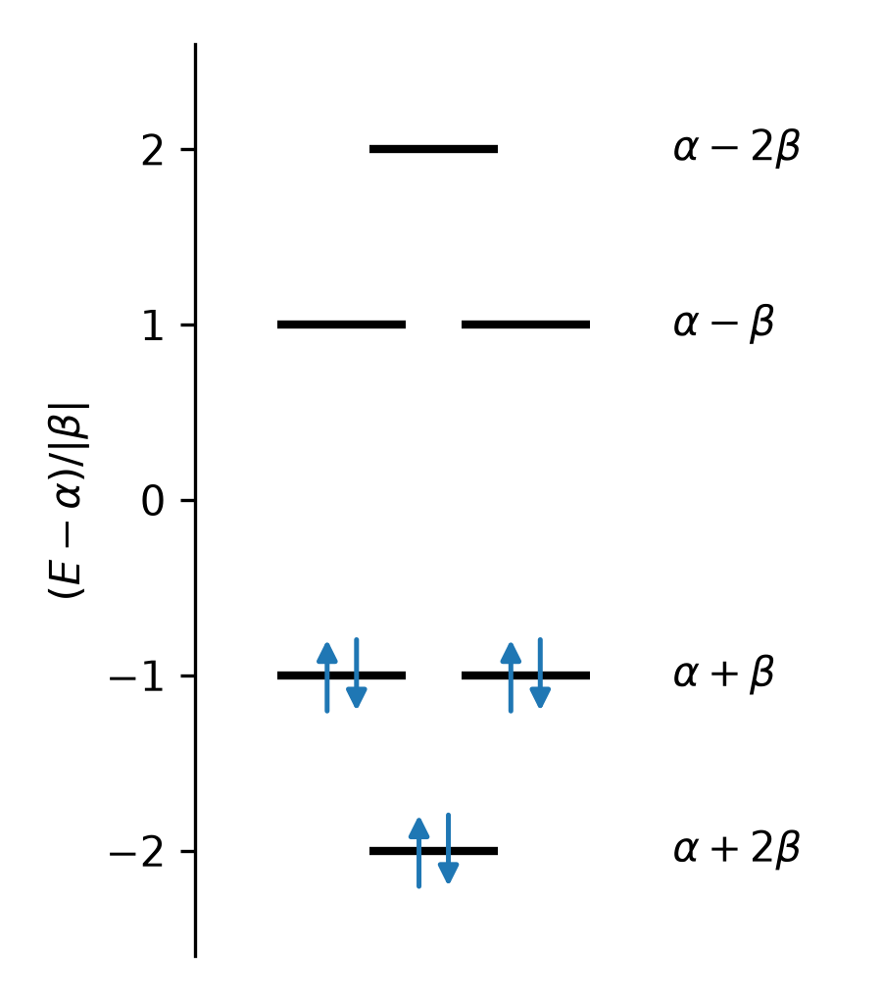

# 第 6 回　Markdown と数式の書き方

!!! abstract "この回の道筋"
    Markdown は、ふつうの文字だけで見出しや箇条書きを書ける、軽い文書の書き方です。
    研究ノート、プログラムの説明書（README）、GitHub のページ、このサイトの講義ノートも、Markdown で書かれています。
    この回では、Markdown の基本の書き方と、量子化学でよく使う数式（ハット、ブラケット、和、行列）の書き方を学びます。

    | 節 | 内容 |
    |---|---|
    | 1 | Markdown とは |
    | 2 | 見出し・段落・強調 |
    | 3 | 箇条書きと表 |
    | 4 | コードブロックとリンク |
    | 5 | 数式の書き方 |
    | 6 | 量子化学でよく使う記号 |
    | 7 | 計算ノートの例 |

    **前に読んでおく回**：研究の道具 第 5 回 [Git と GitHub](05-git-github.md)（読んでいなくても、この回は読めます）

## 1. Markdown とは

**Markdown** は、文書の形（見出し、箇条書き、強調など）を、`#` や `-` などの記号で表す書き方です。
ファイルは、拡張子 `.md` のふつうのテキストファイルです。
専用の道具（GitHub、このサイトを作っている MkDocs、多くのノートのアプリ）が、これを読んで、見やすく整えた形で表示します。

研究で Markdown を使う利点は、2 つあります。

- ふつうのテキストなので、どのエディタでも書け、第 5 回の Git で変更の記録をとれます。論文の原稿をテキストの形式で書いてバージョン管理することは、研究のデータ管理の勧めにも挙げられています [Wilson 2017]。
- 記号がそのまま読めるので、整えて表示しなくても、テキストのままで内容が分かります。

Markdown には、少しずつ違う方言があります。
基本の部分は共通の規格（CommonMark）にまとめられていて、GitHub はそれに表などを足した方言を使っています。
この回では、どの方言でも使える書き方を中心に扱い、違いがあるところは、その都度書きます。

以下では、Markdown の書き方を先に示し、その下に表示の結果を示します。

**ここまでで分かったこと**：Markdown は、記号で文書の形を表すテキストの書き方で、Git で記録をとるのにも向いています。

## 2. 見出し・段落・強調

**見出し**は、行の先頭に `#` を書きます。
`#` の数が見出しの深さで、`#` が一番大きい見出し（文書の題）、`##` がその下の節、`###` がさらに下の小節です。
`#` の後には空白を 1 つ入れます。

```markdown
# 水分子の構造最適化
## 計算の条件
### 基底関数
```

**段落**は、空行で区切ります。
Markdown では、改行を 1 つ入れただけでは段落が分かれず、前の行とつながって表示されます。
段落を分けたいときは、必ず空行を入れます。

**強調**は、文字を `**` で囲むと太字、`*` で囲むと斜体になります。

```markdown
収束の条件は **必ず** 確かめます。基底関数は *cc-pVDZ* を使いました。
```

収束の条件は **必ず** 確かめます。基底関数は *cc-pVDZ* を使いました。

**ここまでで分かったこと**：見出しは `#`、段落は空行、強調は `**` と `*` で書きます。

## 3. 箇条書きと表

**箇条書き**は、行の先頭に `-` と空白を書きます。
番号付きの箇条書きは、`1.` のように数字と点を書きます。
箇条書きの前には空行を入れます（空行がないと、前の段落の続きとして扱われる方言があります）。

```markdown
計算の手順は次のとおりです。

1. 構造を最適化する。
2. 振動数を計算する。
    - 虚の振動数がないことを確かめる。
    - ゼロ点エネルギーを記録する。
3. 一点のエネルギーを計算する。
```

計算の手順は次のとおりです。

1. 構造を最適化する。
2. 振動数を計算する。
    - 虚の振動数がないことを確かめる。
    - ゼロ点エネルギーを記録する。
3. 一点のエネルギーを計算する。

箇条書きの中の箇条書き（入れ子）は、行の先頭に空白を入れて字下げします。
必要な空白の数は方言によって違います。
GitHub では、親の項目の文字の始まりまで下げれば足ります（`-` の項目なら 2 つ、`1.` の項目なら 3 つ）。
一方、このサイトで使っている Python-Markdown は、1 段ごとに 4 つを必要とします。
どこでも通じるように、4 つの空白で字下げするのが安全です。

**表**は、`|` で列を区切り、2 行目に `---` を並べて見出しの行と中身の行を分けます。
表は CommonMark の規格にはありませんが、GitHub をはじめ多くの方言で使えます。

```markdown
| 汎関数 | 種類 | 備考 |
|---|---|---|
| PBE | GGA | 純粋汎関数 |
| B3LYP | 混成 | 交換の一部を Hartree–Fock で置き換える |
```

| 汎関数 | 種類 | 備考 |
|---|---|---|
| PBE | GGA | 純粋汎関数 |
| B3LYP | 混成 | 交換の一部を Hartree–Fock で置き換える |

列の幅をそろえる必要はありません。
2 行目を `|---:|` のように書くと右寄せ、`|:---:|` と書くと中央寄せになり、数の列は右寄せにすると桁が読みやすくなります。

**ここまでで分かったこと**：箇条書きは `-` か `1.`、入れ子は 4 つの空白で字下げし、表は `|` と `---` で書きます。

## 4. コードブロックとリンク

プログラムや入力ファイルは、**コードブロック**に入れます。
前後の行を `` ``` `` で囲むと、中身は書いたとおりに（記号を解釈せずに）表示されます。
最初の `` ``` `` の後にプログラムの言語の名前を書くと、言語に合わせて色が付きます。

````markdown
```python
import numpy as np
print(np.pi)
```
````

```python
import numpy as np
print(np.pi)
```

文の中の短いコード（命令の名前やファイル名）は、`` ` `` で囲みます。
たとえば `` `np.linalg.eigh` `` と書くと `np.linalg.eigh` と表示されます。

**リンク**は、`[表示する文字](URL)` と書きます。
同じサイトの中のファイルへのリンクは、URL の代わりにファイルの相対パス（第 1 回の 2 節）を書きます。
画像は、先頭に `!` を付けて `` と書きます。

```markdown
[NumPy の文書](https://numpy.org/doc/stable/) を参照してください。
NumPy の使い方は [第 3 回](03-python-numpy.md) で扱いました。

```

[NumPy の文書](https://numpy.org/doc/stable/) を参照してください。
NumPy の使い方は [第 3 回](03-python-numpy.md) で扱いました。

画像の説明の文字は、画像が表示されないときに代わりに表示され、画面を読み上げる道具でも読まれます。そのため、中身が分かるように書きます。
画像の表示の結果は、第 4 回の図を見てください。

**ここまでで分かったこと**：プログラムは `` ``` `` で囲んだコードブロックに、リンクは `[文字](URL)`、画像は `` で書きます。

## 5. 数式の書き方

多くの Markdown の道具は、LaTeX（数式の組版で標準的に使われている仕組み）と同じ書き方で数式を書けるようにしています [Lamport 1994]。
このサイトと GitHub では、次の 2 つの書き方を使います。

- 文の中の数式は、`$` で囲みます。
- 別の行に大きく出す数式は、`$$` で囲みます。

```markdown
水素原子の基底状態のエネルギーは $E = -\frac{1}{2}\,E_\mathrm{h}$ です。

$$
E_n = -\frac{1}{2n^2}\,E_\mathrm{h}
$$
```

水素原子の基底状態のエネルギーは $E = -\frac{1}{2}\,E_\mathrm{h}$ です。

$$
E_n = -\frac{1}{2n^2}\,E_\mathrm{h}
$$

数式の中では、次の決まりで書きます。

| 書きたいもの | 書き方 | 表示 |
|---|---|---|
| 下付き・上付き | `x_i`、`x^2`、`x_{ij}^{(2)}` | $x_i$、$x^2$、$x_{ij}^{(2)}$ |
| 分数 | `\frac{a}{b}` | $\frac{a}{b}$ |
| ギリシャ文字 | `\alpha`、`\beta`、`\Psi`、`\phi` | $\alpha$、$\beta$、$\Psi$、$\phi$ |
| 立体（傾けない文字） | `E_\mathrm{h}`、`\mathrm{d}x` | $E_\mathrm{h}$、$\mathrm{d}x$ |
| 太字（ベクトル・行列） | `\mathbf{r}`、`\mathbf{H}` | $\mathbf{r}$、$\mathbf{H}$ |

下付きや上付きが 2 文字以上のときは、`{}` で囲みます。
`x_ij` と書くと、`i` だけが下付きになります。
単位や、$E_\mathrm{h}$ の h（hartree の頭文字）のように変数でない文字は、`\mathrm` で立体にします。

数式の中の空白は、表示に影響しません。
空きを入れたいときは、`\,`（小さな空き）や `\quad`（大きな空き）を使います。

!!! note "数式が崩れるとき"
    数式の機能のない Markdown の道具では、`$` は数式の印として扱われず、数式の中の `_` や `*` が強調の印として解釈されて、表示が崩れることがあります。
    数式が崩れたら、その道具が数式に対応しているか、どの書き方を認めているかを確かめます。

**ここまでで分かったこと**：数式は、文の中は `$...$`、別の行は `$$...$$` で囲み、中は LaTeX の書き方で書きます。

## 6. 量子化学でよく使う記号

ここでは、量子化学の式を書くときによく使う記号をまとめます。

**ハット（演算子）**。
演算子は、文字の上にハットを付けて表します。
`\hat{H}` と書きます。

```markdown
$$
\hat{H}\Psi = E\Psi
$$
```

$$
\hat{H}\Psi = E\Psi
$$

**ブラケット**。
ブラ $\langle \Psi |$ とケット $| \Psi \rangle$ の山形のかっこは、`\langle` と `\rangle` で書きます。
不等号 `<` と `>` で代用すると、空きの大きさが違い、読みにくくなります。

```markdown
$$
E = \frac{\langle \Psi | \hat{H} | \Psi \rangle}{\langle \Psi | \Psi \rangle}
$$
```

$$
E = \frac{\langle \Psi | \hat{H} | \Psi \rangle}{\langle \Psi | \Psi \rangle}
$$

電子反発積分を書くときは、化学者の表記 $(ij|kl)$ か、物理学者の表記 $\langle ij|kl \rangle$ かを、文書の中でそろえて明記します。
2 つの表記では添字の並びの意味が違い、$(ij|kl) = \langle ik|jl \rangle$ の関係があります [Szabo 1996]。

**和と積分**。
和は `\sum`、積分は `\int` で書き、範囲は `_` と `^` で付けます。

```markdown
$$
E_0 = 2\sum_{a=1}^{N/2} h_{aa} + \sum_{a=1}^{N/2}\sum_{b=1}^{N/2} \left[ 2(aa|bb) - (ab|ba) \right]
$$

$$
\langle \phi_i | \phi_j \rangle = \int \phi_i^*(\mathbf{r})\, \phi_j(\mathbf{r})\, \mathrm{d}\mathbf{r} = \delta_{ij}
$$
```

$$
E_0 = 2\sum_{a=1}^{N/2} h_{aa} + \sum_{a=1}^{N/2}\sum_{b=1}^{N/2} \left[ 2(aa|bb) - (ab|ba) \right]
$$

$$
\langle \phi_i | \phi_j \rangle = \int \phi_i^*(\mathbf{r})\, \phi_j(\mathbf{r})\, \mathrm{d}\mathbf{r} = \delta_{ij}
$$

1 つ目の式は、$N$ 電子の閉殻の分子の Hartree–Fock のエネルギーを、占有された空間軌道 $a, b$ で書いたものです。$h_{aa}$ は 1 電子積分、$(aa|bb)$ などは化学者の表記の電子反発積分です [Szabo 1996]。
`\left[` と `\right]` は、中身の高さに合わせてかっこを大きくします。
`\delta_{ij}` はクロネッカーのデルタ（$i = j$ なら 1、それ以外は 0）です。

**行列**。
行列は `\begin{pmatrix}` と `\end{pmatrix}` の間に書き、`&` で列を、`\\` で行を区切ります。
`pmatrix` は丸かっこ、`bmatrix` は角かっこの行列になります。

```markdown
$$
\mathbf{H} = \begin{pmatrix}
\alpha & \beta & 0 \\
\beta & \alpha & \beta \\
0 & \beta & \alpha
\end{pmatrix}
$$
```

$$
\mathbf{H} = \begin{pmatrix}
\alpha & \beta & 0 \\
\beta & \alpha & \beta \\
0 & \beta & \alpha
\end{pmatrix}
$$

これは、3 つの炭素が鎖状に並んだアリル基の Hückel 法のハミルトニアン行列です（第 3 回の 5 節と同じ決め方で、1 番と 3 番の炭素は結合していないので 0 です）。

**複数行の式**。
式の変形を何行かに分けて書き、`=` の位置をそろえたいときは、`\begin{aligned}` と `\end{aligned}` の間に書きます。
そろえたい場所の前に `&` を置き、行の終わりに `\\` を書きます。

```markdown
$$
\begin{aligned}
\langle \Psi | \hat{H} | \Psi \rangle
  &= \sum_{i} \langle i | \hat{h} | i \rangle + \frac{1}{2}\sum_{ij} \langle ij || ij \rangle \\
  &= \sum_{i} h_{ii} + \frac{1}{2}\sum_{ij} \left( \langle ij | ij \rangle - \langle ij | ji \rangle \right)
\end{aligned}
$$
```

$$
\begin{aligned}
\langle \Psi | \hat{H} | \Psi \rangle
  &= \sum_{i} \langle i | \hat{h} | i \rangle + \frac{1}{2}\sum_{ij} \langle ij || ij \rangle \\
  &= \sum_{i} h_{ii} + \frac{1}{2}\sum_{ij} \left( \langle ij | ij \rangle - \langle ij | ji \rangle \right)
\end{aligned}
$$

これは、1 つの Slater 行列式 $\Psi$ のエネルギーを、占有されたスピン軌道 $i, j$ で書いたものです。
この式だけは、2 つの表記の違いを示すために物理学者の表記を使い、$\langle ij || ij \rangle = \langle ij | ij \rangle - \langle ij | ji \rangle$ です [Szabo 1996]。
空間軌道で書いた閉殻の式（上の $E_0$ の式）は、この式でスピンについて和をとったものです。

ほかによく使う記号を表にまとめます。

| 書きたいもの | 書き方 | 表示 |
|---|---|---|
| 偏微分、ナブラ | `\frac{\partial E}{\partial x}`、`\nabla^2` | $\frac{\partial E}{\partial x}$、$\nabla^2$ |
| 複素共役、エルミート共役 | `\phi^*`、`\mathbf{C}^\dagger` | $\phi^*$、$\mathbf{C}^\dagger$ |
| 近似、比例、無限大 | `\approx`、`\propto`、`\infty` | $\approx$、$\propto$、$\infty$ |
| 点の並び | `1, \dots, N` | $1, \dots, N$ |
| 上線、チルダ | `\bar{\phi}`、`\tilde{E}` | $\bar{\phi}$、$\tilde{E}$ |

**ここまでで分かったこと**：演算子は `\hat`、ブラケットは `\langle`・`\rangle`、和は `\sum`、行列は `pmatrix` で書きます。

## 7. 計算ノートの例

ここまでの書き方を合わせると、計算の記録を次のように書けます。
ファイルの名前は `README.md` などにして、計算のディレクトリに置いておきます。

````markdown
# H₂ のポテンシャル曲線（Hartree–Fock/STO-3G）

## 目的
平衡距離の近くで、ポテンシャル曲線を Morse ポテンシャル $V(r) = D_\mathrm{e}[1 - e^{-a(r - r_\mathrm{e})}]^2$ と比べる。

## 計算の条件

| 項目 | 値 |
|---|---|
| 方法 | RHF |
| 基底関数 | STO-3G |
| 距離 | 0.5–3.0 Å、0.1 Å 刻み |

## 手順

1. `scan.py` で各距離のエネルギーを計算し、`h2_rhf.dat` に書く。
2. `plot.py` で図 `h2.png` を作る。

## 結果

- 最も低い点：$R = 0.70$ Å、$E = -1.117349\,E_\mathrm{h}$（0.1 Å 刻みの点の中で）。
````

このように書いておくと、何のために、どの条件で、どのプログラムを使って計算したかが、半年後の自分にも共同研究者にも分かります。
結果の数値は、第 4 回の 1 節で計算した H₂ の値です。

## まとめ

- Markdown は、記号で文書の形を表すテキストの書き方で、Git で変更の記録をとれます。
- 見出しは `#`、段落は空行、箇条書きは `-` か `1.`（入れ子は 4 つの空白）、表は `|` と `---` で書きます。
- プログラムは `` ``` `` で囲み、リンクは `[文字](URL)`、画像は `` で書きます。
- 数式は `$...$` と `$$...$$` で囲み、中は LaTeX の書き方で書きます。
- 量子化学では `\hat{H}`、`\langle \Psi | \hat{H} | \Psi \rangle`、`\sum_{i=1}^{N}`、`pmatrix` をよく使います。

## 参考文献

- L. Lamport, "LaTeX: A Document Preparation System" (Addison-Wesley, 1994). ISBN: 9780201529838
- A. Szabo, N. S. Ostlund, "Modern Quantum Chemistry" (Dover, 1996). ISBN: 9780486691862
- G. Wilson et al., "Good enough practices in scientific computing", PLoS Comput. Biol. 13, e1005510 (2017). DOI: [10.1371/journal.pcbi.1005510](https://doi.org/10.1371/journal.pcbi.1005510)

## 関連リンク

- CommonMark の規格：<https://commonmark.org/>
- GitHub Flavored Markdown の規格：<https://github.github.com/gfm/>
- GitHub Docs（数式の書き方）：<https://docs.github.com/ja/get-started/writing-on-github/working-with-advanced-formatting/writing-mathematical-expressions>
- Python-Markdown の文書（ほかの Markdown との違い）：<https://python-markdown.github.io/#differences>
- MathJax の文書（使える LaTeX の命令）：<https://docs.mathjax.org/en/latest/input/tex/macros/index.html>
