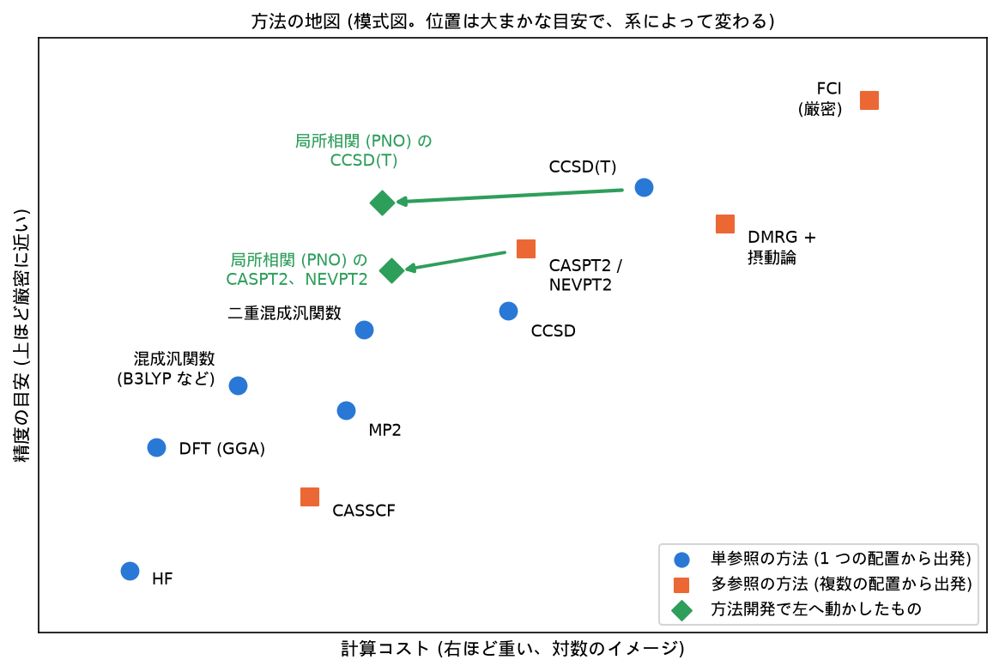
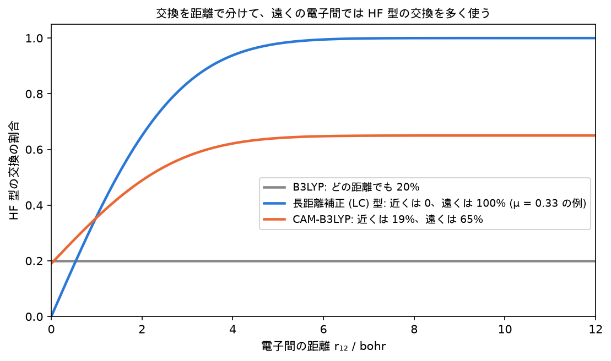
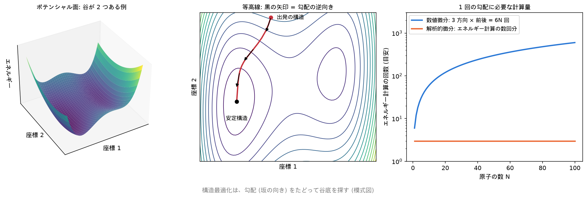
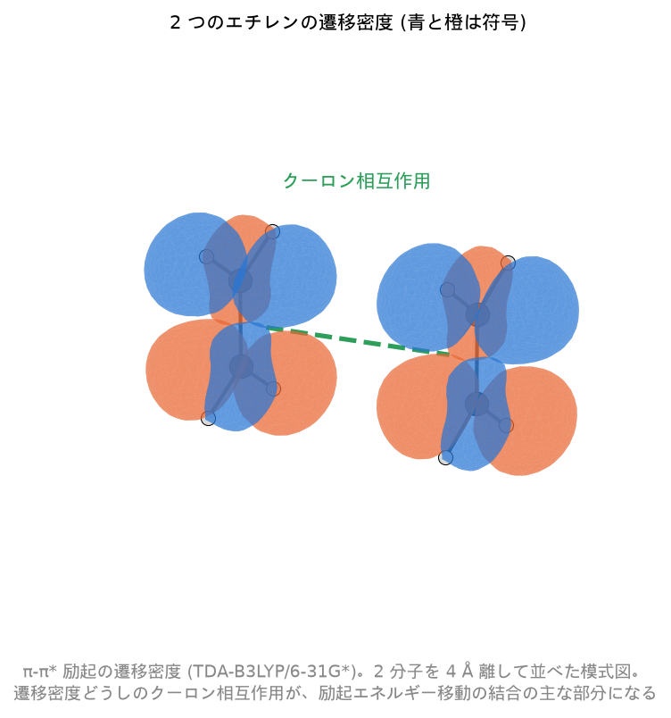

# 計算理論：新しい計算方法をつくる研究

!!! abstract "このページで分かること"
    量子化学の計算方法そのものを新しくつくる分野を紹介します。この分野の人は、ある分子の性質を調べるよりも、「もっと大きな分子を、もっと正確に、もっと速く計算できる方法」をつくることを目標にしています。波動関数理論、密度汎関数、解析的微分、環境を取り込む方法、プログラム開発の文化の 5 つに分けて、何をしているのか、どんな言葉が飛び交うのかを、図で説明します。

    | 節 | 内容 |
    |---|---|
    | 1 | この分野が答えようとしている問い：精度とコストの地図 |
    | 2 | 波動関数理論の開発：DMRG、多参照摂動論、局所相関、新しい波動関数の形 |
    | 3 | 密度汎関数の開発：汎関数の階段、長距離補正、CAM-B3LYP |
    | 4 | 解析的微分：勾配、非断熱結合、スピン軌道結合の微分 |
    | 5 | 環境を取り込む方法：相対論、溶媒、周期系、分子の間の相互作用 |
    | 6 | プログラム開発の文化：オープンソース、ベンチマーク、再現性 |

!!! tip "ひとことで言うと"
    計算理論の研究は「地図をつくる人のための測量器具をつくる」仕事に似ています。化学者は計算で分子の地図（エネルギー、構造、スペクトル）を描きます。ところが、精密な器具（厳密な計算）は重すぎて小さな分子にしか使えず、軽い器具（簡単な近似）は大きな分子にも使えますが、ときどき大きく外れます。この分野では、「精度はほとんど落とさずに、重さだけを減らす」新しい器具を、式を考えるところから、プログラムを書き、ほかの器具と比べて性能を確かめるところまで、すべて自分たちで行います。

## 1. この分野が答えようとしている問い

量子化学の計算は、原理的にはシュレーディンガー方程式を解けば終わりです。ところが、厳密に解く方法（完全配置間相互作用、FCI）は、電子と軌道の数が増えると計算量が指数関数的に増えるので、小さな分子にしか使えません。そこで、さまざまな近似の方法が使われています。

方法を「精度」と「計算コスト」の 2 つの軸に並べると、図 1 のような地図になります。右上ほど正確で重く、左下ほど軽くて大まかです。

**図 1**　量子化学の方法の地図（模式図）。青の丸は 1 つの電子配置から出発する単参照の方法、橙の四角は複数の電子配置から出発する多参照の方法です。緑のひし形は、方法開発によって「同じ精度のまま左（軽い側）へ動かした」例です。位置は大まかな目安で、対象の分子によって変わります。

この分野の問いは、地図の上の言葉で言うと次の 3 つにまとめられます。

- **左へ動かす**：同じ精度の方法を、もっと軽くできないか（例：局所相関の方法、2.4 節）。
- **上へ動かす**：同じくらいの重さで、もっと正確にできないか（例：よりよい汎関数、3 節）。
- **地図の空白を埋める**：今の方法では扱えない種類の問題（強い電子相関、重い元素、溶液、励起状態の動き）を扱えるようにする（2.2 節、4 節、5 節）。

研究は、図 2 のような輪を何周も回って進みます。

**図 2**　方法開発の研究のサイクル（模式図）。既存の方法の限界から出発し、式をつくり、実装し、厳密な値や数値微分と一致するかを検証し、標準の分子の集合（ベンチマーク）で精度と速さを測り、最後に実際の化学の問題に応用します。応用の中で新しい限界が見つかると、次の周回が始まります。

この分野の論文では、「新しい式」と「それを実装したプログラム」と「ベンチマーク」と「応用例」の 4 つがそろっていることが期待されます。式だけでは、本当に速いのか、本当に正確なのかが分からないからです。

## 2. 波動関数理論の開発

### 2.1 何をする研究か：指数関数の壁を越える

波動関数理論は、電子の波動関数を、電子配置（スレーター行列式）の重ね合わせで表す方法の総称です。HF 法、MP2、結合クラスター法（CCSD、CCSD(T)）、CASSCF、CASPT2 などがこの仲間です。どの方法も、計算時間が系の大きさ N のべき乗で増えます。図 3 は、そのべき乗の違いを描いたものです。

**図 3**　計算時間のスケーリング（比だけを描いた模式図。N = 10 のときを 1 としました）。N は基底関数の数など、系の大きさの目安です。N⁷ で増える CCSD(T) は、系を 10 倍にすると 10⁷ 倍（1000 万倍）重くなります。FCI や大きな活性空間の CAS は指数関数的に増えるので、すぐに手が届かなくなります。

特に難しいのが、**多参照**（強い静的相関）の問題です。結合が切れかけた分子、遷移金属を何個も含むクラスター、長い π 共役系では、1 つの電子配置では波動関数を表せず、たくさんの配置が同じくらいの重みで混ざります。こうした系では、CASSCF（活性空間の中だけ FCI を解く方法）を使いますが、活性空間の決定子の数は、活性軌道の数 k に対して指数関数的に増えます（図 4 の赤い線）。

**図 4**　CAS(k,k)（k 個の電子を k 個の軌道に入れる活性空間）の決定子の数（赤）と、行列積状態の変数の数のおおよその目安 4kD²（青と緑）。決定子の数は k が 20 を超えると 1 TB のメモリーに入らなくなります。行列積状態の変数は k に比例してしか増えません。D は 2.2 節で説明する結合次元です。

### 2.2 DMRG：波動関数を行列の積で書く

**密度行列繰り込み群**（DMRG）は、もともと物理学で 1 次元の格子模型のために考えられた方法です [White 1992]。量子化学に使われたのは 1999 年ごろからです [White 1999]。DMRG では、軌道を一列に並べ、各軌道に小さな行列を 1 つずつ置き、それらを掛け合わせて CI の係数をつくります（図 5）。この形の波動関数を**行列積状態**（matrix product state、MPS）と呼びます。

**図 5**　行列積状態の模式図。丸が各軌道の行列 A、下に出た線がその軌道の占有（空、α、β、2 個の 4 通り）、横の太い線が行列どうしのつながりです。つながりの太さ D（結合次元）を大きくすると、表せる波動関数が増え、FCI に近づきます。列のどこで切っても左右をつなぐ線は 1 本なので、必要な D は「その切れ目での左右のもつれ（エンタングルメント）の大きさ」で決まります。

たとえで言うと、行列積状態は「長い文章を、隣どうしの単語のつながりだけで覚える」やり方です。全部の単語の組み合わせを覚える（FCI）代わりに、隣との関係を太さ D の線で覚えます。化学の分子は 1 次元の鎖ではないので、遠い軌道どうしのもつれを表すには大きな D が必要になります。

量子化学の DMRG を大きな活性空間の実用的な道具にした研究の 1 つが、Kurashige と Yanai の並列化された DMRG の実装です [Kurashige 2009]。この論文では、Cr₂ の 24 電子 30 軌道の活性空間で、外挿した最良値から 0.6 m$E_\mathrm{h}$ の精度のエネルギーを得ています（左右のブロックの基底を 10,000 個使った場合）。また、[Cu₂O₂]²⁺ の異性化を 32 電子 62 軌道の活性空間で計算し、小さな活性空間の CASSCF ではビラジカル性を過大評価することを示しています。

DMRG だけでは、活性空間の外の電子の動き（動的相関）が入りません。そこで、DMRG の上に動的相関を足す方法がいくつもつくられました。

- **DMRG-CT**：正準変換理論（canonical transformation、CT）は、指数関数のユニタリー変換でハミルトニアンを変換し、動的相関を取り込む方法です [Yanai 2006]。DMRG と組み合わせた DMRG-CT では、ポリエンで 24 電子 24 軌道、[Cu₂O₂]²⁺ で 28 電子 32 軌道の活性空間が扱われました [Yanai 2010]。
- **DMRG-CASPT2**：DMRG の波動関数を出発点にした CASPT2 です。Cr₂ への応用で知られています [Kurashige 2011]。

DMRG と多参照摂動論のしくみは、講義ノートの[量子化学の理論 第 14 回](../courses/qc-theory/14-dmrg-sci.md)で詳しく説明しています。

### 2.3 多参照摂動論と、その改良

**CASPT2** [Andersson 1990] と **NEVPT2** [Angeli 2001] は、CASSCF の波動関数の上に 2 次の摂動で動的相関を足す方法です。どちらも多参照の問題の「標準の道具」として広く使われています。方法開発の研究では、次のような改良が行われています。

- **精度を上げる**：CASPT2 は動的相関を 2 次の摂動でしか扱わないので、精度が足りない場合があります。Saitow と Yanai は、外側の軌道への励起を、より高次の結合電子対近似（CEPA）で扱い、残りを CASPT2 で扱う混成の理論（CEPT2）を提案しました [Saitow 2020]。
- **実装の正しさを確かめる**：Yanai らは、CASPT2 を独立に実装した 2 つのプログラムと、広く使われていた Molcas の元のプログラムを比べ、元のプログラムでは 1 次の方程式の射影が左右で一部食い違っていたことを見つけました [Yanai 2017]。多くの場合、誤差は化学的精度に比べて無視できますが、化学的な結論が変わりうる難しい例もあり、修正が Molcas に取り込まれました。同じ方法を独立に実装して比べることの大切さを示す例です（6 節）。

### 2.4 局所相関：遠くの電子のペアは手を抜く

大きな分子では、遠く離れた電子どうしの相関は小さくなります。この性質を使って計算を軽くするのが、**局所相関**の方法です。まず、分子全体に広がった正準軌道を、結合ごとに局在した軌道に変換します（図 6）。

**図 6**　ブタンの軌道の 3D 図（PySCF [Sun 2020] で RHF/6-31G の計算をし、等値面を描きました）。左：正準軌道（HOMO）は分子全体に広がっています。中と右：Pipek–Mezey 法で局在化した軌道は、中央の C–C 結合や端の C–H 結合の 1 か所に集まっています。局在化軌道を使うと、「どの電子のペアが近いか」がはっきりします。

次に、局在化軌道のペアごとに、そのペアの相関を表すのに大事な仮想軌道だけを選びます。この、ペアごとに最適化した仮想軌道を**ペア自然軌道**（pair natural orbital、PNO）と呼びます。PNO を使った局所 CCSD（LPNO-CCSD）では、大きな分子で、正準な CCSD に比べて決める振幅の数が 10⁵〜10⁶ 分の 1 に減ります。これをさらに改良して、ほぼ線形のスケーリングにしたのが DLPNO-CCSD です [Riplinger 2013]。ORCA の DLPNO-CCSD(T) の基礎です（講義ノートの[量子化学の理論 第 11 回](../courses/qc-theory/11-dlpno-ccsd-t.md)）。

多参照の方法にも PNO が使われています。Yanai らのグループは、正規直交な局在化仮想軌道（LVMO）を土台にした PNO の多参照摂動論を、次のように順に開発しました。

1. **PNO-CASPT2**：LVMO の領域（ドメイン）の大きさを、軌道の微分重なり積分で決めることで小さくできることを示し、カーボンナノチューブの中のメンシュトキン反応のような大きな系に応用しました [Saitow 2022]。
2. **PNO-NEVPT2**：200 原子以上のコバラミンの誘導体で Co–C 結合の解離エネルギーを計算し、正準な NEVPT2 の相関エネルギーの 99.85% 以上を回収できることを確かめました [Uemura 2023]。
3. **PNO-QD-NEVPT2**：円錐交差のように複数の状態が近い場合に使う準縮退の版です。緑色蛍光タンパク質の模型の光異性化や、大きな遷移金属錯体の 10 状態の計算に応用しました [Hayashi 2024]。

この流れは、図 2 のサイクルを何周も回る研究の典型です。1 周目で土台（LVMO の PNO）をつくり、2 周目以降でその土台の上に別の理論を載せていきます。

### 2.5 新しい波動関数の形

決定子の重ね合わせ以外の形で波動関数を表す研究もあります。

- **transcorrelated 法**：波動関数に電子間の距離を含むジャストロー因子を掛け、その因子でハミルトニアンを相似変換します。考え方は 1969 年の Boys と Handy にさかのぼります [Boys 1969]。変換したハミルトニアンはエルミートでなくなり、3 体の相互作用を含みますが、小さな基底関数でも基底関数の極限に近いエネルギーが得られます。第 2 周期の原子で、基底関数の極限から 1 m$E_\mathrm{h}$ 以内の精度が報告されています [Cohen 2019]。
- **ニューラルネットワークの波動関数**：CI の係数を、電子配置を入力とするニューラルネットワーク（ボルツマンマシン）で表し、エネルギーを最小にするように学習させる研究もあります [Yang 2020]。参照データを使わず、ハミルトニアンだけから波動関数を求める点が特徴です。

### 2.6 この界隈の常識

- 新しい方法は、まず小さな分子で FCI や正準な（近似のない）計算と比べ、誤差がどこから来るかを調べる。
- 「スケーリング」は、系を大きくしたときの計算時間の増え方のこと。N⁵、N⁷ のように書く。局所相関の方法は「線形スケーリングに近い」ことを目標にする。
- 多参照の方法では、活性空間の選び方で結果が変わる。DMRG は活性空間を大きくできるが、その分、軌道の選び方と並べ方が問題になる。
- 局所相関の方法では、しきい値（どこまで手を抜くか）を厳しくすると正準な結果に近づくことを必ず示す。
- 式が長く複雑な方法（多参照の結合クラスター、解析的微分など）では、式の導出とプログラムの生成をコンピューターで自動化することが多い [Saitow 2020; Hayashi 2025]。

## 3. 密度汎関数の開発

### 3.1 何をする研究か：交換相関汎関数をよくする

密度汎関数理論（DFT）では、電子のエネルギーのうち、交換と相関の部分を、電子密度の関数（汎関数）で近似します。この**交換相関汎関数**の形を工夫して、精度を上げるのが汎関数の開発です。汎関数は、使う材料によって「階段」のように分類されます [Perdew 2001]（図 7）。

**図 7**　汎関数の階段（ヤコブのはしご）。下の段から順に、各点の密度だけを使う LDA、密度の勾配も使う GGA、運動エネルギー密度も使う meta-GGA、HF 型の交換を混ぜる混成汎関数、仮想軌道を使った MP2 型の相関も入れる二重混成汎関数です。上の段ほど一般に精度が上がり、計算コストも増えます。

汎関数の開発には、大きく 2 つの流儀があります。

- **非経験的**：厳密な汎関数が満たすべき条件（極限での振る舞いなど）を満たすように形を決める（PBE、SCAN など）。
- **経験的**：たくさんの参照データ（ベンチマークの集合）に合うように、パラメーターを最適化する（B3LYP の 3 つの係数、ωB97 系列、M06 系列など）。

Mardirossian と Head-Gordon は、約 5000 個のデータ点を含むデータベースで 200 種類の汎関数を比べ、ωB97M-V を最も有望な汎関数として挙げています [Mardirossian 2017]。主族元素の熱化学と反応のためのベンチマーク集合 GMTKN55 も広く使われています [Goerigk 2017]。汎関数の使い分けは、講義ノートの[量子化学の理論 第 16 回](../courses/qc-theory/16-functionals.md)で説明しています。

### 3.2 代表的な研究例：長距離補正と CAM-B3LYP

GGA の交換汎関数は、電子どうしが遠く離れたときの相互作用（長距離の交換）を正しく表せません。そのため、電荷移動励起のエネルギーを大きく過小評価するなどの問題が起きます。これを直すのが**長距離補正**（long-range correction、LC）です。

Iikura、Tsuneda、Yanai、Hirao は、電子間のクーロン相互作用 1/r₁₂ を誤差関数で「近距離の部分」と「遠距離の部分」に分け、近距離は GGA の交換、遠距離は HF の交換で扱う方法を提案しました [Iikura 2001]。この方法を時間依存 DFT に使うと、リュードベリ励起のエネルギーが誤差 0.5 eV 以内になり、電荷移動励起のエネルギーの距離依存性も正しく再現できることが示されました [Tawada 2004]。

Yanai、Tew、Handy は、この考え方と B3LYP を組み合わせた **CAM-B3LYP** を提案しました [Yanai 2004]。CAM-B3LYP では、HF 型の交換の割合が、近距離で 19%、遠距離で 65% になるように、誤差関数（パラメーター 0.33）で滑らかにつなぎます（図 8）。原子化エネルギーは B3LYP と同程度の精度を保ちつつ、B3LYP が大きく過小評価するジペプチドの模型の電荷移動励起をよく再現すると報告されています。

**図 8**　HF 型の交換の割合を、電子間の距離 r₁₂ の関数として描いたもの。B3LYP（灰）はどの距離でも 20% です。長距離補正型（青、μ = 0.33 の例）は近くで 0、遠くで 100%、CAM-B3LYP（橙）は近くで 19%、遠くで 65% です。遠くの電子間で HF 型の交換を多く使うことで、電荷移動励起のように電子が遠くへ移る現象を正しく扱えるようになります。

### 3.3 この界隈の常識

- 「B3LYP/6-31G*」のように、汎関数と基底関数の組で計算条件を書く。どの汎関数でも、分散力の補正（D3 など）を付けるかどうかを明記する。
- 汎関数の名前の ω や LC は、長距離補正（範囲分離）を意味することが多い。CAM は Coulomb-attenuating method の略。
- 新しい汎関数の論文では、学習に使っていないデータ（テスト集合）で精度を示すことが求められる。
- 汎関数の開発には、強い静的相関（多参照）と自己相互作用誤差という、まだ解決していない難題が残っている [Mardirossian 2017]。

## 4. 解析的微分

### 4.1 何をする研究か：エネルギーの坂の向きを式で求める

分子の構造を最適化する、反応の経路をたどる、分子動力学で原子を動かす。どれも、エネルギーを原子の座標で微分した**勾配**（力）が必要です。勾配は、坂の向きと急さを表します（図 9）。

**図 9**　左：谷が 2 つあるポテンシャル面の 3D 図。中：同じ面の等高線と、勾配の逆向きにたどって谷底（安定構造）に下りる経路。右：1 回の勾配に必要なエネルギー計算の回数の目安（模式図）。数値微分では、原子ごとに 3 方向へ前後にずらすので 6N 回のエネルギー計算が要ります。解析的微分では、エネルギー計算の数回分の手間で全部の成分が一度に求まります。

勾配を、エネルギーの式を微分した式から直接求めるのが**解析的微分**です。ハートリー–フォック法の解析的勾配は、Pulay が 1969 年に導きました [Pulay 1969]。解析的微分の式は、エネルギーの式よりはるかに複雑になります。特に、軌道や係数が別の方程式（SCF、局在化、DMRG の最適化など）で決まる方法では、その方程式の「応答」を表す追加の方程式（Z ベクトル方程式、結合摂動方程式）を解く必要があります。

### 4.2 代表的な研究例

- **SA-DMRG-CASSCF の解析的勾配**：Iino、Shiozaki、Yanai は、複数の状態を平均した DMRG-CASSCF の勾配を求めるための結合摂動方程式を新しく導き、そのアルゴリズムを示しました [Iino 2023]。計算量は全体として元の DMRG-CASSCF と同程度で、数値微分の勾配との比較で誤差が十分小さいことを確かめています。
- **PNO-MP2 の解析的勾配**：Hayashi、Saitow、Yanai は、2.4 節の LVMO を使った PNO-MP2 の解析的勾配を開発しました [Hayashi 2025]。LVMO を作る条件をラグランジアンに入れるため、追加の Z ベクトル方程式（CP-VL 方程式）を解きます。一方、LVMO が正規直交であるため、PNO の係数の微分が消え、式が簡単になります。ドセタキセルやホスト–ゲスト錯体で、計算の規模を大きくしても効率よく動くことを示しています。
- **スピン軌道結合の微分**：PyGraSO は、時間依存 DFT の枠組みで、スピン軌道結合の行列要素とその原子核の座標による解析的微分を計算するオープンソースのプログラムです [Hagai 2025]。それまでは数値微分でしか得られなかった量で、ベンチマークでは数値微分より最大 36 倍速くなりました。126 個の熱活性化遅延蛍光（TADF）分子の逆項間交差の速度定数の予測に使われ、振動によるスピン軌道結合の変化を入れると実験との一致がよくなると報告されています。しくみと図は、[励起状態と光化学のページの 5.4 節](04-excited-states.md#54-pygraso)で詳しく紹介しています。

### 4.3 何に使えるか

解析的微分ができると、次のことができるようになります。

- **構造最適化と振動数**：大きな分子でも、高い精度の方法で安定構造と遷移状態を求められる。
- **非断熱結合と円錐交差**：複数の電子状態の間の結合（非断熱結合）も、波動関数の微分から求める。光化学反応の経路を探すのに使う（講義ノートの[量子化学の理論 第 22 回](../courses/qc-theory/22-conical-intersections.md)）。
- **励起状態のダイナミクス**：原子を動かしながら電子状態を計算するシミュレーションには、各ステップで勾配が必要になる。
- **分光学的な性質**：双極子モーメントや分極率などの応答の性質も、エネルギーを電場などで微分した量として求まる。

### 4.4 この界隈の常識

- 新しい解析的勾配は、必ず数値微分（有限差分）の勾配と比べて、小数点以下何桁まで一致するかを示す。
- 「エネルギーは計算できるが、勾配はまだない」方法は、応用の範囲が限られる。方法が広く使われるようになるには、勾配の実装が鍵になる。
- 変分的でない方法（MP2、CASPT2、結合クラスター法など）の勾配では、ラグランジアンの方法（ラグランジュの未定乗数）で式を組み立てるのが標準。

## 5. 環境を取り込む方法：相対論、溶媒、周期系、分子の間の相互作用

### 5.1 何をする研究か

実際の分子は、真空の中に 1 つだけあるわけではありません。溶媒の中にあったり、結晶の中にあったり、タンパク質の中にあったりします。また、重い元素では電子が光速に近い速さで動くので、相対論の効果が無視できません。こうした「分子の外側の条件」を計算に取り込む方法をつくるのも、計算理論の大事な仕事です（図 10）。

**図 10**　分子のまわりの環境の取り込み方（模式図）。左から、真空中の 1 分子、溶媒を一様な誘電体で表す連続誘電体模型（PCM など）、溶媒の分子の分布を統計力学で求める方法（RISM など）、単位胞を無限に繰り返す周期系です。

### 5.2 代表的な研究例

- **相対論**：重い元素を扱うには、ディラック方程式に基づく 4 成分の方法が最も厳密です。Reynolds、Yanai、Shiozaki は、密度フィッティングと 2 次の軌道更新を使って、相対論の CASSCF を安定に収束させるアルゴリズムを報告しました [Reynolds 2018]。Cruz らは、4 成分の MP2 のエネルギーをモンテカルロ積分で確率的に求め、計算コストが電子の数の 3 乗、あるいは 2 乗程度でしか増えないことを示しました（従来の決定論的な方法は 5 乗）[Cruz 2022]。
- **溶媒**：Saitow らは、(DMRG-)CASPT2 を、連続誘電体模型（PCM）と溶媒分布の理論（RISM）のそれぞれと組み合わせて比べました [Saitow 2021]。水素結合を正しく表せないことを除けば、PCM-CASPT2 の精度は多くの場合 RISM の版と同程度でした。連続誘電体模型の総説としては [Tomasi 2005] がよく読まれます。
- **周期系**：固体の計算でよく使われる PAW 法（projector augmented wave）[Blöchl 1994] を、分子の計算で一般的なガウス型基底関数の DFT に組み込む方法も開発されています [Xiong 2017]。固体の計算については、[固体と表面のページ](09-solids-surfaces.md)を見てください。
- **分子の間の相互作用を分けて計算する**：光合成のアンテナのように色素がたくさん並んだ系では、励起エネルギーが色素から色素へ移ります。Fujimoto は、各色素の遷移密度（基底状態と励起状態の「重なりの密度」）の間の相互作用から励起エネルギー移動の結合を計算する遷移密度フラグメント相互作用（TDFI）法を、交換相互作用と電荷移動状態を通した寄与まで含むように拡張しました [Fujimoto 2012]。TDFI 法は、キサントロドプシンのエネルギー移動 [Fujimoto 2009] や、励起子結合による円二色性スペクトル [Fujimoto 2010] に応用されています（図 11）。

**図 11**　エチレンの π-π* 励起の遷移密度の 3D 図（TDA-B3LYP/6-31G* で計算し、2 分子を 4 Å 離して並べた模式図）。青と橙は符号です。一方の分子の遷移密度と、もう一方の分子の遷移密度のクーロン相互作用が、励起エネルギー移動の結合の主な部分になります。各分子の遷移密度どうしの相互作用を直接計算するのが、TDFI 法の出発点です。

### 5.3 この界隈の常識

- 溶媒の模型には、溶媒を一様な誘電体とみなす方法（PCM、COSMO、SMD など）、分子の分布を求める方法（RISM）、溶媒分子をあらわに置く方法（QM/MM と分子動力学）がある。水素結合のような特定の相互作用が大事なら、連続誘電体だけでは足りない。
- 相対論の効果は、内殻の電子を置き換える有効内殻ポテンシャル（ECP）で取り込むのが手軽。スピン軌道結合のように相対論そのものが主役の現象では、2 成分や 4 成分の方法を使う。
- 分子の方法（ガウス基底）と固体の方法（平面波）は、文化が違う。両方の良さを組み合わせる研究が続いている。

## 6. プログラム開発の文化

### 6.1 何をする研究か：方法をみんなが使える道具にする

新しい方法は、プログラムとして公開され、ほかの研究者が使えるようになって初めて広まります。量子化学には、性格の違うプログラムがいくつもあります（表）。

| プログラム | 特徴 |
|---|---|
| PySCF | Python で書かれたオープンソースのプログラム。新しい方法を試作する研究者に広く使われている [Sun 2020] |
| ORCA | 学術利用は無料。DLPNO 法や多参照の方法が充実している [Neese 2022] |
| OpenMolcas | オープンソース。CASSCF、CASPT2 などの多参照の方法の伝統がある [Fdez. Galván 2019; Aquilante 2020] |
| BAGEL | オープンソース。相対論の方法、多参照の方法と解析的微分に強い [Shiozaki 2018] |
| Molpro | 商用。高精度の波動関数理論（結合クラスター法、MRCI、局所相関法）で知られる [Werner 2020] |
| block2 | オープンソースの DMRG のプログラム [Zhai 2023] |

最近は、プログラムどうしを組み合わせることも多くなっています。たとえば、DMRG のプログラムを PySCF や OpenMolcas の CASSCF の部品として呼び出す、といった使い方です。

### 6.2 ベンチマークと再現性

新しい方法の性能は、**ベンチマーク**（標準の分子の集合と、信頼できる参照値）で測ります。励起状態の Thiel のセット [Schreiber 2008]、主族の熱化学の GMTKN55 [Goerigk 2017] などが代表です。同じ集合で比べることで、方法どうしを公平に比べられます。

**再現性**も大事なテーマです。Lejaeghere らは、71 種類の元素の結晶の状態方程式を、15 種類の DFT のプログラムと 40 種類のポテンシャルで計算して比べ、最近のプログラムと方法はほぼ同じ値に収束し、そのばらつきは実験の誤差と同程度であることを示しました [Lejaeghere 2016]。2.3 節の CASPT2 の例 [Yanai 2017] のように、独立に実装したプログラムで同じ計算をして比べることで、長く気づかれなかった問題が見つかることもあります。

### 6.3 この界隈の常識

- 論文には、使ったプログラムとそのバージョン、計算条件（基底関数、しきい値、収束条件、活性空間）を、ほかの人が再現できるように書く。
- オープンソースのプログラムでは、コードを公開することで、ほかの研究者が中身を確かめ、改良できる。新しい方法の論文と同時にコードを公開することが増えている。
- 速さを比べるときは、同じ計算機、同じ条件で比べる。計算時間だけでなく、メモリーとディスクの使用量も示す。
- 商用のプログラムには、ライセンスの条件で性能の比較の公表が制限されているものがある。
- 大きな計算では、並列化（MPI、OpenMP）や GPU への対応が、方法そのものと同じくらい重要になる。

## この分野でよく出てくる言葉

| 言葉 | 意味 |
|---|---|
| スケーリング | 系の大きさ N を増やしたときの計算時間の増え方。N⁵ など |
| 静的相関・動的相関 | 複数の配置が同じくらい混ざる相関と、たくさんの配置が少しずつ混ざる相関 |
| 多参照 | 1 つの電子配置では表せない状態。結合の解離、遷移金属のクラスターなど |
| 活性空間 | CASSCF で、FCI で扱う軌道と電子の組。CAS(n,m) と書く |
| 行列積状態 (MPS) | 軌道ごとの行列の積で CI の係数を表す波動関数。DMRG で使う |
| 結合次元 | 行列積状態の行列の大きさ D。大きいほど精度が上がる |
| 内部縮約 | 多参照摂動論で、CASSCF の波動関数に演算子を作用させた関数を基底に使うこと |
| 侵入状態 | 多参照摂動論で、エネルギーの分母が 0 に近くなり、結果が発散する問題 |
| 局在化軌道 | 結合や孤立電子対の 1 か所に集まるように変換した軌道 |
| PNO | 電子のペアごとに最適化した仮想軌道。局所相関の方法で使う |
| 範囲分離・長距離補正 | 電子間の距離で交換を分け、遠距離を HF 型の交換で扱うこと |
| 解析的微分 | エネルギーの式を微分した式から、勾配などを直接求めること |
| Z ベクトル方程式 | 解析的微分で、軌道などの応答を一度に取り込むための追加の方程式 |
| 非断熱結合 | 2 つの電子状態の間の、原子核の動きによる結合 |
| ベンチマーク | 標準の分子の集合と参照値。方法の精度を比べるのに使う |
| 化学的精度 | 約 1 kcal/mol の精度。方法の目標としてよく使われる |

## この分野の常識：まとめ

- 新しい方法は「式、実装、ベンチマーク、応用」の 4 つがそろって一人前。
- どの方法にも、精度とコストの交換関係がある。「左へ動かす（軽くする）」か「上へ動かす（正確にする）」かを意識して研究する。
- 計算時間のスケーリングは N のべき乗で語る。HF は N⁴、MP2 は N⁵、CCSD(T) は N⁷、FCI は指数関数。
- 多参照の問題には CASSCF とその上の摂動論（CASPT2、NEVPT2）が標準。活性空間が大きいときは DMRG などを使う。
- 局所相関の方法（PNO）で、大きな分子でも高精度の計算ができるようになった。しきい値への依存を確かめるのが作法。
- 汎関数は「階段」で分類する。電荷移動励起やリュードベリ励起には長距離補正の汎関数を使う。
- 勾配（解析的微分）がない方法は、構造最適化やダイナミクスに使いにくい。新しい解析的勾配は数値微分と比べて検証する。
- 溶媒、相対論、周期系をどう取り込むかで、方法の使える範囲が決まる。
- プログラムのバージョンと計算条件を論文に書くのは、再現性のための最低限の礼儀。
- 独立な実装どうしで結果を比べることで、誤りが見つかることがある。

## 最初に読むとよい文献

- T. Helgaker, P. Jørgensen, J. Olsen, "Molecular Electronic-Structure Theory"：波動関数理論と解析的微分の標準的な教科書。方法開発をする人の座右の書です。
- F. Jensen, "Introduction to Computational Chemistry"：方法を広く見渡せる教科書。
- W. Koch, M. C. Holthausen, "A Chemist's Guide to Density Functional Theory"：化学者向けの DFT の教科書。
- G. K.-L. Chan, S. Sharma, "The Density Matrix Renormalization Group in Quantum Chemistry" [Chan 2011]：量子化学の DMRG の総説。
- N. Mardirossian, M. Head-Gordon, "Thirty years of density functional theory in computational chemistry" [Mardirossian 2017]：汎関数の歴史と性能の総説。

## 講義ノートとの関係

- [量子化学の理論 第 9 回　MP2](../courses/qc-theory/09-mp2.md)、[第 10 回　結合クラスター法](../courses/qc-theory/10-coupled-cluster.md)：単参照の波動関数理論の基礎。
- [量子化学の理論 第 11 回　DLPNO-CCSD(T)](../courses/qc-theory/11-dlpno-ccsd-t.md)：局所相関と PNO（2.4 節）。
- [量子化学の理論 第 12 回　CASSCF](../courses/qc-theory/12-casscf.md)、[第 13 回　CASPT2 と NEVPT2](../courses/qc-theory/13-caspt2-nevpt2.md)、[第 14 回　DMRG と選択的 CI](../courses/qc-theory/14-dmrg-sci.md)：多参照の方法（2.2〜2.3 節）。
- [量子化学の理論 第 15 回　Kohn–Sham 法](../courses/qc-theory/15-kohn-sham.md)、[第 16 回　汎関数](../courses/qc-theory/16-functionals.md)、[第 19 回　TDDFT](../courses/qc-theory/19-tddft.md)：密度汎関数と長距離補正（3 節）。
- [量子化学の理論 第 22 回　円錐交差](../courses/qc-theory/22-conical-intersections.md)：非断熱結合と解析的微分の使い道（4 節）。
- [遷移金属錯体 第 10 回　多参照の方法](../courses/tm-complexes/10-multireference-tm.md)：多参照の方法の応用。

## 参考文献

- S. R. White, "Density matrix formulation for quantum renormalization groups", Phys. Rev. Lett. 69, 2863 (1992). DOI: [10.1103/PhysRevLett.69.2863](https://doi.org/10.1103/PhysRevLett.69.2863)
- S. R. White, R. L. Martin, "Ab initio quantum chemistry using the density matrix renormalization group", J. Chem. Phys. 110, 4127 (1999). DOI: [10.1063/1.478295](https://doi.org/10.1063/1.478295)
- Y. Kurashige, T. Yanai, "High-performance ab initio density matrix renormalization group method: Applicability to large-scale multireference problems for metal compounds", J. Chem. Phys. 130, 234114 (2009). DOI: [10.1063/1.3152576](https://doi.org/10.1063/1.3152576)
- T. Yanai, G. K.-L. Chan, "Canonical transformation theory for multireference problems", J. Chem. Phys. 124, 194106 (2006). DOI: [10.1063/1.2196410](https://doi.org/10.1063/1.2196410)
- T. Yanai, Y. Kurashige, E. Neuscamman, G. K.-L. Chan, "Multireference quantum chemistry through a joint density matrix renormalization group and canonical transformation theory", J. Chem. Phys. 132, 024105 (2010). DOI: [10.1063/1.3275806](https://doi.org/10.1063/1.3275806)
- Y. Kurashige, T. Yanai, "Second-order perturbation theory with a density matrix renormalization group self-consistent field reference function: Theory and application to the study of chromium dimer", J. Chem. Phys. 135, 094104 (2011). DOI: [10.1063/1.3629454](https://doi.org/10.1063/1.3629454)
- K. Andersson, P.-Å. Malmqvist, B. O. Roos, A. J. Sadlej, K. Wolinski, "Second-order perturbation theory with a CASSCF reference function", J. Phys. Chem. 94, 5483 (1990). DOI: [10.1021/j100377a012](https://doi.org/10.1021/j100377a012)
- C. Angeli, R. Cimiraglia, S. Evangelisti, T. Leininger, J.-P. Malrieu, "Introduction of n-electron valence states for multireference perturbation theory", J. Chem. Phys. 114, 10252 (2001). DOI: [10.1063/1.1361246](https://doi.org/10.1063/1.1361246)
- M. Saitow, T. Yanai, "A multireference coupled-electron pair approximation combined with complete-active space perturbation theory in local pair-natural orbital framework", J. Chem. Phys. 152, 114111 (2020). DOI: [10.1063/1.5142622](https://doi.org/10.1063/1.5142622)
- T. Yanai, Y. Kurashige, M. Saitow, J. Chalupský, R. Lindh, P.-Å. Malmqvist, "Influence of the choice of projection manifolds in the CASPT2 implementation", Mol. Phys. 115, 2077 (2017). DOI: [10.1080/00268976.2016.1271152](https://doi.org/10.1080/00268976.2016.1271152)
- C. Riplinger, F. Neese, "An efficient and near linear scaling pair natural orbital based local coupled cluster method", J. Chem. Phys. 138, 034106 (2013). DOI: [10.1063/1.4773581](https://doi.org/10.1063/1.4773581)
- M. Saitow, K. Uemura, T. Yanai, "A local pair-natural orbital-based complete-active space perturbation theory using orthogonal localized virtual molecular orbitals", J. Chem. Phys. 157, 084101 (2022). DOI: [10.1063/5.0094777](https://doi.org/10.1063/5.0094777)
- K. Uemura, M. Saitow, T. Ishimaru, T. Yanai, "Local N-electron valence state perturbation theory using pair-natural orbitals based on localized virtual molecular orbitals", J. Chem. Phys. 158, 154110 (2023). DOI: [10.1063/5.0143793](https://doi.org/10.1063/5.0143793)
- M. Hayashi, M. Saitow, K. Uemura, T. Yanai, "Quasi-degenerate extension of local N-electron valence state perturbation theory with pair-natural orbital method based on localized virtual molecular orbitals", J. Chem. Phys. 160, 194105 (2024). DOI: [10.1063/5.0204419](https://doi.org/10.1063/5.0204419)
- S. F. Boys, N. C. Handy, "The determination of energies and wavefunctions with full electronic correlation", Proc. R. Soc. Lond. A 310, 43 (1969). DOI: [10.1098/rspa.1969.0061](https://doi.org/10.1098/rspa.1969.0061)
- A. J. Cohen, H. Luo, K. Guther, W. Dobrautz, D. P. Tew, A. Alavi, "Similarity transformation of the electronic Schrödinger equation via Jastrow factorization", J. Chem. Phys. 151, 061101 (2019). DOI: [10.1063/1.5116024](https://doi.org/10.1063/1.5116024)
- P.-J. Yang, M. Sugiyama, K. Tsuda, T. Yanai, "Artificial Neural Networks Applied as Molecular Wave Function Solvers", J. Chem. Theory Comput. 16, 3513 (2020). DOI: [10.1021/acs.jctc.9b01132](https://doi.org/10.1021/acs.jctc.9b01132)
- J. P. Perdew, K. Schmidt, "Jacob's ladder of density functional approximations for the exchange-correlation energy", AIP Conf. Proc. 577, 1 (2001). DOI: [10.1063/1.1390175](https://doi.org/10.1063/1.1390175)
- N. Mardirossian, M. Head-Gordon, "Thirty years of density functional theory in computational chemistry: an overview and extensive assessment of 200 density functionals", Mol. Phys. 115, 2315 (2017). DOI: [10.1080/00268976.2017.1333644](https://doi.org/10.1080/00268976.2017.1333644)
- L. Goerigk, A. Hansen, C. Bauer, S. Ehrlich, A. Najibi, S. Grimme, "A look at the density functional theory zoo with the advanced GMTKN55 database for general main group thermochemistry, kinetics and noncovalent interactions", Phys. Chem. Chem. Phys. 19, 32184 (2017). DOI: [10.1039/C7CP04913G](https://doi.org/10.1039/C7CP04913G)
- H. Iikura, T. Tsuneda, T. Yanai, K. Hirao, "A long-range correction scheme for generalized-gradient-approximation exchange functionals", J. Chem. Phys. 115, 3540 (2001). DOI: [10.1063/1.1383587](https://doi.org/10.1063/1.1383587)
- Y. Tawada, T. Tsuneda, S. Yanagisawa, T. Yanai, K. Hirao, "A long-range-corrected time-dependent density functional theory", J. Chem. Phys. 120, 8425 (2004). DOI: [10.1063/1.1688752](https://doi.org/10.1063/1.1688752)
- T. Yanai, D. P. Tew, N. C. Handy, "A new hybrid exchange–correlation functional using the Coulomb-attenuating method (CAM-B3LYP)", Chem. Phys. Lett. 393, 51 (2004). DOI: [10.1016/j.cplett.2004.06.011](https://doi.org/10.1016/j.cplett.2004.06.011)
- P. Pulay, "Ab initio calculation of force constants and equilibrium geometries in polyatomic molecules", Mol. Phys. 17, 197 (1969). DOI: [10.1080/00268976900100941](https://doi.org/10.1080/00268976900100941)
- T. Iino, T. Shiozaki, T. Yanai, "Algorithm for analytic nuclear energy gradients of state averaged DMRG-CASSCF theory with newly derived coupled-perturbed equations", J. Chem. Phys. 158, 054107 (2023). DOI: [10.1063/5.0130636](https://doi.org/10.1063/5.0130636)
- M. Hayashi, M. Saitow, T. Yanai, "Analytical nuclear gradients for second-order Møller–Plesset perturbation theory using pair-natural orbitals based on localized virtual molecular orbitals", J. Chem. Phys. 163, 234114 (2025). DOI: [10.1063/5.0302950](https://doi.org/10.1063/5.0302950)
- M. Hagai, K. J. Fujimoto, T. Yanai, "PyGraSO: Analytical Nuclear Derivatives of Spin–Orbit Coupling for Intersystem Crossing Dynamics Simulations", J. Chem. Theory Comput. 21, 11604 (2025). DOI: [10.1021/acs.jctc.5c01442](https://doi.org/10.1021/acs.jctc.5c01442)
- R. D. Reynolds, T. Yanai, T. Shiozaki, "Large-scale relativistic complete active space self-consistent field with robust convergence", J. Chem. Phys. 149, 014106 (2018). DOI: [10.1063/1.5036594](https://doi.org/10.1063/1.5036594)
- J. C. Cruz, J. Garza, T. Yanai, S. Hirata, "Stochastic evaluation of four-component relativistic second-order many-body perturbation energies: A potentially quadratic-scaling correlation method", J. Chem. Phys. 156, 224102 (2022). DOI: [10.1063/5.0091973](https://doi.org/10.1063/5.0091973)
- M. Saitow, K. Hori, A. Yoshikawa, R. Shimizu, D. Yokogawa, T. Yanai, "Multireference Perturbation Theory Combined with PCM and RISM Solvation Models: A Benchmark Study for Chemical Energetics", J. Phys. Chem. A 125, 8324 (2021). DOI: [10.1021/acs.jpca.1c05944](https://doi.org/10.1021/acs.jpca.1c05944)
- J. Tomasi, B. Mennucci, R. Cammi, "Quantum Mechanical Continuum Solvation Models", Chem. Rev. 105, 2999 (2005). DOI: [10.1021/cr9904009](https://doi.org/10.1021/cr9904009)
- P. E. Blöchl, "Projector augmented-wave method", Phys. Rev. B 50, 17953 (1994). DOI: [10.1103/PhysRevB.50.17953](https://doi.org/10.1103/PhysRevB.50.17953)
- X. Xiong, T. Yanai, "Projector Augmented Wave Method Incorporated into Gauss-Type Atomic Orbital Based Density Functional Theory", J. Chem. Theory Comput. 13, 3236 (2017). DOI: [10.1021/acs.jctc.7b00404](https://doi.org/10.1021/acs.jctc.7b00404)
- K. J. Fujimoto, "Transition-density-fragment interaction combined with transfer integral approach for excitation-energy transfer via charge-transfer states", J. Chem. Phys. 137, 034101 (2012). DOI: [10.1063/1.4733669](https://doi.org/10.1063/1.4733669)
- K. J. Fujimoto, S. Hayashi, "Electronic Coulombic Coupling of Excitation-Energy Transfer in Xanthorhodopsin", J. Am. Chem. Soc. 131, 14152 (2009). DOI: [10.1021/ja905697n](https://doi.org/10.1021/ja905697n)
- K. J. Fujimoto, "Transition-density-fragment interaction approach for exciton-coupled circular dichroism spectra", J. Chem. Phys. 133, 124101 (2010). DOI: [10.1063/1.3480015](https://doi.org/10.1063/1.3480015)
- Q. Sun et al., "Recent developments in the PySCF program package", J. Chem. Phys. 153, 024109 (2020). DOI: [10.1063/5.0006074](https://doi.org/10.1063/5.0006074)
- F. Neese, "Software update: The ORCA program system—Version 5.0", WIREs Comput. Mol. Sci. 12, e1606 (2022). DOI: [10.1002/wcms.1606](https://doi.org/10.1002/wcms.1606)
- I. Fdez. Galván et al., "OpenMolcas: From Source Code to Insight", J. Chem. Theory Comput. 15, 5925 (2019). DOI: [10.1021/acs.jctc.9b00532](https://doi.org/10.1021/acs.jctc.9b00532)
- F. Aquilante et al., "Modern quantum chemistry with [Open]Molcas", J. Chem. Phys. 152, 214117 (2020). DOI: [10.1063/5.0004835](https://doi.org/10.1063/5.0004835)
- T. Shiozaki, "BAGEL: Brilliantly Advanced General Electronic-structure Library", WIREs Comput. Mol. Sci. 8, e1331 (2018). DOI: [10.1002/wcms.1331](https://doi.org/10.1002/wcms.1331)
- H.-J. Werner et al., "The Molpro quantum chemistry package", J. Chem. Phys. 152, 144107 (2020). DOI: [10.1063/5.0005081](https://doi.org/10.1063/5.0005081)
- H. Zhai et al., "Block2: A comprehensive open source framework to develop and apply state-of-the-art DMRG algorithms in electronic structure and beyond", J. Chem. Phys. 159, 234801 (2023). DOI: [10.1063/5.0180424](https://doi.org/10.1063/5.0180424)
- M. Schreiber, M. R. Silva-Junior, S. P. A. Sauer, W. Thiel, "Benchmarks for electronically excited states: CASPT2, CC2, CCSD, and CC3", J. Chem. Phys. 128, 134110 (2008). DOI: [10.1063/1.2889385](https://doi.org/10.1063/1.2889385)
- K. Lejaeghere et al., "Reproducibility in density functional theory calculations of solids", Science 351, aad3000 (2016). DOI: [10.1126/science.aad3000](https://doi.org/10.1126/science.aad3000)
- G. K.-L. Chan, S. Sharma, "The Density Matrix Renormalization Group in Quantum Chemistry", Annu. Rev. Phys. Chem. 62, 465 (2011). DOI: [10.1146/annurev-physchem-032210-103338](https://doi.org/10.1146/annurev-physchem-032210-103338)
- T. Helgaker, P. Jørgensen, J. Olsen, "Molecular Electronic-Structure Theory" (Wiley, 2000). ISBN: 9780471967552
- F. Jensen, "Introduction to Computational Chemistry" (Wiley, 2017). ISBN: 9781118825990
- W. Koch, M. C. Holthausen, "A Chemist's Guide to Density Functional Theory" (Wiley-VCH, 2001). ISBN: 9783527303724
