# 計算理論：新しい計算方法をつくる研究

!!! abstract "このページで分かること"
    量子化学の計算方法そのものを新しくつくる分野を紹介します。この分野の人は、ある分子の性質を調べるよりも、「もっと大きな分子を、もっと正確に、もっと速く計算できる方法」をつくることを目標にしています。波動関数理論、密度汎関数、解析的微分、環境を取り込む方法、プログラム開発の文化の 5 つに分けて、何をしているのかを図で説明します。この分野の人が当たり前のように言う「〜が必要」「〜を確かめる」についても、そもそもそれは何か、なぜ必要か、どう確かめるかを、1 つずつ説明します。

    | 節 | 内容 |
    |---|---|
    | 1 | この分野が答えようとしている問い：精度とコストの地図、化学的精度 |
    | 2 | 波動関数理論の開発：多参照、DMRG、多参照摂動論、局所相関、新しい波動関数の形、共鳴状態 |
    | 3 | 密度汎関数の開発：汎関数の階段、自己相互作用誤差、長距離補正、分散力の補正 |
    | 4 | 解析的微分：勾配、Z ベクトル方程式、数値微分による検証 |
    | 5 | 環境を取り込む方法：相対論、溶媒、周期系、分子の間の相互作用 |
    | 6 | プログラム開発の文化：オープンソース、ベンチマーク、再現性 |

!!! tip "ひとことで言うと"
    計算理論の研究は「地図をつくる人のための測量器具をつくる」仕事に似ています。化学者は計算で分子の地図（エネルギー、構造、スペクトル）を描きます。ところが、精密な器具（厳密な計算）は重すぎて小さな分子にしか使えず、軽い器具（簡単な近似）は大きな分子にも使えますが、ときどき大きく外れます。この分野では、「精度はほとんど落とさずに、重さだけを減らす」新しい器具を、式を考えるところから、プログラムを書き、ほかの器具と比べて性能を確かめるところまで、すべて自分たちで行います。

## 1. この分野が答えようとしている問い

量子化学の計算は、原理的にはシュレーディンガー方程式を解けば終わりです。ところが、厳密に解く方法（完全配置間相互作用、FCI）は、電子と軌道の数が増えると計算量が指数関数的に増えるので、小さな分子にしか使えません。そこで、さまざまな近似の方法が使われています。

方法を「精度」と「計算コスト」の 2 つの軸に並べると、図 1 のような地図になります。右上ほど正確で重く、左下ほど軽くて大まかです。

**図 1**　量子化学の方法の地図（模式図）。青の丸は 1 つの電子配置から出発する単参照の方法、橙の四角は複数の電子配置から出発する多参照の方法です。緑のひし形は、方法開発によって「同じ精度のまま左（軽い側）へ動かした」例です。位置は大まかな目安で、対象の分子によって変わります。

この分野の問いは、地図の上の言葉で言うと次の 3 つにまとめられます。

- **左へ動かす**：同じ精度の方法を、もっと軽くできないか（例：局所相関の方法、2.5 節）。
- **上へ動かす**：同じくらいの重さで、もっと正確にできないか（例：よりよい汎関数、3 節）。
- **地図の空白を埋める**：今の方法では扱えない種類の問題（強い電子相関、重い元素、溶液、励起状態の動き）を扱えるようにする（2.3 節、4 節、5 節）。

研究は、図 2 のような輪を何周も回って進みます。

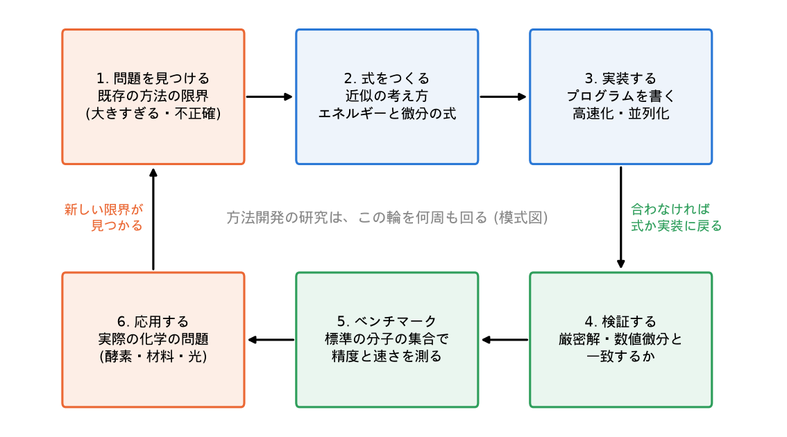

**図 2**　方法開発の研究のサイクル（模式図）。既存の方法の限界から出発し、式をつくり、実装し、厳密な値や数値微分と一致するかを検証し、標準の分子の集合（ベンチマーク）で精度と速さを測り、最後に実際の化学の問題に応用します。応用の中で新しい限界が見つかると、次の周回が始まります。

この分野の論文では、「新しい式」と「それを実装したプログラム」と「ベンチマーク」と「応用例」の 4 つがそろっていることが期待されます。式だけでは、本当に速いのか、本当に正確なのかが分からないからです。

「どこまで正確なら十分か」の目安としてよく使われるのが、**化学的精度**（約 1 kcal/mol）です。

!!! question "「化学的精度（1 kcal/mol）が目標」と言われるのはなぜ？"
    **そもそも化学的精度とは**：計算したエネルギーの差（反応熱、活性化エネルギーなど）の誤差を、約 1 kcal/mol（約 4.2 kJ/mol、約 0.043 eV）以内に抑えることです。

    **なぜ 1 kcal/mol なのか**：化学で知りたいのは、反応の速さや、どちらの構造が多いかです。どちらも、エネルギーの差 ΔE が $\exp(-\Delta E/RT)$ の形で効きます。室温（298 K）では $RT \approx 0.59$ kcal/mol です。したがって、活性化エネルギーを 1 kcal/mol 間違えると、速度定数は $\exp(1/0.59) \approx 5$ 倍ずれます。2 kcal/mol なら約 29 倍です（図 3）。1 kcal/mol 以内なら「どちらの反応が速いか」「どちらの異性体が多いか」の順番をほぼ正しく言える、というのがこの目安の意味です。

    **どう使うか**：新しい方法の論文では、ベンチマーク（6.2 節）の参照値との平均の誤差が 1 kcal/mol を下回るかどうかが、よく比べられます。ただし、1 kcal/mol に届かない方法でも、誤差が系統的なら（いつも同じ向きにずれるなら）、傾向の比較には使えます。

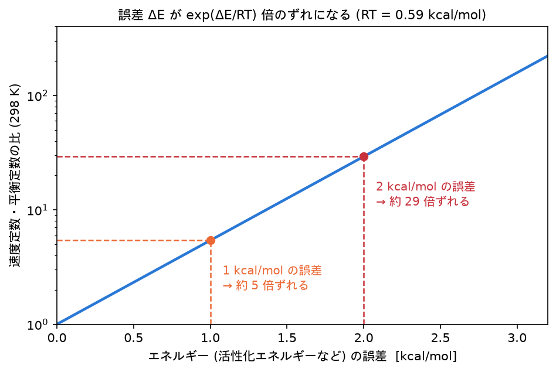

**図 3**　エネルギーの誤差が、298 K での速度定数（や平衡定数）の何倍のずれになるか。$\exp(\Delta E/RT)$ を描いたものです。縦軸は対数です。1 kcal/mol で約 5 倍、2 kcal/mol で約 29 倍になります。

## 2. 波動関数理論の開発

### 2.1 何をする研究か：指数関数の壁を越える

波動関数理論は、電子の波動関数を、電子配置（スレーター行列式）の重ね合わせで表す方法の総称です。HF 法、MP2、結合クラスター法（CCSD、CCSD(T)）、CASSCF、CASPT2 などがこの仲間です。どの方法も、計算時間が系の大きさ N のべき乗で増えます（図 4）。

べき乗の数は、計算の中でいちばん多い「組み合わせの数」から来ています。HF 法では、基底関数 4 個の組でできる電子反発積分 $(pq|rs)$ を使うので、N⁴ で増えます。CCSD(T) の (T) の項では、占有軌道 3 個と仮想軌道 4 個の組み合わせを数えるので、N⁷ で増えます。

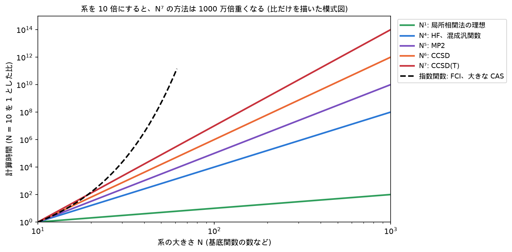

**図 4**　計算時間のスケーリング（比だけを描いた模式図。N = 10 のときを 1 としました）。N は基底関数の数など、系の大きさの目安です。N⁷ で増える CCSD(T) は、系を 10 倍にすると 10⁷ 倍（1000 万倍）重くなります。FCI や大きな活性空間の CAS は指数関数的に増えるので、すぐに手が届かなくなります。

### 2.2 多参照の問題

特に難しいのが、**多参照**（強い静的相関）の問題です。結合が切れかけた分子、遷移金属を何個も含むクラスター、長い π 共役系がその例です。

!!! question "「この系には多参照の方法が必要」と言われるのはなぜ？"
    **そもそも多参照とは**：HF 法や CCSD(T) は、1 つの電子配置（決定子）を「土台（参照）」にして、そこからのずれを足していきます。ところが、エネルギーのほぼ等しい 2 つ以上の配置が、同じくらいの重みで混ざる状態があります。土台が 1 つでは足りないので、こうした状態を「多参照」と呼びます。

    **なぜ必要か**：土台が悪いと、その上に何を足しても直りにくいからです。いちばん簡単な例は、H₂ の結合を切る計算です。RHF 法は、2 個の電子を同じ結合性の軌道に入れた配置 1 個しか使いません。この配置には、「H⁺ と H⁻ に分かれた（イオン的な）形」が、結合を切っても 50% 混ざったまま残ります。そのため、cc-pVDZ 基底の計算では、H–H を 4 Å まで離したときの RHF のエネルギーが、厳密な値（FCI）より約 5.9 eV も高くなります。反結合性の軌道に 2 個入れた配置も混ぜると、この誤りが消えます。詳しい計算と図は、[電子構造論のページ](02-electronic-structure.md)の 2.2 節にあります。

    **どう確かめるか**：自然軌道の占有数（2 と 0 から大きく外れた軌道がないか）、CASSCF の主配置の重み、結合クラスター法の T1・D1 診断などを見ます。これらの読み方も、[電子構造論のページ](02-electronic-structure.md)の 2.2 節で説明しています。

多参照の系では、CASSCF（活性空間の中だけ FCI を解く方法）を使います。**活性空間**は、配置の混ざりが大事な軌道と電子の組で、k 個の電子を k 個の軌道に入れるとき CAS(k,k) と書きます。ところが、活性空間の決定子の数は、活性軌道の数 k に対して指数関数的に増えます（図 5 の赤い線）。

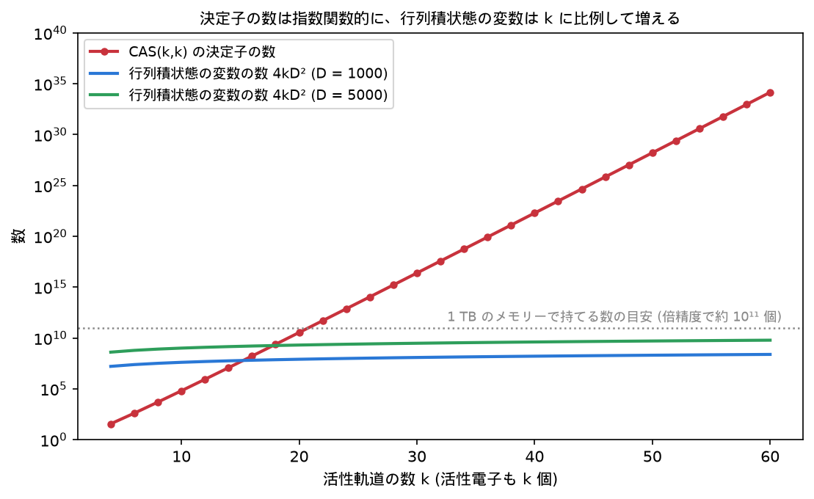

**図 5**　CAS(k,k)（k 個の電子を k 個の軌道に入れる活性空間）の決定子の数（赤）と、行列積状態の変数の数のおおよその目安 4kD²（青と緑）。決定子の数は k が 20 を超えると 1 TB のメモリーに入らなくなります。行列積状態の変数は k に比例してしか増えません。D は 2.3 節で説明する結合次元です。

### 2.3 DMRG：波動関数を行列の積で書く

**密度行列繰り込み群**（DMRG）は、もともと物理学で 1 次元の格子模型のために考えられた方法です [White 1992]。量子化学に使われたのは 1999 年ごろからです [White 1999]。DMRG では、軌道を一列に並べ、各軌道に小さな行列を 1 つずつ置き、それらを掛け合わせて CI の係数をつくります（図 6）。この形の波動関数を**行列積状態**（matrix product state、MPS）と呼びます。

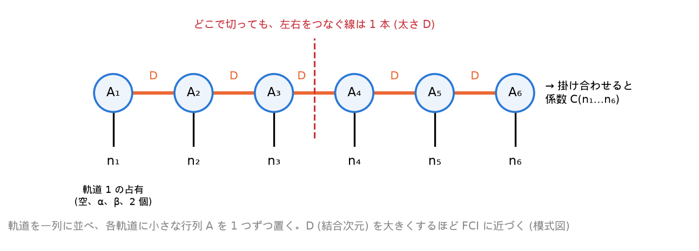

**図 6**　行列積状態の模式図。丸が各軌道の行列 A、下に出た線がその軌道の占有（空、α、β、2 個の 4 通り）、横の太い線が行列どうしのつながりです。つながりの太さ D（結合次元）を大きくすると、表せる波動関数が増え、FCI に近づきます。列のどこで切っても左右をつなぐ線は 1 本なので、必要な D は「その切れ目での左右のもつれ（エンタングルメント）の大きさ」で決まります。

たとえで言うと、行列積状態は「長い文章を、隣どうしの単語のつながりだけで覚える」やり方です。全部の単語の組み合わせを覚える（FCI）代わりに、隣との関係を太さ D の線で覚えます。化学の分子は 1 次元の鎖ではないので、遠い軌道どうしのもつれを表すには大きな D が必要になります。

!!! question "「DMRG では D に対する収束と軌道の並べ方を確かめる必要がある」と言われるのはなぜ？"
    **そもそも D とは**：DMRG は、鎖を切れ目で左右に分けたとき、左右の状態の組のうち重みの大きい D 個だけを残し、残りを捨てる近似です。捨てた状態の重みの合計を**打ち切りの重み**（discarded weight）と呼びます。

    **なぜ必要か**：D が足りないと、エネルギーは厳密な値より高く出ます（DMRG のエネルギーは変分的なので、上から近づきます）。また、強くもつれた 2 つの軌道を鎖の両端に離して置くと、その間のすべての切れ目でもつれを運ぶ必要があり、同じ D でも精度が落ちます。

    **どう確かめるか**：D を何段階か大きくして、エネルギーが落ち着くかを見ます。打ち切りの重みが 0 になる極限へ外挿した値を「最良値」として示すのが一般的です [Chan 2011]。軌道は、もつれの強い軌道どうし（たとえば結合性と反結合性の組）が近くに来るように並べます。

量子化学の DMRG を大きな活性空間の実用的な道具にした研究の 1 つが、Kurashige と Yanai の並列化された DMRG の実装です [Kurashige 2009]。この論文では、Cr₂ の 24 電子 30 軌道の活性空間で、外挿した最良値から 0.6 m$E_\mathrm{h}$ の精度のエネルギーを得ています（左右のブロックの基底を 10,000 個使った場合）。また、[Cu₂O₂]²⁺ の異性化を 32 電子 62 軌道の活性空間で計算し、小さな活性空間の CASSCF ではビラジカル性を過大評価することを示しています。

DMRG だけでは、活性空間の外の電子の動き（**動的相関**）が入りません。

!!! question "「CASSCF や DMRG の上に動的相関を足す必要がある」と言われるのはなぜ？"
    **そもそも動的相関とは**：電子どうしは反発するので、互いに避け合うように動きます。この「避け合い」を波動関数で表すには、たくさんの仮想軌道へ電子を少しずつ励起した配置が要ります。活性空間に入れた少数の軌道だけでは、これを表せません。

    **なぜ必要か**：動的相関のエネルギーは小さくありません。電子が 2 個しかない H₂ でも、平衡距離で、RHF と FCI の差（相関エネルギー）は 0.035 $E_\mathrm{h}$（約 0.94 eV）です（cc-pVDZ 基底の計算）。しかも、その大きさは状態ごと、構造ごとに違います。そのため、活性空間だけの計算では、反応熱や励起エネルギーのような「差」に大きな誤差が残ります。

    **どう足すか**：活性空間の波動関数を土台にして、2 次の摂動論（CASPT2、NEVPT2）や正準変換理論で残りの相関を足します。

そこで、DMRG の上に動的相関を足す方法がいくつもつくられました。

- **DMRG-CT**：正準変換理論（canonical transformation、CT）は、指数関数のユニタリー変換でハミルトニアンを変換し、動的相関を取り込む方法です [Yanai 2006]。DMRG と組み合わせた DMRG-CT では、ポリエンで 24 電子 24 軌道、[Cu₂O₂]²⁺ で 28 電子 32 軌道の活性空間が扱われました [Yanai 2010]。
- **DMRG-CASPT2**：DMRG の波動関数を出発点にした CASPT2 です。Cr₂ への応用で知られています [Kurashige 2011]。

DMRG と多参照摂動論のしくみは、講義ノートの[量子化学の理論 第 14 回](../courses/qc-theory/14-dmrg-sci.md)で詳しく説明しています。DMRG で求めた波動関数を化学の言葉に読み解く方法（占有数、エンタングルメント）と、光化学系 II の Mn₄CaO₅ クラスターやナノグラフェンへの応用は、[電子構造論のページ](02-electronic-structure.md)で紹介しています。

### 2.4 多参照摂動論と、その改良

**CASPT2** [Andersson 1990] と **NEVPT2** [Angeli 2001] は、CASSCF の波動関数の上に 2 次の摂動で動的相関を足す方法です。どちらも多参照の問題の「標準の道具」として広く使われています。

摂動論には、**侵入状態**という落とし穴があります。2 次の摂動のエネルギーは、各配置の寄与を「エネルギーの差」で割った和です。土台のエネルギーとほぼ同じエネルギーの配置が活性空間の外にあると、分母が 0 に近づき、寄与が発散します。CASPT2 では、分母に小さな値を足す**レベルシフト**でこれを避けます [Roos 1995]。シフトの値を変えても結果がほとんど変わらないことを確かめるのが作法です。

方法開発の研究では、次のような改良が行われています。

- **精度を上げる**：CASPT2 は動的相関を 2 次の摂動でしか扱わないので、精度が足りない場合があります。Saitow と Yanai は、外側の軌道への励起を、より高次の結合電子対近似（CEPA）で扱い、残りを CASPT2 で扱う混成の理論（CEPT2）を提案しました [Saitow 2020]。
- **実装の正しさを確かめる**：Yanai らは、CASPT2 を独立に実装した 2 つのプログラムと、広く使われていた Molcas の元のプログラムを比べ、元のプログラムでは 1 次の方程式の射影が左右で一部食い違っていたことを見つけました [Yanai 2017]。多くの場合、誤差は化学的精度に比べて無視できますが、化学的な結論が変わりうる難しい例もあり、修正が Molcas に取り込まれました。同じ方法を独立に実装して比べることの大切さを示す例です（6 節）。

### 2.5 局所相関：遠くの電子のペアは手を抜く

大きな分子では、遠く離れた電子どうしの相関は小さくなります。この性質を使って計算を軽くするのが、**局所相関**の方法です。まず、分子全体に広がった正準軌道を、結合ごとに局在した軌道に変換します（図 7）。

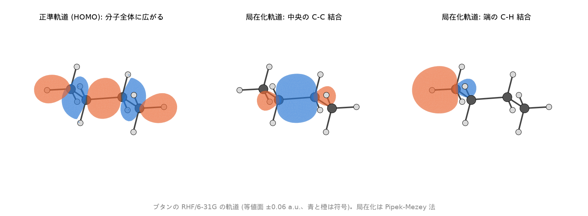

**図 7**　ブタンの軌道の 3D 図（PySCF [Sun 2020] で RHF/6-31G の計算をし、等値面を描きました）。左：正準軌道（HOMO）は分子全体に広がっています。中と右：Pipek–Mezey 法で局在化した軌道は、中央の C–C 結合や端の C–H 結合の 1 か所に集まっています。局在化軌道を使うと、「どの電子のペアが近いか」がはっきりします。

次に、局在化軌道のペアごとに、そのペアの相関を表すのに大事な仮想軌道だけを選びます。この、ペアごとに最適化した仮想軌道を**ペア自然軌道**（pair natural orbital、PNO）と呼びます。PNO を使った局所 CCSD（LPNO-CCSD）では、大きな分子で、正準な CCSD に比べて決める振幅の数が 10⁵〜10⁶ 分の 1 に減ります。これをさらに改良して、ほぼ線形のスケーリングにしたのが DLPNO-CCSD です [Riplinger 2013]。ORCA の DLPNO-CCSD(T) の基礎です（講義ノートの[量子化学の理論 第 11 回](../courses/qc-theory/11-dlpno-ccsd-t.md)）。

!!! question "「局所相関の方法では、しきい値への依存を確かめる必要がある」と言われるのはなぜ？"
    **そもそもしきい値とは**：局所相関の方法は、「この PNO は占有数が小さいので捨てる」「このペアは遠いので粗く扱う」という判断を、数値のしきい値で決めます。しきい値を緩くすると速くなり、厳しくすると正準な（近似のない）計算に近づきます。

    **なぜ必要か**：捨てた分だけ、相関エネルギーが取りこぼされます。比べる 2 つの構造で取りこぼしの量が違うと、反応熱などの差に誤差が残ります。

    **どう確かめるか**：しきい値を何段階か厳しくして、知りたいエネルギーの差が落ち着くかを見ます。ORCA の NormalPNO と TightPNO のように、プログラムにはしきい値の組が用意されていることが多いです。新しい局所相関の方法の論文では、しきい値を厳しくすると正準な結果に近づくことを必ず示します。

多参照の方法にも PNO が使われています。Yanai らのグループは、正規直交な局在化仮想軌道（LVMO）を土台にした PNO の多参照摂動論を、次のように順に開発しました。

1. **PNO-CASPT2**：LVMO の領域（ドメイン）の大きさを、軌道の微分重なり積分で決めることで小さくできることを示し、大きな系に応用しました [Saitow 2022]。
2. **PNO-NEVPT2**：200 原子以上のコバラミンの誘導体で、正準な NEVPT2 の相関エネルギーの 99.85% 以上を回収できることを確かめました [Uemura 2023]。
3. **PNO-QD-NEVPT2**：円錐交差のように複数の状態が近い場合に使う準縮退の版です [Hayashi 2024]。

この流れは、図 2 のサイクルを何周も回る研究の典型です。1 周目で土台（LVMO の PNO）をつくり、2 周目以降でその土台の上に別の理論を載せていきます。

### 2.6 新しい波動関数の形

決定子の重ね合わせ以外の形で波動関数を表す研究もあります。

- **transcorrelated 法**：波動関数に電子間の距離を含むジャストロー因子を掛け、その因子でハミルトニアンを相似変換します。考え方は 1969 年の Boys と Handy にさかのぼります [Boys 1969]。なぜこれが効くかというと、2 つの電子が近づいたときの波動関数の「とがり」（カスプ）を、決定子の重ね合わせで表すには非常に多くの基底関数が要るのに対し、電子間の距離を含む因子なら直接表せるからです。変換したハミルトニアンはエルミートでなくなり、3 体の相互作用を含みますが、小さな基底関数でも基底関数の極限に近いエネルギーが得られます。第 2 周期の原子で、基底関数の極限から 1 m$E_\mathrm{h}$ 以内の精度が報告されています [Cohen 2019]。
- **ニューラルネットワークの波動関数**：CI の係数や波動関数そのものをニューラルネットワークで表す研究もあります [Yang 2020]。この流れは、[機械学習のページ](07-machine-learning.md)で紹介しています。

### 2.7 束縛されていない状態を扱う：共鳴状態と複素吸収ポテンシャル

量子化学のふつうの方法は、電子が分子に束縛された状態を求めるためのものです。ところが、中性の分子に電子が 1 個付いた陰イオンの中には、エネルギーが「中性の分子 + 自由な電子」より高く、しばらくすると電子が逃げてしまうものがあります。このような、自由な電子の状態（連続状態）の中に埋もれた準安定な状態を**共鳴状態**と呼びます [Phung 2020]。共鳴状態は、エネルギーの位置 $E_\mathrm{r}$ と幅 $\Gamma$ で特徴づけられます。幅は寿命 $\tau$ と $\tau = \hbar/\Gamma$ の関係にあり、幅が広いほど電子は早く逃げます（図 8a）。

ふつうの方法で共鳴状態を計算しようとすると、電子が遠くへ逃げた連続状態に落ち込んでしまいます。基底関数を増やすほど、遠くへ広がった関数で「電子が逃げた状態」を表せるようになり、エネルギーがそちらへ下がっていくからです。そこで使われるのが**複素吸収ポテンシャル**（complex absorbing potential、CAP）です。分子から離れた所でだけ値を持つ関数 $W$（分子の近くでは 0）に虚数をかけてハミルトニアンに足し、

$$
\hat{H}(\eta) = \hat{H} - i\eta W
$$

とします。$\eta$ は吸収の強さです。遠くへ逃げていく電子の波は、この虚数のポテンシャルに吸い込まれて消えます。こうすると、散乱の問題が、束縛状態と同じ二乗可積分の問題に変わり、束縛状態のための標準の方法で共鳴状態を扱えるようになります [Sommerfeld 2015]。固有値は複素数 $E = E_\mathrm{r} - i\Gamma/2$ になり、実部から位置が、虚部から幅（寿命）が分かります。

ただし、$\eta$ は人が決める量で、有限の基底関数では答えが $\eta$ に依存します。そこで、$\eta$ を少しずつ変えて固有値の動き（$\eta$ 軌跡）を描き、固有値が最も動かない点を選ぶのが標準のやり方です [Riss 1993]。

$W$ の形も工夫の対象です。電子構造の計算では、ガウス基底で積分が簡単に求まる箱型の CAP がほとんど使われてきました。ところが箱型の CAP は、分子全体を囲む最小の箱の外側から始まります。そのため、大きな分子やクラスターでは、分子から離れているのに CAP がなく、基底関数でも十分に表せない「死んだ空間」が箱の中に残ります（図 8b）。Sommerfeld と Ehara は、各原子の Voronoi 胞（その原子が最も近くにある点の集まり）ごとに定義する Voronoi 型の CAP と、胞の境目をなめらかにした版を提案しました [Sommerfeld 2015]。等値面は分子の形に沿った面になり、分子と同じ対称性を持ちます（図 8c）。その代わり、積分は数値的に求める必要があります。

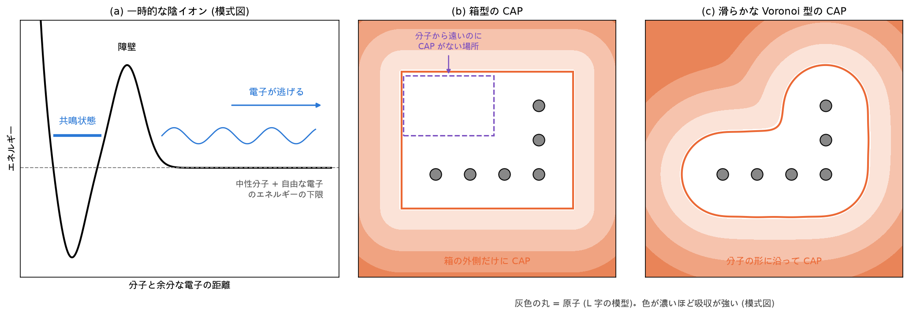

**図 8**　(a) 一時的な陰イオンの共鳴状態のイメージ（模式図）。余分な電子は障壁の内側に一時的にとらえられますが、やがて外へ逃げます。(b) 箱型の CAP。L 字の模型では、箱の中に、原子から遠いのに吸収のない場所（紫の破線）が残ります。(c) なめらかな Voronoi 型の CAP。吸収の始まる面（橙の線）が原子の並びに沿います。[Sommerfeld 2015] の要旨の説明から作図しました。

Phung、Komori、Yanai、Sommerfeld、Ehara は、なめらかな Voronoi 型の CAP を XMS-CASPT2（複数の状態を同時に扱う CASPT2 の一種）と組み合わせました [Phung 2020]。共鳴状態の計算の難しさは、電子が束縛されている面と、連続状態へ逃げていく面を、釣り合いよく表すことにあります。CAP/XMS-CASPT2 では、活性空間の選び方でこの釣り合いをとります。計算量を減らすため、射影型の方式で実装しています。ホルムアルデヒド、クロロエテン、N₂⁻ の共鳴状態で、活性空間の大きさに対する収束を系統的に調べ、結果は CAP/SAC-CI と約 0.15 eV の差で一致しました。結合が切れかけた領域では CAP/XMS-CASPT2 の方がはっきり有利でした。

同じ道具は、多価の陰イオンにも使われています。Davis らは、自ら電子を放出して壊れる Be₃²⁻ と Mg₃²⁻ の共鳴状態を、CAP や解析接続の方法と、さまざまな相関の方法を組み合わせて調べ、幅が 1〜1.5 eV と広く、寿命がフェムト秒の程度であることを示しました [Davis 2021]（$\tau = \hbar/\Gamma$ に $\hbar \approx 0.658$ eV·fs を入れると、約 0.4〜0.7 fs です）。

### 2.8 この界隈の常識

- **新しい方法は、まず小さな分子で FCI や正準な計算と比べる。** 厳密な答えが分かっている所でしか、誤差がどの近似から来たのかを切り分けられないからです。
- **「スケーリング」は、系を大きくしたときの計算時間の増え方のこと。** N⁵、N⁷ のように書きます。計算時間が分子の大きさで決まる以上、方法を大きな分子に使えるかどうかは、このべき乗でほぼ決まります。局所相関の方法は「線形スケーリングに近い」ことを目標にします。
- **多参照の方法では、活性空間の選び方で結果が変わる。** 活性空間に入れた軌道の間の相関だけが厳密に扱われ、残りは近似されるからです。DMRG は活性空間を大きくできますが、その分、軌道の選び方と並べ方が問題になります（2.3 節）。
- **局所相関の方法では、しきい値を厳しくすると正準な結果に近づくことを示す。** 手を抜いた分の誤差がどれだけかを、読者が判断できるようにするためです（2.5 節）。
- **束縛されていない状態（共鳴状態）は、ふつうの方法では表せない。** 基底関数を増やすほど「電子が逃げた状態」に落ち込むからで、CAP のような工夫で境界条件を変えて扱います（2.7 節）。
- **式が長く複雑な方法では、式の導出とプログラムの生成をコンピューターで自動化することが多い** [Saitow 2020; Hayashi 2025]。多参照の結合クラスター法や解析的微分では、項の数が数百から数千になり、手で書くと写し間違いが避けられないからです。

## 3. 密度汎関数の開発

### 3.1 何をする研究か：交換相関汎関数をよくする

密度汎関数理論（DFT）では、電子のエネルギーのうち、交換と相関の部分を、電子密度の関数（汎関数）で近似します。この**交換相関汎関数**の厳密な形は分かっていません。そこで、形を工夫して精度を上げるのが汎関数の開発です。汎関数は、使う材料によって「階段」のように分類されます [Perdew 2001]（図 9）。

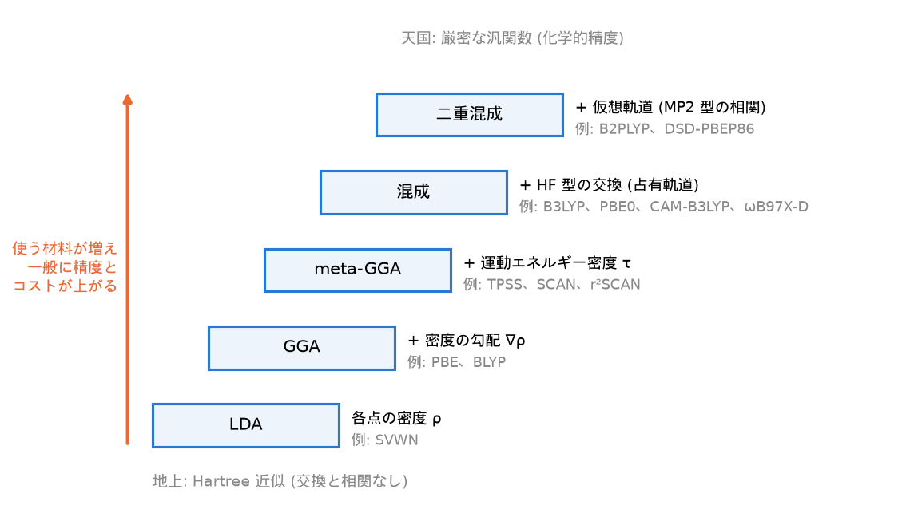

**図 9**　汎関数の階段（ヤコブのはしご）。下の段から順に、各点の密度だけを使う LDA、密度の勾配も使う GGA、運動エネルギー密度も使う meta-GGA、HF 型の交換を混ぜる混成汎関数、仮想軌道を使った MP2 型の相関も入れる二重混成汎関数です。上の段ほど一般に精度が上がり、計算コストも増えます。

汎関数の開発には、大きく 2 つの流儀があります。

- **非経験的**：厳密な汎関数が満たすべき条件（極限での振る舞いなど）を満たすように形を決める（PBE、SCAN など）。
- **経験的**：たくさんの参照データ（ベンチマークの集合）に合うように、パラメーターを最適化する（B3LYP の 3 つの係数、ωB97 系列、M06 系列など）。

Mardirossian と Head-Gordon は、約 5000 個のデータ点を含むデータベースで 200 種類の汎関数を比べ、ωB97M-V を最も有望な汎関数として挙げています [Mardirossian 2017]。主族元素の熱化学と反応のためのベンチマーク集合 GMTKN55 も広く使われています [Goerigk 2017]。汎関数の使い分けは、講義ノートの[量子化学の理論 第 16 回](../courses/qc-theory/16-functionals.md)で説明しています。

近似の汎関数に共通する、いちばん根の深い誤りが**自己相互作用誤差**です。

!!! question "「DFT には自己相互作用誤差がある」と言われるのは、どういうこと？"
    **そもそも自己相互作用とは**：DFT のエネルギーには、電子密度どうしのクーロン反発（ハートリー項）が入っています。これは「密度全体が密度全体と反発する」量なので、電子が自分自身と反発する分も含んでいます。厳密な理論では、この余分な反発を、交換のエネルギーがちょうど打ち消します。HF 法でも、同じ軌道どうしのクーロン積分と交換積分が等しいので、きれいに打ち消し合います。ところが、近似の汎関数ではこの打ち消しが不完全で、電子が自分自身と少し反発したまま残ります [Perdew 1981]。

    **なぜ問題か**：自分と反発する電子は、広がった方がエネルギーが下がります。そのため、近似の汎関数は電子を広げすぎる傾向（非局在化誤差）を持ちます。その結果、反応の障壁の高さ、電荷移動のエネルギー、固体のバンドギャップなどが系統的に小さく出ます [Cohen 2008]。

    **どう対処するか**：HF 型の交換を混ぜる（混成汎関数）、特に遠距離で多く混ぜる（長距離補正、3.2 節）のが代表的な対策です。DFT の誤差の分類は、講義ノートの[量子化学の理論 第 18 回](../courses/qc-theory/18-dft-errors.md)で説明しています。

### 3.2 代表的な研究例：長距離補正と CAM-B3LYP

GGA の交換汎関数は、電子どうしが遠く離れたときの相互作用（長距離の交換）を正しく表せません。そのため、電荷移動励起のエネルギーを大きく過小評価するなどの問題が起きます。これを直すのが**長距離補正**（long-range correction、LC）です。

!!! question "「電荷移動励起には長距離補正の汎関数が必要」と言われるのはなぜ？"
    **そもそも電荷移動励起とは**：分子の一方の部分（ドナー D）から、離れた別の部分（アクセプター A）へ、光で電子が 1 個移る励起です。

    **正しいエネルギーはどうなるか**：D から電子を 1 個取るのに、イオン化エネルギー IP が要ります。A に電子を 1 個付けると、電子親和力 EA だけ得をします。最後に、できた D⁺ と A⁻ が距離 R で引き合うので、クーロン引力 1/R（原子単位）だけ下がります。したがって、R が大きいとき、

    $$
    \omega_\mathrm{CT}(R) \approx \mathrm{IP}(\mathrm{D}) - \mathrm{EA}(\mathrm{A}) - \frac{1}{R}
    $$

    となるはずです（図 10 の青）。

    **なぜ GGA では駄目か**：GGA や、HF 交換の割合が小さい混成汎関数の TDDFT では、D と A の軌道が重ならないと、電子と正孔の間の引力を表す項が消えてしまいます。そのため励起エネルギーは、ほぼ軌道エネルギーの差 $\varepsilon_\mathrm{LUMO}(\mathrm{A}) - \varepsilon_\mathrm{HOMO}(\mathrm{D})$ になり、−1/R の距離依存性が出ません。しかも、自己相互作用誤差のために軌道エネルギーの差が小さすぎるので、励起エネルギーは大きく過小評価されます（図 10 の橙）[Dreuw 2003]。遠距離で HF 型の交換を使う長距離補正の汎関数では、電子と正孔の引力が戻り、−1/R の振る舞いが再現されます [Tawada 2004]。

    **どう確かめるか**：励起の性格（HOMO と LUMO が空間的に離れているか）を見て、電荷移動型なら、長距離補正の汎関数でも計算して比べます。

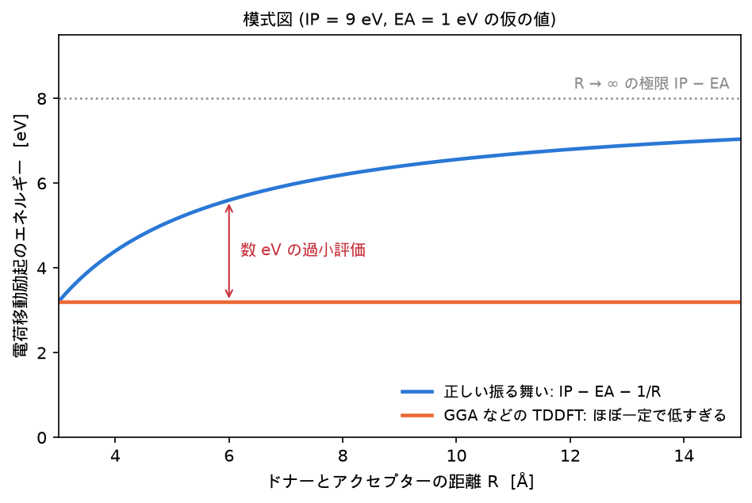

**図 10**　電荷移動励起のエネルギーの、ドナーとアクセプターの距離への依存性（模式図。IP = 9 eV、EA = 1 eV の仮の値で描きました）。正しい振る舞い（青）は −1/R で極限に近づきます。GGA などの TDDFT（橙）は距離によらずほぼ一定で、大きく低すぎます。

Iikura、Tsuneda、Yanai、Hirao は、電子間のクーロン相互作用 1/r₁₂ を誤差関数で「近距離の部分」と「遠距離の部分」に分け、近距離は GGA の交換、遠距離は HF の交換で扱う方法を提案しました [Iikura 2001]。この方法を時間依存 DFT に使うと、リュードベリ励起のエネルギーが誤差 0.5 eV 以内になり、電荷移動励起のエネルギーの距離依存性も正しく再現できることが示されました [Tawada 2004]。

Yanai、Tew、Handy は、この考え方と B3LYP を組み合わせた **CAM-B3LYP** を提案しました [Yanai 2004]。CAM-B3LYP では、HF 型の交換の割合が、近距離で 19%、遠距離で 65% になるように、誤差関数（パラメーター 0.33）で滑らかにつなぎます（図 11）。原子化エネルギーは B3LYP と同程度の精度を保ちつつ、B3LYP が大きく過小評価するジペプチドの模型の電荷移動励起をよく再現すると報告されています。

**図 11**　HF 型の交換の割合を、電子間の距離 r₁₂ の関数として描いたもの。B3LYP（灰）はどの距離でも 20% です。長距離補正型（青、μ = 0.33 の例）は近くで 0、遠くで 100%、CAM-B3LYP（橙）は近くで 19%、遠くで 65% です。遠くの電子間で HF 型の交換を多く使うことで、電荷移動励起のように電子が遠くへ移る現象を正しく扱えるようになります。

### 3.3 分散力の補正

!!! question "「DFT には分散力の補正が必要」と言われるのはなぜ？"
    **そもそも分散力とは**：電荷を持たない閉殻の分子どうしにも、弱い引力がはたらきます。一方の分子の電子がゆらいで瞬間的に双極子ができると、もう一方の分子の電子もそれにつられて分極し、両者が引き合うからです。これをロンドンの分散力と呼びます。遠くでは、距離 R の 6 乗に反比例する $-C_6/R^6$ の形になります。

    **なぜ補正が必要か**：GGA などの汎関数は、空間の各点の密度とその勾配だけから、その点のエネルギーを決めます。2 つの分子の密度が重ならないほど離れると、「離れた 2 か所の電子のゆらぎが連動する」効果を表す材料がなくなり、引力が出てきません。そのため、分散力が主役の相互作用（π 積層、アルキル鎖どうしの接触、分子性結晶など）では、引力の谷が浅すぎるか、まったく出ません（図 12 の橙）。

    **どう補うか**：原子の組ごとに $-C_6/R^6$ の形の引力を足し、近距離では減衰関数で弱める経験的な補正（D3 など）が広く使われています [Grimme 2010]。「B3LYP-D3」のように、汎関数の名前の後ろに付けて書きます。分散力のしくみと補正の種類は、講義ノートの[量子化学の理論 第 17 回](../courses/qc-theory/17-dispersion.md)で詳しく説明しています。

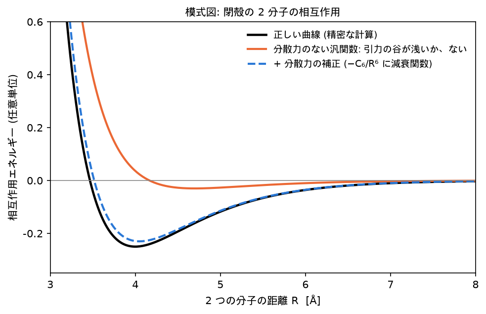

**図 12**　閉殻の 2 分子の相互作用エネルギー（模式図）。分散力を表せない汎関数（橙）では、引力の谷が浅いか、ありません。原子の組ごとの $-C_6/R^6$ の補正を足すと（青の破線）、精密な計算（黒）に近づきます。

### 3.4 この界隈の常識

- **「B3LYP/6-31G\*」のように、汎関数と基底関数の組で計算条件を書く。分散力の補正（D3 など）を付けたかどうかも明記する。** 同じ汎関数でも、補正の有無で分子間の相互作用や構造が大きく変わるからです（3.3 節）。
- **汎関数の名前の ω や LC は、長距離補正（範囲分離）を意味することが多い。** CAM は Coulomb-attenuating method の略です。電荷移動励起を扱うかどうかで、選ぶべき汎関数が変わるので、名前から性格を読めると便利です（3.2 節）。
- **新しい汎関数の論文では、学習に使っていないデータ（テスト集合）で精度を示すことが求められる。** パラメーターの多い汎関数は、学習データにだけ合わせ込む（過学習する）ことができてしまうからです。データの分け方の考え方は、[機械学習のページ](07-machine-learning.md)にもあります。
- **汎関数の開発には、強い静的相関（多参照）と自己相互作用誤差という、まだ解決していない難題が残っている** [Mardirossian 2017]。どちらも、今の汎関数の形（1 つの決定子の密度から出発する）に根があるからです。

## 4. 解析的微分

### 4.1 何をする研究か：エネルギーの坂の向きを式で求める

分子の構造を最適化する、反応の経路をたどる、分子動力学で原子を動かす。どれも、エネルギーを原子の座標で微分した**勾配**（力）が必要です。勾配は、坂の向きと急さを表します（図 13）。

**図 13**　左：谷が 2 つあるポテンシャル面の 3D 図。中：同じ面の等高線と、勾配の逆向きにたどって谷底（安定構造）に下りる経路。右：1 回の勾配に必要なエネルギー計算の回数の目安（模式図）。数値微分では、原子ごとに 3 方向へ前後にずらすので 6N 回のエネルギー計算が要ります。解析的微分では、エネルギー計算の数回分の手間で全部の成分が一度に求まります。

勾配を、エネルギーの式を微分した式から直接求めるのが**解析的微分**です。ハートリー–フォック法の解析的勾配は、Pulay が 1969 年に導きました [Pulay 1969]。解析的微分の式は、エネルギーの式よりはるかに複雑になります。特に、軌道や係数が別の方程式（SCF、局在化、DMRG の最適化など）で決まる方法では、その方程式の「応答」を表す追加の方程式を解く必要があります。

!!! question "「解析的勾配には Z ベクトル方程式（ラグランジアン）が必要」と言われるのはなぜ？"
    **そもそも何が難しいのか**：エネルギー E は、原子の座標 x に直接よるだけでなく、軌道の係数 C を通しても x による、と考えます。$E = E(x, C(x))$ です。微分の連鎖律から、

    $$
    \frac{dE}{dx} = \frac{\partial E}{\partial x} + \frac{\partial E}{\partial C}\,\frac{dC}{dx}
    $$

    となります。第 2 項の $dC/dx$（座標を動かしたとき軌道がどう変わるか）を求めるには、座標ごとに 1 本ずつ連立 1 次方程式（結合摂動方程式）を解く必要があります。原子が N 個なら 3N 本です。

    **変分的な方法なら楽な理由**：HF 法や CASSCF のように、エネルギーを C について最小にして C を決める方法（変分的な方法）では、$\partial E/\partial C = 0$ です。第 2 項が消えるので、$dC/dx$ は要りません。

    **変分的でない方法では**：MP2、CASPT2、結合クラスター法などでは、C は HF などの別の条件で決まっていて、エネルギーはその C について停留していません。そこで、C を決める条件（停留条件）に未定乗数 z を掛けてエネルギーに足した**ラグランジアン**をつくり、z を「ラグランジアンが C について停留する」ように決めます。こうすると、3N 本の方程式の代わりに、座標によらない z の方程式を 1 本だけ解けばよくなります [Handy 1984]。この z の方程式が **Z ベクトル方程式**です。

### 4.2 代表的な研究例

- **SA-DMRG-CASSCF の解析的勾配**：Iino、Shiozaki、Yanai は、複数の状態を平均した DMRG-CASSCF の勾配を求めるための結合摂動方程式を新しく導き、そのアルゴリズムを示しました [Iino 2023]。計算量は全体として元の DMRG-CASSCF と同程度で、数値微分の勾配との比較で誤差が十分小さいことを確かめています。
- **PNO-MP2 の解析的勾配**：Hayashi、Saitow、Yanai は、2.5 節の LVMO を使った PNO-MP2 の解析的勾配を開発しました [Hayashi 2025]。LVMO を作る条件をラグランジアンに入れるため、追加の Z ベクトル方程式（CP-VL 方程式）を解きます。一方、LVMO が正規直交であるため、PNO の係数の微分が消え、式が簡単になります。ドセタキセルやホスト–ゲスト錯体で、計算の規模を大きくしても効率よく動くことを示しています。
- **スピン軌道結合の微分**：PyGraSO は、時間依存 DFT の枠組みで、スピン軌道結合の行列要素とその原子核の座標による解析的微分を計算するオープンソースのプログラムです [Hagai 2025]。それまでは数値微分でしか得られなかった量で、ベンチマークでは数値微分より最大 36 倍速くなりました。しくみと、項間交差の速度の予測への使い方は、[励起状態と光化学のページ](04-excited-states.md)の PyGraSO の節で紹介しています。

新しい解析的勾配の論文では、必ず数値微分と比べます。

!!! question "「新しい解析的勾配は数値微分と比べて検証する必要がある」と言われるのはなぜ？"
    **そもそも数値微分とは**：座標を ±h だけずらした 2 点でエネルギーを計算し、$[E(x+h) - E(x-h)]/2h$ で勾配を近似する方法です（中心差分）。式の導出もプログラムも単純なので、間違いが入りにくい「独立な答え」になります。

    **なぜ必要か**：解析的勾配の式は長く、項が 1 つ抜けたり符号を間違えたりしても、エネルギーは正しいまま勾配だけが少しずれます。構造最適化は一応収束してしまうので、ずれに気づきにくいのです。

    **どう比べるか**：刻み幅 h の選び方が大事です。h が大きいと、中心差分の打ち切り誤差（h² に比例）が大きくなります。h が小さすぎると、エネルギーに含まれる SCF の収束の誤差が 2h で割られて大きくなります（図 14）。そのため、エネルギーを十分に厳しく収束させ、ほどよい h（10⁻³〜10⁻² bohr 程度）で比べ、何桁まで一致するかを示します。

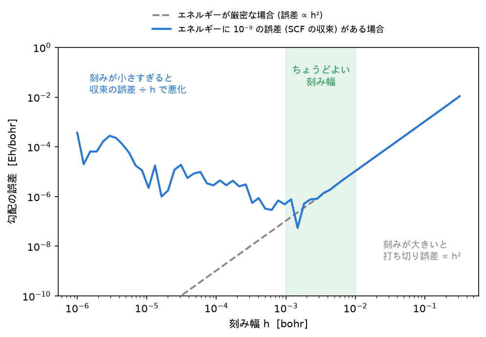

**図 14**　中心差分で求めた勾配の誤差と刻み幅 h の関係（Morse ポテンシャルで計算した例）。灰の破線はエネルギーが厳密な場合で、誤差は h² に比例して減ります。青はエネルギーに 10⁻⁹ $E_\mathrm{h}$ 程度のでたらめな誤差（SCF の収束の誤差のつもり）を加えた場合で、h を小さくしすぎると誤差がかえって大きくなります。

### 4.3 何に使えるか

解析的微分ができると、次のことができるようになります。

- **構造最適化と振動数**：大きな分子でも、高い精度の方法で安定構造と遷移状態を求められる。
- **非断熱結合と円錐交差**：複数の電子状態の間の結合（非断熱結合）も、波動関数の微分から求める。光化学反応の経路を探すのに使う（講義ノートの[量子化学の理論 第 22 回](../courses/qc-theory/22-conical-intersections.md)）。
- **励起状態のダイナミクス**：原子を動かしながら電子状態を計算するシミュレーションには、各ステップで勾配が必要になる。
- **分光学的な性質**：双極子モーメントや分極率などの応答の性質も、エネルギーを電場などで微分した量として求まる。

### 4.4 この界隈の常識

- **新しい解析的勾配は、数値微分（有限差分）の勾配と比べて、何桁まで一致するかを示す。** 式や実装の誤りを見つける、最も確実な方法だからです（4.2 節の箱）。
- **「エネルギーは計算できるが、勾配はまだない」方法は、応用の範囲が限られる。** 構造最適化やダイナミクスでは、1 回の計算で数十〜数千回の勾配が要ります。数値微分では 1 回の勾配に 6N 回のエネルギー計算がかかるので、大きな分子では現実的でなくなります。
- **変分的でない方法（MP2、CASPT2、結合クラスター法など）の勾配では、ラグランジアンの方法で式を組み立てるのが標準。** 座標ごとに方程式を解く代わりに、Z ベクトル方程式 1 本で済むからです（4.1 節の箱）。

## 5. 環境を取り込む方法：相対論、溶媒、周期系、分子の間の相互作用

### 5.1 何をする研究か

実際の分子は、真空の中に 1 つだけあるわけではありません。溶媒の中にあったり、結晶の中にあったり、タンパク質の中にあったりします。また、重い元素では内側の電子が光速に近い速さで動くので、相対論の効果が無視できません。こうした「分子の外側の条件」を計算に取り込む方法をつくるのも、計算理論の大事な仕事です（図 15）。

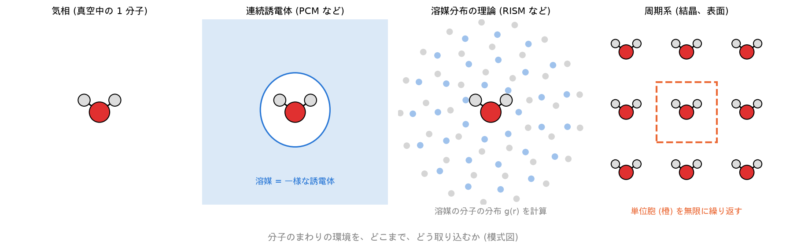

**図 15**　分子のまわりの環境の取り込み方（模式図）。左から、真空中の 1 分子、溶媒を一様な誘電体で表す連続誘電体模型（PCM など）、溶媒の分子の分布を統計力学で求める方法（RISM など）、単位胞を無限に繰り返す周期系です。

### 5.2 相対論

!!! question "「重い元素では相対論の効果を入れる必要がある」と言われるのはなぜ？"
    **そもそも相対論の効果とは**：物体の速さ v が光速 c に近づくと、質量が実質的に $\gamma = 1/\sqrt{1 - v^2/c^2}$ 倍に増えるように振る舞います。ふつうのシュレーディンガー方程式は、この効果を含みません。

    **なぜ重い元素で効くか**：原子単位では光速は c ≈ 137 です。原子番号 Z の水素型原子の 1s 電子の速さは、おおよそ v ≈ Z（原子単位）なので、v/c ≈ Z/137 になります。炭素（Z = 6）では 0.04 ですが、金（Z = 79）では約 0.58 です（図 16）。軌道の半径は質量に反比例するので、1s 軌道は 1/γ 倍に縮みます。金では約 18% です。内側の s 軌道が縮むと、外側の軌道の形やエネルギーも変わり、結合の長さや反応性に効いてきます。さらに、スピン軌道結合（電子のスピンと軌道運動の相互作用）も相対論から出てくる効果で、重い元素ほど大きくなります。

    **どう入れるか**：多くの場合、内殻の電子を有効内殻ポテンシャル（ECP）で置き換え、その中に相対論の効果を含めます。ふつうの ECP が含むのは、相対論の効果のうちスピンによらない部分（軌道の縮みなど）です。スピン軌道結合そのものが主役の現象（重原子を含む分子の項間交差など）では、スピン軌道結合を摂動として足すか、スピンを含む 2 成分や 4 成分の波動関数を使う方法が必要になります。

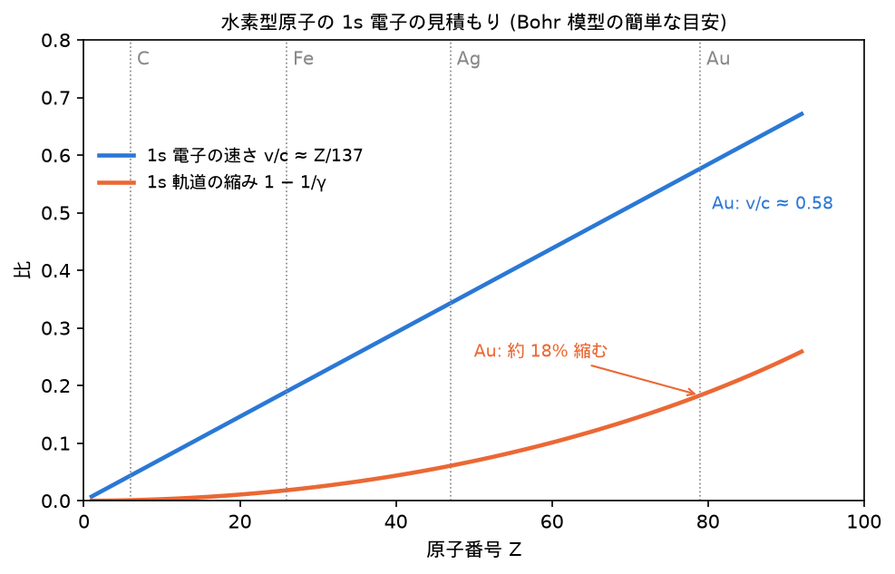

**図 16**　水素型原子の 1s 電子の速さ v/c ≈ Z/137（青）と、それから見積もった 1s 軌道の縮みの割合 1 − 1/γ（橙）。Bohr 模型による簡単な目安です。

重い元素を最も厳密に扱うのは、ディラック方程式に基づく 4 成分の方法です。Reynolds、Yanai、Shiozaki は、密度フィッティングと 2 次の軌道更新を使って、相対論の CASSCF を安定に収束させるアルゴリズムを報告しました [Reynolds 2018]。Cruz らは、4 成分の MP2 のエネルギーをモンテカルロ積分で確率的に求め、計算コストが電子の数の 3 乗、あるいは 2 乗程度でしか増えないことを示しました（従来の決定論的な方法は 5 乗）[Cruz 2022]。

### 5.3 溶媒、周期系、分子の間の相互作用

この節の 3 つの話題は、それぞれ別のページに本拠地があります。ここでは、方法開発の例として短く紹介します。

- **溶媒**：溶媒を一様な誘電体で表す PCM や、溶媒分子の分布を統計力学で求める RISM を、多参照摂動論と組み合わせる方法も開発されています [Saitow 2021]。溶媒和モデルのしくみと使い分けは、[生体分子と溶液のページ](08-biomolecules-solution.md)で説明しています。
- **周期系**：固体の計算でよく使われる PAW 法（projector augmented wave）[Blöchl 1994] を、分子の計算で一般的なガウス型基底関数の DFT に組み込む方法が開発されています [Xiong 2017]。PAW 法のしくみと、この研究の詳しい紹介は、[固体と表面のページ](09-solids-surfaces.md)にあります。
- **分子の間の相互作用を分けて計算する**：色素がたくさん並んだ系では、励起エネルギーが色素から色素へ移ります。Fujimoto は、各色素の遷移密度の間の相互作用から励起エネルギー移動の結合を計算する遷移密度フラグメント相互作用（TDFI）法を、交換相互作用と電荷移動状態を通した寄与まで含むように拡張しました [Fujimoto 2012]。大きな系を部分（フラグメント）に分け、部分どうしの相互作用を精度よく求めるという、方法開発の 1 つの型です。TDFI 法のしくみと応用は、[励起状態と光化学のページ](04-excited-states.md)の励起エネルギー移動の節で紹介しています。

### 5.4 この界隈の常識

- **溶媒の模型には、一様な誘電体（PCM、COSMO、SMD など）、分子の分布を求める方法（RISM）、溶媒分子をあらわに置く方法（QM/MM と分子動力学）がある。** 誘電体の模型は溶媒を平均化するので、特定の溶媒分子との水素結合のような「向きのある」相互作用は表せません。それが大事な系では、溶媒分子をあらわに置きます。
- **相対論の効果は、ECP で取り込むのが手軽。スピン軌道結合が主役の現象では、2 成分や 4 成分の方法を使う。** ふつうの ECP が含むのは相対論の効果のうちスピンによらない部分で、スピンの向きが変わる過程を起こすスピン軌道結合は、別に入れる必要があるからです（5.2 節の箱）。
- **分子の方法（ガウス基底）と固体の方法（平面波）は、文化が違う。** ガウス基底は原子のまわりに局在した分子に、平面波は周期的に繰り返す結晶に向いているからです。両方の良さを組み合わせる研究が続いています。

## 6. プログラム開発の文化

### 6.1 何をする研究か：方法をみんなが使える道具にする

新しい方法は、プログラムとして公開され、ほかの研究者が使えるようになって初めて広まります。量子化学には、性格の違うプログラムがいくつもあります（表）。

| プログラム | 特徴 |
|---|---|
| PySCF | Python で書かれたオープンソースのプログラム。新しい方法を試作する研究者に広く使われている [Sun 2020] |
| ORCA | 学術利用は無料。DLPNO 法や多参照の方法が充実している [Neese 2022] |
| OpenMolcas | オープンソース。CASSCF、CASPT2 などの多参照の方法の伝統がある [Fdez. Galván 2019; Aquilante 2020] |
| BAGEL | オープンソース。相対論の方法、多参照の方法と解析的微分に強い [Shiozaki 2018] |
| Molpro | 商用。高精度の波動関数理論（結合クラスター法、MRCI、局所相関法）で知られる [Werner 2020] |
| block2 | オープンソースの DMRG のプログラム [Zhai 2023] |

最近は、プログラムどうしを組み合わせることも多くなっています。たとえば、DMRG のプログラムを PySCF や OpenMolcas の CASSCF の部品として呼び出す、といった使い方です。

オープンソースのプログラムが多くの研究者の共同作業で育っていく様子は、OpenMolcas の 3 本の論文から分かります。

- **2019 年**：商用の MOLCAS からオープンソースの基盤へ移ったことを受けて、新しいソフトウェア開発の基盤と、移行の間に加わった多くの新しい方法（確率的 CASSCF、DMRG、多配置の波動関数と DFT を組み合わせた方法、円錐交差の最適化、断熱・非断熱の分子動力学、X 線の過程の計算など）を紹介し、共同開発への参加を呼びかけました [Fdez. Galván 2019]。著者は 60 人を超えます。
- **2020 年**：プログラムの主な機能と、それを使った化学の応用を総覧しました [Aquilante 2020]。
- **2023 年**：「OpenMolcas Web」と題して、2020 年春以降の開発を分野ごとにまとめ、ほかのプログラムとのインターフェースを通して使える機能も紹介しました [Li Manni 2023]。著者は 100 人を超え、副題のとおり「コミュニティが主導する」開発の形を示しています。

### 6.2 ベンチマークと再現性

新しい方法の性能は、**ベンチマーク**（標準の分子の集合と、信頼できる参照値）で測ります。励起状態の Thiel のセット [Schreiber 2008]、主族の熱化学の GMTKN55 [Goerigk 2017] などが代表です。方法ごとに違う分子で試すと、「たまたま得意な分子を選んだ」のか本当に優れているのかが区別できません。同じ集合で比べることで、方法どうしを公平に比べられます。

**再現性**も大事なテーマです。Lejaeghere らは、71 種類の元素の結晶の状態方程式を、15 種類の DFT のプログラムと 40 種類のポテンシャルで計算して比べ、最近のプログラムと方法はほぼ同じ値に収束し、そのばらつきは実験の誤差と同程度であることを示しました [Lejaeghere 2016]。2.4 節の CASPT2 の例 [Yanai 2017] のように、独立に実装したプログラムで同じ計算をして比べることで、長く気づかれなかった問題が見つかることもあります。

### 6.3 この界隈の常識

- **論文には、使ったプログラムとそのバージョン、計算条件（基底関数、しきい値、収束条件、活性空間）を書く。** 同じ方法の名前でも、プログラムやバージョンによって既定の設定（積分の近似、収束の基準、凍結する内殻など）が違い、結果が変わることがあるからです。
- **新しい方法の論文と同時にコードを公開することが増えている。** 式の解釈のあいまいさや実装の誤りを、ほかの研究者が中身を見て確かめられるからです。
- **速さを比べるときは、同じ計算機、同じ条件で比べ、メモリーとディスクの使用量も示す。** 計算時間は CPU の種類や並列の数で何倍も変わりますし、速い方法がメモリーを大量に使うことも多いからです。
- **商用のプログラムには、ライセンスの条件で性能の比較の公表が制限されているものがある。** 比較を公表する前に、使ったプログラムのライセンスを確かめます。
- **大きな計算では、並列化（MPI、OpenMP）や GPU への対応が、方法そのものと同じくらい重要になる。** 1 つの CPU コアのクロック周波数は 2000 年代の半ばからほとんど上がっておらず、計算機の性能の伸びは、主にコアの数と GPU から来ているからです。

## この分野でよく出てくる言葉

| 言葉 | 意味 |
|---|---|
| スケーリング | 系の大きさ N を増やしたときの計算時間の増え方。N⁵ など |
| 化学的精度 | 約 1 kcal/mol の精度。室温で速度定数が約 5 倍ずれる大きさ |
| 静的相関・動的相関 | 複数の配置が同じくらい混ざる相関と、たくさんの配置が少しずつ混ざる相関（電子どうしが避け合う効果） |
| 多参照 | 1 つの電子配置では表せない状態。結合の解離、遷移金属のクラスターなど |
| 活性空間 | CASSCF で、FCI で扱う軌道と電子の組。CAS(n,m) と書く |
| 行列積状態 (MPS) | 軌道ごとの行列の積で CI の係数を表す波動関数。DMRG で使う |
| 結合次元 | 行列積状態の行列の大きさ D。大きいほど精度が上がる |
| 打ち切りの重み | DMRG で、残さなかった状態の重みの合計。0 への外挿に使う |
| 侵入状態 | 多参照摂動論で、エネルギーの分母が 0 に近くなり、結果が発散する問題。レベルシフトで避ける |
| 局在化軌道 | 結合や孤立電子対の 1 か所に集まるように変換した軌道 |
| PNO | 電子のペアごとに最適化した仮想軌道。局所相関の方法で使う |
| 自己相互作用誤差 | 近似の汎関数で、電子が自分自身と反発する分が打ち消されずに残る誤り |
| 範囲分離・長距離補正 | 電子間の距離で交換を分け、遠距離を HF 型の交換で扱うこと |
| 分散力の補正 | 汎関数に欠けている −C₆/R⁶ 型の引力を、原子の組ごとに足す補正。D3 など |
| 解析的微分 | エネルギーの式を微分した式から、勾配などを直接求めること |
| Z ベクトル方程式 | 解析的微分で、軌道などの応答を座標によらない 1 本の方程式で取り込むための式 |
| 非断熱結合 | 2 つの電子状態の間の、原子核の動きによる結合 |
| ベンチマーク | 標準の分子の集合と参照値。方法の精度を比べるのに使う |
| 共鳴状態 | 連続状態の中に埋もれた準安定な状態。一時的な陰イオンなど。位置と幅（寿命）で表す |
| 複素吸収ポテンシャル (CAP) | 逃げていく電子を吸収させる虚数のポテンシャル。共鳴状態の計算に使う |
| PAW 法 | 原子核の近くをなめらかな関数と補正の項で表す方法。固体の計算で広く使われる |

## この分野の常識：まとめ

- **新しい方法は「式、実装、ベンチマーク、応用」の 4 つがそろって一人前。** どれが欠けても、本当に正確で速いのかを、ほかの人が判断できないからです。
- **どの方法にも、精度とコストの交換関係がある。** 「左へ動かす（軽くする）」か「上へ動かす（正確にする）」かを意識して研究します。
- **目標の精度は、化学的精度（約 1 kcal/mol）で語ることが多い。** 室温では 1 kcal/mol の誤差で速度定数が約 5 倍ずれるので、それ以下なら反応の速さの順番をほぼ正しく言えるからです。
- **計算時間のスケーリングは N のべき乗で語る。** HF は N⁴、MP2 は N⁵、CCSD(T) は N⁷、FCI は指数関数です。べき乗の数で、どの大きさの分子まで手が届くかがほぼ決まります。
- **多参照の問題には、CASSCF とその上の摂動論（CASPT2、NEVPT2）が標準。活性空間が大きいときは DMRG などを使う。** 1 つの配置を土台にする方法では、土台の誤りが後から直らないからです。
- **DMRG では、結合次元 D に対する収束を示し、外挿した値を最良値とする。** D が有限だと、エネルギーが上から近づくだけで、どこまで近づいたかが分からないからです。
- **局所相関の方法（PNO）では、しきい値への依存を確かめる。** 手を抜いた分の誤差が、比べる構造の間で打ち消し合うとは限らないからです。
- **電荷移動励起やリュードベリ励起には、長距離補正の汎関数を使う。** GGA などでは、遠く離れた電子と正孔の引力が出てこないからです。
- **分子間の相互作用を扱う DFT の計算には、分散力の補正を付ける。** 多くの汎関数は、密度の重ならない分子どうしの −C₆/R⁶ の引力を表せないからです。
- **新しい解析的勾配は、数値微分と比べて検証する。** 勾配だけがずれる誤りは、構造最適化の結果を見ても気づきにくいからです。
- **溶媒、相対論、周期系をどう取り込むかで、方法の使える範囲が決まる。** 実際の化学は、真空中の 1 分子では起こらないことが多いからです。
- **プログラムのバージョンと計算条件を論文に書く。独立な実装どうしで結果を比べる。** 既定の設定の違いや実装の誤りで、同じ名前の方法でも結果が変わることがあるからです。

## 最初に読むとよい文献

- T. Helgaker, P. Jørgensen, J. Olsen, "Molecular Electronic-Structure Theory"：波動関数理論と解析的微分の標準的な教科書。方法開発をする人の座右の書です。
- F. Jensen, "Introduction to Computational Chemistry"：方法を広く見渡せる教科書。
- W. Koch, M. C. Holthausen, "A Chemist's Guide to Density Functional Theory"：化学者向けの DFT の教科書。
- G. K.-L. Chan, S. Sharma, "The Density Matrix Renormalization Group in Quantum Chemistry" [Chan 2011]：量子化学の DMRG の総説。
- N. Mardirossian, M. Head-Gordon, "Thirty years of density functional theory in computational chemistry" [Mardirossian 2017]：汎関数の歴史と性能の総説。

## 講義ノートとの関係

- [量子化学の理論 第 7 回　電子相関](../courses/qc-theory/07-electron-correlation.md)：静的相関と動的相関（2.2〜2.3 節）。
- [量子化学の理論 第 9 回　MP2](../courses/qc-theory/09-mp2.md)、[第 10 回　結合クラスター法](../courses/qc-theory/10-coupled-cluster.md)：単参照の波動関数理論の基礎と、T1 診断。
- [量子化学の理論 第 11 回　DLPNO-CCSD(T)](../courses/qc-theory/11-dlpno-ccsd-t.md)：局所相関と PNO（2.5 節）。
- [量子化学の理論 第 12 回　CASSCF](../courses/qc-theory/12-casscf.md)、[第 13 回　CASPT2 と NEVPT2](../courses/qc-theory/13-caspt2-nevpt2.md)、[第 14 回　DMRG と選択的 CI](../courses/qc-theory/14-dmrg-sci.md)：多参照の方法（2.2〜2.4 節）。
- [量子化学の理論 第 15 回　Kohn–Sham 法](../courses/qc-theory/15-kohn-sham.md)、[第 16 回　汎関数](../courses/qc-theory/16-functionals.md)、[第 17 回　分散力](../courses/qc-theory/17-dispersion.md)、[第 18 回　DFT の誤差](../courses/qc-theory/18-dft-errors.md)、[第 19 回　TDDFT](../courses/qc-theory/19-tddft.md)：密度汎関数、自己相互作用誤差、分散力、長距離補正（3 節）。
- [量子化学の理論 第 22 回　円錐交差](../courses/qc-theory/22-conical-intersections.md)：非断熱結合と解析的微分の使い道（4 節）。
- [遷移金属錯体 第 10 回　多参照の方法](../courses/tm-complexes/10-multireference-tm.md)：多参照の方法の応用と、多参照性の診断。

## 参考文献

- S. R. White, "Density matrix formulation for quantum renormalization groups", Phys. Rev. Lett. 69, 2863 (1992). DOI: [10.1103/PhysRevLett.69.2863](https://doi.org/10.1103/PhysRevLett.69.2863)
- S. R. White, R. L. Martin, "Ab initio quantum chemistry using the density matrix renormalization group", J. Chem. Phys. 110, 4127 (1999). DOI: [10.1063/1.478295](https://doi.org/10.1063/1.478295)
- Y. Kurashige, T. Yanai, "High-performance ab initio density matrix renormalization group method: Applicability to large-scale multireference problems for metal compounds", J. Chem. Phys. 130, 234114 (2009). DOI: [10.1063/1.3152576](https://doi.org/10.1063/1.3152576)
- G. K.-L. Chan, S. Sharma, "The Density Matrix Renormalization Group in Quantum Chemistry", Annu. Rev. Phys. Chem. 62, 465 (2011). DOI: [10.1146/annurev-physchem-032210-103338](https://doi.org/10.1146/annurev-physchem-032210-103338)
- T. Yanai, G. K.-L. Chan, "Canonical transformation theory for multireference problems", J. Chem. Phys. 124, 194106 (2006). DOI: [10.1063/1.2196410](https://doi.org/10.1063/1.2196410)
- T. Yanai, Y. Kurashige, E. Neuscamman, G. K.-L. Chan, "Multireference quantum chemistry through a joint density matrix renormalization group and canonical transformation theory", J. Chem. Phys. 132, 024105 (2010). DOI: [10.1063/1.3275806](https://doi.org/10.1063/1.3275806)
- Y. Kurashige, T. Yanai, "Second-order perturbation theory with a density matrix renormalization group self-consistent field reference function: Theory and application to the study of chromium dimer", J. Chem. Phys. 135, 094104 (2011). DOI: [10.1063/1.3629454](https://doi.org/10.1063/1.3629454)
- K. Andersson, P.-Å. Malmqvist, B. O. Roos, A. J. Sadlej, K. Wolinski, "Second-order perturbation theory with a CASSCF reference function", J. Phys. Chem. 94, 5483 (1990). DOI: [10.1021/j100377a012](https://doi.org/10.1021/j100377a012)
- C. Angeli, R. Cimiraglia, S. Evangelisti, T. Leininger, J.-P. Malrieu, "Introduction of n-electron valence states for multireference perturbation theory", J. Chem. Phys. 114, 10252 (2001). DOI: [10.1063/1.1361246](https://doi.org/10.1063/1.1361246)
- B. O. Roos, K. Andersson, "Multiconfigurational perturbation theory with level shift — the Cr2 potential revisited", Chem. Phys. Lett. 245, 215 (1995). DOI: [10.1016/0009-2614(95)01010-7](https://doi.org/10.1016/0009-2614(95)01010-7)
- M. Saitow, T. Yanai, "A multireference coupled-electron pair approximation combined with complete-active space perturbation theory in local pair-natural orbital framework", J. Chem. Phys. 152, 114111 (2020). DOI: [10.1063/1.5142622](https://doi.org/10.1063/1.5142622)
- T. Yanai, Y. Kurashige, M. Saitow, J. Chalupský, R. Lindh, P.-Å. Malmqvist, "Influence of the choice of projection manifolds in the CASPT2 implementation", Mol. Phys. 115, 2077 (2017). DOI: [10.1080/00268976.2016.1271152](https://doi.org/10.1080/00268976.2016.1271152)
- C. Riplinger, F. Neese, "An efficient and near linear scaling pair natural orbital based local coupled cluster method", J. Chem. Phys. 138, 034106 (2013). DOI: [10.1063/1.4773581](https://doi.org/10.1063/1.4773581)
- M. Saitow, K. Uemura, T. Yanai, "A local pair-natural orbital-based complete-active space perturbation theory using orthogonal localized virtual molecular orbitals", J. Chem. Phys. 157, 084101 (2022). DOI: [10.1063/5.0094777](https://doi.org/10.1063/5.0094777)
- K. Uemura, M. Saitow, T. Ishimaru, T. Yanai, "Local N-electron valence state perturbation theory using pair-natural orbitals based on localized virtual molecular orbitals", J. Chem. Phys. 158, 154110 (2023). DOI: [10.1063/5.0143793](https://doi.org/10.1063/5.0143793)
- M. Hayashi, M. Saitow, K. Uemura, T. Yanai, "Quasi-degenerate extension of local N-electron valence state perturbation theory with pair-natural orbital method based on localized virtual molecular orbitals", J. Chem. Phys. 160, 194105 (2024). DOI: [10.1063/5.0204419](https://doi.org/10.1063/5.0204419)
- S. F. Boys, N. C. Handy, "The determination of energies and wavefunctions with full electronic correlation", Proc. R. Soc. Lond. A 310, 43 (1969). DOI: [10.1098/rspa.1969.0061](https://doi.org/10.1098/rspa.1969.0061)
- A. J. Cohen, H. Luo, K. Guther, W. Dobrautz, D. P. Tew, A. Alavi, "Similarity transformation of the electronic Schrödinger equation via Jastrow factorization", J. Chem. Phys. 151, 061101 (2019). DOI: [10.1063/1.5116024](https://doi.org/10.1063/1.5116024)
- P.-J. Yang, M. Sugiyama, K. Tsuda, T. Yanai, "Artificial Neural Networks Applied as Molecular Wave Function Solvers", J. Chem. Theory Comput. 16, 3513 (2020). DOI: [10.1021/acs.jctc.9b01132](https://doi.org/10.1021/acs.jctc.9b01132)
- Q. M. Phung, Y. Komori, T. Yanai, T. Sommerfeld, M. Ehara, "Combination of a Voronoi-Type Complex Absorbing Potential with the XMS-CASPT2 Method and Pilot Applications", J. Chem. Theory Comput. 16, 2606 (2020). DOI: [10.1021/acs.jctc.9b01032](https://doi.org/10.1021/acs.jctc.9b01032)
- T. Sommerfeld, M. Ehara, "Complex Absorbing Potentials with Voronoi Isosurfaces Wrapping Perfectly around Molecules", J. Chem. Theory Comput. 11, 4627 (2015). DOI: [10.1021/acs.jctc.5b00465](https://doi.org/10.1021/acs.jctc.5b00465)
- U. V. Riss, H.-D. Meyer, "Calculation of resonance energies and widths using the complex absorbing potential method", J. Phys. B 26, 4503 (1993). DOI: [10.1088/0953-4075/26/23/021](https://doi.org/10.1088/0953-4075/26/23/021)
- J. U. Davis, Q. M. Phung, T. Yanai, M. Ehara, T. Sommerfeld, "Lifetimes of Be32– and Mg32– Cluster Dianions", J. Phys. Chem. A 125, 3579 (2021). DOI: [10.1021/acs.jpca.1c00770](https://doi.org/10.1021/acs.jpca.1c00770)
- J. P. Perdew, K. Schmidt, "Jacob's ladder of density functional approximations for the exchange-correlation energy", AIP Conf. Proc. 577, 1 (2001). DOI: [10.1063/1.1390175](https://doi.org/10.1063/1.1390175)
- N. Mardirossian, M. Head-Gordon, "Thirty years of density functional theory in computational chemistry: an overview and extensive assessment of 200 density functionals", Mol. Phys. 115, 2315 (2017). DOI: [10.1080/00268976.2017.1333644](https://doi.org/10.1080/00268976.2017.1333644)
- L. Goerigk, A. Hansen, C. Bauer, S. Ehrlich, A. Najibi, S. Grimme, "A look at the density functional theory zoo with the advanced GMTKN55 database for general main group thermochemistry, kinetics and noncovalent interactions", Phys. Chem. Chem. Phys. 19, 32184 (2017). DOI: [10.1039/C7CP04913G](https://doi.org/10.1039/C7CP04913G)
- J. P. Perdew, A. Zunger, "Self-interaction correction to density-functional approximations for many-electron systems", Phys. Rev. B 23, 5048 (1981). DOI: [10.1103/PhysRevB.23.5048](https://doi.org/10.1103/PhysRevB.23.5048)
- A. J. Cohen, P. Mori-Sánchez, W. Yang, "Insights into Current Limitations of Density Functional Theory", Science 321, 792 (2008). DOI: [10.1126/science.1158722](https://doi.org/10.1126/science.1158722)
- A. Dreuw, J. L. Weisman, M. Head-Gordon, "Long-range charge-transfer excited states in time-dependent density functional theory require non-local exchange", J. Chem. Phys. 119, 2943 (2003). DOI: [10.1063/1.1590951](https://doi.org/10.1063/1.1590951)
- H. Iikura, T. Tsuneda, T. Yanai, K. Hirao, "A long-range correction scheme for generalized-gradient-approximation exchange functionals", J. Chem. Phys. 115, 3540 (2001). DOI: [10.1063/1.1383587](https://doi.org/10.1063/1.1383587)
- Y. Tawada, T. Tsuneda, S. Yanagisawa, T. Yanai, K. Hirao, "A long-range-corrected time-dependent density functional theory", J. Chem. Phys. 120, 8425 (2004). DOI: [10.1063/1.1688752](https://doi.org/10.1063/1.1688752)
- T. Yanai, D. P. Tew, N. C. Handy, "A new hybrid exchange–correlation functional using the Coulomb-attenuating method (CAM-B3LYP)", Chem. Phys. Lett. 393, 51 (2004). DOI: [10.1016/j.cplett.2004.06.011](https://doi.org/10.1016/j.cplett.2004.06.011)
- S. Grimme, J. Antony, S. Ehrlich, H. Krieg, "A consistent and accurate ab initio parametrization of density functional dispersion correction (DFT-D) for the 94 elements H-Pu", J. Chem. Phys. 132, 154104 (2010). DOI: [10.1063/1.3382344](https://doi.org/10.1063/1.3382344)
- P. Pulay, "Ab initio calculation of force constants and equilibrium geometries in polyatomic molecules", Mol. Phys. 17, 197 (1969). DOI: [10.1080/00268976900100941](https://doi.org/10.1080/00268976900100941)
- N. C. Handy, H. F. Schaefer III, "On the evaluation of analytic energy derivatives for correlated wave functions", J. Chem. Phys. 81, 5031 (1984). DOI: [10.1063/1.447489](https://doi.org/10.1063/1.447489)
- T. Iino, T. Shiozaki, T. Yanai, "Algorithm for analytic nuclear energy gradients of state averaged DMRG-CASSCF theory with newly derived coupled-perturbed equations", J. Chem. Phys. 158, 054107 (2023). DOI: [10.1063/5.0130636](https://doi.org/10.1063/5.0130636)
- M. Hayashi, M. Saitow, T. Yanai, "Analytical nuclear gradients for second-order Møller–Plesset perturbation theory using pair-natural orbitals based on localized virtual molecular orbitals", J. Chem. Phys. 163, 234114 (2025). DOI: [10.1063/5.0302950](https://doi.org/10.1063/5.0302950)
- M. Hagai, K. J. Fujimoto, T. Yanai, "PyGraSO: Analytical Nuclear Derivatives of Spin–Orbit Coupling for Intersystem Crossing Dynamics Simulations", J. Chem. Theory Comput. 21, 11604 (2025). DOI: [10.1021/acs.jctc.5c01442](https://doi.org/10.1021/acs.jctc.5c01442)
- R. D. Reynolds, T. Yanai, T. Shiozaki, "Large-scale relativistic complete active space self-consistent field with robust convergence", J. Chem. Phys. 149, 014106 (2018). DOI: [10.1063/1.5036594](https://doi.org/10.1063/1.5036594)
- J. C. Cruz, J. Garza, T. Yanai, S. Hirata, "Stochastic evaluation of four-component relativistic second-order many-body perturbation energies: A potentially quadratic-scaling correlation method", J. Chem. Phys. 156, 224102 (2022). DOI: [10.1063/5.0091973](https://doi.org/10.1063/5.0091973)
- M. Saitow, K. Hori, A. Yoshikawa, R. Shimizu, D. Yokogawa, T. Yanai, "Multireference Perturbation Theory Combined with PCM and RISM Solvation Models: A Benchmark Study for Chemical Energetics", J. Phys. Chem. A 125, 8324 (2021). DOI: [10.1021/acs.jpca.1c05944](https://doi.org/10.1021/acs.jpca.1c05944)
- P. E. Blöchl, "Projector augmented-wave method", Phys. Rev. B 50, 17953 (1994). DOI: [10.1103/PhysRevB.50.17953](https://doi.org/10.1103/PhysRevB.50.17953)
- X. Xiong, T. Yanai, "Projector Augmented Wave Method Incorporated into Gauss-Type Atomic Orbital Based Density Functional Theory", J. Chem. Theory Comput. 13, 3236 (2017). DOI: [10.1021/acs.jctc.7b00404](https://doi.org/10.1021/acs.jctc.7b00404)
- K. J. Fujimoto, "Transition-density-fragment interaction combined with transfer integral approach for excitation-energy transfer via charge-transfer states", J. Chem. Phys. 137, 034101 (2012). DOI: [10.1063/1.4733669](https://doi.org/10.1063/1.4733669)
- Q. Sun et al., "Recent developments in the PySCF program package", J. Chem. Phys. 153, 024109 (2020). DOI: [10.1063/5.0006074](https://doi.org/10.1063/5.0006074)
- F. Neese, "Software update: The ORCA program system—Version 5.0", WIREs Comput. Mol. Sci. 12, e1606 (2022). DOI: [10.1002/wcms.1606](https://doi.org/10.1002/wcms.1606)
- I. Fdez. Galván et al., "OpenMolcas: From Source Code to Insight", J. Chem. Theory Comput. 15, 5925 (2019). DOI: [10.1021/acs.jctc.9b00532](https://doi.org/10.1021/acs.jctc.9b00532)
- F. Aquilante et al., "Modern quantum chemistry with [Open]Molcas", J. Chem. Phys. 152, 214117 (2020). DOI: [10.1063/5.0004835](https://doi.org/10.1063/5.0004835)
- G. Li Manni et al., "The OpenMolcas Web: A Community-Driven Approach to Advancing Computational Chemistry", J. Chem. Theory Comput. 19, 6933 (2023). DOI: [10.1021/acs.jctc.3c00182](https://doi.org/10.1021/acs.jctc.3c00182)
- T. Shiozaki, "BAGEL: Brilliantly Advanced General Electronic-structure Library", WIREs Comput. Mol. Sci. 8, e1331 (2018). DOI: [10.1002/wcms.1331](https://doi.org/10.1002/wcms.1331)
- H.-J. Werner et al., "The Molpro quantum chemistry package", J. Chem. Phys. 152, 144107 (2020). DOI: [10.1063/5.0005081](https://doi.org/10.1063/5.0005081)
- H. Zhai et al., "Block2: A comprehensive open source framework to develop and apply state-of-the-art DMRG algorithms in electronic structure and beyond", J. Chem. Phys. 159, 234801 (2023). DOI: [10.1063/5.0180424](https://doi.org/10.1063/5.0180424)
- M. Schreiber, M. R. Silva-Junior, S. P. A. Sauer, W. Thiel, "Benchmarks for electronically excited states: CASPT2, CC2, CCSD, and CC3", J. Chem. Phys. 128, 134110 (2008). DOI: [10.1063/1.2889385](https://doi.org/10.1063/1.2889385)
- K. Lejaeghere et al., "Reproducibility in density functional theory calculations of solids", Science 351, aad3000 (2016). DOI: [10.1126/science.aad3000](https://doi.org/10.1126/science.aad3000)
- T. Helgaker, P. Jørgensen, J. Olsen, "Molecular Electronic-Structure Theory" (Wiley, 2000). ISBN: 9780471967552
- F. Jensen, "Introduction to Computational Chemistry" (Wiley, 2017). ISBN: 9781118825990
- W. Koch, M. C. Holthausen, "A Chemist's Guide to Density Functional Theory" (Wiley-VCH, 2001). ISBN: 9783527303724
