# 電子構造論：分子の電子状態を調べ、解釈する研究

!!! abstract "このページで分かること"
    分子の中で電子がどのように入り、どのように結びついているかを、計算で調べて読み解く分野を紹介します。[計算理論のページ](01-theory-development.md)が「道具をつくる」分野だとすると、この分野は「道具を使って、難しい分子の正体を明らかにする」分野です。電子状態を読む道具（軌道、占有数、エンタングルメント）から始めて、強相関の系、遷移金属錯体のスピン状態、結合と酸化数、π 電子系のラジカルの順に説明します。この分野でよく聞く「多参照性を確かめる」「スピン汚染に注意する」「汎関数を何種類も試す」といった作法が、なぜ必要なのかも、1 つずつ説明します。

    | 節 | 内容 |
    |---|---|
    | 1 | この分野が答えようとしている問い |
    | 2 | 電子状態を読む道具：分子軌道、多参照性、自然軌道と占有数、エンタングルメント |
    | 3 | 多参照系と強相関：光化学系 II の Mn₄CaO₅、鉄硫黄クラスター |
    | 4 | 遷移金属錯体のスピン状態：DFT の難しさ、エントロピー、参照値のつくり方 |
    | 5 | 化学結合の解析：交換相互作用と broken-symmetry 法、酸化数、配位子の非無垢性 |
    | 6 | π 電子系・ラジカル・開殻分子、分子どうしの積層 |

!!! tip "ひとことで言うと"
    電子構造論は「分子の中の電子の住み方を調べる国勢調査」のようなものです。ふつうの分子では、電子は 2 個ずつ決まった部屋（軌道）に住んでいて、名簿（1 つの電子配置）を見れば全員の居場所が分かります。ところが、金属をたくさん含むクラスターや、大きなラジカルでは、電子が「この部屋にいるとも、あの部屋にいるとも言える」重ね合わせの状態で住んでいて、1 枚の名簿では書けません。この分野では、精密な計算で波動関数を求め、それを「どの部屋に何人くらい住んでいるか」（占有数）、「誰と誰が強く結びついているか」（エンタングルメント）、「スピンはどちら向きか」といった化学の言葉に翻訳します。

## 1. この分野が答えようとしている問い

電子構造論の問いは、図 1 のようにまとめられます。

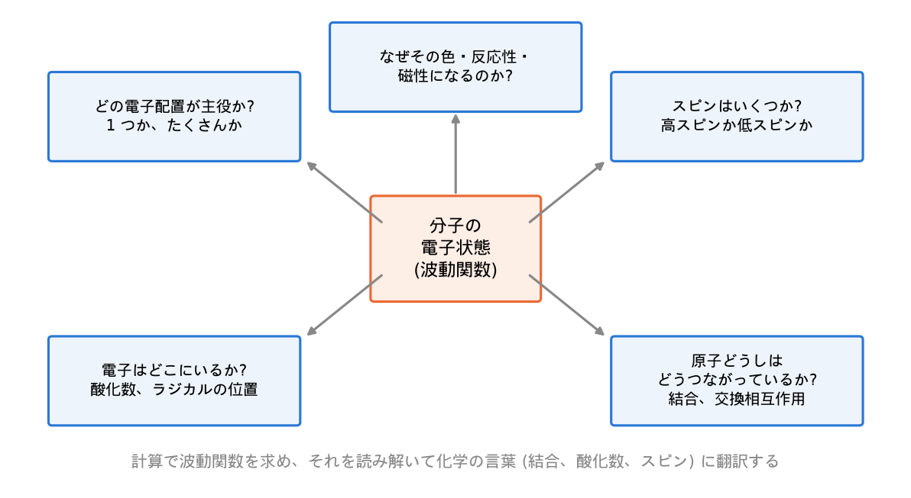

**図 1**　電子構造論の問い（模式図）。中心にあるのは、計算で求めた分子の電子状態（波動関数）です。そこから、どの電子配置が主役か、スピンはいくつか、電子はどこにいるか（酸化数、ラジカルの位置）、原子どうしはどうつながっているか、といった問いに答え、最終的に「なぜその色・反応性・磁性になるのか」を説明します。

この分野の研究は、次の 2 段階からなります。

1. **正しい波動関数を求める**：対象の分子に合った方法を選び、信頼できる電子状態を計算する。
2. **波動関数を解釈する**：求めた波動関数から、化学者が使う概念（結合、酸化数、スピン、ラジカル性）を取り出す。

2 段階目が特に大事です。波動関数そのものは、何十億もの係数の集まりで、そのままでは何も分かりません。それを化学の言葉に翻訳するのが、この分野の腕の見せ所です。

1 段階目でよく言われるのが、「難しい分子には大きな活性空間の方法が必要」ということです。

!!! question "「金属クラスターには DMRG のような大きな活性空間の方法が必要」と言われるのはなぜ？"
    **そもそも活性空間とは**：CASSCF などの多参照の方法で、配置の混ざりを厳密に扱う軌道と電子の組です。それ以外の軌道は、「いつも 2 個入っている」か「いつも空」として扱います。

    **なぜ大きくする必要があるか**：配置の混ざりが大事な軌道を活性空間から外すと、その混ざりがまったく表せないからです。遷移金属の d 軌道は 1 原子あたり 5 個あります。Mn を 4 個含むクラスターなら、d 軌道だけで 20 個です。さらに、金属どうしをつなぐ酸素の p 軌道も、スピンの結びつき（5.1 節）を運ぶので入れたくなります。ところが、ふつうの CASSCF で扱える活性空間は、おおよそ 16〜18 軌道までです。決定子の数が活性軌道の数に対して指数関数的に増えるからです（[計算理論のページ](01-theory-development.md)の図 5）。

    **どうするか**：DMRG（行列積状態で波動関数を表す方法）を使うと、数十軌道の活性空間を扱えます。DMRG の方法そのものは[計算理論のページ](01-theory-development.md)の 2.3 節で説明しています。電子構造論の立場では、DMRG は「活性空間の大きさの制限をゆるめる道具」として使い、得られた波動関数を、この後の 2 節の道具で読み解きます。

## 2. 電子状態を読む道具

### 2.1 分子軌道：電子の部屋の形

最も基本的な道具は**分子軌道**です。HF 法や DFT で得られる軌道は、電子 1 個の「部屋」の形を表します。図 2 は、ホルムアルデヒド H₂CO の 3 つの軌道を 3D で描いたものです。

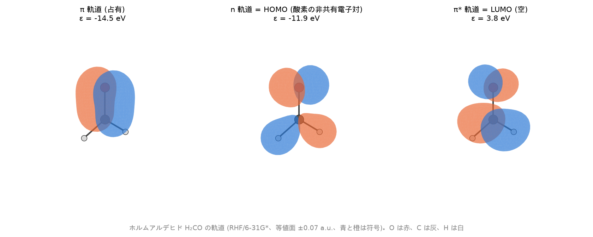

**図 2**　ホルムアルデヒドの軌道の 3D 図（PySCF [Sun 2020] で RHF/6-31G* の計算をし、等値面を marching cubes 法で描きました）。左：C=O の π 結合の軌道。中：最高被占軌道（HOMO）で、酸素の非共有電子対（n 軌道）が主です。右：最低空軌道（LUMO）で、C=O の π* 反結合性軌道です。青と橙は波動関数の符号を表します。

軌道の形から、分子の性質の多くが説明できます。たとえば、ホルムアルデヒドの最も低い励起は、HOMO の n 軌道から LUMO の π* 軌道へ電子が 1 個移る n→π* 励起です。この励起の吸収は弱いことが知られています。理由は軌道の形から分かります。光の吸収の強さは、遷移双極子 $\int \varphi_n\, \boldsymbol{r}\, \varphi_{\pi^*}\, d\boldsymbol{r}$ の大きさで決まります。n 軌道は分子の面内に、π* 軌道は面に垂直に広がっています（図 2）。この 2 つと座標 x、y、z の積は、どの向きでも、分子の対称操作で符号が反転する部分と打ち消し合い、積分が 0 になります。そのため、n→π* 励起は対称性で「禁制」になり、分子の振動でわずかに対称性が崩れた分だけ弱く吸収します。

ただし、軌道の描像は「電子が 1 つの配置で表せる」ときにだけそのまま使えます。複数の配置が混ざると、「どの軌道に電子が入っているか」が一通りに決まらなくなるからです。そうした場合は、2.3 節の自然軌道と占有数を使います。

### 2.2 多参照性：1 枚の名簿で書けない状態

!!! question "「この分子は多参照性が強いので、単参照の方法は使えない」と言われるのはなぜ？"
    **そもそも多参照性とは**：HF 法、MP2、CCSD(T)、ふつうの DFT は、1 つの電子配置（決定子）を土台にしています。エネルギーのほぼ等しい 2 つ以上の配置が同じくらいの重みで混ざる状態では、土台が 1 つでは足りません。この性質を**多参照性**（強い静的相関）と呼びます。

    **なぜ単参照の方法が駄目になるか**：いちばん簡単な H₂ の解離で確かめます（図 3）。原子 A、B の 1s 軌道を a、b とし、結合性の軌道を $\sigma_g \propto a + b$、反結合性の軌道を $\sigma_u \propto a - b$ とします。RHF は、2 個の電子を両方 σg に入れた配置だけを使います。その空間部分を原子の軌道で展開すると（規格化の係数は省きます）、

    $$
    \sigma_g(1)\sigma_g(2) \propto \underbrace{a(1)b(2) + b(1)a(2)}_{\text{H–H（共有結合的）}} + \underbrace{a(1)a(2) + b(1)b(2)}_{\text{H⁻H⁺ と H⁺H⁻（イオン的）}}
    $$

    となり、共有結合的な形とイオン的な形が、いつも同じ重みで入っています。原子を遠く離すと、正しい答えは「中性の H 原子 2 個」なのに、RHF はイオン的な形を 50% 含んだままです。そのため、図 3a のように、4 Å で RHF のエネルギーは厳密な値（FCI）より約 5.9 eV 高くなります（cc-pVDZ 基底）。

    これを直すには、σu に 2 個入れた配置も混ぜます。$\sigma_u(1)\sigma_u(2) \propto [a(1)b(2) + b(1)a(2)]\,(-1) + [a(1)a(2) + b(1)b(2)]$ なので、2 つの配置を引き算するとイオン的な部分が消えます。2 つの配置 $\Phi_1 = |\sigma_g\bar\sigma_g|$、$\Phi_2 = |\sigma_u\bar\sigma_u|$ の間のハミルトニアン行列は、

    $$
    \mathbf{H} =
    \begin{pmatrix}
    E_1 & K \\
    K & E_2
    \end{pmatrix},
    \qquad
    K = (\sigma_g\sigma_u|\sigma_g\sigma_u)
    $$

    です（$E_1$、$E_2$ は各配置のエネルギー、$K$ は化学者の表記の交換積分）。原子が遠く離れると $E_1 = E_2$ になるので、固有ベクトルは $\Psi = (\Phi_1 - \Phi_2)/\sqrt{2}$、つまり 2 つの配置が 50% ずつ混ざった状態です。これが典型的な多参照の状態です。

    **どう確かめるか**：次の指標を組み合わせます。

    - **自然軌道の占有数**（2.3 節）：2 と 0 から大きく外れた軌道があるか。図 3b では、4 Å で σg と σu の占有数がどちらも約 1 になっています。
    - **主配置の重み** $c_0^2$：CASSCF や FCI の波動関数で、いちばん重い配置の係数の 2 乗です。図 3b では、平衡距離で 0.98、4 Å で 0.50 です。
    - **T1 診断・D1 診断**：CCSD の 1 電子励起の振幅の大きさです。3d 遷移金属を含む分子では T1 > 0.05、D1 > 0.15 などを多参照性が強い目安とする提案があります。ただし、目安を下回っても多参照性が弱いとは限らないことも、同じ論文で指摘されています [Jiang 2012]。

    診断の詳しい使い方は、講義ノートの[量子化学の理論 第 10 回](../courses/qc-theory/10-coupled-cluster.md)と[遷移金属錯体 第 10 回](../courses/tm-complexes/10-multireference-tm.md)にあります。

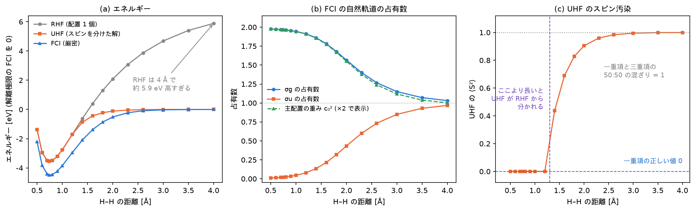

**図 3**　H₂ の結合を伸ばしたときの計算（PySCF、cc-pVDZ）。(a) エネルギー。RHF（灰）は結合を切ると大きく外れます。UHF（橙）は解離の極限では FCI（青）に近づきますが、途中の距離では外れます。(b) FCI の自然軌道の占有数と主配置の重み（2 倍して表示）。結合を伸ばすと、σg と σu の占有数がどちらも 1 に近づき、主配置の重みは 0.5 に近づきます。(c) UHF の ⟨S²⟩。1.2 Å と 1.4 Å の間で UHF の解が RHF から分かれ、⟨S²⟩ が一重項の正しい値 0 から 1 へ向かってずれます（スピン汚染、5.1 節）。

### 2.3 自然軌道と占有数：部屋に何人住んでいるか

多くの配置が混ざった波動関数からでも、1 電子密度行列（電子 1 個の分布をまとめた行列）を対角化すれば、**自然軌道**とその**占有数**が得られます [Löwdin 1955]。占有数は 0 から 2 の値をとり、

- 2 に近い：その軌道には電子が 2 個ずつしっかり入っている。
- 0 に近い：その軌道はほとんど空。
- 1 に近い：電子が「入っているとも空とも言える」状態。ラジカル性や強い静的相関のしるし。

と読みます。図 3b の H₂ では、平衡距離で σg が 1.97、σu が 0.02 で、ほぼ閉殻です。図 4 は、三重結合を持つ N₂ の結合を伸ばしていったときの占有数の変化です。

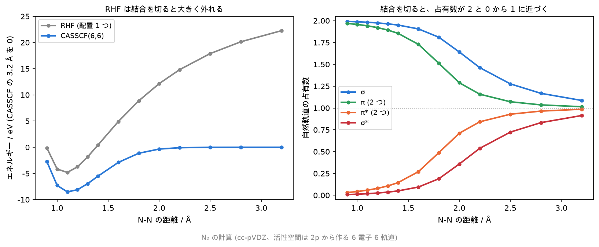

**図 4**　N₂ の結合を伸ばしたときの計算（PySCF、cc-pVDZ、活性空間は 6 電子 6 軌道）。左：エネルギー。RHF（灰）は 1 つの配置しか使わないので、結合を切ると大きく外れます。CASSCF（青）は解離の極限まで滑らかです。右：自然軌道の占有数。平衡構造の近くでは 2 と 0 に近く、結合を伸ばすと、結合性の σ、π と反結合性の π*、σ* の占有数がそろって 1 に近づきます。

平衡構造の近くと伸ばした構造の占有数を並べると、違いがはっきりします（図 5）。

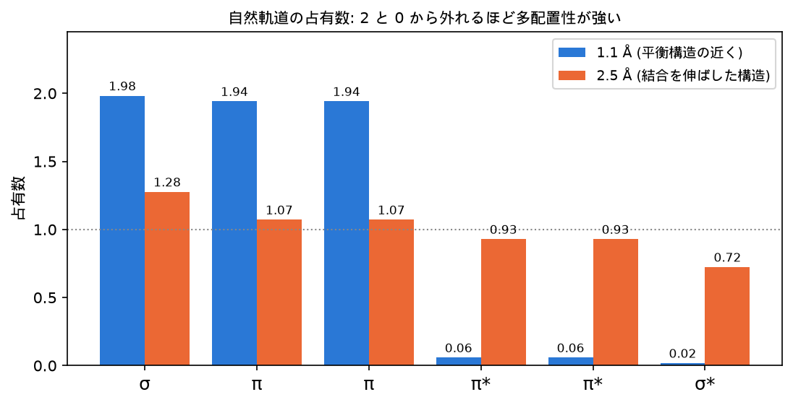

**図 5**　N₂ の自然軌道の占有数（図 4 と同じ計算）。1.1 Å（青）では σ が 1.98、π が 1.94 で、ほぼ閉殻です。2.5 Å（橙）では σ が 1.28、π が 1.07、π* が 0.93 で、6 個の電子が 6 個の軌道にほぼ 1 個ずつ入った状態に近くなっています。

占有数から「有効な不対電子の数」を数える指標も提案されています [Head-Gordon 2003]。占有数が 1 に近い軌道ほど、不対電子として大きく数える考え方です。6 節のアセンやナノグラフェンのラジカル性は、こうした指標で議論されます。

### 2.4 エンタングルメント：誰と誰が結びついているか

占有数は、軌道 1 つずつの情報です。どの軌道とどの軌道が強く結びついているかを見るには、量子情報理論の**エンタングルメント**（もつれ）の指標を使います [Boguslawski 2012]。

- **軌道のエントロピー** s：1 つの軌道は、空、α が 1 個、β が 1 個、2 個の 4 つの状態をとれます。波動関数から、それぞれの状態にある確率 $w_1, \dots, w_4$ を求め、$s = -\sum_{k=1}^{4} w_k \ln w_k$ とします。どれか 1 つの状態に確定していれば（確率が 1 と 0 なら）s = 0、4 つが等しい確率なら最大値 ln 4 ≈ 1.39 です。
- **相互情報量** I：2 つの軌道の間のもつれ。I = s(軌道 1) + s(軌道 2) − s(2 つの軌道をまとめたもの) で定義します（論文によっては 1/2 を掛けた定義も使われます）。

図 6 は、図 4 の N₂ の波動関数から、この 2 つの量を計算したものです。

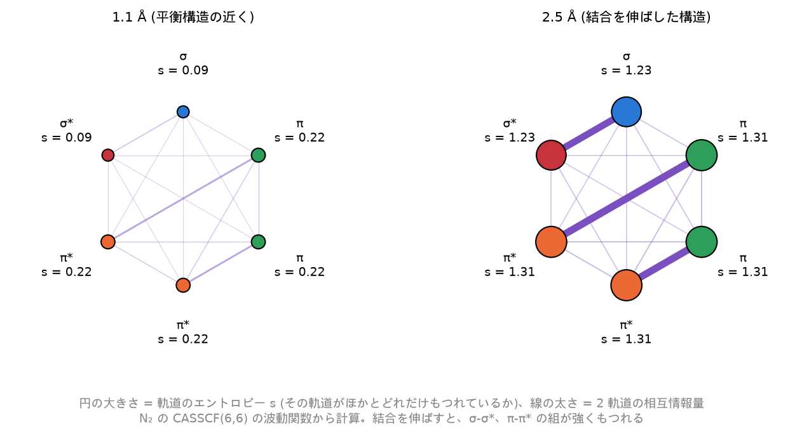

**図 6**　N₂ の CASSCF(6,6) の波動関数から計算した、軌道のエントロピー（円の大きさ）と相互情報量（線の太さ）。1.1 Å（左）では、どの軌道のエントロピーも 0.1〜0.2 程度で、もつれは弱いです。2.5 Å（右）では、エントロピーが 1.2〜1.3 に増え、σ と σ*、π と π* の組が強くもつれています。結合を切ると、結合をつくっていた電子のペアが、左右の原子に 1 個ずつ分かれた「もつれたペア」になることが分かります。

この図は、結合が 3 つ（σ と 2 つの π）あり、それぞれが結合性と反結合性の軌道の組でもつれていることを、波動関数から直接読み取れることを示しています。エンタングルメントの図は、活性空間の選び方の判断にも使われます。まず小さめの D の DMRG で大きな空間を粗く計算し、エントロピーの大きい軌道を見つけて、それらを本番の活性空間に入れる、という使い方です。

### 2.5 この界隈の常識

- **軌道の形と軌道エネルギーは、1 つの配置で表せる分子の解釈に使う。** 配置が混ざると「どの軌道が占有か」が決まらないからです。また、HF の軌道エネルギーはクープマンスの定理でイオン化エネルギーの近似になりますが、近似の汎関数を使った DFT の軌道エネルギーにはその保証がなく、HOMO–LUMO の差も励起エネルギーとは違います。
- **占有数が 2 と 0 から大きく外れた自然軌道（たとえば 0.1〜1.9 の範囲のもの）があれば、多参照性を疑う。** 境目は目安で、厳密な基準はありません。主配置の重みや T1・D1 診断と組み合わせて判断します（2.2 節）。
- **活性空間の自然軌道の占有数を見て、活性空間が適切かを判断する。** 占有数が 2 や 0 にほとんど等しい軌道は、配置の混ざりにほとんど寄与していないので、活性空間に入れる必要が薄いからです。逆に、活性空間の端の軌道の占有数が 1.9 や 0.1 から大きく外れていたら、外にも大事な軌道が残っている可能性があります。
- **等値面の図には、等値面の値（例：±0.05 a.u.）を書く。** 同じ軌道でも、値を小さくすると大きく膨らみ、大きくすると小さく縮んで、見た目の「広がり」の印象が大きく変わるからです。

## 3. 多参照系と強相関

### 3.1 何をする研究か

遷移金属を何個も含むクラスターでは、各金属の d 電子が不対電子として残り、それらが互いに結びついています。不対電子のスピンの向きの組み合わせは、金属の数が増えると急に増え、そのどれもがほぼ同じエネルギーになります。こうした系では、たくさんの電子配置がほぼ同じ重みで混ざるので（強い静的相関）、1 つの配置を土台にする方法では正しい電子状態が得られないことがあります。DMRG のような大きな活性空間の方法で、多電子の波動関数を直接求めるのが、この分野の最前線です。

### 3.2 代表的な研究例：光化学系 II の Mn₄CaO₅ クラスター

植物の光合成で水を分解して酸素をつくるのは、光化学系 II というタンパク質の中の Mn₄CaO₅ クラスターです。その構造は、1.9 Å の分解能の X 線結晶構造で明らかにされました [Umena 2011]。4 個の Mn と 1 個の Ca が 5 個の酸素でつながった、ゆがんだいす形の構造です（図 7）。

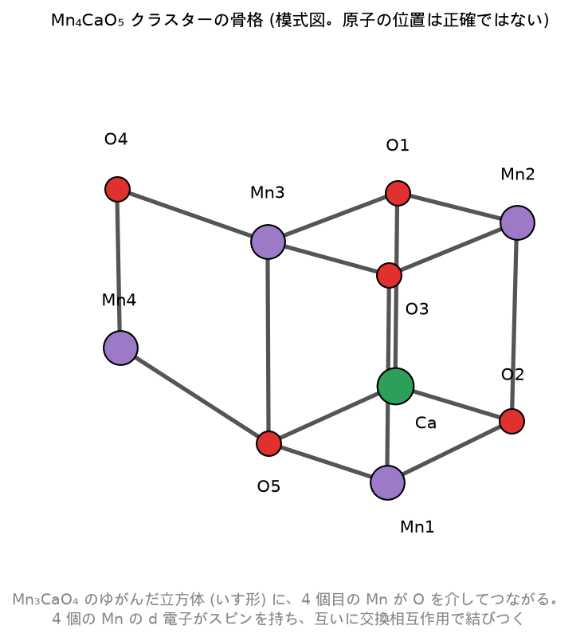

**図 7**　Mn₄CaO₅ クラスターの骨格の 3D 図（模式図。原子の位置は正確ではありません）。3 個の Mn と Ca と 4 個の O がゆがんだ立方体をつくり、4 個目の Mn が O を介してつながっています。各 Mn は d 電子のスピンを持ち、それらが交換相互作用で結びついています。

Kurashige、Chan、Yanai は、DMRG を使って、このクラスターの多電子の波動関数をほぼ厳密に計算しました [Kurashige 2013]。要旨によると、扱った量子的な自由度は 10¹⁸ を超え、光化学系 II を DFT の 1 電子の描像を超えて扱った最初の例です。計算の結果は、X 線結晶構造に対して提案されていた修正を支持し、構造のゆがみに関係する複数の低いエネルギーの面があること（複数の状態が反応に関わりうること）を示しました。また、波動関数から各 Mn のスピンの射影を直接求め、パラメーターを含むスピン模型で絞り込まれていた候補を見直す必要があることを指摘しました。エンタングルメントの図（2.4 節）から、反応のサイクルの中での結合の変化も読み取っています。「正しい波動関数を求める」と「波動関数を化学の言葉に翻訳する」の 2 段階（1 節）の両方を行った例です。

### 3.3 鉄硫黄クラスターとニトロゲナーゼ

鉄硫黄クラスターは、電子の移動や窒素の固定などを担う、生体の中の基本的な部品です。Sharma、Sivalingam、Neese、Chan は、[2Fe-2S] と [4Fe-4S] のクラスターの電子の準位を、模型の仮定なしに計算しました [Sharma 2014]。その結果、広く使われてきたハイゼンベルク型の二重交換の模型は、状態の数を 1〜2 桁少なく見積もっており、その原因が Fe の d-d 励起が模型に入っていないことにあると示しました。同じスピンの状態でも、電子の準位は振動のゆらぎの大きさ程度の間隔で密に並んでいます。

この流れは、ニトロゲナーゼの P クラスター（8 個の Fe を含む）にも広がっています [Li 2019]。軌道の励起とスピンの励起のエネルギーの幅が重なり、密な状態のスペクトルをつくること、クラスターが古典的でないスピン相関を持つスピン配置の重ね合わせになっていることが報告されています。

### 3.4 DFT の結論を多参照の方法で確かめる

多参照の方法は、DFT の結論を確かめるのにも使われます。たとえば、銅ゼオライトの活性中心によるメタンの C–H 結合の切断では、97 種類の汎関数の DFT で有利な経路が汎関数によって入れ替わり、DMRG-CASPT2 がどちらの経路が有利かを判定しました [Phung 2025a]。反応の機構の詳しい内容は、[反応と触媒のページ](03-reactions-catalysis.md)で紹介しています。

### 3.5 この界隈の常識

- **遷移金属のクラスターでは、1 つの汎関数の結論だけで反応機構を決めない。** 汎関数は、静的相関をどれだけ「偶然に」取り込むかが、HF 交換の割合などによって違います。そのため、多参照性の強い系では、汎関数を変えると答えの順番まで入れ替わることがあるからです（3.4 節）。
- **多参照の計算では、どの軌道を活性空間に入れたかを必ず書く。** 活性空間の中の相関だけが厳密に扱われるので、選び方で結果が変わり、ほかの人が再現・検証するにはその情報が欠かせないからです。
- **大きなクラスターは、配位子を簡単にした小さな模型で計算することが多い。** 多参照の方法の計算量は、活性空間の大きさだけでなく、基底関数の数にも強く依存するからです。模型の切り方で結果が変わらないかも確かめます。
- **「ハイゼンベルク模型」のようなスピンの模型は便利だが、d-d 励起などが入っていないことを意識する** [Sharma 2014]。模型は「各金属のスピンの大きさは固定」と仮定しているので、それが崩れる状態は表せないからです。

## 4. 遷移金属錯体のスピン状態

### 4.1 何をする研究か

遷移金属錯体では、d 軌道への電子の入り方によって、全体のスピンが変わります。たとえば八面体の Fe(II)（d 電子 6 個）では、配位子場の分裂 Δ が大きいと、6 個の電子が下の t₂g 軌道に対になって入る**低スピン**（S = 0）になります。Δ が小さいと、電子が上の eg 軌道にも入って、不対電子が 4 個の**高スピン**（S = 2）になります（図 8 左）。どちらになるかは、Δ と、電子を同じ軌道に対にするときの反発のエネルギー（対形成エネルギー）の大小で決まります。

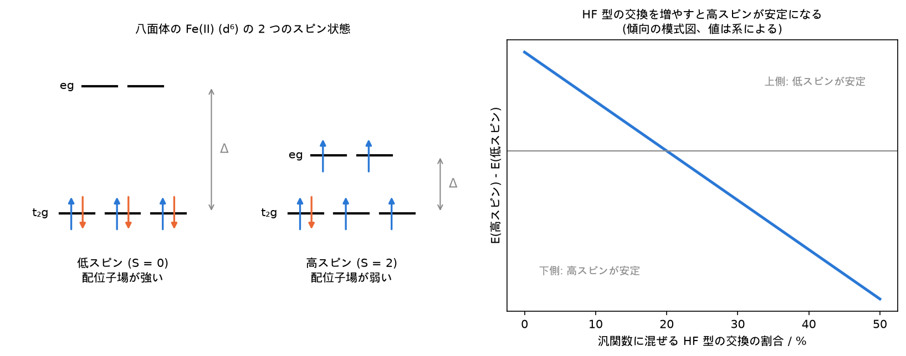

**図 8**　左：八面体の Fe(II)（d⁶）の低スピンと高スピンの電子配置。α 電子は青の上向き、β 電子は橙の下向きの矢印です。右：汎関数に混ぜる HF 型の交換の割合を増やすと、高スピン状態が相対的に安定になる傾向の模式図（値は系によって変わります）。

どちらのスピン状態が安定かは、触媒の反応性、磁性、スピンクロスオーバー（温度や光でスピン状態が切り替わる現象）を決めます。

スピン状態は、配位子のわずかな違いでも入れ替わります。Bibi らは、2-(1H-イミダゾール-2-イル)ジアジンの 2 つの構造異性体を配位子とする鉄(II) 錯体を比べました [Bibi 2018]。2 つの配位子の違いは、ジアジンの環の窒素原子 1 個の位置だけです（ピラジン型の Z と、ピリミジン型の M）。それでも、&#91;Fe(M)₃&#93;(ClO₄)₂ は 241 K でスピン転移を起こすスピンクロスオーバー錯体で、&#91;Fe(Z)₃&#93;(ClO₄)₂ は 2〜300 K の範囲で磁気的な性質が変わりませんでした。CASPT2 の計算では、Z の錯体の配位子場がわずかに強く（一重項で 506 cm⁻¹ の差）、そのぶん一重項（低スピン）が安定になっていました。この程度の弱い効果でも、スピン多重度が変わりうるということです。

### 4.2 DFT の難しさ：HF 交換の割合で答えが変わる

!!! question "「スピン状態の計算では、汎関数を何種類も試す必要がある」と言われるのはなぜ？"
    **そもそも何が問題か**：Reiher、Salomon、Hess は、混成汎関数で、多重度の違う状態のエネルギー差が、混ぜる HF 交換の割合にほぼ直線的に依存することを示しました [Reiher 2001]（図 8 右）。HF 型の交換は、同じ向きのスピンの電子どうしが互いを避ける効果（フェルミ相関）をそのまま取り込むので、同じ向きのスピンの多い高スピン状態を安定にする方向に働きます。この論文では、B3LYP の HF 交換を 20% から 15% に減らした B3LYP* が提案されました。

    **なぜ「何種類も」なのか**：HF 交換の割合は、理論から 1 つに決まる量ではなく、汎関数ごとに選ばれたパラメーターです。しかも、最適な割合は系によって違います。Dey らは、d⁴〜d⁶ の第一遷移系列の 50 種類の八面体錯体について、多参照の CASPT2/CC の水準でスピン状態のエネルギー差のデータを作り、さまざまな DFT を比べました [Dey 2026]。最適な HF 交換の割合は、どのスピン状態の間の差を見るかによっても変わりました。1 つの汎関数の答えは、その汎関数の HF 交換の割合で決まった「一つの見方」にすぎない、ということです。

    **どう確かめるか**：HF 交換の割合の違う汎関数をいくつか使い、結論（どのスピン状態が下か）が変わらないかを見ます。変わる場合は、4.3 節の波動関数の方法の参照値や実験と比べます。

Dey らは、上のデータと機械学習（Δ 学習）を組み合わせて、500 種類の錯体まで精度を広げています [Dey 2026]。スピン状態の計算の成功例と落とし穴は、[Swart 2013] の総説にまとめられています。講義ノートの[遷移金属錯体 第 3 回](../courses/tm-complexes/03-spin-states.md)と[第 5 回](../courses/tm-complexes/05-spin-state-energetics.md)も参考にしてください。

実験と比べるときには、もう 1 つ注意があります。

!!! question "「スピン状態の比較では、電子エネルギーの差だけでなくエントロピーも効く」と言われるのはなぜ？"
    **そもそも何を比べているか**：計算で最初に求まるのは、原子核を止めたときの電子エネルギーの差 ΔE です。実験で決まるのは、ある温度でどちらのスピン状態が多いか、つまりギブズエネルギーの差 ΔG = ΔH − TΔS です。

    **なぜエントロピーが効くか**：高スピン状態では、反結合性の eg 軌道に電子が入るので、金属と配位子の結合が長く、弱くなります。結合が弱いと振動数が下がり、振動の状態がたくさん使えるようになるので、振動のエントロピーが大きくなります。さらに、高スピン状態にはスピンの向きの自由度（2S + 1 通り）があります。Fe(II) の S = 2 では 5 通りなので、電子のエントロピーが R ln 5 ≈ 13.4 J/(mol K) だけ大きくなります。したがって、低スピンから高スピンへの変化では ΔH > 0 でも ΔS > 0 で、温度を上げると −TΔS の項が勝って高スピンが安定になります。これがスピンクロスオーバーの基本のしくみです（図 9）。

    **どう扱うか**：振動数の計算から振動のエントロピーを求め、ΔG で比べます。転移温度の目安は T½ = ΔH/ΔS です。溶液中の実験と比べるなら、溶媒の効果も見積もります。

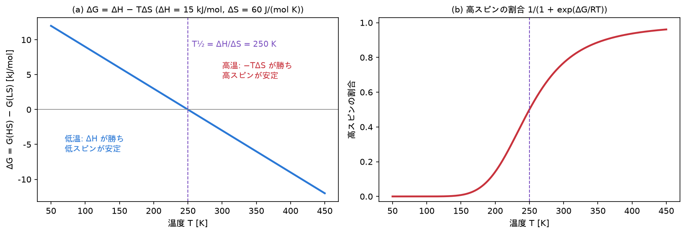

**図 9**　スピンクロスオーバーの熱力学（模式図。ΔH = 15 kJ/mol、ΔS = 60 J/(mol K) の仮の値で描きました）。(a) ΔG = ΔH − TΔS は温度とともに下がり、T½ = 250 K で 0 になります。(b) 高スピンの割合は、T½ の前後で 0 から 1 へ移ります。

### 4.3 参照値をどうつくるか：CASPT2/CC と結合クラスター法の限界

4.2 節では、DFT の結果を「信頼できる参照」と比べると書きました。では、その参照値はどうつくるのでしょうか。スピン状態のエネルギー差では、波動関数の方法を使っても簡単ではありません。この問題に取り組んだ一連の研究を、順に紹介します。

**CASPT2 の偏りとその原因**：CASPT2 は多参照の系の標準の方法ですが、第一遷移金属の錯体では、高スピン状態を安定にしすぎる偏りが知られています。Pierloot、Phung、Domingo は、標準の CASPT2 が価電子の相関はよく表すものの、金属の**セミコア**（3s、3p の電子。価電子のすぐ内側の殻）の相関を正しく表せないことを示しました [Pierloot 2017]。これが偏りの原因の一部です。3s、3p の軌道は 3d 軌道と空間的に重なっているので、3d の電子の数や入り方が変わると、その相関のエネルギーも変わります。そのため、スピン状態の差には、内側の電子も効いてきます。

**CASPT2/CC**：そこで Phung、Feldt、Harvey、Pierloot は、電子の相関を 2 つに分け、それぞれを得意な方法で求めて足し合わせる方法を提案しました [Phung 2018a]（図 10）。価電子の相関は、大きな基底関数を使った質の高い CASPT2 で求めます。セミコアの 3s3p の相関の寄与は、最小に近い小さな基底関数を使った CCSD(T) で、安く見積もります。たとえると、「全体の設計は多参照に強い CASPT2 に、内側の細かい部分は CCSD(T) に分担させる」やり方です。鉄錯体の系列で効率を示し、CCSD(T) の結果との比較から、平均の誤差は約 2 kcal/mol（高スピンの側に偏る）と見積もられました。

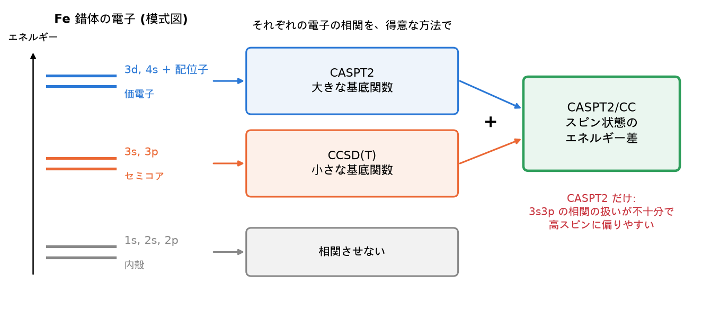

**図 10**　CASPT2/CC の考え方（模式図）。鉄錯体の電子を、価電子（3d、4s と配位子）、セミコア（3s、3p）、内殻に分けます。価電子の相関は大きな基底関数の CASPT2 で、セミコアの相関の寄与は小さな基底関数の CCSD(T) で求め、足し合わせてスピン状態のエネルギー差にします。[Pierloot 2017; Phung 2018a] の要旨の内容から作図しました。

**結合クラスター法も絶対ではない**：DFT の評価では、CCSD(T) が参照としてよく使われます。ところが、開殻の分子の CCSD(T) には、スピンを制限して扱う形と、制限せずに扱う形があります。Feldt らは、非ヘム鉄酵素の C–H 結合の活性化の簡単な模型で、これらの形の違いによって、ポテンシャル面の上の化学種のエネルギーが約 5 kcal/mol も違いうることを示しました [Feldt 2019]。さらに、局所結合クラスター法（2 つの実装）は、改良なしでは、この系の 2 状態反応性（反応の途中で 2 つのスピン状態のポテンシャル面が入れ替わる反応）を表すのに向かないと結論しました。

**局所結合クラスター法の系統的な偏り**：Phung らは、CASPT2/CC で非ヘムの Fe(IV)=O 錯体の系列の五重項と三重項のエネルギー差を求め、それを参照に DFT と 2 種類の局所結合クラスター法を評価しました [Phung 2019]。DLPNO-CCSD(T) は五重項を系統的に安定にしすぎ、LUCCSD(T0) は逆に三重項の側に偏りました。偏りが系統的なので、局所相関の方法を改良する手がかりや、簡単な補正の土台になりうるとしています。

**FeN₄ 錯体**：Phung、Nam、Saitow は、鉄が 4 つの窒素原子に囲まれた 19 種類の FeN₄ 錯体のスピン状態のエネルギーを、多数の多参照の方法で比べました [Phung 2023a]。多くの方法は、出発点の CASSCF の波動関数に由来する誤差のために、高スピン状態を安定にしすぎました。CCSD(T) の参照とよく合ったのは、CASPT2/CC、DSRG-MRPT3、LDSRG(2) などの少数の方法でした。また、五重項（高スピン）が基底状態の FeN₄ 錯体はきわめて少ないことも示しています。

この分野の進歩は、Feldt と Phung の短い総説にまとめられています [Feldt 2022]。

### 4.4 この界隈の常識

- **スピン状態のエネルギー差は、汎関数の HF 交換の割合に強く依存する。** HF 交換が高スピンを安定にする向きに働き、その割合が汎関数ごとのパラメーターだからです。複数の汎関数や、信頼できる参照（CASPT2/CC、結合クラスター法、実験）と比べます（4.2 節）。
- **高スピンの状態は 1 つの配置でよく表せることが多いが、低スピンや中間スピンの状態は多参照性を持つことがある。** 高スピンでは電子の入り方がほぼ一通りに決まるのに対し、低スピンでは、対になる電子の入り方の組み合わせが複数あって混ざりやすいからです。
- **実験と比べるときは、電子エネルギーの差だけでなく、振動とエントロピー、溶媒の効果も入れる。** 高スピン状態は振動とスピンのエントロピーが大きいので、温度によって安定な状態が入れ替わるからです（4.2 節の 2 つ目の箱）。
- **UHF や UKS の計算では、スピン汚染（⟨Ŝ²⟩ が正しい値からずれること）を確かめる。** ずれが大きいと、ほかのスピン状態が混ざったエネルギーを比べていることになるからです（5.1 節の箱）。
- **参照値の側にも誤差がある。** CASPT2 は高スピンに偏りやすく、その原因の 1 つはセミコア（3s3p）の相関です。開殻の CCSD(T) も、スピンの扱い方の違いで数 kcal/mol 変わることがあり、局所結合クラスター法はどちらかのスピン状態に系統的に偏ることがあります [Feldt 2019; Phung 2019]。

## 5. 化学結合の解析：交換相互作用、酸化数、配位子の非無垢性

### 5.1 交換相互作用と broken-symmetry 法

不対電子を持つ 2 つの金属イオンが、酸素などの橋かけの配位子でつながると、2 つのスピンの向きの間に**交換相互作用**がはたらきます。ハイゼンベルクのハミルトニアン H = −2J S₁·S₂ で表すと、J < 0 なら 2 つのスピンが逆向きにそろった低スピン（反強磁性的）の状態が下になり、J > 0 なら同じ向きにそろった高スピン（強磁性的）の状態が下になります（図 11 左）。スピンの向きは、多くの場合、金属の d 軌道と橋の O の p 軌道の重なりを通して伝わります。これを**超交換**と呼びます（図 11 右）。

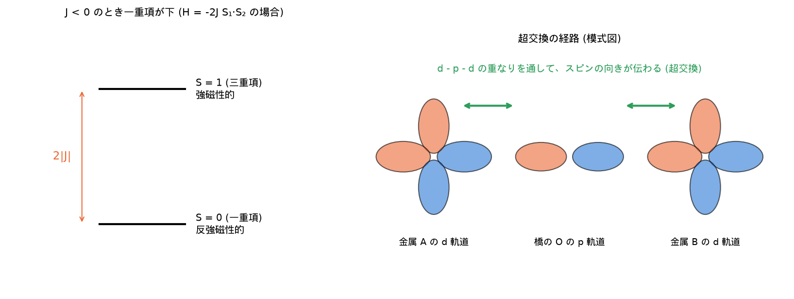

**図 11**　左：2 つのスピン 1/2 の交換相互作用によるエネルギー準位。H = −2J S₁·S₂ の場合、一重項と三重項の差は 2|J| です。右：超交換の経路の模式図。2 つの金属の d 軌道が、橋の酸素の p 軌道と重なることで、スピンの向きの情報が伝わります。

DFT では、スピンの対称性を破った解（broken-symmetry 解、BS 解）を使って J を見積もる方法がよく使われます。その基礎は Noodleman の研究にさかのぼります [Noodleman 1981]。

!!! question "「UHF や UKS ではスピン汚染に注意」と言われるのはなぜ？ broken-symmetry 法はなぜそれでも使えるの？"
    **そもそもスピン汚染とは**：正しい波動関数は、全スピンの 2 乗 Ŝ² の固有関数で、その値は S(S + 1) です（一重項 0、二重項 0.75、三重項 2）。UHF や UKS では、α スピンと β スピンの電子に別々の空間軌道を使います。自由度が増えてエネルギーは下がりますが、その代わり、波動関数が Ŝ² の固有関数でなくなり、ほかのスピン状態が混ざることがあります。これを**スピン汚染**と呼び、計算した ⟨Ŝ²⟩ が S(S + 1) からずれることで分かります。

    **なぜ問題か**：比べたいのは「一重項のエネルギー」なのに、実際には一重項と三重項の混ざったもののエネルギーを見ていることになるからです。スピン密度などの性質も、混ざった状態のものになります。図 3c の H₂ では、1.2〜1.4 Å より長くすると UHF の解が RHF から分かれ、解離の極限で ⟨Ŝ²⟩ が 1 に近づきます。これは、一重項（0）と三重項（2）がちょうど半分ずつ混ざった値です。

    **broken-symmetry 法での使い方**：この「半分ずつ混ざる」性質を逆に利用するのが broken-symmetry 法です。2 つのスピン 1/2 の場合、軌道の重なりが小さいと、BS 解のエネルギーは一重項と三重項のほぼ平均になります（図 12）。H = −2J S₁·S₂ では一重項と三重項の差が −2J なので、

    $$
    E(\mathrm{HS}) - E(\mathrm{BS}) \approx \frac{E(\mathrm{T}) - E(\mathrm{S})}{2} = -J
    \quad\Longrightarrow\quad
    J \approx E(\mathrm{BS}) - E(\mathrm{HS})
    $$

    となります。軌道の重なりが大きい場合は、⟨Ŝ²⟩ の値を使って混ざり具合を補正した式が使われます。

    **どう確かめるか**：計算のたびに ⟨Ŝ²⟩ を出力で確かめます。閉殻や高スピンの状態のつもりで ⟨Ŝ²⟩ が S(S + 1) から大きくずれていたら、その結果の解釈には注意が要ります。BS 解では、ずれていることを前提に、上のような式で使います。

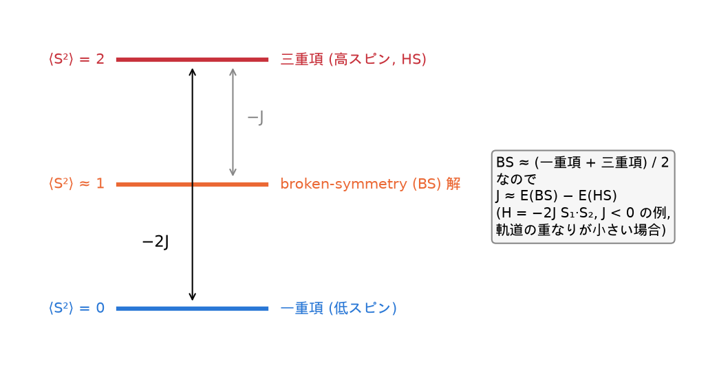

**図 12**　2 つのスピン 1/2 の一重項、三重項と broken-symmetry 解のエネルギーと ⟨S²⟩（模式図。H = −2J S₁·S₂、J < 0 の例）。BS 解は一重項と三重項のほぼ半分ずつの混ざりなので、エネルギーも ⟨S²⟩ も両者の中間になります。

J がどの経路から来るのかを、波動関数から読み取る研究もあります。軌道のエントロピーと相互情報量で J の寄与を分析する方法が提案されましたが [Stein 2019]、Chalupský、Srnec、Yanai は、この分析では J の機構を誤って解釈することがあると指摘しました [Chalupský 2021]。代わりに、2 電子密度に基づく軌道のエンタングルメントの分析を提案し、ビス μ-オキソの 2 核マンガン錯体で、O の面外の p 軌道を介した π 超交換の経路が反強磁性の主な原因であることを示しました。相互情報量は、低スピン状態に含まれるスピンのもつれの寄与が大きいため、直接の Mn–Mn 間の相互作用を過大に見せてしまいます。2.4 節の道具も、何を測っているのかを理解して使う必要があることを示す例です。

### 5.2 酸化数と配位子の非無垢性

**酸化数**は、化学結合の電子を、電気陰性度の大きい方の原子にすべて割り当てたときの原子の電荷です。IUPAC は 2016 年に、酸化数の包括的な定義を勧告しています [Karen 2016]。

ところが、配位子が電子を出し入れしやすい場合、金属と配位子のどちらに電子があるのかがはっきりしなくなります。このような配位子を**非無垢な**（non-innocent）配位子と呼びます。代表例が、一酸化窒素 NO とポルフィリンに似たコロールです。こうした系では、波動関数を「金属が Fe(III) で NO が中性」「金属が Fe(II) で NO が陰イオン」のような**共鳴形**の重ね合わせとして読み、それぞれの重みから酸化数を判断します。

- **金属コロール**：Phung らは、7 種類の金属コロール錯体を DMRG-CASPT2 などで調べ、コロールの非無垢性の強さの順番を決めました [Phung 2021]。たとえば、Fe&#91;Cor&#93;(NO) の基底状態（S = 0）は、局所的に S = 1/2 の {FeNO}⁷ がコロールのラジカルと反強磁性的に結合したものと表すのが最もよく、Ru&#91;Cor&#93;(NO) のコロールは無垢であることを示しました。B3LYP は定性的には使えるものの、状態間のエネルギー差では 10 kcal/mol を超える誤差がありうることも指摘しています。同じ鉄ニトロシルコロールについては、Pierloot、Phung、Ghosh が、最大 37 軌道の活性空間の CASSCF と DMRG で中性と陰イオンの状態を調べていました [Pierloot 2020]。B3LYP で提案されていた描像をおおむね確かめる一方で、Fe–コロールの結合のジラジカル性は 35% にとどまることを示しました。また、実験と合うように、還元（電子の付加）は金属ではなくコロールの側で起こると計算されました。
- **ヘムのニトロシル錯体**：NO の錯体は、Enemark–Feltham の表記で {FeNO}ⁿ と書きます。n は Fe の d 電子と NO の π* 電子の数の和です。この表記を使うのは、n は数えられても、電子を Fe と NO にどう分けるかが決めにくいからです。n が同じでも、分け方で局所的な酸化数が変わります（図 13）。Phung、Nam、Ghosh は、{FeNO}⁶、{FeNO}⁷、{FeNO}⁸ のヘムのニトロシル錯体を、初めて DMRG/CASSCF–CASPT2 で調べました [Phung 2023b]。スピン状態のエネルギー差は、{FeNO}⁷ では二重項と四重項の差が 1〜4 kcal/mol と小さく、{FeNO}⁶ と {FeNO}⁸ では一重項と三重項の差が約 20 kcal/mol 以上と大きく求まりました。DMRG-CASSCF の波動関数を局在化軌道で書き直し、NO の π* の占有数が違う共鳴形に分けると、{FeNO}⁶ と {FeNO}⁷ のどちらでも、NO が中性の共鳴形（Fe(III)–NO⁰ と Fe(II)–NO⁰）が主な寄与でした。{FeNO}⁶ のヘムを Fe(II)–NO⁺ と書くよくある慣習とは違いますが、Fe の L 吸収端の X 線吸収分光の解析とは合っています。{FeNO}⁸ の {Fe&#91;P&#93;(NO)}⁻ は、Fe(I)–NO⁰ ↔ Fe(II)–NO⁻ の共鳴混成体と表されました。
- **非ヘム鉄ニトロシル**：ヘム以外の配位子を持つ {FeNO}⁶〜¹⁰ の錯体を DMRG-CASSCF で調べた研究では、{FeNO}⁶ は Fe(III)–NO⁰、{FeNO}⁷ は Fe(II)–NO⁰ の配置が主であることが分かりました [Phung 2025b]。さらに、共鳴形の重みから求めた NO の π* 軌道の占有数が、NO の結合の長さや伸縮振動数と直線的に相関し、NO の結合の長さから NO の酸化数を読み取れることを示しました。計算でしか見えない量（占有数）と、実験で測れる量（結合の長さ、振動数）を結びつけた例です。
- **酸素の付加体**：O₂ も、金属との間で電子をやりとりしやすい配位子です。Phung と Pierloot は、鉄とマンガンのポルフィリンへの O₂ の結合を DMRG-CASPT2 で調べ、MnP–O₂ の基底状態は O₂ が横向き（side-on）に結合した四重項で、MnP と O₂ の間の電荷移動が大きいことを示しました [Phung 2018b]。O₂ の標準結合エンタルピーは実験と 2 kcal/mol 以内で一致しました。

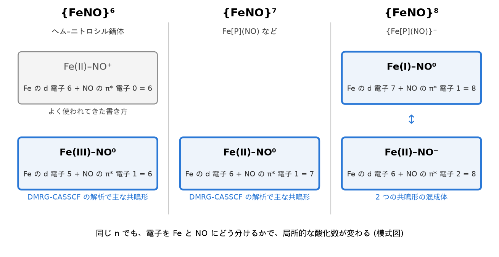

**図 13**　ヘムのニトロシル錯体の {FeNO}ⁿ の電子の数え方と、局所的な酸化数（模式図）。どの共鳴形も、Fe の d 電子と NO の π* 電子の和は n で同じです。青の枠は、DMRG-CASSCF の波動関数の解析で主な寄与とされた共鳴形、灰色の枠は {FeNO}⁶ のよく使われてきた書き方です。[Phung 2023b] の要旨の内容から作図しました。

### 5.3 この界隈の常識

- **交換相互作用の J には、H = −2J S₁·S₂ と H = −J S₁·S₂ の 2 つの流儀がある（値が 2 倍違う）。** 同じ分子でも、論文によって J の数値が 2 倍違って見えるので、比べる前にどちらの定義かを確かめます。
- **broken-symmetry の DFT は J の見積もりに広く使われるが、汎関数によって値が大きく変わる。** J は BS 解と高スピンの解のエネルギーの小さな差で、その差が HF 交換の割合などに敏感だからです。
- **酸化数は「形式的な数」で、実際の電荷とは違う。** 結合の電子を「すべて片方に割り当てる」という約束で決めた数だからです。非無垢な配位子があると、どちらに割り当てるべきかがあいまいになり、酸化数そのものが議論の対象になります。
- **共鳴形の重み、自然軌道の占有数、スピン密度など、複数の指標を組み合わせて電子の居場所を判断する。** どの指標も、軌道の選び方や分け方の約束に依存するので、1 つだけでは結論が揺らぐからです。

## 6. π 電子系・ラジカル・開殻分子

### 6.1 何をする研究か

有機分子の中にも、不対電子を持つ**ラジカル**や、2 つの不対電子を持つ**ジラジカル**があります [Abe 2013]。不対電子がどこにいるかは、**スピン密度**（α スピンの密度から β スピンの密度を引いたもの）で表します。図 14 は、最も簡単な π ラジカルの 1 つ、アリルラジカルのスピン密度です。

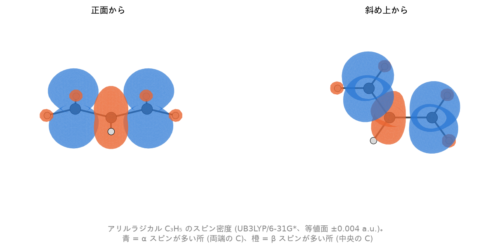

**図 14**　アリルラジカル C₃H₅ のスピン密度の 3D 図（PySCF で UB3LYP/6-31G* の計算をしました。等値面は ±0.004 a.u.）。青は α スピンが多い所、橙は β スピンが多い所です。不対電子は主に両端の炭素の π 軌道にいます。中央の炭素には、逆向きの β スピンが少し現れます（スピン分極）。この計算の Mulliken のスピン密度は、両端の炭素で約 +0.71、中央の炭素で約 −0.30 でした。

中央の炭素に負のスピン密度が現れるのは、両端の α の不対電子が、中央の炭素の電子対のうち α の電子を少し引き寄せ、β の電子を少し残すためです。このような細かな特徴は、電子スピン共鳴（ESR）の超微細結合定数として実験で観測できるので、計算と実験を比べる手がかりになります。

!!! question "「開殻一重項（ジラジカル）は制限された方法では表せない」と言われるのはなぜ？"
    **そもそも開殻一重項とは**：全スピンは 0（一重項）なのに、2 個の電子が別々の場所の軌道に 1 個ずつ入っている状態です。結合を伸ばした H₂ は、その最も簡単な例です。

    **なぜ制限された方法（RHF、RKS）では駄目か**：制限された方法は、α と β の電子を同じ空間軌道に入れます。2.2 節で見たように、これはイオン的な形を 50% 含む配置で、「左右に 1 個ずつ」の状態を表せません。

    **どう扱うか**：2 つの方法があります。1 つは、UHF や UKS で α と β の軌道を別々の場所に分ける方法（broken-symmetry 解）です。手軽ですが、三重項が混ざってスピン汚染が起こります（図 3c、5.1 節の箱）。もう 1 つは、CASSCF(2,2) のように、2 つの配置を混ぜる多参照の方法です。正しい一重項が得られます。ジラジカルの度合い（ジラジカル性）は、多参照の波動関数の自然軌道の占有数で表すことが多く、最低非占有自然軌道（LUNO）の占有数が 1 に近いほどジラジカル的です。図 3b の H₂ では、4 Å で σu の占有数が 0.97 で、ほぼ完全なジラジカルです。

### 6.2 代表的な研究例：アセンとナノグラフェンのラジカル性

ベンゼン環を直線につないだアセンは、環の数が増えると反応しやすく不安定になります。DFT の計算から、長いアセンの基底状態は開殻の一重項（ジラジカル）だと予測されました [Bendikov 2004]。その後、DMRG でナフタレンからドデカセンまでの π 電子をすべて活性空間に入れた計算が行われ、基底状態はどの長さでも一重項だが、自然軌道や有効な不対電子の数から見ると、長いアセンはポリラジカルの性格を持つことが示されました [Hachmann 2007]。

Mizukami、Kurashige、Yanai は、長方形の多環芳香族とも見なせるグラフェンナノリボンを DMRG で調べ、リボンを長くするにつれて、電子状態がラジカルでない状態からラジカルの性格へと移り変わる様子を示しました [Mizukami 2013]。π 電子の多体の相互作用による、中くらいの大きさ特有の効果がポリラジカル性の原因だとし、任意の長さのリボンのラジカルの数を表す解析的な式も示しています。ジグザグの端に不対電子が現れるイメージを図 15 に示します。

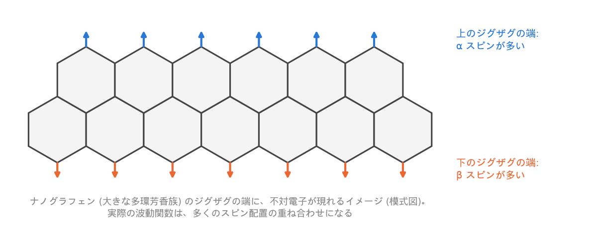

**図 15**　ナノグラフェンのジグザグの端に不対電子が現れるイメージ（模式図）。上の端に α スピン、下の端に β スピンが多くなる様子を矢印で描きました。実際の多参照の波動関数は、1 つのスピン配置ではなく、多くのスピン配置の重ね合わせです。

同じグループは、磁性有機分子の原型であるポリ(m-フェニレンカルベン) も DMRG で調べています [Mizukami 2010]。高スピンと低スピンのエネルギー差（スピンギャップ）が、カルベンの数を増やすと小さくなること、これは DFT を含む単参照の方法の予測とまったく逆であること、また、その大きさの依存性に偶奇の振動があり、1 つの交換定数のハイゼンベルク模型では説明できないことが示されました。

### 6.3 分子と分子の間の結合：反芳香族分子の近い積層

π 電子系の分子は、面と面を向かい合わせて重なること（π 積層）があります。不対電子を 1 個持つ π ラジカルは、2 つの分子の不対電子の軌道が重なって、積層した二量体をつくることがよくあります。この結合は、2 つの分子にまたがる「多中心 2 電子結合」とみなされています。

Kino らは、これとは違い、4 個の電子が関わる多中心の結合を報告しました [Kino 2024]。対象は、反芳香族（環をめぐる π 電子の数が 4n 個で、芳香族とは逆に不安定になりやすい性質）のポルフィリン類縁体、Ni(II) ビス(ペンタフルオロフェニル)ノルコロールです。その二量体は、2.97 Å という非常に短い距離で面と面を向かい合わせて積層していました。グラファイトの層の間隔（約 3.35 Å）と比べると、どれほど近いかが分かります。この近い積層は、2 つの分子の間の多中心 4 電子結合の相互作用によるもので、結合にあずかる電子は放射光の X 線回折で実験的に観測され、理論計算でも裏づけられました。分子軌道どうしの相互作用によって、積層した二量体は、単量体とははっきり違う芳香族性を帯びます。

### 6.4 この界隈の常識

- **開殻一重項（ジラジカル）は、制限された計算（RHF、RKS）では表せない。** α と β の電子を同じ空間軌道に入れる制限のせいで、「左右に 1 個ずつ」の配置が書けないからです。UHF や UKS で対称性を破るか、CASSCF などの多参照の方法を使います（6.1 節の箱）。
- **UHF、UKS のスピン密度にはスピン汚染が混ざる。⟨Ŝ²⟩ の値を必ず確かめる。** 混ざった高いスピン状態の分だけ、スピン密度が大きく出ることがあるからです（5.1 節の箱）。
- **「ジラジカル性」「ラジカル性」は、自然軌道の占有数から定義する指標が使われる。定義が複数あるので、どの指標かを確かめる。** 同じ分子でも、指標によって違う数字になりうるからです。
- **π 電子系の大きな活性空間は、π 軌道をすべて入れる「全 π 価電子の活性空間」がよく使われる。** π 軌道はどれもフロンティア軌道に近いエネルギーにあり、どれを外すかを恣意的に決めにくいからです。全 π の活性空間は大きくなるので、DMRG がこの用途で威力を発揮します。
- **不安定な開殻分子でも、かさ高い置換基やホウ素などの元素で安定化して単離できることがあり、計算と合成が協力する研究が多い。** 計算で「どこに不対電子がいるか」が分かれば、そこを保護する置換基を設計できるからです。

## この分野でよく出てくる言葉

| 言葉 | 意味 |
|---|---|
| 電子配置 | 電子がどの軌道に何個入っているかの組。1 つのスレーター行列式で表す |
| 多参照性 | 1 つの電子配置では表せない性質。強い静的相関 |
| 活性空間 | 多参照の方法で、配置の混ざりを厳密に扱う軌道と電子の組 |
| 主配置の重み | 多参照の波動関数で、いちばん重い配置の係数の 2 乗。1 に近いほど単参照的 |
| T1・D1 診断 | CCSD の 1 電子励起の振幅から求める、多参照性の目安 |
| 自然軌道 | 1 電子密度行列を対角化して得られる軌道 |
| 占有数 | 自然軌道に入っている電子の数（0〜2）。1 に近いとラジカル的 |
| 軌道のエントロピー | ある軌道が、ほかの軌道とどれだけもつれているかの指標 |
| 相互情報量 | 2 つの軌道の間のもつれの指標 |
| 高スピン・低スピン | 不対電子が多い状態と少ない状態 |
| スピンクロスオーバー | 温度、圧力、光などでスピン状態が切り替わる現象 |
| スピン密度 | α スピンの密度から β スピンの密度を引いたもの。不対電子の居場所 |
| スピン汚染 | UHF などの波動関数に、ほかのスピン状態が混ざること。⟨Ŝ²⟩ のずれで分かる |
| 交換相互作用 J | 2 つのスピンの向きをそろえる、または逆向きにする相互作用の強さ |
| 超交換 | 橋かけの配位子の軌道を介した交換相互作用 |
| broken-symmetry 解 | スピンの対称性を破った DFT や UHF の解。J の見積もりに使う |
| 非無垢な配位子 | 電子を出し入れしやすく、金属の酸化数をあいまいにする配位子 |
| Enemark–Feltham の表記 | {MNO}ⁿ。金属の d 電子と NO の π* 電子の数の和 n で錯体を表す |
| セミコア | 価電子のすぐ内側の殻の電子。第一遷移金属では 3s、3p |
| CASPT2/CC | 価電子の相関を CASPT2、セミコアの相関を CCSD(T) で求めて足し合わせる方法 |
| 2 状態反応性 | 反応の途中で、2 つのスピン状態のポテンシャル面が入れ替わる反応 |
| ジラジカル性 | 2 つの電子が対をつくらずに残っている度合い |

## この分野の常識：まとめ

- **波動関数を求めるだけでは終わらない。化学の言葉（結合、酸化数、スピン）に翻訳して初めて研究になる。** 何十億もの係数の集まりのままでは、化学者が実験の設計や解釈に使えないからです。
- **多参照性は、占有数、主配置の重み、T1・D1 診断を組み合わせて確かめる。** どの指標にも見逃しがあり、1 つでは「大丈夫」と言い切れないからです。
- **自然軌道の占有数は、多参照性とラジカル性を見る最も基本的な道具。** 多くの配置が混ざった波動関数からでも、軌道ごとの「電子の数」として直感的に読めるからです。
- **エンタングルメント（軌道のエントロピー、相互情報量）は、どの軌道が強く結びついているかを示す。ただし、何を測っているのかを理解して使う。** スピンのもつれと化学結合のもつれが混ざって見えることがあるからです（5.1 節）。
- **遷移金属のクラスターや大きなラジカルでは、DFT の結果が汎関数で大きく変わる。DMRG などの多参照の方法で確かめる。** 汎関数ごとに静的相関の取り込み方が違うからです。
- **スピン状態のエネルギー差は、HF 交換の割合に強く依存する。万能な汎関数はない。参照に使う CASPT2 や CCSD(T) にも、系統的な偏りがありうる。** HF 交換の割合は系によって最適値が変わるパラメーターで、参照の方法にも、それぞれ苦手な相関があるからです。
- **スピン状態を実験と比べるときは、エントロピーも入れる。** 高スピン状態はエントロピーが大きく、温度で安定な状態が入れ替わるからです。
- **交換相互作用 J の定義には流儀が 2 つある（−2J と −J）。** 比べる前にそろえないと、2 倍の違いを見誤るからです。
- **酸化数は形式的なもので、非無垢な配位子があるとあいまいになる。共鳴形の重みなど複数の指標で判断する。** 電子を割り当てる約束が、配位子が電子を出し入れすると一通りに決まらなくなるからです。
- **開殻一重項は制限された方法では表せない。UHF のスピン汚染に注意する。** 制限された方法はイオン的な形を含んだままになり、制限しない方法はほかのスピン状態が混ざるからです。
- **長い π 共役系（アセン、ナノグラフェン）は、大きくなるとラジカル性を帯びる。** π 電子が増えると HOMO と LUMO のエネルギーが近づき、2 つの配置がほぼ同じエネルギーで混ざるからです。
- **計算の結果は、ESR、磁化率、X 線吸収などの実験と比べて確かめる。** スピン密度、J、酸化数などは、どれも計算の約束に依存する量なので、実験で測れる量と結びつけて初めて確かになるからです。

## 最初に読むとよい文献

- A. Szabo, N. S. Ostlund, "Modern Quantum Chemistry"：分子軌道、HF 法、電子相関の基礎。H₂ の解離の RHF と配置間相互作用の例も、この本で詳しく扱われています。
- B. O. Roos ほか, "Multiconfigurational Quantum Chemistry"：CASSCF と CASPT2 を中心とした多配置の方法と、その応用の教科書。
- G. K.-L. Chan, S. Sharma, "The Density Matrix Renormalization Group in Quantum Chemistry" [Chan 2011]：強相関の系に DMRG を使うための総説。
- M. Swart, "Spin states of (bio)inorganic systems: Successes and pitfalls" [Swart 2013]：スピン状態の計算の成功と落とし穴。
- M. Feldt, Q. M. Phung, "Ab Initio Methods in First-Row Transition Metal Chemistry" [Feldt 2022]：第一遷移金属の錯体のスピン状態に使う、局所結合クラスター法と多参照の方法の短い総説。
- M. Abe, "Diradicals" [Abe 2013]：ジラジカルの化学の総説。

## 講義ノートとの関係

- [量子化学の理論 第 4 回　スピン](../courses/qc-theory/04-spin.md)、[第 5 回　Hartree–Fock 法](../courses/qc-theory/05-hartree-fock.md)：スピン状態、UHF とスピン汚染の基礎（5.1 節、6 節）。
- [量子化学の理論 第 7 回　電子相関](../courses/qc-theory/07-electron-correlation.md)、[第 12 回　CASSCF](../courses/qc-theory/12-casscf.md)：静的相関と多参照性、自然軌道（2 節）。
- [量子化学の理論 第 10 回　結合クラスター法](../courses/qc-theory/10-coupled-cluster.md)：T1・D1 診断（2.2 節）。
- [量子化学の理論 第 14 回　DMRG と選択的 CI](../courses/qc-theory/14-dmrg-sci.md)：大きな活性空間とエンタングルメント（2.4 節、3 節）。
- [遷移金属錯体 第 1 回　配位子場](../courses/tm-complexes/01-ligand-field.md)、[第 3 回　スピン状態](../courses/tm-complexes/03-spin-states.md)、[第 5 回　スピン状態のエネルギー](../courses/tm-complexes/05-spin-state-energetics.md)：4 節の背景。
- [遷移金属錯体 第 10 回　多参照の方法](../courses/tm-complexes/10-multireference-tm.md)：遷移金属錯体への多参照の方法の応用と、多参照性の診断（2.2 節、3 節、5 節）。

## 参考文献

- P.-O. Löwdin, "Quantum Theory of Many-Particle Systems. I. Physical Interpretations by Means of Density Matrices, Natural Spin-Orbitals, and Convergence Problems in the Method of Configurational Interaction", Phys. Rev. 97, 1474 (1955). DOI: [10.1103/PhysRev.97.1474](https://doi.org/10.1103/PhysRev.97.1474)
- W. Jiang, N. J. DeYonker, A. K. Wilson, "Multireference Character for 3d Transition-Metal-Containing Molecules", J. Chem. Theory Comput. 8, 460 (2012). DOI: [10.1021/ct2006852](https://doi.org/10.1021/ct2006852)
- M. Head-Gordon, "Characterizing unpaired electrons from the one-particle density matrix", Chem. Phys. Lett. 372, 508 (2003). DOI: [10.1016/S0009-2614(03)00422-6](https://doi.org/10.1016/S0009-2614(03)00422-6)
- K. Boguslawski, P. Tecmer, Ö. Legeza, M. Reiher, "Entanglement Measures for Single- and Multireference Correlation Effects", J. Phys. Chem. Lett. 3, 3129 (2012). DOI: [10.1021/jz301319v](https://doi.org/10.1021/jz301319v)
- Y. Umena, K. Kawakami, J.-R. Shen, N. Kamiya, "Crystal structure of oxygen-evolving photosystem II at a resolution of 1.9 Å", Nature 473, 55 (2011). DOI: [10.1038/nature09913](https://doi.org/10.1038/nature09913)
- Y. Kurashige, G. K.-L. Chan, T. Yanai, "Entangled quantum electronic wavefunctions of the Mn4CaO5 cluster in photosystem II", Nat. Chem. 5, 660 (2013). DOI: [10.1038/nchem.1677](https://doi.org/10.1038/nchem.1677)
- S. Sharma, K. Sivalingam, F. Neese, G. K.-L. Chan, "Low-energy spectrum of iron–sulfur clusters directly from many-particle quantum mechanics", Nat. Chem. 6, 927 (2014). DOI: [10.1038/nchem.2041](https://doi.org/10.1038/nchem.2041)
- Z. Li, S. Guo, Q. Sun, G. K.-L. Chan, "Electronic landscape of the P-cluster of nitrogenase as revealed through many-electron quantum wavefunction simulations", Nat. Chem. 11, 1026 (2019). DOI: [10.1038/s41557-019-0337-3](https://doi.org/10.1038/s41557-019-0337-3)
- Q. M. Phung, T. Yanai, D. Plessers, B. F. Sels, R. A. Schoonheydt, K. Pierloot, "Homolytic versus Heterolytic Methane Hydroxylation in Copper Zeolites", ACS Catal. 15, 1249 (2025). DOI: [10.1021/acscatal.4c06246](https://doi.org/10.1021/acscatal.4c06246)
- M. Reiher, O. Salomon, B. A. Hess, "Reparameterization of hybrid functionals based on energy differences of states of different multiplicity", Theor. Chem. Acc. 107, 48 (2001). DOI: [10.1007/s00214-001-0300-3](https://doi.org/10.1007/s00214-001-0300-3)
- M. Dey, A. Ray, V. Austen, Q. M. Phung, T. Yanai, A. Paul, D. Ghosh, "High-quality quantum chemical data for spin state determination in transition-metal complexes", Phys. Chem. Chem. Phys. 28, 6470 (2026). DOI: [10.1039/D5CP03964A](https://doi.org/10.1039/D5CP03964A)
- N. Bibi, E. G. R. de Arruda, A. Domingo, A. A. Oliveira, C. Galuppo, Q. M. Phung, N. M. Orra, F. Béron, A. Paesano, K. Pierloot, A. L. B. Formiga, "Switching the Spin-Crossover Phenomenon by Ligand Design on Imidazole–Diazineiron(II) Complexes", Inorg. Chem. 57, 14603 (2018). DOI: [10.1021/acs.inorgchem.8b02278](https://doi.org/10.1021/acs.inorgchem.8b02278)
- K. Pierloot, Q. M. Phung, A. Domingo, "Spin State Energetics in First-Row Transition Metal Complexes: Contribution of (3s3p) Correlation and Its Description by Second-Order Perturbation Theory", J. Chem. Theory Comput. 13, 537 (2017). DOI: [10.1021/acs.jctc.6b01005](https://doi.org/10.1021/acs.jctc.6b01005)
- Q. M. Phung, M. Feldt, J. N. Harvey, K. Pierloot, "Toward Highly Accurate Spin State Energetics in First-Row Transition Metal Complexes: A Combined CASPT2/CC Approach", J. Chem. Theory Comput. 14, 2446 (2018). DOI: [10.1021/acs.jctc.8b00057](https://doi.org/10.1021/acs.jctc.8b00057)
- M. Feldt, Q. M. Phung, K. Pierloot, R. A. Mata, J. N. Harvey, "Limits of Coupled-Cluster Calculations for Non-Heme Iron Complexes", J. Chem. Theory Comput. 15, 922 (2019). DOI: [10.1021/acs.jctc.8b00963](https://doi.org/10.1021/acs.jctc.8b00963)
- Q. M. Phung, C. Martín-Fernández, J. N. Harvey, M. Feldt, "Ab Initio Calculations for Spin-Gaps of Non-Heme Iron Complexes", J. Chem. Theory Comput. 15, 4297 (2019). DOI: [10.1021/acs.jctc.9b00370](https://doi.org/10.1021/acs.jctc.9b00370)
- Q. M. Phung, H. N. Nam, M. Saitow, "Unraveling the Spin-State Energetics of FeN4 Complexes with Ab Initio Methods", J. Phys. Chem. A 127, 7544 (2023). DOI: [10.1021/acs.jpca.3c04254](https://doi.org/10.1021/acs.jpca.3c04254)
- M. Feldt, Q. M. Phung, "Ab Initio Methods in First-Row Transition Metal Chemistry", Eur. J. Inorg. Chem. 2022, e202200014 (2022). DOI: [10.1002/ejic.202200014](https://doi.org/10.1002/ejic.202200014)
- M. Swart, "Spin states of (bio)inorganic systems: Successes and pitfalls", Int. J. Quantum Chem. 113, 2 (2013). DOI: [10.1002/qua.24255](https://doi.org/10.1002/qua.24255)
- L. Noodleman, "Valence bond description of antiferromagnetic coupling in transition metal dimers", J. Chem. Phys. 74, 5737 (1981). DOI: [10.1063/1.440939](https://doi.org/10.1063/1.440939)
- C. J. Stein, D. A. Pantazis, V. Krewald, "Orbital Entanglement Analysis of Exchange-Coupled Systems", J. Phys. Chem. Lett. 10, 6762 (2019). DOI: [10.1021/acs.jpclett.9b02417](https://doi.org/10.1021/acs.jpclett.9b02417)
- J. Chalupský, M. Srnec, T. Yanai, "Interpretation of Exchange Interaction through Orbital Entanglement", J. Phys. Chem. Lett. 12, 1268 (2021). DOI: [10.1021/acs.jpclett.0c03652](https://doi.org/10.1021/acs.jpclett.0c03652)
- P. Karen, P. McArdle, J. Takats, "Comprehensive definition of oxidation state (IUPAC Recommendations 2016)", Pure Appl. Chem. 88, 831 (2016). DOI: [10.1515/pac-2015-1204](https://doi.org/10.1515/pac-2015-1204)
- Q. M. Phung, Y. Muchammad, T. Yanai, A. Ghosh, "A DMRG/CASPT2 Investigation of Metallocorroles: Quantifying Ligand Noninnocence in Archetypal 3d and 4d Element Derivatives", JACS Au 1, 2303 (2021). DOI: [10.1021/jacsau.1c00417](https://doi.org/10.1021/jacsau.1c00417)
- K. Pierloot, Q. M. Phung, A. Ghosh, "Electronic Structure of Neutral and Anionic Iron–Nitrosyl Corrole. A Multiconfigurational and Density Matrix Renormalization Group Investigation", Inorg. Chem. 59, 11493 (2020). DOI: [10.1021/acs.inorgchem.0c01312](https://doi.org/10.1021/acs.inorgchem.0c01312)
- Q. M. Phung, H. N. Nam, A. Ghosh, "Local Oxidation States in {FeNO}6–8 Porphyrins: Insights from DMRG/CASSCF–CASPT2 Calculations", Inorg. Chem. 62, 20496 (2023). DOI: [10.1021/acs.inorgchem.3c03689](https://doi.org/10.1021/acs.inorgchem.3c03689)
- Q. M. Phung, H. N. Nam, V. Austen, T. Yanai, A. Ghosh, "NO Oxidation States in Nonheme Iron Nitrosyls: A DMRG-CASSCF Study of {FeNO}6–10 Complexes", Inorg. Chem. 64, 1702 (2025). DOI: [10.1021/acs.inorgchem.4c03845](https://doi.org/10.1021/acs.inorgchem.4c03845)
- Q. M. Phung, K. Pierloot, "The dioxygen adducts of iron and manganese porphyrins: electronic structure and binding energy", Phys. Chem. Chem. Phys. 20, 17009 (2018). DOI: [10.1039/C8CP03078B](https://doi.org/10.1039/C8CP03078B)
- M. Abe, "Diradicals", Chem. Rev. 113, 7011 (2013). DOI: [10.1021/cr400056a](https://doi.org/10.1021/cr400056a)
- M. Bendikov, H. M. Duong, K. Starkey, K. N. Houk, E. A. Carter, F. Wudl, "Oligoacenes: Theoretical Prediction of Open-Shell Singlet Diradical Ground States", J. Am. Chem. Soc. 126, 7416 (2004). DOI: [10.1021/ja048919w](https://doi.org/10.1021/ja048919w)
- J. Hachmann, J. J. Dorando, M. Avilés, G. K.-L. Chan, "The radical character of the acenes: A density matrix renormalization group study", J. Chem. Phys. 127, 134309 (2007). DOI: [10.1063/1.2768362](https://doi.org/10.1063/1.2768362)
- W. Mizukami, Y. Kurashige, T. Yanai, "More π Electrons Make a Difference: Emergence of Many Radicals on Graphene Nanoribbons Studied by Ab Initio DMRG Theory", J. Chem. Theory Comput. 9, 401 (2013). DOI: [10.1021/ct3008974](https://doi.org/10.1021/ct3008974)
- W. Mizukami, Y. Kurashige, T. Yanai, "Communication: Novel quantum states of electron spins in polycarbenes from ab initio density matrix renormalization group calculations", J. Chem. Phys. 133, 091101 (2010). DOI: [10.1063/1.3476461](https://doi.org/10.1063/1.3476461)
- S. Kino, S. Ukai, N. Fukui, R. Haruki, R. Kumai, Q. Wang, S. Horike, Q. M. Phung, D. Sundholm, H. Shinokubo, "Close Stacking of Antiaromatic Ni(II) Norcorrole Originating from a Four-Electron Multicentered Bonding Interaction", J. Am. Chem. Soc. 146, 9311 (2024). DOI: [10.1021/jacs.4c01142](https://doi.org/10.1021/jacs.4c01142)
- G. K.-L. Chan, S. Sharma, "The Density Matrix Renormalization Group in Quantum Chemistry", Annu. Rev. Phys. Chem. 62, 465 (2011). DOI: [10.1146/annurev-physchem-032210-103338](https://doi.org/10.1146/annurev-physchem-032210-103338)
- Q. Sun et al., "Recent developments in the PySCF program package", J. Chem. Phys. 153, 024109 (2020). DOI: [10.1063/5.0006074](https://doi.org/10.1063/5.0006074)
- A. Szabo, N. S. Ostlund, "Modern Quantum Chemistry" (Dover, 1996). ISBN: 9780486691862
- B. O. Roos, R. Lindh, P. Å. Malmqvist, V. Veryazov, P.-O. Widmark, "Multiconfigurational Quantum Chemistry" (Wiley, 2016). ISBN: 9780470633465
