# 反応と触媒：反応のしくみを計算で解き明かす研究

!!! abstract "このページで分かること"
    化学反応が「どの道を通って」「どのくらいの速さで」進むのかを、量子化学の計算で調べる分野を紹介します。
    反応の地図であるポテンシャルエネルギー曲面、峠にあたる遷移状態、障壁の高さから速度を出す Eyring 式が、分野全体の共通語です。
    その上に、触媒、光触媒、プロトン共役電子移動、金属酵素とゼオライト、反応経路の自動探索という小分類があります。

    | 節 | 小分類 | キーワード |
    |---|---|---|
    | 2 | 反応の機構と遷移状態 | 反応座標、鞍点、IRC、活性化エネルギー、Eyring 式 |
    | 3 | 遷移金属触媒・均一系触媒 | 触媒サイクル、律速段階、エネルギースパン |
    | 4 | 光触媒・光レドックス触媒 | 励起状態の酸化還元、HAT、機械学習による触媒探索 |
    | 5 | プロトン共役電子移動 | 電子と H⁺ の協奏的な移動、振電結合 |
    | 6 | 金属酵素とゼオライト | 多核の金属中心、メタンの水酸化、金属オキソ種、多参照法 |
    | 7 | 反応経路の自動探索 | GRRM、AFIR、反応経路の網目 |

!!! tip "ひとことで言うと"
    反応の計算は、山あいの地図を作って、峠越えの道を探す作業です。
    反応物と生成物は谷にあたり、分子はいちばん低い峠を越えて隣の谷へ移ります。
    峠の高さ（活性化エネルギー）が分かれば、反応の速さが見積もれます。
    触媒は、もっと低い峠を通る別の道を用意する「トンネル工事」のようなものです。
    この分野の研究者は、峠の位置と高さを計算で求め、「なぜこの反応は進むのか」「どうすれば速くなるか」を説明・予測します。

## 1. この分野が答えようとしている問い

実験で反応を見ると、分かるのはふつう「何から何ができたか」と「どのくらいの時間がかかったか」だけです。
途中の分子の形は、寿命が短すぎてほとんど観測できません。
計算は、この見えない途中の部分を補います。
この分野の問いは、おおむね次の 4 つにまとめられます。

- **どの道を通るのか（反応機構）**：どの結合が、どの順番で切れたりできたりするのか。中間体はあるのか。
- **どのくらい速いのか（速度）**：いちばん高い峠はどこで、その高さはいくらか。
- **どれができるのか（選択性）**：2 つの生成物ができうるとき、どちらがどれだけ多くできるのか。
- **どうすればよくなるのか（設計）**：触媒や置換基をどう変えれば、峠が低くなるのか。

これらの問いは、すべて図 1 のような**エネルギー図**の上で考えます。

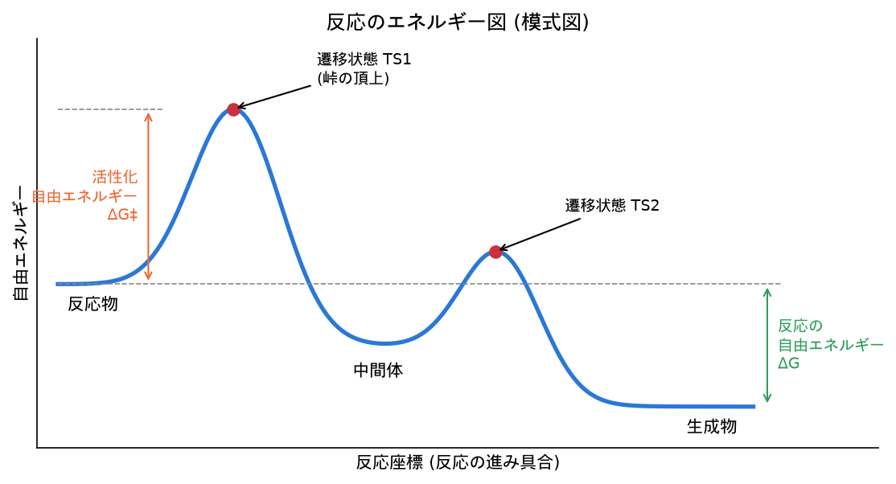

**図 1**　反応のエネルギー図（模式図）。横軸は反応の進み具合（反応座標）、縦軸は自由エネルギーです。谷が反応物・中間体・生成物、山の頂上（赤い点）が遷移状態です。反応物から遷移状態までの高さ ΔG‡ が速さを決め、反応物と生成物の差 ΔG が、反応がどちらへ偏るか（平衡）を決めます。

ΔG‡ と ΔG は別物です。
ΔG が大きな負の値でも（生成物がずっと安定でも）、ΔG‡ が高ければ反応は進みません。
木炭が空気中で勝手に燃えないのは、この例です。

## 2. 有機反応の機構と遷移状態

### 2.1 何をする研究か

分子のエネルギーは、原子の位置（分子の形）によって変わります。
このエネルギーを原子の座標の関数として見たものを**ポテンシャルエネルギー曲面**（potential energy surface, PES）と呼びます。
N 個の原子からなる分子では、形を決める座標は 3N − 6 個あるので、曲面は高い次元の「地形」です。
図 2 は、2 つの座標だけを持つ模型の曲面です。

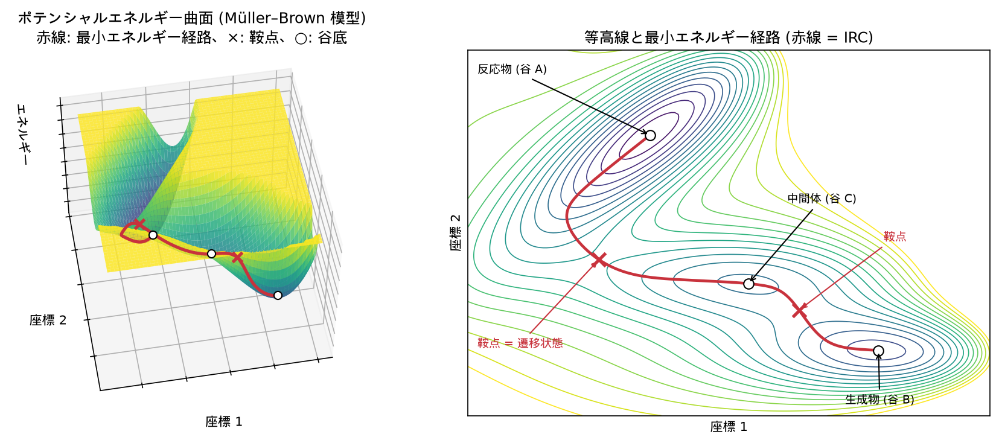

**図 2**　2 次元の模型（Müller–Brown ポテンシャル）のエネルギー曲面（左、3D）と等高線（右）。白丸は谷底（安定な構造）、× は鞍点（遷移状態）、赤線は鞍点から両側の谷へ最も急な下り坂をたどった最小エネルギー経路です。左の 3D 図では、高い所を平らに切り取っています。この模型では、反応物の谷 A から中間体の谷 C を経て、生成物の谷 B へ 2 つの峠を越えて進みます。

地形の中で特別な点は 2 種類です（図 3）。

- **安定構造（谷底）**：どの方向に動いてもエネルギーが上がる点です。反応物、中間体、生成物がこれにあたります。
- **遷移状態（鞍点）**：ある 1 方向だけは下り坂で、ほかのすべての方向は上り坂の点です。馬の鞍や、山道の峠の形です。

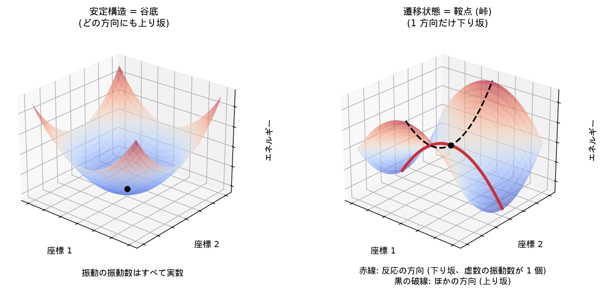

**図 3**　谷底（左）と鞍点（右）の 3D 図。鞍点では、赤線の方向（反応の方向）だけが下り坂で、黒の破線の方向は上り坂です。振動数を計算すると、下り坂の方向は「虚数の振動数」として現れます。遷移状態であることを確かめるには、虚数の振動数がちょうど 1 個あることを見ます。

鞍点から、両側の谷へ向かって最も急な下り坂をたどった道を、**固有反応座標**（intrinsic reaction coordinate, IRC）と呼びます。
福井謙一が提案した考え方で、反応の「道筋」を一本の曲線として定義します [Fukui 1981]。
計算の現場では、遷移状態を見つけたら IRC 計算を行い、その遷移状態が本当に目的の反応物と生成物をつないでいるかを確かめます。

### 2.2 峠の高さから速さへ：Eyring 式

遷移状態の理論（transition state theory）では、反応物と遷移状態の間に平衡が成り立つと考えて、速度定数 $k$ を次の式で表します [Eyring 1935; Truhlar 1996]。

$$
k = \frac{k_\mathrm{B} T}{h} \exp\!\left( -\frac{\Delta G^\ddagger}{RT} \right)
$$

$k_\mathrm{B}$ はボルツマン定数、$h$ はプランク定数、$T$ は温度、$R$ は気体定数です。
前の因子 $k_\mathrm{B}T/h$ は、298 K で約 $6 \times 10^{12}$ s⁻¹ です。
これは、遷移状態に着いた分子が向こう側へ越えていく「試行の頻度」と考えることができます。
指数の部分は、分子が峠の高さ $\Delta G^\ddagger$ まで登れる割合（ボルツマン因子）です。

この式から、計算の世界でよく使う目安が出てきます（図 4）。

- 298 K では、$\Delta G^\ddagger$ が 1.36 kcal/mol 高くなるごとに、速度は 1/10 になります（$RT \ln 10 = 1.36$ kcal/mol）。
- 1 次反応の半減期は、$\Delta G^\ddagger$ = 20 kcal/mol で約 1 分、25 kcal/mol で約 3 日です（298 K、上の式で計算した値）。
- したがって、「室温で数時間で進む反応」の障壁は、おおむね 20 kcal/mol 台の前半です。

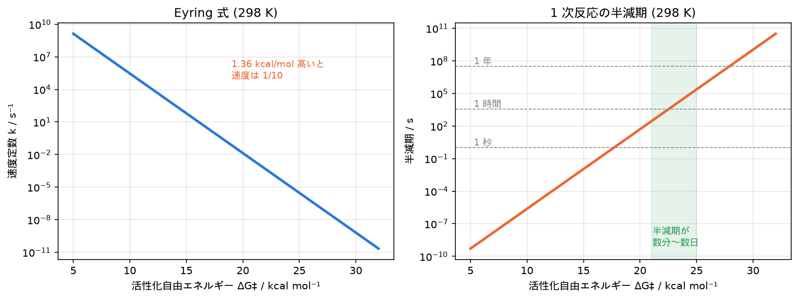

**図 4**　Eyring 式による、298 K での速度定数（左）と 1 次反応の半減期（右）。縦軸は対数です。ΔG‡ が 1.36 kcal/mol 変わるごとに、速度が 10 倍変わります。緑の帯は、半減期が数分から数日になる範囲（ΔG‡ = 21〜25 kcal/mol）です。

この「1.36 kcal/mol で 10 倍」は、計算の精度の話でも大切です。
障壁の誤差が 3 kcal/mol あると、速度は 100 倍以上ずれます。
2 つの生成物の比（選択性）を予測するときも、2 つの遷移状態のエネルギー差が 1.4 kcal/mol で 10：1、2.7 kcal/mol で 100：1 です。
このため、選択性の予測には、とくに高い精度が求められます [Harvey 2019]。

### 2.3 よく使う方法とプログラム

- **構造の最適化と振動数の計算**：密度汎関数理論（DFT）で行うのがふつうです。分散力の補正（D3 など）を加えた混成汎関数がよく使われます。振動数の計算で、谷底（虚数の振動数が 0 個）か遷移状態（1 個）かを確かめ、同時に自由エネルギーの補正（零点エネルギー、熱の寄与、エントロピー）を求めます。
- **エネルギーの精密化**：DFT で求めた構造で、DLPNO-CCSD(T) などのより精度の高い方法の 1 点計算を行い、エネルギーだけを置き換えることがよくあります。
- **溶媒の効果**：溶液の反応では、PCM や SMD などの連続誘電体モデルを使います。
- **汎関数の選び方**：主族元素の反応エネルギーと障壁については、GMTKN55 という大きなベンチマーク集で多くの汎関数が比べられています [Goerigk 2017]。
- **プログラム**：Gaussian、ORCA、Q-Chem、Turbomole など。遷移状態の探索、IRC、振動数の計算は、どのプログラムにもあります。

### 2.4 この界隈の常識

- 遷移状態の構造を出すときは、「虚数の振動数が 1 個」と「IRC で反応物と生成物につながる」の 2 つを確かめたことを書きます。
- エネルギー図は、電子エネルギー（$\Delta E$）ではなく、自由エネルギー（$\Delta G$）で描くのが標準です。どちらで描いたかを必ず書きます。
- 計算の結果は、エントロピーの扱い、溶媒和、計算に使う構造のモデル、配座（分子のねじれ方）の探し方に大きく左右されます。電子状態の方法（汎関数など）だけが精度を決めるのではありません [Harvey 2019]。
- 分子がとりうる配座が多いときは、最も安定な配座を探し漏らすと、障壁を大きく間違えます。

## 3. 遷移金属触媒・均一系触媒

### 3.1 何をする研究か

触媒は、反応の前後で自分は変わらずに、反応を速くする物質です。
均一系触媒（反応物と同じ溶液に溶けている触媒）の多くは、Pd、Ni、Rh、Ir、Fe、Cu などの遷移金属錯体です。
触媒は反応の途中で基質と結合し、いくつかの段階を経て生成物を放し、元の形に戻ります。
この一回りを**触媒サイクル**と呼びます（図 5）。

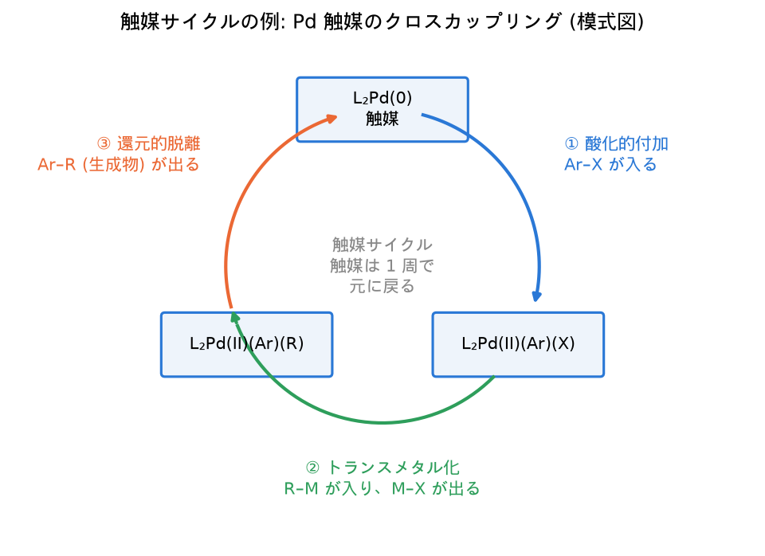

**図 5**　Pd 触媒のクロスカップリングの触媒サイクル（模式図）。① 酸化的付加で Ar–X の結合が金属に入り、Pd の酸化数が 0 から +2 になります。② トランスメタル化で、もう一方の有機基 R が金属に移ります。③ 還元的脱離で Ar–R がつながって離れ、Pd(0) に戻ります。L は配位子です。

計算でやることは、サイクルの各段階の中間体と遷移状態をすべて求め、1 枚のエネルギー図につなぐことです。
そこから、どの段階が遅いのか、配位子を変えると何が変わるのかを議論します。

### 3.2 律速段階ではなく、エネルギースパン

触媒の性能は、触媒 1 分子が単位時間に何回サイクルを回すか（ターンオーバー頻度、TOF）で表します。
「いちばん高い遷移状態が律速段階で、その高さが TOF を決める」と考えたくなりますが、触媒サイクルではそうとは限りません。
Kozuch と Shaik の**エネルギースパンモデル**は、TOF が 1 組の状態で決まることを示しました [Kozuch 2010]。

- **TDTS**（TOF-determining transition state）：TOF を決める遷移状態。
- **TDI**（TOF-determining intermediate）：TOF を決める中間体。
- TDTS が TDI より後にあるとき、その差が**エネルギースパン** δE です。TDTS が TDI より前にあるときは、反応全体の ΔG を足します。TOF は、δE を見かけの活性化エネルギーとして Eyring 式の形で書けます。

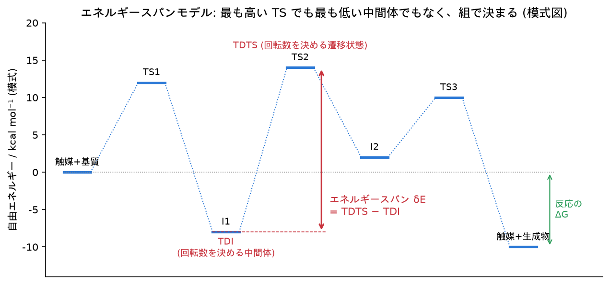

**図 6**　エネルギースパンモデル（模式図）。この例では、最も低い中間体 I1 が TDI、その後の最も高い遷移状態 TS2 が TDTS になり、両者の差 δE（この図では 22 kcal/mol）が TOF を決めます。TS2 の高さ（14 kcal/mol）を出発点から測っただけでは、障壁を小さく見積もってしまいます。

Kozuch と Shaik は、TDI と TDTS が、最も低い状態や最も高い状態とは限らず、隣り合った段階である必要もないことを強調しています。
「触媒には律速段階ではなく、律速の状態がある」というのが、この論文の主張です [Kozuch 2010]。

### 3.3 よく使う方法と注意

- DFT がほぼ唯一の現実的な選択肢です。ただし、遷移金属では汎関数による違いが大きいので、いくつかの汎関数で結果を比べたり、DLPNO-CCSD(T) で確かめたりします。
- 配位子の数や、溶媒が配位するかどうか、スピン状態など、モデルの選び方に任意性があります。Harvey らの総説は、これらが電子状態の方法と同じくらい結果を左右すると指摘しています [Harvey 2019]。

### 3.4 この界隈の常識

- 触媒サイクルのエネルギー図では、いちばん高い山だけを見ずに、その前のいちばん深い谷も見ます。
- 遷移金属錯体では、スピン状態が違う曲面が交わることがあります（2 状態反応性）。スピン状態ごとに計算します。
- 実験で分かっている選択性や速度の傾向を、計算が再現できるかをまず確かめてから、予測に使います。

## 4. 光触媒・光レドックス触媒

### 4.1 何をする研究か

光レドックス触媒は、光を吸収して励起状態になった触媒（光増感剤）が、基質と電子をやりとりして反応を起こすものです [Prier 2013]。
励起状態の分子は、基底状態より電子を渡しやすく、受け取りやすくもなります。
光のエネルギーを使って、ふだんは起こりにくい 1 電子の酸化・還元を、室温で起こせるのが特徴です。

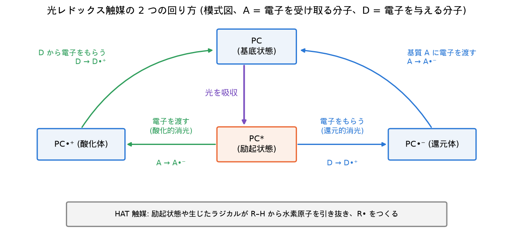

**図 7**　光レドックス触媒の 2 つの回り方（模式図）。光を吸収した PC* が、電子を受け取る場合（右、還元的消光）と、電子を渡す場合（左、酸化的消光）があります。どちらの場合も、もう一度電子をやりとりして PC に戻ります。下の箱は、水素原子移動（HAT）による基質の活性化です。

もう 1 つの重要な方法が、**水素原子移動**（hydrogen atom transfer, HAT）による活性化です。
励起状態の触媒（直接型）や、光触媒のサイクルでつくられたラジカル（間接型）が、基質の C–H などの結合から水素原子を引き抜き、反応性の高いラジカルをつくります [Capaldo 2017]。

計算では、励起エネルギー、励起状態の酸化還元電位、三重項の寿命などを求め、どの触媒が効くかを説明します。
励起状態を扱うので、TDDFT などの励起状態の方法が必要です（[励起状態と光化学](04-excited-states.md)のページも参照）。

### 4.2 代表的な研究例：機械学習で光増感剤を選ぶ

光触媒の性能は、励起状態の性質だけでなく、多くの要因の組み合わせで決まります。
このため、量子化学の計算と機械学習、実験を組み合わせて、触媒を選ぶ研究が増えています（図 8）。

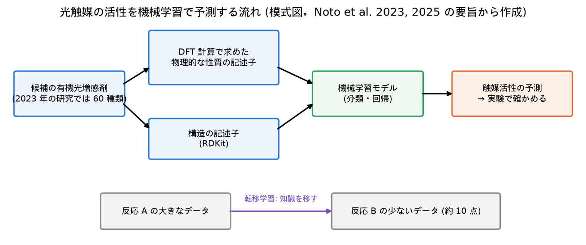

**図 8**　光触媒の活性を機械学習で予測する流れ（模式図。Noto et al. 2023、2025 の要旨から作成）。DFT 計算で求めた物理的な性質と、構造の記述子を組み合わせてモデルを作ります。下の段は転移学習で、ある反応で学んだ知識を、データの少ない別の反応に移します。

- **Noto, Yada, Yanai, Saito（2023）**：Ni(II) の塩と有機光増感剤を使ってフェノールを合成する反応で、60 種類の有機光増感剤の触媒活性を調べました。DFT 計算で求めた物理的な記述子と、RDKit で求めた構造の記述子を両方使うと、片方だけの場合より、適合率と再現率のバランスのよい分類モデルが得られました [Noto 2023]。
- **Noto et al.（2025）**：光触媒のクロスカップリング反応で得た有機光増感剤の知識を、種類の違う [2+2] 環化付加反応の予測に移す転移学習（ドメイン適応）を行いました。10 点の学習データだけでも、満足できる予測ができたと報告しています [Noto 2025]。
- **Kunisada et al.（2026）**：光増感剤の励起状態の各過程の速度定数を量子化学計算で求め、機械学習の記述子にしました。C–O 結合の形成とアルケンへのラジカル付加の収率を、テストデータで R² = 0.83 と 0.77 で予測しました。計算した速度定数は、実験で測った励起状態の寿命と同等以上に良い記述子でした。T₁ 状態からの遷移の速度定数が、予測に大きく寄与することも分かりました [Kunisada 2026]。

### 4.3 この界隈の常識

- 光レドックス触媒の議論では、励起状態の還元電位と酸化電位（励起エネルギーと基底状態の電位から見積もる）が基本の量です。
- 多くの反応は、寿命の長い三重項（T₁）を経由します。項間交差（一重項から三重項への移り変わり）の速さも触媒の性能に効きます。
- 実験のデータは数十件程度と少ないことが多く、機械学習では、少ないデータで使える工夫（物理的な記述子、転移学習）が鍵になります。

## 5. プロトン共役電子移動（PCET）

### 5.1 何をする研究か

**プロトン共役電子移動**（proton-coupled electron transfer, PCET）は、電子（e⁻）とプロトン（H⁺）が組になって移動する反応です [Weinberg 2012]。
光合成の水の酸化、呼吸の酵素、燃料電池や電解の触媒など、エネルギー変換の多くの場面に現れます。
電子とプロトンを別々に動かすと、途中で電荷の偏った不安定な状態を通ります。
両方を同時に動かすと、この不安定な状態を避けられます。

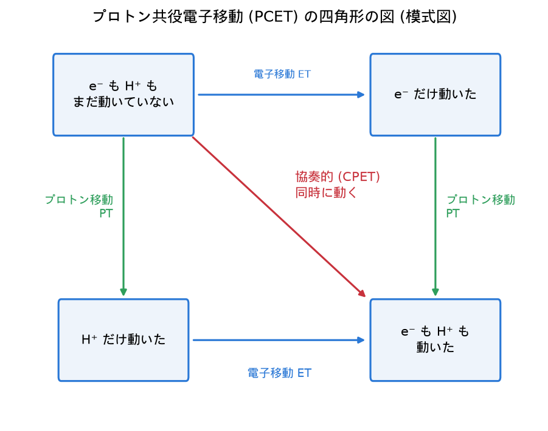

**図 9**　PCET の四角形の図（模式図）。左上から右下へ行く道は 3 通りあります。電子が先（上の辺から右の辺）、プロトンが先（左の辺から下の辺）、両方同時（対角線、協奏的 PCET = CPET）です。

PCET の計算が難しいのは、プロトンが軽いために量子力学的な粒子として振る舞うことと、電子の状態が 2 つ以上関わることです。
Hammes-Schiffer の総説は、PCET の速度定数と速度論的同位体効果の理論、電極触媒の還元電位と pKa の計算をまとめています [Hammes-Schiffer 2015]。

### 5.2 代表的な研究例

- **Iino, Sendo, Yanai（2026）**：協奏的 PCET の速度定数を、振動の相関関数の方法に、実効的な非調和性の補正を加えて計算する方法（VCF-H）を提案しました。気相のモデル系（フェノキシル/フェノール、チミン–アクリルアミド）で、プロトンが動く振動と、供与体と受容体の間の伸縮振動の混ざり（Duschinsky 効果）を入れると、速度定数の予測が数桁大きくなることを示しました [Iino 2026]。
- **Lampe, Yanai, Neugebauer（2025）**：ブロックに局在した Kohn–Sham 軌道を使う多状態 DFT で、PCET に必要な電子のカップリングを、CASSCF より安く計算する方法を調べました。CASSCF と NEVPT2 との比較で、非エルミートの演算子を使うと正確な振電カップリングが得られました。DNA–アクリルアミドの複合体に応用しています [Lampe 2025]。

### 5.3 この界隈の常識

- PCET では、電子とプロトンの移動が「段階的か、協奏的か」を区別して議論します。
- 重水素に置き換えたときの速度の変化（速度論的同位体効果）が大きいことは、プロトンが量子力学的に動いている（トンネル効果）ことの手がかりになります。
- 速度定数を出すには、電子状態の計算だけでなく、振動の量子力学的な扱いが必要です。

## 6. 金属酵素とゼオライト

### 6.1 何をする研究か

生物の中では、金属を含む酵素（金属酵素）が、窒素の固定、水の酸化、メタンの酸化などの難しい反応を、室温で起こしています。
工業でも、ゼオライト（アルミノケイ酸塩の多孔質の結晶）に銅や鉄を入れた触媒が、メタンをメタノールに変える触媒として研究されています。
どちらも、活性中心は数個の金属原子と酸素からなる小さなクラスターです。

計算では、活性中心とそのまわりを数十〜数百原子のクラスターとして切り出し（クラスターモデル）、反応の経路を調べます。
酵素の研究では、タンパク質全体を古典力場で扱う QM/MM 法も使います。
Blomberg、Siegbahn らの総説は、クラスターモデルと DFT による金属酵素の反応機構の研究をまとめています [Blomberg 2014]。

### 6.2 なぜ難しいか：多参照性

複数の遷移金属が酸素でつながった中心では、d 電子が多くの軌道にまたがって強く相関します。
このような電子状態は、1 つの電子配置では表せません（多参照性、静的相関）。
DFT の結果は汎関数によって大きく変わることがあり、CASSCF や DMRG などの多参照法が必要になります（講義ノート[第 12 回](../courses/qc-theory/12-casscf.md)、[第 14 回](../courses/qc-theory/14-dmrg-sci.md)）。

### 6.3 代表的な研究例

- **光化学系 II の Mn₄CaO₅ クラスター**：Kurashige, Chan, Yanai（2013）は、密度行列くりこみ群（DMRG）で、水を酸化する Mn₄CaO₅ クラスターのほぼ厳密な多電子波動関数を求めました。X 線の結晶構造で見られた構造のひずみに関係する、エネルギーの低い複数の状態を見つけ、パラメータを含むスピンのモデルで区別されてきた構造の候補を見直すべきことを示しました [Kurashige 2013]。
- **銅ゼオライトの活性中心**：Woertink ら（2009）は、共鳴ラマン分光と DFT の計算から、酸素で活性化した Cu-ZSM-5 の活性中心が、折れ曲がった [Cu₂O]²⁺（1 個の酸素で 2 個の Cu(II) が橋かけされた中心）であることを決めました [Woertink 2009]。
- **銅ゼオライトでのメタンの水酸化**：Phung, Yanai, Pierloot ら（2025）は、Cu-CHA ゼオライトの [CuOCu]²⁺ がメタンの C–H を切る段階を、大きなクラスターモデルで調べました。97 種類の汎関数の DFT と DMRG/cu(4)-CASPT2 を比べています。それまでの DFT の研究では、ラジカル的に C–H を切る経路が一般に受け入れられていました。DMRG/cu(4)-CASPT2 は、非ラジカル的（ヘテロリティック）な経路のほうが有利だと示しました（活性化エンタルピー 12.3 kcal/mol 対 21.1 kcal/mol、図 10）。DFT の結果は汎関数に強く依存し、B3LYP はラジカル経路を選びましたが、混成 meta-GGA を中心に多くの汎関数は DMRG/cu(4)-CASPT2 と同じ結論になりました [Phung 2025]。

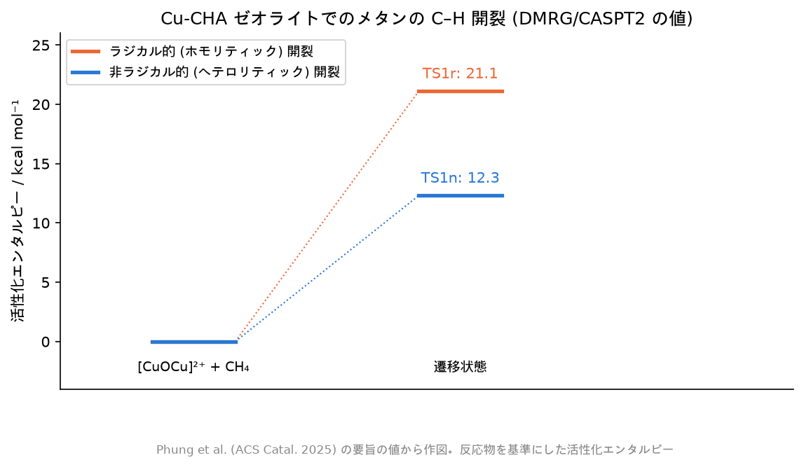

**図 10**　Cu-CHA ゼオライトでのメタンの C–H 開裂の 2 つの経路の活性化エンタルピー（DMRG/cu(4)-CASPT2）。Phung et al.（2025）の要旨の値から作図。どちらの経路を選ぶかで、障壁が 9 kcal/mol 近く違います。Eyring 式で考えると、速度にして 10⁶ 倍ほどの違いです。

### 6.4 高原子価の金属オキソ種と C–H 結合の活性化

**何が起きているか**：シトクロム P450 などの酵素や、それをまねた合成の錯体では、酸化数の高い金属に酸素原子が 1 個結合した**金属オキソ種**（Fe(IV)=O、Mn(V)=O など）が、強い C–H 結合を切ります。
最初の段階は多くの場合、**水素原子移動**（HAT）です。
C–H 結合の水素が、プロトンと電子の組（つまり水素原子）として酸素に移り、M–OH と炭素ラジカルができます（図 11 の左）。
計算で知りたいのは、この峠の高さ（障壁）と、その高さが金属や配位子でどう変わるかです。

**なぜ難しいか**：金属オキソ種は開殻（不対電子をもつ）で、近いエネルギーに複数のスピン状態があります。
反応の途中で、スピン状態が入れかわることもあります。
2 つのスピン状態の曲面が交わる点を **MECP**（minimum energy crossing point、交差点のうち最もエネルギーの低い点）と呼びます（図 11 の右）。
さらに、酸化された電子 1 個分の「穴」が、金属にあるか配位子にあるかで、性格の違う状態ができます。
このように、電子の置き場所だけが違う状態を**電子異性体**（electromer）と呼びます（図 12）。
こうした状態の順番は汎関数で変わりやすいので、多参照法の値を基準にします。

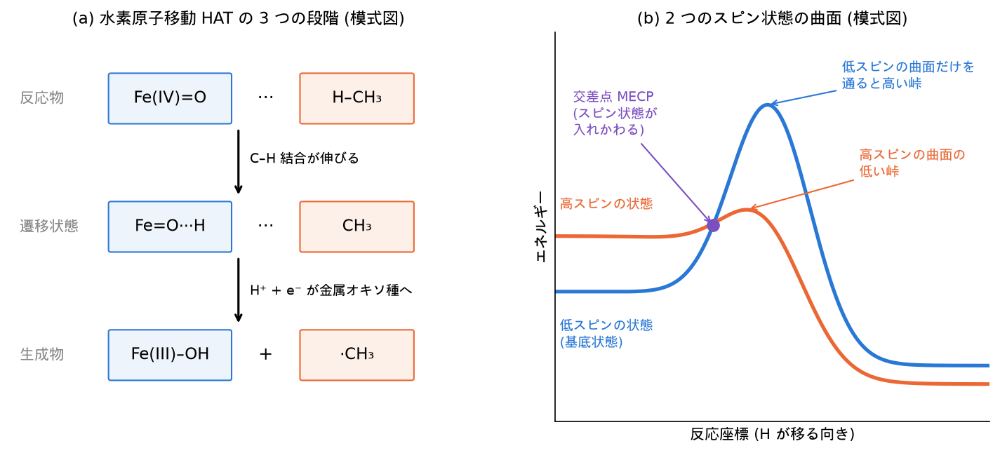

**図 11**　(a) 鉄(IV)–オキソ種によるメタンの水素原子移動の 3 つの段階（模式図）。遷移状態では、H が O と C の間にあります。(b) 2 つのスピン状態の曲面（模式図）。基底状態（青）の曲面だけをたどると峠は高いのですが、交差点（MECP）で別のスピン状態（橙）の曲面に乗りかえると、低い峠を越えられます。

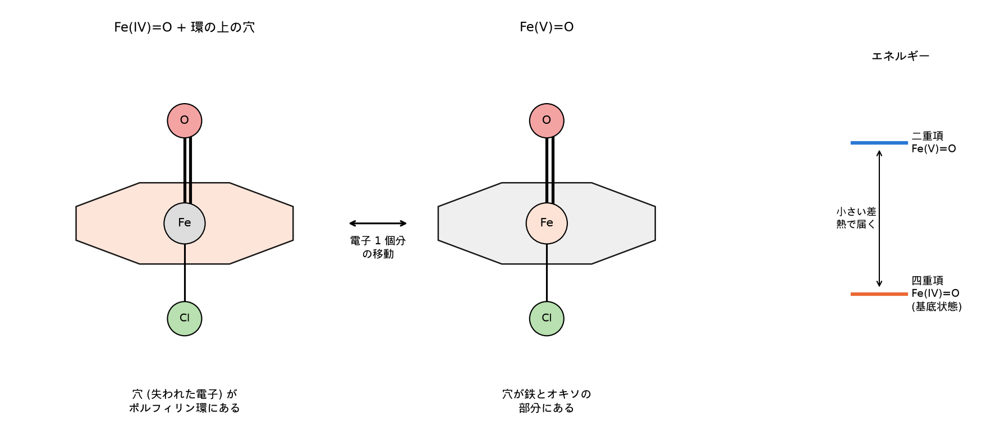

**図 12**　塩化物が配位した鉄–オキソポルフィリン（Compound I のモデル）の 2 つの電子異性体（模式図）。橙色の部分に、酸化で失われた電子 1 個分の「穴」があります。左は穴がポルフィリン環にある Fe(IV)=O、右は穴が鉄とオキソの部分にある Fe(V)=O です。右端は、Phung と Pierloot（2019）の要旨にある順番（四重項の Fe(IV)=O が基底状態で、二重項の Fe(V)=O が熱で届く高さにある）を表したもので、間隔は模式的です。

**代表的な研究例**

- **鉄(IV)–オキソ錯体の HAT の障壁**：Austen, Yanai, Phung（2026）は、10 種類の Fe(IV)=O 錯体によるメタンの HAT を、DFT と多参照の CASPT2 で調べ、活性化自由エネルギーの基準値を求めました。障壁は、H が移る方向の原子間の距離とは強く相関しましたが、オキソのラジカル性とは弱くしか相関しませんでした。配位数が小さく、基底状態が S = 2 の [Fe(IV)O(ᵗBu₃tacn)]²⁺ が、室温でメタンを活性化できる有望な触媒だと予測しています。CASPT2 を基準に DFT の汎関数を比べると、誤差は経路によって大きく違いました。いくつかの汎関数は主な経路では正確でしたが、ほかの経路の障壁を系統的に低く見積もりました。また、DFT の平均絶対誤差は、汎関数に混ぜるハートリー–フォック交換の割合と強い直線関係があり、割合の大きい汎関数ほど障壁の誤差が大きくなりました [Austen 2026]。
- **Compound I のモデルの電子異性体**：Phung と Pierloot（2019）は、P450 の活性種 Compound I のモデルである、塩化物が配位した鉄(IV)–オキソポルフィリンのスピン状態のエネルギーを、DMRG-CASPT2 で調べました。活性空間は最大 31 軌道です。タンパク質の環境の補正を加えると、四重項の Fe(IV)=O が基底状態で、二重項の Fe(V)=O の励起状態が熱で届く高さにあることが分かりました。この Fe(V)=O の状態が、反応性に直接関わる可能性があります。小さな活性空間の CASPT2 や、安価な近似（cu(4)）の DMRG-CASPT2 でも、スピン状態のエネルギーを正確に表せることも示しています [Phung 2019a]（図 12）。
- **窒素で橋かけされた二核の鉄–オキソ種**：Phung と Pierloot（2019）は、メタンの H 引き抜きを起こす、窒素で橋かけされた高原子価の二核鉄–オキソ種を、DFT と DMRG-CASPT2 で調べました。2 個の鉄がともに Fe(IV) の基底状態のすぐ上に、Fe(V)–Fe(IV) の混合原子価の状態が低いエネルギーにあることを見つけました。電子構造とスピン密度から、この励起状態のほうが H 引き抜きの反応性がずっと高いと考えられ、メタンに対する高い反応性の理由の候補になっています [Phung 2019b]。
- **Mn–オキソポルフィリンによる水酸化**：Ricciarelli, Phung, Harvey ら（2019）は、Mn(V)–オキソポルフィリンによるトルエンの水酸化を計算で調べました。最初に、Mn(V)=O 種が一重項から三重項へ、熱で越えられる障壁で乗りかわり（MECP）、三重項の状態がとても容易に H を引き抜くことを示しました（図 11 の右と同じ形）。DFT（BP86）の一重項–三重項のエネルギー差は、DMRG-CASPT2/CC の値で妥当性を確かめています。軸配位子のトランス影響が、この一重項–三重項のエネルギー差を通して反応性を決めることも示しました [Ricciarelli 2019]。
- **[NiFe] ヒドロゲナーゼの反応機構**：Dong, Phung, Pierloot, Ryde（2018）は、H₂ とプロトンと電子を可逆的に変換する [NiFe] ヒドロゲナーゼの反応機構の全体を調べました。構造は QM/MM で求め、819 原子を量子力学で扱う big-QM 計算でエネルギーを精密化し、QM/MM の熱力学サイクルの摂動計算で自由エネルギーを出しています。各状態の電子構造は DMRG-CASSCF で調べました。律速段階は、架橋のヒドリドがプロトンとしてシステインの硫黄に移り、2 電子が Ni に移る段階で、障壁は 58 kJ/mol でした。これは実験の速度（750 ± 90 s⁻¹、約 52 kJ/mol に相当）と合います。H–H 結合の開裂の障壁は 33 kJ/mol で、容易に進みます。反応エネルギーは、QM の領域の大きさ、基底関数、汎関数に敏感でした [Dong 2018]。

### 6.5 この界隈の常識

- 金属酵素や金属触媒の反応機構の結論は、汎関数に依存することがあります。1 つの汎関数（とくに B3LYP だけ）に頼った結論には注意が必要です [Phung 2025]。
- クラスターモデルの大きさ（どこまでのまわりの原子を含めるか）で結果が変わります。大きさを変えて確かめます。
- 多核の金属中心では、スピンの組み合わせ（どの金属のスピンが上向きか下向きか）が多く、それぞれを計算します。
- 金属オキソ種の反応では、基底状態だけでなく、近くにある別のスピン状態や電子異性体も反応に関わることがあります。反応の途中でのスピン状態の乗りかえ（MECP）も調べます [Ricciarelli 2019]。
- HAT の障壁の DFT の誤差は、経路と、ハートリー–フォック交換の割合で変わります。1 つの経路の比較だけで汎関数を選ばないようにします [Austen 2026]。

## 7. 反応経路の自動探索

### 7.1 何をする研究か

ここまでの方法では、研究者が「この遷移状態があるはずだ」と予想して、その近くから探します。
予想していない経路は見つかりません。
**反応経路の自動探索**は、曲面上の谷と峠を系統的に探し、予想していない経路まで含めた「反応経路の網目」をつくる方法です [Dewyer 2018]。

代表的な方法が、前田、大野、諸熊らの GRRM（global reaction route mapping）の戦略です [Maeda 2013]。
GRRM では、2 つの相補的な方法を使います。

- **ADDF**（anharmonic downward distortion following）：谷底から出発し、調和振動子からのずれ（非調和性）をたよりに、峠の方向を探します。異性化や解離の経路を見つけます。
- **AFIR**（artificial force induced reaction）：2 つ以上の分子（あるいは分子の 2 つの部分）の間に人工の力を加えて押しつけ、反応を無理に起こさせます。力を加えた曲面の上の経路は、本当の遷移状態の近くを通るので、そこから遷移状態を精密に求めます [Maeda 2016]。

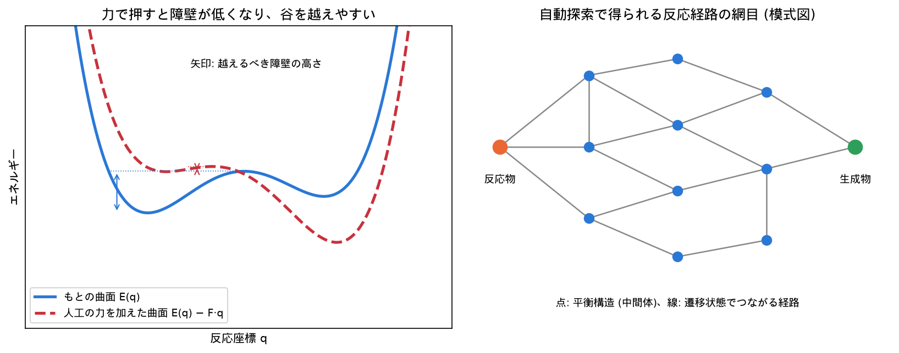

**図 13**　AFIR の考え方（模式図）。左：もとの曲面（青）に、反応座標に比例する人工の力を加えると（赤の破線）、障壁がほとんどなくなり、隣の谷へ移れます。右：このような探索をくり返して得られる、平衡構造（点）と経路（線）の網目。

### 7.2 代表的な研究例

- **計算が見つけた合成法**：Mita, Harabuchi, Maeda（2020）は、目的の化合物（α,α-ジフルオログリシン誘導体）が分解する経路を AFIR で網羅的に探し、その逆向きを合成経路の候補としました（逆合成に似た考え方）。候補から、ジフルオロカルベン、アミン、CO₂ を組み合わせる反応を選び、実験で実現しました [Mita 2020]。
- **反応の発見に向けて**：Maeda らは、AFIR と速度定数の行列を縮約する方法を組み合わせ、反応経路の網目をつくりながら速度論のシミュレーションを行い、生成物の収率まで予測する方法を総説にまとめています [Maeda 2023]。

### 7.3 この界隈の常識

- 自動探索は計算量が多いので、安い方法（小さな基底関数の DFT や半経験的方法）で網目をつくり、重要な経路だけを精度の高い方法で計算し直すのがふつうです。
- 網目が見つかっても、どの経路が実際に使われるかは、速度論（各経路の速さの比べ合い）で決まります。

## この分野でよく出てくる言葉

| 言葉 | 意味 |
|---|---|
| ポテンシャルエネルギー曲面（PES） | 分子のエネルギーを、原子の座標の関数として見たもの。反応の「地形図」 |
| 遷移状態（TS） | 曲面の鞍点。反応の通り道で最もエネルギーが高い点 |
| 反応座標 | 反応の進み具合を表す座標。IRC はその代表 |
| IRC | 遷移状態から両側の谷へ最も急な下り坂をたどった道 |
| 虚数の振動数 | 遷移状態で、下り坂の方向に現れる振動数。ちょうど 1 個あることを確かめる |
| 活性化自由エネルギー ΔG‡ | 反応物から遷移状態までの自由エネルギーの差。速さを決める |
| Eyring 式 | ΔG‡ から速度定数を出す、遷移状態理論の式 |
| 律速段階 | 全体の速さを決める段階。触媒サイクルではエネルギースパンで考える |
| TOF | ターンオーバー頻度。触媒 1 分子が単位時間に回すサイクルの数 |
| エネルギースパン δE | TDTS と TDI の差。触媒サイクルの見かけの活性化エネルギー |
| 酸化的付加・還元的脱離 | 金属に結合が入る段階と、金属から 2 つの配位子がつながって離れる段階 |
| 光レドックス触媒 | 光で励起された触媒が、基質と電子をやりとりする触媒 |
| HAT | 水素原子移動。結合から水素原子（H⁺ + e⁻）を引き抜く |
| PCET、CPET | プロトン共役電子移動と、その協奏的なもの |
| クラスターモデル | 活性中心のまわりだけを切り出して計算するモデル |
| 金属オキソ種 | 酸化数の高い金属に酸素原子が 1 個結合した活性種。Fe(IV)=O など |
| MECP | 2 つのスピン状態の曲面の交わりのうち、最もエネルギーの低い点。スピン状態が乗りかわる場所 |
| 電子異性体（エレクトロマー） | 原子の並びは同じで、電子（または穴）の置き場所だけが違う状態 |
| GRRM、ADDF、AFIR | 反応経路の自動探索の戦略と方法 |

## この分野の常識：まとめ

- 速さは ΔG‡、平衡は ΔG で決まります。生成物が安定でも、障壁が高ければ反応は進みません。
- 298 K では、ΔG‡ が 1.36 kcal/mol 違うと速度が 10 倍違います。選択性の 10：1 は 1.4 kcal/mol の差です。
- 「室温で数時間」の反応の障壁は、20 kcal/mol 台の前半が目安です。
- 遷移状態は、虚数の振動数が 1 個であることと、IRC でつながりを確かめてから報告します。
- エネルギー図は自由エネルギーで描くのが標準です。ΔE か ΔG かを必ず書きます。
- 構造は DFT、エネルギーは DLPNO-CCSD(T) などで精密化、という組み合わせがよく使われます。
- 溶媒、エントロピー、配座、モデルの選び方は、汎関数の選び方と同じくらい結果を左右します。
- 触媒サイクルでは、最も高い遷移状態だけでなく、その前の最も深い中間体も見ます（エネルギースパン）。
- 遷移金属を含む系では、汎関数による違いが大きく、多参照法で確かめることがあります。
- 予想していない経路は、自動探索をしないと見つかりません。

## 最初に読むとよい文献

- J. N. Harvey, F. Himo, F. Maseras, L. Perrin, "Scope and Challenge of Computational Methods for Studying Mechanism and Reactivity in Homogeneous Catalysis"（2019）：均一系触媒の計算で、何が結果を左右するかを整理した総説です [Harvey 2019]。
- S. Kozuch, S. Shaik, "How to Conceptualize Catalytic Cycles? The Energetic Span Model"（2010）：触媒サイクルの効率を計算のエネルギー図から出す考え方です [Kozuch 2010]。
- D. G. Truhlar, B. C. Garrett, S. J. Klippenstein, "Current Status of Transition-State Theory"（1996）：遷移状態理論の考え方と限界の総説です [Truhlar 1996]。
- M. R. A. Blomberg ほか, "Quantum Chemical Studies of Mechanisms for Metalloenzymes"（2014）：金属酵素の反応機構の計算の総説です [Blomberg 2014]。
- S. Hammes-Schiffer, "Proton-Coupled Electron Transfer: Moving Together and Charging Forward"（2015）：PCET の理論と計算の総説です [Hammes-Schiffer 2015]。
- S. Maeda, K. Ohno, K. Morokuma, GRRM の総説（2013）：反応経路の自動探索の考え方です [Maeda 2013]。

## 講義ノートとの関係

- 汎関数の選び方と誤差：[量子化学の理論 第 16 回](../courses/qc-theory/16-functionals.md)、[第 17 回](../courses/qc-theory/17-dispersion.md)（分散力の補正）、[第 18 回](../courses/qc-theory/18-dft-errors.md)（DFT の誤差）
- エネルギーの精密化：[量子化学の理論 第 10 回](../courses/qc-theory/10-coupled-cluster.md)（結合クラスター法）、[第 11 回](../courses/qc-theory/11-dlpno-ccsd-t.md)（DLPNO-CCSD(T)）
- 多参照法（金属酵素、ゼオライト）：[量子化学の理論 第 12 回](../courses/qc-theory/12-casscf.md)、[第 13 回](../courses/qc-theory/13-caspt2-nevpt2.md)、[第 14 回](../courses/qc-theory/14-dmrg-sci.md)
- 遷移金属触媒：[遷移金属錯体の計算 第 7 回](../courses/tm-complexes/07-benchmark-reactions.md)（反応エネルギーと障壁のベンチマーク）、[第 8 回](../courses/tm-complexes/08-functional-choice.md)（汎関数の選び方）、[第 10 回](../courses/tm-complexes/10-multireference-tm.md)（多参照法）
- 振動数と熱力学の補正の計算：[計算プログラムの使い方 第 5 回](../courses/packages/05-gaussian-freq-thermo.md)（Gaussian）、[第 7 回](../courses/packages/07-orca-freq-thermo.md)（ORCA）
- 光触媒の励起状態：[量子化学の理論 第 19 回](../courses/qc-theory/19-tddft.md)（TDDFT）

## 参考文献

- H. Eyring, "The Activated Complex in Chemical Reactions", J. Chem. Phys. 3, 107 (1935). DOI: [10.1063/1.1749604](https://doi.org/10.1063/1.1749604)
- K. Fukui, "The path of chemical reactions - the IRC approach", Acc. Chem. Res. 14, 363 (1981). DOI: [10.1021/ar00072a001](https://doi.org/10.1021/ar00072a001)
- D. G. Truhlar, B. C. Garrett, S. J. Klippenstein, "Current Status of Transition-State Theory", J. Phys. Chem. 100, 12771 (1996). DOI: [10.1021/jp953748q](https://doi.org/10.1021/jp953748q)
- L. Goerigk, A. Hansen, C. Bauer, S. Ehrlich, A. Najibi, S. Grimme, "A look at the density functional theory zoo with the advanced GMTKN55 database for general main group thermochemistry, kinetics and noncovalent interactions", Phys. Chem. Chem. Phys. 19, 32184 (2017). DOI: [10.1039/C7CP04913G](https://doi.org/10.1039/C7CP04913G)
- J. N. Harvey, F. Himo, F. Maseras, L. Perrin, "Scope and Challenge of Computational Methods for Studying Mechanism and Reactivity in Homogeneous Catalysis", ACS Catal. 9, 6803 (2019). DOI: [10.1021/acscatal.9b01537](https://doi.org/10.1021/acscatal.9b01537)
- S. Kozuch, S. Shaik, "How to Conceptualize Catalytic Cycles? The Energetic Span Model", Acc. Chem. Res. 44, 101 (2010). DOI: [10.1021/ar1000956](https://doi.org/10.1021/ar1000956)
- C. K. Prier, D. A. Rankic, D. W. C. MacMillan, "Visible Light Photoredox Catalysis with Transition Metal Complexes: Applications in Organic Synthesis", Chem. Rev. 113, 5322 (2013). DOI: [10.1021/cr300503r](https://doi.org/10.1021/cr300503r)
- L. Capaldo, D. Ravelli, "Hydrogen Atom Transfer (HAT): A Versatile Strategy for Substrate Activation in Photocatalyzed Organic Synthesis", Eur. J. Org. Chem. 2017, 2056 (2017). DOI: [10.1002/ejoc.201601485](https://doi.org/10.1002/ejoc.201601485)
- N. Noto, A. Yada, T. Yanai, S. Saito, "Machine-Learning Classification for the Prediction of Catalytic Activity of Organic Photosensitizers in the Nickel(II)-Salt-Induced Synthesis of Phenols", Angew. Chem. Int. Ed. 62, e202219107 (2023). DOI: [10.1002/anie.202219107](https://doi.org/10.1002/anie.202219107)
- N. Noto, R. Kunisada, T. Rohlfs, M. Hayashi, R. Kojima, O. García Mancheño, T. Yanai, S. Saito, "Transfer learning across different photocatalytic organic reactions", Nat. Commun. 16, 3388 (2025). DOI: [10.1038/s41467-025-58687-5](https://doi.org/10.1038/s41467-025-58687-5)
- R. Kunisada, M. Hayashi, T. Rohlfs, T. Nagano, K. Sano, N. Inai, N. Noto, T. Ogaki, Y. Matsui, H. Ikeda, O. García Mancheño, T. Yanai, S. Saito, "Data-driven approach to elucidate the correlation between photocatalytic activity and rate constants from excited states", Chem. Sci. 17, 176 (2026). DOI: [10.1039/D5SC06465A](https://doi.org/10.1039/D5SC06465A)
- D. R. Weinberg, C. J. Gagliardi, J. F. Hull, C. F. Murphy, C. A. Kent, B. C. Westlake, A. Paul, D. H. Ess, D. G. McCafferty, T. J. Meyer, "Proton-Coupled Electron Transfer", Chem. Rev. 112, 4016 (2012). DOI: [10.1021/cr200177j](https://doi.org/10.1021/cr200177j)
- S. Hammes-Schiffer, "Proton-Coupled Electron Transfer: Moving Together and Charging Forward", J. Am. Chem. Soc. 137, 8860 (2015). DOI: [10.1021/jacs.5b04087](https://doi.org/10.1021/jacs.5b04087)
- T. Iino, S. Sendo, T. Yanai, "Concerted proton–electron transfer via vibration correlation function approach with effective anharmonicity: Beyond classical approximation with Duschinsky effects", J. Chem. Phys. 164, 084112 (2026). DOI: [10.1063/5.0305257](https://doi.org/10.1063/5.0305257)
- L. Lampe, T. Yanai, J. Neugebauer, "Large-Scale Modeling of Proton-Coupled Electron Transfer Based on Block-Localized Kohn–Sham Orbitals", J. Chem. Theory Comput. 21, 12545 (2025). DOI: [10.1021/acs.jctc.5c01287](https://doi.org/10.1021/acs.jctc.5c01287)
- M. R. A. Blomberg, T. Borowski, F. Himo, R.-Z. Liao, P. E. M. Siegbahn, "Quantum Chemical Studies of Mechanisms for Metalloenzymes", Chem. Rev. 114, 3601 (2014). DOI: [10.1021/cr400388t](https://doi.org/10.1021/cr400388t)
- Y. Kurashige, G. K.-L. Chan, T. Yanai, "Entangled quantum electronic wavefunctions of the Mn4CaO5 cluster in photosystem II", Nat. Chem. 5, 660 (2013). DOI: [10.1038/nchem.1677](https://doi.org/10.1038/nchem.1677)
- J. S. Woertink, P. J. Smeets, M. H. Groothaert, M. A. Vance, B. F. Sels, R. A. Schoonheydt, E. I. Solomon, "A [Cu2O]2+ core in Cu-ZSM-5, the active site in the oxidation of methane to methanol", Proc. Natl. Acad. Sci. USA 106, 18908 (2009). DOI: [10.1073/pnas.0910461106](https://doi.org/10.1073/pnas.0910461106)
- Q. M. Phung, T. Yanai, D. Plessers, B. F. Sels, R. A. Schoonheydt, K. Pierloot, "Homolytic versus Heterolytic Methane Hydroxylation in Copper Zeolites", ACS Catal. 15, 1249 (2025). DOI: [10.1021/acscatal.4c06246](https://doi.org/10.1021/acscatal.4c06246)
- V. Austen, T. Yanai, Q. M. Phung, "Hydrogen Atom Transfer Barriers by High-Valent Iron(IV)–Oxo Complexes: A DFT and Multireference Ab Initio Study", Inorg. Chem. 65, 11853 (2026). DOI: [10.1021/acs.inorgchem.6c01138](https://doi.org/10.1021/acs.inorgchem.6c01138)
- Q. M. Phung, K. Pierloot, "Low-Lying Electromeric States in Chloro-Ligated Iron(IV)-Oxo Porphyrin as a Model for Compound I, Studied with Second-Order Perturbation Theory Based on Density Matrix Renormalization Group", J. Chem. Theory Comput. 15, 3033 (2019). DOI: [10.1021/acs.jctc.9b00166](https://doi.org/10.1021/acs.jctc.9b00166)
- Q. M. Phung, K. Pierloot, "Electronic Structure of N-Bridged High-Valent Diiron-Oxo", Chem. Eur. J. 25, 12491 (2019). DOI: [10.1002/chem.201902766](https://doi.org/10.1002/chem.201902766)
- D. Ricciarelli, Q. M. Phung, L. Belpassi, J. N. Harvey, P. Belanzoni, "Understanding the Reactivity of Mn-Oxo Porphyrins for Substrate Hydroxylation: Theoretical Predictions and Experimental Evidence Reconciled", Inorg. Chem. 58, 7345 (2019). DOI: [10.1021/acs.inorgchem.9b00476](https://doi.org/10.1021/acs.inorgchem.9b00476)
- G. Dong, Q. M. Phung, K. Pierloot, U. Ryde, "Reaction Mechanism of [NiFe] Hydrogenase Studied by Computational Methods", Inorg. Chem. 57, 15289 (2018). DOI: [10.1021/acs.inorgchem.8b02590](https://doi.org/10.1021/acs.inorgchem.8b02590)
- A. L. Dewyer, A. J. Argüelles, P. M. Zimmerman, "Methods for exploring reaction space in molecular systems", WIREs Comput. Mol. Sci. 8, e1354 (2017). DOI: [10.1002/wcms.1354](https://doi.org/10.1002/wcms.1354)
- S. Maeda, K. Ohno, K. Morokuma, "Systematic exploration of the mechanism of chemical reactions: the global reaction route mapping (GRRM) strategy using the ADDF and AFIR methods", Phys. Chem. Chem. Phys. 15, 3683 (2013). DOI: [10.1039/C3CP44063J](https://doi.org/10.1039/C3CP44063J)
- S. Maeda, Y. Harabuchi, M. Takagi, T. Taketsugu, K. Morokuma, "Artificial Force Induced Reaction (AFIR) Method for Exploring Quantum Chemical Potential Energy Surfaces", Chem. Rec. 16, 2232 (2016). DOI: [10.1002/tcr.201600043](https://doi.org/10.1002/tcr.201600043)
- T. Mita, Y. Harabuchi, S. Maeda, "Discovery of a synthesis method for a difluoroglycine derivative based on a path generated by quantum chemical calculations", Chem. Sci. 11, 7569 (2020). DOI: [10.1039/D0SC02089C](https://doi.org/10.1039/D0SC02089C)
- S. Maeda, Y. Harabuchi, H. Hayashi, T. Mita, "Toward Ab Initio Reaction Discovery Using the Artificial Force Induced Reaction Method", Annu. Rev. Phys. Chem. 74, 287 (2023). DOI: [10.1146/annurev-physchem-102822-101025](https://doi.org/10.1146/annurev-physchem-102822-101025)
