# 励起状態と光化学：光と分子の研究

!!! abstract "このページで分かること"
    分子が光を吸収してから、光を出したり、熱になったり、反応したりするまでを計算で調べる分野を紹介します。
    共通の地図は Jablonski 図と、励起状態のポテンシャルエネルギー曲面です。
    小分類として、色と吸収、励起エネルギー移動、円二色性、無輻射失活と円錐交差、発光材料（TADF）、一重項分裂を順に見ていきます。

    | 節 | 小分類 | キーワード |
    |---|---|---|
    | 2 | 色と吸収 | 吸収スペクトル、色の調節、ロドプシン、QM/MM |
    | 3 | 励起エネルギー移動 | 光合成アンテナ、FRET、Förster の式、励起子相互作用、TDFI 法 |
    | 4 | 円二色性と励起子結合 | H 会合と J 会合、分裂した CD |
    | 5 | 無輻射失活・項間交差・円錐交差 | 内部転換、スピン軌道相互作用、蛍光量子収率 |
    | 6 | 発光材料 | TADF、逆項間交差、多重共鳴型 TADF |
    | 7 | 一重項分裂 | 1 個の光子から 2 個の三重項 |

!!! tip "ひとことで言うと"
    光を吸収した分子は、エネルギーの高い「励起状態」という坂の上に置かれたボールのようなものです。
    ボールの転がり方には、光を出して下りる（蛍光、りん光）、熱を出しながら下りる（無輻射失活）、隣の分子へエネルギーを渡す（エネルギー移動）、別の形の谷へ転がり込む（光反応）といういくつかの道があります。
    この分野の研究者は、どの道がどれだけの速さで起こるかを計算で求め、色、発光の明るさ、光合成の効率、光反応の生成物を説明・設計します。

## 1. この分野が答えようとしている問い

光と分子の関わりは、時間の順に次の問いに分けられます。

- **どの色の光を吸収するか**：吸収の波長と強さは何で決まるのか。タンパク質の中で、同じ色素の色が変わるのはなぜか。
- **吸収したエネルギーはどこへ行くか**：光を出すのか、熱になるのか、隣の分子へ移るのか、反応に使われるのか。
- **それぞれの過程はどれだけ速いか**：速さの比べ合いで、発光の効率（量子収率）や反応の効率が決まります。

これらを整理する地図が、図 1 の **Jablonski 図**です。

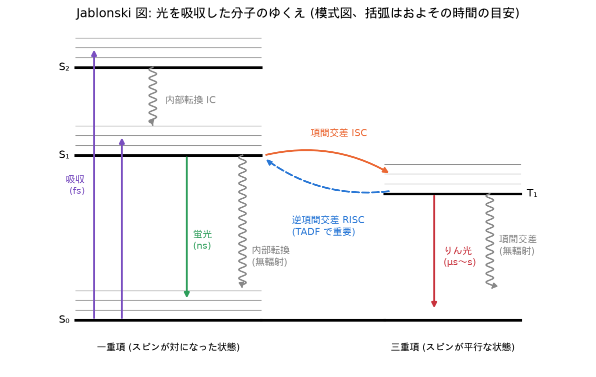

**図 1**　Jablonski 図（模式図）。左が一重項（2 個の電子のスピンが対になった状態）、右が三重項（スピンが平行な状態）です。太線は電子状態、細線は振動の準位です。まっすぐな矢印は光の出入りを伴う過程、波線は光を出さない過程（無輻射）です。括弧の時間は、教科書でよく使われるおおよその目安です。

図 1 の基本的な規則を 3 つ挙げます。

- **Kasha の規則**：高い励起状態（S₂ など）に励起されても、内部転換ですぐに最低の励起状態（S₁ や T₁）まで下り、そこから光を出すのがふつうです [Kasha 1950]。
- **スピンの規則**：一重項と三重項の間の移り変わり（項間交差、りん光）は、スピンの向きを変える必要があるので、もともと起こりにくい過程です。スピン軌道相互作用（電子のスピンと軌道運動の相互作用）があって初めて起こります。
- **速さの比べ合い**：S₁ からの蛍光、内部転換、項間交差は同時に起こりうる過程で、速いものが勝ちます。蛍光量子収率は、蛍光の速度定数を、S₁ から出ていくすべての過程の速度定数の和で割ったものです。

## 2. 色と吸収

### 2.1 何をする研究か

分子が吸収する光の波長は、基底状態 S₀ と励起状態のエネルギー差で決まります。
計算では、まず基底状態の構造で励起エネルギーと振動子強度（吸収の強さ）を求めます。
しかし、実験の吸収スペクトルは一本の線ではなく、幅のある帯です。
帯の形には、振動の準位（振電構造）と、まわりの分子の揺らぎが効いています（図 2）。

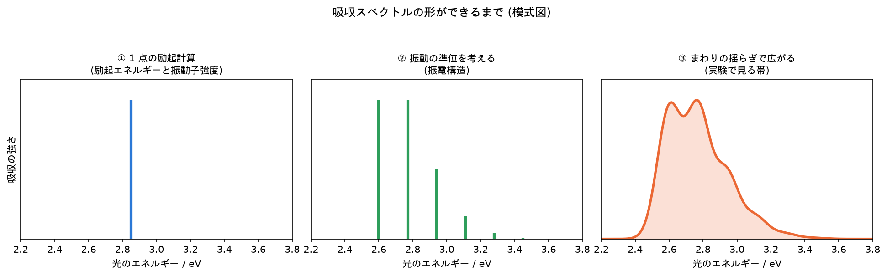

**図 2**　吸収スペクトルの形ができるまで（模式図）。① 1 点の励起計算で得られるのは、1 本の線（励起エネルギーと強さ）です。② 励起で分子の形が変わると、振動の準位への遷移が何本も現れます。③ まわりの溶媒やタンパク質の揺らぎで線が広がり、実験で見る帯になります。

帯の形まで計算する方法の 1 つが、分子動力学のシミュレーションと量子化学計算を組み合わせ、時間相関関数からスペクトルを出す方法です。
Sendo, Fujimoto, Miyashita, Saito, Yanai（2025）は、この方法の 5 段階の近似を、2 つの色素（テトラクロロフルオレセインとクリスタルバイオレット）で比べました。
骨格の硬いテトラクロロフルオレセインでは近似の違いがほとんど出ませんでしたが、柔らかいクリスタルバイオレットでは近似によって形が大きくずれました。
分子の硬さが、スペクトルの形の予測の精度を左右することが分かりました [Sendo 2025]。

### 2.2 タンパク質の中の色：色の調節

同じ色素でも、まわりの環境で吸収の波長が大きく変わります。
この現象を**色の調節**（color tuning、spectral tuning）と呼びます。
代表例は視物質です。
ヒトの網膜の赤、緑、青の錐体の視物質は、どれも同じ色素（レチナール）をタンパク質（オプシン）に結合させていますが、吸収の波長が違います [Ernst 2014]。

色の調節の主な原因の 1 つは、タンパク質の電荷が色素につくる電場（静電的な相互作用）です。
タンパク質の中のレチナールは、リシンと結合してプロトン化したシッフ塩基になっていて、正電荷を持ちます。
光で励起すると、この正電荷がシッフ塩基の側から、反対側の環の側へ移ります。
そのため、負電荷の位置によって、S₀ と S₁ のどちらがより安定になるかが変わり、吸収のエネルギーが変わります（図 3）。

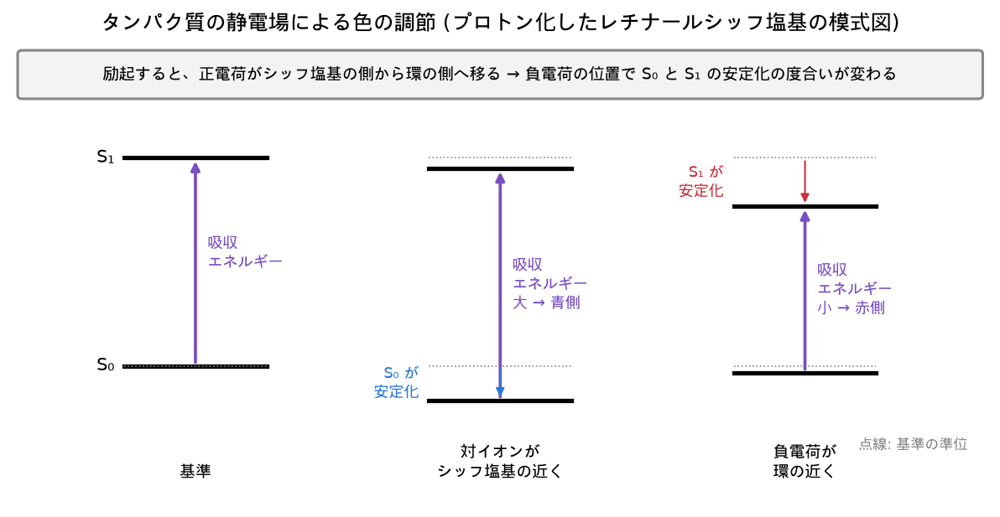

**図 3**　タンパク質の静電場による色の調節（模式図）。負電荷（対イオン）がシッフ塩基の近くにあると、正電荷がそこにある S₀ がより安定になり、吸収のエネルギーが大きく（青側に）なります。負電荷が環の近くにあると、S₁ がより安定になり、吸収は赤側にずれます。

### 2.3 よく使う方法とプログラム

- **励起状態の電子状態の方法**：TDDFT（[講義ノート第 19 回](../courses/qc-theory/19-tddft.md)）が最もよく使われます。精度が必要なときは、SAC-CI、EOM-CCSD、ADC(2)、CC2（[第 23 回](../courses/qc-theory/23-excited-wavefunction.md)）や、CASPT2・NEVPT2 などの多参照法（[第 13 回](../courses/qc-theory/13-caspt2-nevpt2.md)）を使います [Dreuw 2005]。
- **タンパク質や溶媒の扱い**：色素を量子力学（QM）で、まわりのタンパク質を古典力場（MM）で扱う QM/MM 法がよく使われます。
- **プログラム**：Gaussian、ORCA、Q-Chem、Turbomole、GAMESS、Molpro、OpenMolcas など。QM/MM には、これらと分子動力学のプログラム（Amber、GROMACS など）を組み合わせます。

### 2.4 代表的な研究例

- **SAC-CI と QM/MM による色の調節**：Hasegawa, Fujimoto, Nakatsuji（2011）は、ヒトの錐体の視物質、ホタルのルシフェラーゼ、赤色蛍光タンパク質の色の調節を、SAC-CI 法と QM/MM 法で調べた研究をまとめ、3 つに共通する仕組みを議論しました [Hasegawa 2011]。
- **網膜タンパク質の光吸収の総説**：Fujimoto（2021）は、レチナールの電子状態を SAC-CI、タンパク質の環境を QM/MM、色素どうしの電子的な結合を TDFI 法で扱い、ロドプシン類の吸収と円二色性のスペクトルを再現した研究をまとめています [Fujimoto 2021a]。
- **サルの緑の視物質と塩化物イオン**：Fujimoto らは（2023）、塩化物イオン（Cl⁻）が結合する部位を持つサルの緑の視物質の構造をモデル化し、Cl⁻ の結合による赤方偏移を励起状態の計算で再現しました。静電的なエネルギーの分解から、赤方偏移の原因は His197 のプロトン化状態と、Glu129、Ser202、Ala308 の配座であり、Cl⁻ そのものはむしろ青方偏移に寄与することが分かりました。AlphaFold2 はこの構造の変化を予測できなかったことも報告しています [Fujimoto 2023]。

### 2.5 この界隈の常識

- 吸収の極大（λmax）と、計算の垂直励起エネルギーは、厳密には同じものではありません。比べるときは振電構造の効果を意識します。
- TDDFT は、電荷移動型の励起を低く見積もりやすい汎関数があります。範囲分離型の汎関数（CAM-B3LYP、ωB97X-D など）がよく使われます。
- タンパク質の中の色素の計算では、構造（結晶構造の精度、アミノ酸のプロトン化状態）が、電子状態の方法と同じくらい結果を左右します。

## 3. 励起エネルギー移動

### 3.1 何をする研究か

光合成の生物は、アンテナ（集光系）と呼ばれる色素とタンパク質の複合体で光を集めます。
アンテナの多くの色素が吸収したエネルギーは、色素から色素へ受け渡され、最後に反応中心に届きます [Scholes 2011]。
このように、励起状態のエネルギーが分子から分子へ移る現象を**励起エネルギー移動**（excitation energy transfer, EET）と呼びます。

紅色細菌のアンテナ LH2 では、バクテリオクロロフィル（BChl）が 2 つの環をつくって並んでいます（図 4）。
色素の位置と遷移双極子の向きが、吸収の波長とエネルギー移動の速さを決めます。

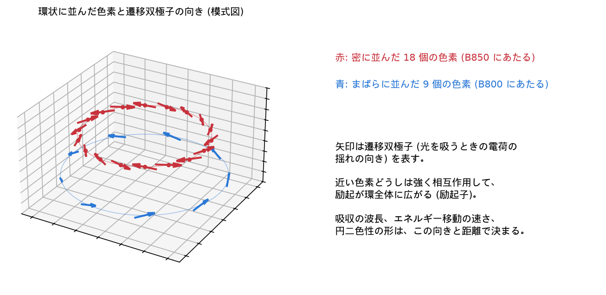

**図 4**　環状に並んだ色素と遷移双極子の向きの 3D 模式図（LH2 に似た配置。実際の座標ではありません）。赤は密に並んだ 18 個の色素（B850 と呼ばれる帯にあたる）、青はまばらに並んだ 9 個の色素（B800 にあたる）です。矢印は遷移双極子で、光を吸収するときに電荷が揺れる向きを表します。

### 3.2 Förster の式

色素どうしが離れているとき、エネルギー移動は、供与体の励起と受容体の励起の間のクーロン相互作用で起こります。
Förster（1948）は、この過程の速度を、分光学の測定量から計算する理論を作りました [Förster 1948]。
エネルギー移動の速度定数 $k_\mathrm{EET}$ は、供与体の励起状態の寿命 $\tau_\mathrm{D}$ と距離 $R$ を使って

$$
k_\mathrm{EET} = \frac{1}{\tau_\mathrm{D}} \left( \frac{R_0}{R} \right)^6
$$

と書けます。
$R_0$ は **Förster 半径**で、エネルギー移動と、供与体のほかの失活とが同じ速さになる距離です。
$R_0$ は、供与体の発光スペクトルと受容体の吸収スペクトルの重なり、供与体の蛍光量子収率、媒質の屈折率、そして配向因子 $\kappa^2$ で決まります。
Förster は、この臨界の距離が、フルオレセインで 50 Å、クロロフィル a で 80 Å になると見積もりました [Förster 1948]。

エネルギー移動の効率 $E$ は、上の速度定数から $E = 1/[1 + (R/R_0)^6]$ です。
距離の 6 乗で効く鋭い変化を使うと、2 つの色素の距離を測る「分子のものさし」になります。
これが蛍光共鳴エネルギー移動（FRET）の測定です（図 5）。

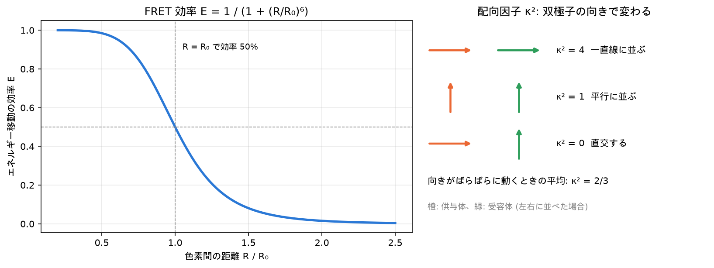

**図 5**　FRET の効率の距離依存（左）と配向因子 κ²（右）。左：R = R₀ で効率は 50% になり、その前後で急に変わります。右：遷移双極子の向きによって κ² は 0 から 4 まで変わります。向きが速くばらばらに動くとみなせるときの平均値が 2/3 です。

配向因子は、2 つの遷移双極子の単位ベクトル $\hat{\boldsymbol\mu}_\mathrm{D}$、$\hat{\boldsymbol\mu}_\mathrm{A}$ と、両者を結ぶ方向の単位ベクトル $\hat{\mathbf R}$ で

$$
\kappa = \hat{\boldsymbol\mu}_\mathrm{D} \cdot \hat{\boldsymbol\mu}_\mathrm{A} - 3 (\hat{\boldsymbol\mu}_\mathrm{D} \cdot \hat{\mathbf R}) (\hat{\boldsymbol\mu}_\mathrm{A} \cdot \hat{\mathbf R})
$$

と書けます。
FRET の実験では $\kappa^2 = 2/3$ を仮定することが多いのですが、色素の向きが固定されていると、この仮定は成り立ちません。
Fujimoto, Miyashita, Dewa, Yanai（2022）は、LH2 に人工の蛍光色素（Alexa Fluor 647）を結合させた系の配向因子を、分子動力学と電子的な結合の計算で求めました。
平均の配向因子は 1.55 で、2/3 から大きく外れていました [Fujimoto 2022]。

### 3.3 点双極子近似を超えて：TDFI 法

Förster の式の背後には、2 つの色素の相互作用を、点の双極子どうしの相互作用（距離の 3 乗に反比例）で近似する考え方があります。
色素の大きさと同じくらいまで近づくと、この近似は破れます（図 6）。

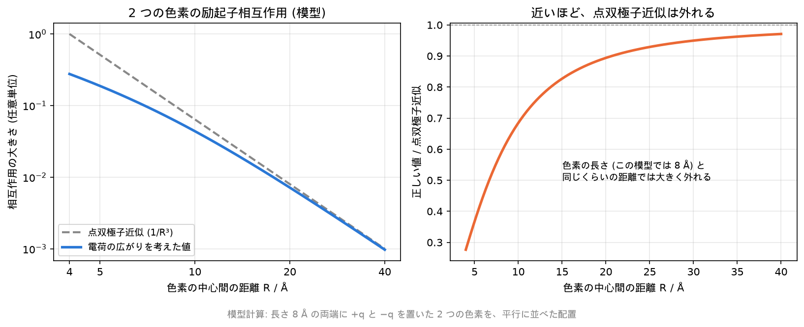

**図 6**　点双極子近似が破れる距離（模型計算）。長さ 8 Å の両端に +q と −q を置いた 2 つの「延びた双極子」を平行に並べ、クーロン相互作用を点双極子近似と比べました。距離 10 Å で点双極子近似の約 0.68 倍、20 Å で約 0.89 倍です。実際の色素では、遷移密度（励起で電子の分布がどう変わるか）の形がもっと複雑です。

Krueger, Scholes, Fleming（1998）は、遷移密度を 3 次元の格子（cube）の上で表し、その間のクーロン相互作用を正確に計算する方法（遷移密度キューブ法）で、LH2 の色素間の結合を求めました。
BChl の遷移では、点双極子近似は 15 Å より遠ければおおむね使えますが、ねじれたカロテノイドの遷移では 20 Å より遠くても大きくずれました [Krueger 1998]。

**遷移密度フラグメント相互作用（TDFI）法**も、遷移密度どうしのクーロン相互作用を正確に計算する方法です。
Fujimoto と Hayashi（2009）は、TDFI 法を、キサントロドプシンの中のカロテノイド（サリニキサンチン）からレチナールへのエネルギー移動に応用しました。
点双極子近似では評価が難しかった結合を計算し、実験で見積もられた値とよく一致する結果を得ました。
さらに、天然のタンパク質の中のカロテノイドの配置が、エネルギー移動の効率が最大になる配置であることを示しました [Fujimoto 2009]。
Fujimoto（2012）は、TDFI 法を交換相互作用まで拡張し、移動積分（TI）の方法と組み合わせて、電荷移動状態を経由するエネルギー移動を扱えるようにしました（TDFI-TI 法）[Fujimoto 2012]。

### 3.4 代表的な研究例：アンテナの色を決めるもの

光合成のアンテナでは、同じ色素が、複合体によって違う波長の光を吸収します。
Fujimoto らは、励起子のモデルを拡張し、吸収の赤方偏移を、色素のひずみ、タンパク質の静電場、励起子相互作用、色素間の電荷移動（CT）の寄与に分ける一連の研究を行っています。

- **LH2（2021）**：B800 の赤方偏移は主にタンパク質の静電的な相互作用によるもので、B850 の赤方偏移は BChl どうしの励起子相互作用と、近接した 2 量体の間の電荷移動によるものでした [Fujimoto 2021b]。
- **LH1（2024）**：LH1 では BChl a どうしの距離が LH2 より近く、LH1 に特有の赤方偏移（エネルギーで約 61%）の大部分が電荷移動の効果で説明できました [Fujimoto 2024a]。
- **珪藻のアンテナ（2024）**：珪藻のアンテナ FCPII に含まれる特有のフコキサンチン分子が、珪藻に特有の吸収スペクトルとクロロフィルへのエネルギー移動に重要な役割を持つことを示しました [Fujimoto 2024b]。
- **Ca²⁺ と LH1（2026）**：好熱性の紅色細菌 *Thermochromatium tepidum* の LH1 は、915 nm という特に長い波長の光を吸収します。計算は吸収の極大を 892 nm と再現し、赤方偏移の 56.3% を電荷移動、28.8% を励起子相互作用、1.1% を静電的な環境（Ca²⁺ を含む）に帰属しました。Ca²⁺ は電場として直接効くのではなく、タンパク質を締め付けて色素どうしを近づけることで、間接的に吸収を長波長にしていました [Fujimoto 2026]。
- **キサントロドプシン Kin4B8（2025）**：淡水のキサントロドプシン Kin4B8 では、ルテインからレチナールへのエネルギー移動の効率が、中性の 40% から酸性の 55% に上がります。計算から、Asp94 のプロトン化が電子的な結合を強めることが分かりました。結合の 2 乗は 1.24 倍になり、スペクトルの重なりの減少を補って、移動の速度は正味で 1.07 倍になりました [Fujimoto 2025]。

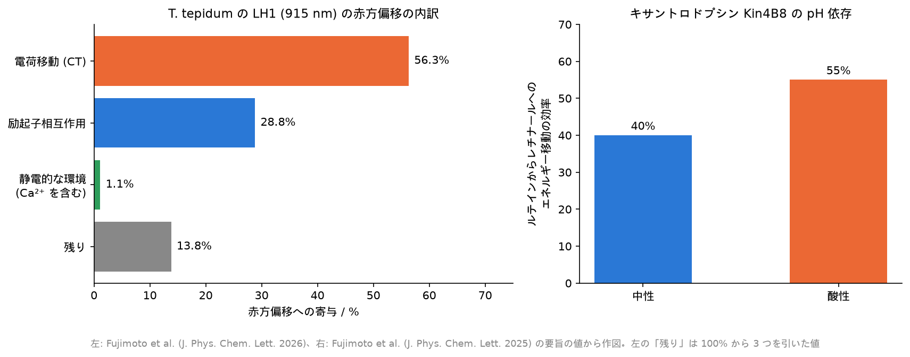

**図 7**　タンパク質の中の色素の研究の数値。左：*T. tepidum* の LH1 の赤方偏移の内訳（Fujimoto et al. 2026 の要旨の値から作図。「残り」は 100% から 3 つの寄与を引いた値で、要旨には内訳がありません）。右：Kin4B8 のエネルギー移動の効率の pH 依存（Fujimoto et al. 2025 の要旨の値から作図）。

光合成のアンテナの研究は、生物の進化の研究にもつながっています。
Matsuo らは（2025）、太古代の海の中の光が、酸化した鉄の沈殿のために主に緑色だった可能性を数値計算で示し、シアノバクテリアの集光系フィコビリソームが緑の光の環境に適応して進化したという仮説を、遺伝子工学と系統解析とあわせて提案しました [Matsuo 2025]。

### 3.5 この界隈の常識

- 色素が近いと、励起は 1 つの色素にとどまらず、多くの色素に広がった状態（励起子）になります。この場合は、色素から色素へ「飛び移る」Förster の描像ではなく、励起子の描像で考えます。
- 点双極子近似は、色素の大きさより十分遠いときだけ使えます。近いときは、遷移密度の形を考えた方法（遷移密度キューブ法、TrESP、TDFI など）を使います。
- FRET で距離を測るときの $\kappa^2 = 2/3$ は仮定です。色素の動きが制限されているときは、外れることがあります。
- 光合成の色素の計算の総説としては、Curutchet と Mennucci の総説がよく読まれています [Curutchet 2016]。

## 4. 円二色性と励起子結合

### 4.1 何をする研究か

**円二色性**（circular dichroism, CD）は、左回りと右回りの円偏光の吸収の差です。
鏡像の関係にある分子（キラルな分子）や、色素がねじれて並んだ集合体で現れます。
CD のスペクトルは、色素の並び方に敏感なので、タンパク質の中の色素の配置を調べる手がかりになります。

2 つの同じ色素が近くにあると、励起子相互作用 $V$ によって、励起状態のエネルギーが $\pm V$ だけ分裂します。
Kasha らの励起子モデルによると、遷移双極子が横に並ぶ（H 会合）と、光を吸うのは上の準位で、吸収は青側にずれます。
縦に一直線に並ぶ（J 会合）と、光を吸うのは下の準位で、吸収は赤側にずれます [Kasha 1965]。
2 つの色素がねじれて並ぶと、分裂した 2 つの準位の CD が逆の符号を持ち、正と負の 1 組の帯（分裂した CD、exciton couplet）が現れます（図 8）。

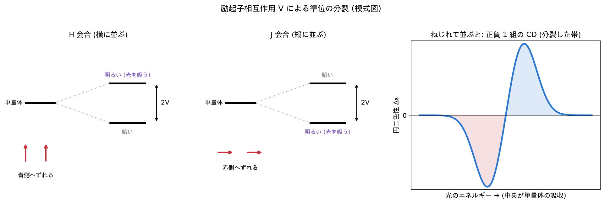

**図 8**　励起子相互作用による準位の分裂（模式図）。左と中央：遷移双極子（赤い矢印）の並び方で、どちらの準位が光を吸うかが変わります。右：ねじれて並ぶと、単量体の吸収の位置を境に、正と負の CD の帯が 1 組現れます。どちらが正になるかは、ねじれの向きで決まります。

### 4.2 代表的な研究例

- **TDFI 法による CD**：Fujimoto（2010）は、TDFI 法を励起子結合の CD のスペクトルの計算に拡張し、レチナールのシッフ塩基の 2 量体に応用しました。点双極子近似や、静電ポテンシャルから求めた遷移電荷（TrESP）の方法と比べて、電子的な結合をよりよく表せることを示しました [Fujimoto 2010]。
- **ナトリウムポンプ型ロドプシン KR2**：網膜タンパク質が多量体をつくると、ふつうは負と正の 2 つの CD の帯が現れます。しかし KR2 の 5 量体では、正の帯が 1 つだけ見えます。Fujimoto と Inoue（2020）は、励起子モデルと TDFI 法で KR2 の吸収と CD を再現し、レチナールどうしの弱い励起子結合が、この CD の形を決めていることを示しました [Fujimoto 2020]。
- **チャネルロドプシンとヘリオロドプシン**：構造が似ているのに、チャネルロドプシンの 2 量体は負と正の 2 つの帯、ヘリオロドプシンの 2 量体は正の帯 1 つを示します。Fujimoto らは（2024）、励起子相互作用の符号が両者で逆であり、その原因が 2 つのレチナールの向きの違い（配向因子の第 2 項）にあることを示しました。色素の向きのわずかな違いが、CD の形を大きく変えるという結論です [Fujimoto 2024c]。

### 4.3 この界隈の常識

- 分裂した CD の符号（正が先か負が先か）は、2 つの色素のねじれの向き（右ねじか左ねじか）を表します。天然物の絶対配置の決定にも使われます。
- CD の形は、励起子相互作用の大きさだけでなく、色素の向きと、もともとの励起エネルギーの違いの両方で決まります。

## 5. 無輻射失活・項間交差・円錐交差

### 5.1 何をする研究か

励起状態の分子が光を出さずに基底状態へ戻る過程を、**無輻射失活**と呼びます。
蛍光の明るい分子をつくるには、無輻射失活を抑える必要があります。
逆に、光反応や、光から熱への変換（光から身を守る仕組みなど）には、速い無輻射失活が必要です。

無輻射失活の主な道は 2 つです。

- **内部転換**（同じスピンの状態の間）：S₁ と S₀ の曲面が交わる点、**円錐交差**を通ると、非常に速く S₀ に落ちます。
- **項間交差**（違うスピンの状態の間）：S₁ から T₁ へ移り、T₁ から光を出さずに S₀ へ戻ります。

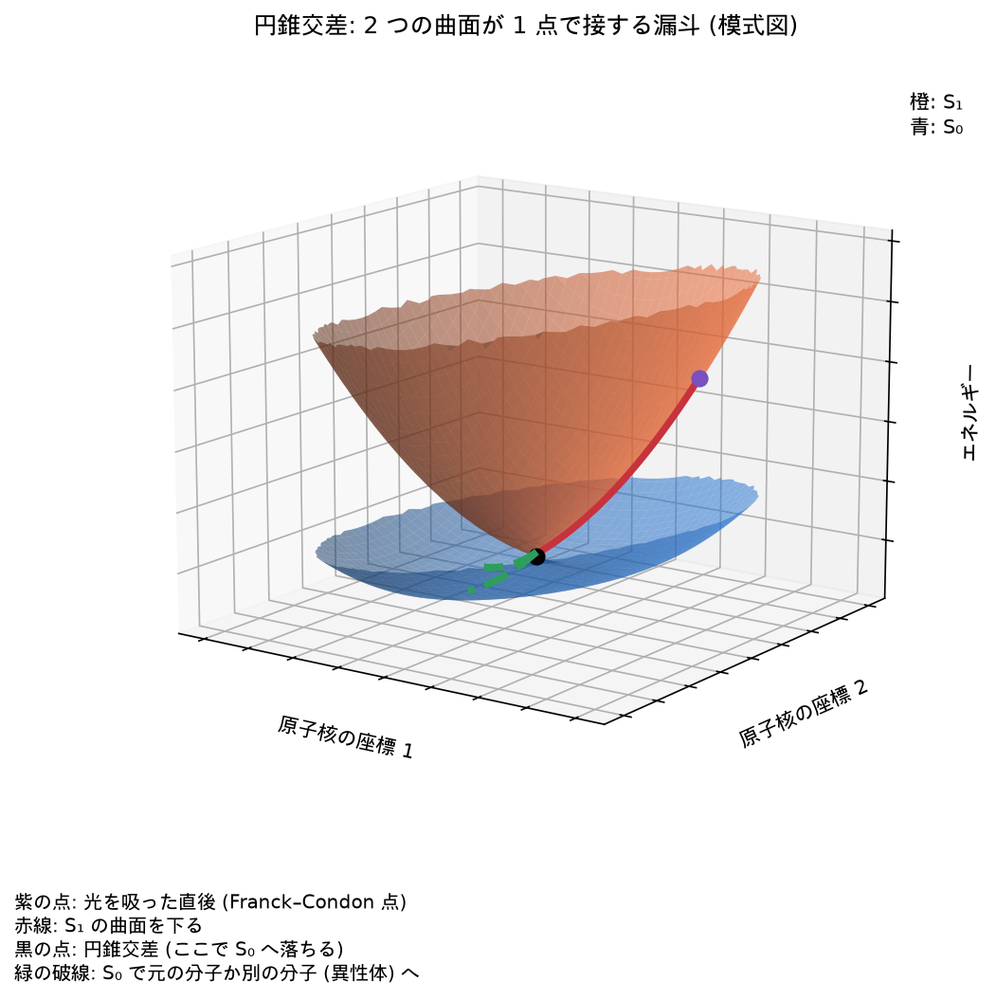

**図 9**　円錐交差の 3D 模式図。光を吸った直後の構造（紫の点）から、分子は S₁ の曲面（橙）を下り（赤線）、2 つの曲面が 1 点で接する円錐交差（黒の点）に着きます。そこから S₀（青）へ落ち、元の分子に戻るか、別の分子（異性体）になります（緑の破線）。円錐交差は、励起状態から基底状態への「漏斗」の役割をします。

円錐交差の理論は、[講義ノート第 22 回](../courses/qc-theory/22-conical-intersections.md)で詳しく説明しています。
光によるシス–トランス異性化は、円錐交差を通る代表的な反応です [Levine 2007]。
視物質ロドプシンの中のレチナールの異性化（視覚の最初の段階）は、フェムト秒（1 fs = 10⁻¹⁵ 秒）の時間で進む、非常に速い反応です。
Polli らは（2010）、非常に短い時間分解能の分光で、この反応が円錐交差を通る様子を捉えました [Polli 2010]。

項間交差の速さは、スピン軌道相互作用の大きさで決まります。
**El-Sayed の規則**によると、軌道の性格が違う状態の間（たとえば nπ* と ππ*）では、スピン軌道相互作用が大きく、項間交差が速くなります [El-Sayed 1963]。
近年は、分子の振動によってスピン軌道相互作用が変わる効果や、振動を介した状態の混ざり（スピン振電機構）が重要なことが分かってきました [Penfold 2018]。

### 5.2 よく使う方法

- **円錐交差の構造**：円錐交差の付近では、TDDFT（ふつうの線形応答）は S₁/S₀ の交差を正しく表せません。CASSCF、CASPT2、スピン反転 TDDFT、MRSF-TDDFT などを使います（[講義ノート第 12 回](../courses/qc-theory/12-casscf.md)、[第 20 回](../courses/qc-theory/20-spin-flip-tddft.md)、[第 21 回](../courses/qc-theory/21-mrsf-tddft.md)）。
- **速度定数**：Fermi の黄金律と振動の相関関数を使う方法（振動の量子効果を含めて、無輻射失活や項間交差の速度定数を求める）や、表面ホッピングなどの非断熱の分子動力学を使います。

### 5.3 代表的な研究例

- **シレピン誘導体**：Inai, Yokogawa, Yanai（2021）は、多参照の 2 次摂動論を使い、シレピン誘導体の S₁ から円錐交差に達するまでの活性化エネルギーを計算しました。計算した活性化エネルギーと、実験の蛍光量子収率の相関から、中央の C–C 結合のねじれで円錐交差に至る経路で無輻射失活することが示唆されました。多参照摂動論で遷移状態の構造を最適化すると、活性化エネルギーの見積もりが大きく下がることも分かりました [Inai 2021]。
- **リンで橋かけしたスチルベン**：Inai, Yamaguchi, Yanai（2023）は、リンを含む 4 種類の色素の輻射と無輻射の速度定数を計算しました。リンを酸化すると三重項が相対的に不安定になって項間交差が抑えられ、実験の蛍光量子収率の 0.07 から 0.98 への増加を、0.23 から 0.94 への増加として再現しました [Inai 2023]。
- **スピン軌道相互作用の解析的な微分（PyGraSO）**：Hagai, Fujimoto, Yanai（2025）は、TDDFT の枠組みで、スピン軌道相互作用の行列要素とその原子核の座標についての微分を解析的に計算するプログラム PyGraSO を公開しました。数値微分と比べて最大 36 倍速くなりました。126 個の TADF 分子の逆項間交差の速度定数を計算し、スピン振電結合を含めると実験との一致がよくなることを示しました [Hagai 2025]。

### 5.4 この界隈の常識

- 蛍光量子収率の予測は、速度定数の比を出すことです。輻射の速度定数は比較的よく計算できますが、無輻射の速度定数の計算は今も難しい課題です。
- 円錐交差の付近を扱うときは、方法の選び方に注意が必要です。ふつうの TDDFT で S₁/S₀ の交差を最適化した結果は、信用できないことがあります。
- 重い原子（Br、I、金属）を含む分子では、スピン軌道相互作用が大きく、項間交差が速くなります（重原子効果）。

## 6. 発光材料：TADF と逆項間交差

### 6.1 何をする研究か

有機 EL（OLED）では、電気で分子を励起します。
このとき、スピンの組み合わせの統計から、一重項の励起子が 25%、三重項の励起子が 75% できます。
ふつうの蛍光材料は一重項からしか光を出せないので、残りの 75% のエネルギーが無駄になります。

**熱活性化遅延蛍光**（thermally activated delayed fluorescence, TADF）の材料は、S₁ と T₁ のエネルギー差 ΔE_ST を小さくした分子です。
三重項の励起子が、熱のエネルギーを借りて一重項へ戻り（**逆項間交差**、reverse intersystem crossing, RISC）、蛍光として光を出します（図 10）。
Uoyama, Adachi らは（2012）、金属を含まない TADF 材料で、りん光材料に匹敵する、外部量子効率 19% を超える有機 EL を報告しました [Uoyama 2012]。

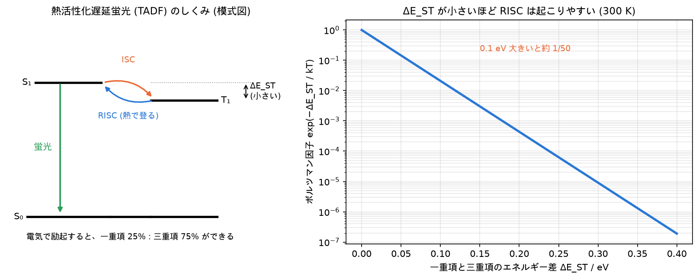

**図 10**　TADF のしくみ（左、模式図）と、ΔE_ST によるボルツマン因子の変化（右、300 K）。右の図は、逆項間交差の速さが、ΔE_ST を越える熱の確率に比例すると考えた単純な見積もりです。ΔE_ST が 0.1 eV 大きくなると、ボルツマン因子は約 1/50 になります。実際の速度は、スピン軌道相互作用と振動の効果にも左右されます。

ΔE_ST を小さくするには、HOMO と LUMO を分子の別々の場所に分けるのが基本の設計です。
Hatakeyama らは（2016）、ホウ素と窒素の多重共鳴効果で HOMO と LUMO を原子ごとに交互に分ける**多重共鳴型（MR）TADF** を開発しました。
467 nm の深い青の発光で、半値全幅 28 nm という鋭い発光と、約 100% の内部量子効率を報告しています [Hatakeyama 2016]。

### 6.2 代表的な研究例

- **逆項間交差の理論の拡張**：Hagai, Inai, Yasuda, Fujimoto, Yanai（2024）は、MR-TADF 分子の逆項間交差を、摂動論による励起状態のダイナミクスの枠組みで調べました。非断熱のスピン振電結合と、振動で生じるスピン軌道相互作用の協奏的な効果が、速度定数を決めるのに重要であることを示しました。実験の Arrhenius プロットから ΔE_ST を見積もる方法も提案し、121 個の MR-TADF 分子で、Marcus 理論の近似が誤った振る舞いを示す原因を明らかにしました [Hagai 2024]。
- **機械学習による青色 TADF 材料の発見**：Hagai らは（2026）、カルバゾールを含む 13 環の多環芳香族化合物 19,518 個を列挙し、約 1,000 個について発光エネルギーと ΔE_ST を量子化学計算で求めました。グラフニューラルネットワークでライブラリ全体を予測したところ、発光エネルギーと ΔE_ST の間に負の相関（R = −0.75）が見つかり、純粋な青の領域に ΔE_ST の小さい候補が多いことが分かりました。ホウ素を含まない 2 つの分子を合成し、半値全幅 17〜19 nm の深い青の発光と、実験の ΔE_ST 0.13〜0.19 eV を確かめました。増感した素子では、最大外部量子効率 35.2% を得ています [Hagai 2026]。

### 6.3 この界隈の常識

- TADF の設計の基本は、ΔE_ST を小さく、かつ S₁ からの蛍光を強く保つことです。HOMO と LUMO を離しすぎると蛍光が弱くなるので、両立が課題です。
- 逆項間交差の速さは ΔE_ST だけでは決まらず、スピン軌道相互作用、高い三重項（T₂ など）の関与、振動の効果が効きます [Penfold 2018; Hagai 2024]。
- 発光材料では、色の純度（発光スペクトルの幅）も重要です。多重共鳴型の骨格は、幅の狭い発光で知られています。

## 7. 一重項分裂

### 7.1 何をする研究か

**一重項分裂**（singlet fission）は、1 つの一重項励起子が、2 つの三重項励起子に分かれる現象です [Smith 2010]。
光子 1 個から励起子 2 個ができるので、太陽電池の効率の上限を超える可能性があり、注目されています。
エネルギーの面では、S₁ のエネルギーが T₁ の 2 倍と同じか、それより大きいことが目安です（図 11）。
テトラセン、ペンタセン、ルブレンなどの結晶で調べられてきました。

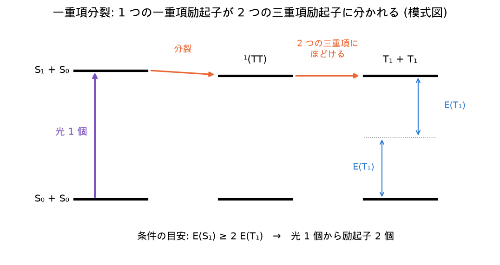

**図 11**　一重項分裂の準位図（模式図）。光で生じた S₁ は、まず 2 つの三重項が組になった一重項の状態 ¹(TT) になり、それが 2 つの独立した三重項 T₁ + T₁ にほどけます。E(S₁) ≥ 2E(T₁) であれば、エネルギーの上で起こりえます。

### 7.2 代表的な研究例

Miyata, Kurashige, Yanai らは（2017）、ルブレンの結晶の一重項分裂を、超高速の分光と量子化学計算で調べました。
熱で活性化されるふつうの経路に加えて、速いコヒーレントな経路があることを示しました。
この経路が開くのは、一重項分裂の円錐交差が、基底状態の平衡構造のすぐ近くにあるためと、分子間の対称性を破る振動が励起されて、分裂に必要な電子的な結合が生じるためです [Miyata 2017]。

### 7.3 この界隈の常識

- 一重項分裂の中間体 ¹(TT) は、2 つの三重項がスピンで結びついた状態で、1 つの電子配置では書けない多参照の状態です。CASSCF や DMRG などの多参照法が使われます。
- 分子の並び方（結晶の中の重なり方）で、電子的な結合の大きさが大きく変わります。対称性のために、平衡の構造で結合が消えることもあります。

## この分野でよく出てくる言葉

| 言葉 | 意味 |
|---|---|
| S₀、S₁、T₁ | 一重項の基底状態、最低の一重項励起状態、最低の三重項状態 |
| 垂直励起エネルギー | 基底状態の構造のまま励起したときのエネルギー差 |
| 振動子強度 | 吸収の強さを表す無次元の量 |
| 遷移双極子モーメント | 光を吸うときの電荷の揺れの大きさと向き |
| 遷移密度 | 励起によって電子の分布がどう変わるかを表す量 |
| 内部転換（IC） | 同じスピンの状態の間の、光を出さない移り変わり |
| 項間交差（ISC）、逆項間交差（RISC） | 一重項から三重項へ、三重項から一重項への移り変わり |
| スピン軌道相互作用（SOC） | 項間交差を起こす相互作用。重い原子で大きい |
| 円錐交差 | 2 つの電子状態の曲面が 1 点で接する構造。速い無輻射失活の漏斗 |
| 蛍光量子収率 | 吸収した光子のうち、蛍光として出る光子の割合 |
| 色の調節 | 環境によって、同じ色素の吸収の波長が変わること |
| 励起エネルギー移動（EET）、FRET | 励起状態のエネルギーが分子から分子へ移ること |
| Förster 半径 R₀ | エネルギー移動の効率が 50% になる距離 |
| 配向因子 κ² | 遷移双極子の向きで決まる、エネルギー移動の強さの因子 |
| 励起子 | 多くの色素に広がった励起状態 |
| 円二色性（CD） | 左右の円偏光の吸収の差 |
| TADF | 熱活性化遅延蛍光。三重項を逆項間交差で一重項に戻して光らせる |
| 一重項分裂 | 1 つの一重項励起子が 2 つの三重項励起子に分かれる現象 |
| QM/MM | 色素を量子力学で、まわりを古典力場で扱う方法 |

## この分野の常識：まとめ

- 光を吸った分子は、ふつう最低の励起状態（S₁、T₁）まで速く下りてから光を出します（Kasha の規則）。
- 蛍光量子収率は、蛍光の速さと、ほかの失活の速さの比べ合いで決まります。
- 吸収の計算値（垂直励起エネルギー）と実験の吸収極大は、振電構造の分だけずれることがあります。
- TDDFT は便利ですが、電荷移動の励起、二電子励起、円錐交差の付近は苦手です。
- タンパク質の中の色は、主にまわりの電荷がつくる電場で調節されます。構造とプロトン化状態の精度が大切です。
- FRET の効率は距離の 6 乗で変わります。κ² = 2/3 は仮定であり、外れることがあります。
- 色素が近いときは点双極子近似が破れます。遷移密度の形を考えた方法を使います。
- ねじれて並んだ色素の対は、正と負の 1 組の CD を示します。
- 円錐交差は、光反応と無輻射失活の漏斗です。扱うには多参照法やスピン反転型の方法が必要です。
- TADF の鍵は ΔE_ST を小さくすることですが、逆項間交差の速さには、スピン軌道相互作用と振動も効きます。

## 最初に読むとよい文献

- A. Dreuw, M. Head-Gordon, "Single-Reference ab Initio Methods for the Calculation of Excited States of Large Molecules"（2005）：TDDFT などの励起状態の方法の総説です [Dreuw 2005]。
- G. D. Scholes, G. R. Fleming, A. Olaya-Castro, R. van Grondelle, "Lessons from nature about solar light harvesting"（2011）：光合成のアンテナとエネルギー移動の総説です [Scholes 2011]。
- C. Curutchet, B. Mennucci, "Quantum Chemical Studies of Light Harvesting"（2016）：光合成の色素の量子化学計算の総説です [Curutchet 2016]。
- K. J. Fujimoto, "Electronic Couplings and Electrostatic Interactions Behind the Light Absorption of Retinal Proteins"（2021）：ロドプシン類の吸収と CD の計算の総説です [Fujimoto 2021a]。
- T. J. Penfold, E. Gindensperger, C. Daniel, C. M. Marian, "Spin-Vibronic Mechanism for Intersystem Crossing"（2018）：項間交差の理論の総説です [Penfold 2018]。
- M. B. Smith, J. Michl, "Singlet Fission"（2010）：一重項分裂の総説です [Smith 2010]。

## 講義ノートとの関係

- 励起状態の計算方法：[量子化学の理論 第 19 回](../courses/qc-theory/19-tddft.md)（TDDFT）、[第 23 回](../courses/qc-theory/23-excited-wavefunction.md)（EOM-CCSD、CC2、ADC(2)）
- 円錐交差を扱える方法：[量子化学の理論 第 20 回](../courses/qc-theory/20-spin-flip-tddft.md)（スピン反転 TDDFT）、[第 21 回](../courses/qc-theory/21-mrsf-tddft.md)（MRSF-TDDFT）、[第 22 回](../courses/qc-theory/22-conical-intersections.md)（円錐交差と非断熱過程）
- 多参照法：[量子化学の理論 第 12 回](../courses/qc-theory/12-casscf.md)（CASSCF）、[第 13 回](../courses/qc-theory/13-caspt2-nevpt2.md)（CASPT2、NEVPT2）、[第 14 回](../courses/qc-theory/14-dmrg-sci.md)（DMRG）
- 一重項と三重項：[量子化学の理論 第 4 回](../courses/qc-theory/04-spin.md)（スピン）
- 汎関数の選び方（範囲分離型）：[量子化学の理論 第 16 回](../courses/qc-theory/16-functionals.md)

## 参考文献

- M. Kasha, "Characterization of electronic transitions in complex molecules", Discuss. Faraday Soc. 9, 14 (1950). DOI: [10.1039/DF9500900014](https://doi.org/10.1039/DF9500900014)
- A. Dreuw, M. Head-Gordon, "Single-Reference ab Initio Methods for the Calculation of Excited States of Large Molecules", Chem. Rev. 105, 4009 (2005). DOI: [10.1021/cr0505627](https://doi.org/10.1021/cr0505627)
- S. Sendo, K. J. Fujimoto, T. Miyashita, S. Saito, T. Yanai, "Assessment of the time correlation function-based approach for absorption spectrum calculations using time-dependent density functional theory and molecular dynamics simulations", J. Chem. Phys. 163, 134116 (2025). DOI: [10.1063/5.0281605](https://doi.org/10.1063/5.0281605)
- O. P. Ernst, D. T. Lodowski, M. Elstner, P. Hegemann, L. S. Brown, H. Kandori, "Microbial and Animal Rhodopsins: Structures, Functions, and Molecular Mechanisms", Chem. Rev. 114, 126 (2013). DOI: [10.1021/cr4003769](https://doi.org/10.1021/cr4003769)
- J. Hasegawa, K. J. Fujimoto, H. Nakatsuji, "Color Tuning in Photofunctional Proteins", ChemPhysChem 12, 3106 (2011). DOI: [10.1002/cphc.201100452](https://doi.org/10.1002/cphc.201100452)
- K. J. Fujimoto, "Electronic Couplings and Electrostatic Interactions Behind the Light Absorption of Retinal Proteins", Front. Mol. Biosci. 8, 752700 (2021). DOI: [10.3389/fmolb.2021.752700](https://doi.org/10.3389/fmolb.2021.752700)
- K. J. Fujimoto, F. Minowa, M. Nishina, S. Nakamura, S. Ohashi, K. Katayama, H. Kandori, T. Yanai, "Molecular Mechanism of Spectral Tuning by Chloride Binding in Monkey Green Sensitive Visual Pigment", J. Phys. Chem. Lett. 14, 1784 (2023). DOI: [10.1021/acs.jpclett.2c03619](https://doi.org/10.1021/acs.jpclett.2c03619)
- G. D. Scholes, G. R. Fleming, A. Olaya-Castro, R. van Grondelle, "Lessons from nature about solar light harvesting", Nat. Chem. 3, 763 (2011). DOI: [10.1038/nchem.1145](https://doi.org/10.1038/nchem.1145)
- T. Förster, "Zwischenmolekulare Energiewanderung und Fluoreszenz", Ann. Phys. 437, 55 (1948). DOI: [10.1002/andp.19484370105](https://doi.org/10.1002/andp.19484370105)
- K. J. Fujimoto, T. Miyashita, T. Dewa, T. Yanai, "Determination of FRET orientation factor between artificial fluorophore and photosynthetic light-harvesting 2 complex (LH2)", Sci. Rep. 12, 15091 (2022). DOI: [10.1038/s41598-022-19375-2](https://doi.org/10.1038/s41598-022-19375-2)
- B. P. Krueger, G. D. Scholes, G. R. Fleming, "Calculation of Couplings and Energy-Transfer Pathways between the Pigments of LH2 by the ab Initio Transition Density Cube Method", J. Phys. Chem. B 102, 5378 (1998). DOI: [10.1021/jp9811171](https://doi.org/10.1021/jp9811171)
- K. J. Fujimoto, S. Hayashi, "Electronic Coulombic Coupling of Excitation-Energy Transfer in Xanthorhodopsin", J. Am. Chem. Soc. 131, 14152 (2009). DOI: [10.1021/ja905697n](https://doi.org/10.1021/ja905697n)
- K. J. Fujimoto, "Transition-density-fragment interaction combined with transfer integral approach for excitation-energy transfer via charge-transfer states", J. Chem. Phys. 137, 034101 (2012). DOI: [10.1063/1.4733669](https://doi.org/10.1063/1.4733669)
- K. J. Fujimoto, T. Minoda, T. Yanai, "Spectral Tuning Mechanism of Photosynthetic Light-Harvesting Complex II Revealed by Ab Initio Dimer Exciton Model", J. Phys. Chem. B 125, 10459 (2021). DOI: [10.1021/acs.jpcb.1c04457](https://doi.org/10.1021/acs.jpcb.1c04457)
- K. J. Fujimoto, R. Tsuji, Z.-Y. Wang-Otomo, T. Yanai, "Prominent Role of Charge Transfer in the Spectral Tuning of Photosynthetic Light-Harvesting I Complex", ACS Phys. Chem. Au 4, 499 (2024). DOI: [10.1021/acsphyschemau.4c00022](https://doi.org/10.1021/acsphyschemau.4c00022)
- K. J. Fujimoto, T. Seki, T. Minoda, T. Yanai, "Spectral Tuning and Excitation-Energy Transfer by Unique Carotenoids in Diatom Light-Harvesting Antenna", J. Am. Chem. Soc. 146, 3984 (2024). DOI: [10.1021/jacs.3c12045](https://doi.org/10.1021/jacs.3c12045)
- K. J. Fujimoto, R. Tsuji, Z.-Y. Wang-Otomo, T. Yanai, "Ca2+-Driven Protein Compaction Tunes NIR Absorption in the Thermophilic Purple Bacterial LH1", J. Phys. Chem. Lett. 17, 4173 (2026). DOI: [10.1021/acs.jpclett.6c00317](https://doi.org/10.1021/acs.jpclett.6c00317)
- K. J. Fujimoto, Y. A. Tsuzuki, M. Konno, T. Nagata, R. Murakami, K. Inoue, T. Yanai, "Protonation-Enhanced Energy Transfer in Xanthorhodopsin Kin4B8", J. Phys. Chem. Lett. 16, 11884 (2025). DOI: [10.1021/acs.jpclett.5c02898](https://doi.org/10.1021/acs.jpclett.5c02898)
- T. Matsuo, K. Ito-Miwa, Y. Hoshino, Y. I. Fujii, S. Kanno, K. J. Fujimoto, R. Tsuji, S. Takeda, C. Onami, C. Arai, Y. Yoshiyama, Y. Mino, Y. Kato, T. Yanai, Y. Fujita, S. Masuda, T. Kakegawa, H. Miyashita, "Archaean green-light environments drove the evolution of cyanobacteria's light-harvesting system", Nat. Ecol. Evol. 9, 599 (2025). DOI: [10.1038/s41559-025-02637-3](https://doi.org/10.1038/s41559-025-02637-3)
- C. Curutchet, B. Mennucci, "Quantum Chemical Studies of Light Harvesting", Chem. Rev. 117, 294 (2016). DOI: [10.1021/acs.chemrev.5b00700](https://doi.org/10.1021/acs.chemrev.5b00700)
- M. Kasha, H. R. Rawls, M. Ashraf El-Bayoumi, "The exciton model in molecular spectroscopy", Pure Appl. Chem. 11, 371 (1965). DOI: [10.1351/pac196511030371](https://doi.org/10.1351/pac196511030371)
- K. J. Fujimoto, "Transition-density-fragment interaction approach for exciton-coupled circular dichroism spectra", J. Chem. Phys. 133, 124101 (2010). DOI: [10.1063/1.3480015](https://doi.org/10.1063/1.3480015)
- K. J. Fujimoto, K. Inoue, "Excitonic coupling effect on the circular dichroism spectrum of sodium-pumping rhodopsin KR2", J. Chem. Phys. 153, 045101 (2020). DOI: [10.1063/5.0013642](https://doi.org/10.1063/5.0013642)
- K. J. Fujimoto, Y. Tsuzuki, K. Inoue, T. Yanai, "Molecular Mechanisms behind Circular Dichroism Spectral Variations between Channelrhodopsin and Heliorhodopsin Dimers", J. Phys. Chem. Lett. 15, 5788 (2024). DOI: [10.1021/acs.jpclett.4c00879](https://doi.org/10.1021/acs.jpclett.4c00879)
- B. G. Levine, T. J. Martínez, "Isomerization Through Conical Intersections", Annu. Rev. Phys. Chem. 58, 613 (2007). DOI: [10.1146/annurev.physchem.57.032905.104612](https://doi.org/10.1146/annurev.physchem.57.032905.104612)
- D. Polli, P. Altoè, O. Weingart, K. M. Spillane, C. Manzoni, D. Brida, G. Tomasello, G. Orlandi, P. Kukura, R. A. Mathies, M. Garavelli, G. Cerullo, "Conical intersection dynamics of the primary photoisomerization event in vision", Nature 467, 440 (2010). DOI: [10.1038/nature09346](https://doi.org/10.1038/nature09346)
- M. A. El-Sayed, "Spin—Orbit Coupling and the Radiationless Processes in Nitrogen Heterocyclics", J. Chem. Phys. 38, 2834 (1963). DOI: [10.1063/1.1733610](https://doi.org/10.1063/1.1733610)
- T. J. Penfold, E. Gindensperger, C. Daniel, C. M. Marian, "Spin-Vibronic Mechanism for Intersystem Crossing", Chem. Rev. 118, 6975 (2018). DOI: [10.1021/acs.chemrev.7b00617](https://doi.org/10.1021/acs.chemrev.7b00617)
- N. Inai, D. Yokogawa, T. Yanai, "Investigating the Nonradiative Decay Pathway in the Excited State of Silepin Derivatives: A Study with Second-Order Multireference Perturbation Wavefunction Theory", J. Phys. Chem. A 125, 559 (2021). DOI: [10.1021/acs.jpca.0c08738](https://doi.org/10.1021/acs.jpca.0c08738)
- N. Inai, S. Yamaguchi, T. Yanai, "Theoretical Insight into the Effect of Phosphorus Oxygenation on Nonradiative Decays: Comparative Analysis of P-Bridged Stilbene Analogs", ACS Phys. Chem. Au 3, 540 (2023). DOI: [10.1021/acsphyschemau.3c00038](https://doi.org/10.1021/acsphyschemau.3c00038)
- M. Hagai, K. J. Fujimoto, T. Yanai, "PyGraSO: Analytical Nuclear Derivatives of Spin–Orbit Coupling for Intersystem Crossing Dynamics Simulations", J. Chem. Theory Comput. 21, 11604 (2025). DOI: [10.1021/acs.jctc.5c01442](https://doi.org/10.1021/acs.jctc.5c01442)
- H. Uoyama, K. Goushi, K. Shizu, H. Nomura, C. Adachi, "Highly efficient organic light-emitting diodes from delayed fluorescence", Nature 492, 234 (2012). DOI: [10.1038/nature11687](https://doi.org/10.1038/nature11687)
- T. Hatakeyama, K. Shiren, K. Nakajima, S. Nomura, S. Nakatsuka, K. Kinoshita, J. Ni, Y. Ono, T. Ikuta, "Ultrapure Blue Thermally Activated Delayed Fluorescence Molecules: Efficient HOMO–LUMO Separation by the Multiple Resonance Effect", Adv. Mater. 28, 2777 (2016). DOI: [10.1002/adma.201505491](https://doi.org/10.1002/adma.201505491)
- M. Hagai, N. Inai, T. Yasuda, K. J. Fujimoto, T. Yanai, "Extended theoretical modeling of reverse intersystem crossing for thermally activated delayed fluorescence materials", Sci. Adv. 10, eadk3219 (2024). DOI: [10.1126/sciadv.adk3219](https://doi.org/10.1126/sciadv.adk3219)
- M. Hagai, J. Sun, J. Lee, K. J. Fujimoto, S. Yamaguchi, T. Yasuda, T. Yanai, "Machine-Learning-Guided Discovery of Boron-Free Narrowband Blue Thermally Activated Delayed Fluorescence Emitters", Angew. Chem. Int. Ed. 65, e2731055 (2026). DOI: [10.1002/anie.2731055](https://doi.org/10.1002/anie.2731055)
- M. B. Smith, J. Michl, "Singlet Fission", Chem. Rev. 110, 6891 (2010). DOI: [10.1021/cr1002613](https://doi.org/10.1021/cr1002613)
- K. Miyata, Y. Kurashige, K. Watanabe, T. Sugimoto, S. Takahashi, S. Tanaka, J. Takeya, T. Yanai, Y. Matsumoto, "Coherent singlet fission activated by symmetry breaking", Nat. Chem. 9, 983 (2017). DOI: [10.1038/nchem.2784](https://doi.org/10.1038/nchem.2784)
